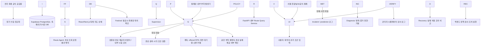
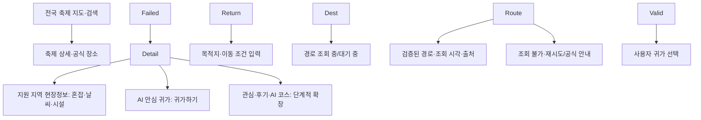
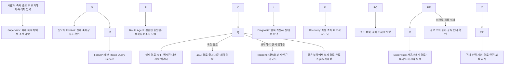
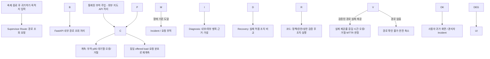

# 놀다가 (NOLDAGA)

## AI 안심 귀가 특화형 전국 축제 플랫폼

### 축제의 시작부터 마지막 귀갓길까지 연결하는 AI 서비스

**서비스 기획 및 요구사항 명세서  | API·DB 설계서  범위 연계·Supabase PostgreSQL 확정·검증 상태 정합화 | 2026-11-18**

|항목|내용|
|-|-|
|서비스명 / 팀명|**놀다가(NOLDAGA) / 수다수다(6명)**|
|서비스 성격|**전국 축제 지도·검색·상세를 기본으로 하는 통합 플랫폼**. 행사 종료 후 **AI 안심 귀가**가 대표 차별화 기능|
|슬로건|**축제의 시작부터 마지막 귀갓길까지 연결하는 AI 서비스**|
|선택 교육 주제|**1번 — 멀티 에이전트 기반 장애 예측·자가 진단·자율 복구(Auto-Healing)**|
|대표 사용자 경험|**전국 축제 탐색 → 축제 상세·현장 안내 → 행사 종료 → 귀가 목적지 입력 → 경로 조회·정보 확인 → 귀가 판단**|
|대표 Auto-Healing|**축제 종료 시점 귀가 경로 조회 동시 요청 증가로 인한 '놀다가 내부 경로 조회 처리 지연'을 통제된 테스트에서 재현** → 진단·대안 평가·코드 실행 → **동일 부하에서 실제 경로 제공 회복 여부 검증**|
|기본 플랫폼 범위|공식 공급원에서 수집·검증한 전국 복수 축제 지도·검색·상세. 전국 모든 축제 완전 수집은 보장하지 않음|
|현장 혼잡도|서울시 지원 집계 지역에 한정, 축제와 **위치 매핑이 실제 검증된 경우**만 표시. 혼잡 API 장애는 **보조 시험**|
|AI 구성|**Supervisor / Festival / Route / Diagnosis / Recovery = 5개 에이전트**. 초도 귀가 시연은 Route·Diagnosis·Recovery가 핵심 협업|
|기술 기준|React/Next.js, FastAPI, LangGraph, **Supabase PostgreSQL(사용 확정)**, pgvector·Redis·Docker/AWS 등. **DB 제품 선정과 실제 구성·배포 완료는 구분**|
|검증 상태|**설계·팀 검토용 + 모의 내부 경로 처리 예비 실험 1회 수행**. 120건 동시 요청에서 반복 조건의 중복 조회 묶기 효과를 측정했으나, **실제 길찾기 API·실제 CPU 병목·자동 전환·LangGraph Auto-Healing·운영 성능은 미검증**. 실제 축제 트래픽·외부 API 장애 발생을 주장하지 않음|

> \*\* 최우선 방향:\*\* 놀다가를 '귀가 전용 서비스'로 축소하지 않는다. \*\*전국 축제 플랫폼은 핵심 기본 기능\*\*, \*\*AI 안심 귀가는 가장 중요한 차별화 기능\*\*이다. 다섯 에이전트 구조와 예매 보류, 기존 8개 장은 유지한다.
>
> \*\*대표 기술 시연 변경:\*\* 의 서울 \*\*혼잡도 API 500\*\*은 후속/보조 시험으로 내린다. 첫 장애 시연은 \*\*우리 서비스가 직접 제어할 수 있는 귀가 경로 조회 처리 구간\*\*의 지연·과부하로 전환한다. \*\*행사 인파 증가 ≠ 자동으로 앱 트래픽 증가\*\*이며, 동시 요청은 팀의 시험용 부하 생성기로 주입한다. 외부 지도·길찾기 API에는 무단 부하를 걸지 않는다.
>
> \*\*복구 성공의 의미:\*\* 요청 접수·대기열 등록·초당 처리량 수치만으로 성공이라 하지 않는다. \*\*사용자가 검증된 경로를 실제로 받을 때까지의 시간, 제한시간 내 완료율, 오류·거절율\*\*을 \*\*같은 제공 부하(offered load)\*\*에서 B0/B1/A1로 비교한다. 복구로 처리량을 낮추어 요청을 거절하면 그 요청은 경로 제공 성공으로 세지 않는다.
>
> \*\*데이터·안전 경계:\*\* 경로 공급원과 실제 시간·통제 연동은 \*\*확보·실호출 전\*\*이다. 실측 시험에 고정 경로 응답을 사용하면 \*\*시험용 모의 경로\*\*라고 표시하고 실시간 귀가 경로로 주장하지 않는다. 현재 통제·무정차·승강기 상태가 확인되지 않으면 안전·이용 가능성을 보장하지 않는다.
>
> \*\*오토힐링 5종 기록:\*\* `normal\_recovered / valid\_cache / alternate\_source / degraded / unresolved` 분류를 유지한다. 다만 이는 \*\*사용자에게 제공된 최종 결과\*\*로 기록하며 별도 `recovery\_action`(중복 요청 묶기·처리량 조정·대기열 관리 등)과 분리한다. 서비스 내부 병목이 풀려 유효한 새 경로를 다시 제공하는 경우 `normal\_recovered`, 적법·유효한 경로 캐시를 실제 제공하면 `valid\_cache`가 된다. 대기만 시킨 경우 정상 복구 아님.
>
> \*\*기존 기록 보존:\*\* 의 혼잡 API 대표 시연·서울 API 오류코드·갱신지연 예측 설명은 과거 기획 또는 \*\*보조 검증 설계\*\*로 보존하며  대표 기술 시연으로 해석하지 않는다. 로그인은 별도 기능 장을 두지 않고 권한 조건만 유지, 예매는 보류.
>
> \*\*업무 범위:\*\* 최신 WBS 111건(필수 103/선택 8)은 \*\*강사 피드백 보고값\*\*이며 본 문서에서 상세 행을 재확인하거나 변경하지 않았다. Must/Should/Could는 제품 요구사항 우선순위이고 WBS 필수/선택 집계와 다르다. 실제 진행·검토·제출 상태는 증빙이 있을 때만 완료로 표시한다.

> \*\* 예비 실험 결과(2026-11-17):\*\* 모의 FastAPI/ASGI 처리에서 120개 동시 요청·동시 처리 상한 8·모의 비동기 지연 120ms를 사용했다. 12개 동일 경로 키 반복 패턴에서 `baseline`의 p95 \*\*1,784.8ms\*\*가 `coalesce` 적용 시 \*\*271.9ms\*\*로 단축되고 내부 처리 횟수는 \*\*120→12회\*\*였다. 목적지가 모두 다른 120개 요청에서는 p95 \*\*1,796.5→1,828.8ms\*\*로 개선이 없었다. 이는 \*\*후보 기술의 모의 성능 실험\*\*이지 \*장애 자동 감지, 정책 자동 전환, AI 에이전트 복구, 실경로 제공\*이 아니다. 캐시 사전 적재 조건은 공정한 cold-start 비교에 해당하지 않는다. 자세한 수치는 3.9·8.4·8.6 참조.

> \*\* 확정(2026-11-18):\*\* 팀은 `03\_API\_설계문서.md` 의 \*\*A01\~A24 전체 API 목록을 놀다가 서비스의 설계·구현 대상 범위에 포함\*\*하기로 했다. 이는 \*\*모든 API가 구현됐거나 11/20까지 전부 구현되어야 한다는 뜻이 아니다\*\*. 해당 API 문서의 \*\*1차/최종/보조/후속\*\* 단계 구분과 이 기획안의 Must/Should/Could를 함께 유지한다. 향후 추가 기능은 변경 이력으로 관리한다.
>
> \*\*DB 플랫폼 확정:\*\* 운영 관계형 데이터베이스는 \*\*Supabase에서 제공하는 PostgreSQL\*\*을 사용한다. `pgvector` 사용 목표 및 Redis 캐시는 기존 범위에 포함된다. \*\*Supabase Auth 사용 여부는 별도 결정\*\*이며, DB/인증 구성·RLS·마이그레이션을 실제 적용한 상태는 아니다.
>
> \*\*연계 문서:\*\* `03\_API\_설계문서.md` (2026-11-17), `04\_DB\_스키마\_설계서.md` (2026-11-17). 두 문서 모두 \*\*작성된 초안이며 작성자 검토·실제 공급원 연동·DB 생성·공식 제출 완료를 의미하지 않음\*\*. 세부 API 스키마·DDL·권한 정책은 연계 문서에서 관리하고 기획안에서는 적용 범위·사용자 흐름·검증 상태를 관리한다.

### 문서 목차

1. [01. 프로젝트 개요](#01-프로젝트-개요)
2. [02. 문제 정의](#02-문제-정의)
3. [03. 핵심 시나리오](#03-핵심-시나리오)
4. [04. 요구사항 명세](#04-요구사항-명세)
5. [05. 서비스 아키텍처 · 기술 스택](#05-서비스-아키텍처--기술-스택)
6. [06. 에이전트 구성 · 협업 흐름](#06-에이전트-구성--협업-흐름)
7. [07. 일정 · 역할 분담](#07-일정--역할-분담)
8. [08. 리스크와 대응](#08-리스크와-대응)

\---

# 01\. 프로젝트 개요

### 1.1 서비스 소개

**놀다가**는 전국의 축제를 공식 데이터로 통합해 지도·검색·상세로 제공하고, 방문 준비·축제 현장 정보·종료 후 이동을 한 서비스에서 연결하는 **AI 안심 귀가 특화형 전국 축제 플랫폼**이다. 전국 축제 검색은 서비스를 구성하는 **핵심 기본 기능**이며 '부가 기능'으로 축소하지 않는다.

서비스의 \*\*대표 차별화 기능은 '축제 종료 후 AI 안심 귀가'\*\*이다. 사용자가 선택한 축제 장소를 출발점으로 목적지를 입력하면 Route Agent가 실제 연결된 경로 공급원의 후보와 출처·조회 시각·이동 조건을 안내한다. 동행자·교통약자 조건은 검증 가능한 경로 요소에 한해 반영하며, 현재 교통통제·무정차·접근성 상태가 연동·검증되지 않았다면 '확인 필요'로 표시한다. 여기서 '안심'은 실제 안전 보장이 아닌 **확인 가능한 정보와 불확실성을 구분하여 귀가 판단을 돕는 의미**다.

핵심 기술 시연은 **축제 종료 시점 경로 조회 요청 증가를 팀의 통제된 부하 시험으로 재현**하여, 자체 경로 조회 처리 지연을 감지하고 Diagnosis Agent가 병목 후보·영향을 분석하며 Recovery Agent가 **실제로 구현된 허용 조치**의 적합성을 평가하는 것이다. 백엔드는 조치 실행 후 **동일한 요청량에서 사용자가 유효한 경로를 받은 비율·시간**을 재측정한다. 내부 처리 지연과 외부 길찾기 공급원 장애를 혼동하지 않는다.

현장 혼잡·기상·시설·공식 통제 기능은 전·중·후 서비스를 지원하는 기능으로 유지한다. **서울시 지역 단위 혼잡 데이터**는 축제 장소와 집계 지역 매핑이 검증된 경우에만 연결하며 혼잡 API 500/stale/본문코드 감지·복구는 보조 기술 시험으로 보존한다.

### 1.2 비전·목표

**비전:** “축제의 시작부터 마지막 귀갓길까지, 필요한 정보를 신뢰할 수 있게.”

1. **전국 축제 플랫폼:** 여러 지역의 실제 축제 정보를 수집·정규화하여 지도·검색·상세로 제공한다.
2. **축제 전·중 연결:** 날씨·지역 혼잡·편의시설·공식 공지를 출처·유효 시각과 함께 안내한다(공급원 지원 범위에 한함).
3. **AI 안심 귀가:** 축제 종료 후 목적지·동행 조건에 맞는 **검증 가능한** 귀가 경로 후보를 설명하고, 미확인 사항을 명시한다.
4. **복원력 있는 귀가 조회:** 자체 경로 조회 서비스의 동시 요청 증가를 통제 시험으로 재현하고, 서비스 처리 성능·실제 경로 제공이 개선되는지 검증한다.
5. **멀티에이전트의 추가 가치 검증:** Route/Diagnosis/Recovery의 별도 판단·인계와 B0/B1/A1 동일 조건 비교를 통해 AI가 고정 규칙보다 추가로 기여하는지 측정한다.
6. **안전한 한계 준수:** 안전·통제·실시간 이동 가능 여부를 실제보다 과장하지 않고, 유효 경로가 없으면 조회 불가를 정확히 알린다.

### 1.3 핵심 가치와 차별화

|가치|제공 경험|검증 방법|
|-|-|-|
|**발견성**|전국 축제 지도·목록·필터로 여러 행사를 찾음|실제 수집 축제 수·지역 커버리지·지도/상세 연결|
|**AI 안심 귀가(차별화)**|행사 종료 후 목적지 입력·AI 경로 안내·선택 조건 설명|실제 경로 조회 완료·출처/시각·조건 미충족 안내|
|**서비스 신뢰성(핵심 기술)**|경로 조회가 몰려도 허용 조치로 처리 성능 회복 시도|같은 부하의 시간 내 경로 제공 비율·p95 지연·거절/오류·MTTR|
|현장 연계|지원 지역 혼잡·날씨·시설·공식 공지 확인|공급원·갱신시각·매핑 검증|
|정보 정확성|검증된 경로만 안내하고 미확인 통제를 구분|출처 없는 경로·통제 충돌·가짜 실시간 정보 표시 0건 지향|
|확장성|관심·후기·맞춤 코스 등 단계적 확장|승인된 기능별 실구현·사용성·데이터 적합성|

**포지셔닝:** 놀다가는 축제 전용 귀가 앱이 아니라 **축제 정보 플랫폼**이다. 경쟁 서비스의 기능 부재를 검증 없이 단정하지 않으며, '귀가 안내의 신뢰성'과 '진단·복구 과정의 검증 가능성'을 목표 차별점으로 설명한다.

### 1.4 서비스 범위와 경계

|구분|범위|
|-|-|
|전국 공통|API에서 수집 가능한 축제·행사 탐색, 지도 마커, 지역·기간·키워드 검색, 상세, 관심 목록, 후기(구현 우선순위 별도)|
|지원 지역별|해당 지역에서 실제 데이터 제공이 확인된 날씨, 주변 장소, 기본 길찾기|
|서울 지원 장소|서울시 실시간 인구데이터의 지역 단위 혼잡과 전망; 실제 장소 매핑이 있을 때만 표시|
|공식 통제·운행 변경|출처·적용 시간·구간을 확인한 정보만 안내. 자동 경로 반영 가능 범위는 실제 데이터 검증 후 확정|
|비지원·비대상|전국 모든 축제 완전 수집 보장, 축제 내부 부스·보행로별 실제 혼잡, 축제 방문객만 따로 계산한 현재 인원, 네이티브 앱, 개인 이동 추적|

### 1.5 한눈에 보는 서비스 정의

|항목|내용|
|-|-|
|문제|전국 축제 정보는 흩어져 있고, 대형 행사 종료 시 이용자는 경로·운행 변경을 따로 확인해야 한다. **이때 우리 귀가 조회 서비스가 지연되면 필요한 판단을 제때 하기 어렵다.**|
|사용자|전국 축제를 찾는 시민·관광객, 종료 후 귀가 이용자, 현장 방문객, 운영 관리자|
|해결 방식|전국 축제를 지도·검색으로 제공하고 **축제별 AI 안심 귀가 경로 조회**로 방문 전·중·후 경험을 연결. 지원 데이터의 출처·조회/관측 시각·불확실성 표시|
|대표 가치|**전국 축제 탐색 → 축제 상세·현장 안내 → 종료 후 목적지 입력 → AI 안심 귀가 경로 조회 → 귀가 판단**|
|대표 기술 시연|**동시 귀가 조회 부하 주입 → 내부 경로 조회 지연 감지 → Route·Diagnosis·Recovery 협업 → 코드 실행·검증 → 동일 부하에서 경로 제공 회복 여부 측정**|
|보조 기술 시험|서울시 혼잡 API 500 / 200+stale / 본문 결과 코드, 축제 수집 장애(원래 기획 보존)|
|경계|실제 축제 인파 ≠ 실제 놀다가 트래픽, 귀가 안전 보장 금지, 대기열 접수 ≠ 유효 경로 제공|

### 1.6 MVP 상위 5개 영역과 상세 7개 기능군

|상위 영역|상세 기능군|1차 및 최종 역할|
|-|-|-|
|① **전국 축제 데이터·지도 플랫폼**|A 수집·통합·관리 / B 지도·검색·상세|**플랫폼 기본 핵심**: 실제 여러 지역의 축제를 검색·선택. 귀가 기능의 `festival\_id`·장소 출처 제공|
|② 축제 현장정보|C 혼잡·날씨·공식 통제 / D 시설·상권|지원 지역의 데이터만 검증해 안내, 초도 부하 시연의 필수 병목 아님|
|③ **AI 안심 귀가·방문 지원**|E 귀가 경로·AI 개인화·가는 길 / F 관심·후기·코스|**차별화 핵심**: 축제장 출발·목적지 입력·실제 경로 조회·상태 안내를 초도 필수로 배치|
|④ **멀티에이전트 Auto-Healing**|G Route·Diagnosis·Recovery 판단 및 코드 실행·검증|**핵심 기술**: 동일 부하 조건의 내부 경로 조회 처리 장애·회복 측정|
|⑤ 운영·검증|A 수집·관리, G 부하 지표/Incident·정책·감사|사용자 귀가 화면과 운영자 장애·복구 타임라인 동시 제시|

**제품 최종 범위:** 기존 Must/Should/Could는 유지하되 첫 시연은 '축제 선택→귀가 조회→통제된 부하→검증된 자동 대응' 하나에 집중한다. 고급 경로 비교 5유형은 Should로 유지하며 모두 첫 시연에 넣지 않는다. **예매·자체 결제·예약 장애 대응은 계속 제외**한다.

### 1.7 우선순위·확정 수준

* `Must`는 **최종 MVP의 필수 목표**, `Should`는 팀 채택 조건부 추가 기능, `Could`는 추후 기능이다. **1차 시연 포함 여부는 별도 표**로 구분한다.
* **Q1:** 기본 가는 길·오는 길 Must, 고급 경로 비교 5유형은 Should. 이번 시연은 **기본 귀가 경로 요청·조회·실패 안내** 중심으로 우선 배치.
* **Q2:** AI 챗봇 Must 유지, 기본 귀가 요청은 자연어/화면에서 연결. 실제 조건 해석과 경로 검증은 분리한다.
* **Q3( 변경):** 대표 Auto-Healing은 **놀다가 내부 귀가 경로 조회 처리 지연·과부하**. 서울시 혼잡 API 장애는 보조 시험.
* **Q4:** 통합 찾기(Should), 리워드(Could)는 기존 후속 기능으로 보존한다.
* 주변 식당·카페·편의점 위치 및 공식 통제·혼잡은 기존 기능군에서 유지하되 첫 시연 필수 경로에서 제외한다. 고급 통제 반영·접근성 보장은 데이터 검증 시에만 구현한다.
* 실제 복구 방법 중 **동일 요청 묶기**는 2026-11-17 모의 반복 패턴에서 **성능 후보 효과 1회 확인**했다. 하지만 자동 전환·실경로 복구는 미실증이며, 짧은 유효 캐시·동시 처리량·대기열 조정도 운영 복구 효과 미검증 후보이다. 실제 병목·요청 분포를 추가 계측한 후 조치를 채택한다.
* 예매와 자체 결제·환불·예매 관련 Auto-Healing은 이번 범위에서 **보류**한다.
* ** 결정:** 기존 기획안의 전국 축제·현장·AI 귀가·챗봇·RAG·관심/후기·운영 등 **전체 기능 범위를 유지**한다. `03\_API\_설계문서.md`의 A01\~A24 전체를 설계·구현 대상 API 범위에 포함하되, **1차/최종/보조/후속 단계는 그대로 유지**한다. 이 선택은 해당 API의 외부 데이터 확보·구현·배포 완료를 뜻하지 않는다.

### 1.8 프로젝트 팀 및 기획 범위

**팀 구성(기존 주/보조 역할 유지):** 정예진(PM·기획/프론트), 한다영(에이전트/QA), 권오현(백엔드/에이전트), 한태경(QA/인프라), 이수언(프론트엔드/PM), 신유빈(인프라/백엔드).

**주요 산출물:** 실제 전국 축제 여러 건의 지도·상세 웹, AI 귀가 경로 요청·결과·조회 중/대기/실패 화면, 경로 조회 내부 처리 구간 및 통제된 부하 생성기, Diagnosis·Recovery 간 인계 trace, 코드 정책 실행/효과 재측정, 관리자 운영 화면.

**역할 경계:** 경로 후보 생성·실제 길찾기 공급원은 검증 단계별로 제공/미제공을 구분한다. 첫 부하 시험에서 내부 모의 경로 엔진을 사용한 경우 **실제 운영 경로 품질까지 검증했다고 주장하지 않는다**. 공식 안전·교통통제를 대체하지 않는다.

### 1.9 기대효과 및 측정 가설

|기대효과(가설)|실측할 지표|
|-|-|
|전국 축제 탐색의 편의|수집된 축제 수·지역 커버리지, 지도→상세 전환 성공률|
|행사 종료 후 귀가 안내의 유용성|목적지 입력→경로 조회 완료율·소요시간, 사용자 사용성 검증|
|동시 조회 상황에서도 신뢰 가능한 정보 제공|**동일 제공 요청량**에서 시간 내 실제 경로 제공 비율, p50/p95 지연, 전체 오류·거절율, 대기열 길이|
|멀티에이전트 추가 가치|B0/B1/A1의 경로 제공 성공·MTTR·판단 정확도·지연·토큰/비용 차이|
|안전한 실패 안내|검증되지 않은 경로를 실제 이용 가능처럼 표시한 횟수, 상태/출처 표기 정확성|

현재는 모두 **측정 계획**이며 개선 수치·합격 임계값은 첫 기준 성능 시험 이후 정한다.

### 1.10 초도 시연·최종 구현·보류 범위의 구분 

**첫 시연의 사용자 질문:** “축제가 끝났어요. 지금 목적지까지 어떻게 돌아가면 좋을까요?” **사용자가 내릴 결정:** 출처·조회 시각과 확인된 제한조건을 보고 실제 귀가 경로를 선택할지, 재조회 또는 공식 교통 안내를 확인할지 판단한다.

|구분|목표와 범위|완료 판정 / 한계|
|-|-|-|
|**1차 시연 — 기본 축제 흐름**|전국 복수 축제 지도·검색·상세 → 축제 선택 → **귀가 출발점(축제 장소)·목적지 입력** → 경로 조회 결과·출처/조회 시각 또는 정직한 오류 표시|실제 축제 데이터/경로 데이터의 지원 범위와 **모의 자료를 분리**. 최초 정상 경로 조회가 성립해야 부하 복구를 시연|
|**1차 시연 — 대표 장애**|자체 **경로 조회 처리 계층**에 동시 요청 주입 → 지연·오류/대기열 관측 → Diagnosis/Recovery 판단 인계 → 백엔드 허용 조치 → **동일 부하 재측정**|실제 경로 응답 완료시간·기한 내 성공률·거절/오류율·대기열·MTTR, 사용자 UI와 운영 로그 일치. 사용자 경로 미제공 시 성공 아님|
|**최종 구현 목표**|기본 가는 길, 축제 현장정보, 공식 교통공지, AI 코스·챗봇, 지원 지역 혼잡, 시설, RAG·관심 등 기존 Must와 채택된 범위|API·통제·접근성 연동을 실제 검증해 제공. 경로 비교 5종은 Should 유지|
|**보조 Auto-Healing**|서울 혼잡 API 500/200+stale/본문 오류, 축제 목록 수집/에이전트 품질 오류|초도 귀가 부하 시험을 대체하지 않음. 원본 실호출과 모의 장애 구분|
|**이번 보류**|예매·결제, 전국 실시간 혼잡 보장, 개인 이동 추적, 검증 안 된 실시간 경로·무장애 보장|별도 팀 결정·공급원 검증 없이 필수 개발·시연으로 올리지 않음|

**플랫폼과 기술 시험의 관계:** 전국 행사 지도는 자체 기반 기능으로 유지한다. 실제 부하 시험은 **팀이 직접 제어하는 경로 처리 코드**에만 가하고, 외부 상용 지도 API를 부하 테스트 대상으로 삼지 않는다. 같은 경로 입력을 모의해 만든 응답은 '경로 처리 성능 실험'으로 표시하고 실제 이용 가능한 경로 서비스 통합 성공으로 계산하지 않는다.

** 근거 추가:** 모의 ASGI 처리 환경에서 **반복 요청 패턴의 `singleflight` 후보 효과**는 1회 측정되었다(3.9). 다만 장애 임계값 감지→자동 활성화→에이전트 판단→재검증의 연쇄 시험은 수행하지 않았다. 1차 시연 완료 판정은 **그 후속 통합 시험**을 통과해야 한다.

### 1.11 기획 기능과 최신 작업 범위의 대조 원칙 ( 유지)

* `Must/Should/Could`는 제품 요구사항 분류, WBS `필수/선택`은 작업별 진행률 집계 분류로 **서로 다르다**.
* 강사 피드백 보고값 **총 111개·필수 103개·선택 8개**는 현 문서에서 상세 행 대조를 완료한 수치가 아니다. 본 수정은 WBS 작업 수·담당·일정을 임의 변경하지 않는다.
* **귀가 조회 지연 시험이 핵심 기술 시연으로 변경되면서** 경로 조회 API·부하 생성·복구 검증 작업의 선행조건을 최신 WBS 담당자에게 전달하여 **범위 변경 영향**을 확인해야 한다.
* 후기·상권·고급 5경로·통합 찾기·트래픽 추가 대응 등 기존 선택 기능은 팀 채택 후 담당·기간·시험 범위를 정한다. 다만 대표 귀가 부하 시험에 필요한 **최소 성능 계측·통제된 과부하·복구 검증**은 해당 선택 기능과 별도로 **1차 시연 필수 요건**이다.
* 작성·검토·제출을 구분하며, 실호출·실험·제출 근거가 없는 것을 완료 처리하지 않는다.

### 1.12  대표 서비스·기술 시연 변경 경계

1. **확정한 공식 제목:** `놀다가 (NOLDAGA) / AI 안심 귀가 특화형 전국 축제 플랫폼 / 축제의 시작부터 마지막 귀갓길까지 연결하는 AI 서비스`.
2. **서비스 측면의 핵심:** 전국 축제 탐색·지도는 기본 플랫폼, 행사 종료 후 **AI 안심 귀가**는 핵심 차별화 기능.
3. **기술 측면의 핵심:** 우리 내부 경로 조회 처리의 동시 요청 병목을 재현하고 **Route → Diagnosis → Recovery** 협업으로 실제 사용자 경로 제공이 개선되는지 검증.
4. **미확정:** 실제 경로 API·유효 캐시 정책·**실제 이용자의 요청 키 중복 분포**·실서비스 대기열 구조·장애 기준·자동 전환 방식·실제 운영 복구 성능. **모의 처리 1회 예비 실험은 별도 확보(3.9), 운영 병목 확정과 동일시하지 않음**.
5. **보조 유지:** 서울 혼잡 API 장애·본문 오류(`RESULT.CODE`)와 인구 데이터 갱신 지연 예측은 기술 자산으로 보존하되 **대표 장애가 아님**.
6. **장애 예측 정합화:** 대표 예측은 요청량·p95 지연·대기열·오류율의 추세로 **향후 경로 조회 SLA 위반 위험을 사전에 추정**하는 후속 기술 목표. 단순 현재 임계값 초과 검출은 예측으로 계산하지 않음.
7. **안전·비용:** 부하 시험은 팀이 제어하는 내부 서비스/시험용 어댑터에서 수행. 제3자 API 요금·쿼터·약관을 침해하는 무단 동시 호출 금지.

### 1.13  예비 성능 실험 근거와 확정 경계

* **확인된 범위:** in-process `httpx.ASGITransport` + FastAPI/ASGI 모의 경로 처리에서 120건 동시 요청, 비동기 대기 120ms, 내부 동시 처리 제한 8을 설정하여 `baseline`·`coalesce`·`cache\_coalesce`의 총 **6조합**을 1회씩 측정했다.
* **확인된 결과:** 12개 경로 키가 120건에서 반복되면 중복 요청 묶기가 내부 실행 수를 줄이고 p95를 낮췄다. 120개 경로 키가 모두 다르면 중복 요청 묶기는 효과가 확인되지 않았다. 동일 상황에서 `캐시 사전 적재`는 측정 전 준비 시간이 제외된 **참고 결과**다.
* **완료 판정 제외:** 실제 경로 API 응답, 네트워크/CPU/DB 병목, 현장 트래픽, 스위칭 시점·장애 감지, Diagnosis·Recovery 실행, 동일 부하의 **B0/B1/A1**, 사용자에게 실제 경로 제공, 예측 성능은 **아직 실증하지 않았다**.
* **원본 근거:** `noldaga\_route\_load\_experiment.py`, `noldaga\_route\_load\_results.json`, `noldaga\_route\_load\_report.md`, `noldaga\_route\_load\_README.md`(2026-11-17). 숫자·시험 조건·실행 방식은 원본 결과 파일 기준으로 재확인한다.
* **유지 원칙:** 전국 축제 플랫폼과 AI 안심 귀가의 서비스 우선순위, 5개 에이전트 구조, 예매 보류, WBS 필수 103/선택 8 보고값 및 8개 장 구성은 변경하지 않는다.

# 02\. 문제 정의

### 2.1 축제 탐색·정보 제공의 구조적 문제

축제 일정과 장소는 공공 포털·지자체·주최 측 홈페이지에 분산되어 있고, 현장 혼잡·기상·교통통제·주변 시설은 별도의 서비스에 존재한다. 사용자는 **어떤 축제가 열리는가**, **가도 되는 날씨인가**, **주변이 얼마나 붐비는가**, **가는 길·귀가 길을 어떻게 정할 것인가**를 각각 확인해야 한다.

사업자·기관별 축제 데이터는 필드·형식·갱신 주기가 다르므로 지도 플랫폼은 API 호출뿐 아니라 **정규화·중복 제거·좌표 확인·변경 관리**가 필요하다. 전국의 모든 행사가 어느 한 API에 완전하게 포함된다고 전제하지 않는다.

### 2.2 참고 사례와 규모 근거

**2025 서울빛초롱축제:** 서울관광재단의 2026-01-20 공식 보도자료는 행사 **37일간 누적 방문객 383만 명**을 발표했다. 이는 대규모 도심 축제에 대한 관심과 현장 안내의 중요성을 보여주는 사례다. **실시간 현장 인원이나 서울시 지역 인구 API 수치와 동일하지 않다.** [출처: 서울관광재단](https://sto.or.kr/press/16035_/16035).

**2026 서울세계불꽃축제:** 2026-09-01 서울시 사전 교통·안전 대책에는 지하철 운행 증회, 역사 무정차 가능성, 도로 통제·버스 우회 등의 안내가 포함됐다. 과거 행사 대책은 **현재 시행 중인 통제**로 사용하지 않는다. [출처: 서울시 보도자료](https://www.seoul.go.kr/news/news_report.do?nttNo=465103).

### 2.3 관람객의 문제

> \*\* 핵심 문제 추가:\*\* 축제 종료 직후 이용자는 목적지별 귀가 경로와 공식 교통 안내를 따로 확인해야 한다. 놀다가의 귀가 경로 조회가 자체 처리 병목으로 지연된다면 필요한 정보가 제때 제공되지 못한다. \*\*이는 실제로 트래픽이 폭증했다는 관측 결과가 아니라 통제된 부하 시험으로 확인할 기술 가설\*\*이다.

|단계|사용자 불편|놀다가 대응|
|-|-|-|
|축제 전|여러 행사 일정·지역·후기를 한눈에 비교하기 어려움|전국 지도·날짜·지역 검색, 축제 상세·관심 저장|
|축제 전|가족·연인에 맞는 이동·식사·편의시설 계획 번거로움|AI 코스 후보, 주변 상권·시설, 가는 길·예보|
|축제 중|주변 혼잡·날씨·현장 통제 정보가 분산|지역 혼잡·12시간 전망·날씨·통제, 출처·시각 안내|
|축제 중|화장실·보관함·병원·카페 등을 따로 검색해야 함|주변 시설·상권 카테고리 지도|
|축제 후|교통 운행 변경 속 귀가 경로 확인이 번거로움|귀가 경로 조회, 확인된 공식 변경 반영 검토|
|축제 후|방문 경험을 다음 방문자에게 전달할 공간 필요|축제별 후기·관심 목록|

### 2.4 기존 공공 안전관리와의 관계

지자체·주최 측·경찰·소방 등 관계 기관은 현장 통제·안전관리 책임을 담당한다. 놀다가는 해당 기관의 판단을 대신하지 않고 **공식 공지를 발견·표시하고 이용자가 참고할 수 있도록 돕는 보조 정보 서비스**다. 혼잡도만으로 '사고 위험', '안전한 골목', '무정차 확정' 등을 임의 판단하지 않는다.

### 2.5 기존 서비스의 한계와 기회

Spotts는 지도 기반 전국 행사 탐색과 일정·장소·주변 시설 경험을 참고할 수 있는 벤치마크다. 기존 지도 앱은 폭넓은 길찾기를, 지자체·공공데이터 플랫폼은 지역별 현장 지표를 제공한다. 놀다가는 **하나의 선택된 축제를 맥락으로 하여 축제 정보와 실시간 상태·주변 시설·이동·AI를 묶는 경험**을 검증한다. 경쟁사에 특정 기능이 없다고 단정하지 않는다.

### 2.6 데이터 측면의 제약

서울시 인구 혼잡도는 주요 **장소 단위 통신 기반 추정치**이다. 축제 전용 센서나 축제장 내부 부스별 계측치가 아니다. 모든 축제 위치가 서울시 혼잡 집계 장소와 일치하는 것은 아니므로 **장소 매핑 검증**이 필수다. 미래 혼잡 전망은 현재 관측치가 아니며 평소 대비 지표도 공급원별 제공 여부를 따로 확인해야 한다.

### 2.7 핵심 문제 정의

**서비스 문제:** 전국 축제 정보와 현장·교통 정보가 분산되어 있고, **축제 종료 후 대중교통·교통통제 및 귀가 경로를 다시 찾아야 하는 상황**에서 이용자는 이동 선택의 근거를 한곳에서 확인하기 어렵다.

**기술 문제:** 귀가자가 같은 시각에 **놀다가의 귀가 경로 조회 기능을 실제로 사용하는 경우**, 우리 내부 경로 조회 처리 계층에 트래픽이 집중되어 응답 지연·오류가 발생할 수 있다. **실제 방문객 수 증가만으로 내부 트래픽·장애가 발생했다고 단정하지 않는다.** 통제된 시험에서 병목을 재현하고, 에이전트가 진단·복구 대안을 평가한 뒤 시스템이 사용자 경로 제공 상태를 회복했는지 측정한다.

**안전·품질 문제:** 오래된 경로나 확인되지 않은 교통통제를 현재 이용 가능한 경로라고 제시하면 안 된다. 실패 시 '조회 중/대기 중/확인 불가'를 정확히 구분하는 것도 중요하다.

### 2.8 주요 사용자

|사용자|주요 요구|대표 기능|
|-|-|-|
|축제 탐색자·관광객|전국에서 지금 또는 앞으로 열리는 행사 확인|지도·필터·상세|
|연인·친구 방문객|행사 일정·식사·카페·가는 길 묶기|관심·AI 코스·주변 상권|
|어린이·고령 가족 동행|화장실·주차·쉼터·이동 부담 확인|시설·길찾기·AI 안내|
|당일 현장 방문객|혼잡·날씨·공식 통제 확인|실시간 카드·지역 정보|
|대중교통 귀가자|무정차·우회와 귀가 경로 확인|공식 운행 변경·기본 귀가|
|플랫폼 운영자|외부 API 데이터 오류·중복·장애 처리|축제 데이터 관리·모니터링|

### 2.9 페르소나(기획 가설)

**A — 주말 데이트 계획 사용자:** 서울뿐 아니라 인천·부산 등 여러 지역의 주말 축제를 지도에서 비교하고 관심 저장. 연인 코스와 카페, 가는 길 검색이 필요하다.

**B — 가족 단위 사용자:** 어린아이·고령 가족과 함께 행사에 방문. 화장실·주차장·쉼터·응급시설을 먼저 확인하고 이동 부담이 작은 코스를 원한다. 검증되지 않은 무장애 경로는 보장하지 않는다.

**C — 현장 방문 사용자:** 선택한 서울 축제 주변에 혼잡 데이터가 있으면 혼잡도·12시간 전망을 보고 현장 동선을 판단하고, 운행 변경 시 귀가 경로를 다시 확인한다.

**D — 관리자:** 축제 A가 API 두 곳에 중복 등록되었거나 행사 날짜가 다르고, 혼잡 API는 오류를 반환하는 상황에서 데이터·장애 상태를 구분해 처리한다.

### 2.10 사용자 검증 계획

* 축제 검색·예정 행사 탐색·관심 저장·현장정보 이해의 실제 사용성 테스트 설계.
* 15\~20건의 공개 축제 방문 후기 분석 및 20\~30명 규모 소규모 탐색 설문은 **권장 계획**으로 기재. 실시 실적 아님.
* `혼잡도 미지원`, `N분 전 자료`, `향후 12시간 전망`의 의미를 사용자가 오해하지 않는지 확인.
* PC·모바일에서 지도 마커 검색·필터·상세·뒤로가기·후기 입력 성공 여부를 관찰.

\---

|서비스·자료|확인 가능한 특징/참고 분야|놀다가 적용 목표|
|-|-|-|
|**Spotts** (spotts.kr)|전국 축제·팝업 등 행사 검색과 지도·일정·지역 분류, 행사별 주변 시설 등|지도 중심 탐색 UX, 정보 카드·상세 구조를 참고하되 독자 브랜드 구축|
|대한민국 구석구석·TourAPI|전국 관광·축제 공공정보|축제 데이터 공식 공급원과 상세·이미지·기간 제공 범위 검증|
|서울 실시간 도시데이터|지원 장소의 지역별 인구·혼잡·전망 및 도시정보|혼잡/예보를 축제 상세에 매핑, 기준 시각·지역 한계 표시|
|카카오맵 등 일반 지도 플랫폼|장소 검색·지도·길찾기|가능한 경로 서비스를 연동하고 운영 조건·데이터 범위를 검증|
|TOPIS·지하철 공식 공지|도로 통제·버스 우회·운행 변경 관련 공식 게시|통제·무정차의 출처와 적용 시간 확인|

**기획 원칙:** Spotts가 실제로 모든 데이터를 어떤 기술·API로 수집하는지는 공개 화면만으로 확정할 수 없다. Spotts 자체 로고·이미지·HTML/CSS·코드를 복제하지 않는다. 경쟁 기능 비교는 동일한 시점·동일한 행사로 실제 확인한 항목만 표기한다.

**차별화 검증 질문:** 사용자가 축제를 선택했을 때 `혼잡도 제공/미지원`, `기준 시각`, `날씨`, `통제 정보`, `가는/오는 길`을 한 화면 흐름에서 정확히 구분해 제공하는가? 장애가 나도 전국 축제 탐색은 유지하는가?

\---

### 2.11 귀가 경로 조회 장애가 사용자에게 미치는 구체적 영향 

* **사용자 작업:** 축제 종료 후 '귀가하기'를 누르고 목적지를 입력해 실제 이용 가능한 이동 경로를 확인하고자 한다.
* **필요한 근거:** 축제 장소/출발점, 목적지, 이동 수단·동행 조건, 실제 경로 공급원, 조회 시각, 확인된 공식 교통 통제·운행 변경.
* **처리 지연 시 피해:** 목적지·교통 선택을 결정하지 못하고 재시도하거나 다른 채널을 찾아야 한다. 다만 인파가 많다고 놀다가 서버 장애가 자동 발생하는 것은 아니다.
* **올바른 시스템 대응:** 대기 중·조회 중·완료·확인 불가를 구분하고, Diagnosis/Recovery가 근거와 허용 조치를 남기며, 실제 경로 완료율과 시간을 재검증한다.
* **실패해도 유지할 것:** 전국 축제 지도·검색·상세, 출처 있는 공식 안내 링크. **검증된 경로를 얻지 못했다면 귀가 '경로 제공 성공'으로 세지 않는다.**

# 03\. 핵심 시나리오

### 3.1 전국 플랫폼 대표 사용자 흐름과 AI 안심 귀가 초도 시연의 연결

**대표 사용자(기획 가설):** 전국 축제 목록에서 행사 하나를 찾고 참여한 방문객 A. 축제 종료 후 목적지를 입력하여 확인 가능한 귀가 경로를 비교·선택하려 한다. 전국 지도는 실제 서로 다른 지역의 여러 행사를 제공하는 **기본 플랫폼**이다.

|단계|사용자 행동·판단|필요한 데이터/결과|에이전트·시스템|화면 상태|
|-|-|-|-|-|
|① 축제 탐색|지역·날짜로 축제를 찾음|공식 축제 ID·장소·시간·좌표|DB 검색 / 필요 시 Festival|축제 목록·상세, 출처|
|② 축제 이용|축제장·현장 정보를 확인|공식 행사 안내, 제공 가능한 지역 정보|Festival / 공공 API|혼잡 지원·미지원 구분|
|③ **귀가 선택**|**'귀가하기' → 목적지·이동 조건 입력**|축제장 출발점·목적지(필요 시 이동수단)|Supervisor → Route → 경로 조회 백엔드|조회 중 / 대기 중|
|④ 정상 응답|실제 경로를 확인하고 이동을 결정|검증된 공급원 응답·조회 시각·이동 정보|Route + 코드 유효성 검증|유효한 경로 / 미확인 통제 표시|
|⑤ **통제 장애 주입**|여러 사용자가 동시에 조회하는 상황을 실험|우리 서비스 내부 요청량·대기열·응답시간·오류|**팀의 내부 부하 발생기** + 관측 코드|조회 지연/실패, 허위 경로 금지|
|⑥ **에이전트 Auto-Healing**|장애 중 경로 결과를 기다림|증거·복구 후보·실행 로그|**Diagnosis → Recovery → 정책 코드**|처리·대기·결과 상태 구분|
|⑦ **동일 부하 재검증**|실제 경로를 받거나 확인 불가 안내 확인|경로 제공 건수·지연·거절·오류·통제 반영 여부|실행 코드·Route·Supervisor|경로 제공 성공 또는 정확한 실패 안내|

**통제된 기술 시연과 운영 서비스의 구분:** 실제 축제 종료 때 이용자가 집중된다는 것은 사용자 문제의 배경이다. 동시 요청 급증과 경로 처리 병목은 **시연용 부하 주입으로 재현하는 가설**이며 실제 축제 운영 트래픽·외부 API 장애를 확인했다는 뜻이 아니다. 고정된 시험용 경로를 사용했다면 결과에 반드시 '모의'를 표시한다.

### 3.2 1차 시연 범위와 이후 서비스 경험 분리

|시점|**첫 시연 필수**|최종 구현·후속|보류·미지원|
|-|-|-|-|
|축제 전|전국 다수 축제 지도·검색·상세·장소 선택|AI 동행 코스, 날씨·시설·관심·가는 길|예매, 확인되지 않은 행사 세부 운영 정보|
|축제 중|축제 기본 정보·선택 위치 유지|검증된 서울 혼잡/전망·공식 공지·교통통제|전국 혼잡 보장, 골목·출구 안전 단정|
|**축제 후**|**목적지 입력 → 실제 경로 응답/출처·시각 → 조회 실패/대기 상태**|통제 연계, 후기·다음 축제 탐색, 고급 5유형(Should)|실측 안 된 경로·접근성·운행 상태 보장|
|**Auto-Healing**|**내부 경로 처리의 부하 주입 → 감지 → Diagnosis/Recovery → 허용 조치 → 동일 부하 검증**|혼잡 API 500/stale/본문 오류, 축제 수집 장애, 귀가 예측 고도화|외부 길찾기 API 직접 과부하 시험, 없는 대체원 가장|

**우선 개발:** 실제 경로를 정상적으로 받는 최소 계약이 먼저 필요하다. 부하 시험용 경로 공급원이 모의인 경우 첫 시연은 '내부 경로 처리 복원력 검증'이고, **실제 경로 연동은 아직 미완료**라고 표시한다.

### 3.3 대표 Auto-Healing — 귀가 경로 조회 동시 요청 처리 지연

**대표 장애(시연):** 사용자가 축제 종료 후 동시에 '귀가하기'를 눌렀다고 가정하고, **팀이 통제하는 내부 경로 조회 처리 어댑터/서비스**에 동시 요청을 부여한다. 병목은 측정한 후 확정하며, 외부 경로 API를 무단 고부하 호출하지 않는다.

|단계|확인 질문|실행·증빙|사용자 화면|
|-|-|-|-|
|0 기준 상태|평소 경로 조회가 실제로 되는가?|출발·목적지→검증된 경로 응답 또는 모의 경로 표기; 기준 p95·완료율 측정|경로·출처/시각 또는 시험용 응답 표시|
|1 부하 주입|어떤 요청이 얼마나 들어오는가?|일정한 동시 요청·도착률·출발/도착 패턴 기록, 부하 발생기 로그|조회 중·대기 중|
|2 감지|경로 실제 제공이 느려지거나 실패했나?|`offered\_rps`, `queue\_depth`, `inflight`, `route\_latency\_ms`, timeout, error/rejection 기록, Incident 생성|지연/실패 원인 **확정 전** 표시|
|3 Diagnosis|병목이 내부 처리인가 외부 API인가?|서비스/의존성 로그·자원 사용·지연 분해, 확정 사실/가설/영향 범위 출력|복구 처리 중, 원인 단정 금지|
|4 Recovery|실제 구현된 대응 중 무엇이 효과가 있나?|**동일 조건 재요청 병합(singleflight)**, 검증된 짧은 캐시, 동시 처리·대기열 정책 등 후보와 기각 이유 비교|사용자 요청 대기/처리 상태|
|5 코드 실행|권한·정책·종료 상한은?|allowlist의 조치만 실행, 경로 유효성·통제 반영 여부 확인, 조치/설정/시각 로그|검증된 경로 외 미노출|
|6 **같은 부하 재검증**|고객에게 경로가 더 잘 도착하나?|**같은 부하·같은 요청 구성·같은 시험용 공급원 조건**으로 완료율/p95/거절·오류율·대기열·MTTR 비교|유효 경로 제공 / 확인 불가 구분|
|7 결과 확정|경로를 받지 못한 요청은?|사건 5종 결과+실행 조치 기록; 미응답/거절 요청은 성공에서 제외|서비스 지속/축소/실패 정확히 표시|

**실행 후보는 검증 전:** 동일 조회 묶기는 출발·목적지·수단·조건·시간/통제 문맥이 같을 때만 가능하다. 사용자 목적지가 다양하면 효과가 작을 수 있다. 대기열·동시성 제한은 서버 보호 조치일 수 있으나 **사용자가 경로를 못 받으면 복구 성공이 아니다**. 이미 검증된 조치가 없으면 `degraded/unresolved`를 기록한다.

**첫 시연의 핵심 성공 조건:** AI 에이전트가 분석 메시지를 남긴 것만으로 성공이 아니다. **부하를 낮추지 않은 상태에서** 유효 경로 제공 완료율과 지연이 개선되는 것을 측정하며, B0/B1/A1 차이가 없으면 그대로 기록한다.

**예비 실험 반영(2026-11-17):** 위 4단계 Recovery의 `동일 조회 병합`은 **12개 고유 키가 반복되는 120건 모의 조회**에서 유효한 *후보*임을 측정했다. 그러나 `coalesce`는 실험 시작부터 활성화된 방식이었으므로 **장애 후 자동 전환·복구 성공으로 간주하지 않는다**. 목적지가 모두 다른 120건에서는 효과가 관측되지 않아, 실제 요청의 중복 분포와 병목을 확인하기 전에는 모든 귀가 요청에 동일 정책을 적용한다고 쓰지 않는다. 상세 수치는 3.9 참조.

### 3.4 5개 에이전트의 조건부 협업

**대표 귀가 흐름:** `Supervisor → (필요 시 Festival로 축제장 확인) → Route → \[내부 조회 지연 시] Diagnosis → Recovery → 백엔드 정책/실행 → Route 결과 검증 → Supervisor`.

* **Route Agent는 첫 시연의 핵심**: 출발점·목적지/요청조건 정리, 유효 경로 후보·공식 제약 결과 수신 및 사용자에게 설명할 정보 전달.
* **Diagnosis Agent:** 제공 요청량, 처리 대기열, 내부/외부 구간별 응답지연, 오류·거절을 구분해 원인 후보·영향 범위를 판단한다.
* **Recovery Agent:** 코드가 제공한 **실재하는 허용 조치만** 비교하여 선정/기각 이유와 중단 조건을 전달한다.
* **Festival Agent:** 축제 ID·장소·종료 정보가 필요한 경우 호출하며, 장애 대응 전 과정에 강제 참여시키지 않는다.
* 5개 에이전트의 수는 유지하되 **모든 요청이 5개를 전부 실행해야 한다는 뜻은 아니다.**

### 3.5 시연 축제·경로 데이터·부하 시험 범위 선정

|확인할 항목|증빙 또는 통과 조건|미확보 시 처리|
|-|-|-|
|전국 축제 데이터|공식 축제 공급원 실호출·복수 지역의 행사 DB 적재|지도는 '모의 데이터'와 '실호출 확인' 분리 표기|
|**기본 경로 공급원**|출발/목적지·수단·시간·경로 요소, API 가격·쿼터·라이선스, 오류 계약을 팀 키로 실제 호출|**실제 경로 제공 성공 주장 금지**, 내부 부하 시험은 명시된 모의 결과만 사용|
|**실제 귀가 시연 대상**|축제 1\~2곳의 장소 좌표·기본 경로 요청 지원 확인(전국 플랫폼 자체는 다수 행사 유지)|경로 지원 전이면 축제 상세·기술 실험 분리|
|**내부 병목 구간**|자체 FastAPI 경로 조회 처리·캐시·동시성 처리 중 측정·제어 가능한 범위|어떤 장애가 나는지 먼저 측정; 내부 과부하를 억지로 단정 금지|
|**부하 요청 패턴**|동일 출발·목적지 반복 vs 서로 다른 목적지 분포, 요청량·도착률·제한 시간 기록|중복 요청 묶기/캐시 효과의 일반화 금지|
|외부 공급원·공식 통제|운행·무정차·통제·접근성 연결 가능 조건 검증|미확인 경로 '안전'·'현재 이용 가능' 단정 금지|
|혼잡 데이터(후속)|OA-21778 원본·지역 매핑·기준 시각 실증|축제 내부 혼잡이라고 주장하지 않고 '미지원'|

**대표 시연은 팀이 제어하는 경로 조회 처리 레이어만 부하 생성**한다. 외부 경로 API의 지연/429/500은 별도 공급원 장애 시험으로 구분하고 외부 서비스에 부하를 발생시키지 않는다.

**사전 검증 이력:** 고유 경로 키 12종/120건 및 120종/120건 **두 입력 분포**는 모의 테스트에서 검증되었다. 이 결과는 실제 축제 종료 시 이용자들의 목적지 분포를 측정한 것이 아니며, 대규모 부하와 실운영 경로 데이터의 적합성을 보장하지 않는다.

### 3.6 귀가 조회 Auto-Healing 사건의 결과 5종 분류 

**변경 원칙:** 의 `final\_mode` 다섯 값은 유지하되 **내부 경로 처리 과부하**의 실제 사용자 결과에 맞춰 정의한다. 정상 시점의 성공 요청은 장애 사건 분모에 포함하지 않는다. **조치(`action`)와 결과(`final\_mode`)는 별개**다.

|최종 결과(`final\_mode`)|귀가 조회 적용 조건|화면과 집계|
|-|-|-|
|**① `normal\_recovered`**|내부 병목 대응 후 **새로 확인된 검증 가능한 경로 결과**를 제한 시간 내 실제 제공하며 같은 부하에서 서비스 처리 성능 회복을 증명. 특정 공급원 재시도만을 뜻하지 않음|'경로 조회 정상화' + 실제 출처·시각, 정상 복구 사건. 미완료 요청은 별도 요청 성공률 집계|
|**② `valid\_cache`**|출발·목적지·수단·조건·시간/통제·유효기간이 일치하는 캐시 경로를 실제 제공하고 검증함. 최신 운행·통제 미확인이면 실시간 이용 가능 보장 금지|'유효 캐시 경로' + 생성/검증 시각. 캐시 대응 사건|
|**③ `alternate\_source`**|**실제 검증된 독립 경로 공급원**이 동일 요청 조건·유효성·약관을 충족한 경로를 제공|'대체 경로 공급원' + 출처/시각. 실제 미확보 시 성공 0건|
|**④ `degraded`**|유효 경로를 제공하지 못했으나 요청 실패/대기 제한/다른 공식 안내·축제 지도 등을 **정확하게 안전하게 제공**|'경로 확인 불가·재조회/공식 안내 확인', **경로 제공 성공 아님**|
|**⑤ `unresolved`**|유효 경로 제공 실패에 더해 안전한 오류 안내/기능 격리/정책 준수마저 실패|미해결 사건, **경로 제공 성공 아님**|

**추가 필수 집계:** 사건 결과 5종 외에 개별 요청별 `offered / accepted / completed\_valid\_route / rejected / timed\_out / failed`를 기록한다. `accepted`나 `queued`는 **경로 제공 성공으로 세지 않는다**. 동일 부하를 넣었을 때 대기/거절로 처리량을 줄여 나타나는 속도 향상도 복구 효과라고 주장하지 않는다.

**모의/실제 구별:** 시험용 정적 경로 Fixture나 모의 API를 쓴 경우 별도 `data\_is\_mock=true` 및 '내부 처리 복원력 시험'으로 기록한다. 실제 운영 경로 서비스의 정상화와 합산하지 않는다.

### 3.7 전국 축제 사용자 경험과 보조 장애 시나리오

* **축제 전·중:** 공식 축제 목록·지도·상세, 동행 유형별 AI 방문 코스, 검증된 현장정보/공식 통제 및 주변 시설. 예매는 보류.
* **축제 후:** **기본 AI 안심 귀가**가 핵심; 후기·관심·다음 축제 추천은 추가 경험. 고급 경로 비교 5유형(최단시간·혼잡 회피·교통약자·최소 도보·최소 환승)은 **Should**로 유지.
* **보조 시연 1:** OA-21778 혼잡 API HTTP 500, 200+stale/본문코드(실제 응답 검증 후). 유효 캐시/대체원/안전 축소·원본 기준시각 표시.
* **보조 시연 2:** 전국 축제 수집 API 일부/전체 실패 시 검증된 DB 목록 유지·갱신 지연 표시.
* **보조 시연 3:** 검증되지 않은 경로·존재하지 않는 장소·만료된 공지의 AI 답변 차단. **대표 귀가 조회 부하 시험의 복구 성공으로 합산하지 않음**.

### 3.8 대표 장애 예측·추가 오류 실험 

\*\*대표 예측 대상은 '귀가 경로 조회 처리 성능 저하 위험'\*\*이다. 아직 장애 확정 전에 최근 `offered\_rps`, 동시 처리 중 요청, 대기열 증가율, 경로 응답시간 p95, 오류·타임아웃 추세를 수집하고 **앞으로 정한 평가 구간 내 요청 완료율/지연 기준 위반 가능성**을 기록한다. 관찰한 시점이 이미 지연/시간 초과 기준을 넘었다면 장애 감지이지 사전 예측 성과가 아니다. `prediction\_id`, 사전시각·판단 근거·미래 평가창·예측 결과와 실제 결과를 연결해 적중·오경보·누락을 측정한다.

**보조 예측 및 오류:** 이전 의 `PPLTN\_TIME` 갱신 지연 예측, 서울시 HTTP 200+`RESULT.CODE` 오류, 외부 혼잡 API 500 시연 설계는 보존한다. 단, 이는 **귀가 경로 처리 장애 예측과는 다른 지표·시험**이며 기획안에서 기술 범위를 혼합하지 않는다.

### 3.9 귀가 조회 중복 요청 묶기 예비 실험과 대표 시연 적용 판단 

**실험 근거(2026-11-17 / 모의 FastAPI/ASGI in-process, 1회):** 팀이 통제하는 경로 처리 코드를 `httpx.ASGITransport`로 호출한 시험이다. 실제 길찾기 API·외부망·실제 지도 경로·LangGraph/AI 에이전트는 **사용하지 않았다**. 모의 계산은 `asyncio.sleep(0.12)`로 대기했으므로 **실제 CPU 포화의 재현이 아니다**. 한꺼번에 120건을 보낸 burst 시험이며 지속적인 offered RPS의 장애 시험도 아니다.

|120건 동시 입력 패턴|처리 방식|고유 키|내부 모의 처리 횟수|p95 응답(ms)|모의 HTTP 응답|
|-|-|-:|-:|-:|-:|
|같은 경로 조건 반복|`baseline`(개별 처리)|12|120|**1,784.8**|120/120|
|같은 경로 조건 반복|`coalesce`(진행 중 동일 요청 공유)|12|**12**|**271.9**|120/120|
|같은 경로 조건 반복|`cache\_coalesce`(사전 적재)|12|0|**0.6**|120/120|
|모든 목적지 다름|`baseline`|120|120|**1,796.5**|120/120|
|모든 목적지 다름|`coalesce`|120|120|**1,828.8**|120/120|
|모든 목적지 다름|`cache\_coalesce`(캐시 미적재)|120|120|**1,827.3**|120/120|

* 반복 조건 `coalesce`는 p95 **약 84.8% 감소**, 내부 실행 **120→12**(108건은 진행 중 동일 요청을 공유)하였다. **조건이 모두 다른 경우는 개선이 확인되지 않았다**. 실험이 1회이므로 작은 지연 차이에 통계적 의미를 부여하지 않는다.
* `cache\_coalesce`의 반복 조건은 **12개 키를 측정 전에 사전 적재**한 결과다(캐시 TTL 60초). 캐시 준비 시간과 실제 교통·통제 유효성 검사가 포함되지 않았으므로 **복구·실시간 경로 성능 성과로 집계하지 않는다**.
* 두 패턴 모두 `모의 응답 성공 120/120`의 의미는 **모의 HTTP 200**이다. `실제 유효 귀가 경로 제공 120/120`이라고 보고하지 않는다.
* **설계 판단:** `duplicate\_ratio`, `unique\_route\_keys`, `backend\_execution\_count`, `shared\_request\_count` 등을 계측해 **중복률이 높고 검증된 동일 요청 키가 존재할 때만** 조치 후보로 평가한다. 중복이 적거나 동일조건 검증이 불가하면 병합을 **보류**하고 다른 근거/대응 또는 안전 축소를 검토한다. 숫자 임계값은 실제 반복 부하 시험 후 확정한다.
* **후속 게이트:** (1) 내부 서비스에서 반복 측정·병목 재현, (2) 장애 감지 후 병합 **자동 활성화와 원복**, (3) 동일 부하/입력 분포에서 B0/B1/A1 비교, (4) 실제 길찾기 공급원 응답과 모의 데이터 분리, (5) 조치가 불리할 때 중단/보류 증빙이 필요하다.

**원본 측정 자료:** `noldaga\_route\_load\_results.json`·`noldaga\_route\_load\_report.md`·`noldaga\_route\_load\_experiment.py`. 본 절의 결과는 실험 수행 기록이며 1차 Auto-Healing 통합 시연의 완료 판정이 아니다.

# 04\. 요구사항 명세

### 4.1 요구사항의 범위와 우선순위

* `Must` = 최종 MVP 필수 목표, `Should` = 팀 채택 시 추가 목표, `Could` = 후속 후보. **1차 시연 포함 여부는 별도 표시**한다.
* **핵심 제품 기능:** 전국 축제 수집·지도·검색 및 행사 종료 후 **기본 AI 안심 귀가**. 기본 가는 길·오는 길 `FR-R12/R13`은 Must. 고급 경로 비교 `FR-R01\~R05`는 Should 유지.
* **대표 기술 과제:** 자체 경로 조회 처리 지연·과부하와 Route/Diagnosis/Recovery 협업. **최소 부하 계측·장애 주입·실제 경로 제공 검증은 1차 시연 필수**. 일반적인 트래픽 고도화 `FR-H12`와 별도로 구분해 개발 범위를 넓히지 않는다.
* **기존 기능 유지:** 챗봇 Must, 혼잡·날씨·공식 공지/상권·통합 찾기/후기 등은 기존 우선순위대로 최종/선택 기능군에 남긴다. 혼잡 장애는 **보조**.
* **예매·결제 보류:** API/DB/UI/Auto-Healing 기능으로 승인 없이 추가하지 않는다.
* WBS 111(필수 103/선택 8)은 피드백 보고값이다. 이 문서의 FR Must/Should 개수와 혼합하지 않고 실제 변경 채택 시 별도 담당·일정·시험·완료 기준을 조정한다.

### 4.2 핵심 기능군 요약

|기능군|제품 내 역할|구현 방향|
|-|-|-|
|A 축제 데이터 수집·관리|전국 지도 플랫폼의 데이터 기반|공식 원천·정규화·중복·변경 검증|
|B 전국 축제 지도·검색·상세|**기본 플랫폼 핵심**|실제 복수 축제와 상세 연결|
|C 현장 실시간 정보|축제 전·중 안내 지원|검증된 서울 혼잡·날씨·공식 통제만 표시|
|D 주변 시설·상권|방문 편의 지원|API 지원 범위·Should 선택 여부 적용|
|**E AI 안심 귀가·방문 이동**|**대표 차별화 기능**|축제 출발지·목적지 입력·검증된 경로·오류/대기 안내, 고급 비교는 후속|
|F 챗봇·관심·후기|방문 전·후 경험 확장|사용자 맥락·출처·권한 검증|
|**G 신뢰·운영·Auto-Healing**|**대표 기술 시연**|내부 경로 조회 부하·Diagnosis/Recovery 판단·동일 부하 재검증, 혼잡 장애는 보조|

### 4.3 축제 탐색·현장 정보 — FR-F

|ID|기능 요구사항|우선순위|수용 기준 / 예외 처리|
|-|-|-|-|
|**FR-F01**|전국 축제 검색|**Must**|DB에 적재된 축제를 지역·기간·키워드·진행/예정 상태로 검색; 공급원별 원본 ID가 아닌 통합 축제 ID 사용|
|**FR-F02**|선택 축제 주변 실시간 혼잡도|**Must**|서울시 지원·매핑 장소에 한해 현재 혼잡 단계·추정 범위·출처·기준 시각 표시; `FCST\_PPLTN` 있으면 **향후 12시간 전망** 구분 표시; 평소 동일 요일/시간 대비는 필드·산식 검증 시 제공|
|**FR-F03**|혼잡도와 위험·공식 통제 분리|**Must**|`붐빔/약간 붐빔`만으로 위험·통제 확정 표시 금지; 공식 통제는 근거·시간 별도 노출|
|**FR-F04**|주변 공공·편의시설 지도|**Must**|공중화장실·공영주차장·**지하철역 물품보관함** 등 실제 확보한 좌표·출처 표시; 미수집 임시시설은 자동 수집으로 표현 금지|
|**FR-F05**|축제 운영·현장 공식 공지|**Must**|주최 측의 취소·운영시간·현장안내 공지를 출처·작성/효력 시각과 함께 표시; FR-F13 교통통제와 구분|
|FR-F06|기존 폐기 ID|**폐기 유지**|기능 ID 재사용 금지|
|FR-F07|GPS 기반 시설 길안내|Could|사용자 위치 처리 정책·동의·지도 API 실증 후 착수. 초기 MVP 위치 추적 없음|
|FR-F08|주차장 실시간 잔여 면수|Could|공급원별 실제 잔여 면수 필드가 검증된 경우만 제공|
|**FR-F09**|기상·현장 날씨|**Must**|축제 위치 날씨·예보의 기준 시각과 제공 지역 표시; 강수·특보는 실제 응답 시 안내. 푸시 알림 필수 아님|
|**FR-F10 \[신규]**|지도에 **여러 전국 축제 마커** 표시|**Must**|실제 수집된 복수 축제를 지도·카드로 표시, 진행 중/예정 구분. 좌표 없는 축제는 목록에 남기되 지도 노출 보류, 혼잡 미지원 표시|
|**FR-F11 \[신규]**|응급 관련 시설 안내|**Must**|병원·약국·응급실 등 공급원에서 검증된 카테고리/좌표 표시; 응급실 가용성은 실시간 정보가 확보된 경우만 표시|
|**FR-F12 \[신규]**|주변 식당·카페·편의점|**Should**|축제 중심 선택 반경 내 업소를 카테고리별 지도/목록으로 보여주고 출처 기록; 관광지 AI 추천은 범위 밖|
|**FR-F13 \[신규]**|도로·지하철 교통통제 구간·기간|**Must**|공식 자료의 유형(무정차/운행 변경/도로 통제/버스 우회), 구간, 시작·종료/게시 시각, 출처 제공. 적용 범위 미확인 시 ‘통제 반영 여부 확인 불가’|
|**FR-F14 \[신규 제안]**|축제-혼잡 관측 지역 매핑|**Must**|`festival\_id`와 서울 지역 `area\_code`를 검증된 관계로 저장; 미매핑 축제는 ‘혼잡도 미지원’, 임의 근접 매핑 금지|
|**FR-F15 \[신규 제안]**|축제 진행·예정·종료 상태|**Must**|행사 기간을 기준으로 필터 적용하며 취소·변경은 공식 원본 우선; 날짜 오류 감지 시 상태 확정 유보|

### 4.4 방문 계획·경로 — FR-R / FR-P ( AI 안심 귀가 핵심)

|ID|요구사항|우선순위|수용 기준·검증 경계|
|-|-|-|-|
|FR-R01|최단시간 경로 비교|Should|복수 **실제** 경로 후보와 소요시간 제공 시만 비교|
|FR-R02|혼잡 회피 경로 비교|Should|검증된 구간 혼잡과 경로가 일치할 때만. 서울 지역 혼잡으로 특정 골목 안전 단정 금지|
|FR-R03|교통약자 배려 경로|Should|확인된 접근성·계단·엘리베이터 정보 있을 때만, 무장애 이동 보장 금지|
|FR-R04|최소 도보 경로|Should|후보별 실제 보행 거리 있을 때만|
|FR-R05|최소 환승 경로|Should|실제 환승 횟수 데이터가 있을 때만|
|**FR-R06**|공식 통제 충돌 검증|Must(검증 가능한 범위)|확인된 공식 시간·구간·경로 요소로 검증될 때 충돌 후보 차단. 미확인 시 상태 안내|
|FR-R07|자연어 이동 조건 개인화|Should|가족·연인·교통약자 조건을 실제 경로 필드로 해석·검증 가능한 경우만 적용|
|**FR-R08**|이동 경로 근거·상태 안내|Must|**경로 출처·조회 시각·확인된 이동 조건**, 요청 중/대기/완료/거절/확인 불가 구분|
|**FR-R09**|통제 시 재조회|Must(연동 가능 범위)|경로·구간·시각 일치 시 차단/재조회; 대체 경로 없으면 '확인 불가'|
|**FR-R10**|접근성 미확인 처리|Must|검증된 자료 없으면 계단 없는 경로·이용 가능 보장 금지|
|FR-R11|막차 타이머·자동 알림|Could|이후 개발 후보|
|**FR-R12**|축제장 가는 길 기본 조회|Must|출발지·축제장 목적지 입력→실제 경로·출처/시각·오류 안내|
|**FR-R13**|**AI 안심 귀가 기본 조회(핵심)**|**Must · 1차 시연 필수**|`festival\_id` 기반 축제장 출발·목적지/조건 입력→**검증된 경로 요청/결과**, 제공자·조회 시각·실패 상태. 모의 데이터는 명시|
|**FR-R14 \**|귀가 요청 상태 관리|**Must · 1차 시연 필수**|`created/queued/processing/ready/unavailable/rejected/timed\_out` 추적. **수락·대기 ≠ 경로 제공 완료**|
|**FR-R15 \**|귀가 요청·응답 추적|**Must · 1차 시연 필수**|`route\_request\_id`, 시간/출처/경로 유효성·모의 여부, 민감 목적지 최소 보존|
|**FR-R16 \**|귀가 결과 유효성 검증|**Must · 1차 시연 필수**|경로 공급원·출발/목적지·수단·조건·조회시각·공식 통제 검증 가능한 범위 확인; 없으면 이용 가능 단정 금지|
|**FR-R17 \**|귀가 대기/실패 UX|**Must · 1차 시연 필수**|조회 중·대기·거절·실패·재조회/공식 안내를 구분해 실제 경로 없는 경우 정직히 표시|
|**FR-R18 \**|귀가 요청 부하 격리|**Must · 1차 시연 필수**|팀 내부 시험 구간과 외부 공급원 호출을 분리; 부하가 전국 축제 검색에 전파되지 않는지 확인|
|**FR-P01**|동행 유형별 AI 방문 코스|Must(최종)|가족·연인 등 실제 장소·운영시간·검증된 조건 기반 추천|
|FR-P02|코스 조건 변경·재추천|Should|조건 변경과 미충족 이유 전달|
|**FR-P03**|추천 코스 검증|Must(최종)|실제 축제/장소 ID·검증 조건에 맞지 않는 결과 차단|

**기존 결정 유지:** 기본 왕복 길찾기 Must / 고급 경로 5유형 Should. 다만 이번 핵심 차별화 및 첫 시연은 **기본 AI 안심 귀가와 그 조회 처리의 장애 대응**이며, 5유형 비교를 억지로 1차 Must로 승격하지 않는다.

### 4.5 AI 통합 챗봇 — FR-C

|ID|요구사항|우선순위|수용 기준|
|-|-|-|-|
|**FR-C01**|자연어 축제 안내|Must|검색/선택 축제의 일정·장소·행사정보 질문에 실제 데이터 기반 응답|
|**FR-C02**|복합 질문 처리|Must|축제·코스·혼잡·날씨·상권·가는/오는 길 중 필요한 도구 분리 호출 후 통합 답변|
|**FR-C03**|동행 유형·조건 이해|Must|가족·연인 등 사용자 명시 조건을 코스 추천에 전달, 민감 정보 영구 저장 금지|
|**FR-C04**|축제 맥락 유지|Must|현재 선택한 `festival\_id`와 지원 지역을 유지; 축제를 바꾸면 잘못된 현장정보 인용 금지|
|**FR-C05**|공식 안내 RAG|Must|승인된 축제 운영 공지·FAQ를 근거로 응답하며 문서 출처 제공|
|**FR-C06**|출처·최신성·불확실성 표시|Must|실시간 API 시각과 RAG 문서 작성일 구분, 부재 시 확인 불가|
|**FR-C07**|AI 추천 검증|Must|존재하지 않는 장소·공식 통제 위반·유효기간 지난 공지 등 규칙 검증 실패 시 재생성 또는 차단|
|FR-C08|음성 질문|Could|후속 기능 유지, STT 비용·동의 검토 이후 결정|
|FR-C09 \[신규 제안]|LLM 장애 시 비AI 기본 서비스 유지|Must|챗봇 실패 시 지도·축제 상세·관심 목록 등 정상 작동, 실패 메시지 정확히 표시|

### 4.6 관심 축제 저장과 최소 인증 전제 — FR-A

|ID|기능 요구사항|우선순위|수용 기준|
|-|-|-|-|
|**FR-A08**|관심 축제 저장·해제·모아보기|**Must**|사용자별 `festival\_id` 저장/해제·중복 방지, 다른 사람의 관심 목록 접근 차단. 쓰기 작업은 인증·권한 검증|

**별도 개발 관리:** **Supabase PostgreSQL은 DB 플랫폼으로 확정**했으나 **Supabase Auth는 API·DB 설계서의 인증 후보**이다. 인증 방식·세션·회원 정보 변경·탈퇴·소셜 로그인은 실제 개발 범위에 포함될 수 있으나 본 기획안의 독립 기능 설명 대상이 아니다. 구현 과정에서 필요한 보안·권한 검증은 NFR 및 API 계약 문서로 관리한다.

### 4.7 후기·경험 공유 — FR-U \[신규]

|ID|요구사항|우선순위|수용 기준|
|-|-|-|-|
|**FR-U01**|축제 후기 작성·목록 조회|**Should**|로그인 사용자가 특정 축제에 후기를 등록, 해당 축제 상세에서 목록 조회|
|FR-U02|후기 수정·삭제|Should|본인 후기만 수정/삭제 가능, 관리자 정책에 따른 비공개 조치 구분|
|FR-U03|후기 기본 검증|Should|빈 글·길이·XSS 등 입력 검증, 신고·악용 방지 최소 정책|
|FR-U04|후기 관리·신고|Could|신고 흐름·운영자 조치·이력 등 추가 정책 결정 후 구현|

**범위:** 후기는 서비스의 전·후 기능에 포함된다. 그러나 화면·API·DB/권한·운영 부담을 고려해 \*\*Should(중요한 추가 구현)\*\*로 두며, 팀에서 Must 승격 시 테스트·담당자·기간도 함께 승인한다.

### 4.8 통합 찾기·리워드 — FR-S / FR-W (Q4 유지)

|ID|요구사항|우선순위|수용 기준|
|-|-|-|-|
|FR-S01|분실물 센터|**Should (추가)**|공식 안내처/신고 경로 출처 표시|
|FR-S02|미아보호소|**Should (추가)**|공식 보호소·운영본부 정보가 있을 때만 표시|
|FR-S03|일행 만남 장소|**Should (추가)**|확인된 공식 만남 장소 또는 정적 지정 장소 안내|
|FR-S04|일행 실시간 위치 공유|Could|별도 위치정보 정책·사용자 동의·권한 검토 후 구현|
|FR-W01|방문 인증·스탬프/리워드|**Could**|방문 인증 정책, 부정/중복 인증 방지 설계 후 구현|

### 4.9 RAG 지식 관리 — FR-K

|ID|요구사항|우선순위|수용 기준|
|-|-|-|-|
|FR-K01|공식 문서 수집|Must|축제별 공식 FAQ·안내·운영 정책에 출처·작성일·대상 축제 기록|
|FR-K02|정제·임베딩|Must|문서 분류·중복 관리·축제 ID 필터 검색|
|FR-K03|검색 출처 제시|Must|검색 결과와 답변에 근거 문서 표시|
|FR-K04|유효기간·승인|Must|만료·미승인 문서를 현재 통제로 사용하지 않음|
|FR-K05|실시간 API 분리|Must|혼잡·날씨·열차 상태를 오래된 정적 RAG만으로 답하지 않음|

### 4.10 전국 축제 데이터 수집·통합·관리 — FR-D (독립 핵심)

`FR-D01\~D05`의 기존 취지를 유지하고 **D06\~D14를 새로 추가**한다. `D04\~D05`는 공식 공지 처리이며, 축제 목록 수집 파이프라인의 신규 기능과 구분한다.

|ID|요구사항|우선순위|수용 기준|
|-|-|-|-|
|**FR-D01 \[확장]**|외부 공공 API 수집·상태 기록|Must|축제·혼잡·시설 공급원별 호출 성공/실패, 마지막 시도/성공 시각, 페이지·건수 기록|
|**FR-D02 \[확장]**|축제·시설 정적 데이터 제공|Must|수집 데이터가 내부 DB에서 검색·지도·상세로 제공됨|
|**FR-D03**|원본 형식·최신성·누락 검사|Must|빈 응답·스키마 오류·인증/한도 문제·갱신 중단 감지|
|FR-D04|공식 공지 구조화|Should|축제 취소·운영 변경·교통 공지 글의 원문/추출값/확신 불가항목 구분|
|FR-D05|공식 공지 관리자 승인|**Must (D04 적용 시)**|AI 구조화된 통제는 관리자 승인 전 경로 차단 규칙에 적용 금지|
|**FR-D06 \[신규]**|**전국 축제 목록 API 정기 수집**|**Must**|TourAPI 등 승인된 공급원에서 날짜 범위·페이지를 순회 수집; 실제 수집 건수·오류 로그 보관|
|**FR-D07 \[신규]**|**공급원 공통 스키마 정규화**|**Must**|`source\_id/source\_item\_id/title/start\_at/end\_at/venue/address/lat/lng` 등 공통 구조로 변환, 원본 링크 연결|
|**FR-D08 \[신규]**|**중복 축제 식별·통합**|**Must**|동일 공급원 ID 우선 식별, 교차 소스 후보는 이름·기간·장소 등으로 판정; 애매한 경우 보류|
|**FR-D09 \[신규]**|**필수값·기간·좌표 검증**|**Must**|날짜 역전·좌표 범위 외·누락을 탐지; 좌표가 없으면 지도 마커 제외하지만 검색 대상은 유지 가능|
|**FR-D10 \[신규]**|**축제 DB 저장·증분 갱신**|**Must**|업서트 멱등성, 기존 관심·후기 연결 보존, 수정·취소/종료 반영, 원본 삭제만으로 자동 물리 삭제 금지|
|**FR-D11 \[신규]**|**출처·수집 이력·갱신 시각**|**Must**|공급원·원본 URL·수집 시각·원본 수정 시각(제공 시)·정규화 결과·오류 기록|
|**FR-D12 \[신규]**|**관리자 축제 등록·수정·승인**|**Must 제안**|관리자만 변경 가능; 공식 정보·변경 사유·승인 상태 및 변경 이력 보존|
|**FR-D13 \[신규]**|**축제 공급원 장애 시 DB 목록 제공**|**Must**|정기 수집 실패 시 마지막 검증된 축제 목록으로 지도/검색 유지, 마지막 갱신 시각과 지연 상태 표시|
|**FR-D14 \[신규]**|**수집원 충돌·보류 관리**|**Must 제안**|서로 다른 날짜·장소·취소 상태가 충돌하면 검토 큐로 이동, 자동 허위 병합/덮어쓰기 금지|

#### 축제 공통 데이터 모델 — 필수 필드와 결측 정책

|필드|의미|필수 여부/처리|
|-|-|-|
|`festival\_id`|놀다가 내부 고유 ID|필수; 소스가 바뀌어도 관심·후기 관계 보존|
|`source\_id`, `source\_item\_id`|수집원 및 원본 축제 ID|필수, 복수 소스 매핑 테이블로 관리|
|`title`|축제명|필수; 중복 후보 판정에 사용|
|`start\_date`, `end\_date`|행사 기간|필수 또는 미확정 상태; 날짜 역전 금지|
|`venue\_name`, `address`|행사 장소·주소|가능한 범위 수집, 누락 시 보완 대상|
|`latitude`, `longitude`|지도 위치|지도 표시 조건. WGS84 좌표 확인 후 표시|
|`category`, `region\_code`|유형·지역|출처 코드를 공통 코드로 매핑|
|`description`, `image\_url`|소개·이미지|선택값; 이미지 사용 허락·표기 조건 검증|
|`official\_url`, `organizer`|공식 상세·주최|가능한 경우 표시, 미제공 시 빈 값|
|`event\_status`|예정/진행/종료/취소/확인 필요|기간과 공식 취소 공지 반영|
|`source\_updated\_at`, `collected\_at`|원본 수정·수집 시각|가능한 범위 기록, 조회 시 출처·시각 표시|
|`review\_status`, `published\_at`|관리자 검토·게시 상태|운영 조건에 따른 승인 후 노출|

**데이터 수집의 단계적 검증:** 우선 **1개 공식 축제 API로 복수 지역·여러 축제 실제 수집** → 저장·검색·마커 → 두 번째 소스로 교차 수집·중복 처리 → 운영자 보완. 보완 소스가 연동되지 않아도 첫 소스 기반 전국 지도 플랫폼은 구현할 수 있다. 다만 추가 소스 통합이 완성되지 않았다면 해당 Must 항목의 일부 미달 상태를 명시한다.

#### 공급원·기간·갱신 정책(초안)

* TourAPI의 행사정보조회 `searchFestival2`(공식 문서)로 `eventStartDate`, `eventEndDate`, `pageNo`, `numOfRows` 등 사용 가능 여부와 결과 페이지 계산을 **인증키로 실검증**한다.
* `상태=진행 중/예정/종료`는 실제 기간과 타임존을 기준으로 DB에서 계산하고 취소는 별도 공식 상태로 우선 적용한다.
* **기본 수집 주기 제안: 하루 1회**(최초 전체 수집+변경분 확인). 이는 운영 설계 제안이며 API 공급원 실사용 한도·원본 업데이트 주기 확인 후 확정.
* 실시간 혼잡/날씨/교통에는 같은 1일 캐시 정책을 적용하지 않는다. 각 공급원 문서와 실제 갱신 시각에 맞춘 TTL 필요.
* 축제 이미지 사용은 원본별 이용허락·저작권 표시 조건을 검증한다. Spotts 이미지를 직접 복사하지 않는다.

### 4.11 Auto-Healing — FR-H (귀가 대표 시연 + 혼잡 보조)

|ID|요구사항|우선순위|수용 기준|
|-|-|-|-|
|**FR-H01**|장애 감지|Must|자체 귀가 경로 조회 지연·queue·inflight·timeout·rejected·완료율 **코드 기반 감지**; 보조 공급원 HTTP/본문 코드·stale 구분|
|**FR-H02**|허용된 재시도·캐시|Must|경로는 출발/목적지·수단·시간·통제·TTL 검증한 캐시만 실제 경로로 제공, 재시도 횟수·비용 상한 준수|
|**FR-H03**|Diagnosis 근거 기반 진단|Must|Route 컨텍스트·내부/외부 지연·자원·큐 등 확정 사실/가설/미확인·영향 범위를 구분해 `incident\_id`에 기록|
|**FR-H04**|Recovery 대안 비교·선택|Must|**실제 구현된 조치**의 효과·부작용·선택/기각 이유·중단 조건. 없는 Provider나 캐시 창작 금지|
|**FR-H05**|코드 기반 실행·정책 검사|Must|조치 allowlist·권한·TTL·큐/동시성 상한·안전 검증 적용; 에이전트 결정만으로 실행/성공 간주 금지|
|FR-H06|AI 추천 오류 검증|Must(최종)|없는 장소/공식 통제 충돌·운영 시간 오류 결과 차단|
|FR-H07|고급 경로 자동 재계산|Should|실제 고급 경로 후보/공식 통제 연결 시만|
|**FR-H08**|효과 재검증 및 결과 5종|Must|**같은 offered load**에서 실제 유효 경로 완료율·p95·오류/거절·대기열·MTTR 확인 후 `normal\_recovered/valid\_cache/alternate\_source/degraded/unresolved` 판정|
|**FR-H09**|안전한 기능 축소|Must|경로 제공 불가 시 **'귀가 경로 확인 불가'**, 원문 검증된 공식 안내·다른 축제 기능 유지. 경로 제공 성공과 별도 집계|
|**FR-H10**|장애·감사 로그|Must|`incident\_id`, Route→Diagnosis→Recovery trace, 실행·사후 동일 부하 검증·사용자 결과·모의/실제 구분|
|FR-H11|원래 공급원/처리 정책 복귀|Must(실제 전환 시)|연속 정상 상태·Flapping 방지·복귀 이력. 실제 전환 구현 전 성공 선언 금지|
|**FR-H12**|트래픽 대응 고도화|Should|장기 운영/일반 트래픽 고도화 후보. **1차 필수인 최소 부하 실험·복구 검증(FR-H21\~24)과 구분**|
|FR-H13|에이전트 오류 시 비AI 기본 모드|Must|LLM 실패에도 기본 귀가 조회(가능하면)·축제 탐색, 실패 이유 정확히 표시|
|FR-H14|외부 길찾기 API 장애|Must(최종)|실제 공급원 오류/쿼터·계약 확인 후 재조회·검증된 대체/확인 불가. **대표 내부 부하 시연과 구분**|
|FR-H15|진단/복구 에이전트 자체 오류|Must|최대 시간·반복 제한, B1 기본 정책 또는 안전 종료|
|FR-H16|축제 목록 수집 장애|Must(최종·보조)|검증된 DB 목록·갱신지연 안내·부분 수집 격리|
|FR-H17|축제 수집 품질 검사|Must(최종)|중복·좌표/기간 충돌·취소 상태 이상 격리|
|FR-H18|영향 범위 분리|Must|**귀가 처리 병목이 전국 축제 지도·검색을 중단시키지 않음**, 보조 혼잡 장애도 별도 격리|
|**FR-H19**|장애 사전 예측(대표 전환)|Must(최종 검증, 초도 후속)|장애 기준 도달 **이전** 요청량·큐·p95·오류 추세로 미래 경로 조회 지연 위험 예측, 사후 정답·오경보·선행시간 측정. 기존 혼잡 데이터 예측은 보조|
|FR-H20|공급원 본문 오류 코드|Must(보조·계약)|HTTP와 서울 혼잡 API `RESULT.CODE` 등 이중 검사, 실측 HTTP/JSON·XML 경로 미확인 표기|
|**FR-H21 \**|내부 귀가 부하 재현·계측|**Must · 1차 시연**|**외부 공급원 고부하 없이** 우리 경로 처리 계층에 동시 요청 주입, offered RPS·완료·큐·오류·거절 측정|
|**FR-H22 \[ 보강]**|실효 복구 조치 후보 검증|**Must · 1차 시연**|**예비 모의 실험(3.9)은 후보 효과의 일부 근거**. 실제 재현 가능한 병목에서 같은 제공 부하·입력 분포로 반복 시험하고 효과/부작용을 검증한 조치만 채택; 실행 후 효과 미달이면 복구 성공 처리 금지|
|**FR-H23 \**|동일 부하 B0/B1/A1 비교|**Must · 1차 시연**|**같은 요청량·입력 분포·자원/캐시 조건**에서 유효 경로 시간 내 제공률·p95·거절/타임아웃·MTTR 비교|
|**FR-H24 \**|요청 완료와 대기 분리|**Must · 1차 시연**|`accepted/queued`는 경로 제공 성공이 아님. 실제 검증된 경로 도착만 성공 계수|
|**FR-H25 \**|Route–Diagnosis–Recovery 협업 근거|**Must · 1차 시연**|Route 요청 문맥→Diagnosis 사실/가설→Recovery 조치 선택·기각→코드 실행·재검증을 사건별 연결|
|**FR-H26 \**|요청 패턴 기반 조치 적격성 판단|**Must · 1차 시연**|동일 조건 키의 수·중복 비율·실제 내부 실행 수·입력 조건을 확인해 `singleflight` 채택/기각/보류 근거 기록; **고유 요청만 있는 조건에서 무조건 병합 성공 주장 금지**|
|**FR-H27 \**|장애 후 자동 전환·효과 없는 조치 중단|**Must · 1차 시연**|초기 성능 최적화와 구분하여 **감지→정책 검사→자동 활성화→동일 부하 재검증→원복/안전 종료**의 시간·상태·근거 기록; 현재 **미구현**|

### 4.12 관리자·운영 — FR-O 

|ID|요구사항|우선순위|수용 기준|
|-|-|-|-|
|**FR-O01**|경로/API 상태 모니터링|Must|**경로 offered RPS·실제 완료·p95·큐·오류/거절** 및 기존 API 상태·갱신시각|
|**FR-O02**|사건 타임라인|Must|Route 요청·Diagnosis 증거·Recovery 비교·코드 조치·동일 부하 재검증·화면 상태와 5종 최종 결과|
|**FR-O03**|장애 시뮬레이터|**Must · 1차 시연**|**통제된 경로 조회 부하** 주입·중단·동일 부하 비교, 실제 운영/외부 공급원 보호. 혼잡 500/stale 모의는 보조|
|FR-O04|AI 추천 오류 시뮬레이터|Should|없는 장소·미승인 통제 등 검증|
|**FR-O05**|관리자 인증·권한|Must|시뮬레이터 비관리자 접근 금지, 외부 API 키 마스킹|
|FR-O06|공식 공지 수동 등록·수정|Must(적용 시)|원문·시각·승인 상태/이력|
|FR-O07|AI 구조화 공식 공지 승인|Should(추출 도입 시 필수)|미승인 공지 실행 정책 적용 금지|
|FR-O08|API·LLM 비용·사용량|Should|경로 provider·에이전트 비용·쿼터·부하 호출량|
|**FR-O09**|축제 수집 작업 대시보드|Must|수집/보류/중복·오류·시각|
|**FR-O10**|축제 데이터 수동 보완·승인|Must 제안|수동 수정·출처·이력|
|FR-O11|후기 운영 관리|Should|신고·검토·권한|

### 4.13 주요 요구사항 추적성·선행조건 

|서비스 흐름|주요 요구사항|선행 데이터·도구|대표 검증|
|-|-|-|-|
|전국 축제 DB·지도|FR-D06\~D14, F01/F10/F15|TourAPI 실호출·DB·지도|TC-01\~09|
|**AI 귀가 기본 흐름**|**FR-R08/R13\~R18, FR-C02/C04**|검증된 축제 장소, 실제/모의 표시된 경로 공급원, 입력/응답 계약|TC-20, **RETURN-TC-01\~03**|
|**귀가 처리 Auto-Healing**|**FR-H03\~H05/H08\~H10/H21\~H27, O01\~O03**|내부 Route Query Service·관측·부하 발생기·LangGraph·실효 조치|**RETURN-TC-04\~11 및 PRELOAD-TC-01\~03(예비)**|
|**귀가 장애 예측**|FR-H19, 6.21|요청량·큐·p95·오류 시계열, 미래 정답|**RETURN-TC-12**|
|서울 혼잡/현장(보조)|FR-F02/F03/F09/F13/F14, FR-H20|OA-21778 실호출·매핑·관측시각|TC-10\~18, TC-30\~34, DEMO-TC(구버전)|
|방문 코스/가는 길|FR-P01\~03, FR-R01\~12|경로·공식 문서·실증|TC-19, TC-21\~26|
|관심·후기|FR-A08, FR-U01\~U04|인증·DB/권한|TC-28\~29|

### 4.14 비기능 요구사항 (NFR)

|ID|품질 영역|요구사항|검증/수용 기준(목표)|
|-|-|-|-|
|NFR-01|데이터 정확성|축제명·기간·장소·좌표의 출처와 검증 상태|수집 원본·정규화·DB 값을 샘플 비교, 누락·역전·중복 검사|
|NFR-02|데이터 갱신|축제 데이터와 실시간 도시데이터의 주기 구분|공급원별 최종 성공/응답 시각 표시, 지연된 값을 최신으로 오인하지 않음|
|NFR-03|지역 제한|지원되는 혼잡 집계 장소만 매핑|서울 밖/미매핑 축제를 ‘혼잡도 미지원’으로 안내|
|NFR-04|혼잡·안전|지역 혼잡 단계와 공식 위험/통제 구별|혼잡 표시만으로 위험 경고 생성 금지|
|NFR-05|경로·공식 통제|확인된 통제와 충돌하는 경로 차단|시간/구간/대상 식별 가능 시 위반 후보 차단, 불가 시 확인 불가|
|NFR-06|접근성|근거 없는 무장애·교통약자 경로 보장 금지|필요한 필드 없으면 지원 미확인 표시|
|NFR-07|보안·개인정보|비회원·회원·관리자 권한, 개인정보 최소 처리|RBAC, 토큰 만료, 타인 후기 수정 차단, 초기 GPS 미수집|
|NFR-08|AI 안전성|hallucination·prompt injection·도구 권한 차단|RAG/도구 결과 스키마·화이트리스트·코드 검증, 미승인 외부 공지의 실행 금지|
|NFR-09|API 비밀정보|키 서버 보관·로그 마스킹|브라우저·공개 저장소·로그에 비밀키 미노출|
|NFR-10|반응형 UI|PC·모바일에서 지도·검색·상세·현장 카드 사용 가능|최소 두 화면 범주의 실제 브라우저 시험 기록|
|NFR-11|확장성|다수 축제 마커·검색에 따른 과부하 방지|페이징·지도 화면 범위 조회·클러스터링(성능 필요 시) 검증|
|NFR-12|장애 격리|**귀가 내부 경로 조회 지연**, 혼잡 API 오류가 전국 축제 검색을 중단시키지 않음|부하·오류 주입 중 지도·검색·상세 정상 확인|
|NFR-13|회복성|제한된 재시도·캐시·복구·안전 축소|정상 복구와 안전한 기능 축소를 별도 지표로 기록|
|NFR-14|추적성|데이터 출처·정규화 이력·복구 사건 추적|원본 ID, 수집 시각, 사건 ID, 처리자·조치 기록|
|NFR-15|성능|**귀가 경로 실제 제공률·지연 p95·대기열·오류/거절**, 지도 성능 구분|같은 제공 부하/요청 구성의 기준 실험 후 수용 임계값 승인. 현재 미측정|
|NFR-16|운영 비용|API·LLM 호출량·캐시 효율 추적|공급원별 호출/요청 수·사용 예산 모니터링|
|NFR-17|저작권·라이선스|사진·행사 정보·지도 SDK 이용 약관 준수|출처표시·이미지 유형·전송/재배포 조건 확인|
|NFR-18|사용자 생성 콘텐츠|후기 입력·표시·신고 정책|XSS 방지·권한 검사·삭제·비노출 정책 검증|
|NFR-19|광고·안전 정보 구별|제휴/홍보 가능성(추후)과 공식 정보 구분|공식 안전·통제 정보에 광고성 우선순위 부여 금지|

**측정 목표:** 2026-11-17 모의 처리 예비 시험의 p95 \*\*1,784.8→271.9ms(중복 조건)\*\*는 **운영 서비스의 합격선이 아니다**. 실경로 공급원·지속 부하·자동 전환을 포함한 반복 기준 시험 뒤 성능 목표·복구 합격선을 팀이 확정한다. 현재 NFR의 수용 기준은 시험 설계용이다.

\---

### 4.15 기능별 '1차 시연 / 최종 구현 / 보류' 매트릭스 

|기능·관련 FR|**1차 시연**|최종 구현 목표|축소·보류 기준|
|-|-|-|-|
|전국 지도·검색·축제 상세 (`FR-D06\~D11`, `FR-F01/F10`)|**필수**: 여러 실제 축제 DB·화면 연결|정기 수집·운영 관리 보강|실호출 미확보 시 모의와 분리|
|**AI 안심 귀가 (`FR-R08/R13/R14\~R18`)**|**필수**: 목적지 입력→출처 있는 유효 경로/모의 구분→조회 중·대기·오류·복구 후 상태|실제 경로 공급원/통제 연계·개인화|API 불가 시 실제 서비스 구현 성공 주장 금지|
|**귀가 내부 Auto-Healing (`FR-H03\~05/08\~10/21\~25`)**|**필수**: 팀이 제어하는 부하→감지→진단/복구 판단→허용 실행→같은 부하 검증|추가 병목 및 장애 예측 고도화|실행 가능한 조치 없으면 복구 미성공, 안전 축소 확인|
|서울 혼잡·현장 (`FR-F02/F14`)|귀가 대표 장애 시연에 **필수 아님**|서울 검증 매핑·갱신시각·전망|미매핑/미지원 정확히 표시|
|기본 가는 길·AI 코스·챗봇·시설·관심|대표 흐름 후 또는 병렬|기존 승인 Must·실제 데이터 지원 조건|검증되지 않은 경로·통제 보장 금지|
|후기·상권·고급 5유형·통합 찾기·리워드|**미포함**|팀 선택 후 단계적 구현|담당·일정·시험 범위 확정 전 착수 보류|
|예매/결제/예매 장애 대응|**제외**|현재 계획 없음|별도 팀 승인 전 도입 금지|

### 4.16 1차 귀가 Auto-Healing의 통합 수용 기준 및 실패 판정 

|검증 ID|관찰 가능한 완료 조건|필요한 증빙|
|-|-|-|
|`DEMO-01`|여러 지역 축제 지도·상세에서 하나를 선택하고 축제장 위치를 귀가 출발점으로 전달|실제 원본/DB 축제 ID·화면·출발 좌표|
|`DEMO-02`|사용자가 귀가 목적지 입력, **검증된 경로 공급원의 응답** 또는 명확한 '시험용 모의' 경로와 오류 안내 확인|경로 요청·응답·출처·조회시각·UI|
|`DEMO-03`|자체 경로 조회 처리 계층에서 동시 요청으로 지연을 **실제로 재현**하고 사건을 기록|부하 발생기·요청 분포·제공 부하·p95/대기열/오류 로그|
|`DEMO-04`|Route 요청 컨텍스트→Diagnosis 사실/가설→Recovery 적격 후보·기각 근거 인계|동일 incident/run\_id trace|
|`DEMO-05`|정책 코드가 허용 조치만 실행, 실제 경로 유효성·시각·조건 검증|allowlist·실행 로그·응답 검증|
|`DEMO-06`|**동일 부하·동일 요청 분포에서** B0/B1/A1 실험의 경로 완료율·응답 지연·거절/오류율·MTTR 비교|동일 부하 스크립트·시계열·비교표|
|`DEMO-07`|조치가 효과 없으면 성공으로 기록하지 않고 **경로 확인 불가**와 다른 축제 기능을 유지|실패 경로·사용자 화면·사건 5종 판정|
|`DEMO-08`|요청 중복 분포에 따라 동일 조회 병합을 **선택 또는 보류**하고, 장애 감지 후 자동 전환·동일 부하 재검증/원복까지 추적|요청 키 분포·Diagnosis/Recovery 선택·기각·정책 상태·조치 시간·후속 비교 지표|

**대표 실패 판정:** (1) 경로 응답이 아닌 `queued/accepted`를 성공으로 기록, (2) 부하를 줄이거나 거절률을 높여 만든 겉보기 지연 개선을 복구 성공으로 주장, (3) 검증되지 않은 경로/통제 안내 제공, (4) Diagnosis/Recovery의 실제 별도 판단·인계 없음, (5) 원본/모의 응답 구분 없음.

**수치 기준:** 지연·대기열·시간 내 성공률·요청량·리트라이 상한은 첫 내부 기준 시험 이후 팀 승인. 현재 미측정 임계값을 사실처럼 기재하지 않는다.

### 4.17 기능 채택·시연 범위 변경 판정 규칙 

|구분|범위와 근거|문서 반영|
|-|-|-|
|**대표 시연**|전국 축제 선택→AI 안심 귀가→내부 경로 조회 지연→멀티에이전트 복구→동일 부하 검증|1.10·3.3·4.15·5.17·6.12·8.4를 동일한 흐름으로 유지|
|**최종 구현**|승인 Must와 실제 사용 가능한 경로·공식 통제·현장정보 공급원|실호출/실구현/부분/미지원 구분|
|**선택 기능**|후기·고급 5유형·상권·통합 찾기·트래픽 고도화|팀 승인 때만 담당·일정·테스트·범위 변경|
|**보조 장애**|혼잡 API HTTP 500/stale/본문 오류, 축제 수집 장애|본 시연의 경로 조회 성공률에 합산 금지|
|**보류/제외**|예매·결제·검증 없는 귀가 안전 보장|별도 승인 없이 추가 금지|

**WBS 원본은 변경하지 않는다.** 대표 시연 변경의 영향 작업 목록만 07장에 요약하고 담당 팀의 최종 판단을 기다린다.

# 05\. 서비스 아키텍처 · 기술 스택

### 5.1 전체 시스템 설계 원칙

* **전국 축제 플랫폼:** 공식 축제 목록은 정기 수집 → 정규화·중복/좌표 검증 → **Supabase PostgreSQL** → React/Next.js 지도·검색·상세로 연결한다.
* **대표 귀가 조회 경로:** 사용자의 `festival\_id`에서 검증된 축제장 출발점 확인 → 목적지·이동 조건 → **FastAPI 내부 Route Query Service(계측 가능)** → 검증된 경로 제공자 어댑터 → Route Agent의 설명 → 사용자 화면. 프론트에는 공급원 API 키를 직접 노출하지 않는다.
* **관측·실행 분리:** 요청량·p50/p95·대기열·inflight·오류·거절은 코드/모니터링이 계측하고 Incident를 생성한다. Diagnosis는 근거/병목 가설, Recovery는 후보·기각 이유, 실행 코드는 allowlist/한도/권한을 적용한다.
* **실험 격리:** 팀이 직접 제어하는 **경로 조회 처리 계층과 허용된 시험 어댑터**에만 부하 주입. 외부 길찾기 API/상용 지도에 대량 호출하지 않는다. 모의 응답을 사용한 성능 결과와 실제 길찾기 API 연동 결과는 서로 다른 증빙이다.
* **경로 안전:** 실제 원천·조회 시각·출발·목적지·수단·시간/통제 조건을 재검증한다. 확인되지 않은 교통통제나 접근성은 AI가 확정하지 않는다. 응답 대기/거절/검증 실패는 유효 경로 제공과 별도로 기록한다.
* **현장 데이터:** 서울 혼잡 등은 지원 지역의 검증된 축제-집계 지역 매핑에서만 제공하며, 관련 API 오류는 보조 장애 시나리오로 관리한다.
* **동일 부하 평가:** B0/B1/A1의 offered load·요청 구성·경로 응답 조건·기간/동시성·타임아웃·시스템 자원을 고정하고, 결과의 사용자 경로 제공 여부를 최우선으로 비교한다.

### 5.2 기술 스택 및 선정 근거 ( DB 플랫폼 확정)

|영역|기술|역할·선정 이유|결정·검증 상태|
|-|-|-|-|
|UI/UX|Figma|지도·카드·반응형 화면 설계|설계 도구 선정|
|프론트엔드|React + Next.js|전국 축제 지도·검색·상세, AI 안심 귀가·챗봇 반응형 웹|기존 설계 방향 유지, 연동 검증 전|
|백엔드|Python + FastAPI|사용자/관리자 API, 경로 조회 서비스, 데이터 수집·정규화·검증|기존 설계 방향 유지, 실제 구현 별도|
|AI 오케스트레이션|LangGraph|Supervisor·Festival·Route·Diagnosis·Recovery 협업|5개 에이전트 설계, 실제 협업 trace 전|
|**관계형 DB(확정)**|**Supabase PostgreSQL**|전국 축제·귀가 요청·결과·사건·복구·사용자 데이터 저장|**플랫폼 사용 결정 완료 / 물리 DB·마이그레이션 실행 전**|
|벡터 검색|PostgreSQL `pgvector`|승인된 공식 문서·RAG 청크 검색|도입 목표 유지; 임베딩 모델·차원·실제 확장 구성 검증 전|
|인증|**Supabase Auth 또는 대안(미확정)**|로그인·JWT·역할/권한. `profiles` 및 RLS 적용 방안과 연계|**DB 결정으로 인증 방식까지 확정된 것은 아님**|
|캐시·임시 상태|Redis|요청 제한·진행 중 경로 공유·유효 캐시·시험 정책 상태|역할과 키 설계 초안, TTL/실제 연동 검증 전|
|배포·서비스 운영|AWS + Docker|백엔드·프론트 및 시험 환경 운영. DB는 Supabase 서비스 사용|배포 구성·서비스 실행 검증 전|
|지도 SDK|공급원 검토|전국 마커·주소 검색·장소 좌표|공급원·약관·비용 검증 전|
|외부 길찾기 API|공급원 검토|출발지→축제장 및 축제장→목적지, 지원 교통수단·시간/경로|**미선정·팀 실제 요청·응답 미확보**|

**운영 원칙:** 별도 독립 PostgreSQL 서버를 중복 구축하는 것으로 기획하지 않고 **Supabase PostgreSQL을 기본 데이터베이스로 사용**한다. 세부 스키마·PK/FK·권한·Redis 키·DDL은 `04\_DB\_스키마\_설계서.md` 을 기준 초안으로 검토·정합화한다. DB 선택은 사용 결정이며 DB 생성·데이터 적재·Supabase Auth 적용 완료를 의미하지 않는다.

### 5.3 전체 시스템 구성 ( 대표 흐름)



**실제 시스템/시험 구분:** 위 아키텍처는 설계안이다. **경로 공급원 실호출 및 자체 병목 측정 전**, 내부 시험 어댑터로 발생시킨 오류·복구 수치는 반드시 '통제된 모의'로 표시한다. `Route Agent`가 실제 경로를 생성하는 것이 아니라 실존 경로 공급원/검증된 데이터를 조회·해석하는 역할을 담당한다.

### 5.4 주요 데이터 모델과 참조 스키마 (, Supabase PostgreSQL 기준)

**데이터베이스는 Supabase PostgreSQL 사용 확정**. 아래는 기획 수준의 테이블 역할 요약이고, 실제 컬럼 타입·PK/FK·인덱스·RLS·보존 기간·Redis 키는 별도 `04\_DB\_스키마\_설계서.md` 에서 관리한다. **스키마 문서는 초안이며 실제 테이블 생성/마이그레이션은 미완료**이다.

|기능군|주요 PostgreSQL 테이블(설계안)|기획상 역할|
|-|-|-|
|전국 축제 수집·정규화|`festivals`, `festival\_sources`, `ingestion\_jobs`, `festival\_change\_history`, `festival\_review\_queue`|공식 원천 연결·중복 제거·변경 이력·승인 및 축제 지도/검색 데이터|
|AI 안심 귀가·상태|`route\_requests`, `route\_results`, `route\_cache\_entries`|요청별 진행 상태·실제/모의 공급원·경로 유효성·캐시 이용 근거|
|내부 부하 시험·측정|`load\_simulations`, `route\_query\_metrics`|시뮬레이션별 B0/B1/A1 조건, 요청 분포, 제공 요청·검증 경로 완료·지연·거절·오류|
|장애 감지·에이전트·복구|`incident\_logs`, `agent\_runs`, `incident\_diagnostics`, `recovery\_plans`, `recovery\_attempts`, `incident\_outcomes`|`incident\_id`를 기준으로 감지·진단 근거·조치 결정/실행·최종 결과 5종 연결|
|사용자·관심·후기|`profiles`, `favorites`, `festival\_reviews`|사용자 역할·본인 관심·후기. 인증 공급원 선정은 별도|
|공식 안내·편의시설|`official\_notices`, `facilities`|축제 공지·공식 통제·시설정보와 출처·유효 시간|
|공식문서 RAG|`rag\_documents`, `rag\_chunks`|승인된 문서·유효기간 및 검색 청크. `pgvector` 실제 사용 조건은 검증 후 확정|
|서울 혼잡·지역 매핑(보조)|`population\_areas`, `festival\_population\_links`, `realtime\_snapshots`|실제 검증된 축제-서울 집계 장소 연결 및 혼잡 관측값|
|후속 예측 기능|`route\_risk\_predictions`, `crowd\_prediction\_signals` **후속 설계 후보**|경로 SLA·혼잡 데이터 품질 사전 예측. **04 의 1차 물리 테이블·DDL로 확정된 것은 아님**|

**주요 관계:** `festivals` → `route\_requests` → `route\_results`; `load\_simulations` → `route\_requests/route\_query\_metrics`; `incident\_logs` → `incident\_diagnostics/recovery\_plans/agent\_runs` → `recovery\_attempts` → `incident\_outcomes`. 구체적인 다대일 관계 및 사건-시뮬레이션 연결은 ERD 초안 검토에서 확정한다. `incident\_outcomes`의 사건별 최종 결과 1건과, **개별 요청의 검증된 경로 제공 성공 여부**는 구분한다.

**Redis는 별도 관계형 DB가 아니라** 진행 중 동일 요청 공유, 단기 경로 캐시, 요청 제한, 복구 정책 활성 상태용으로 활용한다. **기본 상시 성능 최적화**와 **장애 감지 이후의 복구 조치 활성화**는 로그에서 분리한다.

**정합성 검토 항목:** DB 초안의 `profiles` 인증 연계(Supabase Auth 별도 결정), 현재 상태 업데이트와 불변 감사 이력의 경계, `load\_simulations`와 복수 Incident 관계, 일부 미작성 DDL은 작성 완료로 오인하지 않는다. 기획안에 구현 상세를 중복 추가하기보다 DB 설계서 검토 이슈로 추적한다.

### 5.5 외부 API·데이터 공급원 및 실호출 검증표

> \*\* 연계 상태:\*\* `03\_API\_설계문서.md` 은 내부 API와 외부 공급원 어댑터를 분리하고, \*\*경로 공급원 미선정·미실호출 / TourAPI 미실호출 / OA-21778 sample 호출 팀원 보고\*\*를 구분한다. DB 플랫폼은 Supabase PostgreSQL로 확정됐지만 외부 공급원 검증 상태는 변경되지 않는다.

> \*\* 우선 점검:\*\* 기존 축제/서울 혼잡 API 자료는 유지하되, \*\*귀가 경로 공급원\*\*의 실제 출발·목적지 호출/쿼터/응답·오류·이용조건이 대표 시연에 중요하다. 실제 공급원은 아직 미확정이며, \*\*외부 API를 직접 부하 시험하지 않는다\*\*. 경로 실호출 미확보 시 자체 부하 시험은 '모의 경로 처리'로 분리한다.

**상태 기준:** `공식 문서 확인`, `팀 샘플키 호출 성공 보고`, `팀 실인증키 호출 성공`, `통합 연동 성공`, `검증 전`. 유효한 로그 없이 `성공`으로 올리지 않는다. **2026-11-17 현재 추가 원본 응답·개발/제출 증빙은 이 문서 작성 과정에서 새로 확보하지 못했다. 아래 개별 확인 수준은 기존 11/16 기록을 보존한 것이다.**

|분류|공급원/데이터|역할|확인 수준(2026-11-16 기준)|후속 검증|
|-|-|-|-|-|
|**전국 축제 — 1순위**|한국관광공사 **국문 관광정보 서비스\_GW** (`searchFestival2` 등, 데이터 ID 15101578)|행사 목록·기간·지역·상세·좌표/이미지(제공 필드)|**공식 API 문서 확인 / 팀 인증키 실호출 전**|실제 페이지네이션·행사 건수·지역 분포·지리 좌표·이미지 라이선스|
|**서울 보완**|**서울시 문화행사 정보** (OA-15486)|서울 문화행사 보완, 행사 날짜·장소·좌표|**공식 데이터셋 확인 / 팀 실호출 전**|TourAPI와 중복·분류·날짜·좌표 검증|
|추가 공식 행사|지자체·주최 측 공식 자료/승인 수동 등록|누락·취소·운영 변경 보완|**후보 / 연동 방식 미정**|이용 조건, 원본 링크, 관리자 승인|
|**서울 혼잡**|**서울시 실시간 인구데이터** `citydata\_ppltn` **OA-21778**|장소별 인구 혼잡·추정 인구·12시간 전망|**권오현 팀원 샘플키 실호출 성공 보고**. 광화문·덕수궁/POI009, JSON, `INFO-000`, 2026-11-16 16:07경|개인 인증키·다른 지원 장소 검증, 축제-장소 매핑, 원본 JSON·실행 로그 대조|
|서울 통합 도시데이터|OA-21285 등 별도 도시정보 데이터셋|도시 교통·환경·인구 등 보조 후보|공개 샘플·문서 확인, 현재 서비스 상태 재검증 필요|OA-21778과 다른 API임을 분리, 실제 제공 중 여부 확인|
|날씨|기상청 초단기실황·예보/단기예보|행사 지역 날씨·강수·예보|**공식 자료 후보 / 팀 실호출 전**|좌표 변환·발표 시각·API 호출 주기|
|공식 교통|서울교통공사 지하철알림정보, TOPIS 통제·버스 우회 공지|무정차·역/노선 변경·도로 통제|**공식 자료 후보 / 팀 API 연동 전**|구조화 필드·시간·구간·명확한 역 ID 매핑|
|기본 길찾기|지도·대중교통 경로 공급원 후보|출발지→축제장 / 축제장→목적지|**공급원 선정·실호출 전**|경로 재조회·도보·환승·상용/비상용 이용약관|
|주변 상권|지도 장소 API(예: 카카오 로컬)·공공 상가정보|식당·카페·편의점|**후보 / 실호출 전**|장소 좌표·폐업/영업시간 여부·쿼터|
|공공시설|공중화장실·주차장·보관함·응급기관 공식 데이터|주변 편의·응급 시설|**후보 / 실호출 전**|지역별 커버리지·운영 시각·응급실 가용 상태|

#### 혼잡 API 팀 실호출 보고 기록(권오현)

|항목|기록|
|-|-|
|API|서울시 실시간 인구데이터 `citydata\_ppltn` (OA-21778)|
|테스트 일시|**2026-11-16 16:07경**, 응답 데이터 기준 시각 `PPLTN\_TIME = 15:40`|
|요청 조건|`sample` 키 / JSON / 장소명 `광화문·덕수궁`|
|응답 상태|`RESULT.CODE = INFO-000`, “정상 처리되었습니다.”|
|장소|`AREA\_NM=광화문·덕수궁`, `AREA\_CD=POI009`|
|혼잡·인구|`AREA\_CONGEST\_LVL=보통`, `AREA\_PPLTN\_MIN=48,000`, `AREA\_PPLTN\_MAX=50,000`|
|전망|`FCST\_YN=Y`, `FCST\_PPLTN\[]`에 17시\~다음 날 04시 등 예측 필드가 왔다고 보고|
|공식 공개 범위|**주요 121개 장소**, **sample 키로 광화문·덕수궁만**, **한 번에 장소 1개 조회** (OA-21778 문서)|
|증빙 파일명(보고)|`2026-11-16\_citydata\_ppltn\_광화문덕수궁.json`|
|보고자|권오현|
|증빙 상태|**팀원 전달 요약 확인**, 원본 JSON 파일을 기획서와 실제 대조 후 증빙 링크/해시 첨부 필요. 팀 실인증키·다장소 호출 성공까지 확장 금지|

**주의:** 서울시 공개 웹 지도에는 최근 28일 동요일 동시간 평균 대비 지표가 보일 수 있지만, **이번 샘플 원본 응답에 해당 비교 필드가 있었다는 증거는 제공되지 않았다.** 따라서 FR-F02의 ‘평소 대비’는 **실제 제공 데이터 또는 허용된 별도 산식 검증 후 표시**로 유지한다.

#### API 증빙 양식(팀 공통)

|필드|채울 항목|
|-|-|
|호출 증거|날짜·시간·검증자·API 문서 링크·요청 파라미터(키 제외)·응답 코드|
|데이터 확인|실제 응답 샘플, 중요 필드, 지원 지역, 기준 시각·갱신 주기|
|제약|인증·쿼터·지역·저작권·결측·동기화 문제|
|적용 판단|Must 충족 / 일부 지원 / 미지원 / 공급원 재검토|
|구현 실적|데이터 조회만 / DB 저장 / 화면 연결 / 장애 시뮬레이션 / 통합 시연 각각 구별|
|증빙 위치|원본 JSON·로그·스크린샷·테스트 케이스 파일 경로 및 링크|

\---

### 5.6 UI·UX 디자인 원칙

**Spotts 벤치마킹:** 지도에서 여러 축제를 발견하고, 필터·축제 카드·상세 화면으로 이동하는 정보 구조와 사용성 패턴을 참고한다. **놀다가의 로고·컬러·타이포그래피·카드·아이콘·이미지는 독자적으로 제작**한다. Spotts UI·HTML·CSS·이미지 직접 복제 금지.

**반응형 기본 원칙**

* 데스크톱: 지도 + 축제 목록(또는 상세) 패널; 검색·필터 상단/측면.
* 모바일: 지도를 기본으로 검색 바·필터 칩·하단 시트(축제 카드)·축제 상세 화면; 터치 영역·뒤로가기 고려.
* 정보 우선순위: **축제명·기간·장소** → 혼잡 제공 상태·기준 시각 → 방문 계획·주변 장소·교통·후기.
* 데이터가 없을 때도 로딩·빈 목록·권한 오류·위치 미지원·API 장애·오래된 데이터·통제 확인 불가 화면을 각각 정의.
* 혼잡도는 색상만 사용하지 않고 **명칭과 기준 시각을 함께 표시**. ‘지역 혼잡’과 ‘공식 위험/통제’는 별도 영역.

### 5.7 사용자 화면 목록(안)

|ID|화면|핵심 구성|핵심 FR|모바일 고려|
|-|-|-|-|-|
|U-01|메인 전국 축제 지도|다수 마커, 카테고리·지역·날짜 필터, 지도 확대/축소, 카드 리스트|F01,F10,F15|지도 + 하단 카드 시트|
|U-02|축제 검색·목록|검색어·기간·진행/예정 구분, 결과 개수, 정렬|F01,F15|전체 화면 필터/목록 전환|
|U-03|축제 상세|이미지, 행사일정, 주최/공식 출처, 장소, 관심, 후기·현장정보 진입|F05,A08,U01|핵심 정보 접기/펼치기|
|U-04|실시간 현장 지도/정보|**지원 장소 혼잡·12시간 전망·자료 시각**, 날씨, 공식 통제, 시설·상권 마커|F02\~04,F09,F11\~14|필터 칩/카드; 혼잡 미지원 상태|
|U-05|방문 계획·AI 코스|동행 유형, 조건, 추천 후보·이유, 주변 장소|P01\~03,C01\~07|단계별 조건 입력|
|U-06|**AI 안심 귀가·가는 길**|**귀가하기 CTA**, 출발 축제장·목적지·경로 후보/출처/조회시각·조회중/대기/실패/모의 표시|R06,R08\~R18|귀가 버튼·목적지 입력·상태 카드 중심|
|U-07|AI 챗봇|선택 축제 문맥, 복합 질문, 출처·기준 시각·확인 불가|C01\~C09,K01\~K05|축제 상세에서 진입/돌아오기|
|U-08|관심 축제|관심 목록·해제, 날짜·지역별 정렬|A08|카드형 리스트|
|U-09|후기|축제별 후기 목록, 작성·수정·삭제(Should)|U01\~U04|작성/조회 분리|
|U-10|통합 찾기·리워드|분실물·미아·만남 장소(Should), 스탬프(Could)|S01\~S04,W01|추가 기능 영역으로 구분|

### 5.8 사용자 화면 정보 구조(개념) — AI 안심 귀가 중심



**모바일 UX 핵심:** 축제 상세에서 눈에 띄는 '귀가하기' 진입, 목적지·교통 조건 입력, 대기/진행/완료/확인 불가 상태 명확화. 위험·통제 확인 자료가 없으면 실제 안전을 보장하지 않는다.

### 5.9 화면별 주요 상태 정의

|화면 요소|정상|데이터 없음|공급원 장애·지연|
|-|-|-|-|
|축제 지도|수집한 행사 마커/목록|‘조건에 맞는 축제가 없습니다’ + 필터 초기화|DB 목록 유지; 마지막 갱신 시각/수집 지연 안내|
|축제 이미지|출처·권리 검증된 이미지|기본 플레이스홀더|이미지 오류를 축제 전체 장애로 처리하지 않음|
|축제 혼잡|지원 지역 원본 단계·기준시각/전망|‘혼잡도 미지원’|‘현재 혼잡도 확인 불가’, 유효성 검증 없는 과거값 표시 금지|
|날씨|실황/예보 + 기준 시각|‘날씨 데이터 미지원’|‘현재 날씨 확인 불가’|
|통제 정보|확인된 공지 출처·효력시간|‘확인된 공지 없음’(충분한 조회 조건일 때만)|‘공식 통제 상태 확인 불가’|
|**AI 안심 귀가 경로**|출처·조회 시각·검증된 실제 후보(모의 구분)|경로 미지원/목적지 확인 필요|**조회 중/대기/거절/시간 초과/확인 불가** 구분; 대기는 성공 아님|
|챗봇|출처 있는 답변·추천 이유|‘확인된 정보 없음’|기본 정보 메뉴 유지, AI 답변 불가 표시|
|관심·후기|본인 데이터 조회·갱신|관심/후기 없음|재시도·저장 실패 명확히 표시, 중복 제출 방지|

### 5.10 관리자 화면 목록

|ID|화면|기능|
|-|-|-|
|A-01|수집원 상태|TourAPI 등 원천 API별 수집 성공/실패·최근 성공/실패 시각·요청량·한도|
|A-02|축제 데이터 관리|축제 목록·원본/통합 ID·누락·중복 후보·수동 등록/수정·게시/승인 이력|
|A-03|축제-혼잡 매핑 관리|혼잡 지원 지역 목록, 축제↔지역 연결, 검증자·검증 시각|
|A-04|공식 통제·운영 공지|공지 원문·적용 구간/시간·승인 대기·수정 이력|
|A-05|**귀가 조회 부하·Auto-Healing 운영 시뮬레이터**|동시 부하·p95·대기열·경로 완료율/거절·Diagnosis/Recovery 판단·조치·동일 부하 검증. 혼잡 500/stale은 보조|
|A-06|보안·운영|관리자 권한, 후기 관리(Should), API/LLM 사용량·비용|

### 5.11 Figma 제작 산출물 제안

* 사이트맵, 전·중·후 사용자 플로우, PC/모바일 와이어프레임, 컴포넌트 목록(마커·축제 카드·날짜/지역 필터·혼잡 상태 카드·로딩/오류·챗봇).
* UI 디자인 시스템(놀다가 브랜드 색·폰트·버튼·카드·혼잡 단계 대비·타이포 규칙).
* 메인 지도, 축제 상세, 실시간 정보, 길찾기, 관심/후기, 관리자 장애 시연의 **클릭 가능한 프로토타입**.
* Figma 구현 완료 주장 전 실제 링크·화면 캡처와 담당자 확인을 기록.

\---

### 5.12 전체 내부 API 채택 범위 및 개발 단계 (, 03 API 설계  연계)

**범위 확정:** 팀은 `03\_API\_설계문서.md` 의 **A01\~A24 전체 API를 놀다가의 프로젝트 설계·구현 대상에 포함**한다. 기존 기획안의 **전국 축제 플랫폼 + AI 안심 귀가** 중심과 Must/Should/Could는 변경하지 않는다. API 문서의 **1차/최종/보조/후속** 표기는 *구현 단계*이며 '범위에서 제외'를 뜻하지 않는다. 특히 A05 귀가 상태 조회는 조건부가 아니라 **1차 필수**로 정리한다.

|ID|내부 API·메서드|서비스 사용 목적|API 문서 구현 단계|
|-|-|-|-|
|A01|`GET /api/health`|서버·DB·Redis 상태 확인|1차 필수|
|A02|`GET /api/festivals`|전국 축제 검색·필터·지도|1차 필수|
|A03|`GET /api/festivals/{festival\_id}`|축제 상세·귀가 출발점 확인|1차 필수|
|A04|`POST /api/routes/return`|**AI 안심 귀가 경로 조회 요청**|**1차 대표 필수**|
|A05|`GET /api/routes/return/{route\_request\_id}`|비동기 경로 처리 상태·결과 조회|**1차 필수**|
|A06|`POST /api/assistant/query`|자연어 챗봇·에이전트 연결|1차 귀가 안내 한정 / 이후 전체 확장|
|A07|`GET /api/festivals/{festival\_id}/notices`|운영 공지·교통통제 정보|최종|
|A08|`GET /api/festivals/{festival\_id}/facilities`|주변 공공·편의·응급 시설|최종|
|A09|`GET /api/festivals/{festival\_id}/weather`|지역 날씨·예보|최종|
|A10|`GET /api/festivals/{festival\_id}/crowd`|서울 검증 지원지역 혼잡 조회|보조|
|A11|`GET /api/me/favorites`|관심 축제 목록|최종|
|A12|`PUT /api/me/favorites/{festival\_id}`|관심 축제 저장|최종|
|A13|`DELETE /api/me/favorites/{festival\_id}`|관심 축제 해제|최종|
|A14|`GET /api/admin/incidents`|장애 사건 목록|1차 필수|
|A15|`GET /api/admin/incidents/{incident\_id}`|사건·진단·복구·검증 상세|1차 필수|
|A16|`GET /api/admin/route-metrics`|귀가 경로 조회 지표|1차 필수|
|A17|`GET /api/admin/route-metrics/risk`|귀가 지연 사전 위험 예측|후속|
|A18|`GET /api/admin/incidents/{incident\_id}/allowed-actions`|현재 허용된 복구 조치 목록|1차 필수|
|A19|`POST /api/admin/incidents/{incident\_id}/recovery-plans`|Recovery 결정 기록·정책 검사/실행 예약|1차 필수|
|A20|`POST /api/admin/simulations/route-load`|**팀 내부 모의 경로 부하 시험**|1차 필수|
|A21|`POST /api/admin/simulations/{simulation\_id}/stop`|부하 시험 중단|1차 필수|
|A22|`POST /api/admin/simulations/crowd`|서울 혼잡 장애 모의|보조|
|A23|`GET /api/admin/ingestion-jobs`|축제 수집 작업 이력|최종|
|A24|`GET/POST /api/admin/festivals/review-queue`|축제 데이터 검토·승인|최종|

**요청·상태·권한 원칙(상세는 03 문서):** 화면/에이전트는 내부 API를 사용하고 외부 공급원은 서버 어댑터가 호출한다. 귀가 조회는 `festival\_id`, 목적지, 이동수단·사용자 제약, 출발 시각(초안 `now`), `request\_id`를 전달한다. 결과는 `route\_request\_id`와 `created/queued/processing/ready/unavailable/rejected/timed\_out` 상태를 갖는다. **HTTP 202·`queued`는 완료가 아니고**, 검증된 경로가 사용자에게 제공될 때에만 완료로 집계한다. 비로그인 귀가 조회는 요청별 접근 토큰·요청 제한으로 보호하며 관리자 API/시뮬레이터는 권한을 요구한다.

**API 오류·실호출 경계:** 경로 요청 예시의 `is\_mock=true`, 가상 후보·`null` 필드, `ROUTE\_PROVIDER\_UNVERIFIED` 등은 **설계 예시**이다. 길찾기 공급원의 실제 경로·시간·환승·오류 형식은 실제 키 호출 증빙 이후에만 확정한다. A01\~A24는 **전체 채택 범위**이지 실제 서버 구현·외부 API 연동·호출 시험 완료 목록이 아니다.

**기능군 범위와 단계 분리:** 기존 후기·RAG·통합 찾기·리워드 등 기획 기능은 관련 API가 현  목록에 별도 없더라도 삭제하지 않는다. 필요 API는 후속 버전에서 명세를 보완하고 변경 이력으로 관리한다. API 문서에서 명시된 모든 A01\~A24와 기존 기획안 기능 우선순위를 함께 보존한다.

### 5.13 데이터·경로·부하·에이전트 검증 게이트 

|게이트|반드시 필요한 증빙|불충족 시 처리|
|-|-|-|
|`GATE-FEST`|서로 다른 지역 축제 공식 원본 응답·DB ID·지도 좌표|모의 축제 여부 표시. 전국 실수집 완료 주장 금지|
|**`GATE-ROUTE`**|경로 API 사용 조건·실호출 요청/응답·경로 필드·공식 통제 범위·오류·쿼터|**실제 AI 귀가 경로 기능 실증 미달**, 내부 처리 부하 시험은 모의로만 진행|
|**`GATE-LOAD`**|자체 경로 처리 구성·외부 호출 격리·동시 요청 부하·지연/대기열·오류 실측|병목 발생 미확인이면 '재현 성공' 주장 금지|
|**`GATE-ACTION`**|실제 실행된 한 가지 이상 조치·효과/부작용·재현 가능한 설정·안전 정책|조치 선정만 했으면 복구 성공 아님. 경로 미제공 시 축소/실패|
|**`GATE-AGENT`**|Route 요청 + Diagnosis 근거/가설 + Recovery 선택/기각 + 코드 정책 trace|멀티에이전트 복구 성공으로 발표 금지|
|**`GATE-COMPARISON`**|B0/B1/A1 같은 부하/요청구성/공급원 조건, 실제 유효 경로 완료율·지연·오류/거절·MTTR|비교 조건 다르면 상대 개선 주장 금지|
|`GATE-CROWD`|OA-21778 실제 원본·지역/시각 및 축제 매핑 근거|서울 혼잡 미지원/별도 기술 시험|
|`GATE-BODY` / `GATE-PRED-CROWD`|OA-21778 HTTP+본문 오류 코드, 갱신 지연 예측 자료|기존 혼잡 보조 시험 상태로만 유지|
|**`GATE-PRED-ROUTE`**|장기 관측된 사전 요청량·지연·대기열·오류, 예측 시각·미래 평가창·정답 대조|실제 사전 예측 성과 미확인. 경고/사후 감지로 구분|

**11/20 우선 목표:** 전국 축제 API와 함께 **경로 공급원 후보의 실제 호출 가능성·응답·오류·비용/쿼터**를 확인하고, 최소 경로 조회 API 계약·ERD·내부 부하 시험 구간을 설계한다. **별도 모의 부하 예비 실험 1회 결과(3.9)는 참고 증빙으로 첨부**할 수 있으나, 실제 경로 API 확인·Agent Auto-Healing·B0/B1/A1 구현의 완료 증거가 아니다.

### 5.14 11/20 API 실호출·매핑 증빙 현황 ( 기준 보존,  귀가 경로 별도 우선)

> \*\*현시점 추가 우선 항목:\*\* 실제 귀가 경로 공급원의 API 요청·응답·쿼터·오류와 \*\*운영 Route Query Service 통합\*\*은 실증 전이다. 다만 \*\*별도 모의 ASGI 경로 처리의 120건 동시 burst 예비 실험 1회\*\*는 수행했다(3.9); 실제 경로 공급원/자동 복구 시험으로 간주하지 않는다. 아래 기존 표는 축제/서울 혼잡 자료의 \*\*과거 검증 근거로만\*\* 참고하고, 대표 시연의 실제 경로 검증은 5.13/5.15/5.17에서 별도로 확인한다.

**원본 확인 원칙:** 문서에 외부 API가 기술되어 있다는 사실, 팀원이 샘플 응답 성공을 보고한 사실, **팀 인증키 원본 실호출을 재현해 증빙한 사실**을 구분한다. 다음 표에서 `검증 전`은 실패 확정이 아니라 **이 문서에 제출 가능한 증빙이 아직 연결되지 않았다는 의미**다.

|대상 / 선행 게이트|현재 확인 가능한 근거|아직 확보·대조할 결과|상태 / 첫 시연 영향|
|-|-|-|-|
|TourAPI 축제 목록 / `GATE-FEST`|API 공식 문서 후보·내부 수집 설계|팀 인증키 실제 요청/응답(비밀키 제거), 원본 축제 ID·기간·좌표·페이지, DB 적재 결과|**실호출 증빙 미확인** / 다수 축제 실데이터 지도 판정 보류|
|서울 혼잡 OA-21778 / `GATE-CROWD`|권오현 팀원의 광화문·덕수궁 **샘플키 호출 성공 보고**|원본 JSON 원문·호출 시간·응답 코드 대조, 팀 키 재현, 장소별 정책·시각 검증|**보고 확인, 원본 검증 전** / 실시간 서비스 연동 완료로 계산 금지|
|축제↔혼잡 장소 / `GATE-MAP`|매핑 규칙·후보 선정 절차|축제 장소/행사 기간·혼잡 구역·근거 URL·승인자·판정|**증빙 전** / 축제 상세에 임의의 혼잡 데이터 표시 금지|
|캐시·대체 공급원 / `GATE-CACHE/ALT`|TTL·대체 적합성 기준 제안|동일 장소·자료형·관측 시각을 갖는 캐시/독립 공급원 실측|**실증 전** / 유효값 없으면 확인 불가; Failover 성공 주장 금지|
|에이전트/장애 / `GATE-AGENT`|5개 역할·상태 계약·B1/A1 실험 설계|Diagnosis/Recovery 실제 trace, 모의 500 로그, 실행·재검증 및 화면 일치 증거|**구현·시험 전** / 멀티에이전트 복구 완료로 계산 금지|

**결과 기입 표준:** `검증 ID | 담당 | 실행 일시(KST) | 제공 API/버전 | 요청 URL·파라미터(키 마스킹) | HTTP 및 공급원 결과 코드 | 원본 응답 저장 위치 | 주요 필드/결측 | 적용 지역·관측 시각 | 확인자/검토일 | 결론(지원/부분/미지원/미확인)`. 원본 JSON 또는 시험 로그를 실제 확인한 뒤 채우며, 임의 샘플·가공 설명은 실호출 증거로 인정하지 않는다.

### 5.15 11/20 API·DB 설계 산출물과 검증 항목 

|산출물|실제로 확인·연결할 것|초안 수용 조건|현재 판정|
|-|-|-|-|
|전국 축제 API/DB|TourAPI 실제 응답/공급원 ID·축제 장소·좌표, DB 적재 모델|목록·상세 계약, festivals/sources 관계|**실호출 증빙 미확인**|
|**귀가 경로 API 계약**|**실제 길찾기 후보의 요청·응답·쿼터·오류**(별도 검증), 내부 POST 계약|`festival\_id/origin/destination/mode`, 응답 상태·시각·경로 정보·미지원 처리|**경로 공급원 실증 전**|
|**경로 요청·부하 DB/로그**|`route\_requests`, `route\_results`, `route\_query\_metrics`, `incident\_logs`, `recovery\_attempts`, `agent\_runs`|`route\_request\_id`·`incident\_id`·요청 완료/실패·지연/거절·모의 여부 추적|**설계안, 실제 계측 전**|
|**복구 정책**|중복 요청 병합/캐시/동시성·대기열의 실제 제어 범위와 사후 검증|허용 행동·상한·실패 분기·동일 부하 기준 초안|**조치 후보, 검증 전**|
|**보조 혼잡 계약**|서울시 혼잡 API HTTP·본문코드·관측시각, 지원 지역|기존 `crowd` API와 5종 사건 결과 분류 보존|**팀 샘플 호출 보고 외 검증 전**|
|**작성·검토·제출**|버전·검토자·증빙 링크·제출/접수일 분리|각 단계 완료 확인 뒤에만 실제 완료 기록|**제출 근거 미확인**|

** 현재 문서 상태:** `03\_API\_설계문서.md` 과 `04\_DB\_스키마\_설계서.md` 의 **초안이 작성되어 있다**. 03은 A01\~A24 전체 목록과 일부 상세 계약, 04는 ERD·테이블 필드 및 일부 DDL을 담는다. 두 문서 모두 **작성자 검토 예정**, 경로 공급원·TourAPI 실호출 미확보, DB 마이그레이션 미실행. **11/20까지 전체 API를 구현하는 것으로 해석하지 않는다.**

**범위 변경 영향:** 11/20 설계의 경로 API·DB 계약을 **대표 흐름의 선행자료로 우선 확인**하되, 실제 부하·AI 복구 성능 구현은 후속 실험에서 검증한다. 미확보 API를 가상 응답으로 성공 처리하지 않는다.

### 5.16 서울시 혼잡 API HTTP·본문 오류 및 갱신 예측 (, **보조 시험으로 유지**)

**유지 내용:** 서울 OA-21778 응답은 HTTP/타임아웃뿐 아니라 본문 `RESULT.CODE`, `RESULT.MESSAGE`, `AREA\_CD`, `PPLTN\_TIME` 등 필드 검증이 필요하다. 서울시 일반 오류 코드 `INFO-000`, `INFO-100`, `INFO-200`, `ERROR-300`, `ERROR-500`, `ERROR-600`은 공식 문서상의 의미가 있으나 **OA-21778의 실제 오류 HTTP 200 조합·JSON/XML 경로는 팀의 원본 호출로만 확정**한다.

**보조 장애 계약:** HTTP 상태 → 공급원별 본문 결과 코드 → 지역·스키마·관측 시각 → 유효 여부 순으로 처리. 실제 결과 확인이 없으면 모의 API 응답은 '모의'로 표기한다.

**보조 장애 예측:** `PPLTN\_TIME`, 수신 시각·지연·최근 오류를 바탕으로 **미래 갱신 지연 위험**을 평가하는  설계는 보존하지만 의 대표 예측인 **귀가 경로 조회 지연 위험**과 혼합하지 않는다. 지역 혼잡 전망 `FCST\_PPLTN`은 API 장애 예측과 구분한다.

**보존 이유:** 축제 중 현장정보를 위한 기술 검증 및 향후 Auto-Healing 확장 후보. **대표 사용자 귀가·서버 부하 시연의 완료 근거로 합산하지 않는다.**

### 5.17 귀가 경로 조회 부하·캐시·사건 데이터 계약 (, 04 DB 스키마  연계)

**저장 원칙:** 운영 데이터는 **Supabase PostgreSQL**, 짧은 요청 공유·단기 캐시·복구 활성 정책 상태는 **Redis**를 사용한다. 아래 데이터 구조는 `04\_DB\_스키마\_설계서.md` 의 **설계안**이며, 구체적 DDL·관계·보존·접근 제어는 별도 문서에서 관리한다.

|영역|테이블·연결 식별자|기획상 기록 목적|
|-|-|-|
|경로 요청|`route\_requests.route\_request\_id`, `request\_id`, `festival\_id`, `route\_key`, `status`, `simulation\_id`, `incident\_id`, `is\_mock`|사용자별 귀가 요청, 처리 상태·멱등성·모의/실제 분리|
|경로 결과|`route\_results.route\_request\_id`, `provider`, `candidates`, `queried\_at`, `validation\_status`, `is\_mock`|실제 제공된 경로 결과의 출처·시각·검증 상태|
|유효 캐시|`route\_cache\_entries.cache\_key`, `verified\_at`, `valid\_until`, `control\_version`|동일 조건·유효한 경로만 재사용할 수 있는 근거|
|부하 비교 실행|`load\_simulations.simulation\_id`, `comparison\_arm`, `scenario`, `concurrency`, `offered\_rps`, `seed`, `cache\_state`, `upstream`|B0/B1/A1 조건 고정, **실제 외부 공급원 부하 금지**|
|성능 계측|`route\_query\_metrics.simulation\_id`, `window\_at`, `offered\_requests`, `valid\_completed\_count`, `unique\_route\_keys`, `backend\_execution\_count`, `shared\_request\_count`, `cache\_hits`, `p95\_ms`, `rejections`, `timeouts`|요청 중복·실제 경로 완료·응답시간·거절/오류 구분|
|사건·에이전트 협업|`incident\_logs.incident\_id`, `incident\_diagnostics`, `agent\_runs`, `recovery\_plans`, `recovery\_attempts`, `incident\_outcomes`|감지 증거→에이전트 판단→정책 실행→효과 검증→사건별 최종 5종 결과|
|사전 예측(후속)|`route\_risk\_predictions`|의 후속 기능 제안. **04 에서 실제 물리 스키마·DDL로 확정되지 않음**|

**요청 묶기와 자동 복구의 차이:** `route\_key`는 출발지·목적지·수단·사용자 제약·출발 시각 구간·공식 통제 버전·공급원 등 **동일한 조건**을 갖추어야 한다. 평소 성능 최적화로 처음부터 켠 기능과, 장애 감지 후 허용된 정책이 **자동 활성화한 복구 조치**는 `incident\_id` 및 실행 시각으로 구분한다. **같은 목적지라도 조건이 다르면 병합하지 않는다.**

**동일 부하 성공 판정:** B0/B1/A1의 제공 부하·키 분포·기간·자원·캐시 상태 등을 맞추고, 접수·대기가 아니라 **제공 요청 전체 중 제한 시간 내 검증된 경로 응답의 비율**과 p95·오류·거절·MTTR을 비교한다. 검증할 수 없는 공식 통제·교통약자 조건을 '안전하게 보장'한다고 안내하지 않는다.

**기존 사전 실험(2026-11-17):** `httpx.ASGITransport`로 모의 in-process 120건 burst, 처리 동시성 8, 모의 지연 120ms. 고유 키 12개 반복 조건에서 p95 **1,784.8→271.9ms**, 내부 계산 **120→12회**. 120개 모두 고유 키일 때 p95 **1,796.5→1,828.8ms**로 개선 없음. 사전 적재 캐시 결과는 참고값이다. **실제 경로 API·장애 후 조치 자동 전환·AI 협업·B0/B1/A1 통합 시험은 미검증**이다.

**정합성 검토로 남길 사항:** `incident\_logs.status`와 변경 불가능한 감사 로그를 어떻게 함께 관리할지, `load\_simulations`와 여러 Incident의 관계, `profiles`/Auth 참조, 미작성 DDL은 **04 설계서의 검토 과제**이다. 기획안에서 기술 세부 규칙을 임의 확정하지 않는다.

# 06\. 에이전트 구성 · 협업 흐름

### 6.1 멀티에이전트 5개 확정 및 설계 원칙

**총 5개:** Supervisor / Festival / Route / Diagnosis / Recovery. AI 챗봇은 사용자 접점일 뿐 별도의 여섯 번째 Agent가 아니다.

|Agent|대표 귀가 흐름에서의 역할|입력·출력|반드시 지킬 경계|
|-|-|-|-|
|**Supervisor**|축제 선택·귀가 목적지·의도 파악 및 결과 통합|`festival\_id`, user constraints → 업무 계획·최종 응답|임의 경로/통제 생성 금지|
|**Festival**|축제 장소·행사 공식 정보 확인(필요 시만)|축제 ID→검증된 장소·행사정보|실제 없는 축제·출발점 생성 금지|
|**Route**|**핵심**: 귀가 경로 요청, 검증된 경로 후보·조건·조회 시각 해석|`origin/destination/mode`, provider status → `route\_request\_id/route\_candidates/verification`|경로를 AI 자체적으로 지어내지 않음|
|**Diagnosis**|**핵심**: 자체 경로 조회 지연을 로그·메트릭으로 분석, 내부 병목/외부 공급원 문제 구분|route request/queue/latency/error traces → `verified\_facts/hypotheses/affected\_features/unknowns`|근거 없는 서버/공급원 원인 단정 금지|
|**Recovery**|**핵심**: 실제 활성화된 중복요청 병합·검증된 캐시·동시성/대기열 조치의 적격성 비교|diagnosis+allowed\_actions+policy → `selected\_action/rejected\_actions/reasons/stop\_condition`|실제 실행 권한·환경 설정을 직접 우회하지 않음|

**책임 분리:** 부하 계측·오류 감지·타임아웃·정책 실행·캐시 키 검증·경로 유효성·사후 지표 판정은 **백엔드 코드**가 수행한다. AI는 원인 후보와 전략의 근거를 판단한다. **고정 규칙 B1과 Agent A1을 동조건 비교**하여 추가 가치가 없는 경우도 기록한다.

### 6.2 대표 사용자 요청 협업 흐름 — Route 중심 



**Route 중심:** 실제 길찾기 API 조회 기능/허용 조건이 확인되지 않았다면 **테스트용 내부 경로 처리 부하 실험**이라고 밝히고, 사용자 운영 경로 제공과 분리한다. Festival은 축제 정보가 이미 확정되었으면 호출을 생략할 수 있다. 혼잡도 질문에서는 Festival이 주도하고 Route는 조건부다.

### 6.3 귀가 조회 장애 감지 → Diagnosis → Recovery → 실행 → 재검증

|주체|입력·객관적 근거|담당 판단/실행|다음 단계 출력|금지 사항|
|-|-|-|-|-|
|**Route Query Service / 모니터링**|`offered\_rps`, `accepted/completed`, `p50/p95`, queue/inflight, timeout, reject, upstream times, CPU/worker|동시 요청·응답지연·오류/경보 **코드로** 감지, `incident\_id` 생성, 외부 API 여부 태깅|`incident\_id`, `route\_request\_id`, metrics, traces, test\_mode|인파 규모를 실제 앱 트래픽으로 간주 금지|
|**Diagnosis Agent**|내부 처리시간·외부 공급원 지연·자원·대기열·이전 정상 기록|**확정 사실/가설/대체 가설/미확인** 분리, 병목 후보·영향 범위 판정|`verified\_facts/hypotheses/evidence\_refs/unknowns/affected\_requests`|단일 지표로 '외부 API 문제' 또는 '자체 서버 문제' 확정 금지|
|**Recovery Agent**|진단 결과와 **실제로 구현된** 단일조회 병합·유효 캐시·동시성·대기열 정책 목록|조치별 적용 가능성/부작용·선택/기각·종료 조건 비교|`selected\_action/rejected\_actions/reasons/policy\_budget`|대안 없는 Failover 가정·무제한 재시도 금지|
|**정책·실행 코드**|action allowlist·설정 상한·캐시 키·경로 검증·권한|실제 조치 실행·효과 재측정; 실패 시 안전 축소|`executed\_action`, `before/after\_metrics`, `final\_mode`, `route\_validated\_count`|agent 출력만으로 복구 성공 표시 금지|
|**Supervisor/Route**|검증된 경로 결과·실패 사유|출처·조회 시각·실제 제공/대기/거절 상태 통합|사용자 응답·운영 감사 이력|대기열 등록을 경로 조회 성공으로 표시 금지|

**첫 시연 조치 후보:** 요청 키가 동일한 조회에만 `singleflight`, 통제/교통 조건까지 확인한 캐시에만 짧은 재사용, 실제 병목에 효과가 있는 내부 concurrency/queue 정책. **효과를 입증한 조치만** 시연 대표 복구 수단으로 확정한다. 단순 요청 거절은 '보호/축소'이지 전체 경로 제공 회복이 아니다.

** 실험 기반 판단 예시(Agent는 아직 미구현):**

|관측 근거|Diagnosis가 구분할 사실/가설|Recovery의 결정 후보|현재 증거 수준|
|-|-|-|-|
|120건/고유 경로 키 12개, 공유 가능한 키 반복|중복 작업 비중이 높고 내부 계산 절감 가능|동일 요청 키 검증 후 병합 **채택 후보**, 적용 전/후 지표 확인|**모의 반복 조건에서 1회 성능 개선 실측**|
|120건/고유 키 120개, 공유 대기 0건|병합할 중복 작업이 없는 조건|병합 **기각/보류**, 다른 근거 탐색 또는 안전 종료|**모의 고유 조건에서 효과 없음 실측**|
|사전 적재 캐시 12개 키·캐시 적중 120건|미리 적재한 조건이라 낮은 지연의 원인이 정책 전환은 아님|**실제 귀가 경로 캐시로 확정하지 않음**, 시각·통제·TTL 별도 검증|**공정한 cold-start/실경로 시험 아님**|
|조치 후 처리 개선 없거나 거절/시간 초과 증가|서비스 품질 미회복 또는 부작용|원복/다른 허용 조치/안전 축소 후보|**실험·Auto-Healing 미실행**|

위 표는 **향후 Diagnosis/Recovery의 판단 명세**이며 실제 에이전트가 이 결정을 수행했다는 뜻이 아니다. 중복률 숫자 하나만으로 조치를 실행하지 않고, 실제 병목·요청 조건·유효성·비용/효과를 추가 검증한다.

**에이전트 장애:** 구조화 응답 형식 오류·시간 초과·반복 상한에 도달하면 B1 코드 기반 안전 정책으로 전환. 경로가 없으면 '확인 불가'로 종료한다.

### 6.4 멀티에이전트 입출력·상태 계약 초안 

|핵심 필드|생산 → 소비|검증|
|-|-|-|
|`run\_id/request\_id/incident\_id/festival\_id/route\_request\_id`|Supervisor·FastAPI → Agent/로그|사용자 요청·경로 작업·사건 간 연결 및 중복 처리|
|`origin\_ref/destination\_token/mode/user\_constraints/provider\_status`|UI·Festival·Route → Route Query Service|좌표·수단·정책, 목적지 원문 최소 보관, 실제/모의 공급원 표시|
|`offered\_rps/queue\_depth/inflight/route\_latency\_p95/timeout\_count/error\_count/rejection\_count`|관측 코드 → Diagnosis|실제 부하 발생기와 요청 로그 대조, 단위·시간창 명시|
|`internal\_processing\_ms/upstream\_latency\_ms/resources/evidence\_refs/test\_mode`|FastAPI·인프라 → Diagnosis|병목 후보의 확인 근거와 모의/실측 구분|
|`verified\_facts/hypotheses/unknowns/affected\_features`|Diagnosis → Recovery|사실과 가설 분리, 근거 ID 필수|
|`allowed\_actions/cache\_metadata/policy\_limits/request\_key\_distribution`|정책 코드 → Recovery|실제 존재하는 조치만 제공, 캐시·중복조회 조건 검증|
|`selected\_action/rejected\_actions/reasons/stop\_condition`|Recovery → 정책 코드|allowlist·설정 한도·비선정 이유|
|`executed\_action/before\_metrics/after\_metrics/route\_validated\_count/final\_mode`|코드 → Supervisor·관리자|같은 제공 부하, 실제 경로 제공, 5종 결과 정합성|

**LangGraph 분기(제안):** `interpret → (optional festival\_lookup) → route\_request → collect\_metrics → (if degraded) diagnosis → recovery\_assessment → policy\_gate → execute → same\_load\_validate → finalize`. 지도·혼잡 질문은 기존 Festival/혼잡 분기를 유지한다.

**구조화 결과 가상 예시(실측이 아님):**

```json
{
  "incident\_id":"TEST-ROUTE-001",
  "failure\_domain":"internal\_route\_query\_service\_hypothesis",
  "evidence":{"offered\_rps":"recorded\_in\_test","queue\_depth":"recorded\_in\_test","upstream\_latency":"recorded\_in\_test"},
  "diagnosis":{"verified\_facts":\["test route query latency increased"],"hypotheses":\["internal queue pressure"],"unknowns":\["root cause pending traces"]},
  "recovery":{"selected\_action":"singleflight\_if\_same\_request\_key","rejected\_actions":\[{"action":"alternate\_provider","reason":"not validated"}],"stop\_condition":"max\_attempts\_or\_time\_budget"},
  "execution":{"status":"not\_yet\_executed","final\_mode":"pending\_validation"}
}
```

**기록 경계:** 실제 `same\_load\_validate`를 통과한 경로 완료율과 지연·거절을 확인한 후에만 결과 5종으로 확정한다. 모델의 텍스트 설명만으로 실행·복구 완료를 주장하지 않는다.

** API Tool 연결:** `03\_API\_설계문서.md` 의 도구 이름·권한·입력/출력 계약을 기준으로 한다. Supervisor/Festival은 `search\_festivals`, `get\_festival` 등 축제 맥락을 제공하고 Route는 `request\_return\_route`·`get\_route\_request\_status`를 사용한다. Diagnosis는 `get\_incident`, `get\_route\_metrics`(예측 `predict\_route\_delay\_risk`는 후속)를 사용하고 Recovery는 `list\_allowed\_actions` 후 `propose\_recovery\_action`을 호출한다. 공식 공지·시설·혼잡·관심은 `get\_official\_notices`, `get\_facilities`, `get\_crowd`, `save\_favorite`로 연결한다. **도구로 조치를 직접 실행하지 않고 백엔드 정책 코드가 허용/실행한다.** 현재는 Tool·BFCL 대응 설계안으로 실제 LangGraph 실행 성공이 아니다.

### 6.5 RAG 도입 목적 및 역할

RAG는 **정적·준정적 공식 축제 안내문**의 검색과 근거 제시에 사용한다. 축제 날짜·좌표·관심·후기처럼 구조화된 정보는 PostgreSQL에서, 현재 혼잡·날씨·교통 운행 상태는 각각의 API에서 조회해야 한다. RAG가 실시간 데이터를 대신하지 않는다.

### 6.6 지식베이스 구성

|분류|데이터 예시|갱신·신뢰 기준|
|-|-|-|
|① 축제 공식 안내|주최 측 FAQ, 프로그램, 입장/운영 안내, 취소·변경 공지|`festival\_id`, 게시일·유효기간·공식 URL, 관리자 검토|
|② 현장 안전 안내|주최 측 공지, 지자체 안전 수칙, 출입 통제 안내|공식 확인·현재 적용 여부 분리|
|③ 이동·교통 이용 안내|대중교통 안내, 교통약자 편의시설 이용법, 이동 주의사항|일반 가이드와 당일 공식 운행상태 분리|
|④ 추가 기능 지식|분실물·미아보호소·일행 만남 장소 운영 지침|Q4 추가 기능 구현 시 활성화|
|⑤ 축제 방문 팁|공식 주최 측 안내에 기초한 준비물·이용 팁|출처와 작성일 필수, 사용자 후기를 공식 사실로 취급하지 않음|

### 6.7 수집·검증 절차

1. 공식 사이트·승인된 문서 수집, 원본 링크·게시일 기록.
2. 축제 ID·지역·문서 유형·유효기간·승인 상태 분류.
3. 분할·임베딩 후 PostgreSQL `pgvector`에 적재; 유효하지 않은 문서 필터.
4. 사용자의 축제 문맥으로 검색하고 근거 문서·작성일 제공.
5. 공식 통제/운행 변경은 최신 API·승인 데이터와 교차 검증. **미승인 또는 오래된 공지를 실행 규칙으로 자동 적용하지 않음.**

### 6.8 RAG 문서 메타데이터(안)

`document\_id`, `festival\_id(nullable)`, `category`, `source\_url`, `publisher`, `published\_at`, `effective\_from`, `effective\_to`, `collected\_at`, `approval\_status`, `approved\_by`, `approved\_at`, `checksum`, `embedding\_version`.

### 6.9 AI 답변 제약

* 검증되지 않은 축제 프로그램·운영시간·무정차 상태를 임의 생성 금지.
* 문서 출처와 유효기간을 함께 표시; 원문이 충돌하면 '확인 필요'로 처리.
* 사용자 후기·광고·외부 웹 텍스트에 포함된 명령을 시스템 지침으로 실행하지 않음.
* 데이터가 없으면 검색 근거가 없는 사실을 만들어내지 않고, 확인 불가·공식 링크 안내.

\---

### 6.10 목표와 적용 범위 — AI 안심 귀가 조회 지연 예측·진단·복구 및 5종 판정 

교육 과제 **1번 멀티 에이전트 기반 장애 예측·자가 진단·자율 복구**에서 **대표 사용자 가치는 귀가 안내**, **대표 기술 시연은 내부 경로 조회 과부하/지연**이다. 기존 서울 혼잡 API HTTP 500, 200+stale, HTTP 성공+본문 오류(`RESULT.CODE`)는 **보조 기술 시험**으로 유지한다.

**사건별 5종 `final\_mode` — 3.6과 동일한 귀가 기준:**

1. `normal\_recovered`: 같은 부하에서 내부 처리 성능이 회복되고 **검증된 새 경로가 실제 제공**됨.
2. `valid\_cache`: 사용자 요청 조건·시각·통제 정보까지 검증한 **유효 경로 캐시**를 실제 제공(원본 신규 조회 성공으로 계산하지 않음).
3. `alternate\_source`: **실제 확인한 독립 경로 공급원**의 동등하고 검증된 경로를 제공(미확보 시 0건).
4. `degraded`: 유효 경로는 못 제공하지만 **경로 확인 불가/공식 안내 안내** 및 다른 축제 기능은 정상 유지(경로 제공 성공 아님).
5. `unresolved`: 유효 경로 제공 실패에 더해 안전한 오류 응답·영향 격리·정책 준수도 실패.

**조치와 결과 분리:** 내부 병목 대응 방법은 `recovery\_action`에 별도 기록한다. 중복요청 병합·캐시·worker 동시성·대기열 정책을 실행했다고 자동 성공이 아니다. 경로 제공 `completed\_valid\_route` 수·지연·거절/시간 초과를 확인한 뒤 사건 결과를 부여한다. 정상 조회는 장애 사건 분모에서 제외한다.

**장애 예측:** 귀가 요청량·대기열·p95·오류율이 **아직 정상 범위인 시점**에 앞으로 정한 평가 창에서 경로 조회 SLA가 위반될 위험을 예측·기록하고, 실제 이후 결과와 대조한다. 단순 현재 임계값 초과·오류 감지는 사전 예측 성과가 아니다. 예측이 맞았다는 사실만으로 AI의 기여가 증명되지는 않으므로 B1/A1을 비교한다.

### 6.11 장애 유형별 처리 — 대표와 보조 구분

|분류|탐지 신호|대응 후보|사용자 영향 / 범위|
|-|-|-|-|
|**대표: 내부 경로 처리 지연**|offered RPS·대기열·inflight·p95 지연 상승, 완료율 저하|실제 조건이 같은 조회 병합·검증된 캐시·동시성/대기열 조정|대기·조회·경로 완료/거절을 각각 정확히 표시|
|**대표: 경로 조회 타임아웃/거절**|queue timeout, 오류·rejection, 검증된 경로 응답 없음|과부하 보호·정확한 실패 안내, 허용된 재조회|**경로 미제공은 성공 아님**, 다른 축제 탐색 유지|
|**후속: 경로 공급원 오류**|실제 외부 API 429/5xx/인증/스키마 오류|이용약관 준수 제한 재시도·실증 대체원 여부 평가|내부 서버 병목과 다르게 집계, 외부 서비스 부하 시험 금지|
|**후속: 장애 사전 예측**|정상 범위에서 요청량·지연·대기열 악화 추세|Diagnosis 위험 근거·Recovery 예방 조치 검토, 코드 실행|예측/오경보/누락을 미래 실제와 대조|
|**보조: 서울 혼잡 API**|HTTP 500/200+stale/본문 비정상 코드|`RESULT.CODE`·관측 시각 검사, 유효 캐시·대체/축소|혼잡 미지원/확인 불가 표기, 경로 복구로 합산 금지|
|**보조: 축제 수집**|수집 잡·페이지/원본 데이터 오류|마지막 검증 DB·업서트·검토 큐|검색/상세 연속성, 갱신 상태 표시|
|**에이전트 자체 실패**|AI 시간 초과·반복·출력 형식 오류|B1 규칙 기반 안전 종료·기능 격리|검증 안 된 경로 제공 금지|

**주의:** 내부 경로 처리 계층이 과부하를 겪었다는 사실은 통제된 실험에서 측정되어야 한다. 인파·날씨·서울 지역 혼잡 자체를 우리 서버 장애의 직접 원인으로 단정하지 않는다.

### 6.12 대표 시연 — Route·Diagnosis·Recovery 협업 및 동일 부하 복구 검증



**초도 조건:** 기본 귀가 조회가 정상 작동해야 한다. 내부 서비스와 부하 생성기를 팀이 직접 제어한다. 시험용 경로 응답을 사용한다면 모의로 구분한다. **외부 지도 서비스에 동시 요청을 퍼붓지 않는다.**

**Diagnosis 역할:** 단순히 '느리다'가 아니라 `offered\_rps`, 대기열·worker·내부 처리시간, 실제 provider 지연의 증거를 비교해 원인 후보와 미확인을 구조화한다.

**Recovery 역할:** 사용 가능한 구현/정책 후보 중 **목적지·조건이 같은 요청 병합**, 실제 유효 캐시, 처리 동시성/큐 제한 등의 효용과 부작용을 평가한다. 후보 중 아무것도 유효하지 않으면 안전 축소를 권한다.

**결과 판정:** 실제 사용자에게 경로를 전달한 요청만 `completed\_valid\_route`. 대기 등록·수락은 성공이 아니며, 거절로 인해 응답이 빨라진 수치만으로 복구라고 선언하지 않는다. **같은 부하에서** B0/B1/A1을 반복하고 지연·완료율·거절·오류·MTTR과 AI 비용을 측정한다. 실행 후 효과가 없다면 `degraded/unresolved`로 기록한다.

**보조 시연의 분리:** 이전 서울시 혼잡 API 500·본문 오류·stale의 코드 검사·장소/시각 검증은 유지하되 **대표 화면/성능 집계에 섞지 않는다**. 외부 경로 공급원 429/5xx 시연은 실제 호출 정책을 검증한 뒤 별도 시험으로 검토한다.

** 사전 실험의 정확한 위치:** `baseline/coalesce/cache\_coalesce`는 **처음부터 다른 설정을 적용해 모의 응답시간을 비교한 예비 시험**이다. `B0/B1/A1`에서 요구하는 장애 기준 감지·동적 정책 전환·Agent 근거 판단·복구 후 동일 지속 부하 시험이 아니다. 결과 기록에는 `evidence\_level=mock\_candidate\_benchmark`를 붙이며, 실제 복구 장면/운영 지표와 합산하지 않는다.

### 6.13 보조 시연 — 축제 목록 API 장애

* 정기 수집에서 `TourAPI 5xx/429` 또는 페이지 누락 발생.
* 수집 잡은 실패·부분 성공을 분리 기록하고 **마지막 정상 동기화된 DB 스냅샷을 유지**한다.
* 사용자는 전국 축제 지도를 계속 탐색하며, 관리자에는 마지막 수집 성공 시각과 미반영 가능성이 표시된다.
* 다음 성공 수집에서 `source\_id+source\_item\_id` 기준 업서트/멱등 처리해 관심·후기 관계가 끊기지 않도록 한다.
* **오래된 행사 정보가 취소되었을 위험**이 있으므로 지나치게 오래된 데이터의 최신성 확정 문구는 금지하고 공식 링크를 제공한다.

### 6.14 보조 시연 — AI 안내·경로 품질 교정

* LLM이 없는 축제/카페를 제안하면 실제 `festival\_id/poi\_id`에 없는 값을 검출→제안 재생성 또는 삭제.
* 교통통제 적용 시간·구간이 명확하고 후보 경로가 충돌하면 코드가 차단. 대체 검색 불가 시 확인 불가.
* 유효하지 않은 공식 공지·RAG 문서 기반 추천은 거부.
* LLM 장애는 제한 재시도→승인된 다른 모델(있을 때만)→B1 비AI 기본 서비스 순서.
* 진단/복구 에이전트 자체 오류도 B1 코드 기반 오류 처리로 하강, 무한 반복 금지.

### 6.15 B0/B1/A1 동일 부하 비교 설계 

|방식|동일 조건에서 수행할 것|의미|
|-|-|-|
|**B0**|대표 장애 발생 시 자동 복구 조치 없이 경로 조회 수행(통제 시험 환경에 한함)|장애로 인한 기준 성능 파악|
|**B1**|관측·규칙 기반으로 **동일하게 허용된** 조치 중 고정 정책을 사용|코드 기반 복구의 독립적 효과|
|**A1**|B1과 **같은 안전 정책·실행 가능 조치**를 제공하고 Diagnosis·Recovery가 증거를 해석해 선택|멀티에이전트가 추가로 개선/악화시킨 부분 평가|

**반드시 동일하게:** `offered\_rps`, 동시성, 동일/다양 목적지 분포, 경로 공급원/시험 어댑터 조건, 캐시 warm/cold, 시간창, 사용자 타임아웃, 사용 인프라 자원과 요청 지연 주입. **더 적은 요청을 던지거나 응답 거절로 생긴 겉보기 빠름은 개선으로 간주하지 않음.**

**최소 지표:** 전체 제공 요청 대비 제한 시간 내 실제 검증된 경로 전달률, p50/p95의 **전체 요청 관점** 지연(미응답/timeout 별도), 오류·거절율, 대기열 추세, MTTR, 에이전트 근거 정확성, 토큰/비용. 성공 요청만의 지연 평균으로 전체 서비스 정상화 주장 금지.

**모의/실제 분리:** 내부 시험용 경로를 쓴 B0/B1/A1은 처리 복원력 결과이고, 실제 운영 경로 API 응답 완료 결과와 합산하지 않는다. 에이전트 방식의 추가 가치가 없으면 그대로 기록한다.

**예비 실험과 차이:** 2026-11-17에 측정한 6조합은 위 B0/B1/A1 **세 방법의 실행 결과가 아니다**. 각각의 설정을 시작부터 적용한 모의 성능 기준 비교였다. 후속 B1/A1에서는 지연 기준 도달→진단/정책→**실제 자동 활성화 시각**→동일 offered load 검증→효과 미달 시 원복을 계측해야 한다. 캐시 사전 적재·버스트/지속 부하·반복 횟수를 조건별로 분리한다.

### 6.16 성과 지표와 계산 방식 — 귀가 조회 중심

|지표|계산·측정 정의|주의|
|-|-|-|
|**유효 경로 시간 내 제공률**|**제공된 전체 귀가 조회 요청(offered) 중** 합의된 제한시간 안에 조건·출처를 검증해 **실제 경로를 전달한 건수 / offered 요청 건수**|queued/accepted/거절은 성공 아님. 미응답·timeout 포함|
|**경로 조회 완료시간**|사용자 요청부터 유효 경로 도착까지, p50/p95 및 실패 요청 수 따로 집계|완료된 소수 요청의 평균만으로 전체 성공 판단 금지|
|**오류·거절/시간 초과율**|offered 요청 중 error/rejected/timeout 각각의 비율|거절로 처리량이 줄면 복구 성능 개선과 분리|
|대기열·처리 중 요청|시간창별 queue depth/inflight, backlog가 해소되는 속도|요청 미처리 상태를 숨기지 않음|
|장애 감지시간|실제 모의 지연 발생시각→Incident 감지시각|부하 주입과 장애 기준 충족을 구분|
|**MTTR**|이상 기준 도달→**합의한 완료율/지연 기준이 동일 부하에서 복귀해 일정 기간 유지**한 시점|부하 제거·시험 종료 뒤 빨라진 시간은 정상 복구 아님|
|5종 사건 결과|`normal\_recovered / valid\_cache / alternate\_source / degraded / unresolved` 각각의 사건 수·비율|사건 1건 최종 1종; 개별 요청 성공률과 중복 산정 금지|
|**AI 추가 가치**|B1 대비 A1의 경로 완료율·지연·오류/거절·MTTR·원인 판단·비용 차이|동일 조건, AI가 같거나 악화시키면 사실대로 기록|
|장애 사전 예측|정상 시점의 미래 경로 SLA 위반 가능성 예측 TP/FP/FN·선행시간|현재 임계값 초과는 감지, 미래 정답으로 사후 대조|
|검증되지 않은 경로 노출|출처·조건·공식 통제 근거 없는 경로를 '현재 이용 가능'으로 잘못 표시한 수|실측/모의 구분, 안전 보장 금지|
|전국 축제 기본 기능 유지|귀가 조회 병목 중 지도·검색·상세 조회 가능 비율|별도 서비스 격리 시험|

**성공 기준 숫자:** 첫 기준 성능·부하 시험으로 정하고 팀 승인 전까지 목표를 임의 적지 않는다.

**실측 참고값과 성공선 구분:** 반복 키 12종 모의 시험의 p95 **1,784.8→271.9ms**는 `singleflight` 후보를 고를 근거지만 **서비스 SLA 또는 Auto-Healing 합격선은 아니다**. 고유 키 120종 시험의 p95 **1,796.5→1,828.8ms**는 효과 없음의 근거다. 모의 HTTP 응답 120/120도 실제 경로 제공 성공률로 집계하지 않는다.

### 6.17 운영·승인 원칙

공식 통제와 충돌할 수 있는 비정형 공지의 추출·적용, 축제 취소·장소 변경이 출처 간 불일치하는 경우에는 **관리자 승인을 요구**한다. 에이전트는 원인·대안을 제시하되 코드 검증과 승인 흐름을 우회해 외부 사실을 확정하지 않는다.

\---

### 6.18 멀티에이전트의 독립 판단·인계 검증 

|질문|필수 증거|미충족 판정|
|-|-|-|
|Route가 실제 경로 조회를 연결했나?|요청조건·Provider 응답(또는 명시 모의)·경로 유효성·조회시각|경로를 AI가 생성하면 실경로 성공 아님|
|Diagnosis가 병목을 구분했나?|offered RPS·queue/inflight·내부 시간/외부 provider 시간·자원·확정 사실/가설|'오류 발생' 텍스트만 있으면 AI 기여 미입증|
|Recovery가 가용 후보를 비교했나?|실재 조치 목록·각 후보 선택/기각 이유·부작용·종료 조건|고정 재시도만 했다면 B1과 구별 어려움|
|코드가 실행하고 다시 측정했나?|action·policy gate·before/after metrics·같은 부하 설정·경로 완료 건수|에이전트 권고만으로 복구 성공 처리 금지|
|사용자 결과와 운영 로그가 같은가?|유효 경로/확인 불가·출처/시각·거절/타임아웃을 incident ID로 대조|대기/수락을 '귀가 경로 완료'라 하면 실패|

### 6.19 B0/B1/A1 실험 실행 단위 — 내부 경로 조회 서비스

1. 기준 경로 조회 성공 및 내부·외부 구간 지연을 분리 계측한다. 미연동 시 **명시된 모의 경로 처리 시험**으로 분리한다.
2. 동일 부하 발생기로 **같은 offered RPS·목적지 분포·지속시간·캐시 정책·인프라 조건**을 재현한다.
3. B0는 복구 개입 없이 병목을 측정, B1은 고정 코드 정책, A1은 동일 허용 조치 중 Diagnosis/Recovery의 증거 기반 선택을 수행한다.
4. **발생한 요청 전체** 중 시간 내 실제 검증된 경로를 받은 비율·p95·오류/거절·대기열·MTTR을 측정한다.
5. 요청 제한/대기열 보호 조치는 기록하되, 거절·큐 등록을 유효 경로 성공에 넣지 않는다.
6. 동일한 장애 조건에서 AI가 기존 규칙보다 나아지지 않으면 성과가 없다고 기록하고 지연·비용 증가도 표기한다.
7. 혼잡 API 500·본문코드·stale 및 혼잡 갱신 예측은 **별도의 보조 실험 표**에서만 비교한다.

**계측 기준·시험 반복 횟수·TTL·성공 한계는 실제 기준 시험 뒤 결정하며, 외부 공급원에 무단 부하를 가하지 않는다.**

### 6.20 운영 화면에서 입증할 귀가 Auto-Healing 

* **두 화면 동시 시연:** 사용자 귀가 요청/조회중·대기·결과 화면과 관리자 `offered\_rps`, queue, p95, 오류·거절, Incident 타임라인을 동시에 보여준다.
* **진단·복구 의사결정:** Diagnosis의 내부/외부 병목 근거·확신/미확인, Recovery의 허용 후보·기각 사유, 코드 실행 및 동일 부하 사후 지표를 연결한다.
* **경로 자체의 진실성:** 실제 경로 API/시험용 모의 공급원, 출처·조회 시각·통제 미확인, 캐시 유효기간을 표시한다.
* **정상/장애/후속 상태:** 정상 경로 응답 → 지연/대기 → 회복된 경로 제공 또는 확인 불가. **유효 경로가 없으면 복구 성공 UI 금지**.
* **장애 영향 분리:** 귀가 조회 병목에도 전국 축제 검색·지도·상세가 사용 가능한지 확인한다.
* **B0/B1/A1 비교:** 동일한 부하·요청 구성이라는 시험 설정이 표시돼야 한다.

### 6.21 최소 장애 예측 기능 — 귀가 조회 지연 위험 

**후속 기술 검증 목표:** 내부 경로 조회 처리 계층이 **아직 정상 응답 기준을 충족하는 시점에** 최근 요청 도착률·대기열 증가율·p95·오류율 변화를 통해 미래 평가창의 경로 제공 지연/실패 위험을 사전에 기록한다. **장애 발생 이후의 경고는 예측 성과가 아니라 감지**다.

|단계|주체|입력·출력|검증 근거|
|-|-|-|-|
|관측|FastAPI/메트릭|`offered\_rps`, `queue\_depth`, `inflight`, p95, error/reject/timeout 및 시각|원본 시계열, 모의/실제 구분|
|사전 위험 산정(B1)|규칙/기초 예측|미래 평가창·기준선·위반 가능성·`prediction\_id` 기록|예측 시각이 실제 장애 전임을 입증|
|근거 해석(A1)|Diagnosis|요청 증가·내부/외부 구간 병목 가설·확신/미확인 설명|근거 ID·검증 가능한 가설|
|사전 대응 제안(A1)|Recovery|허용된 중복요청 정책/캐시·처리 제한 후보의 비용·부작용 검토|미구현 조치 추천 금지, 실행은 코드|
|실행·사후 검증|백엔드/QA|실제 시간 후 SLA 위반 여부, 경고 선행시간·TP/FP/FN, B1/A1 비교|결과를 시계열/정답과 연결|

**별도 보존:**  혼잡 데이터의 `PPLTN\_TIME` 갱신 지연 사전 예측도 보조 시험 설계로 유지한다. 사람 수/인파 전망(`FCST\_PPLTN`)을 경로 조회 서버 장애 예측으로 사용하지 않는다. 현시점은 구현·예측 성능 미실증이며 테스트 후에만 완료로 평가한다.

### 6.22  예비 실험을 Diagnosis·Recovery 결정으로 연결하는 구현 계약

**증거와 정책 분리:** FastAPI 계측은 `test\_run\_id`·요청 키 분포·동일 키 공유 가능성·내부 처리 수·지연·실패율을 **객관적 값**으로 계산한다. Diagnosis Agent는 원인 후보를 `사실/가설/확인 불가`로 구분한다. Recovery Agent는 실제 허용된 후보에 대해 `select / reject / defer`를 출력하고 근거와 중단 조건을 남긴다. 코드는 allowlist·경로 유효성·TTL·동시성 제한을 검사한 뒤 **감지 이후에만 조건부 자동 전환**하고 효과를 재검증한다.

|결정 게이트|필수 입력|검증 실패 시|
|-|-|-|
|요청 공유 적격성|출발·도착·출발 시각·수단·동행자/이동 제약·공급원/공식 통제 문맥을 포함한 **동일 키**|병합 불가; 개인정보 포함 원문을 장기 보관하지 않음|
|효과 기대 근거|요청 키 중복률, 공유된 진행 중 요청 수, `backend\_execution\_count`, p95, 병목 위치|근거 부족이면 `defer`; 맹목적 병합 금지|
|실행 안전|검증된 allowlist 조치, 상한·타임아웃·원복 조건|승인 거절, 기존 안전 응답 유지|
|사후 효과|같은 요청 구성과 제공 부하의 시간 내 유효 경로 완료율·p95·거절/오류·MTTR|효과 미달 시 `rollback/stop`, 정상 복구로 분류 금지|

**현재 상태:** 표는 **실험 결과를 바탕으로 도출한 차기 설계안**이다. 모의 벤치마크에는 Diagnosis·Recovery의 실제 판단, 전환 시각, 롤백 로그가 없었으므로 1차 통합 시연 완료로 계산하지 않는다.

# 07\. 일정 · 역할 분담

### 7.1 개발 우선순위 — 11/20 설계 → 기본 귀가 → 부하 재현 → 멀티에이전트 복구

|단계|우선 작업|선행조건|완료 산출물/판정|
|-|-|-|-|
|**STEP 2 (11/20) 계약·DB**|전국 축제 API 실호출·축제 ID/장소, **경로 API 후보 실호출·쿼터·오류·가격 확인**, `POST /api/routes/return`·요청상태·라우팅 로그/사건 ERD 초안|팀 API 키·이용조건·응답 표본|확인된 원본 응답 또는 미확보 원인, 내부 API/ERD·모의 경계, 작성/검토/제출 분리|
|**1. 기본 귀가 UX**|전국 축제 상세 → 출발지 확정 → 목적지 입력 → 정상 경로 조회/실패 상태|축제 DB·경로 제공자/명시 모의|**실제 경로/모의 경로 구분**, 출처·시간·조건·안내 화면|
|**2. 기준 성능·병목**|**모의 경로 처리 예비 실험 1회 수행(2026-11-17)**; 다음은 실제 내부 Route Query Service 반복 계측·지속 부하·내부/외부 지연 분리|기본 경로 처리, 외부 공급원 부하 격리|**예비 결과 JSON·보고서 확보**, 실제 경로/CPU/DB 병목·지속 부하의 근거는 추후 필요|
|**3. Diagnosis/Recovery 협업**|관측된 내부 병목 분석→허용 조치 선택→코드 실행/안전 종료|에이전트 계약·조치 allowlist·인프라|별도 Agent trace·실행/미실행 이력|
|**4. 동일 부하 복구 검증**|B0/B1/A1 동조건 비교 및 사용자 귀가 경로 성공률 확인|기준 실험·실재 복구 수단|동일 offered load, 경로 실제 제공/거절·지연/MTTR 측정, 발표 사용자+운영 화면|
|**5. 서비스 확장·보조 시연**|혼잡 API 500/stale, 공식 통제, 기타 축제 기능, 고급 경로 등|각 공급원/데이터 실증·선택 기능 채택|미지원·검증 전 구분, 1차 시연 지연 방지|

**계획/실적:** 본 기획서는 변경된 선행관계·수용 기준을 규정할 뿐 WBS 원본의 111개 작업 행·간트·진행률을 임의 수정하지 않는다. 팀 확정 후 WBS 담당자가 영향을 받는 태스크·담당·일정·검증 범위를 조정한다.

**예비 실험의 업무 상태:** `귀가 경로 모의 처리 부하 후보 시험`에 한해 결과 파일이 있다. 이는 기존 WBS 특정 필수 작업이 실제로 완료됐다는 증거와 동일하지 않다. **어느 WBS 행에 연결할지는 담당자/팀 검토 후** 확정한다.

### 7.2 팀 구성 및 역할(기존 결정 유지)

|팀원|주 담당|보조 담당| 역할 기반 중심 협업(제안)|
|-|-|-|-|
|**정예진**|PM·기획|프론트엔드|기획안/FR/기능 범위·사용자 흐름·화면 설계 정합성|
|**한다영**|에이전트|품질검사|LangGraph, **Route/Diagnosis/Recovery 협업**, RAG·응답 품질|
|**권오현**|백엔드|에이전트|TourAPI·**귀가 경로 API/내부 조회 처리**·OA-21778 보조·데이터 파이프라인|
|**한태경**|품질검사|인프라|테스트·증빙·보안·운영 정책 검토|
|**이수언**|프론트엔드|PM|Next.js·Figma·지도/검색/상세·**AI 안심 귀가 UX**|
|**신유빈**|인프라|백엔드|DB·Redis·Docker/AWS·**경로 조회 계측/내부 부하 주입·장애 인프라**|

**주의:** 위 '중심 협업'은 기존 주/보조 역할에서 파생한 추천 업무 분장이다. 변경된 실제 담당자·완료일은 팀 확정 후 WBS에 반영한다. 기획안 자체는 WBS를 수정하지 않는다.

### 7.3 공식 단계·발표 일정(기존 문서 기준)

|구분|일정|산출물 목표|
|-|-|-|
|STEP 1 기획·WBS|2026.11.10\~11.13|서비스 기획·요구사항, WBS|
|**STEP 2 API·DB 설계**|**2026.11.16\~11.20**|전국 축제·**귀가 경로 공급원** 실호출(또는 미확보 근거), 경로 요청·Incident DB/API 초안, 혼잡 API 보조 계약|
|STEP 3 단일 에이전트·자기 검증|2026.11.23\~12.04|코스·현장 질문, 규칙/AI 검증|
|STEP 4 멀티에이전트·Auto-Healing|2026.12.07\~12.18|다중 에이전트 협업, 장애 진단/복구·테스트|
|STEP 5 통합·최적화·배포|2026.12.21\~12.31|통합테스트, 배포 URL, 배포 아키텍처|
|**중간 발표**|**2026.12.08**|플랫폼 사용자 흐름 및 기술 진행 내용 발표|
|**최종 발표**|**2027.01.04**|발표 자료, GitHub 소스코드, 시연영상 등 최종 산출물|

**일정 정합성:** 의 공식 단계·발표 일정 표를 유지했으며, 새로운 축제 데이터 수집/지도 기능을 STEP 2 핵심 선행조건으로 재배치한다. 실제 교육기관 안내에서 일정이 변경되면 공지를 기준으로 갱신한다.

**작업일 기준(최신 강사 피드백):** 기본 작업일 **38일**, **12/25·1/1 제외**라는 운영 기준이 전달되었다. 이 기획서에서는 11/20·단계 마감과 필요 선행 결과만 기재하고, **주차별 계획 대비 실제 착수·종료 범위 및 간트 업데이트는 WBS 담당자가 실적 증빙을 확인해 관리**한다. 문서 작성일을 실제 작업 수행일로 대신 기록하지 않는다.

### 7.4 WBS·관리 원칙

* 각 기능은 책임자·보조·목표일·선행조건·제출 증빙이 연결되어야 한다. 이 기획서 개정은 **최신 WBS 111개 작업의 실제 변경 완료를 의미하지 않는다**.
* 11/20에는 **축제 API/DB와 함께 귀가 경로 API 후보의 실제 응답/이용조건 및 route request·incident 계약 초안**을 검토한다. 기본 귀가 경로 자체를 개발·검증하기 전에는 내부 부하 Auto-Healing을 '구현 완료'로 표기하지 않는다.
* **필수/선택 관리:** 대표 부하 시연의 최소 계측·주입·동일 조건 검증은 필수 기술 시연 요건이나, 일반 트래픽 대응 고도화와 후기·상권·고급경로 등의 채택 여부는 별도로 관리한다.
* 주차별 실제 진행일/간트는 WBS에서 증빙으로 관리하고 **문서 작성/검토/공식 제출**을 분리한다.
* 원본 경로 공급원·복구 조치·시간 내 제공률이 확인되지 않았으면 '미검증'이라고 표시한다.

### 7.5 수정된 기능의 선행 의존성·산출물 

|우선 작업|선행 조건|담당 역할(제안, 팀 확정 전)|완료 증거|
|-|-|-|-|
|전국 축제 수집·지도|TourAPI 팀 키/이용조건, DB·지도|권오현/신유빈 + 이수언|원본 축제 여러 건/DB/지도·상세 연결|
|**귀가 경로 API·내부 처리**|경로 API 실호출·약관·모의 어댑터 구분|권오현/신유빈|실제 요청/응답/오류 계약·내부 경로 처리·출처/시각|
|**귀가 사용자 UX**|축제장 좌표·경로 요청 상태 계약|이수언/정예진|목적지 입력·조회 중/대기·완료·확인 불가 PC/모바일|
|**부하·계측**|자체 경로 처리, 외부 API 격리|신유빈/한태경|통제 부하·p95·큐·오류/거절·완료율 로그|
|**Route/Diagnosis/Recovery**|경로 상태·관측/Incident 스키마·실제 허용 조치|한다영/권오현|3개 핵심 에이전트 별도 판단·인계·정책 실행 trace|
|**B0/B1/A1 동일 부하 평가**|기본 경로 조회·실측 병목·실효 조치|한태경/한다영/신유빈|동일 부하·요청분포 결과표, 경로 실제 제공률·p95·MTTR·비용|
|보조 혼잡 API·축제 수집 장애|OA-21778 실호출·장소매핑, 수집원 검증|권오현/한다영|기존 보조 TC 증빙, 대표 귀가 시험과 분리|

담당 표기는 기존 역할에 따른 **제안**이며 팀 승인/최신 WBS 대조 전이다.

### 7.6 11/20 API·DB 설계에 연결할 담당·선행조건·완료기준 ( 제안)

|추적용 ID|작업·산출물|담당 제안|선행 조건|**11/20에 확인할 증빙**|
|-|-|-|-|-|
|`STEP2-A`|TourAPI 실제 응답·축제 장소/좌표 확인|권오현|팀 인증키·공식 이용 조건|원본 JSON·필드·source ID·위치, 미검증이면 이유|
|**`STEP2-R1`**|**귀가 경로 공급원 후보 실호출·호출 한도·오류/지연 필드 확인**|권오현|API 키/약관, 축제장 좌표·목적지 후보|원본 경로 응답 또는 연결 불가 증거, 모의 데이터 사용 여부|
|**`STEP2-R2`**|**기본 귀가 API·상태 계약**|권오현/이수언|`STEP2-R1`|`route\_request\_id`, 입력 조건, `queued/processing/ready/unavailable/rejected/timed\_out`, provider·조회 시각·오류|
|**`STEP2-R3`**|**경로·부하·Incident 테이블/ERD 초안**|신유빈/권오현|R1/R2|`route\_requests/results/query\_metrics/incident\_logs/agent\_runs`의 관계·개인정보 보유 정책|
|**`STEP2-R4`**|**내부 부하 시연 구간·비교지표 정의**|신유빈/한태경|R2/R3·시험 환경 정책|자체 서비스 대상·외부 경로 API 격리·offered RPS·경로 완료율·p95·거절율 측정 정의|
|**`STEP2-R5`**|**Route→Diagnosis→Recovery 인계 스키마 초안**|한다영/권오현|R2/R4|route context → 병목 증거/가설 → 실제 후보/기각 → 정책/효과 검증 계약|
|**`STEP2-R6`**|**귀가 사용자 흐름·화면 상태**|이수언/정예진|R2|전국 축제 선택→귀가 목적지→대기/완료/확인 불가, 모의/실제 라벨|
|`STEP2-B`|혼잡 API 샘플 본문/HTTP 검증(보조)|권오현|기존 OA-21778 실호출|실호출/보고 단계 구분·미검증 표시|
|`STEP2-I`|개정 기획안 공유·팀 합의·WBS 변경 영향 점검|정예진/신유빈(담당 제안)|R1\~R6·A/B 확인|변경 결정 기록과 검토/제출 증빙. WBS 원본 수정은 담당자가 수행|

**11/20은 설계·실호출 근거를 점검하는 마감**이다. 성능 복구율 달성·실제 Agent 구동·공급원 API 교체 구현까지 완료했다고 주장하지 않는다. **이 추적용 ID는 기존 WBS 태스크 번호가 아니다.**

### 7.7 다음 멘토링에 가져갈 한 장 실증 요약 

1. **서비스 사용자 장면:** 전국 축제 선택→축제 종료→'AI 안심 귀가' 목적지 입력→실제 경로 조회/오류.
2. **재현 장애:** 팀이 제어하는 내부 귀가 조회 처리 계층에 **지속적인 동시 요청** 주입, 요청 분포·p95·대기열·오류 기록. 행사 인파 수는 앱 부하 근거가 아님.
3. **AI 판단 역할:** Route가 경로를 요청하고, Diagnosis는 내부 vs 외부 병목 사실·가설·미확인 구분, Recovery는 실제 허용 조치 적합성 비교, 코드는 실행·재측정.
4. **복구 결과:** **같은 부하에서 사용자에게 유효 경로가 도착하는 비율·시간**과 거절·타임아웃·MTTR을 B0/B1/A1로 비교. 모의/실제 공급원 구분.
5. **확인 질문:** (a) 실제 경로 API와 자체 부하 구간이 확보 가능한가? (b) 가장 먼저 시험할 실효 복구 조치는 무엇인가? (c) 동일 입력 비율이 낮으면 병합/캐시 실효성이 없는가? (d) 안전한 축소를 어떻게 평가할까? (e) AI가 B1보다 무엇을 더 나아지게 했나?

**회의 후** 의견·결정·근거·담당·시한·기획안/계약/WBS에 반영할 항목을 남긴다. 질문 제출 자체는 기술 검증 완료가 아니다.

** 멘토링 추가 근거:** 2026-11-17 모의 120건 burst에서 **동일 경로 12종 반복은 p95 1,784.8→271.9ms(120→12회 처리)**, 고유 목적지 120종은 \*\*1,796.5→1,828.8ms(개선 없음)\*\*이었다. 캐시 사전 적재는 공정한 미적재 시험이 아니며, **Auto-Healing 자동 전환·B0/B1/A1·실경로는 미실행**이다. 시연 대상 조치 확정 전에 실제 귀가 요청 키 중복률을 검증하는 것이 다음 질문이다.

### 7.8 문서 작성·검토·제출의 단계별 완료 판정 

|상태|기획안에서 뜻하는 바|필요한 증빙|완료로 오인하지 않을 것|
|-|-|-|-|
|`작성 중`|설계서·응답 검증 기록·ERD가 작성 중|초안 경로와 담당|미완료를 작성 완료로 집계 금지|
|`작성 완료`|담당자가 검토 가능한 버전을 생성|문서 버전·작성일·변경 내역|**검토·제출 완료 아님**|
|`검토 완료`|담당 외 검토자가 요청/응답·관계·오류 규칙을 확인하고 보완사항 처리|검토자·검토일·의견·수정/승인 이력|**공식 접수 완료 아님**|
|`제출 완료`|제출처에 실제 업로드·제출·접수 확인|제출 시각·제출 URL 또는 접수 캡처·최종 버전|제출 증빙 없이 완료 표기 금지|
|`미검증/보류`|실호출·팀 승인·제출 근거가 없음|확인할 API/문서·담당·예정 재확인일|추정·가정으로 성공 처리 금지|

**문서-마일스톤 연결:** 11/20에는 `STEP2-A\~I`의 각 원본 근거와 API 계약·ERD 초안이 있는지 먼저 점검한다. 11/23 이후 상태 전이·단일 에이전트 작업으로 이어질 **`incident\_id`, 오류 타입, Diagnosis→Recovery 전달 스키마**는 계약 초안에 남긴다. 실제 WBS 완료율은 **검증된 필수 완료 작업 수/최신 필수 작업 총수**로만 계산하며, 본 기획서가 임의로 결과를 산정하지 않는다.

### 7.9  예비 실험 증빙을 다음 마감과 연결하는 방식

|시점/범위|기존에 있는 것|후속 산출물|완료 상태 판단|
|-|-|-|-|
|**2026-11-17 예비 실험**|모의 처리 코드·결과 JSON·보고서·실행 안내, 6조합 1회 측정|반복/운영 환경 재현 조건 정리|**모의 후보 성능 시험 수행**(실제 귀가 API·Agent 제외)|
|**11/20 API·DB 설계**|기존 route request/metrics/incident 초안 + 새 중복률·내부 실행 횟수 측정 항목 제안|실제 길찾기 API 표본·키/통제 검증, API 계약·ERD·모의/실제 표기|실호출·문서 작성·검토·제출 **각각 별도 증빙 확인**|
|**후속 Auto-Healing 통합**|반복 조건에서 병합 후보 효과에 관한 초기 근거|장애 감지→동적 활성화/보류→정책 실행→동일 부하 B0/B1/A1→원복·사용자 상태|이 실험까지 완료 전에는 **Auto-Healing 성공 미확인**|

기존 WBS **111개/필수 103개/선택 8개**(강사 피드백 보고값)는 건드리지 않는다. `모의 예비 실험`과 `통합 시연`을 같은 완료 항목으로 중복 계산하지 않도록 팀의 실제 WBS 행·담당·날짜·증빙에 연결한다.

### 7.10  연계 설계 문서 채택·검토 상태 (2026-11-18)

|문서/결정|기획 반영 범위|현재 확인 상태|후속 확인|
|-|-|-|-|
|`03\_API\_설계문서.md` |**A01\~A24 전체 API를 프로젝트 설계·구현 범위에 채택**; 1차/최종/보조/후속 구분 유지|**초안 작성, 작성자 검토 예정**|경로·축제 실호출, 세부 공급원 필드·오류/권한 확인|
|`04\_DB\_스키마\_설계서.md` |ERD·테이블·Redis 구조를 기획 요구와 연결|**초안 작성, 일부 DDL만 기술**|PK/FK·상태/감사 정책·누락 DDL 검토, 실제 마이그레이션|
|DB 플랫폼|**Supabase PostgreSQL 사용 확정**|**팀의 사용 결정**, 설치/배포/테이블 생성 증빙 없음|실제 DB 연결·권한·백업/마이그레이션|
|인증|Supabase Auth는 후보, 계정·권한 요구는 기존대로 유지|**인증 공급원 미확정**|인증 계약과 `profiles` 참조 정합성 확인|
|기획안·WBS·대시보드|기존 전체 기능·우선순위 유지, 설계 문서 링크·변경 기록|**기획안  반영 / WBS·대시보드는 이번 파일 수정 대상 아님**|담당자가 각각 실제 문서 연결 및 변경 상태 확인|

**마감 판단:** 2026-11-20은 API·DB 설계 산출물 검토 기준일로, 모든 API 구현·Supabase DB 생성·AI Auto-Healing 배포 완료를 뜻하지 않는다. 세부 기술 선택을 기획안에 과다 복제하지 않고 각 원본 설계 문서에서 갱신한다.


# 08\. 리스크와 대응

### 8.1 리스크 관리 기준

강사 피드백에 따라 리스크는 **확인 근거, 실제 API·데이터 지원 범위, 영향 서비스, 감지 신호, 대응, 담당자·결정 기한, 기능 축소 기준**을 함께 관리한다. `공식 문서 확인`과 `API 샘플 호출 성공`, `통합 연동 성공`은 같은 단계가 아니다.

**플랫폼 범위와 검증 장소의 구분:** 전국 플랫폼 기능을 1\~2개 행사만의 하드코딩 서비스로 축소하지 않는다. 대표 기술 시연은 **팀이 제어하는 내부 경로 조회 처리 부하**에서 검증하며 실제 경로 공급원도 1\~2곳의 시험 입력으로 확인한다. 서울 혼잡 API는 보조 시험에서 검증된 집계 구역만 사용한다. 광화문·덕수궁 샘플 호출 성공만으로 임의 축제의 지역 매핑이 완료되었다고 볼 수 없다.


|리스크|가능 영향|대응 및 검증 기준|
|-|-|-|
|**실제 귀가 경로 공급원 미확보**|시연에서 실제 이용 가능한 경로 제공 불가|먼저 경로 API 실호출·쿼터·출처 확인, 없으면 모의 내부 처리 시험으로 정확히 구분|
|**인파 증가를 앱 트래픽으로 가정**|허구 장애/인과관계 주장|내부 제공 부하 생성기·실제 요청량/대기열 로그, 시연용 가설로 명시|
|**외부 지도 API에 무단 부하**|사용제한·비용·서비스 영향|내부 Route Query Service와 시험용 어댑터만 부하 주입, 외부 공급원 격리|
|**요청 거절로 겉보기 응답속도 상승**|경로 미수령 이용자를 성공으로 집계|offered 전체 대비 실제 유효 경로 제공률·거절/timeout 별도 측정|
|**목적지 다양성으로 캐시/병합 무효**|복구 조치 실효성 부족|**모의 120개 고유 요청 시험에서 병합 효과 없음 확인**. 실제 이용자 목적지 분포 측정 및 cache key·시간/통제/수단 검증 전까지 전면 적용 금지|
|**AI 복구 제안은 했으나 실제 효과 없음**|발표 기술 성과 과장|사전 모의 시험에서 **후보 조치 효과만 확인**했음을 표시. 동일 부하·자원으로 B0/B1/A1 자동 전환 시험을 따로 실행하고, 개선 없으면 그대로 기록|
|TourAPI 축제 범위/누락|지도에 모든 축제가 나오지 않음|공식 공급원 커버리지 실측, 보완 소스/관리자 등록, '전국 모든 축제' 보장 표현 금지|
|TourAPI 인증·쿼터·이용조건|수집 실패/비용·재배포 문제|서비스키 발급·정기 수집 정책 확인, 오류 분류, API 키 서버 보관|
|여러 소스 중복·날짜 충돌|같은 축제 중복 마커/잘못된 행사 일정|통합 ID·교차소스 후보·승인 큐·변경 이력|
|좌표 누락·오차|지도 마커 부정확|주소/좌표 검증, 미확인 축제는 목록에 두되 마커 유보|
|이미 지난 취소/종료 행사|사용자 오인|행사 기간·취소 상태·최종 갱신 시각 표시|
|외부 이미지 라이선스|저작권·재배포 위반|사진별 조건·출처 표시, 사용 가능 자료만 노출|
|지도 SDK 가격·약관|조회량·서비스 구조 변경|복수 후보의 무료 한도/상용 약관·서버 저장 허용 여부 검증|
|서울 혼잡 장소 한계|대부분의 전국 축제에서 혼잡 미지원|축제-장소 매핑 검증, 미지원 표시, 서울 지원 지역만 실시간|
|혼잡 전망/평소 대비 필드 부족|화면에 계획한 지표 누락|12시간 샘플 검증, 평소 대비는 API·웹 화면 차이 확인 후만 적용|
|혼잡 원본 단계 과장|사용자에게 위험 과장|공식 단계 레이블 대응표 확정, 위험 별도 근거|
|도로 통제·무정차의 비정형 공지|경로에 잘못 적용|공식 원문·시간·구간 추출/승인, 검증 불가 시 안내로 한정|
|역별 실시간 혼잡·접근성 부족|고급 5유형 품질 제약|5유형 Should, 미검증 비교 미제공, 이동약자 동선 보장 금지|
|주차 잔여·임시 보관함 미확보|데이터 없는 시설 카드|정적 위치 우선, 잔여 면수·임시 시설은 조건부|
|후기 운영 부담·악성 콘텐츠|개인정보·운영 비용|Should로 단계화, 인증·수정권한·신고·관리 절차|
|AI 답변 오류·프롬프트 인젝션|없는 축제/장소·잘못된 통제 안내|DB ID·공식 출처·시간·허용 도구 코드 검증|
|대체 혼잡 API 미확보|자동 Failover 시연 불가능|같은 데이터 종류·장소·시간의 대체 공급원 실증 전 Failover 성과 주장 금지; 안전 축소 시연|
|**단순 규칙만으로도 복구 가능**|멀티에이전트 필요성 입증 부족|B1/A1 같은 장애·같은 허용 조치로 비교하고, 근거 해석/복구 판단 추가 가치가 없으면 한계를 명시|
|**에이전트 출력과 실제 조치 불일치**|AI 설명만 성공으로 표시·잘못된 대응|Diagnosis/Recovery 구조화 출력과 실행 코드·재검증 로그를 Incident 단위로 대조|
|**단순 HTTP 500으로 원인 단정**|잘못된 진단·재시도 확대|같은 공급원 다른 장소·이전 성공·로그를 확인해 원인 후보/불확실성 분리, 재시도 상한 적용|
|**검증되지 않은 축제-혼잡 매핑**|이용자에게 다른 지역 혼잡도를 행사 혼잡으로 오인시킴|실제 축제 위치/집계 지역 근거·승인 없는 매핑 금지, 기술 시험은 분리 표기|
|Auto-Healing 과잉 복구|스테일·다른 장소 데이터를 잘못 제공|신뢰도 검증·재시도/반복 제한·안전 종료|
|일정·개발 범위 확대|필수 흐름 미완성|전국 지도+기본 AI 귀가 조회+내부 경로 부하 복구 시연 우선, Should/Could 단계화|
|제출 증빙 부족|강사 피드백 미충족|API 원본·로그·화면·테스트·실제 결과를 링크/날짜/담당과 관리|

\---

### 8.2 미결정 항목·검증 계획

> \*\*우선순위:\*\* 전국 축제 API·DB·지도 연동과 \*\*귀가 경로 공급원과 내부 경로 처리 계층의 실제 검증\*\*이 첫 시연 게이트다. 전국 플랫폼은 여러 행사로 운영하고, 귀가 경로 시험에 쓸 축제장/목적지 후보 1\~2건을 실제 API 응답 기준으로 먼저 확인한다. 혼잡 기술 검증은 보조로 유지한다. 광화문·덕수궁은 현재 확보된 \*\*혼잡 API 샘플키 검증 장소\*\*일 뿐 축제 매핑 근거가 아니다. 아래 담당·기한은 기존 역할/STEP 2 일정 기반 \*\*제안\*\*이며 팀 승인 전 완료로 표기하지 않는다.

|항목|검증·결정 질문|책임 제안|목표일 제안|현재 상태|
|-|-|-|-|-|
|**귀가 경로 API 공급원 실호출**|실제 출발·목적지·수단·경로 결과·가격/쿼터·오류/통제 연계·재배포 약관|권오현/이수언|11/20|**후보·계약 설계, 팀 원본 실호출 전**|
|**자체 Route Query Service·부하 구간**|어디에서 병목을 재현할 수 있고 외부 API를 어떻게 격리하나?|신유빈/권오현|11/20 설계|**모의 ASGI 120건 burst 예비 측정 1회 확보**; 실제 내부 서버 병목·지속 부하·격리 설계 실증 전|
|**경로 내부 복구 조치**|동일 입력 병합·짧은 캐시·큐/동시성 정책 중 무엇이 실제 효과가 있나?|신유빈/한다영/한태경|12/11 후속 시험 제안|**동일 키 병합의 모의 후보 효과 1회 측정**, 고유 키에서는 효과 없음. 자동 전환·실경로·캐시 유효성 검증 전|
|**Route/Diagnosis/Recovery 대표 인계**|실제 경로 요청·내부/외부 지연 근거→후보 적합성→동일 부하 검증|한다영/권오현|11/20 계약 초안|**실제 LangGraph trace 전**|
|**TourAPI 전국 축제 목록 실호출**|API 키·행사 목록·기간/지역·페이징·좌표·이미지/권리 검증|권오현|11/18|**공식 문서 확인, 팀 실호출 전**|
|**서울 행사정보 보완**|서울시 행사 데이터 호출·TourAPI 교차 중복 여부|권오현|11/19|**후보 확인, 실호출 전**|
|**축제 DB·통합 스키마**|\*\*Supabase PostgreSQL(플랫폼 확정)\*\*의 내부 ID·원천 ID·업서트/중복·상태·감사 이력|권오현/신유빈|11/20|**04 DB 스키마  초안 작성**, 실제 마이그레이션·적재 전|
|**수집 주기·허용 조건**|원천별 변경 주기·쿼터·최초 수집/증분·데이터 재배포 가능성|권오현/한태경|11/20|**제안: 하루 1회, 공급원 검증 전**|
|**지도 SDK 선택**|다수 마커·클러스터·주소 검색·비용·모바일 반응형|이수언/권오현|11/19|**미선정**|
|**축제-혼잡 장소 매핑 및 시연 후보**|실제 축제 1\~2곳 위치·시기·집계 구역과의 관계 및 승인/미지원 기록|권오현/정예진|11/20|**규칙 설계·후보 실증 전**; 후보 부적합 시 서울 집계 장소 시험 분리|
|**서울 혼잡 API 검증**|광화문·덕수궁 팀 샘플 원본 대조, 인증키 타 장소 호출·TTL|권오현|11/18|**샘플키 실호출 성공 보고**, 본키·매핑 검증 전|
|**평소 대비 비교 지표**|실제 API에 동일 요일 대비 필드가 있는지/별도 합법 데이터가 있는지|권오현/한태경|11/20|**웹 지도 지표 확인, 해당 API 필드 미증빙**|
|**날씨·시설·상권 API**|위치 필드·갱신·이용약관·범위·응급기관 가용성 여부|권오현/이수언|11/20|**공식 후보, 실호출 전**|
|**왕복 길찾기 공급원**|지도/교통 경로 API 제공 범위, 시간/환승/도보, 통제 연계 여부|권오현/이수언|11/20|**후보 조사, 미검증**|
|**공식 통제·무정차 연결**|출처·공지 구조·역/노선/구간 ID·효력시간·관리자 승인|권오현/한다영|11/20|**TOPIS·서울교통공사 후보 조사, 실호출 전**|
|**후기·보호 기능 정책**|후기 시연 범위·작성 권한·수정/삭제·최소 인증 조건|정예진/한태경|11/20|**우선순위 Should, 운영 정책 미결정**|
|**AI 코스·RAG 자료**|시연 가능한 범용 축제/주변 시설·공식 문서·유효기간|한다영/권오현|11/27|**자료 선정·실험 전**|
|**5개 에이전트의 협업 계약**|초도에 Supervisor/Route/Diagnosis/Recovery의 구조화 판단·인계, Festival의 장소 조회 조건부 분기·권한|한다영/권오현|**11/20 초안**, 12/04 고도화|**5개 구조 유지, 실제 trace/비용 검증 전**|
|**Auto-Healing 복구 후보·B1/A1**|내부 경로 병목/부하·유효 경로 캐시·조치 효과·동일 부하 B0/B1/A1; 혼잡은 보조|권오현/신유빈/한다영|**11/20 정책 초안**, 12/11 실험|**독립 대체원 미검증**. 캐시·규칙/AI 비교 실측 전|
|**장애 성능 수치**|정상 복구율·안전 축소율·감지시간·MTTR 합격선|한태경/신유빈|12/18|**측정 정의 작성, 목표·실측 전**|
|**후기·고급 경로/통합 찾기·리워드 구현 시점**|Must 완료 후 남은 일정·기술 가능성|정예진/팀장|12/04|**Should/Could 유지, 정확한 착수 순서 미결정**|

** 결정 완료:** A01\~A24 전체 API를 프로젝트 대상에 포함하고 **Supabase PostgreSQL** 사용을 확정했다. 따라서 이 둘을 "결정 필요" 목록으로 재상정하지 않는다. 실제 외부 공급원·API 실호출·인증 공급원·초안 검토는 증빙이 나올 때까지 별도 미확인으로 남긴다.

#### 기존 Q1\~Q4 의사결정 반영 현황

|질문|현재 처리 기준| 반영 위치|
|-|-|-|
|Q1. 귀가 5유형 유지?|**기본 가는 길·오는 길 Must / 고급 5유형 Should**|03·04·05·07·08장 반영|
|Q2. AI 챗봇 유지?|**유지 Must**|04장 FR-C·05장 시스템 구조·06장 RAG·챗봇|
|Q3. 대표 Auto-Healing?|**: 내부 귀가 경로 조회 지연·과부하**,  혼잡 API는 보조|03·04·05·06장 대표 시연, 08장 `RETURN-TC`|
|Q4. 통합 찾기·리워드?|**추가 기능 유지**|FR-S Should/FR-W Could, 04·05·08장에 보존|

#### 개정 충돌 및 보류 기준

|이전 문구·논점|현재 처리 기준|
|-|-|
|“주변 맛집·관광 기능 제외”|최신 방향의 **식당·카페·편의점 위치/기본정보 포함**으로 변경. 독립 관광지 추천은 제외 유지|
|“안심 귀가가 대표 서비스”|**: 전국 축제 지도·탐색은 기본 플랫폼 핵심, AI 안심 귀가는 대표 차별화 기능**. 축제 전용 귀가 앱으로 축소하지 않음|
|“특정 축제 1\~2곳 선정이 필수”|**플랫폼 전체를 1\~2개로 제한하는 주장은 폐기**. 단, 강사 피드백에 따라 혼잡 API 기술 검증을 위한 **실제 매핑 가능 대상 1\~2곳 선정은 우선 수행**|
|“5가지 귀가 경로 전부 Must”|Should로 변경, 기본 가는 길·오는 길 Must|
|“혼잡 API 실호출 미확인”|권오현 제공 **샘플키 호출 성공 보고**로 업데이트, 인증키·통합 구현은 미확인|
|“TourAPI 실호출 완료”|**해당 주장 없음.** 공식 문서 확인·팀 키 호출 전으로 기록|

#### 최종 제출 확인(실제 완료 후 기입)

|확인 항목|현재 값|확인 담당|
|-|-|-|
|서비스명·팀명|**놀다가(NOLDAGA) / 수다수다**|정예진|
|교육 분류|**1번 — 멀티 에이전트 기반 장애 예측·자가 진단·자율 복구**|정예진|
|기획서 버전|** 수정본 (작성 완료/팀 검토·제출은 별도 증빙)**|정예진|
|제출·공유 URL|**미기입 — 실제 URL 등록 필요**|정예진|
|열람 권한|**미확인 — 강사 계정 또는 외부 계정으로 테스트 필요**|정예진|
|제출 완료 시각|**미확인 — 제출처 기록 확인 후만 기입**|정예진|
|API 실호출 증빙 모음|**팀이 공유한 광화문·덕수궁 샘플 JSON 실물 링크 재확인 필요**|권오현/한태경|
|지도/Auto-Healing 배포·시연 URL|**미구현·미기입**|이수언/신유빈|

\---

### 8.3 테스트 공통 원칙 ( 대표 흐름)

* 전국 축제 플랫폼은 **실제 원천 기반 여러 지역의 축제**를 지도·검색·상세에 연결한다. 특정 한 행사만 플랫폼으로 하드코딩하지 않는다.
* **대표 기술 시연은 자체 Route Query Service에 대한 통제 부하**다. 사용자가 실제로 선택한 축제의 귀가 요청 흐름과 연결하되 외부 API를 고부하 공격하지 않는다. **현재 수행된 시험은 in-process ASGI 모의 처리 120건 burst 1회로, 이 대표 통합 시연과 구분**한다.
* 실제 실호출/모의 경로, 모의 장애/실제 장애, 내부 처리 병목/외부 공급원 오류, 단순 예측 경고/실제 장애를 **분리**한다.
* 동일한 `offered` 부하·요청 목적지 분포·지속시간·타임아웃·캐시 상태·인프라 조건에서 B0/B1/A1을 비교한다.
* **사용자가 실제 검증된 경로를 받은 것만 성공**이며 `accepted/queued`는 성공이 아니다. 사용자 안전·공식 통제도 데이터 확보 범위에서만 확정한다.
* 이전 `TC-30\~34` 등의 혼잡 API 장애 시험은 **보조 시험으로 유지**하고 ID 재사용/삭제 없이 대표 귀가 부하 시험은 `RETURN-TC`를 신규 접두어로 사용한다.
* 테스트 합격 임계값과 실행 결과를 임의로 만들어 기입하지 않는다.

### 8.4 테스트 케이스 — 귀가 조회 대표 시험과 기존 보조 시험 구분

|TC ID|시험 대상·상황|기대 결과|단계|
|-|-|-|-|
|TC-01|TourAPI 인증키로 축제 목록 실제 조회|복수 축제·지역·기간·원본 ID 확인|실호출|
|TC-02|목록 여러 페이지 수집|누락·중복 페이지 없이 개수 합산, 에러 페이지 기록|수집 통합|
|TC-03|서울시 문화행사 등 두 공급원 병합|동일 축제 후보 탐지, 출처/필드 충돌 기록|수집 통합|
|TC-04|동일 수집 잡 재실행|축제 중복 삽입 없이 업서트; 관심·후기 참조 유지|DB|
|TC-05|날짜 역전/좌표 누락/취소 행사|검증 보류·마커 제외 또는 수정, 임의 삭제 금지|단위+통합|
|TC-06|전국 지도 초기 진입|DB에 적재된 여러 축제 마커와 카드 표시|UI 통합|
|TC-07|서울·부산 등 지역 검색/필터|조건에 맞는 축제만 지도·목록에 반영|UI 통합|
|TC-08|진행/예정/종료 기간 필터|시간 기준에 따라 상태·결과 정확|UI 통합|
|TC-09|축제 카드/마커 선택|선택 축제의 고유 ID로 상세·공식 링크 연결|UI 통합|
|TC-10|서울 혼잡 지원 장소 실호출|원본 단계·기준 시각·추정 인구 표시|실호출+UI|
|TC-11|`FCST\_PPLTN` 포함|현재와 **12시간 전망**을 구분해 표시|실호출+UI|
|TC-12|지역 미매핑·서울 밖 축제|상세정보 유지, '혼잡도 미지원'|UI 통합|
|TC-13|혼잡 단계 높음|위험/통제 확정 문구 자동 생성 안 함|단위+UI|
|TC-14|평소 대비 원본 필드 없음|비교 지표를 임의 생성하지 않음|단위+UI|
|TC-15|날씨·예보 정상/지연|출처·발행 시각·예보 시각 구분|실호출+UI|
|TC-16|화장실·주차장·보관함·병원 조회|확보된 좌표만 카테고리별 표시|실호출+UI|
|TC-17|식당·카페·편의점 검색|축제 주변 장소·업종별 검색·출처 표시|실호출+UI|
|TC-18|공식 통제·무정차 공지|구간·시간·출처 확인, 미확인 시 확정 문구 금지|실호출+UI|
|TC-19|출발지→축제장 기본 길찾기|실제 경로 후보·출처/조회 시각 표시|실호출+UI|
|TC-20|축제장→집 기본 귀가|목적지 입력·경로 조회·오류 처리|실호출+UI|
|TC-21|공식 통제와 경로 충돌|매핑 가능한 경우 부적합 경로 차단·재조회|통합|
|TC-22|접근성 필드 없음|계단 없는 경로 등을 보장하지 않음|단위+UI|
|TC-23|‘가족 코스’ AI 요청|실존 축제·장소와 이유를 이용한 코스|AI 통합|
|TC-24|없는 상점·운영시간 추천|코드 검증에서 차단·수정·확인 불가 처리|AI 품질|
|TC-25|축제·혼잡·날씨 복합 질문|선택 축제 문맥과 각 출처/시각 구분|AI 통합|
|TC-26|RAG 과거 통제 공지 입력|만료/미승인 문서로 현재 사실 확정 금지|RAG 품질|
|TC-28|관심 축제 저장·취소|본인 목록 저장, 중복 생성 금지|인증/DB|
|TC-29|후기 작성·수정·삭제 및 권한|본인만 수정, 타인·비관리자 보호|회원/후기(Should)|
|TC-30|**보조:** 혼잡 API HTTP 500 장애|감지→분류→제한 재시도/대안 검증→안전 축소|Auto-Healing|
|TC-31|**보조:** 혼잡 API HTTP 200 stale|최신성 검증 실패, 현재 혼잡인 척 표시하지 않음|Auto-Healing|
|TC-32|복구 후보 모두 부적합|혼잡 확인 불가, **전국 지도·검색 정상 유지**|Auto-Healing|
|TC-33|실제 검증된 대체 소스 복구|자료/장소/시각 동등성 검사 후만 전환|Auto-Healing(조건부)|
|TC-34|정상 공급원 복귀|전환이 있는 경우 Flapping 방지 기준 확인|Auto-Healing(조건부)|
|TC-35|TourAPI 수집 잡 실패|기존 DB 목록 서비스, 수집 지연/실패 로그|Auto-Healing|
|TC-36|중복/일정 충돌 수집|관리자 검토 큐·승인 기록·무단 게시 방지|데이터 품질|
|TC-37|LLM·에이전트 타임아웃|규칙 B1 기본 서비스 유지, 무한 재시도 금지|Auto-Healing|
|TC-38|관리자 권한 없는 시뮬레이터 접근|요청 거부, 감사 로그|보안|
|TC-39|브라우저 PC·모바일|지도·검색·상세·현장 카드 사용 가능|반응형 UI|
|TC-40|B0/B1/A1 비교|같은 장애 입력·평가 방식으로 감지·복구·비용 비교|기술 평가|

####  시연 기록(구버전 보존) —  대표 평가에 포함하지 않음

|테스트|조건|반드시 검증할 결과|증빙|
|-|-|-|-|
|`DEMO-TC-01` 정상 사용자 흐름|실제 전국 복수 축제, **검증된** 집계 지역 조회|축제 선택→현재 혼잡 단계·관측시각·출처 정상 표시; 미매핑 축제는 미지원|원본 API·DB·화면|
|`DEMO-TC-02` 500 감지·멀티에이전트 협업|**모의** HTTP 500, 동일 Incident|코드 오류 감지→Diagnosis 사실/가설→Recovery 후보·기각 근거→백엔드 실행/검증 로그|주입·agent trace·policy audit|
|`DEMO-TC-03` 유효 데이터 재확보|500 이후 실제 재조회가 정상 유효 응답을 반환하는 통제 시험|원본 지역·시각·스키마 검증에 통과할 때만 정상 복구로 기록|전후 응답/화면/시각|
|`DEMO-TC-04` 유효 후보 없음|캐시 만료·대체원 없음·재시도 불가|혼잡만 확인 불가, 전국 지도·검색 정상, 성공률과 축소율 구분|캐시 메타·거부 로그·화면|
|`DEMO-TC-05` B1/A1 비교|같은 장애·캐시·제약·자료|AI가 추가로 바꾼 진단/선택 근거 또는 효과 없음, 지연/호출/비용 기록|두 경로 trace 비교표|
|`DEMO-TC-06` AI 자체 실패|Diagnosis/Recovery 타임아웃·형식 오류 **모의**|제한 시간 안에 B1 기본 정책/안전 축소로 종료, 무한 반복 없음|제한·분기·사건 로그|
|`DEMO-TC-07` 지역 매핑 불확실|검증되지 않은 축제와 인구 집계 지역|행사 주변 혼잡이라고 표시하지 않고 미지원/분리된 서울 시험으로 명시|매핑 표·UI 비교|

**구버전 시연 기록:** 이 표의 `DEMO-TC-01\~07`은  혼잡 중심 시연 기록으로서 **이번  첫 시연의 성공 판정에 쓰지 않는다**. 모두 시험 설계안, 실제 통과·실측 결과 기입 전. 기존 `TC-30\~40`은 계속 유효하며 예매 관련 삭제 TC 번호를 재사용하지 않는다.

####  혼잡 API 본문 오류·갱신예측(보조 시험 보존)

|테스트 ID|준비 및 주입 유형|기대 검증 결과|시험 증빙·현재 상태|
|-|-|-|-|
|`DEMO-TC-08`|같은 지역·조건, **유효한 캐시**가 있으나 원본 오류|TTL/관측시각/지역 검증 통과 시 `final\_mode=valid\_cache`; 화면 `유효 캐시 사용`; 대체 공급원으로 계산 금지|캐시 메타+UI+Incident / **미실행**|
|`DEMO-TC-09`|원본 장애 + **실제 검증된 독립 공급원**이 있는 조건(미확보 시 모의만)|의미·지역·시간·이용조건 적합성 확인 후에만 `alternate\_source`; 없는 경우 성공 기록 금지|공급원 독립성/실호출/정합 검증 / **미확인**|
|`DEMO-TC-10`|**모의 HTTP 200 + `RESULT.CODE=ERROR-500`** 및 `INFO-100`, `INFO-200` 등 코드별 테스트|HTTP 성공이라도 성공 데이터로 오판하지 않고, 서버/인증/데이터 없음의 정책 분류를 구분. 실제 OA-21778 HTTP 조합은 실호출 확인 전|모의 원문+분류 로그; 실제 응답은 별도 / **미실행**|
|`DEMO-TC-11`|TTL이 아직 만료되지 않은 과거 구간 데이터로 **향후 갱신 지연 위험을 사전 추정**, 평가 시간 창 종료 후 실제 결과 대조|`prediction\_id`·기준선·근거·사전시각→Diagnosis/Recovery의 판단→안전한 사전 조치→사후 적중/오경보/누락 측정. 이미 만료된 데이터 판정만 했다면 예측 시험 실패|시계열/정답/예측 타임라인·B1/A1 비교 / **미실행**|
|`DEMO-TC-12`|동일 사건에서 재시도→캐시→대체 후보 평가 후 하나의 결과로 종료|각 시도는 이력으로, 최종 `final\_mode`는 **정확히 5종 중 하나**, 사용자 데이터 상태와 일치|로그/화면/집계 대조 / **미실행**|

**수용 기준:** 본문 코드 시험은 **명세 기반 모의**와 **실제 OA-21778 표본**을 구분한다. 사전 예측은 적중률/오경보율·선행시간을 실제 데이터로 평가하기 전까지 '설계·모의'이며 구현 완료를 주장하지 않는다. 이 테스트 케이스를 추가했다고 WBS 필수·선택 작업 개수를 임의 증가시키지 않는다.


####  대표 귀가 경로 조회·내부 과부하 Auto-Healing 시험 (신규 `RETURN-TC`)

|ID|시험 조건|반드시 확인할 결과|증빙·현재 상태|
|-|-|-|-|
|`RETURN-TC-01`|전국 여러 축제 지도→축제 선택→귀가 목적지 입력|유효한 출발점, `route\_request\_id`, 이동 조건 전달|지도/DB/UI·API trace / **미실행**|
|`RETURN-TC-02`|정상 경로 공급원 응답(실제 또는 명확한 모의)|**실제/모의 표기**, 출처·조회 시각·수단·경로 유효성|API 원본·UI / **실증 전**|
|`RETURN-TC-03`|경로 대기/큐/타임아웃·거절|상태별 UI 정확, `accepted/queued`는 경로 성공에서 제외|화면·상태 로그 / **미실행**|
|`RETURN-TC-04`|내부 경로 서비스에 통제 부하 주입|**offered\_rps/동시성/목적지 분포·p95·큐·오류/거절**로 실제 병목 재현|**모의 burst 120건 예비 계측만 수행**(지속 부하·실제 병목 미검증); 통합 TC **미통과**|
|`RETURN-TC-05`|내부 vs 외부 공급원 지연 분리|Diagnosis가 사실/병목 후보·영향·미확인을 구분|시간 구간 trace·AI 출력 / **미실행**|
|`RETURN-TC-06`|실재 허용 조치 후보 2종 이상 검토(가능하면)|Recovery의 선정/기각·효과/부작용, 없는 대체 공급원 배제|plan·정책 / **검증 전**|
|`RETURN-TC-07`|정책상 조치 실행|allowlist·캐시 조건·한도 통과한 경우만 실행, 결과 로그 기록|실행·검증 trace / **미실행**|
|`RETURN-TC-08`|B0/B1/A1 **같은 offered load**|시간 내 **실제 유효 경로 완료율**, p95·오류/거절·MTTR/비용 비교, 개선 없으면 그대로 보고|동일 조건 부하 결과 / **미실행**|
|`RETURN-TC-09`|요청 거절만 증가한 조건|전체 요청 대비 경로 완료율 저하를 정상 복구로 기록하지 않음|제공·거절 건수 / **미실행**|
|`RETURN-TC-10`|다양한 목적지·이동 조건 vs 같은 목적지|singleflight/캐시 후보의 조건별 유효성 및 실제 효과 검증|**모의 반복/고유 두 패턴 예비 검증**; 실제 경로·캐시 유효성·반복 실험은 **미완료**|
|`RETURN-TC-11`|복구 불가/AI timeout|경로 확인 불가·공식 안내·전국 지도 정상; 안전 축소/미복구 구분|UI·Incident 5종 / **미실행**|
|`RETURN-TC-12`|정상 시점에 미래 경로 SLA 위반 위험 예측|예측 시각·미래 평가 창·사후 정답, 경고 선행시간·오경보/누락|예측/실측 시계열 / **후속·미실행**|

####  예비 모의 부하 실험 증빙 (`PRELOAD-TC`, 2026-11-17)

|ID|실제 수행한 검증|결과|상태/미완료 경계|
|-|-|-|-|
|`PRELOAD-TC-01`|120건/12개 동일 키에서 개별 처리 vs 진행 중 동일 요청 공유|p95 **1,784.8→271.9ms**; 내부 계산 **120→12**; 모의 응답 120/120|**모의 후보 효과 1회 확인**. 자동 전환/실경로는 미검증|
|`PRELOAD-TC-02`|120건/120개 서로 다른 키에서 개별 처리 vs 중복 공유|p95 **1,796.5→1,828.8ms**; 계산 **120→120**|**모의 조건에서 개선 없음 확인**. 다른 병목·실경로 데이터 미검증|
|`PRELOAD-TC-03`|미리 12개 키를 채운 60초 캐시+요청 공유|p95 **0.6ms**, 내부 계산 0회(측정 중)|**캐시 사전 적재 편향**, 준비 비용·실제 통제·시간 유효성 검증 제외. 실경로 복구 성공 아님|

**공통 조건:** `httpx.ASGITransport` in-process FastAPI/ASGI, burst 120건, 동시 처리 8, `asyncio.sleep(0.12)` 모의 지연, **6조합 각 1회 실행**. 결과 파일 `noldaga\_route\_load\_results.json`, 보고서 `noldaga\_route\_load\_report.md`, 코드 `noldaga\_route\_load\_experiment.py`. **AI 에이전트·장애 임계값 감지·자동 정책 전환·실제 길찾기 공급원·사용자 실경로 제공·B0/B1/A1 실험은 모두 미수행**.

**합격선과 시연 범위:** 부하량·지연 임계값·시험 반복·허용 조치 범위는 기준 시험 후 팀에서 정한다. 외부 API에 고부하를 걸지 않으며, 모의 경로 처리 복원력과 실제 운영 경로 제공 성능을 같은 결과로 합산하지 않는다.

### 8.5 핵심 성과 지표(KPI) — 귀가 안내·Auto-Healing 우선

**① 전국 축제 플랫폼:** 공식 원본 수집 축제/지역 커버리지, 지도 마커·상세 진입 성공률, 정규화·변경 검증 결과.

**② AI 안심 귀가:** 축제 출발점→목적지 입력→**유효 경로 실제 수신 완료율**, 공급원/조회 시각/조건 표시 정확도, 검증되지 않은 교통통제·안전 문구 노출 건수.

**③ 대표 Auto-Healing(동일 제공 부하):** 요청 도착률·p50/p95·시간 내 유효 경로 수신률·오류/거절/타임아웃률·대기열·inflight·MTTR, 결과 5종(`normal\_recovered/valid\_cache/alternate\_source/degraded/unresolved`). **각 사건 결과 5종은 사용자 개별 요청 제공률을 대체하지 않는다.**

**④ 멀티에이전트 가치:** B1 대비 A1의 실제 경로 완료율·p95·MTTR·원인 분류 정확도·조치 선택 적합성·토큰/비용. 나아지지 않았으면 그대로 기록.

**⑤ 장애 예측:** 경로 조회 기준 위반의 사전 예측 적중·오경보·누락·경고 선행시간. 혼잡 데이터 갱신 예측은 **보조 지표**로 분리.

**⑥ 기능 격리/보조 시연:** 귀가 조회 장애 중 전국 축제 검색·상세 정상 비율, 서울 혼잡 API 실호출/유효성·미지원 표기 정확도.

**합격선:** 실제 기준 부하/경로 공급원 시험 이전에는 미확정. 실행 증거 없는 성능 수치를 목표나 성과로 혼용하지 않는다.

### 8.6 구현·검증 현황 (2026-11-18,  API·DB 연계 기준)

|대상|현재 이 문서에서 확인된 근거|미완료·검증 필요|
|-|-|-|
|전국 축제 TourAPI|공식 명세와 수집 파이프라인 **설계**|팀 키 실호출·복수 행사 DB 적재/지도 통합 증빙 전|
|**AI 귀가 기본 경로**|기본 왕복 조회 Must, **대표 기능으로 기획 재정렬**|실제 제공자 API·비용/쿼터·응답·약관·경로 검증·웹 화면 전|
|**자체 경로 처리 병목**|**모의 FastAPI/ASGI 요청 처리 예비 실험 1회**: burst 120건, 동시 처리 8, 모의 비동기 지연 120ms, 두 요청 분포·3가지 설정|**실제 CPU/DB/네트워크 병목·외부 경로 API 분리·지속 부하 실측 전**. 운영 서비스 과부하 재현 완료 아님|
|**동일 요청 묶기 후보**|**반복 조건(12 고유 키/120건) p95 1,784.8→271.9ms, 내부 계산 120→12**, 고유 조건(120 키/120건) 개선 없음|한 차례 모의 시험이므로 실서비스 조건·자동 정책 스위치·에이전트 판단·반복 안정성 **미검증**|
|**사전 적재 캐시 후보**|반복 조건 `cache\_coalesce` p95 0.6ms, 60초 캐시 **측정 전 미리 채움**|캐시 준비 시간·실제 경로 유효성·통제 변경·cold start 비교 **미검증**|
|**Route·Diagnosis·Recovery**|5개 역할·인계 스키마 기획|LangGraph 실제 호출·실제 판단·허용 조치 실행·trace **전**|
|**B0/B1/A1**|별도 설정의 모의 `baseline/coalesce/cache\_coalesce` 예비 비교(6조합)는 있음|**장애 후 동적 전환·B0 규칙 미적용/B1 규칙/A1 Agent 동일 조건 비교 미실행**. 예비 시험을 B1/A1 성공으로 계산 금지|
|**귀가 조회 사전 예측**|요청량·p95·큐 등 관측·사전 평가 설계|관측 시계열·예측·사후 정답 평가 **전**|
|서울 혼잡 OA-21778|**광화문·덕수궁 샘플키 호출 성공 팀원 보고**, 공식 결과코드 명세|팀 원본/키·매핑·실시간 연동·후속 혼잡 장애 시험 전|
|날씨·공식 통제·시설·상권|원천 후보/요구사항|연결·현행성·경로 적용 검증 전|
|**내부 API 전체 범위**|`03\_API\_설계문서.md`  **A01\~A24 전체를 프로젝트 설계·구현 범위로 채택**, 단계 구분 유지|**초안 검토·실제 구현·배포 전**. 11/20은 설계 마감이지 24개 API 개발 완료일이 아님|
|**DB 플랫폼 및 스키마**|**Supabase PostgreSQL 사용 확정**. `04\_DB\_스키마\_설계서.md`  ERD·테이블/일부 DDL 초안 작성|Auth 별도 결정, 실물 DB 생성·마이그레이션·RLS 시험 전|
|수집/사용자 UI/배포|요구사항·모델·화면 기획|실제 데이터 적재·웹·통합 테스트·배포·제출 증빙 전|

**주의:** 은 **기획안과 API·DB 초안의 정합화 + Supabase PostgreSQL 사용 결정 반영 + 기존 모의 후보 성능 시험 1회 결과 보존**이다. 기능 통합 구현·실경로 API 실호출·장애 후 자동 전환·AI Auto-Healing·배포·공식 제출 완료를 의미하지 않는다. 실제/모의 결과 구분, 11/20 작성·검토·제출 단계 구분을 유지한다.

### 8.7 공식 안내 우선·안전 보조 역할

지자체·주최 측·경찰·소방의 공식 통제·대피·무정차·우회 안내를 우선한다. AI는 이를 임의 변경하거나 반대 경로를 권고하지 않는다. 정보가 현재 적용 중인지 확인되지 않으면 `정보 확인 필요`로 표시하고 공식 출처를 연결한다.

### 8.8 혼잡·예측·위험 문구 구분

지역 혼잡도는 통신 기반 추정이며 `여유/보통/약간 붐빔/붐빔`의 원본 단계가 존재한다. 미래 전망은 예측치임을 명시한다. **'붐빔'만으로 사고 위험이나 특정 보행로 안전을 단정하지 않는다.** 서비스 자체 UI의 4단계 레이블은 원본 과장 여부 검증 후 확정한다.

### 8.9 위치·경로 개인정보

초기 MVP에서는 사용자의 실시간 위치 추적·이동 이력 수집을 하지 않는다. 출발·목적지는 사용자가 직접 입력하고 필요 목적이 끝나면 최소 보존. 향후 GPS·위치 공유 도입 시 동의/권한/보존/삭제 및 관련 법령을 재검토한다.

### 8.10 사용자 계정·후기

인증/권한 분리, 타인 후기 수정 금지, 후기 부적절 내용·개인정보 유출 대응 정책, 사용자 탈퇴·데이터 삭제 절차를 마련한다. 주최/운영자 공식 안내는 사용자 후기와 UI에서 시각적으로 분리한다.

### 8.11 축제 데이터 저작권·출처

TourAPI 등에서 제공하는 이미지·설명은 각각 사용 조건을 확인한다. 원본 출처·저작권 표기·수정 이력 관리. Spotts에서 공개된 화면을 보더라도 이미지·카드 문구를 무단 복제하지 않는다. 장소 검색/지도 SDK별 재배포·서버 캐시 허용 범위도 확인한다.

### 8.12 관리자 승인과 데이터 품질

중복 축제 병합, 상충하는 취소/일정, 비정형 교통 공지의 규칙 적용은 검증/승인 흐름을 둔다. 관리자 변경은 누가 언제 무엇을 변경했는지 감사 로그를 남긴다.

\---

### 8.13 공식 데이터·기술 근거

1. **한국관광공사**, 「한국관광공사\_국문 관광정보 서비스\_GW」(데이터 ID **15101578**). 행사정보조회 `searchFestival2` 등 공식 명세, 축제 및 이미지 데이터 사용 조건. https://www.data.go.kr/data/15101578/openapi.do
2. **서울특별시**, 「서울시 문화행사 정보」(OA-15486). 서울문화포털 행사명·지역·일정·장소·좌표 등. https://data.seoul.go.kr/dataList/OA-15486/A/1/datasetView.do
3. **서울특별시**, 「서울시 실시간 인구데이터」(OA-21778). 주요 121장소·한 번에 한 장소·sample 키 제한, 지역 혼잡 지표. https://data.seoul.go.kr/dataList/OA-21778/A/1/datasetView.do
4. **서울특별시**, 「서울시 실시간 도시데이터 지도」. 현재 인구 단계·동요일 평균 비교·향후 12시간 전망 등 **웹 화면상 제공 지표** 확인용. 개별 API 필드 제공 보장과 다름. https://data.seoul.go.kr/SeoulRtd/map
5. **서울특별시**, 「서울시 실시간 도시데이터」(통합 후보, OA-21285). 데이터셋별 운영 상태/실호출 확인 필요. https://data.seoul.go.kr/dataList/OA-21285/A/1/datasetView.do
6. **기상청/공공데이터포털**, 기상정보 단기·초단기 예보 서비스 후보. https://www.data.go.kr/data/15084084/openapi.do
7. **서울교통공사/서울 열린데이터광장**, 지하철 알림정보(무정차·운행 변경) 후보. https://data.seoul.go.kr/dataList/OA-22718/A/1/datasetView.do
8. **서울교통정보 TOPIS**, 공식 도로 통제·버스 우회 공지 및 실시간 교통정보. 페이지/공지 제공이 곧 구조화 API 연동 성공을 의미하지 않음. https://topis.seoul.go.kr/
9. **서울관광재단**, 「서울빛초롱축제, 전년 대비 방문객 155% 달성…역대 최다 383만 명 기록」, **2026-01-20**. 2025년 37일 누적 방문객 통계. https://sto.or.kr/press/16035\_/16035
10. **서울특별시**, 「“100만 인파 안전 최우선”…서울시, 서울세계불꽃축제 종합대책 가동」, **2026-09-01**. 행사 당시 교통·안전대책. https://www.seoul.go.kr/news/news\_report.do?nttNo=465103
11. **행정안전부**, 지역축제 안전관리 관련 공식 안내. https://www.mois.go.kr/frt/sub/a06/b13/festivalSafety/screen.do

### 8.14 경쟁 서비스·UI 벤치마킹

12. **Spotts 공식 홈페이지**, 전국 축제·팝업·불꽃축제 등의 일정과 지도 탐색 경험. https://spotts.kr/
13. **Spotts 전국 축제·팝업 목록**, 기간·지역·유형별 행사 탐색 관련. https://spotts.kr/festivals
14. **한국관광공사 대한민국 구석구석**, 전국 관광·행사 탐색 참고. https://korean.visitkorea.or.kr/

**자료 해석 원칙:** 공식 API 문서는 기능 후보·파라미터의 존재를 확인해 주지만 팀 API 키를 통한 실제 호출·데이터 충족·서비스 구현 성공을 증명하지 않는다. Spotts는 UX 참고 대상이며 내부 API/수집 기술을 외부 페이지로 단정하지 않는다. 행사 누적 방문객과 특정 시각 지역 추정 인구는 다른 수치다.

### 8.15 팀 내부 문서·검증자료

* 수다수다 팀, 「놀다가 서비스 기획 및 요구사항 명세서 」, 2026-11-16. **기존 20장·FR ID·인증/안전/에이전트/테스트/일정의 기초 문서**.
* 권오현, 「예진님\_기획서1.0\_반영요청.md」, 2026-11-16. **신규 FR 7개, FR 변경, API 호출 성공 보고·시연 장소 후보** 등 반영 검토 자료.
* 권오현 보고 원본 JSON: `2026-11-16\_citydata\_ppltn\_광화문덕수궁.json` — **파일명은 전달 자료에서 확인되었으나 본 기획서 작성 시 원본 파일 내용을 직접 대조하지 못함. 실제 첨부·링크 검증 필요**.
* 「놀다가 축제 전·중·후 사용자 시나리오 」. 전국 지도·방문 계획·현장·귀가·후기·Auto-Healing 시나리오 초안.
* 수다수다 팀 최신 서비스 방향 및 Q1\~Q4 선택(대화 합의). 전국 축제 지도·축제 전·중·후·식당/카페·AI 챗봇 유지·기본 왕복 길찾기 우선·통합 찾기/리워드 추가 유지.
* 기존 「14쪽 요구사항 명세」·「15쪽 멀티에이전트 및 아키텍처」 등 설계 참고 자료.

** 연계 문서(2026-11-18):** `03\_API\_설계문서.md`  및 `04\_DB\_스키마\_설계서.md` . 두 파일은 **초안**이고 원본 실호출 증빙·실행 가능한 전체 마이그레이션·팀 최종 승인과는 구분한다. 은 해당 설계 문서를 **복제하지 않고 기능/API 범위·상태·선행조건을 참조**한다.

### 8.16  주요 기획 방향 변화(기존 기록 보존)

> \*\*8.16\~8.20은 과거 버전의 변경 기록이다.\*\* 해당 소절의 '혼잡 API 대표 시연', '귀가가 대표가 아님', '/ 최종 상태' 등의 표현은 \*\*당시 결정·당시 문서 상태\*\*를 보존한 것이며 \*\*의 현재 적용 기준이 아니다\*\*. 현재 결정은 1.12, 3.3, 6.12, 8.21을 우선한다.

|구분|||
|-|-|-|
|서비스 정체성|축제 현장 안전·안심 귀가 중심|**전국 지도 기반 축제 통합 플랫폼**|
|사용자 흐름|현장→귀가 중심|**축제 전 탐색·계획→축제 중 현장→축제 후 귀가·후기**|
|축제 데이터|전국 축제 조회·정적 데이터 관리|**정기 수집·정규화·중복 제거·DB·관리자 승인·이력까지 독립 핵심**|
|대표 시연|귀가 경로 비교/AI 교정|**전국의 복수 축제 지도·검색·상세 + 혼잡 API 장애 복구**|
|혼잡도|서울 지역 단계·기준 시각|단계 + **12시간 전망** + 평소 대비 지표 조건부 + 축제-지역 매핑 검증|
|이동|고급 5유형 Must|**기본 가는 길·오는 길 Must / 고급 5유형 Should**|
|주변 정보|맛집·관광 추천 제외|**식당·카페·편의점 위치/기본정보 포함**, 관광 추천은 제외|
|커뮤니티|관심 Should, 후기 기능 약함|**관심 Must, 후기 Should**|
|AI|귀가 중심 챗봇|**축제 안내·코스 추천·현장 질문 챗봇 유지**|
|Auto-Healing|귀가 추천 오류 대표 시연|**혼잡 API 오류/품질 장애 대표**, 축제 목록 실패 보조|
|검증 증빙|혼잡 팀 실호출 미확인|**광화문·덕수궁 sample 호출 성공 보고**로 수정, 원본 검증 대기|
|시연 대상|특정 행사·장소 1\~2곳 후보|**특정 축제 고정하지 않음**, 전국 목록 기반 플랫폼 시연|

\---

**문서 상태: 놀다가 서비스 기획 및 요구사항 명세서  —  멀티에이전트·Auto-Healing 시연 설계 유지 + 11/20 API/DB 근거·작성/검토/제출 기준 보강 / 실제 구현·실증 단계별 검토본**

> \*\*최종 확인:\*\* 본 문서는 `기획 목표`를 정의한다. API 문서 확인과 일부 sample 호출 보고 외에 전국 축제 실수집, 실시간 통합 화면, 5개 에이전트, Auto-Healing 실제 복구, 배포 성공은 \*\*아직 증명되지 않았다\*\*. 발표 전 원본 증빙·테스트 결과·공유 링크와 권한을 실제 확인해 갱신한다. \*\*WBS 파일은 변경하지 않았다.\*\*

### 8.17  개정 및 유지 사항

|항목|반영 상태|
|-|-|
|권장 목차|**8개 상위 장 유지**. 요구사항·기술·검증은 관련 소절에 보존|
|로그인|독립 장·상세 설명 삭제. 관심 저장·후기·관리자 권한에 필요한 인증 전제만 남김|
|멀티에이전트|Supervisor·Festival·Route·Diagnosis·Recovery **5개**를 06장의 독립 핵심 구조로 상세화|
|기능 보류|예매 관련 사용자 기능·FR·화면·DB 필드·Auto-Healing·테스트는 이번 버전에서 제외하고 추후 팀 결정으로 이관|
|대표 Auto-Healing|**혼잡도 API 장애 중심 유지**, 축제 목록 장애·AI 품질 오류는 보조 시연|
|데이터 핵심|전국 축제 수집·통합·관리 독립 핵심 영역 유지, 실제 전국 복수 축제 지도 시연|
|플랫폼 UX|Spotts 벤치마킹, 독자 브랜딩, 다수 축제 지도·검색·상세 중심 유지|
|품질 근거|권오현 혼잡 샘플 호출 성공 **보고**와 인증키·통합 연동·실제 시연 성공을 구분|
|미확정|TourAPI 팀 실호출, 혼잡 매핑, 교통 통제 자동 반영, 성능 실측 등 보류|

**최종 제출 체크:** 문서 공유 URL·외부 열람 권한·제출 시각·실제 GitHub/시연 영상·통합 테스트 증빙은 해당 결과가 확인되었을 때만 작성한다. 기존 WBS 파일은 변경하지 않는다.

### 8.18  개정 사항 및 미실증 표기 (2026-11-17)

|개정 영역|에서 바뀐 부분|유지한 결정 / 미실증 구분|
|-|-|-|
|01·02|사용자 방문 판단과 외부 혼잡 데이터 장애의 연관성 명시, 1차/최종/보류 범위 분리|전국 여러 축제의 지도 기반 플랫폼 유지|
|**03**|**하나의 축제 선택·혼잡 질문 → HTTP 500 → AI 진단·복구 평가 → 검증/화면 결과**로 첫 시연 재구성, 장소 선정 게이트 추가|축제 전·중·후 최종 경험 보존. 플랫폼 자체를 1\~2개 축제에 고정하지 않음|
|**04**|FR-H03/04/05/08/09/10/15 등 인계·근거·코드 실행 기준 강화, `DEMO-01\~07` 수용 기준 도입|기존 FR ID·Must/Should/Could 삭제·재사용 없음; 예매 계속 보류|
|**05**|최소 API 계약과 DB 증빙 구조(`incident\_diagnostics`, `recovery\_plans`, `recovery\_attempts` 등), API·캐시·매핑 게이트 추가|실제 API/DB 스키마 **검증 전 설계 초안**. 독립 대체원 확보 주장 금지|
|**06**|5개 역할의 조건부 실행, Diagnosis와 Recovery의 구별된 판단·인계, 코드 정책/재검증, B1/A1 비교 절차 구체화|5개 에이전트 구성 확정·실제 LangGraph 그래프/에이전트 동작 **구현 전**|
|**07**|첫 시연 우선순위와 **11/20** API/DB·상태계약·멘토 실증 1페이지·담당/선행조건/완료 기준 초안 추가|공식 STEP·발표 날짜 변경 없음. **WBS 원본 파일 미수정**|
|**08**|추가 위험(에이전트 가치 부재·근거 없는 원인 확정·잘못된 지역 매핑), `DEMO-TC` 시험·실측 대기 명시|11/16 혼잡 샘플 키 호출은 **팀원 성공 보고**이지 실시간 서비스 연동 아님|

### 8.19  피드백 반영·실증 추적 원칙 (2026-11-17)

|이번 피드백 사항|기획안 반영 위치|유지·확인할 원칙|
|-|-|-|
|**111개 작업, 필수 103·선택 8**|1.11, 4.1, 4.17|강사 피드백 보고값임을 표시. 최신 WBS의 **실제 작업 ID/진행률은 이 문서에서 재검증하지 않음**. 필수와 선택의 개발 범위 혼용 금지|
|**선택 기능 채택 관리**|1.10\~1.11, 4.17|팀이 채택할 때 담당·일정·시험 범위까지 변경 승인. 기획 Should가 무조건 WBS 선택 1건에 대응하는 것은 아님|
|**계획·실적 간트 분리**|7.3, 7.8|기획안은 선행조건·단계별 산출물만 설명. 실제 주차/날짜·간트 실적 기록은 WBS 담당자가 업데이트|
|**작성/검토/제출 분리**|5.15, 7.8|문서 작성·팀 검토·실제 제출/접수 증빙을 단계별로 관리; 미확인 단계는 완료 처리하지 않음|
|**38개 기본 작업일**|7.3|12/25·1/1 제외 운영 기준은 피드백 참고. 기존 단계·발표 일정을 임의 변경하지 않음|
|**11/20 API·DB 실증**|5.12\~5.15, 7.6, 8.6|원본 API 응답·요청/오류·DB 관계·에이전트 인계 초안, 검토/제출 링크를 증빙 기반으로 갱신|

**아직 확인해야 할 것:** (1) 최신 WBS 111개 상세 행·기능 매핑 및 담당자 확정, (2) TourAPI 팀 인증키 원본 응답, (3) OA-21778 샘플 JSON 원문/팀 키·축제 매핑 검증, (4) DB/계약서 검토자 확인과 제출·접수 증빙. **새 증빙이 없는 항목은 미검증으로 유지**한다.

**당시 문서 상태:** 놀다가 서비스 기획 및 요구사항 명세서 ** (8개 장, 기존 5개 에이전트·초도 혼잡 API Auto-Healing 설계 유지, 기능 범위/11월 20일 실증·문서 상태관리 보강본)**. 설계상의 Must는 목표이며 API 후보·AI 에이전트·Auto-Healing 실제 구현을 의미하지 않는다. **예매 기능은 보류, WBS 원본은 변경하지 않았다.**


### 8.20  캐시·장애 예측·서울 API 오류 판정 정합화 (과거 기록, 2026-11-17)

|수신 피드백|수정 내용|구현·검증 경계|
|-|-|-|
|**캐시 분류 불일치**|3.6·4.11·5.4/5.12·6.10/6.15/6.16·8.4/8.5에 **정상 복구 / 유효 캐시 / 독립 대체 공급원 / 안전 축소 / 미복구 5종**을 동일한 사건 분류로 적용|같은 공급원의 캐시를 독립 공급원으로 부르지 않음. 최종 결과 하나+실행 시도 여러 건 구조|
|**장애 예측 공백**|`FR-H19`, 3.8, 6.10/6.21, 8.4/8.5에 **갱신 지연 사전 위험 예측·사후 정답 대조** 설계 추가|별도 AI 모델·새 에이전트 확정 아님. 데이터/정확도 실증 전, `PPLTN\_TIME` 만료 감지나 `FCST\_PPLTN` 인구전망을 장애 예측으로 포장하지 않음|
|**서울시 HTTP 200+오류 본문 가능성**|`FR-H20`, 5.12\~5.16, 6.3/6.11/6.12, 8.4에 **HTTP 상태 + 결과 코드 이중 검사**, 예시 오류 코드 분류·실호출 게이트 반영|`RESULT.CODE` 존재는 공식 명세로 확인했지만 실제 OA-21778 오류 HTTP 상태·응답 경로는 **팀 실호출 전**. 모의 200+ERROR를 실제 동작으로 주장 금지|
|**일정·산출물 정합성**|11/20은 본문 코드·5종 상태·예측 신호 **API/DB 계약 초안** 확인에 집중, 후속 실험을 기존 일정에 포함|최초 대표 HTTP 500 장면을 그대로 유지. WBS 111개·필수 103개·선택 8개를 여기서 임의 증감하지 않음|

**공식 참고(2026-11-17 문서 확인, 팀 인증키 실호출은 아님):**

1. 서울시 열린데이터광장 [서울시 실시간 인구데이터(OA-21778)](https://data.seoul.go.kr/dataList/OA-21778/F/1/datasetView.do) — `RESULT.CODE`, `RESULT.MESSAGE`, `AREA\_CD`, `PPLTN\_TIME`, `FCST\_PPLTN` 등 응답 필드 정의.
2. 서울시 열린데이터광장 [Open API 메시지 설명](https://data.seoul.go.kr/dataList/OA-2250/A/1/datasetView.do) — `INFO-000`(정상), `INFO-100`(인증 오류), `INFO-200`(데이터 없음), `ERROR-300`(필수값), `ERROR-500`(서버 오류), `ERROR-600`(DB 연결 오류) 등 **공통 코드 의미** 확인.

**특히 주의:** 일부 서울 실시간 데이터 API 안내 자료에는 `resultCode`/`resultMsg` 형태도 있으므로 **공급원·응답 포맷별 실제 경로를 스키마 검증 후 확정**해야 한다. 서울시의 응답을 모든 경우 HTTP 200이라고 일반화하지 않는다. 예시 JSON/모의 서버 응답은 원본 서비스의 실호출 증빙이 아니다.

**당시 문서 상태:** 놀다가 서비스 기획 및 요구사항 명세서 ** (기존 8장·전국 축제 플랫폼·5개 에이전트·예매 보류 유지)**. 세 피드백은 설계·실험 기준으로 반영했으며, 실제 장애 예측·본문 오류 실호출·독립 대체 공급원 구현 성공을 뜻하지 않는다. **기존 와 WBS 원본은 변경하지 않았다.**


### 8.21  공식 제목·귀가 대표 기능·부하 Auto-Healing 전환 기록 (2026-11-17)

|변경 항목|이전 |**현재  적용 기준**|남은 검증|
|-|-|-|-|
|표지·포지셔닝|전국 축제 데이터·현장정보·AI Auto-Healing|**놀다가 / AI 안심 귀가 특화형 전국 축제 플랫폼 / 축제의 시작부터 마지막 귀갓길까지 연결하는 AI 서비스**|대표 UI·메시지 사용성|
|플랫폼 핵심|전국 축제 지도/검색 중심|**전국 지도·검색은 핵심 기본 기능 유지**, AI 안심 귀가는 대표 차별화|복수 실제 축제 조회·장소 연결|
|대표 장애|서울 혼잡 API 모의 HTTP 500|**내부 귀가 경로 조회 처리의 동시 요청 지연·과부하**|자체 병목 실제 재현, 외부 API 부하 격리|
|에이전트 협업|Supervisor/Festival + 장애 시 Diagnosis/Recovery; Route 조건부|**Supervisor/Route 중심, 필요시 Festival, 장애 시 Diagnosis→Recovery**|실제 별도 판단/인계/실행 trace|
|복구 방법|공급원 재시도·캐시·독립 대체원·축소|**내부 병목 실효 조치**(동일 요청 묶기/유효 캐시/동시성·큐 관리) 실험. 5종 최종 결과 분류는 유지하되 조치와 결과 분리|실행 가능한 조치·같은 부하 회복 실측|
|대표 예측|혼잡 API 갱신 지연 위험|**미래 경로 조회 완료율/지연 악화 위험 사전 예측**; 혼잡 예측은 보조|정상 시점 예측 시계열·사후 정답|
|보조 기술 시험|축제 수집 장애·AI 품질|**혼잡 API 500/stale/본문 오류·축제 수집 장애**로 보존|OA-21778 실제 오류 응답/매핑|
|완료 정의|정상/캐시/대체/축소/실패|**경로 실제 제공 여부**와 같은 offered load 완료율·p95·거절/오류·MTTR 필수. 큐 등록은 성공 아님|baseline, B0/B1/A1 반복 실험|
|안전|공식 통제 우선, 출처·시간|경로 출처·조회 시각·검증 가능한 통제/접근성만 안내, 모의 경로 실제로 표시 금지|실제 API·통제 연동 검증|

**이번 변경은 기획 방향 결정과 상세 수용 기준의 문서 반영이다.** 실제 부하·경로 데이터·에이전트 협업·복구 효과·예측 성능·배포·공식 제출은 검증되지 않았다. **기존 와 WBS 원본은 수정하지 않았다.**

### 8.22 후속 의사결정·실증 필요 목록 (팀 리뷰용)

|우선|결정·검증할 항목|의사결정 또는 수용 증거|담당 제안|
|-|-|-|-|
|P0|실제 귀가 경로 공급원 선정|실제 요청·응답/요금·쿼터·이동수단/통제 지원·약관|권오현·이수언|
|P0|내부 경로 조회 부하 시험 구간 확정|팀이 제어 가능한 FastAPI 경로 조회·외부 API 격리·부하 기준|신유빈·권오현|
|P0|축제장→목적지 1\~2개 실험 입력 확정|실제 행사 ID·장소/좌표·경로 공급원 검증|정예진·권오현|
|P0|11/20 경로 API·DB 계약|route request/result/metrics/incident/agent 인계·상태·오류·개인정보 정책|권오현·신유빈·한다영|
|P1|기준 부하 측정과 조치 후보 검증|동일/다른 목적지 분포·완료율·p95·대기열·거절/오류|신유빈·한태경|
|P1|B0/B1/A1 동조건 비교|실행 전후 진단/조치 trace, 실제 경로 제공 성과·AI 비용|한다영·한태경|
|P1|실제 사용자 귀가 화면|출처/시각·조회 중/대기/거절/확인 불가·모의 표기|이수언·정예진|
|P2|서울 혼잡 API 보조 시연|OA-21778 실제 HTTP/본문 코드·지역 매핑·stale 예측 검증|권오현·한다영|

**합의·제출 상태 기록:** `기획 합의 / 담당 배정 / 초안 작성 / 팀 검토 / 실증 통과 / 공식 제출`은 별개이며, 실제 증빙 링크·검토자·시각이 없으면 완료로 세지 않는다.

### 8.23  모의 경로 조회 예비 실험 결과·Auto-Healing 판단 계약 정합화 (2026-11-17)

|변경 사항| 반영 증거|확정하지 않은 것|
|-|-|-|
|중복 조회 묶기 후보 효과|120건·12개 키 조건의 **p95 1,784.8→271.9ms**, 내부 처리 **120→12**|운영 실경로·자동 스위칭 효과·반복 안정성|
|입력 분포에 따른 선택/기각|120건·120개 고유 키 조건 **1,796.5→1,828.8ms**, 개선 없음|실제 축제 사용자 목적지 분포, 임계값|
|캐시 결과 해석|TTL 60초·사전 적재 조건 p95 0.6ms는 **참고값**|실경로 캐시 유효성·cold-start·복구 성공|
|요구사항/데이터|`FR-H26/H27`·`DEMO-08`, 중복률/내부 처리/정책 전환·원복 추적 계약 추가|코드 구현·Agent 판단 실제 실행|
|검증·일정|`PRELOAD-TC-01\~03` 모의 1회 수행, `RETURN-TC-04/10` 일부 예비 근거만 확보|`RETURN-TC-08` B0/B1/A1, 제출·WBS 완료 인증|

**근거 출처:** `noldaga\_route\_load\_experiment.py` / `noldaga\_route\_load\_results.json` / `noldaga\_route\_load\_report.md` (2026-11-17 UTC 실행기록). 이 문서와 별도로 결과 원본·코드 보존이 필요하다. 실험 재현에 앞서 라이브 경로 API에 부하를 전달하지 않는 환경인지 재확인한다.

**문서 원칙:** 기존  대표 시연 방향은 유지하고, 모의 후보 실험의 **근거 수준**만 상승시켰다. 5종 사건 최종 결과와 복구 조치 로그의 구분, 5개 에이전트 구성, 서울 혼잡 API 보조 시험, 111건 WBS 보고값은 변경하지 않았다.

### 8.24  API·DB 설계 문서 전체 범위 반영 및 DB 플랫폼 확정 (2026-11-18)

|구분| 반영 결정|완료·미확인 경계|
|-|-|-|
|서비스 정체성·전체 기능|**전국 축제 기본 플랫폼 + AI 안심 귀가 핵심 차별화** 유지. 기존 기능·Must/Should/Could 삭제·축소 없음|후속 우선순위 유지, 모든 기능 구현 완료 주장 금지|
|API 설계 범위|**03 API 설계 의 A01\~A24 전체 채택**, 상태 조회 A05는 1차 필수|1차/최종/보조/후속 단계 보존; 실제 API 구현·외부 연동 미확인|
|DB 플랫폼|**Supabase PostgreSQL 사용 확정**|DB 물리 생성·마이그레이션 전. **Supabase Auth는 별도 미확정**|
|스키마 연결|**04 DB 스키마 **의 `profiles`, `load\_simulations`, `route\_requests/results/metrics`, `incident\_\*` 등과 기획 데이터 모델 정합화|ERD·일부 DDL은 초안, 관계·감사 이력·RLS·보존 제약 구현 미확인|
|Auto-Healing 성능 실험| 모의 120건 시험 결과 및 미실증 경계를 그대로 보존|자동 조치 전환·AI 협업·B0/B1/A1·실제 경로 API는 미검증|
|상세 설계 책임|API 스키마·오류·Tool 정의는 03, DB 타입·PK/FK·Redis·DDL은 04에서 관리|기획안에는 지표·안전 원칙·서비스 흐름·시연 범위만 유지|
|WBS·대시보드|추후 각 문서에 연계할 항목·변경 기록만 제시|**이번 개정에서 WBS와 대시보드 파일은 수정하지 않음**|

** 수정 범위:** 문서 표제·확정 상태, 5.2 기술 스택, 5.4 DB 요약, 5.12 전체 API 목록, 5.15/5.17 설계 연계, 6장 Tool 연결, 7장 문서 상태, 8장 검증·변경 기록을 중심으로 수정. 구 버전 이력과 기획안 전체 기능은 보존한다.

**최종 문서 상태: 놀다가 서비스 기획 및 요구사항 명세서  — 팀 검토용 수정본. 03 API 설계 의 A01\~A24 전체 범위 반영 및 Supabase PostgreSQL 사용 결정 확정; API·DB 초안과 실물 구현·검토·제출은 구분. 기존 전국 축제 플랫폼 + AI 안심 귀가 + 내부 경로 처리 Auto-Healing 대표 시연 목표 및  모의 실험 기록 유지. 실제 경로·에이전트 자동 복구·B0/B1/A1·DB 마이그레이션은 미검증, WBS/대시보드 원본 미변경.**

