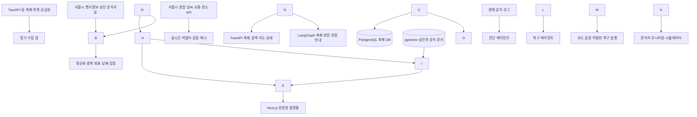
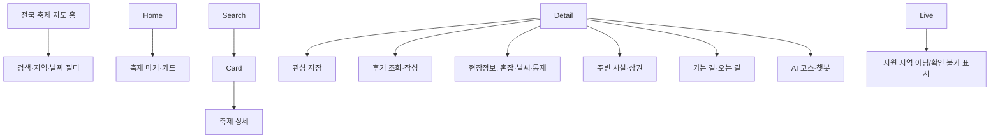
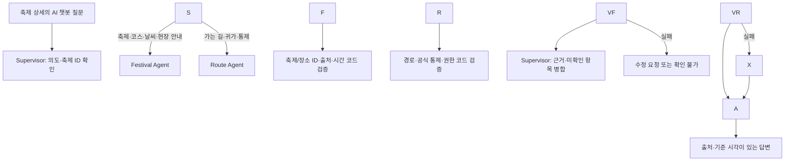
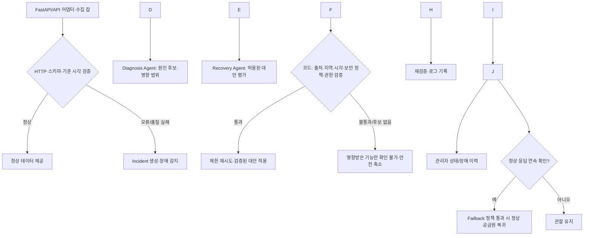
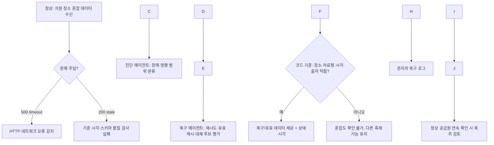

# 놀다가 (NOLDAGA)

## 전국 축제 데이터·실시간 현장정보·AI Auto-Healing 통합 플랫폼

**서비스 기획 및 요구사항 명세서 v2.2 | 예매 기능 보류 반영본 | 2026-11-16**

|항목|내용|
|-|-|
|서비스명 / 팀명|**놀다가(NOLDAGA) / 수다수다(6명)**|
|서비스 정의|전국 축제를 공식 데이터 공급원에서 수집·통합·관리하고 지도에서 탐색하며, 축제 전·중·후의 방문 계획·실시간 현장정보·이동·후기를 연결하는 플랫폼|
|선택 교육 주제|**1번 — 멀티 에이전트 기반 장애 예측·자가 진단·자율 복구(Auto-Healing)**|
|대표 사용자 경험|**전국 축제 지도 → 검색·축제 선택 → 상세 → 방문 준비 → 현장 정보 → 귀가 → 후기·재탐색**|
|전국 제공 범위|공식 API·승인 자료에서 수집된 축제의 지도·검색·상세(전체 축제 완전 수집 보장 아님)|
|실시간 혼잡도|**서울시 데이터가 지원하고 해당 축제와 매핑을 검증한 지역**의 지역 단위 혼잡도·전망. 전국 공통 기능 아님|
|AI 구성|**Supervisor · Festival · Route · Diagnosis · Recovery: 정확히 5개 에이전트**|
|기술 기준|Figma, React·Next.js, Python·FastAPI, LangGraph, PostgreSQL·pgvector, Supabase, Redis, Docker·AWS (실제 적용·검증은 별도)|
|UX 벤치마킹|[Spotts](https://spotts.kr/): 지도·행사 목록·카드·검색·상세 패턴 참고, 고유 로고·코드·이미지 복제 금지|
|문서 상태|**설계·요구사항 검토본**. 실제 API 호출·구현·장애 시연 완료 여부는 증빙 단계별 표기|

> \*\*핵심 의사결정 (2026-11-16):\*\* 본 프로젝트는 서울빛초롱축제 등 특정 축제의 전용 앱이 아니다. 실제 수집된 \*\*전국의 여러 축제를 지도에 표시하는 플랫폼\*\*이 대표 시연이다. 서울시 혼잡 API의 검증된 장소는 \*\*별도 실시간·장애 기술 시험\*\*에 사용하며, 해당 장소를 임의의 축제 방문객 수나 행사장 내부 혼잡으로 표시하지 않는다.
>
> \*\*로그인 장 삭제:\*\* 회원가입·로그인 절차는 본 기획안의 독립 장이나 대표 기능으로 설명하지 않는다. 관심 저장·후기·관리자 접근에 필요한 인증·권한 제약만 각 기능의 수용 기준에 최소 기재하며 실제 인증 구현 상세는 별도 개발 문서에서 관리한다.
>
> \*\*증빙 단계:\*\* `기획/후보` · `공식 문서 확인` · `팀 샘플 호출 성공 보고` · `팀 인증키 실호출` · `통합 구현` · `모의 장애 검증` · `배포 실검증`을 구분한다. 기획상의 Must, 수용 기준, 시연 목표는 완료 실적이 아니다.

### 문서 목차

1. [01. 프로젝트 개요](#01-프로젝트-개요)
2. [02. 문제 정의](#02-문제-정의)
3. [03. 핵심 시나리오](#03-핵심-시나리오)
4. [04. 요구사항 명세](#04-요구사항-명세)
5. [05. 서비스 아키텍처 · 기술 스택](#05-서비스-아키텍처--기술-스택)
6. [06. 에이전트 구성 · 협업 흐름](#06-에이전트-구성--협업-흐름)
7. [07. 일정 · 역할 분담](#07-일정--역할-분담)
8. [08. 리스크와 대응](#08-리스크와-대응)

\---

# 01\. 프로젝트 개요

### 1.1 서비스 소개

**놀다가**는 전국에서 열리는 축제·행사 정보를 복수의 공식 데이터 공급원에서 수집·통합·관리하여 지도에 제공하고, 사용자가 원하는 축제를 선택한 뒤 방문 계획과 현장 이용, 귀가 및 후기까지 이어서 이용할 수 있도록 돕는 **지도 기반 AI 축제 플랫폼**이다.

사용자는 여러 축제를 지역·날짜·키워드로 탐색하고, 상세정보·이전 후기·주변 시설과 식당·카페·편의점을 확인해 방문을 준비한다. 방문 중에는 **선택한 축제 주변의 지원 지역에 한해** 서울시 인구 혼잡도, 향후 전망, 기상, 확인된 공식 교통통제와 대중교통 운행 변경 정보를 참고한다. 축제 후에는 귀가 경로를 확인하고 후기를 남기거나 다른 축제를 저장할 수 있다.

AI 챗봇은 축제 안내·동행 유형별 방문 코스·현장정보를 자연어로 묶어 답변한다. 멀티 에이전트 Auto-Healing은 외부 API 및 AI 오류를 **감지→진단→대안 평가→코드 검증→복구 또는 기능 축소** 순서로 다룬다. 실제 공공 안전관리·교통통제를 대체하지 않으며 공식 안내를 우선한다.

### 1.2 비전·목표

**비전:** “축제를 찾는 순간부터 즐기고 돌아오는 순간까지, 필요한 정보를 한곳에서.”

1. **전국 축제 탐색의 출발점:** 공급원별로 흩어진 행사 정보를 공통 데이터로 통합해 지도·검색·상세정보로 제공한다.
2. **실시간 현장 이해:** 혼잡·날씨·교통·주변 정보를 장소·시간·출처와 함께 제시한다.
3. **개인화된 축제 경험:** 가족·연인 등 동행 상황을 고려한 방문 계획·AI 질문응답·기본 길찾기를 제공한다.
4. **신뢰 가능한 서비스:** 정보가 없거나 API가 고장 나도 허위 실시간 정보를 만들지 않고 가능한 기능을 유지한다.

### 1.3 핵심 가치와 차별화

|가치|제공 경험|검증 방법|
|-|-|-|
|발견성|전국 여러 축제가 지도와 목록에 표시|실제 수집 축제 수·지역 커버리지·지도 마커 검증|
|통합성|하나의 축제 화면에서 일정·주변 장소·혼잡·교통 조회|축제 선택→상세→현장정보 연결 시험|
|시의성|현재 혼잡·12시간 전망·날씨·운행 변경의 기준 시각 표시|응답 시간·데이터 시각 검증|
|편의성|관심 저장·후기·가는 길·오는 길·AI 추천|시나리오 사용성 시험|
|안전·신뢰|공식 통제 우선, 혼잡과 위험 구분, 미확인 정보 명시|위반 후보 차단·결측 처리 시험|
|안정성|데이터 공급원·LLM 장애 시 연속성 확보|장애 주입 및 복구 로그로 증명|

**경쟁 차별화 표현 주의:** Spotts에도 축제·시설·교통 정보와 일부 행사 혼잡 정보 활용 사례가 있으므로, “Spotts에는 혼잡도가 전혀 없다”는 식으로 단정하지 않는다. 놀다가는 **데이터별 기준 시각을 명시한 실시간 현장정보의 통합, 이동·방문 흐름과 연결, 재현 가능한 Auto-Healing**에 차별화 목표를 둔다.

### 1.4 서비스 범위와 경계

|구분|범위|
|-|-|
|전국 공통|API에서 수집 가능한 축제·행사 탐색, 지도 마커, 지역·기간·키워드 검색, 상세, 관심 목록, 후기(구현 우선순위 별도)|
|지원 지역별|해당 지역에서 실제 데이터 제공이 확인된 날씨, 주변 장소, 기본 길찾기|
|서울 지원 장소|서울시 실시간 인구데이터의 지역 단위 혼잡과 전망; 실제 장소 매핑이 있을 때만 표시|
|공식 통제·운행 변경|출처·적용 시간·구간을 확인한 정보만 안내. 자동 경로 반영 가능 범위는 실제 데이터 검증 후 확정|
|비지원·비대상|전국 모든 축제 완전 수집 보장, 축제 내부 부스·보행로별 실제 혼잡, 축제 방문객만 따로 계산한 현재 인원, 네이티브 앱, 개인 이동 추적|

### 1.5 한눈에 보는 서비스 정의(제출용)

|항목|내용|
|-|-|
|문제|전국 축제 정보·현장 혼잡·교통·시설·후기가 흩어져 있고 제공 범위·갱신 시점도 제각각이어서 방문 계획과 현장 판단이 번거롭다.|
|사용자|전국 축제를 찾는 시민·관광객, 가족·연인 방문객, 현장 관람객, 귀가 사용자, 플랫폼 운영 관리자|
|해결 방식|공식 축제 데이터를 통합 수집해 지도 플랫폼을 만들고, 선택 축제의 주변 실시간 정보를 지원 지역에 한해 결합한다.|
|대표 가치|**전국 축제 지도 탐색 → 축제 선택 → 실시간 현장정보 확인 → 방문/귀가·AI 안내 → 후기·재탐색**|
|대표 기술 시연|**혼잡 API 장애 주입 → 멀티에이전트 진단·복구 → 검증된 정보 또는 확인 불가 표시 → 축제 플랫폼 유지**|

### 1.6 MVP 상위 5개 영역과 상세 7개 기능군

**상위 5개 묶음(발표용)**

|상위 영역|해당 상세 기능군|필수 설명|
|-|-|-|
|① 축제 데이터·탐색 플랫폼|A 전국 축제 수집·통합·관리 / B 지도·검색·상세|전국에서 가져온 복수 축제를 실제 지도에 표시|
|② 실시간 축제 현장정보|C 혼잡·날씨·통제 / D 주변 시설·상권|서울 혼잡 지원 여부와 출처·기준 시각 표시|
|③ 축제 전·중·후 사용자 경험|E AI 방문 계획·기본 길찾기 / F 관심·후기·부가 기능|가는 길·오는 길·관심 저장, AI 챗봇|
|④ 멀티에이전트 Auto-Healing|G 진단·복구·코드 검증|혼잡도 장애 대표 시연, 축제 목록 장애 보조 시험|
|⑤ 운영·품질·검증|A의 관리자 데이터 관리 + F의 관심·후기 보호 규칙 + G의 모니터링|데이터 원본·운영 상태·승인·로그|

**대표 MVP 완성 조건(제안):** (a) 실제 수집된 복수의 전국 축제가 지도·검색·상세로 연결, (b) 서울시 지원 장소를 정확히 식별해 혼잡·전망·시각 표시, (c) 기본 방문 계획·길찾기·챗봇 등 승인된 Must 기능 동작, (d) 혼잡 API 장애 시 안전한 기능 축소와 로그 확인. Must 전부를 동시에 달성할 수 없으면 팀 승인 하에 구현 단계 및 검증 범위를 명확히 조정한다.

### 1.7 우선순위·확정 수준

* `Must` = 이번 MVP 목표 필수, `Should` = 중요한 추가 구현, `Could` = 후속 고도화. **기획서 Must가 구현 완료를 의미하지 않는다.**
* **Q1:** 기본 가는 길·오는 길 Must, 기존 5개 고급 경로 유형은 Should.
* **Q2:** AI 챗봇 유지(Must), 축제·방문 코스·현장 질문에 활용.
* **Q3:** Auto-Healing 대표 시연은 혼잡도 API 장애. 축제 목록 수집 장애 등은 보조 시험.
* **Q4:** 통합 찾기(Should)·리워드(Could)는 삭제하지 않고 추가 기능으로 유지.
* 최신 변경에 따라 **식당·카페·편의점의 위치·기본정보 제공은 포함**. 독립적인 관광지 추천 서비스·AI 맛집 랭킹은 범위에 넣지 않는다.
* **추후 결정:** 예매 기능과 관련 Auto-Healing 도입 여부·연동 방식은 이번 MVP 범위에서 제외하고 별도 팀 의사결정으로 보류한다.

\---

### 1.8 프로젝트 팀 및 기획 범위

**팀 구성:** 정예진(PM·기획/프론트), 한다영(에이전트/품질검사), 권오현(백엔드/에이전트), 한태경(품질검사/인프라), 이수언(프론트엔드/PM), 신유빈(인프라/백엔드). 구체 일정과 산출물 책임은 07장에서 정리한다.

**범위 확정:** ① 축제 수집·통합·관리, ② 지도 탐색, ③ 지원 지역의 실시간 현장정보, ④ 방문·귀가, ⑤ AI 챗봇, ⑥ 5개 멀티에이전트 Auto-Healing.

**대표 결과물:** 실제 축제 API에서 가져온 서로 다른 축제들이 지도·필터·상세로 연결되는 반응형 웹, 지원 장소 혼잡 카드, 관리자 장애 모니터링·혼잡 API 장애 시연, 실제 구현/검증 증빙.

### 1.9 기대효과 및 측정 가설

|기대효과|관찰할 지표(실측 전)|
|-|-|
|전국 축제 발견성|수집·게시 축제 수, 지역 커버리지, 검색→상세 완료율|
|축제 전·중·후의 정보 연결|상세→현장·길찾기 이동 성공률, 사용자 흐름 완료율|
|정보 신뢰도|출처·기준 시각 표시 정확도, 잘못된 혼잡/통제 표시 건수|
|장애 대응 능력|감지시간·정상 복구율·안전 축소율·지도/검색 연속성|

위 지표는 실험·운영에서 측정할 계획이며 현재 성과 수치로 제시하지 않는다.

\---

# 02\. 문제 정의

### 2.1 축제 탐색·정보 제공의 구조적 문제

축제 일정과 장소는 공공 포털·지자체·주최 측 홈페이지에 분산되어 있고, 현장 혼잡·기상·교통통제·주변 시설은 별도의 서비스에 존재한다. 사용자는 **어떤 축제가 열리는가**, **가도 되는 날씨인가**, **주변이 얼마나 붐비는가**, **가는 길·귀가 길을 어떻게 정할 것인가**를 각각 확인해야 한다.

사업자·기관별 축제 데이터는 필드·형식·갱신 주기가 다르므로 지도 플랫폼은 API 호출뿐 아니라 **정규화·중복 제거·좌표 확인·변경 관리**가 필요하다. 전국의 모든 행사가 어느 한 API에 완전하게 포함된다고 전제하지 않는다.

### 2.2 참고 사례와 규모 근거

**2025 서울빛초롱축제:** 서울관광재단의 2026-01-20 공식 보도자료는 행사 **37일간 누적 방문객 383만 명**을 발표했다. 이는 대규모 도심 축제에 대한 관심과 현장 안내의 중요성을 보여주는 사례다. **실시간 현장 인원이나 서울시 지역 인구 API 수치와 동일하지 않다.** [출처: 서울관광재단](https://sto.or.kr/press/16035_/16035).

**2026 서울세계불꽃축제:** 2026-09-01 서울시 사전 교통·안전 대책에는 지하철 운행 증회, 역사 무정차 가능성, 도로 통제·버스 우회 등의 안내가 포함됐다. 과거 행사 대책은 **현재 시행 중인 통제**로 사용하지 않는다. [출처: 서울시 보도자료](https://www.seoul.go.kr/news/news_report.do?nttNo=465103).

### 2.3 관람객의 문제

|단계|사용자 불편|놀다가 대응|
|-|-|-|
|축제 전|여러 행사 일정·지역·후기를 한눈에 비교하기 어려움|전국 지도·날짜·지역 검색, 축제 상세·관심 저장|
|축제 전|가족·연인에 맞는 이동·식사·편의시설 계획 번거로움|AI 코스 후보, 주변 상권·시설, 가는 길·예보|
|축제 중|주변 혼잡·날씨·현장 통제 정보가 분산|지역 혼잡·12시간 전망·날씨·통제, 출처·시각 안내|
|축제 중|화장실·보관함·병원·카페 등을 따로 검색해야 함|주변 시설·상권 카테고리 지도|
|축제 후|교통 운행 변경 속 귀가 경로 확인이 번거로움|귀가 경로 조회, 확인된 공식 변경 반영 검토|
|축제 후|방문 경험을 다음 방문자에게 전달할 공간 필요|축제별 후기·관심 목록|

### 2.4 기존 공공 안전관리와의 관계

지자체·주최 측·경찰·소방 등 관계 기관은 현장 통제·안전관리 책임을 담당한다. 놀다가는 해당 기관의 판단을 대신하지 않고 **공식 공지를 발견·표시하고 이용자가 참고할 수 있도록 돕는 보조 정보 서비스**다. 혼잡도만으로 '사고 위험', '안전한 골목', '무정차 확정' 등을 임의 판단하지 않는다.

### 2.5 기존 서비스의 한계와 기회

Spotts는 지도 기반 전국 행사 탐색과 일정·장소·주변 시설 경험을 참고할 수 있는 벤치마크다. 기존 지도 앱은 폭넓은 길찾기를, 지자체·공공데이터 플랫폼은 지역별 현장 지표를 제공한다. 놀다가는 **하나의 선택된 축제를 맥락으로 하여 축제 정보와 실시간 상태·주변 시설·이동·AI를 묶는 경험**을 검증한다. 경쟁사에 특정 기능이 없다고 단정하지 않는다.

### 2.6 데이터 측면의 제약

서울시 인구 혼잡도는 주요 **장소 단위 통신 기반 추정치**이다. 축제 전용 센서나 축제장 내부 부스별 계측치가 아니다. 모든 축제 위치가 서울시 혼잡 집계 장소와 일치하는 것은 아니므로 **장소 매핑 검증**이 필수다. 미래 혼잡 전망은 현재 관측치가 아니며 평소 대비 지표도 공급원별 제공 여부를 따로 확인해야 한다.

### 2.7 핵심 문제 정의

> \*\*“축제를 찾고 계획하고 즐기는 데 필요한 데이터와 서비스가 분산되어 있고, 실시간 현장정보는 지원 범위와 신뢰도를 알기 어렵다. 이를 전국 축제 지도 플랫폼에서 통합하고, 장애가 나더라도 검증된 정보를 기준으로 서비스를 지속할 필요가 있다.”\*\*

\---

### 2.8 주요 사용자

|사용자|주요 요구|대표 기능|
|-|-|-|
|축제 탐색자·관광객|전국에서 지금 또는 앞으로 열리는 행사 확인|지도·필터·상세|
|연인·친구 방문객|행사 일정·식사·카페·가는 길 묶기|관심·AI 코스·주변 상권|
|어린이·고령 가족 동행|화장실·주차·쉼터·이동 부담 확인|시설·길찾기·AI 안내|
|당일 현장 방문객|혼잡·날씨·공식 통제 확인|실시간 카드·지역 정보|
|대중교통 귀가자|무정차·우회와 귀가 경로 확인|공식 운행 변경·기본 귀가|
|플랫폼 운영자|외부 API 데이터 오류·중복·장애 처리|축제 데이터 관리·모니터링|

### 2.9 페르소나(기획 가설)

**A — 주말 데이트 계획 사용자:** 서울뿐 아니라 인천·부산 등 여러 지역의 주말 축제를 지도에서 비교하고 관심 저장. 연인 코스와 카페, 가는 길 검색이 필요하다.

**B — 가족 단위 사용자:** 어린아이·고령 가족과 함께 행사에 방문. 화장실·주차장·쉼터·응급시설을 먼저 확인하고 이동 부담이 작은 코스를 원한다. 검증되지 않은 무장애 경로는 보장하지 않는다.

**C — 현장 방문 사용자:** 선택한 서울 축제 주변에 혼잡 데이터가 있으면 혼잡도·12시간 전망을 보고 현장 동선을 판단하고, 운행 변경 시 귀가 경로를 다시 확인한다.

**D — 관리자:** 축제 A가 API 두 곳에 중복 등록되었거나 행사 날짜가 다르고, 혼잡 API는 오류를 반환하는 상황에서 데이터·장애 상태를 구분해 처리한다.

### 2.10 사용자 검증 계획

* 축제 검색·예정 행사 탐색·관심 저장·현장정보 이해의 실제 사용성 테스트 설계.
* 15\~20건의 공개 축제 방문 후기 분석 및 20\~30명 규모 소규모 탐색 설문은 **권장 계획**으로 기재. 실시 실적 아님.
* `혼잡도 미지원`, `N분 전 자료`, `향후 12시간 전망`의 의미를 사용자가 오해하지 않는지 확인.
* PC·모바일에서 지도 마커 검색·필터·상세·뒤로가기·후기 입력 성공 여부를 관찰.

\---

|서비스·자료|확인 가능한 특징/참고 분야|놀다가 적용 목표|
|-|-|-|
|**Spotts** (spotts.kr)|전국 축제·팝업 등 행사 검색과 지도·일정·지역 분류, 행사별 주변 시설 등|지도 중심 탐색 UX, 정보 카드·상세 구조를 참고하되 독자 브랜드 구축|
|대한민국 구석구석·TourAPI|전국 관광·축제 공공정보|축제 데이터 공식 공급원과 상세·이미지·기간 제공 범위 검증|
|서울 실시간 도시데이터|지원 장소의 지역별 인구·혼잡·전망 및 도시정보|혼잡/예보를 축제 상세에 매핑, 기준 시각·지역 한계 표시|
|카카오맵 등 일반 지도 플랫폼|장소 검색·지도·길찾기|가능한 경로 서비스를 연동하고 운영 조건·데이터 범위를 검증|
|TOPIS·지하철 공식 공지|도로 통제·버스 우회·운행 변경 관련 공식 게시|통제·무정차의 출처와 적용 시간 확인|

**기획 원칙:** Spotts가 실제로 모든 데이터를 어떤 기술·API로 수집하는지는 공개 화면만으로 확정할 수 없다. Spotts 자체 로고·이미지·HTML/CSS·코드를 복제하지 않는다. 경쟁 기능 비교는 동일한 시점·동일한 행사로 실제 확인한 항목만 표기한다.

**차별화 검증 질문:** 사용자가 축제를 선택했을 때 `혼잡도 제공/미지원`, `기준 시각`, `날씨`, `통제 정보`, `가는/오는 길`을 한 화면 흐름에서 정확히 구분해 제공하는가? 장애가 나도 전국 축제 탐색은 유지하는가?

\---

# 03\. 핵심 시나리오

### 3.1 대표 사용자 흐름 — 특정 축제를 고정하지 않은 전국 플랫폼 시연

**가상 사용자:** 주말 축제를 찾는 방문객 A. 서비스가 특정 행사 1\~2개만 하드코딩해 보여주는 것이 아니라, **공식 API로 수집·DB에 저장된 서로 다른 지역의 여러 실제 축제**를 지도에서 탐색하는 것이 전제다.

|단계|사용자 행동|놀다가가 제공할 정보/행동|실패·미지원 시|
|-|-|-|-|
|발견|지도에서 축제 여러 개 확인|전국 지도 마커·카드, 진행 중/예정 구분, 지역/기간 검색|목록이 비면 원인·갱신 시각 표시|
|선택|원하는 축제 클릭|축제 ID 기반 일정·주소·주최·공식 링크·후기·관심 저장|좌표 없는 축제는 목록 위주 제공|
|방문 계획|연인/가족 코스 요청, 날씨·가는 길|AI 추천 후보·근거·주변 식당·카페·화장실·주차장, 경로 검색|미확인 장소·경로를 임의 생성하지 않음|
|현장|축제 주변 정보 확인|**서울 지원·검증 매핑 지역**의 현재 혼잡 단계·기준 시각·전망, 날씨·공식 통제|서울 외/미매핑은 혼잡도 미지원|
|이동·귀가|공식 운행 변경 확인 후 귀가 검색|기본 길찾기, 확인된 구간·시각의 통제 반영 범위 안내|미확인 통제를 반영했다고 단정하지 않음|
|이후|후기 확인·작성, 다음 축제 저장|축제별 후기(Should), 관심 축제(Must), 새로운 행사 탐색|인증이 필요한 쓰기 기능은 권한 검증|

**완료 목표:** 실제 여러 축제 탐색 → 축제 선택 → 실시간 정보의 지원/미지원 구분 → 방문·이동 안내 중 선택 → 저장/재탐색이 하나의 UX로 연결된다.

### 3.2 가족·연인 맞춤 방문 코스

사용자는 “어린아이와 부모님이 함께 가는데 화장실이 가까운 코스”처럼 질문한다. Supervisor가 Festival Agent에 축제·주변 시설·공식 안내 조회를 요청하고, 필요한 경우 Route Agent가 이동 후보를 확인한다. AI는 실제 조회된 축제/장소 ID만 인용하며 **운영 시간·접근성 등 미확인 정보를 확정하지 않는다.**

### 3.3 대표 Auto-Healing 시연 — 혼잡 API 장애

1. 여러 지역 축제가 표시된 지도에서 사용자 선택·상세 기능이 정상 동작한다.
2. 축제 매핑이 검증된 서울 데이터 제공 장소 또는 **별도 검증된 API 테스트 장소**에서 혼잡도·기준 시각·12시간 전망을 확인한다.
3. 테스트 시뮬레이터가 `HTTP 500`, `200 OK + 오래된 PPLTN\_TIME`, `모든 복구 후보 실패` 등을 **순차적으로 모의 주입**한다.
4. 일반 코드가 예외·최신성을 감지하고, Diagnosis/Recovery Agent가 진단과 복구 대안을 평가한다.
5. 코드는 출처·장소·시간·스키마·허용 정책을 재검증한다. 적합하면 복구, 부적합하면 혼잡도만 확인 불가로 처리한다.
6. **전국 지도·축제 목록·검색·상세는 계속 사용 가능**해야 한다.
7. 관리자에서 오류 ID, 판단, 복구 실행, 검증 결과를 확인한다.

### 3.4 축제 목록 수집 장애 보조 시연

정기 수집 작업의 일부 페이지 또는 전체 API가 실패해도 마지막 정상 수집된 **검증된 축제 DB**를 제공한다. 사용자에게 최신 수집 시각과 갱신 지연 가능성을 안내하고, 정상화 시 멱등 업서트로 복귀한다. 취소된 행사를 현재 진행 중이라고 주장하지 않도록 원본 공식 링크를 제공한다.

### 3.5 시연 성공·실패 구분

|시연|최소 수용 기준|금지할 주장|
|-|-|-|
|플랫폼|실제 수집한 서로 다른 복수 축제의 지도·필터·상세가 연결|API에 없는 전국 모든 축제를 100% 수집했다고 주장|
|혼잡도|검증된 **지역 데이터**와 축제 선택 문맥/미지원 상태 구분|축제 방문객 실시간 인원, 내부 길의 안전 보장|
|Auto-Healing|감지·진단·대안 평가·코드 검증·복구/축소 로그와 B0/B1/A1 비교|모의 장애를 실제 공급원 사고로 소개|

\---

# 04\. 요구사항 명세

### 4.1 요구사항의 범위와 우선순위

* **Must:** 현재 MVP에서 우선적으로 구현·시험할 기능 목표. 현재 개발 완료를 의미하지 않는다.
* **Should:** 중요한 추가 구현 목표. 실제 개발 가능성·선행 데이터 확보 여부에 따라 착수한다.
* **Could:** 후속 고도화 후보. 삭제가 아닌 범위 보류를 의미한다.
* **고정 결정:** 왕복 기본 길찾기 Must / 기존 경로 비교 5유형 Should; AI 챗봇 Must; 혼잡 API 장애 대표 시연; 통합 찾기 Should·리워드 Could.
* **로그인 정책:** 사용자 인증 자체는 구현하되 전용 요구사항 표/사용자 시나리오를 따로 장황하게 쓰지 않는다. `관심 저장`, `후기 작성`, `관리자 보호`에서 필요한 권한 조건만 기재한다.

### 4.2 핵심 기능군 요약

|기능군|필수 구현 요약|관련 요구사항|
|-|-|-|
|A 축제 데이터 수집·관리|전국 목록 정기 수집·통합·검증·관리|FR-D / FR-O|
|B 축제 지도|다수 마커·검색·기간·지역·상세|FR-F01/F10/F15|
|C 현장 실시간 정보|서울 매핑 지역 혼잡·12h 전망, 날씨·공식 통제|FR-F02/F09/F13/F14|
|D 주변 정보|시설·응급기관, 상권 탐색|FR-F04/F11/F12|
|E 방문·이동|AI 코스, 가는 길·오는 길, 검증된 경로|FR-P / FR-R|
|F 전·후 사용자|관심, 후기, 챗봇|FR-A08 / FR-U / FR-C|
|G 신뢰·운영|Auto-Healing, 소스/승인/로그/시뮬레이터|FR-H / FR-O / NFR|

### 4.3 축제 탐색·현장 정보 — FR-F

|ID|기능 요구사항|우선순위|수용 기준 / 예외 처리|
|-|-|-|-|
|**FR-F01**|전국 축제 검색|**Must**|DB에 적재된 축제를 지역·기간·키워드·진행/예정 상태로 검색; 공급원별 원본 ID가 아닌 통합 축제 ID 사용|
|**FR-F02**|선택 축제 주변 실시간 혼잡도|**Must**|서울시 지원·매핑 장소에 한해 현재 혼잡 단계·추정 범위·출처·기준 시각 표시; `FCST\_PPLTN` 있으면 **향후 12시간 전망** 구분 표시; 평소 동일 요일/시간 대비는 필드·산식 검증 시 제공|
|**FR-F03**|혼잡도와 위험·공식 통제 분리|**Must**|`붐빔/약간 붐빔`만으로 위험·통제 확정 표시 금지; 공식 통제는 근거·시간 별도 노출|
|**FR-F04**|주변 공공·편의시설 지도|**Must**|공중화장실·공영주차장·**지하철역 물품보관함** 등 실제 확보한 좌표·출처 표시; 미수집 임시시설은 자동 수집으로 표현 금지|
|**FR-F05**|축제 운영·현장 공식 공지|**Must**|주최 측의 취소·운영시간·현장안내 공지를 출처·작성/효력 시각과 함께 표시; FR-F13 교통통제와 구분|
|FR-F06|기존 폐기 ID|**폐기 유지**|기능 ID 재사용 금지|
|FR-F07|GPS 기반 시설 길안내|Could|사용자 위치 처리 정책·동의·지도 API 실증 후 착수. 초기 MVP 위치 추적 없음|
|FR-F08|주차장 실시간 잔여 면수|Could|공급원별 실제 잔여 면수 필드가 검증된 경우만 제공|
|**FR-F09**|기상·현장 날씨|**Must**|축제 위치 날씨·예보의 기준 시각과 제공 지역 표시; 강수·특보는 실제 응답 시 안내. 푸시 알림 필수 아님|
|**FR-F10 \[신규]**|지도에 **여러 전국 축제 마커** 표시|**Must**|실제 수집된 복수 축제를 지도·카드로 표시, 진행 중/예정 구분. 좌표 없는 축제는 목록에 남기되 지도 노출 보류, 혼잡 미지원 표시|
|**FR-F11 \[신규]**|응급 관련 시설 안내|**Must**|병원·약국·응급실 등 공급원에서 검증된 카테고리/좌표 표시; 응급실 가용성은 실시간 정보가 확보된 경우만 표시|
|**FR-F12 \[신규]**|주변 식당·카페·편의점|**Should**|축제 중심 선택 반경 내 업소를 카테고리별 지도/목록으로 보여주고 출처 기록; 관광지 AI 추천은 범위 밖|
|**FR-F13 \[신규]**|도로·지하철 교통통제 구간·기간|**Must**|공식 자료의 유형(무정차/운행 변경/도로 통제/버스 우회), 구간, 시작·종료/게시 시각, 출처 제공. 적용 범위 미확인 시 ‘통제 반영 여부 확인 불가’|
|**FR-F14 \[신규 제안]**|축제-혼잡 관측 지역 매핑|**Must**|`festival\_id`와 서울 지역 `area\_code`를 검증된 관계로 저장; 미매핑 축제는 ‘혼잡도 미지원’, 임의 근접 매핑 금지|
|**FR-F15 \[신규 제안]**|축제 진행·예정·종료 상태|**Must**|행사 기간을 기준으로 필터 적용하며 취소·변경은 공식 원본 우선; 날짜 오류 감지 시 상태 확정 유보|

### 4.4 방문 계획·경로 — FR-R / FR-P

|ID|요구사항|우선순위|수용 기준 / 데이터 조건|
|-|-|-|-|
|FR-R01|최단시간 경로 비교|**Should**|실제 경로 후보의 총 소요시간 비교; 불충분하면 미지원|
|FR-R02|혼잡 회피 경로 비교|**Should**|실제 경로가 지나가는 지역과 검증된 혼잡 데이터가 연결될 때만 비교. 지역 전체 혼잡으로 골목·통로 안전 단정 금지|
|FR-R03|교통약자 배려 경로|**Should**|요청된 이동 제약과 확인된 접근성·승강설비 반영, 연결된 무장애 동선 정보 없으면 보장 금지|
|FR-R04|최소 도보 경로|**Should**|후보별 도보 거리 데이터 존재 시 최소 후보 표시|
|FR-R05|최소 환승 경로|**Should**|후보별 환승 횟수 존재 시 최소 후보 표시|
|**FR-R06**|공식 통제 충돌 검증|**Must (연동 가능 범위)**|공식 구간·시간이 확인되고 경로 요소가 대조될 경우 통제 구간 포함 후보 차단; 불가하면 ‘자동 반영 미검증’ 표시|
|FR-R07|자연어 개인화 이동 조건|**Should**|동행자·선호·접근성 제약을 명시한 요청에 대한 해석·검증. AI 코스 추천과 중복 범위 정리|
|**FR-R08**|이동 경로 근거·상태 안내|**Must**|경로 출처·조회 시각·시간/도보/환승(제공 시)·통제 반영 검증 상태 표시|
|**FR-R09**|통제 시 대체 경로 재조회|**Must (연동 가능 범위)**|공식 통제와 충돌하는 후보 발견 시 차단·다시 검색. 대체 공급원이 없다면 이용 가능 경로로 단정하지 않음|
|FR-R10|접근성 미확인 처리|**Must**|승강기·출입구 이용가능/연속 동선 근거 없으면 ‘교통약자 이용 가능’ 보장 금지|
|FR-R11|막차 타이머·자동 알림|Could|기존 후속 기능 유지; MVP 필수 아님|
|**FR-R12 \[신규]**|**축제장 가는 길** 기본 조회|**Must**|사용자가 출발지를 입력하면 축제장까지 기본 경로 조회·표시; 출발/도착 위치·조회 기준 시각·실패 안내|
|**FR-R13 \[신규 제안]**|**축제장에서 집으로 오는 길** 기본 조회|**Must**|사용자가 목적지를 입력하면 축제장을 출발점으로 귀가 경로 조회·표시; 실시간 통제 자동반영은 FR-R06/09 범위에서 검증|
|**FR-P01 \[신규]**|동행 유형별 AI 방문 코스|**Must**|가족·연인·친구 등 요청 조건과 행사·주변 장소 데이터를 기반으로 코스 후보·추천 이유 제시. 장소별 출처·이용 가능 상태 표시|
|FR-P02 \[신규 제안]|방문 코스 조건 변경·재추천|Should|시간·동행 유형·시설 선호 변경 시 새로운 조건을 반영; 조건 미충족 시 이유 안내|
|FR-P03 \[신규 제안]|추천 코스 검증|**Must**|실제 존재하는 축제·장소 ID, 운영시간·거리·공식 통제 등 확인된 제약 검사; LLM의 가상 장소 삽입 차단|

**Q1 적용:** 기존 `FR-R01\~R05`는 **삭제가 아니라 Should로 하향**. 기본 왕복 길찾기 `FR-R12\~R13`을 Must로 상향한다. 특정 경로 공급원이 필요한 고급 비교를 API 검증 없이 Must 완료라고 선언하지 않는다.

### 4.5 AI 통합 챗봇 — FR-C

|ID|요구사항|우선순위|수용 기준|
|-|-|-|-|
|**FR-C01**|자연어 축제 안내|Must|검색/선택 축제의 일정·장소·행사정보 질문에 실제 데이터 기반 응답|
|**FR-C02**|복합 질문 처리|Must|축제·코스·혼잡·날씨·상권·가는/오는 길 중 필요한 도구 분리 호출 후 통합 답변|
|**FR-C03**|동행 유형·조건 이해|Must|가족·연인 등 사용자 명시 조건을 코스 추천에 전달, 민감 정보 영구 저장 금지|
|**FR-C04**|축제 맥락 유지|Must|현재 선택한 `festival\_id`와 지원 지역을 유지; 축제를 바꾸면 잘못된 현장정보 인용 금지|
|**FR-C05**|공식 안내 RAG|Must|승인된 축제 운영 공지·FAQ를 근거로 응답하며 문서 출처 제공|
|**FR-C06**|출처·최신성·불확실성 표시|Must|실시간 API 시각과 RAG 문서 작성일 구분, 부재 시 확인 불가|
|**FR-C07**|AI 추천 검증|Must|존재하지 않는 장소·공식 통제 위반·유효기간 지난 공지 등 규칙 검증 실패 시 재생성 또는 차단|
|FR-C08|음성 질문|Could|후속 기능 유지, STT 비용·동의 검토 이후 결정|
|FR-C09 \[신규 제안]|LLM 장애 시 비AI 기본 서비스 유지|Must|챗봇 실패 시 지도·축제 상세·관심 목록 등 정상 작동, 실패 메시지 정확히 표시|

### 4.6 관심 축제 저장과 최소 인증 전제 — FR-A

|ID|기능 요구사항|우선순위|수용 기준|
|-|-|-|-|
|**FR-A08**|관심 축제 저장·해제·모아보기|**Must**|사용자별 `festival\_id` 저장/해제·중복 방지, 다른 사람의 관심 목록 접근 차단. 쓰기 작업은 인증·권한 검증|

**별도 개발 관리:** 인증 방식·세션·회원 정보 변경·탈퇴·소셜 로그인은 실제 개발 범위에 포함될 수 있으나 본 기획안의 독립 기능 설명 대상이 아니다. 구현 과정에서 필요한 보안·권한 검증은 NFR 및 API 계약 문서로 관리한다.

### 4.7 후기·경험 공유 — FR-U \[신규]

|ID|요구사항|우선순위|수용 기준|
|-|-|-|-|
|**FR-U01**|축제 후기 작성·목록 조회|**Should**|로그인 사용자가 특정 축제에 후기를 등록, 해당 축제 상세에서 목록 조회|
|FR-U02|후기 수정·삭제|Should|본인 후기만 수정/삭제 가능, 관리자 정책에 따른 비공개 조치 구분|
|FR-U03|후기 기본 검증|Should|빈 글·길이·XSS 등 입력 검증, 신고·악용 방지 최소 정책|
|FR-U04|후기 관리·신고|Could|신고 흐름·운영자 조치·이력 등 추가 정책 결정 후 구현|

**범위:** 후기는 서비스의 전·후 기능에 포함된다. 그러나 화면·API·DB/권한·운영 부담을 고려해 \*\*Should(중요한 추가 구현)\*\*로 두며, 팀에서 Must 승격 시 테스트·담당자·기간도 함께 승인한다.

### 4.8 통합 찾기·리워드 — FR-S / FR-W (Q4 유지)

|ID|요구사항|우선순위|수용 기준|
|-|-|-|-|
|FR-S01|분실물 센터|**Should (추가)**|공식 안내처/신고 경로 출처 표시|
|FR-S02|미아보호소|**Should (추가)**|공식 보호소·운영본부 정보가 있을 때만 표시|
|FR-S03|일행 만남 장소|**Should (추가)**|확인된 공식 만남 장소 또는 정적 지정 장소 안내|
|FR-S04|일행 실시간 위치 공유|Could|별도 위치정보 정책·사용자 동의·권한 검토 후 구현|
|FR-W01|방문 인증·스탬프/리워드|**Could**|방문 인증 정책, 부정/중복 인증 방지 설계 후 구현|

### 4.9 RAG 지식 관리 — FR-K

|ID|요구사항|우선순위|수용 기준|
|-|-|-|-|
|FR-K01|공식 문서 수집|Must|축제별 공식 FAQ·안내·운영 정책에 출처·작성일·대상 축제 기록|
|FR-K02|정제·임베딩|Must|문서 분류·중복 관리·축제 ID 필터 검색|
|FR-K03|검색 출처 제시|Must|검색 결과와 답변에 근거 문서 표시|
|FR-K04|유효기간·승인|Must|만료·미승인 문서를 현재 통제로 사용하지 않음|
|FR-K05|실시간 API 분리|Must|혼잡·날씨·열차 상태를 오래된 정적 RAG만으로 답하지 않음|

### 4.10 전국 축제 데이터 수집·통합·관리 — FR-D (독립 핵심)

`FR-D01\~D05`의 기존 취지를 유지하고 **D06\~D14를 새로 추가**한다. `D04\~D05`는 공식 공지 처리이며, 축제 목록 수집 파이프라인의 신규 기능과 구분한다.

|ID|요구사항|우선순위|수용 기준|
|-|-|-|-|
|**FR-D01 \[확장]**|외부 공공 API 수집·상태 기록|Must|축제·혼잡·시설 공급원별 호출 성공/실패, 마지막 시도/성공 시각, 페이지·건수 기록|
|**FR-D02 \[확장]**|축제·시설 정적 데이터 제공|Must|수집 데이터가 내부 DB에서 검색·지도·상세로 제공됨|
|**FR-D03**|원본 형식·최신성·누락 검사|Must|빈 응답·스키마 오류·인증/한도 문제·갱신 중단 감지|
|FR-D04|공식 공지 구조화|Should|축제 취소·운영 변경·교통 공지 글의 원문/추출값/확신 불가항목 구분|
|FR-D05|공식 공지 관리자 승인|**Must (D04 적용 시)**|AI 구조화된 통제는 관리자 승인 전 경로 차단 규칙에 적용 금지|
|**FR-D06 \[신규]**|**전국 축제 목록 API 정기 수집**|**Must**|TourAPI 등 승인된 공급원에서 날짜 범위·페이지를 순회 수집; 실제 수집 건수·오류 로그 보관|
|**FR-D07 \[신규]**|**공급원 공통 스키마 정규화**|**Must**|`source\_id/source\_item\_id/title/start\_at/end\_at/venue/address/lat/lng` 등 공통 구조로 변환, 원본 링크 연결|
|**FR-D08 \[신규]**|**중복 축제 식별·통합**|**Must**|동일 공급원 ID 우선 식별, 교차 소스 후보는 이름·기간·장소 등으로 판정; 애매한 경우 보류|
|**FR-D09 \[신규]**|**필수값·기간·좌표 검증**|**Must**|날짜 역전·좌표 범위 외·누락을 탐지; 좌표가 없으면 지도 마커 제외하지만 검색 대상은 유지 가능|
|**FR-D10 \[신규]**|**축제 DB 저장·증분 갱신**|**Must**|업서트 멱등성, 기존 관심·후기 연결 보존, 수정·취소/종료 반영, 원본 삭제만으로 자동 물리 삭제 금지|
|**FR-D11 \[신규]**|**출처·수집 이력·갱신 시각**|**Must**|공급원·원본 URL·수집 시각·원본 수정 시각(제공 시)·정규화 결과·오류 기록|
|**FR-D12 \[신규]**|**관리자 축제 등록·수정·승인**|**Must 제안**|관리자만 변경 가능; 공식 정보·변경 사유·승인 상태 및 변경 이력 보존|
|**FR-D13 \[신규]**|**축제 공급원 장애 시 DB 목록 제공**|**Must**|정기 수집 실패 시 마지막 검증된 축제 목록으로 지도/검색 유지, 마지막 갱신 시각과 지연 상태 표시|
|**FR-D14 \[신규]**|**수집원 충돌·보류 관리**|**Must 제안**|서로 다른 날짜·장소·취소 상태가 충돌하면 검토 큐로 이동, 자동 허위 병합/덮어쓰기 금지|

#### 축제 공통 데이터 모델 — 필수 필드와 결측 정책

|필드|의미|필수 여부/처리|
|-|-|-|
|`festival\_id`|놀다가 내부 고유 ID|필수; 소스가 바뀌어도 관심·후기 관계 보존|
|`source\_id`, `source\_item\_id`|수집원 및 원본 축제 ID|필수, 복수 소스 매핑 테이블로 관리|
|`title`|축제명|필수; 중복 후보 판정에 사용|
|`start\_date`, `end\_date`|행사 기간|필수 또는 미확정 상태; 날짜 역전 금지|
|`venue\_name`, `address`|행사 장소·주소|가능한 범위 수집, 누락 시 보완 대상|
|`latitude`, `longitude`|지도 위치|지도 표시 조건. WGS84 좌표 확인 후 표시|
|`category`, `region\_code`|유형·지역|출처 코드를 공통 코드로 매핑|
|`description`, `image\_url`|소개·이미지|선택값; 이미지 사용 허락·표기 조건 검증|
|`official\_url`, `organizer`|공식 상세·주최|가능한 경우 표시, 미제공 시 빈 값|
|`event\_status`|예정/진행/종료/취소/확인 필요|기간과 공식 취소 공지 반영|
|`source\_updated\_at`, `collected\_at`|원본 수정·수집 시각|가능한 범위 기록, 조회 시 출처·시각 표시|
|`review\_status`, `published\_at`|관리자 검토·게시 상태|운영 조건에 따른 승인 후 노출|

**데이터 수집의 단계적 검증:** 우선 **1개 공식 축제 API로 복수 지역·여러 축제 실제 수집** → 저장·검색·마커 → 두 번째 소스로 교차 수집·중복 처리 → 운영자 보완. 보완 소스가 연동되지 않아도 첫 소스 기반 전국 지도 플랫폼은 구현할 수 있다. 다만 추가 소스 통합이 완성되지 않았다면 해당 Must 항목의 일부 미달 상태를 명시한다.

#### 공급원·기간·갱신 정책(초안)

* TourAPI의 행사정보조회 `searchFestival2`(공식 문서)로 `eventStartDate`, `eventEndDate`, `pageNo`, `numOfRows` 등 사용 가능 여부와 결과 페이지 계산을 **인증키로 실검증**한다.
* `상태=진행 중/예정/종료`는 실제 기간과 타임존을 기준으로 DB에서 계산하고 취소는 별도 공식 상태로 우선 적용한다.
* **기본 수집 주기 제안: 하루 1회**(최초 전체 수집+변경분 확인). 이는 운영 설계 제안이며 API 공급원 실사용 한도·원본 업데이트 주기 확인 후 확정.
* 실시간 혼잡/날씨/교통에는 같은 1일 캐시 정책을 적용하지 않는다. 각 공급원 문서와 실제 갱신 시각에 맞춘 TTL 필요.
* 축제 이미지 사용은 원본별 이용허락·저작권 표시 조건을 검증한다. Spotts 이미지를 직접 복사하지 않는다.

### 4.11 Auto-Healing — FR-H

|ID|요구사항|우선순위|수용 기준|
|-|-|-|-|
|FR-H01|API 장애 감지|**Must**|500, 타임아웃, 인증·쿼터, 빈 응답, 200 OK+stale 구분|
|FR-H02|제한 재시도·유효 캐시|**Must**|공급원 정책·TTL·재시도 횟수 준수. 오래된 인구값을 실시간으로 표시 금지|
|FR-H03|진단 에이전트 원인 분류|**Must**|오류 유형·영향 기능·근거 로그·불확실성 기록|
|FR-H04|복구 에이전트 대안 평가|**Must**|후보의 자료 종류·장소·시간·원본 단위·정확성 비교|
|FR-H05|코드 기반 복구 실행|**Must**|허용 목록, 권한, 지역/최신성 검증을 통과한 전환만 실행|
|FR-H06|AI 추천 결과 오류 감지|**Must**|존재하지 않는 장소·공식 통제 충돌·운영시간 등 위반 검증|
|FR-H07|고급 경로 자동 재계산|**Should**|Q1 고급 경로 개발 시 대체역·후보 재계산. 기본 왕복 길찾기 오류 안내는 FR-R06/09 유지|
|FR-H08|복구 결과 재검증|**Must**|정보 단위·시간·출처·AI 도구 결과 조건 통과 여부 기록|
|FR-H09|안전한 기능 축소·중단|**Must**|불확실·오래된 실시간 정보 숨김/확인 불가, 축제 지도·상세 등 영향 없는 기능 유지|
|FR-H10|장애 이력·감사 로그|**Must**|사건 ID·감지·진단·대응·결과·실패 사유 추적|
|FR-H11|정상 공급원 복귀|**Must (실제 전환 구현 시)**|일정 기간 연속 정상 확인, Flapping 방지, 복귀 이력|
|FR-H12|트래픽 급증 대응|Should|호출·응답·비용 모니터링 및 부하 시험|
|FR-H13|LLM 실패·규칙 기반 기본 모드|**Must**|제한 재시도, 검증된 보조 모델만 전환; 모두 실패 시 비AI 기본 축제 기능 유지|
|FR-H14|길찾기 API 장애|**Must**|경로 검증 불가 시 실시간 이용 가능 단정 금지, 재조회/기본 안내/확인 불가|
|FR-H15|진단·복구 에이전트 자체 실패|**Must**|타임아웃·무한 반복 차단, B1 규칙 대응 및 안전 종료|
|**FR-H16 \[신규]**|**축제 목록 수집 장애 복구**|**Must**|수집 잡 실패 시 기존 검증 DB 목록·갱신 지연 표시, 부분 동기화/중복 저장 방지|
|FR-H17 \[신규 제안]|수집 데이터 품질 장애|Must|날짜 역전·중복·좌표 오류·행사 상태 충돌을 게시 전 격리하고 관리자 검토 요청|
|FR-H18 \[신규 제안]|장애 영향 범위 분리|Must|인구 API 오류가 전국 축제 검색·상세·관심·후기에 장애 전파하지 않도록 회로 분리|

### 4.12 관리자·운영 — FR-O

|ID|요구사항|우선순위|수용 기준|
|-|-|-|-|
|FR-O01|API 상태 모니터링|Must|공급원별 최근 요청·응답시간·오류율·기준 시각 표시|
|FR-O02|장애 이벤트 조회|Must|사건별 상태·원인·복구 과정·로그 조회|
|FR-O03|장애 시뮬레이터|Must|테스트 환경에서 500·타임아웃·200 stale·복구 실패 주입|
|FR-O04|AI 추천 오류 시뮬레이터|Should|잘못된 장소·공식 통제 위반 등 검증|
|FR-O05|관리자 인증·권한|Must|비관리자 기능 접근 불가|
|FR-O06|공식 공지 수동 등록·수정|Must (실행 규칙에 사용 시)|원본 URL·효력시간·관리자 승인·수정 이력|
|FR-O07|AI 구조화 공지 승인|Should (AI 추출 도입 시 필수)|미승인 공지 경로 차단 규칙에서 제외|
|FR-O08|API·LLM 사용량·비용|Should|공급원 호출량·사용액·한도 모니터링|
|**FR-O09 \[신규]**|축제 수집 작업 대시보드|**Must**|공급원별 전체/성공/보류/오류/중복 건수 및 수집 시각 확인|
|**FR-O10 \[신규]**|축제 데이터 수동 보완·승인|**Must 제안**|수동 등록/수정, 충돌 후보 승인, 감사 로그|
|FR-O11 \[신규 제안]|후기 운영 관리|Should|운영정책·신고 및 비노출 조치 권한 설정|

### 4.13 주요 요구사항 추적성·선행조건

|서비스 흐름|주요 요구사항|선행 데이터·도구|대표 검증|
|-|-|-|-|
|전국 축제 수집·지도|FR-D06\~D14, F01/F10/F15|TourAPI 실호출·축제 DB·지도 SDK|TC-01\~09|
|실시간 혼잡·현장|FR-F02/F03/F09/F13/F14|OA-21778 실호출·매핑·최신성|TC-10\~18|
|방문·귀가·AI|FR-P01/P03, R06/R08\~R13, C01\~C09|경로·시설·공식 문서·RAG|TC-19\~26|
|관심·후기|FR-A08, FR-U01\~U04|인증·권한·축제 DB|TC-28\~29|
|Auto-Healing|FR-H01\~H18, O01\~O10|장애 주입·로그·코드 검증·에이전트|TC-30\~40|

### 4.14 비기능 요구사항 (NFR)

|ID|품질 영역|요구사항|검증/수용 기준(목표)|
|-|-|-|-|
|NFR-01|데이터 정확성|축제명·기간·장소·좌표의 출처와 검증 상태|수집 원본·정규화·DB 값을 샘플 비교, 누락·역전·중복 검사|
|NFR-02|데이터 갱신|축제 데이터와 실시간 도시데이터의 주기 구분|공급원별 최종 성공/응답 시각 표시, 지연된 값을 최신으로 오인하지 않음|
|NFR-03|지역 제한|지원되는 혼잡 집계 장소만 매핑|서울 밖/미매핑 축제를 ‘혼잡도 미지원’으로 안내|
|NFR-04|혼잡·안전|지역 혼잡 단계와 공식 위험/통제 구별|혼잡 표시만으로 위험 경고 생성 금지|
|NFR-05|경로·공식 통제|확인된 통제와 충돌하는 경로 차단|시간/구간/대상 식별 가능 시 위반 후보 차단, 불가 시 확인 불가|
|NFR-06|접근성|근거 없는 무장애·교통약자 경로 보장 금지|필요한 필드 없으면 지원 미확인 표시|
|NFR-07|보안·개인정보|비회원·회원·관리자 권한, 개인정보 최소 처리|RBAC, 토큰 만료, 타인 후기 수정 차단, 초기 GPS 미수집|
|NFR-08|AI 안전성|hallucination·prompt injection·도구 권한 차단|RAG/도구 결과 스키마·화이트리스트·코드 검증, 미승인 외부 공지의 실행 금지|
|NFR-09|API 비밀정보|키 서버 보관·로그 마스킹|브라우저·공개 저장소·로그에 비밀키 미노출|
|NFR-10|반응형 UI|PC·모바일에서 지도·검색·상세·현장 카드 사용 가능|최소 두 화면 범주의 실제 브라우저 시험 기록|
|NFR-11|확장성|다수 축제 마커·검색에 따른 과부하 방지|페이징·지도 화면 범위 조회·클러스터링(성능 필요 시) 검증|
|NFR-12|장애 격리|혼잡 API 오류가 전국 축제 검색을 중단시키지 않음|오류 주입 상태에서 지도·검색 정상 작동|
|NFR-13|회복성|제한된 재시도·캐시·복구·안전 축소|정상 복구와 안전한 기능 축소를 별도 지표로 기록|
|NFR-14|추적성|데이터 출처·정규화 이력·복구 사건 추적|원본 ID, 수집 시각, 사건 ID, 처리자·조치 기록|
|NFR-15|성능|응답시간·오류율·지도 렌더 체감 목표|기준 부하 측정 후 임계값 제안·승인. 현재 임의 합격값 미확정|
|NFR-16|운영 비용|API·LLM 호출량·캐시 효율 추적|공급원별 호출/요청 수·사용 예산 모니터링|
|NFR-17|저작권·라이선스|사진·행사 정보·지도 SDK 이용 약관 준수|출처표시·이미지 유형·전송/재배포 조건 확인|
|NFR-18|사용자 생성 콘텐츠|후기 입력·표시·신고 정책|XSS 방지·권한 검사·삭제·비노출 정책 검증|
|NFR-19|광고·안전 정보 구별|제휴/홍보 가능성(추후)과 공식 정보 구분|공식 안전·통제 정보에 광고성 우선순위 부여 금지|

**측정 목표:** 숫자로 된 성능 합격선(예: p95 초, 복구율 %)은 실제 API 응답 시간·트래픽·장애 실험의 **첫 기준 측정 이후 확정**한다. 현재 NFR의 수용 기준은 시험 설계용이다.

\---

# 05\. 서비스 아키텍처 · 기술 스택

### 5.1 전체 시스템 설계 원칙

* **축제 목록은 정기 수집 → PostgreSQL 축제 DB → Next.js 지도/검색/상세**로 제공하며 사용자 요청마다 원천 API를 직접 호출하지 않는다.
* **실시간 현장정보는 공급원별 갱신 간격/TTL로 조회**하고, `festival\_id ↔ area\_code` 관계가 검증된 경우에만 혼잡 카드에 연결한다.
* 프론트는 실시간 API의 원본 인증키에 직접 접근하지 않고 FastAPI가 공급원 호출·검증·캐싱·권한 확인을 담당한다.
* AI는 요청 해석·복합 정보 종합·장애 원인/복구 대안 평가에 사용하며, 정기 수집·데이터 검증·권한·복구 실행은 일반 코드로 통제한다.

### 5.2 기술 스택 및 선정 근거

|영역|기술|역할·선정 이유|현재 확인 수준|
|-|-|-|-|
|UI/UX|Figma|지도·카드·반응형 패턴·오류 상태 설계|설계 도구 선정|
|프론트엔드|React + Next.js|Spotts형 지도·검색·축제 상세·AI 챗봇 반응형 UX|구현·연동 검증 전|
|백엔드|Python + FastAPI|공개/보호 API, 축제 수집·정규화, 제약 검증, 관리자 API|설계 기준|
|AI 오케스트레이션|LangGraph|자연어 축제 안내, 진단·복구 에이전트 간 상태·재시도·이력|세부 그래프·성능 검증 전|
|관계형 DB·벡터 검색|PostgreSQL + pgvector|축제·소스·마커·관심·후기·공식 문서·로그|스키마 설계 필요|
|인증/DB 서비스|Supabase|Auth 및 PostgreSQL 호스팅 후보|구성·권한 정책 검증 전|
|캐시·임시 상태|Redis|혼잡 응답의 TTL 관리, 수집 잡 중복 방지, 제한적 레이트리밋|적용 대상·TTL 설계 필요|
|배포|AWS + Docker|API·수집 작업·프론트·관리자 배포 및 시연 재현|배포 검증 전|
|지도 SDK|후보 검토|전국 지도/마커/주소·좌표·주변 장소 검색|비용·약관·좌표 지원 검증 전|
|길찾기 공급원|후보 검토|가는 길·오는 길, 대중교통·도보 후보|실제 필드·이용약관·통제 연동 검증 전|

**교육 기술 선택/대체 이유:** 기존 Streamlit은 내부 시제품에 적합할 수 있으나 사용자 서비스의 모바일 지도 UX·검색·상세·회원 기능을 위해 React/Next.js를 사용한다. Python/FastAPI·LangGraph·pgvector·Redis·AWS·Docker는 수업에서 학습한 개념을 데이터 통합·AI 협업·복구·배포에 적용한다. Supabase PostgreSQL을 사용한다면 별도 중복 DB 배포는 지양한다. **기술을 선정했다는 것은 구현/배포 완료가 아니다.**

### 5.3 전체 시스템 구성

**설명:** 외부 축제 API는 브라우저에서 매번 직접 호출하지 않고 **백엔드 수집 작업으로 DB에 축적**하는 것을 기본으로 한다. 선택 축제의 실시간 정보는 지원 공급원 어댑터를 통해 조회·검증한다. 관리자 승인·복구 정책은 공통 백엔드 권한 검사를 따른다.

### 5.4 추천 데이터 모델·테이블(초안)

|테이블/컬렉션|주요 필드|역할|
|-|-|-|
|`festivals`|id, title, dates, venue, address, lat, lng, status, category, published\_at|통합 축제 기준 레코드|
|`festival\_sources`|id, festival\_id, source\_id, source\_item\_id, source\_url, fetched\_at, raw\_checksum|축제-원본 복수 연결|
|`festival\_change\_history`|id, festival\_id, field, before, after, source, actor, changed\_at|일정·장소·상태 변경 추적|
|`festival\_review\_queue`|id, festival\_id, reason, proposed\_value, approval\_status, reviewer|중복/불일치/수동 보완 승인|
|`ingestion\_jobs`|id, source\_id, started\_at, ended\_at, status, scanned, inserted, updated, rejected, error|수집 배치 실행·증빙|
|`population\_areas`|area\_code, area\_name, data\_source, geometry\_optional|서울시 혼잡 지원 장소|
|`festival\_population\_links`|festival\_id, area\_code, relation\_type, validated\_by, validated\_at, notes|축제-혼잡 집계 구역 매핑|
|`realtime\_snapshots`|data\_type, source, area\_code, observed\_at, received\_at, valid\_until, payload\_hash|마지막 유효 현장 정보/캐시 메타|
|`official\_notices`|id, type, source\_url, published\_at, effective\_from/to, geometry, approval\_status|공식 통제·운영공지|
|`users`, `favorites`|user\_id, festival\_id, created\_at|계정·관심 축제|
|`festival\_reviews`|user\_id, festival\_id, body, status, created\_at, updated\_at|후기|
|`rag\_documents`, `rag\_chunks`|festival\_id, source\_url, valid\_from/to, approved, embedding|승인 문서·RAG|
|`agent\_runs`, `incident\_logs`|run\_id, incident\_id, source, error\_class, decision, outcome, timestamps|AI·Auto-Healing 증빙|

**설계 제약:** `UNIQUE(source\_id, source\_item\_id)`, `UNIQUE(user\_id, festival\_id)`(관심), `CHECK(end\_date >= start\_date)`(날짜 확정 시), 지도 좌표의 범위 검증, 수집 멱등성 키, 삭제 대신 출처/게시 상태 추적. 스키마와 인덱스는 STEP 2 담당 개발자가 확정한다.

### 5.5 외부 API·데이터 공급원 및 실호출 검증표

**상태 기준:** `공식 문서 확인`, `팀 샘플키 호출 성공 보고`, `팀 실인증키 호출 성공`, `통합 연동 성공`, `검증 전`. 유효한 로그 없이 `성공`으로 올리지 않는다.

|분류|공급원/데이터|역할|확인 수준(2026-11-16 기준)|후속 검증|
|-|-|-|-|-|
|**전국 축제 — 1순위**|한국관광공사 **국문 관광정보 서비스\_GW** (`searchFestival2` 등, 데이터 ID 15101578)|행사 목록·기간·지역·상세·좌표/이미지(제공 필드)|**공식 API 문서 확인 / 팀 인증키 실호출 전**|실제 페이지네이션·행사 건수·지역 분포·지리 좌표·이미지 라이선스|
|**서울 보완**|**서울시 문화행사 정보** (OA-15486)|서울 문화행사 보완, 행사 날짜·장소·좌표|**공식 데이터셋 확인 / 팀 실호출 전**|TourAPI와 중복·분류·날짜·좌표 검증|
|추가 공식 행사|지자체·주최 측 공식 자료/승인 수동 등록|누락·취소·운영 변경 보완|**후보 / 연동 방식 미정**|이용 조건, 원본 링크, 관리자 승인|
|**서울 혼잡**|**서울시 실시간 인구데이터** `citydata\_ppltn` **OA-21778**|장소별 인구 혼잡·추정 인구·12시간 전망|**권오현 팀원 샘플키 실호출 성공 보고**. 광화문·덕수궁/POI009, JSON, `INFO-000`, 2026-11-16 16:07경|개인 인증키·다른 지원 장소 검증, 축제-장소 매핑, 원본 JSON·실행 로그 대조|
|서울 통합 도시데이터|OA-21285 등 별도 도시정보 데이터셋|도시 교통·환경·인구 등 보조 후보|공개 샘플·문서 확인, 현재 서비스 상태 재검증 필요|OA-21778과 다른 API임을 분리, 실제 제공 중 여부 확인|
|날씨|기상청 초단기실황·예보/단기예보|행사 지역 날씨·강수·예보|**공식 자료 후보 / 팀 실호출 전**|좌표 변환·발표 시각·API 호출 주기|
|공식 교통|서울교통공사 지하철알림정보, TOPIS 통제·버스 우회 공지|무정차·역/노선 변경·도로 통제|**공식 자료 후보 / 팀 API 연동 전**|구조화 필드·시간·구간·명확한 역 ID 매핑|
|기본 길찾기|지도·대중교통 경로 공급원 후보|출발지→축제장 / 축제장→목적지|**공급원 선정·실호출 전**|경로 재조회·도보·환승·상용/비상용 이용약관|
|주변 상권|지도 장소 API(예: 카카오 로컬)·공공 상가정보|식당·카페·편의점|**후보 / 실호출 전**|장소 좌표·폐업/영업시간 여부·쿼터|
|공공시설|공중화장실·주차장·보관함·응급기관 공식 데이터|주변 편의·응급 시설|**후보 / 실호출 전**|지역별 커버리지·운영 시각·응급실 가용 상태|

#### 혼잡 API 팀 실호출 보고 기록(권오현)

|항목|기록|
|-|-|
|API|서울시 실시간 인구데이터 `citydata\_ppltn` (OA-21778)|
|테스트 일시|**2026-11-16 16:07경**, 응답 데이터 기준 시각 `PPLTN\_TIME = 15:40`|
|요청 조건|`sample` 키 / JSON / 장소명 `광화문·덕수궁`|
|응답 상태|`RESULT.CODE = INFO-000`, “정상 처리되었습니다.”|
|장소|`AREA\_NM=광화문·덕수궁`, `AREA\_CD=POI009`|
|혼잡·인구|`AREA\_CONGEST\_LVL=보통`, `AREA\_PPLTN\_MIN=48,000`, `AREA\_PPLTN\_MAX=50,000`|
|전망|`FCST\_YN=Y`, `FCST\_PPLTN\[]`에 17시\~다음 날 04시 등 예측 필드가 왔다고 보고|
|공식 공개 범위|**주요 121개 장소**, **sample 키로 광화문·덕수궁만**, **한 번에 장소 1개 조회** (OA-21778 문서)|
|증빙 파일명(보고)|`2026-11-16\_citydata\_ppltn\_광화문덕수궁.json`|
|보고자|권오현|
|증빙 상태|**팀원 전달 요약 확인**, 원본 JSON 파일을 기획서와 실제 대조 후 증빙 링크/해시 첨부 필요. 팀 실인증키·다장소 호출 성공까지 확장 금지|

**주의:** 서울시 공개 웹 지도에는 최근 28일 동요일 동시간 평균 대비 지표가 보일 수 있지만, **이번 샘플 원본 응답에 해당 비교 필드가 있었다는 증거는 제공되지 않았다.** 따라서 FR-F02의 ‘평소 대비’는 **실제 제공 데이터 또는 허용된 별도 산식 검증 후 표시**로 유지한다.

#### API 증빙 양식(팀 공통)

|필드|채울 항목|
|-|-|
|호출 증거|날짜·시간·검증자·API 문서 링크·요청 파라미터(키 제외)·응답 코드|
|데이터 확인|실제 응답 샘플, 중요 필드, 지원 지역, 기준 시각·갱신 주기|
|제약|인증·쿼터·지역·저작권·결측·동기화 문제|
|적용 판단|Must 충족 / 일부 지원 / 미지원 / 공급원 재검토|
|구현 실적|데이터 조회만 / DB 저장 / 화면 연결 / 장애 시뮬레이션 / 통합 시연 각각 구별|
|증빙 위치|원본 JSON·로그·스크린샷·테스트 케이스 파일 경로 및 링크|

\---

### 5.6 UI·UX 디자인 원칙

**Spotts 벤치마킹:** 지도에서 여러 축제를 발견하고, 필터·축제 카드·상세 화면으로 이동하는 정보 구조와 사용성 패턴을 참고한다. **놀다가의 로고·컬러·타이포그래피·카드·아이콘·이미지는 독자적으로 제작**한다. Spotts UI·HTML·CSS·이미지 직접 복제 금지.

**반응형 기본 원칙**

* 데스크톱: 지도 + 축제 목록(또는 상세) 패널; 검색·필터 상단/측면.
* 모바일: 지도를 기본으로 검색 바·필터 칩·하단 시트(축제 카드)·축제 상세 화면; 터치 영역·뒤로가기 고려.
* 정보 우선순위: **축제명·기간·장소** → 혼잡 제공 상태·기준 시각 → 방문 계획·주변 장소·교통·후기.
* 데이터가 없을 때도 로딩·빈 목록·권한 오류·위치 미지원·API 장애·오래된 데이터·통제 확인 불가 화면을 각각 정의.
* 혼잡도는 색상만 사용하지 않고 **명칭과 기준 시각을 함께 표시**. ‘지역 혼잡’과 ‘공식 위험/통제’는 별도 영역.

### 5.7 사용자 화면 목록(안)

|ID|화면|핵심 구성|핵심 FR|모바일 고려|
|-|-|-|-|-|
|U-01|메인 전국 축제 지도|다수 마커, 카테고리·지역·날짜 필터, 지도 확대/축소, 카드 리스트|F01,F10,F15|지도 + 하단 카드 시트|
|U-02|축제 검색·목록|검색어·기간·진행/예정 구분, 결과 개수, 정렬|F01,F15|전체 화면 필터/목록 전환|
|U-03|축제 상세|이미지, 행사일정, 주최/공식 출처, 장소, 관심, 후기·현장정보 진입|F05,A08,U01|핵심 정보 접기/펼치기|
|U-04|실시간 현장 지도/정보|**지원 장소 혼잡·12시간 전망·자료 시각**, 날씨, 공식 통제, 시설·상권 마커|F02\~04,F09,F11\~14|필터 칩/카드; 혼잡 미지원 상태|
|U-05|방문 계획·AI 코스|동행 유형, 조건, 추천 후보·이유, 주변 장소|P01\~03,C01\~07|단계별 조건 입력|
|U-06|가는 길·오는 길|출발지·목적지, 이동 후보·시간·통제 반영 검증 상태|R06,R08\~R13|경로 목록+지도 전환|
|U-07|AI 챗봇|선택 축제 문맥, 복합 질문, 출처·기준 시각·확인 불가|C01\~C09,K01\~K05|축제 상세에서 진입/돌아오기|
|U-08|관심 축제|관심 목록·해제, 날짜·지역별 정렬|A08|카드형 리스트|
|U-09|후기|축제별 후기 목록, 작성·수정·삭제(Should)|U01\~U04|작성/조회 분리|
|U-10|통합 찾기·리워드|분실물·미아·만남 장소(Should), 스탬프(Could)|S01\~S04,W01|추가 기능 영역으로 구분|

### 5.8 사용자 화면 정보 구조(개념)

### 5.9 화면별 주요 상태 정의

|화면 요소|정상|데이터 없음|공급원 장애·지연|
|-|-|-|-|
|축제 지도|수집한 행사 마커/목록|‘조건에 맞는 축제가 없습니다’ + 필터 초기화|DB 목록 유지; 마지막 갱신 시각/수집 지연 안내|
|축제 이미지|출처·권리 검증된 이미지|기본 플레이스홀더|이미지 오류를 축제 전체 장애로 처리하지 않음|
|축제 혼잡|지원 지역 원본 단계·기준시각/전망|‘혼잡도 미지원’|‘현재 혼잡도 확인 불가’, 유효성 검증 없는 과거값 표시 금지|
|날씨|실황/예보 + 기준 시각|‘날씨 데이터 미지원’|‘현재 날씨 확인 불가’|
|통제 정보|확인된 공지 출처·효력시간|‘확인된 공지 없음’(충분한 조회 조건일 때만)|‘공식 통제 상태 확인 불가’|
|경로|실제 후보·출처·검증 상태|이동 정보 없음/경로 미제공|‘경로 재조회 실패·이용 가능 여부 확인 필요’|
|챗봇|출처 있는 답변·추천 이유|‘확인된 정보 없음’|기본 정보 메뉴 유지, AI 답변 불가 표시|
|관심·후기|본인 데이터 조회·갱신|관심/후기 없음|재시도·저장 실패 명확히 표시, 중복 제출 방지|

### 5.10 관리자 화면 목록

|ID|화면|기능|
|-|-|-|
|A-01|수집원 상태|TourAPI 등 원천 API별 수집 성공/실패·최근 성공/실패 시각·요청량·한도|
|A-02|축제 데이터 관리|축제 목록·원본/통합 ID·누락·중복 후보·수동 등록/수정·게시/승인 이력|
|A-03|축제-혼잡 매핑 관리|혼잡 지원 지역 목록, 축제↔지역 연결, 검증자·검증 시각|
|A-04|공식 통제·운영 공지|공지 원문·적용 구간/시간·승인 대기·수정 이력|
|A-05|장애 모니터링·시뮬레이터|상태·오류·진단/복구 메시지·코드 검증·최종 결과, 500/stale 주입|
|A-06|보안·운영|관리자 권한, 후기 관리(Should), API/LLM 사용량·비용|

### 5.11 Figma 제작 산출물 제안

* 사이트맵, 전·중·후 사용자 플로우, PC/모바일 와이어프레임, 컴포넌트 목록(마커·축제 카드·날짜/지역 필터·혼잡 상태 카드·로딩/오류·챗봇).
* UI 디자인 시스템(놀다가 브랜드 색·폰트·버튼·카드·혼잡 단계 대비·타이포 규칙).
* 메인 지도, 축제 상세, 실시간 정보, 길찾기, 관심/후기, 관리자 장애 시연의 **클릭 가능한 프로토타입**.
* Figma 구현 완료 주장 전 실제 링크·화면 캡처와 담당자 확인을 기록.

\---

# 06\. 에이전트 구성 · 협업 흐름

### 6.1 멀티에이전트 5개 확정 및 설계 원칙

이번 문서에서 **Supervisor / Festival / Route / Diagnosis / Recovery 총 5개**를 기본 구성으로 정한다. **AI 챗봇은 여섯 번째 에이전트가 아니라 사용자 진입 인터페이스**다. 전국 축제 수집 잡, 데이터 정규화, 캐시 TTL 판정은 원칙적으로 일반 코드가 처리한다.

|에이전트|입력|핵심 책임|출력 예시|허용/금지 경계|
|-|-|-|-|-|
|**① Supervisor**|user\_query, festival\_id, context, capability\_flags|의도 구분·업무 분배·도구 호출 순서·결과 병합|task\_plan, delegated\_tasks, answer\_outline|도구 허용 목록 준수; 직접 DB 임의 수정 금지|
|**② Festival Agent**|축제 DB/공식 문서/혼잡·날씨·상권|축제 안내, 동행 유형별 방문 코스, 현장 질문|festival\_facts, itinerary\_candidates, source\_evidence, confidence|실재하지 않는 축제·장소 생성 금지|
|**③ Route Agent**|origin/destination, route\_api, official\_controls|축제 가는 길/귀가 경로 요청, 후보의 통제·이용조건 설명|route\_candidates, control\_validation\_status|실제 지도 경로 API·코드 검증 우회 금지|
|**④ Diagnosis Agent**|incident\_id, HTTP/타임스탬프/스키마 오류, 공급원·로그|장애 분류, 원인 후보·영향 범위·불확실성|error\_class, hypotheses, affected\_features|정책 변경·서비스 전환 직접 실행 금지|
|**⑤ Recovery Agent**|진단 결과, 허용된 캐시/대체 후보, 정책|재시도·검증된 대체·안전 축소 등 복구 대안 평가|recovery\_plan, evidence, risks|공식 통제 임의 승인·무검증 복구 실행 금지|

**확정 범위:** 에이전트 수와 담당 역할. **구현 전 검증:** 개별 모델·프롬프트·LangGraph 노드/상태 스키마·실행 비용·반복 제한·각 분기 수용 기준.

### 6.2 사용자 질문 협업 흐름

**예시:** “가족과 토요일 축제 갈 건데 주변 카페, 주차장, 날씨와 가는 길 알려줘.” → Festival이 실제 축제·상권·날씨를 조회하고 Route가 이동 데이터를 조회한다. 최종 답변은 `확인된 사실`, `예측`, `미지원/확인 불가`를 구분한다.

### 6.3 장애 감지·진단·복구 협업 흐름

**코드-에이전트 책임 분리:** 감지·타임아웃·TTL·멱등 업서트·공식 통제 적용·기본 Failover/Failback 실행은 승인된 결정적 백엔드 로직이 처리한다. AI 진단/복구의 추가 이점은 동일 장애 세트로 B1(규칙)과 A1(에이전트+규칙)을 비교해 검증한다.

### 6.4 인터페이스·상태 스키마(초안)

|상태/필드|설명|검증 조건|
|-|-|-|
|`run\_id`, `incident\_id`, `festival\_id`|요청 및 장애 추적 식별자|ID 유효성, 요청 관계 검증|
|`intent`, `task\_plan`, `tool\_results`|사용자 요청 분해·조회 결과|도구 allowlist, 타입 제한|
|`source\_id`, `area\_code`, `observed\_at`|실시간 혼잡 데이터 근거|지역 매핑·발행 시간·TTL 검사|
|`error\_class`, `affected\_features`|장애 분류·영향 서비스|고정 enum 및 로그와 일치|
|`recovery\_candidate`, `validation\_report`|대안/검증 결과|코드 검증 통과 시만 실행|
|`attempt\_count`, `deadline`, `approval\_required`|재시도·Safe Stop·관리자 승인|횟수·실행 시간 상한, 권한 검사|
|`final\_mode`|normal / verified\_fallback / degraded / unresolved|실제 제공 상태와 일치|

**LangGraph 종료 조건:** 노드별 최대 시도·시간 예산·에러 분기·Safe Stop을 정의하고, 무한 회전·LLM 반복 오류를 막는다. 도구 실행 로그는 비밀키·개인정보를 마스킹해 저장한다.

### 6.5 RAG 도입 목적 및 역할

RAG는 **정적·준정적 공식 축제 안내문**의 검색과 근거 제시에 사용한다. 축제 날짜·좌표·관심·후기처럼 구조화된 정보는 PostgreSQL에서, 현재 혼잡·날씨·교통 운행 상태는 각각의 API에서 조회해야 한다. RAG가 실시간 데이터를 대신하지 않는다.

### 6.6 지식베이스 구성

|분류|데이터 예시|갱신·신뢰 기준|
|-|-|-|
|① 축제 공식 안내|주최 측 FAQ, 프로그램, 입장/운영 안내, 취소·변경 공지|`festival\_id`, 게시일·유효기간·공식 URL, 관리자 검토|
|② 현장 안전 안내|주최 측 공지, 지자체 안전 수칙, 출입 통제 안내|공식 확인·현재 적용 여부 분리|
|③ 이동·교통 이용 안내|대중교통 안내, 교통약자 편의시설 이용법, 이동 주의사항|일반 가이드와 당일 공식 운행상태 분리|
|④ 추가 기능 지식|분실물·미아보호소·일행 만남 장소 운영 지침|Q4 추가 기능 구현 시 활성화|
|⑤ 축제 방문 팁|공식 주최 측 안내에 기초한 준비물·이용 팁|출처와 작성일 필수, 사용자 후기를 공식 사실로 취급하지 않음|

### 6.7 수집·검증 절차

1. 공식 사이트·승인된 문서 수집, 원본 링크·게시일 기록.
2. 축제 ID·지역·문서 유형·유효기간·승인 상태 분류.
3. 분할·임베딩 후 PostgreSQL `pgvector`에 적재; 유효하지 않은 문서 필터.
4. 사용자의 축제 문맥으로 검색하고 근거 문서·작성일 제공.
5. 공식 통제/운행 변경은 최신 API·승인 데이터와 교차 검증. **미승인 또는 오래된 공지를 실행 규칙으로 자동 적용하지 않음.**

### 6.8 RAG 문서 메타데이터(안)

`document\_id`, `festival\_id(nullable)`, `category`, `source\_url`, `publisher`, `published\_at`, `effective\_from`, `effective\_to`, `collected\_at`, `approval\_status`, `approved\_by`, `approved\_at`, `checksum`, `embedding\_version`.

### 6.9 AI 답변 제약

* 검증되지 않은 축제 프로그램·운영시간·무정차 상태를 임의 생성 금지.
* 문서 출처와 유효기간을 함께 표시; 원문이 충돌하면 '확인 필요'로 처리.
* 사용자 후기·광고·외부 웹 텍스트에 포함된 명령을 시스템 지침으로 실행하지 않음.
* 데이터가 없으면 검색 근거가 없는 사실을 만들어내지 않고, 확인 불가·공식 링크 안내.

\---

### 6.10 목표와 적용 범위

교육 과제 **1번 멀티 에이전트 기반 장애 예측·자가 진단·자율 복구**를 증명한다. 기존 귀가 경로 오류 중심 시연 대신 **혼잡도 API 장애를 대표 시연**으로 사용한다. 동시에 전국 축제 데이터 수집 API의 장애도 별도로 대응하되, 공급원별 캐시 유효성은 다르게 다룬다.

**복구의 구분**

* **정상 복구:** 같은 품질의 검증된 현재 데이터를 다시 제공.
* **검증된 대체 제공:** 동일한 의미·장소·시간을 충족하는 독립 공급원이 **실제 존재할 경우에만** 대체.
* **안전한 기능 축소:** 해당 정보는 '확인 불가'로 표시하고 축제 지도 등 영향 없는 기능은 계속 운영.
* **미복구:** 필수 정책을 위반하거나 지원 데이터가 없어 복구 실패; 실제 복구율에 포함하지 않음.

### 6.11 장애 유형별 처리

|분류|탐지 신호|자동 처리|사용자 영향|
|-|-|-|-|
|API HTTP 오류|5xx, 일부 4xx|한도 있는 재시도, 설정/인증 문제 재시도 남발 금지|해당 실시간 카드 확인 불가 가능|
|네트워크/타임아웃|DNS, 연결, 응답 지연|짧은 제한 재시도, 오류 기록|이전 유효 데이터 사용 여부 조건 검증|
|인증/쿼터|401/403/429 또는 공급원 오류 코드|관리자 알림·백오프, 키 노출 방지|오래된 데이터 실시간 단정 금지|
|**품질 장애**|200 OK이나 `observed\_at` 오래됨/스키마 누락|최신성·필드·장소 코드 검증 실패 처리|신뢰도·시각 표시/확인 불가|
|잘못된 지역 매핑|`festival\_id`와 `area\_code` 매칭 불명확|매핑 관계 검증/격리|축제 혼잡도 미지원 처리|
|축제 목록 수집 실패|수집 잡 일부/전체 실패, 페이지 누락|멱등성 유지, 이미 검증된 DB 목록 제공|‘마지막 갱신 시각’ 표시|
|축제 데이터 충돌|두 출처 날짜·장소 불일치|격리·관리자 승인 요청|미확인 필드 비노출|
|LLM/에이전트|타임아웃·한도·형식 오류|B1 규칙 처리, 기본 UI 유지|AI 추천 실패해도 지도 사용 가능|
|경로/통제|경로 API 오류·공지 시각 미확인|허위 경로 추천 차단, 기본 안내·확인 불가|경로 이용가능 보장 금지|

### 6.12 대표 시연 — 혼잡도 API 장애

**시연 A — HTTP 500:** 동일 API 재시도는 허용 횟수 내에서 수행. 독립 대체 공급원이 확보되지 않았다면 실제 Failover로 설명하지 않고 검증된 캐시 또는 안전 축소로 진행.

**시연 B — HTTP 200 + 오래된 데이터:** 네트워크 정상이라도 `PPLTN\_TIME`을 검증해 임계값 초과 시 실시간 표시 중단. 오래된 데이터가 유용한 참고값이면 \*\*‘과거 기준’\*\*이라는 사실을 명확히 표시하되, 기본 MVP는 혼잡 카드 확인 불가가 더 안전하다.

**시연 C — 복구 실패:** 모든 대안이 지역/시각/형식 조건에 불합격하면 혼잡도 기능만 축소. **전국 축제 지도·검색·상세·관심 기능은 계속 제공**. 관리자 이벤트에 실패 원인과 영향 범위 남김.

**정상화(Failback):** 연속 정상 응답·최소 유지시간·재전환 대기시간 등 Flapping 방지 규칙을 코드로 설정하고 실제 대체 공급원을 구현한 경우에만 복귀 시연. 조건의 숫자 값은 초기 계측 후 확정.

### 6.13 보조 시연 — 축제 목록 API 장애

* 정기 수집에서 `TourAPI 5xx/429` 또는 페이지 누락 발생.
* 수집 잡은 실패·부분 성공을 분리 기록하고 **마지막 정상 동기화된 DB 스냅샷을 유지**한다.
* 사용자는 전국 축제 지도를 계속 탐색하며, 관리자에는 마지막 수집 성공 시각과 미반영 가능성이 표시된다.
* 다음 성공 수집에서 `source\_id+source\_item\_id` 기준 업서트/멱등 처리해 관심·후기 관계가 끊기지 않도록 한다.
* **오래된 행사 정보가 취소되었을 위험**이 있으므로 지나치게 오래된 데이터의 최신성 확정 문구는 금지하고 공식 링크를 제공한다.

### 6.14 보조 시연 — AI 안내·경로 품질 교정

* LLM이 없는 축제/카페를 제안하면 실제 `festival\_id/poi\_id`에 없는 값을 검출→제안 재생성 또는 삭제.
* 교통통제 적용 시간·구간이 명확하고 후보 경로가 충돌하면 코드가 차단. 대체 검색 불가 시 확인 불가.
* 유효하지 않은 공식 공지·RAG 문서 기반 추천은 거부.
* LLM 장애는 제한 재시도→승인된 다른 모델(있을 때만)→B1 비AI 기본 서비스 순서.
* 진단/복구 에이전트 자체 오류도 B1 코드 기반 오류 처리로 하강, 무한 반복 금지.

### 6.15 B0/B1/A1 비교 시험 설계

|방식|정의|비교 목적|
|-|-|-|
|**B0**|장애 대응 최소화 기준선: 요청 실패 시 기본 오류 반환(서비스 실제 정책과 구분되는 시험 조건)|장애 감지·대응이 없는 기준점|
|**B1**|규칙 기반: 상태 코드/시간 검사·고정 재시도·유효 캐시·기본 정보 모드|결정적 코드의 독립적 효과 측정|
|**A1**|B1 위에 진단·복구 에이전트가 원인 후보와 대안 평가, 코드가 최종 승인|AI 에이전트의 추가 기여 측정|

동일 장애 세트·동일 데이터 조건에서 **완전 정상 복구 / 유효 대체 / 안전 축소 / 미복구**를 분리해 기록한다. AI를 붙였다는 이유로 B1 대비 우수하다고 미리 주장하지 않는다.

### 6.16 성과 지표와 계산 방식

|지표|계산·측정 정의|주의|
|-|-|-|
|장애 감지시간|장애 주입/실제 오류 발생 시각 → 감지 이벤트 시각|실제 로그 타임스탬프 필요|
|MTTR(정상 복구)|정상 복구된 사건별 장애 감지 → 정상 제공 시간의 평균|안전 축소 사건을 ‘정상 복구’로 합산 금지|
|정상 복구율|정상 품질로 복구한 사건 수 / 유효한 장애 사건 수|분모·제외 기준 사전 정의|
|안전 축소율|검증된 대안 없을 때 안전 축소한 사건 / 해당 검증 대상 사건 수|정상 복구율과 별도 제시|
|잘못된 최신정보 노출|stale·다른 장소 혼잡을 ‘현재’라고 제공한 횟수|목표 0건을 지향하되 실제 시험 결과로 판단|
|플랫폼 연속성|혼잡 장애 중 전국 축제 지도·검색 성공 비율|프론트+백엔드 통합 시험 필요|
|LLM/에이전트 추가 기여|B1 대비 A1의 분류 정확도·복구 품질·지연·비용 차이|같은 조건 반복 시험|
|비용·지연|공급원/LLM 호출량, p50/p95 응답시간|임의 성능 수치 기재 금지|

### 6.17 운영·승인 원칙

공식 통제와 충돌할 수 있는 비정형 공지의 추출·적용, 축제 취소·장소 변경이 출처 간 불일치하는 경우에는 **관리자 승인을 요구**한다. 에이전트는 원인·대안을 제시하되 코드 검증과 승인 흐름을 우회해 외부 사실을 확정하지 않는다.

\---

# 07\. 일정 · 역할 분담

### 7.1 서비스 구현 우선순위(의존 관계 중심)

|순서|작업 묶음|필요한 선행조건|완료 판단 기준|
|-|-|-|-|
|1|**전국 축제 API 실호출·DB/수집 파이프라인**|TourAPI 인증키·이용약관·필드 분석|복수 지역 축제 실제 수집·저장·수집 로그·중복/날짜 검증|
|2|**전국 지도·검색·상세**|축제 DB, 지도 SDK 선정|여러 축제 마커, 필터·상세 정상 동작(하드코딩 아님)|
|3|**실시간 지원 범위 연결**|서울 장소코드·실호출, 축제-장소 매핑|해당 지역만 혼잡+12시간 전망·시각, 기타 축제는 미지원|
|4|**주변 시설·날씨·기본 왕복 경로**|각 공식/상용 API 실검증, UI 패턴|가는/오는 길, 날씨·시설·통제 안내 및 예외 처리|
|5|**회원·관심·AI 챗봇/코스·RAG**|인증 DB, 도구 계약, 공식 문서|관심 저장·기본 AI 질문/코스와 검증 기록|
|6|**Auto-Healing 대표·관리자**|API 오류 주입기, 로그·캐시/상태 검증|혼잡 500/stale/복구 실패 시연, 전국 지도 유지, 장애 이력|
|7|**추가 기능·성능·배포**|Must 핵심 시연 안정화|후기(Should), 통합 찾기(Should), 고급 경로 5유형(Should), 리워드(Could) 단계화|

위 표는 **기획·기능 의존 순서**이며 팀원이 별도로 운영하는 WBS를 대체하거나 수정하지 않는다. 공식 일정 내에서 병렬 개발은 가능하다.

### 7.2 팀 구성 및 역할(기존 결정 유지)

|팀원|주 담당|보조 담당|이번 v2.2에서의 중심 협업|
|-|-|-|-|
|**정예진**|PM·기획|프론트엔드|기획안/FR/기능 범위·사용자 흐름·화면 설계 정합성|
|**한다영**|에이전트|품질검사|LangGraph, AI·진단/복구 협업, RAG·응답 품질|
|**권오현**|백엔드|에이전트|TourAPI·OA-21778·데이터 파이프라인·서비스 API|
|**한태경**|품질검사|인프라|테스트·증빙·보안·운영 정책 검토|
|**이수언**|프론트엔드|PM|Next.js·Figma·지도/검색/상세 UX|
|**신유빈**|인프라|백엔드|DB·Redis·Docker/AWS·모니터링·장애 주입 인프라|

**주의:** 위 '중심 협업'은 기존 주/보조 역할에서 파생한 추천 업무 분장이다. 변경된 실제 담당자·완료일은 팀 확정 후 WBS에 반영한다. 기획안 자체는 WBS를 수정하지 않는다.

### 7.3 공식 단계·발표 일정(기존 문서 기준)

|구분|일정|산출물 목표|
|-|-|-|
|STEP 1 기획·WBS|2026.11.10\~11.13|서비스 기획·요구사항, WBS|
|**STEP 2 API·DB 설계**|**2026.11.16\~11.20**|전국 축제/혼잡/지원 API 실호출 증빙, DB 스키마, API 계약|
|STEP 3 단일 에이전트·자기 검증|2026.11.23\~12.04|코스·현장 질문, 규칙/AI 검증|
|STEP 4 멀티에이전트·Auto-Healing|2026.12.07\~12.18|다중 에이전트 협업, 장애 진단/복구·테스트|
|STEP 5 통합·최적화·배포|2026.12.21\~12.31|통합테스트, 배포 URL, 배포 아키텍처|
|**중간 발표**|**2026.12.08**|플랫폼 사용자 흐름 및 기술 진행 내용 발표|
|**최종 발표**|**2027.01.04**|발표 자료, GitHub 소스코드, 시연영상 등 최종 산출물|

**일정 정합성:** v1.0의 공식 단계·발표 일정 표를 유지했으며, 새로운 축제 데이터 수집/지도 기능을 STEP 2 핵심 선행조건으로 재배치한다. 실제 교육기관 안내에서 일정이 변경되면 공지를 기준으로 갱신한다.

### 7.4 WBS·관리 원칙

* 기능마다 **책임자 1명·보조·목표일·선행조건·완료 수용 기준**을 WBS 담당자가 관리한다.
* 기획안에는 FR·기능 의존 관계·미결정 사항을 담고, 실제 작업 일정·업무 태스크 변경은 WBS 소관으로 남긴다.
* 지도 축제 목록과 축제 상세 동작을 먼저 증명하고, 실시간 혼잡·AI·Auto-Healing을 차례로 연계한다.
* 실제 API가 없으면 '필수 기능 구현 완료'로 속이지 않고, **미지원/검증 전·조건부·축소 결정**을 명시한다.

\---

### 7.5 수정된 기능의 선행 의존성·산출물

|우선 작업|선행 조건|책임 역할(제안)|완료 산출물(검증 필요)|
|-|-|-|-|
|축제 API → DB 적재|TourAPI 키·응답·이용조건 확인|권오현/신유빈|실호출 JSON, 정규화 DB, 중복·업서트 로그|
|전국 축제 지도 UI|지도 SDK 이용조건·좌표 적재|이수언/정예진|PC·모바일 지도/필터/상세 연결 화면|
|혼잡도·12시간 전망|OA-21778 인증키·지역 매핑|권오현/한다영|지원/미지원·기준 시각 화면 및 응답 로그|
|5개 멀티에이전트|도구 계약·상태 스키마·로깅|한다영/권오현|LangGraph 노드·단독/협업 시험|
|Auto-Healing 대표 시연|장애 주입·검증·관리자 모니터링|신유빈/한다영/한태경|500/stale/실패 재현 로그, B0/B1/A1 결과|

위 책임은 업무 배분 제안이며 **기존 WBS 파일을 변경하지 않는다.** 확정 완료일과 선행 조건은 WBS 담당자가 별도 승인·관리한다.

\---

# 08\. 리스크와 대응

### 8.1 리스크 관리 기준

강사 피드백에 따라 리스크는 **확인 근거, 실제 API·데이터 지원 범위, 영향 서비스, 감지 신호, 대응, 담당자·결정 기한, 기능 축소 기준**을 함께 관리한다. `공식 문서 확인`과 `API 샘플 호출 성공`, `통합 연동 성공`은 같은 단계가 아니다.

**특정 축제 시연 강제 금지:** 전국 플랫폼 기능을 1\~2개 행사만의 하드코딩 서비스로 축소하지 않는다. 단, 실시간 혼잡·교통의 실제 지원 범위와 장애 주입은 **검증된 지역·API 요청**에서 테스트한다. 광화문·덕수궁 샘플 성공만으로 임의 축제의 지역 매핑이 완료되었다고 볼 수 없다.

|리스크|가능 영향|대응 및 검증 기준|
|-|-|-|
|TourAPI 축제 범위/누락|지도에 모든 축제가 나오지 않음|공식 공급원 커버리지 실측, 보완 소스/관리자 등록, '전국 모든 축제' 보장 표현 금지|
|TourAPI 인증·쿼터·이용조건|수집 실패/비용·재배포 문제|서비스키 발급·정기 수집 정책 확인, 오류 분류, API 키 서버 보관|
|여러 소스 중복·날짜 충돌|같은 축제 중복 마커/잘못된 행사 일정|통합 ID·교차소스 후보·승인 큐·변경 이력|
|좌표 누락·오차|지도 마커 부정확|주소/좌표 검증, 미확인 축제는 목록에 두되 마커 유보|
|이미 지난 취소/종료 행사|사용자 오인|행사 기간·취소 상태·최종 갱신 시각 표시|
|외부 이미지 라이선스|저작권·재배포 위반|사진별 조건·출처 표시, 사용 가능 자료만 노출|
|지도 SDK 가격·약관|조회량·서비스 구조 변경|복수 후보의 무료 한도/상용 약관·서버 저장 허용 여부 검증|
|서울 혼잡 장소 한계|대부분의 전국 축제에서 혼잡 미지원|축제-장소 매핑 검증, 미지원 표시, 서울 지원 지역만 실시간|
|혼잡 전망/평소 대비 필드 부족|화면에 계획한 지표 누락|12시간 샘플 검증, 평소 대비는 API·웹 화면 차이 확인 후만 적용|
|혼잡 원본 단계 과장|사용자에게 위험 과장|공식 단계 레이블 대응표 확정, 위험 별도 근거|
|도로 통제·무정차의 비정형 공지|경로에 잘못 적용|공식 원문·시간·구간 추출/승인, 검증 불가 시 안내로 한정|
|역별 실시간 혼잡·접근성 부족|고급 5유형 품질 제약|5유형 Should, 미검증 비교 미제공, 이동약자 동선 보장 금지|
|주차 잔여·임시 보관함 미확보|데이터 없는 시설 카드|정적 위치 우선, 잔여 면수·임시 시설은 조건부|
|후기 운영 부담·악성 콘텐츠|개인정보·운영 비용|Should로 단계화, 인증·수정권한·신고·관리 절차|
|AI 답변 오류·프롬프트 인젝션|없는 축제/장소·잘못된 통제 안내|DB ID·공식 출처·시간·허용 도구 코드 검증|
|대체 혼잡 API 미확보|자동 Failover 시연 불가능|같은 데이터 종류·장소·시간의 대체 공급원 실증 전 Failover 성과 주장 금지; 안전 축소 시연|
|Auto-Healing 과잉 복구|스테일·다른 장소 데이터를 잘못 제공|신뢰도 검증·재시도/반복 제한·안전 종료|
|일정·개발 범위 확대|필수 흐름 미완성|전국 지도+실시간 카드+혼잡 장애 시연 우선, Should/Could 단계화|
|제출 증빙 부족|강사 피드백 미충족|API 원본·로그·화면·테스트·실제 결과를 링크/날짜/담당과 관리|

\---

### 8.2 미결정 항목·검증 계획

> \*\*우선순위:\*\* 전국 축제 API·DB·지도 연동이 가장 먼저 해결할 구현 의존성이다. 서울빛초롱축제·광화문·덕수궁은 \*\*고정 시연 축제가 아니며\*\*, 광화문·덕수궁은 현재 확보된 \*\*혼잡 API 샘플키 검증 장소\*\*일 뿐이다. 아래 담당·기한은 기존 업무 역할/STEP 2 일정 기반의 \*\*제안\*\*이다. 팀 승인 전 완료로 표기하지 않는다.

|항목|검증·결정 질문|책임 제안|목표일 제안|현재 상태|
|-|-|-|-|-|
|**TourAPI 전국 축제 목록 실호출**|API 키·행사 목록·기간/지역·페이징·좌표·이미지/권리 검증|권오현|11/18|**공식 문서 확인, 팀 실호출 전**|
|**서울 행사정보 보완**|서울시 행사 데이터 호출·TourAPI 교차 중복 여부|권오현|11/19|**후보 확인, 실호출 전**|
|**축제 DB·통합 스키마**|내부 ID·소스별 ID·업서트/중복·상태·감사 이력|권오현/신유빈|11/20|**설계 제안, 구현 전**|
|**수집 주기·허용 조건**|원천별 변경 주기·쿼터·최초 수집/증분·데이터 재배포 가능성|권오현/한태경|11/20|**제안: 하루 1회, 공급원 검증 전**|
|**지도 SDK 선택**|다수 마커·클러스터·주소 검색·비용·모바일 반응형|이수언/권오현|11/19|**미선정**|
|**축제-혼잡 장소 매핑**|서울시 지원 장소와 축제 위치의 관계 검증 규칙·관리자 도구|권오현/정예진|11/20|**규칙 설계, 실제 축제 매핑 전**|
|**서울 혼잡 API 검증**|광화문·덕수궁 팀 샘플 원본 대조, 인증키 타 장소 호출·TTL|권오현|11/18|**샘플키 실호출 성공 보고**, 본키·매핑 검증 전|
|**평소 대비 비교 지표**|실제 API에 동일 요일 대비 필드가 있는지/별도 합법 데이터가 있는지|권오현/한태경|11/20|**웹 지도 지표 확인, 해당 API 필드 미증빙**|
|**날씨·시설·상권 API**|위치 필드·갱신·이용약관·범위·응급기관 가용성 여부|권오현/이수언|11/20|**공식 후보, 실호출 전**|
|**왕복 길찾기 공급원**|지도/교통 경로 API 제공 범위, 시간/환승/도보, 통제 연계 여부|권오현/이수언|11/20|**후보 조사, 미검증**|
|**공식 통제·무정차 연결**|출처·공지 구조·역/노선/구간 ID·효력시간·관리자 승인|권오현/한다영|11/20|**TOPIS·서울교통공사 후보 조사, 실호출 전**|
|**후기·보호 기능 정책**|후기 시연 범위·작성 권한·수정/삭제·최소 인증 조건|정예진/한태경|11/20|**우선순위 Should, 운영 정책 미결정**|
|**AI 코스·RAG 자료**|시연 가능한 범용 축제/주변 시설·공식 문서·유효기간|한다영/권오현|11/27|**자료 선정·실험 전**|
|**5개 에이전트 상세 명칭·권한**|경로/축제안내 역할 경계, 의도·도구 스키마·fallback|한다영/권오현|12/04|**5개 구조 유지, 세부 확정 전**|
|**Auto-Healing 대체 공급원**|독립 혼잡 소스 확보 가능 여부, 캐시 TTL·B0/B1/A1 조건|권오현/신유빈|12/11|**후보/시험 전**|
|**장애 성능 수치**|정상 복구율·안전 축소율·감지시간·MTTR 합격선|한태경/신유빈|12/18|**측정 정의 작성, 목표·실측 전**|
|**후기·고급 경로/통합 찾기·리워드 구현 시점**|Must 완료 후 남은 일정·기술 가능성|정예진/팀장|12/04|**Should/Could 유지, 정확한 착수 순서 미결정**|

#### 기존 Q1\~Q4 의사결정 반영 현황

|질문|기존 선택|v2.2 반영 위치|
|-|-|-|
|Q1. 귀가 5유형 유지?|**기본 가는 길·오는 길 Must / 고급 5유형 Should**|03·04·05·07·08장 반영|
|Q2. AI 챗봇 유지?|**유지 Must**|04장 FR-C·05장 시스템 구조·06장 RAG·챗봇|
|Q3. 대표 Auto-Healing?|**혼잡도 API 장애**|06장 대표 시연·08장 핵심 TC|
|Q4. 통합 찾기·리워드?|**추가 기능 유지**|FR-S Should/FR-W Could, 04·05·08장에 보존|

#### 개정 충돌 및 보류 기준

|이전 문구·논점|v2.0 처리|
|-|-|
|“주변 맛집·관광 기능 제외”|최신 방향의 **식당·카페·편의점 위치/기본정보 포함**으로 변경. 독립 관광지 추천은 제외 유지|
|“안심 귀가가 대표 서비스”|전국 축제 데이터 수집·지도 탐색과 서울 지원 지역 실시간 정보가 대표 가치. 귀가는 전·중·후 중 하나의 기능|
|“특정 축제 1\~2곳 선정이 필수”|**폐기.** 플랫폼 시연은 여러 축제. 실시간 데이터 검증용 장소는 별도 선정 가능|
|“5가지 귀가 경로 전부 Must”|Should로 변경, 기본 가는 길·오는 길 Must|
|“혼잡 API 실호출 미확인”|권오현 제공 **샘플키 호출 성공 보고**로 업데이트, 인증키·통합 구현은 미확인|
|“TourAPI 실호출 완료”|**해당 주장 없음.** 공식 문서 확인·팀 키 호출 전으로 기록|

#### 최종 제출 확인(실제 완료 후 기입)

|확인 항목|현재 값|확인 담당|
|-|-|-|
|서비스명·팀명|**놀다가(NOLDAGA) / 수다수다**|정예진|
|교육 분류|**1번 — 멀티 에이전트 기반 장애 예측·자가 진단·자율 복구**|정예진|
|기획서 버전|**v2.2 검토본**|정예진|
|제출·공유 URL|**미기입 — 실제 URL 등록 필요**|정예진|
|열람 권한|**미확인 — 강사 계정 또는 외부 계정으로 테스트 필요**|정예진|
|제출 완료 시각|**미확인 — 제출처 기록 확인 후만 기입**|정예진|
|API 실호출 증빙 모음|**팀이 공유한 광화문·덕수궁 샘플 JSON 실물 링크 재확인 필요**|권오현/한태경|
|지도/Auto-Healing 배포·시연 URL|**미구현·미기입**|이수언/신유빈|

\---

### 8.3 테스트 공통 원칙

* 계획·단위 모의·실제 API 실호출·프론트/백엔드 통합·운영 배포 테스트를 **서로 다른 증빙 단계**로 관리한다.
* 정상/오류/데이터 결측/경계값/권한/시간/지역 제한을 구분한다.
* **대표 사용자 시연은 여러 지역 축제를 실제 DB에서 지도에 표시하는 것**으로 시작한다. 특정 축제를 하드코딩한 데모가 아니어야 한다.
* 혼잡 Auto-Healing 대표 기술 시연은 **API 지원 장소 코드**를 기준으로 수행한다. 해당 장소가 특정 축제의 혼잡과 정확히 연결된다는 주장은 별도 매핑 검증 후에만 한다.
* 테스트 성공률·성능 수치를 예측해 채우지 않으며, 수행 로그로 확인된 결과만 기재한다.

### 8.4 대표 테스트 케이스(TC)

|TC ID|시험 대상·상황|기대 결과|단계|
|-|-|-|-|
|TC-01|TourAPI 인증키로 축제 목록 실제 조회|복수 축제·지역·기간·원본 ID 확인|실호출|
|TC-02|목록 여러 페이지 수집|누락·중복 페이지 없이 개수 합산, 에러 페이지 기록|수집 통합|
|TC-03|서울시 문화행사 등 두 공급원 병합|동일 축제 후보 탐지, 출처/필드 충돌 기록|수집 통합|
|TC-04|동일 수집 잡 재실행|축제 중복 삽입 없이 업서트; 관심·후기 참조 유지|DB|
|TC-05|날짜 역전/좌표 누락/취소 행사|검증 보류·마커 제외 또는 수정, 임의 삭제 금지|단위+통합|
|TC-06|전국 지도 초기 진입|DB에 적재된 여러 축제 마커와 카드 표시|UI 통합|
|TC-07|서울·부산 등 지역 검색/필터|조건에 맞는 축제만 지도·목록에 반영|UI 통합|
|TC-08|진행/예정/종료 기간 필터|시간 기준에 따라 상태·결과 정확|UI 통합|
|TC-09|축제 카드/마커 선택|선택 축제의 고유 ID로 상세·공식 링크 연결|UI 통합|
|TC-10|서울 혼잡 지원 장소 실호출|원본 단계·기준 시각·추정 인구 표시|실호출+UI|
|TC-11|`FCST\_PPLTN` 포함|현재와 **12시간 전망**을 구분해 표시|실호출+UI|
|TC-12|지역 미매핑·서울 밖 축제|상세정보 유지, '혼잡도 미지원'|UI 통합|
|TC-13|혼잡 단계 높음|위험/통제 확정 문구 자동 생성 안 함|단위+UI|
|TC-14|평소 대비 원본 필드 없음|비교 지표를 임의 생성하지 않음|단위+UI|
|TC-15|날씨·예보 정상/지연|출처·발행 시각·예보 시각 구분|실호출+UI|
|TC-16|화장실·주차장·보관함·병원 조회|확보된 좌표만 카테고리별 표시|실호출+UI|
|TC-17|식당·카페·편의점 검색|축제 주변 장소·업종별 검색·출처 표시|실호출+UI|
|TC-18|공식 통제·무정차 공지|구간·시간·출처 확인, 미확인 시 확정 문구 금지|실호출+UI|
|TC-19|출발지→축제장 기본 길찾기|실제 경로 후보·출처/조회 시각 표시|실호출+UI|
|TC-20|축제장→집 기본 귀가|목적지 입력·경로 조회·오류 처리|실호출+UI|
|TC-21|공식 통제와 경로 충돌|매핑 가능한 경우 부적합 경로 차단·재조회|통합|
|TC-22|접근성 필드 없음|계단 없는 경로 등을 보장하지 않음|단위+UI|
|TC-23|‘가족 코스’ AI 요청|실존 축제·장소와 이유를 이용한 코스|AI 통합|
|TC-24|없는 상점·운영시간 추천|코드 검증에서 차단·수정·확인 불가 처리|AI 품질|
|TC-25|축제·혼잡·날씨 복합 질문|선택 축제 문맥과 각 출처/시각 구분|AI 통합|
|TC-26|RAG 과거 통제 공지 입력|만료/미승인 문서로 현재 사실 확정 금지|RAG 품질|
|TC-28|관심 축제 저장·취소|본인 목록 저장, 중복 생성 금지|인증/DB|
|TC-29|후기 작성·수정·삭제 및 권한|본인만 수정, 타인·비관리자 보호|회원/후기(Should)|
|TC-30|혼잡 API HTTP 500 장애|감지→분류→제한 재시도/대안 검증→안전 축소|Auto-Healing|
|TC-31|혼잡 API HTTP 200 stale|최신성 검증 실패, 현재 혼잡인 척 표시하지 않음|Auto-Healing|
|TC-32|복구 후보 모두 부적합|혼잡 확인 불가, **전국 지도·검색 정상 유지**|Auto-Healing|
|TC-33|실제 검증된 대체 소스 복구|자료/장소/시각 동등성 검사 후만 전환|Auto-Healing(조건부)|
|TC-34|정상 공급원 복귀|전환이 있는 경우 Flapping 방지 기준 확인|Auto-Healing(조건부)|
|TC-35|TourAPI 수집 잡 실패|기존 DB 목록 서비스, 수집 지연/실패 로그|Auto-Healing|
|TC-36|중복/일정 충돌 수집|관리자 검토 큐·승인 기록·무단 게시 방지|데이터 품질|
|TC-37|LLM·에이전트 타임아웃|규칙 B1 기본 서비스 유지, 무한 재시도 금지|Auto-Healing|
|TC-38|관리자 권한 없는 시뮬레이터 접근|요청 거부, 감사 로그|보안|
|TC-39|브라우저 PC·모바일|지도·검색·상세·현장 카드 사용 가능|반응형 UI|
|TC-40|B0/B1/A1 비교|같은 장애 입력·평가 방식으로 감지·복구·비용 비교|기술 평가|

### 8.5 핵심 성과 지표(KPI)

**플랫폼 가치**

* 수집·게시된 축제 수, 데이터 출처 수, 지역 커버리지(공급원별 한계와 함께 표시).
* 지도 마커 유효 좌표 비율, 중복 후보 검출률, 수집 업서트 성공률, 취소·일정 변경 반영률.
* 전국 축제 검색 성공률, 축제 상세 진입 성공률, 관심 저장 성공률, 후기 작성 성공률(기능 출시 시).
* 사용자가 축제 정보를 찾는 데 걸리는 시간 및 주요 사용자 흐름 완료율(실사용 테스트 후 측정).

**실시간·안전 신뢰성**

* 서울 축제 중 검증된 혼잡 지원 지역 매핑 수 및 잘못된 매핑 건수.
* 혼잡 단계·기준 시각 표시 정확도, 12시간 전망과 현재 혼동 건수.
* 공식 통제 적용 가능 범위, 미확인 통제를 확정 정보로 잘못 표시한 건수.

**Auto-Healing**

* 장애 감지시간·MTTR·정상 복구율·안전 축소율·미복구율.
* 혼잡 장애 중 플랫폼 검색/상세 이용 가능 비율.
* B1 대비 A1의 정확성·복구 상태·지연·토큰/비용 차이.

**정량 합격선:** 첫 실제 호출/통합 기준 측정 후 팀 승인. 데이터 미수집 상태에서 숫자를 임의 작성하지 않는다.

### 8.6 구현·검증 현황(2026-11-16 기준)

|대상|확인된 상태|미완료·다음 단계|
|-|-|-|
|전국 축제 API TourAPI|**공식 명세 확인**|팀 인증키 실호출·복수 축제 적재·지도 연동 전|
|서울시 문화행사|**공식 명세 확인**|실호출·중복 통합 검증 전|
|서울시 인구 혼잡 OA-21778|**권오현 팀원 샘플키 실호출 성공 보고**(광화문·덕수궁)|원본 JSON 대조·인증키 121개 장소 지원 범위·매핑/화면/장애 복구 전|
|날씨·교통·시설·상권|**공급원 후보·공식 자료 확인**|실제 API 연결·갱신/출처 검증 전|
|지도 SDK·기본 왕복 경로|**기획·후보 선정 단계**|제공 업체·가격·약관·실호출·UI 검증 전|
|축제 DB·수집 파이프라인|**요구사항/스키마 제안**|실제 정규화·멱등 수집·중복 제거 구현 전|
|AI 챗봇·RAG·5에이전트|**역할/기능 설계**|LangGraph 그래프·모델·근거 문서 확보·통합 전|
|Auto-Healing|**장애 시나리오·수용 기준 설계**|실제 장애 주입·B0/B1/A1 비교·복구 측정 전|
|Figma·Next.js·관심·후기·관리자|**기획 범위 지정**|실제 화면·권한·배포 결과 검증 전|

**용어:** ‘샘플 호출 성공 보고’는 ‘API가 응답했다는 팀원 보고’이지 `인증키 전국/전 장소 조회`, `프론트 표시`, `데이터 정확성 증명`, `AI 복구 성공`이 아니다.

\---

### 8.7 공식 안내 우선·안전 보조 역할

지자체·주최 측·경찰·소방의 공식 통제·대피·무정차·우회 안내를 우선한다. AI는 이를 임의 변경하거나 반대 경로를 권고하지 않는다. 정보가 현재 적용 중인지 확인되지 않으면 `정보 확인 필요`로 표시하고 공식 출처를 연결한다.

### 8.8 혼잡·예측·위험 문구 구분

지역 혼잡도는 통신 기반 추정이며 `여유/보통/약간 붐빔/붐빔`의 원본 단계가 존재한다. 미래 전망은 예측치임을 명시한다. **'붐빔'만으로 사고 위험이나 특정 보행로 안전을 단정하지 않는다.** 서비스 자체 UI의 4단계 레이블은 원본 과장 여부 검증 후 확정한다.

### 8.9 위치·경로 개인정보

초기 MVP에서는 사용자의 실시간 위치 추적·이동 이력 수집을 하지 않는다. 출발·목적지는 사용자가 직접 입력하고 필요 목적이 끝나면 최소 보존. 향후 GPS·위치 공유 도입 시 동의/권한/보존/삭제 및 관련 법령을 재검토한다.

### 8.10 사용자 계정·후기

인증/권한 분리, 타인 후기 수정 금지, 후기 부적절 내용·개인정보 유출 대응 정책, 사용자 탈퇴·데이터 삭제 절차를 마련한다. 주최/운영자 공식 안내는 사용자 후기와 UI에서 시각적으로 분리한다.

### 8.11 축제 데이터 저작권·출처

TourAPI 등에서 제공하는 이미지·설명은 각각 사용 조건을 확인한다. 원본 출처·저작권 표기·수정 이력 관리. Spotts에서 공개된 화면을 보더라도 이미지·카드 문구를 무단 복제하지 않는다. 장소 검색/지도 SDK별 재배포·서버 캐시 허용 범위도 확인한다.

### 8.12 관리자 승인과 데이터 품질

중복 축제 병합, 상충하는 취소/일정, 비정형 교통 공지의 규칙 적용은 검증/승인 흐름을 둔다. 관리자 변경은 누가 언제 무엇을 변경했는지 감사 로그를 남긴다.

\---

### 8.13 공식 데이터·기술 근거

1. **한국관광공사**, 「한국관광공사\_국문 관광정보 서비스\_GW」(데이터 ID **15101578**). 행사정보조회 `searchFestival2` 등 공식 명세, 축제 및 이미지 데이터 사용 조건. https://www.data.go.kr/data/15101578/openapi.do
2. **서울특별시**, 「서울시 문화행사 정보」(OA-15486). 서울문화포털 행사명·지역·일정·장소·좌표 등. https://data.seoul.go.kr/dataList/OA-15486/A/1/datasetView.do
3. **서울특별시**, 「서울시 실시간 인구데이터」(OA-21778). 주요 121장소·한 번에 한 장소·sample 키 제한, 지역 혼잡 지표. https://data.seoul.go.kr/dataList/OA-21778/A/1/datasetView.do
4. **서울특별시**, 「서울시 실시간 도시데이터 지도」. 현재 인구 단계·동요일 평균 비교·향후 12시간 전망 등 **웹 화면상 제공 지표** 확인용. 개별 API 필드 제공 보장과 다름. https://data.seoul.go.kr/SeoulRtd/map
5. **서울특별시**, 「서울시 실시간 도시데이터」(통합 후보, OA-21285). 데이터셋별 운영 상태/실호출 확인 필요. https://data.seoul.go.kr/dataList/OA-21285/A/1/datasetView.do
6. **기상청/공공데이터포털**, 기상정보 단기·초단기 예보 서비스 후보. https://www.data.go.kr/data/15084084/openapi.do
7. **서울교통공사/서울 열린데이터광장**, 지하철 알림정보(무정차·운행 변경) 후보. https://data.seoul.go.kr/dataList/OA-22718/A/1/datasetView.do
8. **서울교통정보 TOPIS**, 공식 도로 통제·버스 우회 공지 및 실시간 교통정보. 페이지/공지 제공이 곧 구조화 API 연동 성공을 의미하지 않음. https://topis.seoul.go.kr/
9. **서울관광재단**, 「서울빛초롱축제, 전년 대비 방문객 155% 달성…역대 최다 383만 명 기록」, **2026-01-20**. 2025년 37일 누적 방문객 통계. https://sto.or.kr/press/16035\_/16035
10. **서울특별시**, 「“100만 인파 안전 최우선”…서울시, 서울세계불꽃축제 종합대책 가동」, **2026-09-01**. 행사 당시 교통·안전대책. https://www.seoul.go.kr/news/news\_report.do?nttNo=465103
11. **행정안전부**, 지역축제 안전관리 관련 공식 안내. https://www.mois.go.kr/frt/sub/a06/b13/festivalSafety/screen.do

### 8.14 경쟁 서비스·UI 벤치마킹

12. **Spotts 공식 홈페이지**, 전국 축제·팝업·불꽃축제 등의 일정과 지도 탐색 경험. https://spotts.kr/
13. **Spotts 전국 축제·팝업 목록**, 기간·지역·유형별 행사 탐색 관련. https://spotts.kr/festivals
14. **한국관광공사 대한민국 구석구석**, 전국 관광·행사 탐색 참고. https://korean.visitkorea.or.kr/

**자료 해석 원칙:** 공식 API 문서는 기능 후보·파라미터의 존재를 확인해 주지만 팀 API 키를 통한 실제 호출·데이터 충족·서비스 구현 성공을 증명하지 않는다. Spotts는 UX 참고 대상이며 내부 API/수집 기술을 외부 페이지로 단정하지 않는다. 행사 누적 방문객과 특정 시각 지역 추정 인구는 다른 수치다.

### 8.15 팀 내부 문서·검증자료

* 수다수다 팀, 「놀다가 서비스 기획 및 요구사항 명세서 v1.0」, 2026-11-16. **기존 20장·FR ID·인증/안전/에이전트/테스트/일정의 기초 문서**.
* 권오현, 「예진님\_기획서1.0\_반영요청.md」, 2026-11-16. **신규 FR 7개, FR 변경, API 호출 성공 보고·시연 장소 후보** 등 반영 검토 자료.
* 권오현 보고 원본 JSON: `2026-11-16\_citydata\_ppltn\_광화문덕수궁.json` — **파일명은 전달 자료에서 확인되었으나 본 기획서 작성 시 원본 파일 내용을 직접 대조하지 못함. 실제 첨부·링크 검증 필요**.
* 「놀다가 축제 전·중·후 사용자 시나리오 v1.0」. 전국 지도·방문 계획·현장·귀가·후기·Auto-Healing 시나리오 초안.
* 수다수다 팀 최신 서비스 방향 및 Q1\~Q4 선택(대화 합의). 전국 축제 지도·축제 전·중·후·식당/카페·AI 챗봇 유지·기본 왕복 길찾기 우선·통합 찾기/리워드 추가 유지.
* 기존 「14쪽 요구사항 명세」·「15쪽 멀티에이전트 및 아키텍처」 등 설계 참고 자료.

### 

