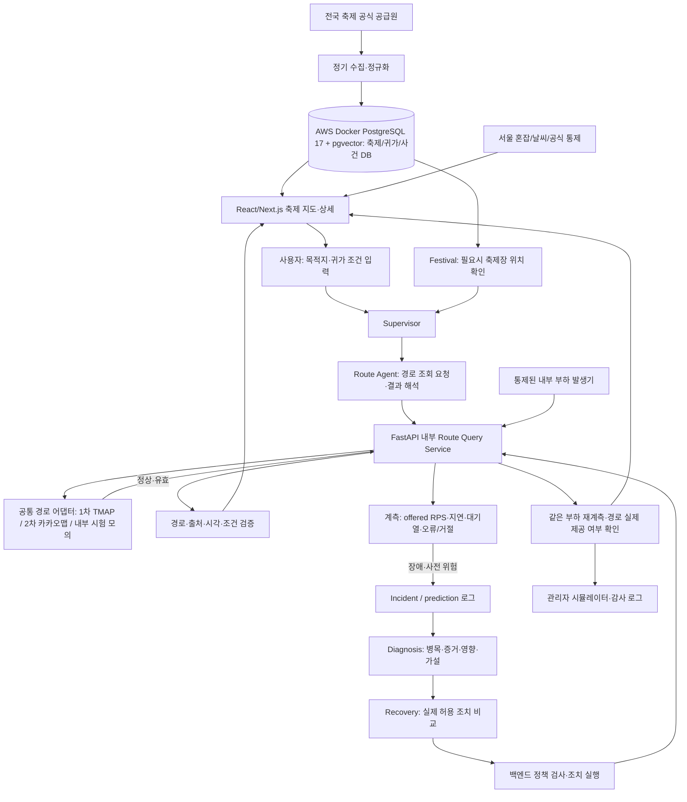
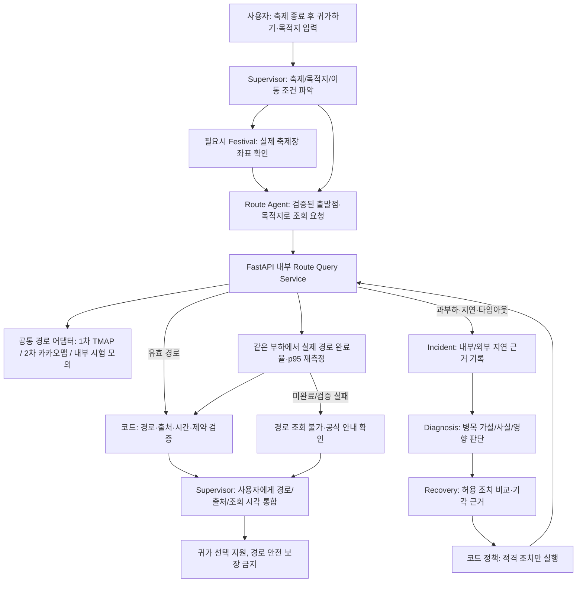

# 놀다가 (NOLDAGA)
## AI 안심 귀가 특화형 전국 축제 플랫폼
### 축제의 시작부터 마지막 귀갓길까지 연결하는 AI 서비스

| 문서 정보 | 내용 |
|---|---|
| 팀·개정 기준 | 수다수다(6명) · 2026-11-24 · 제출용 기획 본문 |
| 기준 문서 | [API 설계서 v0.5](../Step%202/API_설계문서.md) · [DB 설계서 v0.5](../Step%202/DB_스키마_설계서.md) · [WBS](놀다가_WBS.md) |
| 제출 상태 | 이 파일의 GitHub 반영·대시보드 제출·접수는 각각 별도 확인 |

> 놀다가는 전국 축제를 탐색하고 현장 정보를 확인하며 귀갓길까지 안내하는 서비스다. AI 귀가 안내를 차별화 기능으로 제공하고, 내부 경로 조회가 지연되는 상황에서는 에이전트의 진단과 허용된 복구 조치를 동일 부하에서 검증한다.

| 확인 수준 | 2026-11-24 기준 |
|---|---|
| 확정된 설계 | 전국 축제 탐색·AI 귀가·대표 내부 경로 조회 장애 시연, API·DB v0.5 계약, 자체 JWT·WebSocket·AWS Docker PostgreSQL 선택 |
| 로컬에서 확인한 것 | 기본·확장 DB DDL 시험 기록과 11/17 중복 요청 묶기 모의 예비 실험. 범위와 결과는 각각 원본 보고서 기준 |
| 아직 완료 판정 전 | 공급원별 실호출·약관·지역 범위, 프론트·Agent 전체 통합, AWS 운영 적용, 동일 부하 B0/B1/A1 자동 복구 실증, 제출·접수 확인 |

**안전·시험 경계:** 귀가 안전이나 무장애 접근성을 보장하지 않으며, 검증되지 않은 지역 데이터는 대체하지 않는다. 부하는 팀 내부 경로 조회 계층에만 주입한다. 모의 시험·로컬 DB 시험을 실제 경로 제공이나 자동 복구 완료로 해석하지 않는다.

### 문서 목차

1. [01. 프로젝트 개요](#01-프로젝트-개요)
2. [02. 문제 정의](#02-문제-정의)
3. [03. 핵심 시나리오](#03-핵심-시나리오)
4. [04. 요구사항 명세](#04-요구사항-명세)
5. [05. 서비스 아키텍처 · 기술 스택](#05-서비스-아키텍처--기술-스택)
6. [06. 에이전트 구성 · 협업 흐름](#06-에이전트-구성--협업-흐름)
7. [07. 일정 · 역할 분담](#07-일정--역할-분담)
8. [08. 리스크와 대응](#08-리스크와-대응)

---

# 01. 프로젝트 개요

### 1.1 서비스 소개

**놀다가**는 전국의 축제를 공식 데이터로 통합해 지도·검색·상세로 제공하고, 방문 준비·축제 현장 정보·종료 후 이동을 한 서비스에서 연결하는 **AI 안심 귀가 특화형 전국 축제 플랫폼**이다. 전국 축제 검색은 서비스를 구성하는 **핵심 기본 기능**이며 '부가 기능'으로 축소하지 않는다.

서비스의 **대표 차별화 기능은 '축제 종료 후 AI 안심 귀가'**이다. 사용자가 선택한 축제 장소를 출발점으로 목적지를 입력하면 Route Agent가 실제 연결된 경로 공급원(**1차 TMAP 대중교통, 2차 카카오맵 대중교통 후보**)의 결과와 출처·조회 시각·이동 조건을 안내한다. 동행자·교통약자 조건은 검증 가능한 경로 요소에 한해 반영하며, 현재 교통통제·무정차·접근성 상태가 연동·검증되지 않았다면 '확인 필요'로 표시한다. 여기서 '안심'은 실제 안전 보장이 아닌 **확인 가능한 정보와 불확실성을 구분하여 귀가 판단을 돕는 의미**다.

핵심 기술 시연은 **축제 종료 시점 경로 조회 요청 증가를 팀의 통제된 부하 시험으로 재현**하여, 자체 경로 조회 처리 지연을 감지하고 Diagnosis Agent가 병목 후보·영향을 분석하며 Recovery Agent가 **실제로 구현된 허용 조치**의 적합성을 평가하는 것이다. 백엔드는 조치 실행 후 **동일한 요청량에서 사용자가 유효한 경로를 받은 비율·시간**을 재측정한다. 내부 처리 지연과 외부 길찾기 공급원 장애를 혼동하지 않는다.

현장 혼잡·기상·시설·공식 통제 기능은 전·중·후 서비스를 지원하는 기능으로 유지한다. **서울시 지역 단위 혼잡 데이터**는 축제 장소와 집계 지역 매핑이 검증된 경우에만 연결하며 혼잡 API 500/stale/본문코드 감지·복구는 보조 기술 시험으로 관리한다.

### 1.2 비전·목표

**비전:** “축제의 시작부터 마지막 귀갓길까지, 필요한 정보를 신뢰할 수 있게.”

1. **전국 축제 플랫폼:** 여러 지역의 실제 축제 정보를 수집·정규화하여 지도·검색·상세로 제공한다.
2. **축제 전·중 연결:** 날씨·지역 혼잡·편의시설·공식 공지를 출처·유효 시각과 함께 안내한다(공급원 지원 범위에 한함).
3. **AI 안심 귀가:** 축제 종료 후 목적지·동행 조건에 맞는 **검증 가능한** 귀가 경로 후보를 설명하고, 미확인 사항을 명시한다.
4. **복원력 있는 귀가 조회:** 자체 경로 조회 서비스의 동시 요청 증가를 통제 시험으로 재현하고, 서비스 처리 성능·실제 경로 제공이 개선되는지 검증한다.
5. **멀티에이전트의 추가 가치 검증:** Route/Diagnosis/Recovery의 별도 판단·인계와 B0/B1/A1 동일 조건 비교를 통해 AI가 고정 규칙보다 추가로 기여하는지 측정한다.
6. **안전한 한계 준수:** 안전·통제·실시간 이동 가능 여부를 실제보다 과장하지 않고, 유효 경로가 없으면 조회 불가를 정확히 알린다.

### 1.3 핵심 가치와 차별화

| 가치 | 제공 경험 | 검증 방법 |
|---|---|---|
| **발견성** | 전국 축제 지도·목록·필터로 여러 행사를 찾음 | 실제 수집 축제 수·지역 커버리지·지도/상세 연결 |
| **AI 안심 귀가(차별화)** | 행사 종료 후 목적지 입력·AI 경로 안내·선택 조건 설명 | 실제 경로 조회 완료·출처/시각·조건 미충족 안내 |
| **서비스 신뢰성(핵심 기술)** | 경로 조회가 몰려도 허용 조치로 처리 성능 회복 시도 | 같은 부하의 시간 내 경로 제공 비율·p95 지연·거절/오류·MTTR |
| 현장 연계 | 지원 지역 혼잡·날씨·시설·공식 공지 확인 | 공급원·갱신시각·매핑 검증 |
| 정보 정확성 | 검증된 경로만 안내하고 미확인 통제를 구분 | 출처 없는 경로·통제 충돌·가짜 실시간 정보 표시 0건 지향 |
| 확장성 | 관심·후기·맞춤 코스·추천·동행 등 통합 확장 | 승인된 기능별 실구현·사용성·데이터 적합성 |

**포지셔닝:** 놀다가는 축제 전용 귀가 앱이 아니라 **축제 정보 플랫폼**이다. 경쟁 서비스의 기능 부재를 검증 없이 단정하지 않으며, '귀가 안내의 신뢰성'과 '진단·복구 과정의 검증 가능성'을 목표 차별점으로 설명한다.

### 1.4 서비스 범위와 데이터 제공 원칙

| 데이터 성격 | 지역 적용 | 사용자 화면·실행 기준 |
|---|---|---|
| **전국 공통 원천** | 전국 17개 시·도 대상 | 축제·상세·지도, 실제 지원되는 기본 길찾기(1차 TMAP 대중교통·2차 카카오맵 대중교통), 날씨, 시설 위치, TAGO 버스 도착, 경찰청 교통 돌발, 관광지 방문 집중 예측·지역 수요를 공급원별 지원 범위에서 제공 |
| **서울 전용 원천** | **서울만** | 검증된 구역의 OA-21778 실시간 혼잡, 지하철 실시간 도착, **서울 버스 차내 혼잡**, 공영주차장 빈자리, TOPIS 통제, 서울 문화행사 보완 |
| **자전거 존·택시 승강장** | 항목별 개별 판정 | **자전거 존과 택시 승강장 모두 전국 통합 공급원과 좌표가 확인되면 전국 제공하고, 없으면 검증된 서울 공급원으로 제공**한다. 공급원 미확인과 지역 미지원(`unsupported`)을 구분하며, 위치 안내만 제공(실시간 대여 가능 수·택시 호출 제외) |
| **기타 시·도별 원천** | 1차에는 미연동 | 대구·대전·제주 등 별도 지자체 전용 데이터는 확장 후보. 전국 공통 원천 데이터는 해당 지역에서 계속 활용 |
| **시뮬레이션** | **서울 축제 기준** | 실제 축제를 선택한 사용자 흐름에 연결하되 부하는 **내부 모의 경로 처리 어댑터**에만 주입. 지도·길찾기 상용 API에 부하 금지 |
| **미지원·확인 불가** | 모든 지역 공통 정책 | 지원 지역 밖은 `coverage.supported=false`와 `status=unsupported`로 표시. 원천 없음·미검증(`unverified`)·신선도 부족·시설 좌표 없음·공식 통제 미확인은 구체적으로 구분 |
| **범위 밖** | 전국 공통 | 티켓·예매·결제, 공연·전시 별도 탐색, A42용 대한민국 구석구석 인기순의 축제명·순위 수집 외 웹 크롤링, 네이티브 앱, 개인 GPS 이동 이력 추적, 축제장 내부 인원 추정·무장애 귀가 보장 |

**전국 지원 예정 = 전국 실호출 검증 완료가 아님.** TMAP·카카오맵·TAGO·경찰청 등은 실제 키·응답·요금·지원 구간을 검증해야 한다. 서울 집계 혼잡은 **서울 전체/축제장 내부의 구간별 혼잡을 뜻하지 않으며**, 축제-관측구역 매핑이 확인된 경우에만 나타낸다. 30일 방문 집중 *예측(상대값)*은 지금의 실시간 인구 혼잡과 색상·명칭을 분리한다.

### 1.5 범위와 성과 기준

| 단계 | 이용자가 확인할 경험 | 완료 판단 |
|---|---|---|
| 첫 시연 | 전국 축제 탐색·상세 → 목적지 입력 → 귀가 경로 결과 또는 조회 불가 안내 | 실제 축제와 경로 공급원의 지원 범위, 모의 자료를 구분하고 조회 상태를 화면에 표시 |
| 대표 기술 시연 | 내부 경로 조회 지연 감지 → Diagnosis·Recovery 판단 → 허용된 코드 조치 → 동일 부하 재측정 | 유효 경로 제공률·지연·오류·거절·복구시간을 같은 조건에서 비교. 접수·대기는 성공으로 세지 않음 |
| 최종 필수 | 현장 정보·가는 길·AI 코스·챗봇/RAG·관심·맞춤 추천·동행·친구·채팅·운영 기능 | 기능별 권한·데이터·통합 시험을 거쳐 제공. 세부 우선순위는 4.15절과 WBS 참조 |
| 선택·보류 | 경로 비교, 추가 편의 기능, 예매·결제 등 | 4장의 Should/Could 및 WBS 비필수 작업을 기준으로 별도 결정 |

**기대효과는 측정 가설이다.** 축제 탐색 성공과 지역 커버리지, 목적지 입력부터 유효 경로 제공까지의 완료율, 같은 부하의 지연·오류·복구시간을 측정한다. 개선 수치는 통합 시험 전에는 주장하지 않는다.

맞춤 추천과 동행·친구·채팅은 최종 필수 구현 기능이다. 이용자가 해당 기능을 사용하지 않아도 공개 축제 탐색과 귀가 안내는 이용할 수 있다. 사용자 채팅은 AI 챗봇과 구분하고, 취향 기반 축제 발견은 AI 방문 코스와 구분한다.

# 02. 문제 정의

### 2.1 축제 탐색·정보 제공의 구조적 문제

축제 일정과 장소는 공공 포털·지자체·주최 측 홈페이지에 분산되어 있고, 현장 혼잡·기상·교통통제·주변 시설은 별도의 서비스에 존재한다. 사용자는 **어떤 축제가 열리는가**, **가도 되는 날씨인가**, **주변이 얼마나 붐비는가**, **가는 길·귀가 길을 어떻게 정할 것인가**를 각각 확인해야 한다.

사업자·기관별 축제 데이터는 필드·형식·갱신 주기가 다르므로 지도 플랫폼은 API 호출뿐 아니라 **정규화·중복 제거·좌표 확인·변경 관리**가 필요하다. 전국의 모든 행사가 어느 한 API에 완전하게 포함된다고 전제하지 않는다.

### 2.2 참고 사례와 규모 근거

**2025 서울빛초롱축제:** 서울관광재단의 2026-01-20 공식 보도자료는 행사 **37일간 누적 방문객 383만 명**을 발표했다. 이는 대규모 도심 축제에 대한 관심과 현장 안내의 중요성을 보여주는 사례다. **실시간 현장 인원이나 서울시 지역 인구 API 수치와 동일하지 않다.** [출처: 서울관광재단](https://sto.or.kr/press/16035_/16035).

**2026 서울세계불꽃축제:** 2026-09-01 서울시 사전 교통·안전 대책에는 지하철 운행 증회, 역사 무정차 가능성, 도로 통제·버스 우회 등의 안내가 포함됐다. 과거 행사 대책은 **현재 시행 중인 통제**로 사용하지 않는다. [출처: 서울시 보도자료](https://www.seoul.go.kr/news/news_report.do?nttNo=465103).

### 2.3 관람객의 문제

> **핵심 문제:** 축제 종료 직후 이용자는 목적지별 귀가 경로와 공식 교통 안내를 따로 확인해야 한다. 놀다가의 귀가 경로 조회가 자체 처리 병목으로 지연된다면 필요한 정보가 제때 제공되지 못한다. **이는 실제로 트래픽이 폭증했다는 관측 결과가 아니라 통제된 부하 시험으로 확인할 기술 가설**이다.

| 단계 | 사용자 불편 | 놀다가 대응 |
|---|---|---|
| 축제 전 | 여러 행사 일정·지역·후기를 한눈에 비교하기 어려움 | 전국 지도·날짜·지역 검색, 맞춤 추천, 축제 상세·관심 저장 |
| 축제 전 | 가족·연인에 맞는 이동·식사·편의시설 및 동행 계획 번거로움 | AI 코스 후보, 동행 모집·신청, 주변 상권·시설, 가는 길·예보 |
| 축제 중 | 주변 혼잡·날씨·현장 통제 정보가 분산 | 지역 혼잡·12시간 전망·날씨·통제, 출처·시각 안내 |
| 축제 중 | 화장실·병원·주차·교통시설·카페 등을 따로 검색해야 함 | 주변 시설·상권 카테고리 지도 |
| 축제 후 | 교통 운행 변경 속 귀가 경로 확인이 번거로움 | 귀가 경로 조회, 확인된 공식 변경 반영 검토 |
| 축제 후 | 방문 경험을 다음 방문자에게 전달하고 동행 인연을 이어갈 공간 필요 | 축제별 후기(Should)·관심 목록, 지난 동행·친구 채팅 |

### 2.4 기존 공공 안전관리와의 관계

지자체·주최 측·경찰·소방 등 관계 기관은 현장 통제·안전관리 책임을 담당한다. 놀다가는 해당 기관의 판단을 대신하지 않고 **공식 공지를 발견·표시하고 이용자가 참고할 수 있도록 돕는 보조 정보 서비스**다. 혼잡도만으로 '사고 위험', '안전한 골목', '무정차 확정' 등을 임의 판단하지 않는다.

### 2.5 기존 서비스의 한계와 기회

Spotts는 지도 기반 전국 행사 탐색과 일정·장소·주변 시설 경험을 참고할 수 있는 벤치마크다. 기존 지도 앱은 폭넓은 길찾기를, 지자체·공공데이터 플랫폼은 지역별 현장 지표를 제공한다. 놀다가는 **하나의 선택된 축제를 맥락으로 하여 축제 정보와 실시간 상태·주변 시설·이동·AI·동행을 묶는 경험**을 검증한다. 경쟁사에 특정 기능이 없다고 단정하지 않는다.

### 2.6 데이터 측면의 제약

**전국 축제·날씨·시설·버스·교통 돌발·길찾기·관광지 방문 집중 예측**의 공급원은 전국 공통 후보로 확보했으나 지역별 필드·실제 데이터 범위·요금·쿼터와 팀 키 호출은 각각 검증해야 한다. **실시간 인구 혼잡·지하철 도착·서울 버스 차내 혼잡·주차장 잔여 면수·서울 TOPIS 데이터**는 우선 서울에서만 제공한다. 혼잡 집계 장소와 실제 축제장이 일치하지 않거나 매핑 근거가 없으면 '미지원'으로 표시한다.

실시간 혼잡(현재의 관측값)과 30일 관광지 방문 집중 예측(상대값)은 다른 지표다. 교통약자 이동 경로·무정차 반영은 검증된 별도 자료 없이 보장하지 않는다. 길찾기 공급원은 **1차 TMAP 대중교통, 실패 시 2차 카카오맵 대중교통**으로 선정됐지만 실제 요청·응답·오류·전환 및 쿼터는 실호출 전으로 관리한다.

### 2.7 핵심 문제 정의

**서비스 문제:** 전국 축제 정보와 현장·교통 정보가 분산되어 있고, **축제 종료 후 대중교통·교통통제 및 귀가 경로를 다시 찾아야 하는 상황**에서 이용자는 이동 선택의 근거를 한곳에서 확인하기 어렵다.

**기술 문제:** 귀가자가 같은 시각에 **놀다가의 귀가 경로 조회 기능을 실제로 사용하는 경우**, 우리 내부 경로 조회 처리 계층에 트래픽이 집중되어 응답 지연·오류가 발생할 수 있다. 통제된 시험에서 병목을 재현하고, 에이전트가 진단·복구 대안을 평가한 뒤 시스템이 사용자 경로 제공 상태를 회복했는지 측정한다(공통 원칙 2번 준수).

**안전·품질 문제:** 오래된 경로나 확인되지 않은 교통통제를 현재 이용 가능한 경로라고 제시하면 안 된다. 실패 시 '조회 중/대기 중/확인 불가'를 정확히 구분하는 것도 중요하다.

### 2.8 주요 사용자와 검증 가설

| 사용자 | 해결할 문제 | 확인 방법 |
|---|---|---|
| 축제 탐색·방문객 | 지역별 축제·현장 정보를 비교하고 방문 계획 수립 | 지도·검색·상세에서 실제 축제와 출처·시각을 확인 |
| 대중교통 귀가자 | 종료 후 목적지까지의 경로와 미확인 조건 파악 | 경로 완료·대기·조회 불가를 구분하는 사용성 시험 |
| 동행 희망 방문객 | 모집·승인·만남 장소·대화를 안전하게 조율 | 승인 멤버 권한, 정원 초과·차단·보존 시험 |
| 운영자 | 중복 데이터와 내부 경로 조회 장애를 식별·대응 | 원본 대조, 감지·조치·재측정 기록 |

사용자 설문·사용성 시험은 계획이며 실시 실적으로 표기하지 않는다. 서울 혼잡의 지원 범위와 기준 시각, 귀가 경로의 출처·실패 안내를 이용자가 올바르게 이해하는지 확인한다.

# 03. 핵심 시나리오

### 3.1 전국 플랫폼 대표 사용자 흐름과 AI 안심 귀가 초도 시연의 연결

**대표 사용자(기획 가설):** 전국 축제 목록에서 행사 하나를 찾고 참여한 방문객 A. 축제 종료 후 목적지를 입력하여 확인 가능한 귀가 경로를 비교·선택하려 한다. 전국 지도는 실제 서로 다른 지역의 여러 행사를 제공하는 **기본 플랫폼**이다.

| 단계 | 사용자 행동·판단 | 필요한 데이터/결과 | 에이전트·시스템 | 화면 상태 |
|---|---|---|---|---|
| ① 축제 탐색 | 지역·날짜로 축제를 찾음 | 공식 축제 ID·장소·시간·좌표 | DB 검색 / 필요 시 Festival | 축제 목록·상세, 출처 |
| ② 축제 이용 | 축제장·현장 정보를 확인 | 공식 행사 안내, 제공 가능한 지역 정보 | Festival / 공공 API | 혼잡 지원·미지원 구분 |
| ③ **귀가 선택** | **'귀가하기' → 목적지·이동 조건 입력** | 축제장 출발점·목적지(필요 시 이동수단) | Supervisor → Route → 경로 조회 백엔드 | 조회 중 / 대기 중 |
| ④ 정상 응답 | 실제 경로를 확인하고 이동을 결정 | 검증된 공급원(1차 TMAP/2차 카카오맵) 응답·조회 시각·이동 정보 | Route + 코드 유효성 검증 | 유효한 경로 / 미확인 통제 표시 |
| ⑤ **통제 장애 주입** | 여러 사용자가 동시에 조회하는 상황을 실험 | 우리 서비스 내부 요청량·대기열·응답시간·오류 | **팀의 내부 부하 발생기** + 관측 코드 | 조회 지연/실패, 허위 경로 금지 |
| ⑥ **에이전트 Auto-Healing** | 장애 중 경로 결과를 기다림 | 증거·복구 후보·실행 로그 | **Diagnosis → Recovery → 정책 코드** | 처리·대기·결과 상태 구분 |
| ⑦ **동일 부하 재검증** | 실제 경로를 받거나 확인 불가 안내 확인 | 경로 제공 건수·지연·거절·오류·통제 반영 여부 | 실행 코드·Route·Supervisor | 경로 제공 성공 또는 정확한 실패 안내 |

**통제된 기술 시연과 운영 서비스의 구분:** 실제 축제 종료 때 이용자가 집중된다는 것은 사용자 문제의 배경이다. 동시 요청 급증과 경로 처리 병목은 **시연용 부하 주입으로 재현하는 가설**이며 실제 축제 운영 트래픽·외부 API 장애를 확인했다는 뜻이 아니다. 고정된 시험용 경로를 사용했다면 결과에 반드시 '모의'를 표시한다.

### 3.2 1차 시연 범위와 이후 서비스 경험 분리

| 시점 | **첫 시연 필수** | 최종 구현·후속 | 보류·미지원 |
|---|---|---|---|
| 축제 전 | 전국 다수 축제 지도·검색·상세·장소 선택 | AI 동행 코스, 날씨·시설·관심·가는 길, 맞춤 추천 | 예매, 확인되지 않은 행사 세부 운영 정보 |
| 축제 중 | 축제 기본 정보·선택 위치 유지 | 검증된 서울 혼잡/전망·공식 공지·교통통제, 동행 모집/채팅 | 전국 혼잡 보장, 골목·출구 안전 단정 |
| **축제 후** | **목적지 입력 → 실제 경로 응답/출처·시각 → 조회 실패/대기 상태** | 통제 연계, 친구 채팅, 후기(Should)·고급 5유형(Should) | 실측 안 된 경로·접근성·운행 상태 보장 |
| **Auto-Healing** | **내부 경로 처리의 부하 주입 → 감지 → Diagnosis/Recovery → 허용 조치 → 동일 부하 검증** | 혼잡 API 500/stale/본문 오류, 축제 수집 장애, 귀가 예측 고도화 | 외부 길찾기 API 직접 과부하 시험, 없는 대체원 가장 |

**우선 개발:** 실제 경로를 정상적으로 받는 최소 계약이 먼저 필요하다. 부하 시험용 경로 공급원이 모의인 경우 첫 시연은 '내부 경로 처리 복원력 검증'이고, **실제 경로 연동은 아직 미완료**라고 표시한다.

### 3.3 대표 Auto-Healing — 귀가 경로 조회 동시 요청 처리 지연

대표 장애는 팀이 제어하는 경로 처리 계층의 지연·과부하다. 실행 순서는 **정상 기준 측정 → 내부 부하 → 코드 감지 → Diagnosis 근거 분류 → Recovery 후보 선택/기각 → 코드 정책 실행 → 동일 부하 재측정**이다.

| 확인 지점 | 필수 기록 |
|---|---|
| 실제 병목 | 내부/외부 시간·요청량·큐·자원·오류를 분리하고 비동기 sleep과 CPU 병목을 구별 |
| 실행 적격성 | 허용된 공급원·동일 사용자/입력·개인 조건·시각·정책에 맞는 병합/캐시/큐 조치인지 확인 |
| 자동 복구 | 시험 시작부터 최적화를 켜 둔 결과와 장애 감지 후 활성화·원복을 구분 |
| 효과 | 6.6의 동일 조건 비교 지표 사용, 고유 요청에서 무효한 병합은 기각 |

사건 결과와 예비 실험은 3.5, 수용 조건은 4.16에 기록한다. 현재는 설계이며 자동 복구 완료 근거가 아니다.

### 3.4 5개 에이전트의 조건부 협업

**대표 귀가 흐름:** `Supervisor → (필요 시 Festival로 축제장 확인) → Route → [내부 조회 지연 시] Diagnosis → Recovery → 백엔드 정책/실행 → Route 결과 검증 → Supervisor`.

- **Route Agent는 첫 시연의 핵심**: 출발점·목적지/요청조건 정리, 유효 경로 후보·공식 제약 결과 수신 및 사용자에게 설명할 정보 전달.
- **Diagnosis Agent:** 제공 요청량, 처리 대기열, 내부/외부 구간별 응답지연, 오류·거절을 구분해 원인 후보·영향 범위를 판단한다.
- **Recovery Agent:** 코드가 제공한 **실재하는 허용 조치만** 비교하여 선정/기각 이유와 중단 조건을 전달한다.
- **Festival Agent:** 축제 ID·장소·종료 정보가 필요한 경우 호출하며, 장애 대응 전 과정에 강제 참여시키지 않는다.
- 5개 에이전트의 수는 유지하되 **모든 요청이 5개를 전부 실행해야 한다는 뜻은 아니다.**

### 3.5 대표 장애·복구 시연의 판정

팀이 제어하는 FastAPI 경로 조회 계층에만 부하를 주입한다. 외부 TMAP·카카오맵 API에는 부하 시험을 하지 않는다. 같은 요청량과 입력 분포에서 지연·오류·거절·대기열을 관측하고, Diagnosis가 내부 병목과 공급원 오류를 구분한다. Recovery는 구현된 허용 조치만 제안하며 정책 코드가 검증·실행한다. 유효 경로가 제한 시간 내 제공됐는지 재측정한다.

최종 사건 결과는 `normal_recovered`, `valid_cache`, `alternate_source`, `degraded`, `unresolved`로 구분한다. 유효 캐시·대체 공급원은 저장·사용 허용 조건을 충족해야 한다. `degraded`와 `unresolved`, `accepted`·`queued`는 경로 제공 성공이 아니다. 모의 응답은 실제 경로 성공률과 합산하지 않는다.

**중복 요청 묶기 판단:** 2026-11-17 모의 ASGI 예비 시험 기록에서는 동일 조건 반복 요청에만 개선이 관측됐고 서로 다른 요청에서는 개선되지 않았다. 동일 요청 조건과 중복률을 검증할 수 있을 때만 후보로 적용하며, 효과가 없거나 불리하면 보류·원복한다. 원본 코드·JSON·재현 방법의 접근성은 별도 확인하며, 자동 감지·조치·재검증 성과는 별도 통합 시험 대상이다.

### 3.6 확장 사용자 흐름

맞춤 추천은 취향 선택 또는 건너뛰기 → 축제 탐색·추천 이유 확인 → 기존 축제 상세로 이어진다. 동행은 축제별 모집 → 신청 → 작성자 승인 → 승인 멤버 채팅·만남 장소 → 종료로 이어지며, 친구 관계는 상대방 수락 후 별도로 성립한다. 미승인 사용자의 방·정확한 만남 장소 접근은 차단한다. 세부 요구사항은 4장과 `놀다가_요구사항_시험_상세.md`를 따른다.

# 04. 요구사항 명세

### 4.1 요구사항의 범위와 우선순위

- `Must`는 최종 MVP 필수, `Should`는 채택 여부에 따라 진행, `Could`는 후속 후보. **1차 시연 대상은 별도**로 표기한다.
- 전국 축제 탐색·지도·상세와 기본 **가는 길·AI 안심 귀가**, 그리고 **맞춤형 추천·동행/친구/채팅**은 필수 기능이다. 고급 5유형 경로 비교는 `Should` 유지.
- 전국 공통 데이터는 전국, 서울 전용 데이터는 서울에서만 표시하며 `coverage`와 `unsupported` 응답을 일관되게 적용한다.
- API 설계 기본 **A01~A35(`/api/v1`) 전체와 추천 API A36~A42·축제 상세 검색 결과 A81 및 동행·친구·채팅 계약 영역을 프로젝트 대상**에 포함한다(11/20은 문서 설계 마감).
- 기존 AI 챗봇·방문 코스·RAG·관심 등 기능 목표를 유지한다. **물품보관함·약국 지도는 보류**하고 후기·상권 고도화·고급 경로 비교 등 선택 구현은 WBS 분류에 맞춘다.
- 대표 Auto-Healing은 내부 귀가 조회의 통제된 모의 부하 시험이며 서울 혼잡 공급원 장애는 보조다. 예매·결제·공연/전시 별도 탐색과 A42용 대한민국 구석구석 인기순의 축제명·순위 수집 외 웹 크롤링은 범위 밖이다.
- WBS의 **기존 111개(필수 101·선택/조건부/후속/보류 10)와 신규 필수 17개(W112~W128)** 작업 집계는 이 장의 FR 우선순위와 구분한다.

### 4.2 핵심 기능군 요약

| 기능군 | 제품 내 역할 | 데이터·단계 기준 |
|---|---|---|
| A 축제 수집·관리 | 전국 정보 통합 기반 | TourAPI·전국문화축제표준데이터 등 공식 원천, 실호출/누락 확인 |
| B 전국 축제 지도·검색·상세 | **기본 플랫폼 핵심** | 지역·기간·키워드·지도 범위, 축제 소개·입장료(있을 때), 원본 출처 |
| C 현장 상황·이동정보 | 혼잡·날씨·교통 상황 확인 | 전국 날씨·버스 도착·돌발·방문 예측 / 서울 혼잡·지하철 도착·**서울 버스 차내 혼잡**·주차 빈자리·TOPIS |
| D 시설·상권 지도 | 화장실·주차장 위치·병원/응급실·교통 거점·자전거 존·택시 승강장·상권·관광지 | **자전거 존과 택시 승강장 모두 전국 통합 공급원과 좌표 확인 시 전국 제공, 없으면 검증된 서울 공급원으로 제공**, **물품보관함·약국 보류** |
| E 가는 길·AI 안심 귀가 | 이동 후보와 데이터 근거 제공 | **1차 TMAP 대중교통·2차 카카오맵 대중교통** 선정, 귀가 1차 핵심·가는 길 최종, `area_evidence`/`mode_evidence` 구분 |
| F 챗봇·코스·RAG·관심·후기·추천·동행 | 전·중·후 맥락 및 커뮤니티·개인화 | 5개 에이전트 협업 + 규칙 기반 추천·동행/친구/채팅(Must), 후기(Should) |
| G Auto-Healing·운영 | 귀가 경로 지연 자동 감지·안전한 복구 | 같은 offered load B0/B1/A1, 사건·실행·검증 기록, 서울 혼잡 장애 보조 |

**지역별 지원 안내:** 데이터 제공 여부는 `GET /api/v1/data-sources`(A30)와 개별 API의 `coverage`를 기준으로 표시한다. 전국 API를 사용하더라도 실제 개별 지역 지원을 실호출로 확인한 범위만 제공한다.

### 4.3 축제 탐색·현장 정보 — FR-F

| ID | 기능 요구사항 | 우선순위·단계 | 수용 기준 / 예외 처리 |
|---|---|---|---|
| **FR-F01** | 전국 축제 검색·상세 | **Must** | 축제 통합 ID 기준 지역·기간·키워드·상태·지도 범위 검색, **간단 소개·입장료**는 원본에 있을 때 표기 |
| **FR-F02** | 선택 축제 주변 실시간 혼잡 | **Must·서울만** | 서울시 OA-21778 지원 관측 구역과 매핑된 축제만 단계·관측시각·집계 범위. 12시간 인구 전망과 구분 |
| **FR-F03** | 혼잡과 위험·공식 통제 분리 | **Must** | 지역 혼잡도를 개별 귀가 길의 안전·통제 여부로 단정 금지 |
| **FR-F04** | 지도 주변시설 표시 | **Must(확보된 범위)** | **화장실·주차장 위치·병원/응급실·지하철역·버스 정류장** 및 **자전거 존·택시 승강장**(두 항목 모두 전국 통합 공급원·좌표 확인 시 전국 제공, 없으면 검증된 서울 공급원으로 위치 안내만 제공; 실시간 대여 가능 수·택시 호출 제외). **물품보관함은 보류** |
| **FR-F05** | 축제 공식 운영 공지 | **Must** | 행사 취소·운영 변경·현장 안내는 공식 원본과 시각·효력 표시 |
| FR-F06 | 기존 폐기 ID | 폐기 유지 | ID 재사용 금지 |
| FR-F07 | GPS 기반 시설 길안내 | Could | 위치 수집 동의·공급원·개인정보 검증 후만 진행 |
| FR-F08 | 주차 잔여 면수 | Could(서울·채택 시 A27 구현) | **서울 공영주차장 지원 장소**에서만 실호출로 확인한 면수 제공. 다른 지역은 위치만·빈자리는 `unsupported`; API 목록 포함과 Must 승격은 별개 |
| **FR-F09** | 날씨·예보 | **Must·전국 원천** | 기상청 격자 변환 및 발표/관측 시각, 미지원 지역 표시 |
| **FR-F10** | 전국 복수 축제 지도·검색 | **Must** | 여러 지역 행사 마커와 목록 동기화, 좌표 없는 축제는 목록 유지·마커 제외 |
| **FR-F11** | 병원·응급실 정보 | **Must** | 검증된 응급시설 정보·좌표·출처 표시. **약국은 보류**; 응급실 빈 병상은 별도 실시간 근거가 있을 때만 |
| **FR-F12** | 주변 상권·관광지 지도 | Should | 맛집·카페·편의점·주변 관광지 **위치/기본정보**를 확보된 공급원에서 표시. 별도 공연·전시 검색 기능 아님 |
| **FR-F13** | 교통 돌발·공식 통제 | **Must(검증 가능 범위)** | 전국 경찰청 돌발과 서울 TOPIS 보완. 사고·공사·행사·무정차/우회 여부는 원본 시간·구간·출처 일치 시만 확정 |
| **FR-F14** | 축제-혼잡 관측 지역 매핑 | **Must·서울만** | `festival_id`와 실제 서울 `area_code` 관계 검증. 임의 근접 매핑 불가 |
| **FR-F15** | 축제 상태·기간 필터 | **Must** | 예정·진행·종료·취소, 원본 불확실 시 확인 필요 안내 |
| **FR-F16** | 교통수단 실시간 도착 | Must(최종·검증된 지원 범위) | **버스 TAGO(전국 원천)** / **지하철 실시간 도착(서울만)**. 도착 정보는 공급원 제공 범위·시각 내에서 표시(버스 차내 혼잡과 구분) |
| **FR-F17** | 관광지 방문 집중 예측 | Must(최종·검증된 지원 범위) | 30일 **상대 집중도/지역 수요**를 ‘예측’으로 표기, **현재 인구 혼잡과 명칭·색상·데이터 분리** |
| **FR-F18** | 데이터 제공 지역 표시 | **Must(표현 원칙)** | `coverage.scope/region_code/supported`, 데이터 신선도·출처·지역 미지원(`unsupported`)·미검증(`unverified`) 상태 표시; 타지역 값으로 채움 금지 |

**지도 표시 범위:** 축제 장소, 주변 화장실, 주차장 위치, 병원/응급실, 지하철역, 버스 정류장, 자전거 존, 택시 승강장, 주변 상권·관광지 및 서울 지원지역 혼잡도 등의 레이어를 제공한다. 실시간 도착/주차 빈자리는 위치 레이어에 세부 상태로 연결한다. 물품보관함·약국은 API 호환용 값으로만 남기고 기본 지도에서는 수집·표시하지 않는다.

### 4.4 방문 계획·경로 — FR-R / FR-P

| ID | 요구사항 | 우선순위 | 수용 기준·검증 경계 |
|---|---|---|---|
| FR-R01 | 최단시간 경로 | Should | 실제 공급원이 반환한 복수 후보의 소요시간 기준의 경로 비교(노약자·편의시설 중심의 최소 도보 경로 FR-R04와 구분) |
| FR-R02 | 혼잡 회피 경로 | Should | 실제 경로 구간/수단 단위의 신뢰 가능한 혼잡 근거가 있을 때만. 서울 지역혼잡을 개별 길 혼잡으로 단정 금지 |
| FR-R03 | 교통약자 배려 | Should | 접근성·계단/승강기·통제 데이터 확인된 범위만; 무장애 보장 금지 |
| FR-R04 | 최소 도보 경로 | Should | **노약자·보행 약자를 위해 엘리베이터, 에스컬레이터 등 보행 부담을 줄이는 동선과 도보 구간을 안내**하는 경로(총 소요시간이 짧은 최단시간 경로 FR-R01과 구분; 공급원·시설 데이터 검증 범위 내 제공) |
| FR-R05 | 최소 환승 경로 | Should | 실제 경로 후보별 환승 수 검증 후 비교 |
| **FR-R06** | 공식 통제 충돌 검증 | Must(확인된 범위) | 시간·구간·출처가 확실한 공식 통제만 경로 후보와 대조 |
| FR-R07 | 자연어 동행자·이동조건 | Should | AI가 해석하되 공급원에서 검증 가능한 제약만 안내 |
| **FR-R08** | 경로 출처·조회시각·상태 | Must | `provider`(1차 TMAP/2차 카카오맵 구분), `queried_at`, `is_mock`, `coverage`, 확인되지 않은 조건과 경로 상태를 구분 |
| **FR-R09** | 통제 시 재조회 | Must(검증 가능 범위) | 실제 충돌 검증 가능할 때 부적합 후보 차단·재조회. 미지원은 확인 불가 |
| **FR-R10** | 접근성 미확인 처리 | Must | ‘계단 없음/안전함/운행 가능’을 근거 없이 보장하지 않음 |
| FR-R11 | 막차 자동 알림 | Could | 공급원·권한·시간표 실증 후 추후 판단 |
| **FR-R12** | **축제 가는 길 기본 조회** | Must(최종) | A25: 사용자 출발지→축제장, 귀가와 같은 공통 어댑터(1차 TMAP·2차 카카오맵)·응답 검증 재사용, `direction=visit` |
| **FR-R13** | **AI 안심 귀가 기본 조회** | **Must·1차 시연** | A04: `festival_id` 축제장→목적지, **1차 TMAP 대중교통·실패 시 2차 카카오맵 대중교통** 공통 어댑터(실호출·전환 검증 전은 모의·확인 불가 분리) |
| **FR-R14** | 비동기 경로 상태 조회 | **Must·1차 시연** | A05: 내부 상태 `created/queued/processing/ready/unavailable/rejected/timed_out`를 관리하되, **`created`는 내부 생성 상태이며 사용자 화면에는 `queued`부터 노출**한다. 접수/대기는 경로 완료 아님 |
| **FR-R15** | 경로 요청 이력·개인정보 및 저장 정책 | **Must·1차 시연** | `X-Request-ID`, `route_request_id`, `direction`, `is_mock`, 처리 시각/출처 기록. 원문 장소 장기 보존 금지. **카카오맵 경로 본문은 API·DB 설계서 v0.5의 비저장 정책에 따라 DB·캐시에 저장하지 않음** |
| **FR-R16** | 경로·조건 유효성 | **Must·1차 시연** | 출발·도착·교통수단·시간·검증 가능한 공식 안내 확인, 미확인 조건 별도 표시 |
| **FR-R17** | 귀가 대기·거절·확인 불가 UX | **Must·1차 시연** | 타임아웃·429/503·지역 미지원/공급원 오류 구분 및 공식 안내 |
| **FR-R18** | 내부 조회 부하 격리 | **Must·1차 시연** | 내부 모의 어댑터에만 시험 부하. 외부 API(TMAP·카카오맵) 부하 금지, 전국 축제 검색 정상 유지 검증 |
| **FR-R19** | **경로별 판단 근거(`area_evidence` / `mode_evidence`)** | Must(확보된 자료만) | 지역·구간 근거(`area_evidence`: 지나가는 **서울 혼잡 구역**, **전국 경찰청·서울 TOPIS 교통 돌발**)와 수단 비교 근거(`mode_evidence`: **서울 버스 차내 혼잡** 등)를 분리. 버스 차내 혼잡은 **서울만 제공 설계**이며 서울 밖은 `unsupported`, 서울 버스 도착정보(`15000314`)와 TMAP `stationID↔arsId` 매핑 검증 전에는 `unverified` |
| **FR-P01** | 동행 유형별 AI 방문 코스 | Must(최종) | 실존 축제/장소·운영시각·조건을 확인한 추천 |
| FR-P02 | 코스 수정·재추천 | Should | 조건 변경/제약 미충족 이유 |
| **FR-P03** | 방문 코스 검증 | Must(최종) | 실제 장소 ID·날짜·동선 검증 불가 시 확인 불가 안내 |

기본 가는 길·귀가 조회는 Must, **5유형 고급 비교는 Should**로 유지한다. `route_requests.direction`은 `return`/`visit`을 구별한다. AI는 확보하지 않은 정보를 추론해 실시간 환승·통제·혼잡 안전성을 보장하지 않는다.

### 4.5 AI 통합 챗봇 — FR-C

| ID | 요구사항 | 우선순위 | 수용 기준 |
|---|---|---|---|
| **FR-C01** | 자연어 축제 안내 | Must | 검색/선택 축제의 일정·장소·행사정보 질문에 실제 데이터 기반 응답 |
| **FR-C02** | 복합 질문 처리 | Must | 축제·코스·혼잡·날씨·상권·가는/오는 길 중 필요한 도구 분리 호출 후 통합 답변 |
| **FR-C03** | 동행 유형·조건 이해 | Must | 가족·연인 등 사용자 명시 조건을 코스 추천에 전달, 민감 정보 영구 저장 금지 |
| **FR-C04** | 축제 맥락 유지 | Must | 현재 선택한 `festival_id`와 지원 지역을 유지; 축제를 바꾸면 잘못된 현장정보 인용 금지 |
| **FR-C05** | 공식 안내 RAG | Must | 승인된 축제 운영 공지·FAQ를 근거로 응답하며 문서 출처 제공 |
| **FR-C06** | 출처·최신성·불확실성 표시 | Must | 실시간 API 시각과 RAG 문서 작성일 구분, 부재 시 확인 불가 |
| **FR-C07** | AI 추천 검증 | Must | 존재하지 않는 장소·공식 통제 위반·유효기간 지난 공지 등 규칙 검증 실패 시 재생성 또는 차단 |
| FR-C08 | 음성 질문 | Could | 후속 기능 유지, STT 비용·동의 검토 이후 결정 |
| FR-C09 | LLM 장애 시 비AI 기본 서비스 유지 | Must | 챗봇 실패 시 지도·축제 상세·관심 목록 등 정상 작동, 실패 메시지 정확히 표시 |

### 4.6 자체 로그인·인증 및 관심 축제 저장 — FR-A

| ID | 기능 요구사항 | 우선순위 | 수용 기준 |
|---|---|---|---|
| FR-A01 | 자체 회원가입 | Must | A32: 사용자 생성·중복 식별자/입력 검증·비밀번호 안전 보관, users/profiles 연결. 실제 구현·시험은 후속 |
| FR-A02 | 로그인·Access/Refresh 발급 | Must | A33: 서버 검증 후 토큰 발급, 오류 시 비밀정보 비노출·허용된 역할만 부여 |
| FR-A03 | 토큰 갱신·재사용 차단 | Must | A34: Refresh 교체·이전 토큰 재사용/만료·동시 갱신 처리 검증 |
| FR-A04 | 로그아웃·토큰 폐기 | Must | A35: Refresh 폐기, Access 즉시 차단 범위·남은 유효기간 처리와 재접속 거절을 계약에 명시 |
| **FR-A08** | 관심 축제 저장·해제·모아보기 | **Must** | 사용자별 `festival_id` 저장/해제·중복 방지, 다른 사람의 관심 목록 접근 차단. 쓰기 작업은 인증·권한 검증 |

**인증·DB 경계:** FastAPI는 서명·만료·역할·대상 자원 권한을 검증한다. 자체 JWT가 DB 사용자 권한으로 자동 연결되는 것으로 가정하지 않는다. W16에서 검증된 사용자 ID·역할을 트랜잭션 한정 DB 문맥에 연결하는 방식과 제한된 런타임 DB 역할을 정한다. 테이블 소유자/슈퍼유저·BYPASSRLS와 앱 역할을 구분하고, 연결 풀 재사용 시 타인 문맥 잔류·직접 DB 접근·토큰 폐기 후 접근을 W54/W128에서 시험한다. 실제 구현·E2E 검증 전이다.

### 4.7 후기·경험 공유 — FR-U [신규]

| ID | 요구사항 | 우선순위 | 수용 기준 |
|---|---|---|---|
| **FR-U01** | 축제 후기 작성·목록 조회 | **Should** | 로그인 사용자가 특정 축제에 후기를 등록, 해당 축제 상세에서 목록 조회 |
| FR-U02 | 후기 수정·삭제 | Should | 본인 후기만 수정/삭제 가능, 관리자 정책에 따른 비공개 조치 구분 |
| FR-U03 | 후기 기본 검증 | Should | 빈 글·길이·XSS 등 입력 검증, 신고·악용 방지 최소 정책 |
| FR-U04 | 후기 관리·신고 | Could | 신고 흐름·운영자 조치·이력 등 추가 정책 결정 후 구현 |

**범위:** 후기는 화면·API·DB/권한·운영 부담을 고려해 **Should(선택 구현)**로 두며, 팀에서 Must 승격 시 테스트·담당자·기간도 함께 승인한다.

### 4.8 통합 찾기·리워드 — FR-S / FR-W

| ID | 요구사항 | 우선순위 | 수용 기준 |
|---|---|---|---|
| FR-S01 | 분실물 센터 | **Should (추가)** | 공식 안내처/신고 경로 출처 표시 |
| FR-S02 | 미아보호소 | **Should (추가)** | 공식 보호소·운영본부 정보가 있을 때만 표시 |
| FR-S03 | 일행 만남 장소 | **Should (추가)** | 확인된 공식 만남 장소 또는 정적 지정 장소 안내 |
| FR-S04 | 일행 실시간 위치 공유 | Could | 별도 위치정보 정책·사용자 동의·권한 검토 후 구현 |
| FR-W01 | 방문 인증·스탬프/리워드 | **Could** | 방문 인증 정책, 부정/중복 인증 방지 설계 후 구현 |

### 4.9 RAG 지식 관리 — FR-K

| ID | 요구사항 | 우선순위 | 수용 기준 |
|---|---|---|---|
| FR-K01 | 공식 문서 수집 | Must | 축제별 공식 FAQ·안내·운영 정책에 출처·작성일·대상 축제 기록 |
| FR-K02 | 정제·임베딩 | Must | 문서 분류·중복 관리·축제 ID 필터 검색 |
| FR-K03 | 검색 출처 제시 | Must | 검색 결과와 답변에 근거 문서 표시 |
| FR-K04 | 유효기간·승인 | Must | 만료·미승인 문서를 현재 통제로 사용하지 않음 |
| FR-K05 | 실시간 API 분리 | Must | 혼잡·날씨·열차 상태를 오래된 정적 RAG만으로 답하지 않음 |

### 4.10 전국 축제 데이터 수집·통합·관리 — FR-D (독립 핵심)

D01~D03·D06~D14는 축제 데이터 파이프라인, D04~D05는 선택적인 비정형 공식 공지 구조화·승인이다. 축제 취소·운영 공지 표시(F05)는 확보된 공식 원문/API를 통해 필수로 제공한다.

| ID | 요구사항 | 우선순위 | 수용 기준 |
|---|---|---|---|
| **FR-D01 [확장]** | 외부 공공 API 수집·상태 기록 | Must | 축제·혼잡·시설 공급원별 호출 성공/실패, 마지막 시도/성공 시각, 페이지·건수 기록 |
| **FR-D02 [확장]** | 축제·시설 정적 데이터 제공 | Must | 수집 데이터가 내부 DB에서 검색·지도·상세로 제공됨 |
| **FR-D03** | 원본 형식·최신성·누락 검사 | Must | 빈 응답·스키마 오류·인증/한도 문제·갱신 중단 감지 |
| FR-D04 | 공식 공지 구조화 | Should | 축제 취소·운영 변경·교통 공지 글의 원문/추출값/확신 불가항목 구분 |
| FR-D05 | 공식 공지 관리자 승인 | **Must (D04 적용 시)** | AI 구조화된 통제는 관리자 승인 전 경로 차단 규칙에 적용 금지 |
| **FR-D06 [신규]** | **전국 축제 목록 API 정기 수집** | **Must** | TourAPI 등 승인된 공급원에서 날짜 범위·페이지를 순회 수집; 실제 수집 건수·오류 로그 보관 |
| **FR-D07 [신규]** | **공급원 공통 스키마 정규화** | **Must** | `source_id/source_item_id/title/start_at/end_at/venue/address/lat/lng` 등 공통 구조로 변환, 원본 링크 연결 |
| **FR-D08 [신규]** | **중복 축제 식별·통합** | **Must** | 동일 공급원 ID 우선 식별, 교차 소스 후보는 이름·기간·장소 등으로 판정; 애매한 경우 보류 |
| **FR-D09 [신규]** | **필수값·기간·좌표 검증** | **Must** | 날짜 역전·좌표 범위 외·누락을 탐지; 좌표가 없으면 지도 마커 제외하지만 검색 대상은 유지 가능 |
| **FR-D10 [신규]** | **축제 DB 저장·증분 갱신** | **Must** | 업서트 멱등성, 기존 관심·후기 연결 보존, 수정·취소/종료 반영, 원본 삭제만으로 자동 물리 삭제 금지 |
| **FR-D11 [신규]** | **출처·수집 이력·갱신 시각** | **Must** | 공급원·원본 URL·수집 시각·원본 수정 시각(제공 시)·정규화 결과·오류 기록 |
| **FR-D12 [신규]** | **관리자 축제 등록·수정·승인** | **Must** | 관리자만 변경 가능; 공식 정보·변경 사유·승인 상태 및 변경 이력 보존 |
| **FR-D13 [신규]** | **축제 공급원 장애 시 DB 목록 제공** | **Must** | 정기 수집 실패 시 마지막 검증된 축제 목록으로 지도/검색 유지, 마지막 갱신 시각과 지연 상태 표시 |
| **FR-D14 [신규]** | **수집원 충돌·보류 관리** | **Must** | 서로 다른 날짜·장소·취소 상태가 충돌하면 검토 큐로 이동, 자동 허위 병합/덮어쓰기 금지 |

#### 축제 공통 데이터 모델 — 필수 필드와 결측 정책

| 필드 | 의미 | 필수 여부/처리 |
|---|---|---|
| `festival_id` | 놀다가 내부 고유 ID | 필수; 소스가 바뀌어도 관심·후기 관계 보존 |
| `source_id`, `source_item_id` | 수집원 및 원본 축제 ID | 필수, 복수 소스 매핑 테이블로 관리 |
| `title` | 축제명 | 필수; 중복 후보 판정에 사용 |
| `start_date`, `end_date` | 행사 기간 | 필수 또는 미확정 상태; 날짜 역전 금지 |
| `venue_name`, `address` | 행사 장소·주소 | 가능한 범위 수집, 누락 시 보완 대상 |
| `latitude`, `longitude` | 지도 위치 | 지도 표시 조건. WGS84 좌표 확인 후 표시 |
| `category`, `region_code` | 유형·지역 | 출처 코드를 공통 코드로 매핑 |
| `description`, `image_url` | 소개·이미지 | 선택값; 이미지 사용 허락·표기 조건 검증 |
| `official_url`, `organizer` | 공식 상세·주최 | 가능한 경우 표시, 미제공 시 빈 값 |
| `event_status` | 예정/진행/종료/취소/확인 필요 | 기간과 공식 취소 공지 반영 |
| `source_updated_at`, `collected_at` | 원본 수정·수집 시각 | 가능한 범위 기록, 조회 시 출처·시각 표시 |
| `review_status`, `published_at` | 관리자 검토·게시 상태 | 운영 조건에 따른 승인 후 노출 |

**데이터 수집의 단계적 검증:** 우선 **1개 공식 축제 API로 복수 지역·여러 축제 실제 수집** → 저장·검색·마커 → 두 번째 소스로 교차 수집·중복 처리 → 운영자 보완. 보완 소스가 연동되지 않아도 첫 소스 기반 전국 지도 플랫폼은 구현할 수 있다. 다만 추가 소스 통합이 완성되지 않았다면 해당 Must 항목의 일부 미달 상태를 명시한다.

#### 공급원·기간·갱신 정책(초안)

- TourAPI의 행사정보조회 `searchFestival2`(공식 문서)로 `eventStartDate`, `eventEndDate`, `pageNo`, `numOfRows` 등 사용 가능 여부와 결과 페이지 계산을 **인증키로 실검증**한다.
- `상태=진행 중/예정/종료`는 실제 기간과 타임존을 기준으로 DB에서 계산하고 취소는 별도 공식 상태로 우선 적용한다.
- **기본 수집 주기 제안: 하루 1회**(최초 전체 수집+변경분 확인). 이는 운영 설계 제안이며 API 공급원 실사용 한도·원본 업데이트 주기 확인 후 확정.
- 실시간 혼잡/날씨/교통에는 같은 1일 캐시 정책을 적용하지 않는다. 각 공급원 문서와 실제 갱신 시각에 맞춘 TTL 필요.
- 축제 이미지 사용은 원본별 이용허락·저작권 표시 조건을 검증한다. Spotts 이미지를 직접 복사하지 않는다.

### 4.11 Auto-Healing — FR-H (귀가 대표 시연 + 혼잡 보조)

| ID | 요구사항 | 우선순위 | 수용 기준 |
|---|---|---|---|
| **FR-H01** | 장애 감지 | Must | 자체 귀가 경로 조회 지연·queue·inflight·timeout·rejected·완료율 **코드 기반 감지**; 보조 공급원 HTTP/본문 코드·stale 구분 |
| **FR-H02** | 허용된 재시도·캐시 | Must | 경로는 출발/목적지·수단·시간·통제·TTL·**저장 허용 공급원 정책(카카오맵 본문 저장 제외)**을 검증한 캐시만 실제 경로로 제공, 재시도 횟수·비용 상한 준수 |
| **FR-H03** | Diagnosis 근거 기반 진단 | Must | Route 컨텍스트·내부/외부 지연·자원·큐 등 확정 사실/가설/미확인·영향 범위를 구분해 `incident_id`에 기록 |
| **FR-H04** | Recovery 대안 비교·선택 | Must | **실제 구현된 조치**의 효과·부작용·선택/기각 이유·중단 조건. 없는 Provider나 캐시 창작 금지 |
| **FR-H05** | 코드 기반 실행·정책 검사 | Must | 조치 allowlist·권한·TTL·큐/동시성 상한·안전 검증 적용; 에이전트 결정만으로 실행/성공 간주 금지 |
| FR-H06 | AI 추천 오류 검증 | Must(최종) | 없는 장소/공식 통제 충돌·운영 시간 오류 결과 차단 |
| FR-H07 | 고급 경로 자동 재계산 | Should | 실제 고급 경로 후보/공식 통제 연결 시만 |
| **FR-H08** | 효과 재검증 및 결과 5종 | Must | **같은 offered load**에서 실제 유효 경로 완료율·p95·오류/거절·대기열·MTTR 확인 후 `normal_recovered/valid_cache/alternate_source/degraded/unresolved` 판정 |
| **FR-H09** | 안전한 기능 축소 | Must | 경로 제공 불가 시 **'귀가 경로 확인 불가'**, 원문 검증된 공식 안내·다른 축제 기능 유지. 경로 제공 성공과 별도 집계 |
| **FR-H10** | 장애·감사 로그 | Must | `incident_id`, Route→Diagnosis→Recovery trace, 실행·사후 동일 부하 검증·사용자 결과·모의/실제 구분 |
| FR-H11 | 원래 공급원/처리 정책 복귀 | Must(실제 전환 시) | 연속 정상 상태·Flapping 방지·복귀 이력. 실제 전환 구현 전 성공 선언 금지 |
| **FR-H12** | 트래픽 대응 고도화 | Should | 장기 운영/일반 트래픽 고도화 후보. **1차 필수인 최소 부하 실험·복구 검증(FR-H21~24)과 구분** |
| FR-H13 | 에이전트 오류 시 비AI 기본 모드 | Must | LLM 실패에도 기본 귀가 조회(가능하면)·축제 탐색, 실패 이유 정확히 표시 |
| FR-H14 | 외부 길찾기 API 장애 | Must(최종) | 실제 공급원 오류/쿼터·계약 확인 후 재조회·검증된 대체(1차 TMAP 실패 시 2차 카카오맵)/확인 불가. **대표 내부 부하 시연과 구분** |
| FR-H15 | 진단/복구 에이전트 자체 오류 | Must | 최대 시간·반복 제한, B1 기본 정책 또는 안전 종료 |
| FR-H16 | 축제 목록 수집 장애 | Must(최종·보조) | 검증된 DB 목록·갱신지연 안내·부분 수집 격리 |
| FR-H17 | 축제 수집 품질 검사 | Must(최종) | 중복·좌표/기간 충돌·취소 상태 이상 격리 |
| FR-H18 | 영향 범위 분리 | Must | **귀가 처리 병목이 전국 축제 지도·검색을 중단시키지 않음**, 보조 혼잡 장애도 별도 격리 |
| **FR-H19** | 장애 사전 예측(대표 전환) | Must(최종 검증, 초도 후속) | 장애 기준 도달 **이전** 요청량·큐·p95·오류 추세로 미래 경로 조회 지연 위험 예측, 사후 정답·오경보·선행시간 측정. 기존 혼잡 데이터 예측은 보조 |
| FR-H20 | 공급원 본문 오류 코드 | Must(보조·계약) | HTTP와 서울 혼잡 API `RESULT.CODE` 등 이중 검사, 실측 HTTP/JSON·XML 경로 미확인 표기 |
| **FR-H21** | 내부 귀가 부하 재현·계측 | **Must · 1차 시연** | **외부 공급원 고부하 없이** 우리 경로 처리 계층에 동시 요청 주입, offered RPS·완료·큐·오류·거절 측정 |
| **FR-H22** | 실효 복구 조치 후보 검증 | **Must · 1차 시연** | **예비 모의 실험(3.5)은 후보 효과의 일부 근거**. 실제 재현 가능한 병목에서 같은 제공 부하·입력 분포로 반복 시험하고 효과/부작용을 검증한 조치만 채택; 실행 후 효과 미달이면 복구 성공 처리 금지 |
| **FR-H23** | 동일 부하 B0/B1/A1 비교 | **Must · 1차 시연** | **같은 요청량·입력 분포·자원/캐시 조건**에서 유효 경로 시간 내 제공률·p95·거절/타임아웃·MTTR 비교 |
| **FR-H24** | 요청 완료와 대기 분리 | **Must · 1차 시연** | `accepted/queued`는 경로 제공 성공이 아님. 실제 검증된 경로 도착만 성공 계수 |
| **FR-H25** | Route–Diagnosis–Recovery 협업 근거 | **Must · 1차 시연** | Route 요청 문맥→Diagnosis 사실/가설→Recovery 조치 선택·기각→코드 실행·재검증을 사건별 연결 |
| **FR-H26** | 요청 패턴 기반 조치 적격성 판단 | **Must · 1차 시연** | 공급원별 병합 허용 범위를 먼저 확인하고 동일 조건 키의 수·중복 비율·실제 내부 실행 수·입력 조건을 확인해 `singleflight` 채택/기각/보류 근거 기록; **고유 요청만 있는 조건에서 무조건 병합 성공 주장 금지** |
| **FR-H27** | 장애 후 자동 전환·효과 없는 조치 중단 | **Must · 1차 시연** | 초기 성능 최적화와 구분하여 **감지→정책 검사→자동 활성화→동일 부하 재검증→원복/안전 종료**의 시간·상태·근거 기록; 현재 **미구현** |

### 4.12 관리자·운영 — FR-O

| ID | 요구사항 | 우선순위 | 수용 기준 |
|---|---|---|---|
| **FR-O01** | 경로/API 상태 모니터링 | Must | **경로 offered RPS·실제 완료·p95·큐·오류/거절** 및 기존 API 상태·갱신시각 |
| **FR-O02** | 사건 타임라인 | Must | Route 요청·Diagnosis 증거·Recovery 비교·코드 조치·동일 부하 재검증·화면 상태와 5종 최종 결과 |
| **FR-O03** | 장애 시뮬레이터 | **Must · 1차 시연** | **통제된 경로 조회 부하** 주입·중단·동일 부하 비교, 실제 운영/외부 공급원 보호. 혼잡 500/stale 모의는 보조 |
| FR-O04 | AI 추천 오류 시뮬레이터 | Should | 없는 장소·미승인 통제 등 검증 |
| **FR-O05** | 관리자 인증·권한 | Must | 시뮬레이터 비관리자 접근 금지, 외부 API 키 마스킹 |
| FR-O06 | 공식 공지 수동 등록·수정 | Must(적용 시) | 원문·시각·승인 상태/이력 |
| FR-O07 | AI 구조화 공식 공지 승인 | Should(추출 도입 시 필수) | 미승인 공지 실행 정책 적용 금지 |
| FR-O08 | API·LLM 비용·사용량 | Should | 경로 provider·에이전트 비용·쿼터·부하 호출량 |
| **FR-O09** | 축제 수집 작업 대시보드 | Must | 수집/보류/중복·오류·시각 |
| **FR-O10** | 축제 데이터 수동 보완·승인 | Must | 수동 수정·출처·이력 |
| FR-O11 | 후기 운영 관리 | Should | 신고·검토·권한 |

### 4.13 주요 요구사항 추적성·선행조건

| 서비스 흐름 | 주요 요구사항 | 선행 데이터·도구 | 대표 검증 |
|---|---|---|---|
| 전국 축제 DB·지도 | FR-D06~D14, F01/F10/F15 | TourAPI 실호출·DB·지도 | TC-01~09 |
| **AI 귀가 기본 흐름** | **FR-R08/R13~R19, FR-C02/C04** | 검증된 축제 장소, 실제/모의 표시된 경로 공급원(1차 TMAP·2차 카카오맵), 입력/응답 계약 | TC-20, **RETURN-TC-01~03** |
| **귀가 처리 Auto-Healing** | **FR-H03~H05/H08~H10/H21~H27, O01~O03** | 내부 Route Query Service·관측·부하 발생기·LangGraph·실효 조치 | **RETURN-TC-04~11 및 PRELOAD-TC-01~03(예비)** |
| **귀가 장애 예측** | FR-H19, 6.6 | 요청량·큐·p95·오류 시계열, 미래 정답 | **RETURN-TC-12** |
| 서울 혼잡/현장(보조) | FR-F02/F03/F09/F13/F14, FR-H20 | OA-21778 실호출·매핑·관측시각 | TC-10~18, TC-30~34, DEMO-TC(기존 시험) |
| 방문 코스/가는 길 | FR-P01~03, FR-R01~12 | 경로·공식 문서·실증 | TC-19, TC-21~26 |
| **자체 인증·관심·후기** | **FR-A01~04, FR-A08, FR-U01~U04** | FastAPI JWT(`users`/`profiles`/`refresh_tokens`)·DB GRANT/RLS | TC-28~29 |
| **맞춤형 축제 추천·핫한 축제·최신 글(필수)** | **FR-REC01~18** | 축제 수집 DB·태그·사용자 취향 테이블·외부 추세/검색 공급원 | **REC-TC-01~07·A42/A81 검증** |
| **동행·친구·채팅(필수)** | **FR-COM01~24** | 자체 JWT 인증·모집/방/메시지 DB·실시간 전송 | **COM-TC-01~11** |

### 4.14 비기능 요구사항 (NFR)

| ID | 품질 영역 | 요구사항 | 검증/수용 기준(목표) |
|---|---|---|---|
| NFR-01 | 데이터 정확성 | 축제명·기간·장소·좌표의 출처와 검증 상태 | 수집 원본·정규화·DB 값을 샘플 비교, 누락·역전·중복 검사 |
| NFR-02 | 데이터 갱신 | 축제 데이터와 실시간 도시데이터의 주기 구분 | 공급원별 최종 성공/응답 시각 표시, 지연된 값을 최신으로 오인하지 않음 |
| NFR-03 | 지역 제한 | 지원되는 혼잡 집계 장소만 매핑 | 서울 밖/미매핑 축제를 ‘혼잡도 미지원’으로 안내 |
| NFR-04 | 혼잡·안전 | 지역 혼잡 단계와 공식 위험/통제 구별 | 혼잡 표시만으로 위험 경고 생성 금지 |
| NFR-05 | 경로·공식 통제 | 확인된 통제와 충돌하는 경로 차단 | 시간/구간/대상 식별 가능 시 위반 후보 차단, 불가 시 확인 불가 |
| NFR-06 | 접근성 | 근거 없는 무장애·교통약자 경로 보장 금지 | 필요한 필드 없으면 지원 미확인 표시 |
| NFR-07 | 보안·개인정보 | 비회원·회원·관리자 권한, 개인정보 최소 처리 | FastAPI 자체 JWT + DB GRANT/RLS, 토큰 만료, 타인 후기/취향/비승인 동행방 접근 차단, 초기 GPS 미수집 |
| NFR-08 | AI 안전성 | hallucination·prompt injection·도구 권한 차단 | RAG/도구 결과 스키마·화이트리스트·코드 검증, 미승인 외부 공지의 실행 금지 |
| NFR-09 | API 비밀정보 | 키 서버 보관·로그 마스킹 | 브라우저·공개 저장소·로그에 비밀키 미노출 |
| NFR-10 | 반응형 UI | PC·모바일에서 지도·검색·상세·현장 카드 사용 가능 | 최소 두 화면 범주의 실제 브라우저 시험 기록 |
| NFR-11 | 확장성 | 다수 축제 마커·검색에 따른 과부하 방지 | 페이징·지도 화면 범위 조회·클러스터링(성능 필요 시) 검증 |
| NFR-12 | 장애 격리 | **귀가 내부 경로 조회 지연**, 혼잡 API 오류가 전국 축제 검색을 중단시키지 않음 | 부하·오류 주입 중 지도·검색·상세 정상 확인 |
| NFR-13 | 회복성 | 제한된 재시도·캐시·복구·안전 축소 | 정상 복구와 안전한 기능 축소를 별도 지표로 기록 |
| NFR-14 | 추적성 | 데이터 출처·정규화 이력·복구 사건 추적 | 원본 ID, 수집 시각, 사건 ID, 처리자·조치 기록 |
| NFR-15 | 성능 | **귀가 경로 실제 제공률·지연 p95·대기열·오류/거절**, 지도 성능 구분 | 같은 제공 부하/요청 구성의 기준 실험 후 수용 임계값 승인. 현재 미측정 |
| NFR-16 | 운영 비용 | API·LLM 호출량·캐시 효율 추적 | 공급원별 호출/요청 수·사용 예산 모니터링 |
| NFR-17 | 저작권·라이선스 | 사진·행사 정보·지도 SDK·길찾기(카카오맵 본문 미저장 등) 이용 약관 준수 | 출처표시·이미지 유형·전송/재배포/저장 조건 확인 |
| NFR-18 | 사용자 생성 콘텐츠 | 후기·동행 모집·채팅 입력·표시·신고 정책 | XSS 방지·권한 검사·신고/차단·보존 기간(동행 단기/친구 기간 제한)·삭제 정책 검증 |
| NFR-19 | 광고·안전 정보 구별 | 제휴/홍보 가능성(추후)과 공식 정보 구분 | 공식 안전·통제 정보에 광고성 우선순위 부여 금지 |

**측정 목표:** 2026-11-17 모의 처리 예비 시험의 p95 **1,784.8→271.9ms(중복 조건)**는 **운영 서비스의 합격선이 아니다**. 실경로 공급원·지속 부하·자동 전환을 포함한 반복 기준 시험 뒤 성능 목표·복구 합격선을 팀이 확정한다. 현재 NFR의 수용 기준은 시험 설계용이다. W96 측정 결과로 W48이 12/04까지 시간 제한·관측창·반복 수·복귀 유지창을 정의하고 QA가 비교 실험 전에 기준을 고정한다. 시험 후 유리하게 합격선을 바꾸지 않는다.

---

### 4.15 기능별 1차 시연 / 최종 구현 / 선택·보류 매트릭스

| 기능 | 1차 시연 | 최종/선택 목표 | 데이터·안전 경계 |
|---|---|---|---|
| 전국 축제 지도·검색·상세 | **필수** | 전국 원천 수집·정규화, 소개/입장료·상세 보완 | API 실호출 전 데이터는 모의/예시 표시 |
| 기본 AI 안심 귀가 A04/A05 | **필수** | 실제 1차 TMAP·2차 카카오맵·조건 검증·출처/시각·상태 | 공급원 선정만으로 실사용 경로 제공 완료 아님 |
| 내부 귀가 Auto-Healing | **필수** | 중복/고유 요청 분포·진단·안전한 코드 전환·동일 부하 B0/B1/A1 | 외부 API 부하 금지; 모의 예비 시험 ≠ 자동 복구 완료 |
| **가는 길 A25** | 대표 장애 시연 필수 아님 | **Must(최종)** 기본 방문 경로 | `direction=visit`, 원본 경로 응답 검증 |
| **맞춤형 축제 추천** | 첫 시연 필수 아님 | **Must(최종)** 취향 카드·규칙 추천·인기/전체/최신 | 검증된 태그·공개 축제만 추천, 근거 임의 생성 금지 |
| **동행·친구·채팅** | 첫 시연 필수 아님 | **Must(최종)** 모집/승인·동행방(단기 보관)·만남 장소·친구 채팅(기간 제한 보관) | 승인 멤버만 방/장소 열람, 대면 안전 보장 금지 |
| 전국 날씨·시설·버스·돌발·방문 예측 | 대표 흐름 후/병행 | A08/A09/A26/A28/A29 지원 지역 검증 | 사용 가능한 데이터 없는 곳은 미지원/확인 불가 |
| 서울 혼잡·지하철·버스 차내 혼잡·실시간 주차·TOPIS | 대표 귀가 장애 시연 필수 아님 | 서울 A07/A10/A26·mode_evidence, A27 잔여면수는 Could·채택 시 | 서울 집계 장소·시설·정류장 매핑 검증, 다른 시·도 `unsupported` |
| 지도 주변 상권·후기·고급 경로·통합 찾기 | 첫 시연 필수 아님 | 기존 Should·채택 후 구현 | 관광지 위치 조회와 독립 공연/전시 서비스 구분 |
| AI 챗봇·방문 코스·RAG·관심·자체 JWT 인증 | 귀가 안내 맥락 일부 | 기존 Must/단계별 통합 | 모델/도구/권한/검증 통과 후 완료 |
| 물품보관함·약국 | **보류** | 재채택 시 별도 일정 | API 카테고리값 호환은 유지, 제공은 미지원 |
| 티켓·예매·결제·공연/전시·A42용 대한민국 구석구석 인기순의 축제명·순위 수집 외 웹 크롤링 | **제외** | 현재 구현 범위 밖 | 별도 승인 없이는 신규 기능으로 추가하지 않음 |

### 4.16 1차 귀가 Auto-Healing의 통합 수용 기준 및 실패 판정

| 검증 ID | 관찰 가능한 완료 조건 | 필요한 증빙 |
|---|---|---|
| `DEMO-01` | 여러 지역 축제 지도·상세에서 하나를 선택하고 축제장 위치를 귀가 출발점으로 전달 | 실제 원본/DB 축제 ID·화면·출발 좌표 |
| `DEMO-02` | 사용자가 귀가 목적지 입력, **검증된 경로 공급원(1차 TMAP·2차 카카오맵)의 응답** 또는 명확한 '시험용 모의' 경로와 오류 안내 확인 | 경로 요청·응답·출처·조회시각·UI |
| `DEMO-03` | 자체 경로 조회 처리 계층에서 동시 요청으로 지연을 **실제로 재현**하고 사건을 기록 | 부하 발생기·요청 분포·제공 부하·p95/대기열/오류 로그 |
| `DEMO-04` | Route 요청 컨텍스트→Diagnosis 사실/가설→Recovery 적격 후보·기각 근거 인계 | 동일 incident/run_id trace |
| `DEMO-05` | 정책 코드가 허용 조치만 실행, 실제 경로 유효성·시각·조건 검증 | allowlist·실행 로그·응답 검증 |
| `DEMO-06` | **동일 부하·동일 요청 분포에서** B0/B1/A1 실험의 경로 완료율·응답 지연·거절/오류율·MTTR 비교 | 동일 부하 스크립트·시계열·비교표 |
| `DEMO-07` | 조치가 효과 없으면 성공으로 기록하지 않고 **경로 확인 불가**와 다른 축제 기능을 유지 | 실패 경로·사용자 화면·사건 5종 판정 |
| `DEMO-08` | 요청 중복 분포에 따라 동일 조회 병합을 **선택 또는 보류**하고, 장애 감지 후 자동 전환·동일 부하 재검증/원복까지 추적 | 요청 키 분포·Diagnosis/Recovery 선택·기각·정책 상태·조치 시간·후속 비교 지표 |

**대표 실패 판정:** (1) 경로 응답이 아닌 `queued/accepted`를 성공으로 기록, (2) 부하를 줄이거나 거절률을 높여 만든 겉보기 지연 개선을 복구 성공으로 주장, (3) 검증되지 않은 경로/통제 안내 제공, (4) Diagnosis/Recovery의 실제 별도 판단·인계 없음, (5) 원본/모의 응답 구분 없음.

### 4.17 기능 채택·변경 관리 규칙

| 구분 | 확정 내용 | 관리 위치 |
|---|---|---|
| 기본 플랫폼·차별화 | 전국 축제 탐색 핵심, AI 안심 귀가 대표 차별화 | 이 기획안 1·3·4장 |
| 필수 확장 기능 | 맞춤형 축제 추천(FR-REC), 동행·친구·채팅(FR-COM) | 4.18, WBS W112~W128 |
| 인프라·DB·인증 | **AWS 서버 Docker PostgreSQL 17 + pgvector(`pgvector/pgvector:pg17`)**, **FastAPI 자체 JWT 인증** | 5.2, 5.4, 5.8 |
| 길찾기 공급원 | **1차 TMAP 대중교통, 실패 시 2차 카카오맵 대중교통**(카카오맵 본문 DB·캐시 미저장) | 1.4, 4.4, 5.5 |
| 지역 데이터 범위 | 전국 공통 원천은 전국, 지자체 한정 원천은 **서울부터** | 5.5 데이터 원천, DB 설계서의 `data_sources` |
| API 설계 범위 | 기본 **A01~A35(`/api/v1`)**, 추천 **A36~A42**·축제 상세 검색 결과 **A81**, 동행·친구·채팅 계약 영역 | API 설계서 v0.5·5.8·W112 |
| 선택/보류 | 고급 경로·후기·상권 고도화, **물품보관함·약국 보류**, 기타 Could | WBS ·요구사항 담당 표 |
| 기술 시연 | 내부 귀가 경로 조회 지연·복구 비교, 서울 혼잡 장애 보조 | 3·6·8장·시험 결과서 |
| 제외 | 예매/결제, 공연·전시 별도 탐색, A42용 대한민국 구석구석 인기순의 축제명·순위 수집 외 웹 크롤링, 개인 이동 추적 | 1.4·8장 |

### 4.18 맞춤 추천·동행·친구·채팅 필수 요구사항

FR-REC01~18과 FR-COM01~24는 최종 필수(Must) 범위다. 아래는 기능군별 대표 수용 기준이다. **전체 ID·우선순위·개별 수용 기준은 [`놀다가_요구사항_시험_상세.md`](놀다가_요구사항_시험_상세.md)에 보존**하고, API 계약과 구현 상태는 API 설계서 v0.5·WBS를 따른다.

| 기능군·ID | 우선순위 | 제출본 수용 기준 |
|---|---|---|
| 취향·맞춤 추천 FR-REC01~09·14~16 | Must | 본인 취향 선택·건너뛰기·변경 후 공개 축제만 근거와 함께 추천. 검증되지 않은 동반 가능성을 단정하지 않고 추천 실패 시 기본 탐색을 유지 |
| 인기·전체·최신 FR-REC10~13 | Must | 실제 조회·관심 집계와 최초 공개일을 사용하고 중복·봇·동률을 관리. 지표 부족 시 임의 순위를 만들지 않음 |
| 지금 핫한 축제·요즘 올라온 글 FR-REC17~18 | Must | A42는 데이터랩·구석구석 관심도를 구분해 반영하고 부분 출처·조회 불가를 표시. A81은 검색 결과 표시 전용이며 A42 점수에 사용하지 않음 |
| 동행 모집·신청·장소 FR-COM01~11·18~19 | Must | 게시 축제에 연결하고 작성자 승인·동시 정원 잠금을 검증. 승인자만 방·정확한 장소를 보며 종료 후 읽기·보존 정책 적용 |
| 친구·채팅 FR-COM12~17·20 | Must | 상대 수락 후 친구·방 참여, 미승인 전송·구독 차단, 초대·퇴장·차단·재접속·중복 전송 검증 |
| 알림·프로필·신고·보존 FR-COM21~24 | Must | 앱 내 알림, 본인 정보 접근, 신고·관리 권한, 동행 3일·친구 30일 채팅 보존·삭제 검증 |

사용자 간 채팅은 AI가 대신 대화하거나 동행을 자동 연결하는 기능이 아니다. 외부 푸시와 GPS 실시간 위치 공유는 현재 필수 범위에 포함하지 않는다.

# 05. 서비스 아키텍처 · 기술 스택

### 5.1 전체 시스템 설계 원칙

- **전국 축제 플랫폼:** 공식 축제 목록은 정기 수집 → 정규화·중복/좌표 검증 → **AWS 서버 Docker PostgreSQL 17(`pgvector/pgvector:pg17`)** → React/Next.js 지도·검색·상세로 연결한다.
- **대표 귀가 조회 경로:** 사용자의 `festival_id`에서 검증된 축제장 출발점 확인 → 목적지·이동 조건 → **FastAPI 내부 Route Query Service(계측 가능)** → **공통 경로 어댑터(1차 TMAP 대중교통, 실패 시 2차 카카오맵 대중교통)** → Route Agent의 설명 → 사용자 화면. 프론트에는 공급원 API 키를 직접 노출하지 않는다.
- **관측·실행 분리:** 요청량·p50/p95·대기열·inflight·오류·거절은 코드/모니터링이 계측하고 Incident를 생성한다. Diagnosis는 근거/병목 가설, Recovery는 후보·기각 이유, 실행 코드는 allowlist/한도/권한을 적용한다.
- **실험 격리:** 팀이 직접 제어하는 **경로 조회 처리 계층과 허용된 시험 어댑터**에만 부하 주입. 외부 길찾기 API(TMAP·카카오맵)/상용 지도에 대량 호출하지 않는다. 모의 응답을 사용한 성능 결과와 실제 길찾기 API 연동 결과는 서로 다른 증빙이다.
- **경로 안전 및 저장 정책:** 실제 원천·조회 시각·출발·목적지·수단·시간/통제 조건을 재검증한다. **카카오맵 응답·경로를 복원할 수 있는 가공 결과는 API 설계서 v0.5의 비저장·동일 이용자 전달 기준을 따른다.** 확인되지 않은 교통통제나 접근성은 AI가 확정하지 않는다.
- **현장 데이터:** 서울 혼잡 및 서울 버스 차내 혼잡 등은 지원 지역의 검증된 매핑에서만 제공하며, 관련 API 오류는 보조 장애 시나리오로 관리한다.
- **동일 부하 평가:** B0/B1/A1의 offered load·요청 구성·경로 응답 조건·기간/동시성·타임아웃·시스템 자원을 고정하고, 결과의 사용자 경로 제공 여부를 최우선으로 비교한다.

### 5.2 기술 스택 및 확정 상태

| 계층 | 기술 | 확정·검증 상태 |
|---|---|---|
| 프론트엔드 | **React/Next.js 반응형 웹** | 기획 기술 기준. Streamlit은 대체가 가능한 화면과 빠지는 기능을 비교하는 예비안이며 확정 변경 아님 |
| 백엔드 | Python, FastAPI | 내부 API(`/api/v1`)·공급원 어댑터·부하 계측·정책 코드 목표. 실제 서버 구현은 별도 검증 |
| AI 워크플로 | LangGraph, 5개 에이전트 | 설계 확정, 실제 협업 실행·비용·실패 대응 검증 전 |
| 관계형 DB | **AWS 서버 Docker PostgreSQL 17 + pgvector** | **사용 결정 확정(이미지: `pgvector/pgvector:pg17`)**. 기본·확장 DDL과 로컬 시험은 DB 설계서 v0.5에 반영; **AWS 서버 적용·운영 권한·전체 통합 시험은 별도 검증** |
| RAG | PostgreSQL `pgvector` (`pgvector/pgvector:pg17` 내장) | 활용 목표, 임베딩 모델·차원·실제 적재 검증 전 |
| 캐시·제어 상태 | Redis | 허용 공급원의 캐시/정책 상태 및 채팅 단기 보관·빠른 조회. 경로 캐시와 채팅 키/TTL·권한·용량을 분리 |
| 외부 길찾기 | **1차 TMAP 대중교통, 실패 시 2차 카카오맵 대중교통** | **공급원 선정·공통 어댑터 설계 / 팀 키 실호출·전환·쿼터·요금·약관 미검증**. 카카오맵 경로 본문은 DB·캐시 미저장 |
| 배포 | Docker, AWS 서버 | 로컬 Docker 검증과 구분하며, AWS 계정·외부 접속·접근권한·비용 검증 후 실제 배포 완료 판정 |
| 로그인·인증 | **FastAPI 자체 JWT 인증** | **A32~A35 계약·구현 반영**(`users`, `profiles`, `refresh_tokens`). **운영 권한·토큰 전체 E2E 검증은 별도** |

**기술 선택 이유와 협의 상태:** 지도·검색·동행·채팅을 한 반응형 웹 흐름에 연결하기 위해 React/Next.js를 선택했다. 축제·경로·채팅 데이터를 팀이 운영할 DB와 배포 환경에 맞춰 AWS Docker PostgreSQL을 선택했다. 킥오프에서 제시한 Streamlit·Supabase는 교육 예시이며, 대체 가능한 화면 범위와 강사·매니저 협의 완료 여부는 아직 이 문서만으로 확인되지 않는다. 협의 근거는 WBS·팀 결정 기록에서 확인한다.

**운영 원칙:** 백엔드는 외부 API를 직접 UI에 노출하지 않고 어댑터로 호출한다. 실제 공급원이 주지 않는 거리·시간·접근성·통제 수치는 생성하지 않는다. 상세 스키마와 DB/인증/배포 결정은 `Docs/Step 2/API_설계문서.md`·`Docs/Step 2/DB_스키마_설계서.md` 및 WBS 기술 작업에서 관리한다.

### 5.3 전체 시스템 구성 (대표 흐름)

**실제 시스템/시험 구분:** 위 아키텍처는 설계안이다. **경로 공급원 실호출 및 자체 병목 측정 전**, 내부 시험 어댑터로 발생시킨 오류·복구 수치는 반드시 '통제된 모의'로 표시한다. `Route Agent`가 실제 경로를 생성하는 것이 아니라 실존 경로 공급원/검증된 데이터를 조회·해석하는 역할을 담당한다.

### 5.4 주요 데이터 모델과 참조 스키마 (Docker PostgreSQL 17 + pgvector)

운영 관계형 DB는 **AWS 서버 Docker PostgreSQL 17 + pgvector(`pgvector/pgvector:pg17`)**를 사용한다. 아래는 기획 수준의 역할 요약으로서 컬럼 타입·PK/FK·GRANT/RLS·TTL·DDL은 **`Docs/Step 2/DB_스키마_설계서.md` (v0.5)**에서 관리한다. **기본 테이블과 확장 테이블의 로컬 시험 기록은 AWS 서버 적용·배포 완료와 구분**한다.

| 기능군 | 주요 테이블·별도 후보(정확한 기본 DDL 포함 여부는 DB 원본 대조) | 사용자·관리자 기능에서의 역할 |
|---|---|---|
| 인증·사용자 | **`users`, `profiles`, `refresh_tokens`**, `favorites`, `festival_reviews` | **FastAPI 자체 JWT 인증**·토큰 갱신/폐기·권한(GRANT/RLS), 관심/후기 |
| 전국 축제 | `festivals`, `festival_sources`, `ingestion_jobs`, `festival_change_history`, `festival_review_queue` | 전국 축제 검색·상세(소개·입장료), 출처·갱신·중복·검토 이력 |
| 지도 시설·원천 지원 | **`facilities`, `data_sources`** | 시설 종류·좌표·원천·지역/실시간 지원, `coverage`/A30의 근거. 보류 시설은 기본 수집 제외 |
| 귀가·가는 길 | `route_requests`, `route_results`, `route_cache_entries` | `direction=return/visit`, 공급원(1차 TMAP/2차 카카오맵)·상태, `area_evidence`/`mode_evidence`, 저장 허용 공급원 단기 캐시(**카카오맵 경로 본문 제외**) |
| 내부 부하·계측 | **`load_simulations`**, `route_query_metrics` | B0/B1/A1, 같은 요청 분포·캐시 상태·반복 그룹·제공 요청과 유효 완료·지연·오류·결과서 |
| Incident·복구 추적 | `incident_logs`, **`incident_events`**, `incident_diagnostics`, `recovery_plans`, `recovery_attempts`, `incident_outcomes`, `agent_runs` | 장애의 현재 상태와 변경 불가능한 이력, 진단 근거·조치 선택/실행·시간·최종 판정 |
| 공식 운영 정보 | `official_notices` | 공지·통제 구간·시각·승인/유효기간 기반 안내 |
| RAG | `rag_documents`, `rag_chunks` | 승인된 공식 지식·유효기간·검색 청크·`pgvector` |
| 외부 실시간·예측 | **`realtime_snapshots`**, `population_areas`, `festival_population_links` | 날씨·버스/지하철·주차·교통돌발·방문예측, 서울 관측 지역의 검증된 축제 매핑 |
| 후속 위험 예측 | `route_risk_predictions`, `crowd_prediction_signals`(후보) | 필수 최소 경로 위험 기록과 선택 확장 후보를 구분. 정확한 기본 DDL 포함 여부는 W15에서 확인 |

**데이터 관계:** `festivals` → `route_requests` → `route_results`; `load_simulations` 1회 → 경로 요청·시간창 지표·**장애 사건 여러 건 가능**; `incident_logs` → `incident_events`·Agent·진단·복구 계획 → 실행 시도 → `incident_outcomes`(사건당 최종 결과 1건). 현재 사건 상태는 갱신 가능하나 감사 이벤트는 추가만 허용하도록 설계한다.

**표준 필드:** `data_sources.enabled_region_codes`는 전국/서울 제공 정책을 표현한다. `is_mock`은 경로 모의 여부, `sample_kind`는 외부 관측 샘플 종류, `simulation_id`는 시험 1회, `incident_id`는 장애, `route_request_id`는 경로 요청 상태, `X-Request-ID`는 API 요청을 추적한다.

**보안:** 개인 장소의 원문 장기 보존 금지, 보존 기간/TTL 수치는 초안이며 확정 전. 모의 응답은 실데이터 KPI에서 분리한다.

### 5.5 외부 API·데이터 공급원 및 실호출 검증표

**지역 정책:** 전국에서 제공되는 공통 원천은 전국 기능에, 지역별 전용 원천은 우선 **서울에서만** 적용한다. 현재 선정된 공급원이 제공하는 실제 범위와 팀 키 호출 결과가 검증되기 전에는 *구현 확정/전국 연동 성공*이라고 하지 않는다. 실시간/예측/정적 데이터는 서로 다른 기준 시각과 명칭으로 표시한다.

| 기능·지역 | 공급원(설계) | 현재 근거 수준 | 검증할 것 |
|---|---|---|---|
| 전국 축제·상세 | 한국관광공사 TourAPI `searchFestival2`, 전국문화축제표준데이터 | **후보·문서 조사, W98 팀 실호출 원본 미확보** | 복수 지역·기간·좌표·소개·입장료/원본 ID·오류·이용조건 |
| **전국 기본 길찾기** | **1차 TMAP 대중교통, 실패 시 2차 카카오맵 대중교통** | **W10 실호출 전**, 공통 어댑터·전환 설계 단계 | 출발/도착·시간·교통수단·후보/구간·환승·오류·1차→2차 전환·요금/한도·약관(**카카오맵 경로 본문 DB·캐시 미저장 준수**) |
| 전국 날씨 | 기상청 실황·예보 | 조사 단계 | 격자 변환, 예보 기준 시각·오류·커버리지 |
| 전국 버스 도착 | TAGO 버스·정류장 | 조사 단계 | 도시 코드, 정류장 식별자, 실제 도착 정보 제공 범위 |
| 전국 교통 돌발 | 경찰청 교통돌발(UTIC) | 조사 단계 | 사고·공사·행사 분류, 구간 좌표·발효/종료 시각·커버리지 |
| 전국 공공시설·관광·상권 | 공중화장실·주차장 표준데이터, 의료, 카카오 로컬 등 | 조사 단계 | 장소 좌표(없으면 지오코딩), 영업/운영시간·지역·이용 조건 |
| **자전거 존·택시 승강장** | 항목별 개별 판정 공급원 | 조사 단계 | **두 항목 모두 전국 통합 공급원과 좌표 확인 시 전국 제공, 없으면 검증된 서울 공급원으로 제공**. 공급원 미확인과 지역 미지원(`unsupported`) 구분, 위치 안내만 제공 |
| 전국 방문 집중 예측 | 한국관광공사 관광지 집중률·지역 수요 | 조사 단계 | 관광지-축제 매칭, 30일 상대값·예측 시각(실시간 혼잡 아님) |
| **서울 인구 혼잡** | OA-21778 `citydata_ppltn` | **2026-11-16 sample 키 호출 1회 성공 보고**; 원본 JSON 대조 및 팀 키 재현 필요 | 장소 121곳 범위, `AREA_CD/AREA_CONGEST_LVL/PPLTN_TIME`, 축제 실제 매핑·실인증키 |
| **서울 버스 차내 혼잡** | **서울 버스 도착정보(`15000314`) 및 정류장 매핑** | **서울 한정 설계 / 실호출·매핑 검증 전(`unverified`)** | **서울만 제공 대상**, 서울 밖 `unsupported`, 버스 도착 정보·지역 인구 혼잡과 구분, **TMAP `stationID↔arsId` 매핑** 검증 및 `mode_evidence` 연결 |
| 서울 지하철 도착 | 서울 실시간 도착 공급원 | 조사 단계 | 역코드·노선/방향·도착 시각·데이터 신선도 |
| 서울 공영주차장 빈자리 | 서울 열린데이터광장 등 | 조사 단계 | 위치/잔여 면수·갱신 시각·미지원 구분 |
| 서울 공식 통제 | TOPIS·운행 공지 | 조사 단계 | 노선·출입구·도로 구간·적용 시간·공식성, 경로 대조 가능 범위 |
| 서울 행사 보완 | 서울 문화행사 OA-15486 | 조사 단계 | TourAPI와 중복/분류·좌표·기간 확인 |
| 기타 시·도 전용 데이터 | 대구·대전·제주 등 개별 지자체 | **1차 비연동** | 이후 지역별 데이터 공급원·기술·공수 검증 시 확장 |

**실호출 상태 및 증빙 규칙:** `공식 문서 조사 → 샘플키 원본 확인 → 팀 키 실호출 → 내부 어댑터 통합 → 화면/테스트 검증`을 단계별로 구분한다. 원본 JSON/오류 응답·호출일·공급원 제한·요청 조건·키 마스킹·팀 검토 기록을 `Docs/Step 2/API_설계문서.md`와 연결한다.

**외부 부하 시험 금지:** TMAP·카카오맵·공공데이터 등의 실제 외부 API에 고부하 시험을 걸지 않는다. 일정·장소·경로 후보를 모의 어댑터로 고정한 테스트 결과는 실시간 경로 서비스 성과로 기록하지 않는다.

### 5.6 UI·UX 디자인 원칙

**Spotts 벤치마킹:** 지도에서 여러 축제를 발견하고, 필터·축제 카드·상세 화면으로 이동하는 정보 구조와 사용성 패턴을 참고한다. **놀다가의 로고·컬러·타이포그래피·카드·아이콘·이미지는 독자적으로 제작**한다. Spotts UI·HTML·CSS·이미지 직접 복제 금지.

**반응형 기본 원칙**

- 데스크톱: 지도 + 축제 목록(또는 상세) 패널; 검색·필터 상단/측면.
- 모바일: 지도를 기본으로 검색 바·필터 칩·하단 시트(축제 카드)·축제 상세 화면; 터치 영역·뒤로가기 고려.
- 정보 우선순위: **축제명·기간·장소** → 혼잡 제공 상태·기준 시각 → 방문 계획·주변 장소·교통·후기.
- 데이터가 없을 때도 로딩·빈 목록·권한 오류·위치 미지원·API 장애·오래된 데이터·통제 확인 불가 화면을 각각 정의.
- 혼잡도는 색상만 사용하지 않고 **명칭과 기준 시각을 함께 표시**. ‘지역 혼잡’과 ‘공식 위험/통제’는 별도 영역.

### 5.7 사용자 화면과 계약 경계

반응형 웹은 전국 축제 지도·목록·상세, 지원 지역의 현장 정보, 가는 길·귀가 결과/조회 불가, 취향 추천, 동행·채팅·친구·마이페이지를 연결한다. 데이터가 없거나 오래된 경우 출처·시각·미지원 상태를 화면에 표시한다. 정확한 만남 장소와 동행 대화는 승인 멤버만 조회한다. 화면별 작업·상태는 WBS와 프론트 인계 현황표를 따른다.

### 5.8 API·DB와 외부 공급원

내부 API는 `/api/v1`로 통일한다. A01~A81의 경로·요청·응답·권한·오류는 [`API 설계서 v0.5`](../Step%202/API_설계문서.md), 기본·확장 테이블의 필드·제약·마이그레이션은 [`DB 설계서 v0.5`](../Step%202/DB_스키마_설계서.md)를 정본으로 삼는다. 기획서는 API 번호·테이블별 계약을 중복 기재하지 않는다.

귀가 경로는 1차 TMAP 대중교통, 실패 시 검증된 2차 카카오맵 대중교통을 사용한다. 카카오맵 경로 본문은 저장·공유하지 않고 같은 이용자의 허용된 현재 요청에만 전달한다. 경로가 없거나 조건을 확인할 수 없으면 성공 경로로 표시하지 않는다. 축제·날씨·교통·혼잡 등 각 공급원은 실제 키·지역·시각·쿼터·약관을 확인한 범위에만 제공한다.

### 5.9 실시간·보안 운영 기준

인증은 FastAPI 자체 JWT, 채팅 전송은 WebSocket을 사용한다. PostgreSQL 저장 성공 뒤 ACK를 보내고 Redis는 단기 조회를 담당한다. 동행 채팅 3일·친구 채팅 30일 보존, 현재 멤버·차단·퇴장에 따른 전송/구독 권한을 검사한다. 다중 워커·Redis 교체·운영 삭제·복원은 통합 시험 대상이다. 권한과 보존의 상세 계약은 API·DB 설계서에 둔다.

# 06. 에이전트 구성 · 협업 흐름

### 6.1 멀티에이전트 5개 확정 및 설계 원칙

**총 5개:** Supervisor / Festival / Route / Diagnosis / Recovery. AI 챗봇은 사용자 접점일 뿐 별도의 여섯 번째 Agent가 아니다.

| Agent | 대표 귀가 흐름에서의 역할 | 입력·출력 | 반드시 지킬 경계 |
|---|---|---|---|
| **Supervisor** | 축제 선택·귀가 목적지·의도 파악 및 결과 통합 | `festival_id`, user constraints → 업무 계획·최종 응답 | 임의 경로/통제 생성 금지 |
| **Festival** | 축제 장소·행사 공식 정보 확인(필요 시만) | 축제 ID→검증된 장소·행사정보 | 실제 없는 축제·출발점 생성 금지 |
| **Route** | **핵심**: 귀가 경로 요청, 검증된 경로 후보(1차 TMAP·2차 카카오맵)·`area_evidence`/`mode_evidence`·조회 시각 해석 | `origin/destination/mode`, provider status → `route_request_id/route_candidates/verification` | 경로를 AI 자체적으로 지어내지 않음 |
| **Diagnosis** | **핵심**: 자체 경로 조회 지연을 로그·메트릭으로 분석, 내부 병목/외부 공급원 문제 구분 | route request/queue/latency/error traces → `verified_facts/hypotheses/affected_features/unknowns` | 근거 없는 서버/공급원 원인 단정 금지 |
| **Recovery** | **핵심**: 실제 활성화된 중복요청 병합·검증된 캐시(카카오맵 본문 제외)·동시성/대기열 조치의 적격성 비교 | diagnosis+allowed_actions+policy → `selected_action/rejected_actions/reasons/stop_condition` | 실제 실행 권한·환경 설정을 직접 우회하지 않음 |

**책임 분리:** 부하 계측·오류 감지·타임아웃·정책 실행·캐시 키 검증·경로 유효성·사후 지표 판정은 **백엔드 코드**가 수행한다. AI는 원인 후보와 전략의 근거를 판단한다. **고정 규칙 B1과 Agent A1을 동조건 비교**하여 추가 가치가 없는 경우도 기록한다.

### 6.2 대표 사용자 요청 협업 흐름 — Route 중심

**Route 중심:** 실제 길찾기 API 조회 기능/허용 조건이 확인되지 않았다면 **테스트용 내부 경로 처리 부하 실험**이라고 밝히고, 사용자 운영 경로 제공과 분리한다. Festival은 축제 정보가 이미 확정되었으면 호출을 생략할 수 있다. 혼잡도 질문에서는 Festival이 주도하고 Route는 조건부다.

### 6.3 귀가 조회 장애 감지 → Diagnosis → Recovery → 실행 → 재검증

| 주체 | 입력·객관적 근거 | 담당 판단/실행 | 다음 단계 출력 | 금지 사항 |
|---|---|---|---|---|
| **Route Query Service / 모니터링** | `offered_rps`, `accepted/completed`, `p50/p95`, queue/inflight, timeout, reject, upstream times, CPU/worker | 동시 요청·응답지연·오류/경보 **코드로** 감지, `incident_id` 생성, 외부 API 여부 태깅 | `incident_id`, `route_request_id`, metrics, `X-Request-ID`, test_mode | 인파 규모를 실제 앱 트래픽으로 간주 금지 |
| **Diagnosis Agent** | 내부 처리시간·외부 공급원 지연·자원·대기열·이전 정상 기록 | **확정 사실/가설/대체 가설/미확인** 분리, 병목 후보·영향 범위 판정 | `verified_facts/hypotheses/evidence_refs/unknowns/affected_requests` | 단일 지표로 '외부 API 문제' 또는 '자체 서버 문제' 확정 금지 |
| **Recovery Agent** | 진단 결과와 **실제로 구현된** 단일조회 병합·유효 캐시·동시성·대기열 정책 목록 | 조치별 적용 가능성/부작용·선택/기각·종료 조건 비교 | `selected_action/rejected_actions/reasons/policy_budget` | 대안 없는 Failover 가정·무제한 재시도 금지 |
| **정책·실행 코드** | action allowlist·설정 상한·캐시 키·경로 검증·권한 | 실제 조치 실행·효과 재측정; 실패 시 안전 축소 | `executed_action`, `before/after_metrics`, `final_mode`, `route_validated_count` | agent 출력만으로 복구 성공 표시 금지 |
| **Supervisor/Route** | 검증된 경로 결과·실패 사유 | 출처·조회 시각·실제 제공/대기/거절 상태 통합 | 사용자 응답·운영 감사 이력 | 대기열 등록을 경로 조회 성공으로 표시 금지 |

**첫 시연 조치 후보:** 요청 키가 동일한 조회에만 `singleflight`, 통제/교통 조건까지 확인한 저장 허용 캐시(카카오맵 본문 제외)에만 짧은 재사용, 실제 병목에 효과가 있는 내부 concurrency/queue 정책. **효과를 입증한 조치만** 시연 대표 복구 수단으로 확정한다. 단순 요청 거절은 '보호/축소'이지 전체 경로 제공 회복이 아니다.

**실험 기반 판단 명세(Agent는 아직 미구현):**

| 관측 근거 | Diagnosis가 구분할 사실/가설 | Recovery의 결정 후보 | 현재 증거 수준 |
|---|---|---|---|
| 120건/고유 경로 키 12개, 공유 가능한 키 반복 | 중복 작업 비중이 높고 내부 계산 절감 가능 | 동일 요청 키 검증 후 병합 **채택 후보**, 적용 전/후 지표 확인 | **모의 반복 조건에서 1회 성능 개선 실측** |
| 120건/고유 키 120개, 공유 대기 0건 | 병합할 중복 작업이 없는 조건 | 병합 **기각/보류**, 다른 근거 탐색 또는 안전 종료 | **모의 고유 조건에서 효과 없음 실측** |
| 사전 적재 캐시 12개 키·캐시 적중 120건 | 미리 적재한 조건이라 낮은 지연의 원인이 정책 전환은 아님 | **실제 귀가 경로 캐시로 확정하지 않음**, 시각·통제·TTL·저장 허용 공급원 정책 별도 검증 | **공정한 cold-start/실경로 시험 아님** |
| 조치 후 처리 개선 없거나 거절/시간 초과 증가 | 서비스 품질 미회복 또는 부작용 | 원복/다른 허용 조치/안전 축소 후보 | **실험·Auto-Healing 미실행** |

**에이전트 장애:** 구조화 응답 형식 오류·시간 초과·반복 상한에 도달하면 B1 코드 기반 안전 정책으로 전환. 경로가 없으면 '확인 불가'로 종료한다.

### 6.4 판단·실행·재측정의 경계

Supervisor는 필요한 Agent만 호출한다. Festival은 실존 축제·장소를 확인하고 Route는 검증된 경로와 미확인 조건을 설명한다. 내부 경로 조회가 지연되면 Diagnosis가 근거와 병목 가설을 만들고 Recovery가 허용 조치의 적합성·기각 이유를 제안한다. **AI의 제안은 실행 명령이 아니며**, 백엔드 정책 코드가 권한·allowlist·상한·중단 조건을 검사한 뒤 실행한다.

### 6.5 RAG와 응답 제약

RAG는 공식 공지·축제·운영 근거를 출처·효력 시각·권한과 함께 검색한다. 근거가 없거나 만료됐으면 답변을 보류한다. 사용자 채팅은 AI/RAG 입력으로 자동 수집하지 않는다. 모델·임베딩·검색 품질은 별도 시험으로 확인한다.

### 6.6 대표 성과 비교

B0(기준), B1(고정 정책), A1(에이전트 판단)을 같은 부하·입력 분포·시간 제한에서 비교한다. 유효 경로 제공률, p95, 오류·거절, MTTR과 판단 비용을 함께 기록한다. 요청을 거절하거나 대기시켜 지연만 낮춘 결과는 복구 성공으로 판정하지 않는다. 반복 입력과 고유 입력을 모두 시험하고, 조치가 불리하면 중단·원복한다. 지표 계산·시험 입력·예상 결과는 상세 시험 명세와 WBS에 둔다.

# 07. 일정 · 역할 분담

### 7.1 개발 우선순위와 제출 경계

첫 기술 시연은 전국 축제 선택→기본 귀가 조회→내부 지연·진단·복구로 구성한다. 최종 배포에는 4.15·4.18의 모든 필수 기능을 포함한다. 11/20은 API·DB 설계 제출이며 실제 기능 구현 완료일이 아니다. 선택·보류 기능은 WBS의 10개 비필수 작업과 별도로 관리한다.

### 7.2 팀 구성과 역할 (WBS 기준)

| 팀원 | 역할 코드 | 주 역할 | 최신 주요 담당 예시 |
|---|---|---|---|
| **정예진** | R01 | PM·기획 / 프론트 지원 | 기획안·범위/요구사항 정합화, API·WBS 연결표, 제출/문서 버전 대조 |
| **한다영** | R02 | 에이전트 / 품질 | **W98 전국 축제 원본 호출·정리**, BFCL·Agent 협업 |
| **권오현** | R03 | 백엔드 / 에이전트 | **W11 API·W15 ERD·M02 설계서 취합·제출**, 실호출 원본 검토, 자체 JWT 인증·신규 API/DB |
| **한태경** | R04 | 품질·인프라 지원 | **W10 길찾기(TMAP·카카오맵) 실호출**, W16 보존/삭제 정책, 장애 주입·재시험·QA |
| **이수언** | R05 | 프론트 / PM 지원 | 지도·검색·경로 화면, UI/반응형 웹, 추천·동행·채팅 UI |
| **신유빈** | R06 | 인프라 / 백엔드·팀장 | API·DB 최종 기술 검토, AWS Docker PostgreSQL 배포, 부하 계측·자동 복구, WBS 관리 |

기본 담당은 최신 WBS가 기준이다. 개별 실투입 시간과 재배정은 팀 확인 전까지 계획으로 유지하며, 검토자·실제 수행일·결과 링크 없는 작업을 완료로 처리하지 않는다.

### 7.3 단계·일정 및 마일스톤 (WBS 기준)

| 날짜 | 산출물·인계 | 작업·판정 |
|---|---|---|
| 11/20 | API·DB 설계서 M02, 신규 계약·일정 검토 | W10/W11/W15/W16/W95/W98 및 W112. 설계·보고 시험·실제 연동 분리 |
| 11/27 | 단일 Festival Agent 설계서 M03 | W25, 실제/모의 도구 실행 구분 |
| 12/04 | 자기 성찰 M04, 계측→복구 정책 인계 | W30·W96→W48→W44 |
| 12/08 | 중간 발표 M05 | W58, 전국 플랫폼·기본 귀가·기술 진행 수준 |
| 12/11 | 협업 설계 M06 | W47, 5개 역할·입출력·코드 경계 |
| 12/15~18 | 부하 비교·보안·결과서 M07 | W51/W52/W55, 신규 시험 W128은 12/17~18 |
| 12/22 | 전체 통합본 | W61, 추천·동행·친구·채팅 포함 |
| 12/23~24 | 전체 E2E·권한 재확인·웹 배포 M08 | W70→W71→W63, 차단 결함 없음·외부 PC/모바일 확인 |
| 12/31(잠정) | 통합 시험·배포 설계 M09 | W74/W76, 배포 후 회귀·수정·재시험 |
| 01/04 | 최종 발표 M10 | W81, 소스·PT·3~5분 시연영상 |

계획 기간은 2026-11-10~2027-01-04, 기본 작업일 38일이다. 개별 날짜는 WBS 계획이며 개인별 공수·실행 실적 확인과 구분한다. 공식 마감 시각은 R01이 대조한다.

### 7.4 선행조건과 공수 위험

첫 시연은 축제·경로 실데이터 확인과 경로 조회 상태 화면이 선행되어야 한다. 내부 부하 시연은 계측·허용 조치·동일 부하 재측정이 연결된 뒤 완료로 판정한다. 최종 필수인 추천·동행·친구·채팅·RAG·현장정보는 API·DB·프론트·권한·운영 시험이 이어져야 한다.

**가장 큰 일정 위험은 필수 범위 대비 담당자별 실제 가용 시간과 공급원 확보 여부다.** 기능을 임의로 삭제하거나 완료로 간주하지 않는다. 공수·재배정·세부 의존성·검토자·제출 상태는 [WBS](놀다가_WBS.md)에서 근거와 함께 관리한다. 11/20 API·DB 설계 제출은 기능 구현 완료와 구분한다.

# 08. 리스크와 대응

### 8.1 시험과 제출 판정

실제 공급원 응답·모의 자료·로컬 DB 시험·AWS 운영 시험을 각각 구분한다. 대표 귀가 시험은 같은 부하에서 유효 경로 제공률·지연·거절·오류·복구시간을 비교하고, 서울 혼잡 장애는 보조 시험으로 분리한다. 추천·동행·채팅은 권한·동시성·보존·재접속을 검증한다. **시험 케이스 ID와 기대 결과는 [`놀다가_요구사항_시험_상세.md`](놀다가_요구사항_시험_상세.md)에 보존**한다.

실호출 원본, 실험 코드·JSON·재현 명령과 강사·매니저 협의는 파일·실행 기록으로 별도 확인한다. 문서에 적힌 계획만으로 완료 판정하지 않는다.

### 8.2 핵심 성과 지표(KPI) — 귀가 안내·Auto-Healing 우선

제품 지표는 실제 수집 축제·지역 커버리지, 검색/상세·추천/동행·귀가 작업 성공과 사용성으로 측정한다. 기술 지표는 6.6의 동일 조건 비교를 기준으로 하고 미완료 요청을 분모에서 제외하지 않는다. 대표 성과는 B1 대비 A1의 효과·추가 지연/비용·잘못된 조치·원복을 함께 설명하는 것이다. 기준선·합격선은 W48에서 비교 시험 전에 고정하며 실제 수치가 없으면 계획으로 표시한다.

### 8.3 핵심 위험과 대응

| 위험 | 대응·판정 기준 |
|---|---|
| 외부 API·지역 범위 | 실제 키·원본 응답·쿼터·약관과 축제/장소 매핑 확인. 미지원·오래된 정보는 명시 |
| 귀가 경로 신뢰성 | 출처·조회 시각·조건을 검증하고 유효 경로가 없으면 조회 불가로 안내. 모의 결과를 실경로로 표시하지 않음 |
| 일정·필수 범위 과밀 | 담당별 가용 시간·선행조건·재배정을 WBS에서 재대조하고 첫 시연·최종 필수·선택을 구분 |
| 자동 복구 오판 | AI 판단을 정책 코드가 제한하고 동일 부하 재측정·중단·원복으로 효과 확인 |
| 개인정보·채팅 권한 | 본인·현재 멤버·차단·퇴장 상태를 API와 WebSocket 양쪽에서 검사하고 보존·삭제 시험 |
| 기술 선택·협의 | 5.2절의 선택 이유에 대한 강사·매니저 협의 근거와 대체 화면 범위를 확인 |

### 8.4 근거 문서

- [API 설계서 v0.5](../Step%202/API_설계문서.md): API·공급원·권한·오류·도구 계약.
- [DB 설계서 v0.5](../Step%202/DB_스키마_설계서.md): 스키마·마이그레이션·로컬 시험.
- [WBS](놀다가_WBS.md): 담당·공수·일정·작업 상태·제출 근거.
- [요구사항·시험 상세 명세](놀다가_요구사항_시험_상세.md): 전체 FR-REC/FR-COM과 시험 케이스.
- 11/17 모의 예비 실험의 원본 코드·JSON·보고서는 접근 경로와 재현 가능 여부를 별도 확인한다.
