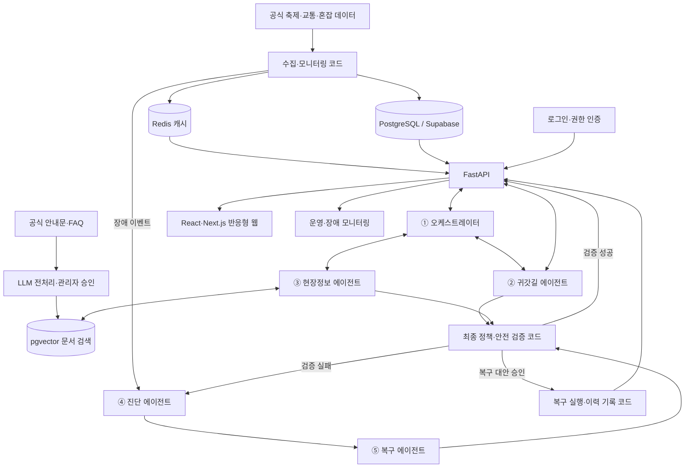
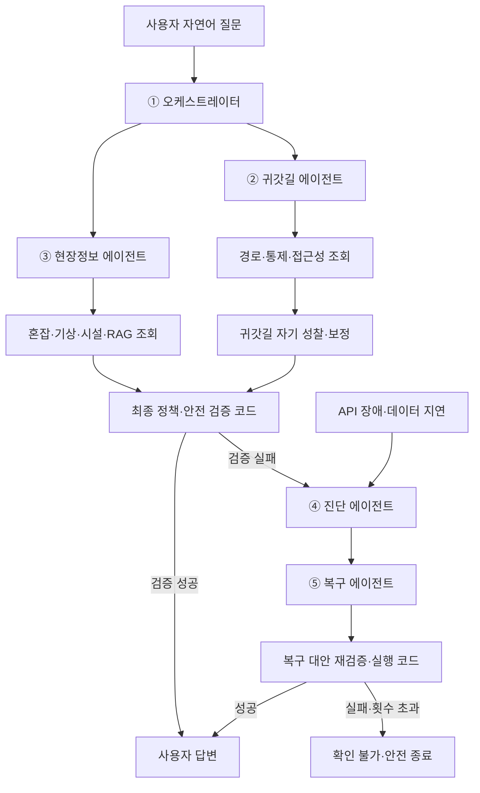
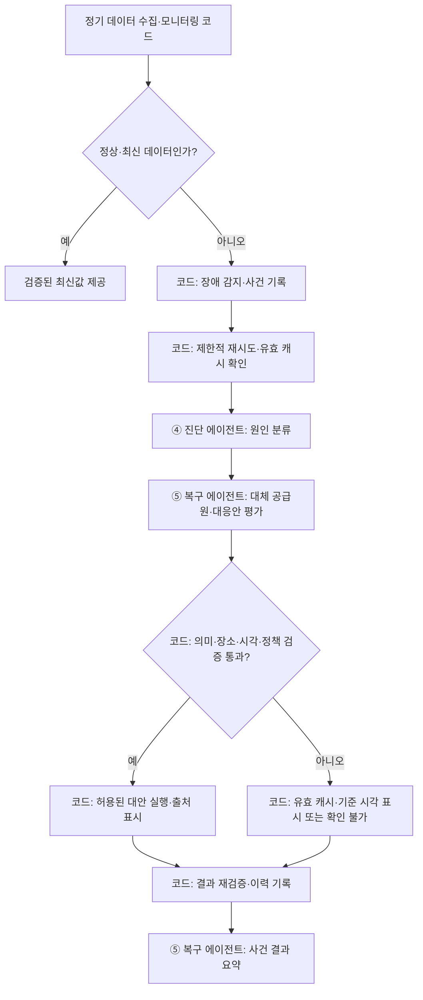
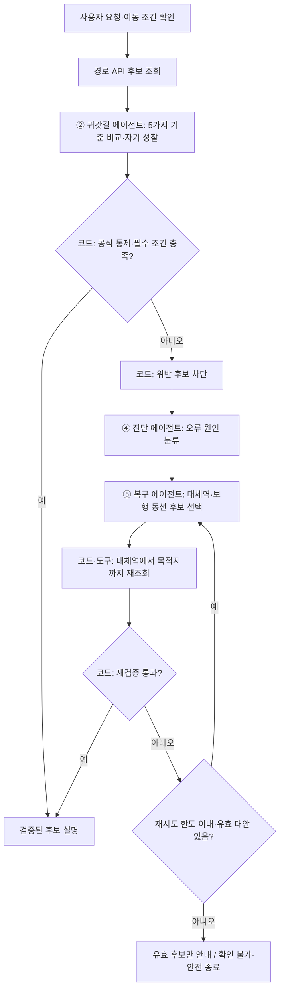

# 놀다가 (NOLDAGA)
## AI 기반 축제 현장 안전·편의 및 맞춤형 안심 귀가 플랫폼

**서비스 기획 및 요구사항 명세서 v0.9**

| 항목 | 내용 |
|---|---|
| 서비스명 | 놀다가 (NOLDAGA) |
| 서비스 슬로건 | 축제는 마음껏 즐기고, 돌아가는 길까지 편안하게 |
| 프로젝트 유형 | 멀티 AI Agent 기반 축제 통합 안내 플랫폼 |
| 팀명 / 인원 | **수다수다 / 6명** |
| 서비스 형태 | React·Next.js 기반 반응형 웹서비스 |
| 주요 사용자 | 축제 방문객, 대중교통 이용자, 가족 단위 관람객, 교통약자 동행 방문객 |
| 전국 서비스 | 축제 검색·일정·장소 등 기본정보 |
| 실시간 서비스 | 서울시 데이터 지원 지역의 혼잡·현장·안심 귀가 정보 |
| 핵심 기술 | React, Next.js, Figma(UI·UX 디자인), Python, FastAPI, LangGraph, PostgreSQL(pgvector), Supabase, Redis, AWS, Docker |
| 문서 버전 | v0.9 |
| 작성 기준일 | 2026년 11월 13일 |
| 작성 상태 | **STEP 1 기획·요구사항 정리 단계** / API 연동·기능 구현·성능 검증 전 |

---

> **문서 사용 안내**  
> 본 문서는 서비스 방향과 기능 요구사항을 공유하기 위한 **기획 초안**이다. 표의 수용 기준은 향후 검증할 목표이며, 구현·테스트를 완료했다는 의미가 아니다. 시연 장소, API 공급원, 성능 기준은 후속 단계에서 결정한다. **에이전트는 5개 역할(오케스트레이터·귀갓길·현장정보·진단·복구) 구성으로 정하고**, 세부 도구·상태 전이·구현 방식은 STEP 3~4에서 검증한다. 기존 합의에 따라 **전국 축제 정보**를 제공하되 **실시간 혼잡도는 서울시 데이터 제공 지역**으로 한정하며, PC·모바일 **반응형 웹서비스**만 구현한다.

# 01. 프로젝트 개요

## 1.1 서비스 소개

**놀다가**는 전국의 축제 정보를 탐색하고, 축제 현장의 혼잡도와 안전·편의 정보를 통합 제공하며, 행사 종료 후 이용자의 상황에 맞는 귀가 경로를 안내하는 AI 기반 축제 통합 플랫폼이다.

축제 방문객은 행사 일정과 장소뿐 아니라 혼잡도, 편의시설, 기상 변화, 교통통제, 대중교통 운행 등 다양한 정보가 필요하다.

하지만 이러한 정보는 축제 공식 홈페이지, 지도 서비스, 교통정보 앱, 지자체 공지 등 여러 채널에 분산되어 있어 사용자가 직접 확인하고 비교해야 한다.

특히 불꽃축제와 같이 많은 관람객이 동시에 귀가하는 행사에서는 특정 지하철역과 보행 통로에 인파가 집중되고, 안전을 위한 출입 통제나 교통편 변경이 발생할 수 있다.

놀다가는 이러한 문제를 해결하기 위해 **축제 정보 탐색 → 현장 상황 확인 → 위험 정보 안내 → AI 맞춤형 안심 귀가**를 하나의 사용자 경험으로 연결한다.

사용자는 기본적인 귀가 경로 유형을 비교할 수 있으며, AI에게 자신의 상황을 자연어로 설명하면 동행자와 이동 조건을 반영한 안내를 받을 수 있다.

## 1.2 서비스 비전

**"축제는 마음껏 즐기고, 돌아가는 길까지 편안하게."**

놀다가는 축제를 방문하는 순간부터 귀가할 때까지 필요한 정보를 제공하고, 이용자가 자신의 상황에 맞는 이동 방법을 선택하도록 돕는 것을 목표로 한다.

## 1.3 핵심 가치

| 핵심 가치 | 제공 내용 |
|---|---|
| 통합성 | 축제·혼잡·시설·교통·날씨 정보를 한곳에서 확인 |
| 편의성 | 여러 서비스 검색 없이 필요한 정보 탐색 |
| 개인화 | 자연어에서 이동 목적과 동행 상황을 이해 |
| 접근성 | 고령자·휠체어·유모차 이용 등을 고려한 이동 안내 |
| 안전 지원 | 공식 통제와 실제 위험정보를 우선 안내 |
| 신뢰성 | 데이터 출처·기준 시각·확인 가능 여부 표시 |
| 안정성 | API 장애와 잘못된 AI 추천을 감지·대응 |

## 1.4 서비스 범위

놀다가는 전국 축제 정보를 제공하되, 실시간 현장 서비스는 서울을 우선 적용한다.

**전국 제공 기능**
- 축제 검색
- 축제 일정과 상세정보
- 축제 장소 확인

**서울 우선 제공 기능**
- 실시간 혼잡도 시각화
- 축제장 주변 공공시설 안내
- 공식 현장·교통통제 정보 안내
- AI 맞춤형 안심 귀가
- 현장 상황을 반영한 AI 통합 챗봇

실시간 혼잡도는 서울시 실시간 도시데이터가 지원하는 장소를 대상으로 제공한다. 서울 모든 지역과 축제장 내부 모든 통로의 혼잡도를 실시간으로 측정하는 서비스는 아니다.

---

## 1.5 서비스 정의 요약 (제출 가이드 형식)

| 구분 | 기재 내용 |
|---|---|
| **서비스명** | 놀다가 (NOLDAGA) |
| **사용자** | 축제 방문객, 대중교통 이용자, 교통약자와 함께 방문한 관람객 |
| **해결 문제** | 혼잡·편의시설·교통통제 정보가 분산되어 있고, 행사 종료 후 개인의 이동 조건에 맞는 귀가 경로를 판단하기 어려움 |
| **핵심 가치** | 전국 축제 탐색 → 서울 현장 혼잡·공식 안내 확인 → 자연어 기반 맞춤형 안심 귀가 |
| **MVP 범위** | 축제·현장 정보, **5가지 귀가 경로 기준**, AI 챗봇·RAG, 회원가입·로그인, API 장애와 추천 오류 대응, 관리자 모니터링·시뮬레이터 |

**MVP 범위에 포함된다는 것과 전 지역에서 동일하게 제공된다는 것은 다르다.** 데이터가 확보되지 않은 지역·경로 유형은 미지원·확인 불가로 표시한다. 확정된 추후 기능(위치 공유, 주차 잔여 면수, 개인별 막차 알림, 리워드)은 이번 단계의 필수 구현 대상으로 승격하지 않는다.

## 1.6 이번 프로젝트 핵심 MVP — 상위 5개 기능 영역

아래 표는 **이번 프로젝트에서 가장 먼저 설명하고 검증할 핵심 기능을 다섯 영역으로 묶은 요약**이다. 이는 8장의 세부 기능 요구사항(FR)을 대체하거나 삭제하는 것이 아니며, 개발 착수 단계에서 서비스 전체 범위를 한눈에 파악하기 위한 구성이다.

| 핵심 영역 | 이번 프로젝트에서 제공하려는 기능 | 관련 요구사항 |
|---|---|---|
| **① 축제·현장 정보** | 전국 축제 검색과 기본정보, 서울시 지원 장소의 혼잡도·날씨·확인된 공식 통제·편의시설 안내 | FR-F, FR-D |
| **② AI 맞춤형 안심 귀가** | **최단시간·혼잡 회피·교통약자 배려·최소 도보·최소 환승**의 5가지 기준 비교, 자연어 개인화, 공식 통제 검증 | FR-R |
| **③ AI 통합 챗봇·RAG** | 현장·교통 관련 복합 질문 응답, 공식 안내문 근거 검색, 출처·기준 시각 및 미확인 사항 표시 | FR-C, FR-K |
| **④ Auto-Healing** | 외부 API 장애 대응과 부적절한 귀가 추천 탐지·교정, 실패 시 안전한 종료 및 이력 확인 | FR-H |
| **⑤ 운영·인증·관리자** | 회원가입·로그인, 역할별 권한, 데이터·장애 상태 모니터링과 시연용 장애 주입 | FR-A, FR-O |

**AI 통합 찾기(공식 안내·만남 장소 안내 중심)**는 추가 기능으로 유지한다. GPS 위치 공유, 자동 막차 알림, 주차 잔여면수, 리워드 등은 추후 기능으로 남긴다.

**대표 구현 목표:** 축제와 출발 구역을 선택한 사용자가 확인된 현장·교통정보를 바탕으로 귀가 후보를 비교하고, 추천에 통제·이동 조건 위반이 발견되면 검증·교정 절차를 거쳐 근거 있는 결과 또는 '확인 불가'를 받도록 한다. **대상 장소·실제 API·최종 성능 목표는 후속 단계에서 검증·확정한다.**

---

# 02. 추진 배경 및 문제 정의

## 2.1 축제 인파 집중의 구조적 문제

지역축제는 문화와 관광을 활성화하고 시민들에게 다양한 경험을 제공한다.

그러나 대규모 행사에서는 많은 방문객이 특정 장소와 시간에 집중되면서 이동 불편과 안전관리 부담이 발생한다.

특히 공연과 불꽃축제처럼 종료 시점이 명확한 행사는 방문객이 나누어 입장하더라도 행사 종료 후 비슷한 시간에 귀가를 시작할 수 있다.

이처럼 **입장은 분산되고 퇴장은 집중되는 구조**는 특정 출입구·보행로·지하철역에 일시적으로 많은 이동 수요를 발생시킨다.

## 2.2 실제 사례: 서울세계불꽃축제

2026년 서울세계불꽃축제에서는 대규모 인파에 대비하여 서울시와 관계기관이 안전 및 교통대책을 시행하였다.

서울특별시 문화본부 문화예술과의 2026년 9월 1일 보도자료에 따른 주요 대책은 다음과 같다.

- 약 6,800명의 안전인력 배치
- 지하철 5·9호선 총 83회 증회
- 혼잡에 따른 여의나루역 무정차 및 출입구 통제 가능성 안내
- 여의도역·마포역·샛강역 등 인근 역 이용 권고
- 주요 도로 교통통제 및 버스 우회
- 주변 공유 이동수단 이용 제한

이는 대규모 축제에서 관람객의 이동 및 귀가 관리가 중요한 과제임을 보여준다. **근거:** 서울특별시, 「“100만 인파 안전 최우선”…서울시, 서울세계불꽃축제 종합대책 가동」(2026-09-01), https://www.seoul.go.kr/news/news_report.do?nttNo=465103. 실제 행사는 2026년 9월 5일 개최되었으며, 해당 대책을 현재 실시 중인 통제로 오인하지 않는다.

## 2.3 실제 사례: 부산불꽃축제

기존 조사자료에서는 부산불꽃축제 역시 행사 종료 이후 관람객의 동시 이동과 지하철역 접근 과정에서의 혼잡이 중요한 안전관리 문제로 다루어졌음을 확인하였다.

다만 행사 전체 구급활동 통계를 귀가 혼잡으로 발생한 사고 건수로 해석하지 않고, 귀가 상황과 직접 관련된 사실을 구분하여 인용한다.

## 2.4 관람객의 주요 불편

| 문제 | 상세 내용 |
|---|---|
| 인파 밀집 | 행사 종료 직후 특정 출입구와 이동 통로로 인파 집중 |
| 지하철 통제 | 무정차 통과 및 역사 출입 제한 |
| 도보 병목 | 계단·교량·좁은 골목 등에서 이동 정체 |
| 대중교통 변경 | 버스 노선 우회 및 정류장 변경 |
| 환승 부담 | 평소 경로를 이용하지 못하고 다른 노선 탐색 |
| 이동약자 불편 | 계단·긴 도보·복잡한 환승 동선으로 이동 부담 증가 |
| 정보 분산 | 혼잡·교통·시설·안전 정보를 여러 서비스에서 확인 |
| 귀가 판단 | 자신의 상황에 적합한 경로를 직접 비교해야 함 |

## 2.5 기존 공공 안전관리 체계

축제 안전은 지자체·주최 측, 경찰, 소방 등 관계기관이 담당한다.

**지자체 및 행사 주최 측**
- 축제 안전관리계획 수립
- 인파 집중 및 위험 구역 관리
- 입·퇴장 동선 관리
- 안전요원과 현장 안내체계 운영

**경찰**
- 도로 및 교통 통제
- 차량 우회
- 보행자 이동 안내
- 혼잡 지역 진입 제한

**소방**
- 구조·구급 인력 배치
- 응급환자 대응 및 이송
- 비상 대피로 확보 지원

놀다가는 공공기관의 현장 안전관리를 대신하지 않는다.

**공식 안전정보를 관람객 개인의 상황에 맞게 전달하고, 이동 선택을 지원하는 보조 서비스**로 운영한다.

## 2.6 기존 서비스의 한계

축제 정보, 교통통제, 지도, 대중교통 길찾기 등은 기존 플랫폼에서도 제공되고 있다.

그러나 방문객이 자신의 목적지와 이동 특성에 맞춰 여러 정보를 함께 확인해야 하는 상황에서는 추가적인 판단이 필요하다.

예를 들어 할머니와 축제를 방문한 사용자가 귀가하려면 단순히 가장 빠른 경로뿐 아니라 계단이 적은 출입구, 엘리베이터가 있는 환승 동선, 도보 부담 등을 검토해야 한다.

이런 상황에서 놀다가는 사용자 요청을 이해하고 확인 가능한 정보를 결합하여 경로 선택을 지원한다.

## 2.7 핵심 문제 정의

**"축제 방문객은 혼잡과 교통통제로 이동 환경이 변화하는 상황에서 필요한 정보를 여러 서비스에서 직접 확인해야 하며, 특히 행사 종료 후에는 자신의 목적지와 이동 특성에 적합한 귀가 경로를 판단하는 데 어려움을 겪는다."**

---

# 03. 타깃 사용자 분석

## 3.1 주요 사용자

놀다가의 핵심 타깃은 대규모 축제를 방문하고 행사 종료 후 대중교통을 이용하는 시민 및 관광객이다.

| 사용자 | 주요 요구 |
|---|---|
| 일반 관람객 | 빠르고 편리한 귀가 |
| 혼잡 회피 선호 사용자 | 확인 가능한 인파 밀집 구역 회피 |
| 고령자 동행 관람객 | 계단·도보·환승 부담 완화 |
| 휠체어 이용자 | 접근 가능한 출입구·엘리베이터·무장애 동선 |
| 유모차 동반 가족 | 유모차 이동이 가능한 경로 |
| 어린아이 동반 보호자 | 혼잡 상황과 이동 부담 고려 |
| 축제 초행 방문객 | 축제장 시설·출입구·교통편 안내 |

## 3.2 대표 페르소나

### 페르소나 A — 대중교통을 이용하는 축제 관람객

- 나이: 29세
- 방문 축제: 서울세계불꽃축제
- 귀가 목적지: 잠실역
- 이동 수단: 대중교통

**문제**

행사 종료 후 가까운 지하철역이 혼잡하거나 통제되면 다른 역을 선택해야 한다.

**기대 서비스**

최단시간·혼잡 회피·최소 환승 등 여러 경로를 비교해 적합한 귀가 방법을 선택하고 싶다.

### 페르소나 B — 고령 가족과 함께 축제를 방문한 사용자

- 나이: 35세
- 동행자: 할머니
- 방문 목적: 가족과 함께 축제 관람
- 이동 수단: 대중교통

**문제**

할머니와 함께 이동해야 하지만 지하철역 계단이 많거나 환승 동선이 복잡하면 부담이 된다.

**기대 서비스**

AI에게 "할머니와 함께 왔는데 편한 길로 안내해줘"라고 말하면 계단 이용을 줄이고 엘리베이터가 있는 경로를 우선 검토해 주기를 기대한다.

단, 연령만으로 이동 능력을 단정하지 않고 실제 요청과 필요한 접근성 조건을 반영한다.

## 3.3 사용자 검증 계획

현재 페르소나는 초기 기획 가설이다.

추후 실제 방문객 후기와 설문조사를 통해 귀가 불편 유형, 경로 선택 기준, 이동약자 관련 요구, AI 이용 의향을 확인한다.

- 공개 방문 후기 약 15~20건 분석 제안
- 탐색 설문 약 20~30명 규모 제안
- MVP 구현 후 사용성 테스트

조사 결과는 완료 후 별도로 기록하며, 현재 가상의 조사 결과를 기획서에 포함하지 않는다.

---

# 04. 경쟁 서비스 분석

| 서비스 | 주요 기능 | 놀다가 차별화 방향 |
|---|---|---|
| Spotts | 축제 정보, 관람 가이드, 시설·교통·후기·AI 질문 | 사용자별 귀가 조건을 반영한 경로 비교 |
| 대한민국 구석구석 | 전국 축제 및 관광정보 | 실시간 현장·안전·귀가 기능 연결 |
| 카카오맵 | 지도·대중교통 길찾기·행사별 안내 | 축제 종료 특성을 고려한 통합 귀가 안내 |
| TMAP | 교통 및 경로 안내 | 보행·대중교통·접근성·혼잡 조건 통합 |
| 서울 실시간 도시데이터 | 서울 주요 지역 혼잡·교통·기상 정보 | AI 챗봇과 개인 상황에 맞는 정보 제공 |

## 핵심 차별화

놀다가는 축제 정보나 AI 챗봇의 존재 자체를 독점적 강점으로 주장하지 않는다.

대신 다음 사용자 경험을 차별화 후보로 설정한다.

1. 기본적으로 다섯 가지 관점의 귀가 경로 비교
2. 자연어를 활용한 사용자 상황 맞춤 추천
3. 혼잡·교통통제·접근성 정보의 종합 활용
4. 공식 통제와 데이터 최신성에 대한 검증
5. 외부 API 장애와 잘못된 AI 추천 결과에 대한 대응

차별성은 향후 경쟁 서비스와 동일한 사용자 시나리오를 테스트하여 검증한다.

---

# 05. 서비스 핵심 기능 및 범위

## 5.1 핵심 기능 ① AI 축제 즐기기

축제 방문객이 필요한 현장 정보를 확인하는 기능이다.

**주요 기능**
- 전국 축제 검색 및 기본정보 확인
- 서울 지원 지역 실시간 혼잡도 시각화
- 공공화장실·공영주차장·물품보관소·의무실·쉼터 안내
- 공식 현장 운영 공지
- 기상 및 출입 통제 상황 안내

**추후 개발**
- GPS 기반 가까운 시설까지 경로 안내
- 실시간 주차 잔여 면수

## 5.2 혼잡도와 위험 경고 구분

혼잡도는 다음 네 단계로 표시한다.

| 단계 | 안내 의미 |
|---|---|
| 여유 | 상대적으로 혼잡도가 낮은 상태 |
| 보통 | 일반적인 혼잡 상태 |
| 혼잡 | 인파가 많아 이동 시 주의가 필요한 상태 |
| 매우혼잡 | 높은 혼잡 수준이 확인된 상태 |

화면 문구는 현재 팀에서 정한 서비스 표현이며, 서울시 원본 API의 혼잡 단계는 **여유 / 보통 / 약간 붐빔 / 붐빔**이다. 구현 단계에서 원본과 서비스 표현의 일대일 대응표를 검증하며, 특히 원본 `붐빔`을 `매우혼잡`으로 표시해 위험을 과장하지 않도록 명칭을 최종 검토한다.

**'매우혼잡'은 곧바로 '위험'을 의미하지 않는다.**

위험 경고는 공식적인 위험·대피 안내, 출입 통제 등 실제 위험을 뒷받침하는 신뢰할 수 있는 근거가 확인된 경우에 별도로 표시한다.

AI가 혼잡도만 보고 독자적으로 위험 구역을 확정하지 않는다.

## 5.3 핵심 기능 ② AI 맞춤형 안심 귀가

놀다가의 대표 기능이다.

사용자가 출발 구역과 도착역을 선택하면 기본적으로 다음 다섯 가지 경로 유형을 비교한다.

| 경로 유형 | 최우선 기준 | 표시·비교 정보 |
|---|---|---|
| **최단시간 경로** | 총 이동시간 최소화 | 예상시간, 도보, 환승 |
| **혼잡 회피 경로** | 확인 가능한 인파 혼잡 최소화 | 지역 혼잡도, 통제정보, 대체역 |
| **교통약자 배려 경로** | 접근성 및 이동 부담 | 승강기, 계단 회피, 무장애 동선 |
| **최소 도보 경로** | 총 도보거리 최소화 | 보행거리, 이동시간, 환승 |
| **최소 환승 경로** | 환승 횟수 최소화 | 환승 횟수, 이동시간, 도보 |

### 경로 추천 공통 원칙

- 다섯 가지는 경로 비교 기준이며 서로 다른 경로 다섯 개가 항상 존재하는 것은 아니다.
- 동일 경로가 여러 기준에서 가장 적합할 경우 중복 사실을 명확하게 표시한다.
- 경로 유형에 필요한 데이터가 없으면 확인 불가 또는 미지원으로 표시한다.
- **확인된 공식 통제**에 반하는 역과 구간을 이용하도록 추천하지 않는다. 공식 통제정보의 최신성을 확인하지 못하면 안전성을 확정적으로 보장하지 않는다.
- 안전을 보장할 근거가 없는 경로를 안전하다고 확정하지 않는다.
- 이용 가능한 경로가 없다면 확인되지 않은 경로를 임의로 생성하지 않는다. 경로 후보를 차단한 뒤에는 **검증된 대체역까지의 도보 구간 + 대체역에서 목적지까지의 대중교통 경로**를 다시 조회하는 방안을 검토한다.

### 자연어 기반 개인 맞춤 추천

사용자는 이동 관련 옵션을 별도로 설정하지 않아도 AI 챗봇에 자연어로 요청할 수 있다.

**요청 예시**

"오늘 할머니와 축제에 왔는데 편한 길로 안내해줘."

AI는 이 요청에서 동행 상황과 편안한 이동이라는 의도를 해석한다.

필요한 경우 계단 이용이 어려운지 확인한 후, 도보·계단·환승 부담이 적고 실제 접근성이 확인된 경로를 우선 검토한다.

**다른 예시**
- "유모차가 있어서 계단 없는 길로 가고 싶어."
- "다리가 아파서 많이 못 걷겠어."
- "조금 늦어도 사람이 덜 많은 길로 가고 싶어."
- "환승 없이 갈 수 있는 길이 있을까?"
- "막차 시간이 걱정되는데 지금 이용 가능한 경로를 알려줘."

**막차 관련 질문의 MVP 처리 범위:** 확인 가능한 경로·교통 운행·공식 통제 정보는 안내할 수 있으나, **막차 시각 확인·실시간 잔여시간 타이머·개인별 푸시 알림은 아직 이번 MVP에서 보장하지 않는다.** 해당 정보가 확보되지 않았다면 모른다고 안내하고 공식 교통기관 확인 경로를 제시한다. 이는 FR-R11의 추후 기능 분류와 구분한다.

휠체어·유모차 이용자에게 에스컬레이터를 엘리베이터의 대체 수단으로 안내하지 않는다.

교통약자 배려 경로는 출발 구역부터 역 출입구, 승강장, 환승 구간까지 필요한 접근성을 확인해야 하며, 정보가 부족할 경우 무장애 이동을 보장하지 않는다.

### 5가지 귀가 경로의 구현 목표와 데이터 확인 범위

다음 표는 **기능 목표와 현재 확보·검증된 사실을 구분**한 것이다. 경로 유형은 다섯 가지 모두 유지하되, 모든 축제·역·출입구에서 동일한 수준으로 구현된다고 가정하지 않는다.

| 유형 | 구현 목표 | 필요한 데이터·현재 제약 | 데이터 부족 시 안내 원칙 |
|---|---|---|---|
| **최단시간** | 조회된 유효 후보 중 예상 총 이동시간이 가장 짧은 경로 표시 | 대중교통 경로 API의 소요시간·구간·정류장 데이터가 필요하며 **팀 실호출 검증 전** | 조회 실패 시 소요시간을 추측하지 않고 확인 불가 표시 |
| **혼잡 회피** | 공식 통제와 **확인 가능한 장소·지역 단위 혼잡정보**를 고려한 대안 후보 안내 | 서울시 지원 장소의 지역 혼잡 데이터 후보는 있으나 **역 출입구·승강장별 실시간 혼잡을 포괄하는 자료는 미확보** | 역별 혼잡을 임의로 추정·서열화하지 않음. 비교 근거가 부족하면 혼잡 회피 판단을 보류 |
| **교통약자 배려** | 확인된 이동 조건에 맞춰 계단·도보 부담 등을 고려한 후보 검토 | 승강기·편의시설 API는 후보이나 **축제장부터 출입구·승강장·환승 구간까지 연결된 무장애 동선은 검증 전** | 확인되지 않은 무장애 이동을 보장하지 않고 확인 가능한 시설정보만 안내 |
| **최소 도보** | 조회된 유효 후보 중 도보거리가 최소인 경로 표시 | 경로 API의 도보거리 및 대체역 접근 보행 구간 확인이 필요함 | 보행 구간이 누락된 후보를 최소 도보로 확정하지 않음 |
| **최소 환승** | 조회된 유효 후보 중 환승 횟수가 최소인 경로 표시 | 경로 API의 환승 횟수와 구간 식별 정보 검증 필요 | 후보가 없으면 무환승 경로를 만들어내지 않음 |

'최단'·'최소'는 **실제로 조회·검증된 후보 안에서의 비교 결과**를 뜻한다. 공식 통제역이 발견되면 기존 후보를 차단하고, 확인된 보행 접근이 가능한 대체역에서 목적지까지 경로를 다시 검색하는 방안을 적용한다. 다섯 기준에 적합한 서로 다른 다섯 개의 경로가 항상 존재하는 것은 아니다.

## 5.4 핵심 기능 ③ AI 통합 챗봇

- 혼잡도·날씨·편의시설·귀가 관련 자연어 질문
- 복합 질문 처리
- 축제 및 출발 구역 맥락 활용
- 동행자·이동 조건에 맞는 귀가 안내
- RAG 기반 공식 안내문 검색
- 출처·정보 기준 시각·미확인 사항 표시

## 5.5 추가 기능 ① AI 통합 찾기

MVP에서는 정보 안내와 만남 장소 추천에 집중한다.

- 공식 분실물 센터 및 신고 절차 안내
- 공식 미아보호소·축제 운영본부 안내
- 일행과 만날 장소 안내
- 확인 가능한 혼잡 정보를 활용한 만남 장소 비교

**MVP 제외 또는 추후 검토**
- GPS 실시간 일행 위치 공유
- 실제 기관과 연동되는 자체 미아 신고 접수 시스템

## 5.6 추가 기능 ② 방문 인증·리워드

**추후 개발**
- QR 방문 인증
- 스탬프 적립
- 포인트·리워드
- 축제 참여형 게임 요소

---

# 06. 회원가입·로그인 및 계정 관리

## 6.1 도입 목적

놀다가에는 사용자 계정과 관리자 계정에 대한 인증 및 권한 관리 기능을 포함한다.

사용자 계정은 향후 개인별 축제 이용 편의와 기록 저장을 위한 기반이 되며, 관리자 인증은 공지 관리와 장애 시뮬레이터 등 운영 기능을 보호한다.

## 6.2 기본 계정 기능

**필수 기능**
- 회원가입
- 로그인
- 로그아웃
- 로그인 상태 유지 및 세션 만료 처리
- 계정 정보 확인 및 수정
- 회원 탈퇴
- 사용자·관리자 권한 구분

**추가 기능 후보**
- 소셜 로그인
- 관심 축제 즐겨찾기
- 최근 조회한 축제
- 최근 귀가 경로 조회
- AI 대화 기록 저장
- 개인 이동 선호도 저장

추가 기능은 사용자 편의성 및 개인정보 처리 범위에 따라 MVP 포함 여부를 결정한다.

## 6.3 로그인 및 비회원 이용 정책

**로그인 기능 자체는 MVP 필수로 확정한다.**

다만 축제 검색, 혼잡도 확인, 기본 귀가 안내 등 공공 안전·편의 정보를 로그인 없이도 제공할지는 최종 결정이 필요하다.

현재 추천안은 다음과 같다. **비회원 이용 허용 여부는 아직 팀에서 결정하지 않았으므로 확정 요구사항으로 취급하지 않는다.**

| 비회원 이용 권장 | 로그인 필요 권장 |
|---|---|
| 전국 축제 검색 | 즐겨찾기 저장 |
| 서울 지원 지역 혼잡도 확인 | 계정별 이용 기록 |
| 기본 귀가 경로 비교 | AI 대화 기록 저장 |
| 기본 AI 질문 | 개인 설정의 장기 저장 |
| 공식 안전·시설 정보 | 마이페이지 |

이 표는 **추천 정책이며 아직 팀이 확정한 사항은 아니다.**

## 6.4 인증 기술 검토

기존 기술 스택의 Supabase Auth를 우선 인증 서비스 후보로 검토한다.

- React·Next.js: 회원가입·로그인·마이페이지 등 반응형 웹 화면
- Supabase Auth: 사용자 인증 및 세션 관리 후보
- FastAPI: 인증 토큰 검증, API 접근권한 검사
- PostgreSQL: 필요한 사용자 정보 및 서비스 기록 관리
- 관리자 역할: 일반 사용자와 분리된 권한 적용

정확한 이메일·소셜 인증 방식과 저장 구조는 기술 검증 후 확정한다.

## 6.5 개인정보 보호 원칙

- GPS 위치정보를 기본적으로 수집하지 않는다.
- 계정 기능과 직접 관계없는 개인정보는 불필요하게 저장하지 않는다.
- 자연어 질문에 등장한 고령 가족 동행 여부나 건강 상태를 자동으로 영구 프로필에 저장하지 않는다.
- 사용자가 선택적으로 저장한 선호도는 확인·변경·삭제할 수 있도록 설계한다.
- 회원 탈퇴 시 삭제 대상과 법적 보관 필요 정보를 구분해 처리한다.

---

# 07. 대표 사용자 시나리오

## 7.1 기본 귀가 경로 비교

**상황(사용자 경험 설명용 가상 예시)**

서울세계불꽃축제 종료 후 잠실역으로 귀가하려는 사용자가 놀다가에 접속한다. **과거 행사의 실제 실시간 데이터나 당시 운영 결과를 재현했다는 뜻은 아니다.** 실제 시연 대상은 후속 데이터 검증 후 선정한다.

**진행 흐름**

1. 사용자가 서울세계불꽃축제를 선택한다.
2. 축제장 출발 구역과 잠실역을 지정한다.
3. 놀다가가 확인 가능한 교통·공식 통제 정보를 조회한다.
4. 경로 API로 이동 가능한 후보를 탐색한다. 현재 확인된 공식 통제에 반하는 후보는 차단한다.
5. 이용 가능한 후보를 검증하고 다섯 가지 기준으로 분류·비교한다.
6. 최단시간, 혼잡 회피, 교통약자 배려, 최소 도보, 최소 환승 유형을 보여준다.
7. 정보가 확인되지 않은 유형은 그 한계를 표시한다.
8. 사용자가 원하는 경로를 선택한다.

## 7.2 AI 자연어 맞춤 귀가

**상황**

할머니와 함께 축제를 관람한 사용자가 편하게 귀가할 방법을 찾는다.

**사용자 질문**

"오늘 할머니와 축제에 왔는데 편한 길로 안내해줘."

**AI 처리 흐름**

1. 동행자와 편한 이동이라는 요청을 이해한다.
2. 계단 회피 등 필요한 조건이 불명확하면 간단히 확인한다.
3. 확인된 경로 후보를 조회한다.
4. 엘리베이터·승강장·환승 동선 등 접근성 정보를 확인한다.
5. 공식 통제 및 이동 가능 여부를 검증한다.
6. 검증된 교통약자 배려 경로를 우선 안내한다.
7. 도보거리, 이동시간, 환승 횟수 및 추천 이유를 설명한다.

## 7.3 데이터 장애 상황

**상황**

축제 현장의 혼잡 데이터를 제공하는 API가 정상적인 응답을 주지 않거나 데이터 갱신이 멈춘다.

**처리 흐름**

1. 데이터 수집기가 장애를 감지한다.
2. 유효한 마지막 정상 데이터가 있는지 확인한다.
3. 진단 에이전트가 장애 원인을 분류하고, 복구 에이전트가 유효 캐시·대체 공급원 등 허용된 대안을 검토한다.
4. 사용 가능한 데이터가 있으면 출처·기준 시각을 표시한다.
5. 데이터가 없으면 '현재 혼잡도 확인 불가'를 안내한다.
6. 관리자는 장애 대시보드에서 감지·진단·대응 결과를 확인한다.

## 7.4 잘못된 AI 귀가 추천 검증

**상황**

경로 API에서 후보를 조회한 뒤 **공식 통제정보가 갱신되었거나**, AI가 비교·설명 대상으로 선택한 후보에 통제역이 포함된 상황을 **테스트 데이터·장애 주입으로 재현한다.** AI가 존재하지 않는 역이나 경로를 임의로 만들어낸다고 전제하지 않는다.

**처리 흐름**

1. 추천 결과 검증기가 공식 통제 정보와 경로를 비교한다.
2. 통제된 역이 포함되었음을 감지한다.
3. 해당 후보를 차단한다.
4. 진단 에이전트가 검증 실패 원인을 분류하고, 복구 에이전트가 허용된 도구로 대안을 탐색한다.
5. 이용 가능한 **대체역·보행 동선**을 확인한 뒤 목적지까지 다시 조회하고, 새 후보를 재검증한다.
6. 검증된 후보만 사용자에게 제시한다.
7. 복구에 실패하면 안전성이 확인되지 않은 경로를 확정적으로 안내하지 않는다.

---

# 08. 기능 요구사항 명세서 (FR)

모든 기능은 고유 ID, 우선순위, 수용 기준으로 관리한다.

## 8.1 축제·현장 정보 — FR-F

| ID | 기능 요구사항 | 우선순위 | 수용 기준 |
|---|---|---|---|
| FR-F01 | 전국 축제 검색 | Must | 지역·기간 조건에 맞는 축제 검색 결과 표시 |
| FR-F02 | 서울 실시간 혼잡도 | Must | 지원 장소의 4단계 혼잡도와 기준 시각 표시 |
| FR-F03 | 혼잡도·위험 분리 | Must | 매우혼잡만으로 위험 경고가 생성되지 않음 |
| FR-F04 | 편의시설 지도 | Must | 확인된 시설의 위치·종류 표시 |
| FR-F05 | 현장 공식 공지 | Must | 승인된 운영·통제 공지 표시 |
| FR-F07 | GPS 기반 시설 경로 | Could (추후) | 별도 위치정보 요건 검토 |
| FR-F08 | 실시간 주차 잔여 면수 | Could (추후) | 데이터 확보 후 검증 |
| FR-F09 | 기상 변화·현장 날씨 안내 | Must | 비·기상특보 등 확인된 상황과 기준 시각을 화면에서 안내하며, 푸시 알림을 필수로 요구하지 않음 |

*FR-F06은 범위 조정으로 폐기한 요구사항 ID이며, 추적성을 위해 다른 기능에 재사용하지 않는다.*

## 8.2 AI 안심 귀가 — FR-R

| ID | 기능 요구사항 | 우선순위 | 수용 기준 |
|---|---|---|---|
| FR-R01 | 최단시간 경로 | Must | 검증된 후보 중 예상 이동시간이 가장 짧은 경로 식별 |
| FR-R02 | 혼잡 회피 경로 | Must | 확인 가능한 혼잡 정보만 사용하고 근거가 없으면 미확인 표시 |
| FR-R03 | 교통약자 배려 경로 | Must | 확인된 접근성·계단·승강설비 정보 반영 |
| FR-R04 | 최소 도보 경로 | Must | 검증된 후보 중 총 도보거리 최소 경로 식별 |
| FR-R05 | 최소 환승 경로 | Must | 검증된 후보 중 환승 횟수 최소 경로 식별 |
| FR-R06 | 공식 통제 검증 | Must | 통제된 역·구간을 이용하는 부적절한 추천 차단 |
| FR-R07 | 자연어 개인화 | Must | 자연어에서 이동 조건을 추출하여 추천에 반영 |
| FR-R08 | 추천 이유 설명 | Must | 경로 유형·시간·도보·환승 및 검증 상태 표시 |
| FR-R09 | 재검색·재추천 | Must | 통제역 포함 후보 차단 후 공식적으로 접근 가능한 **대체역 재검색** 및 재검증 |
| FR-R10 | 접근성 정보 미확인 처리 | Must | 확인되지 않은 엘리베이터·무장애 동선 보장 금지 |
| FR-R11 | 막차 타이머·푸시 알림 | Could (추후) | 별도 고도화 명세 |

## 8.3 AI 통합 챗봇 — FR-C

| ID | 기능 요구사항 | 우선순위 | 수용 기준 |
|---|---|---|---|
| FR-C01 | 자연어 질의응답 | Must | 대표 질문의 의도에 맞는 정보 조회 기능 호출 |
| FR-C02 | 복합 질문 처리 | Must | 혼잡·날씨·귀가 등 여러 정보의 통합 처리 |
| FR-C03 | 상황 및 동행자 이해 | Must | 자연어 요청의 이동 제약·선호도 반영 |
| FR-C04 | 축제 맥락 관리 | Must | 선택한 축제·출발 구역 기준 답변 |
| FR-C05 | 공식 안내 RAG 검색 | Must | 관련 문서 출처에 근거한 답변 |
| FR-C06 | 출처·기준 시각 안내 | Must | 주요 정보의 출처 및 최신성 표시 |
| FR-C07 | AI 추천 오류 검증 | Must | 공식 통제 및 필수 접근성 조건 위반 차단 |
| FR-C08 | 음성 질문 | Could (추후 검토) | 도입 시 별도 수용 기준 정의 |

## 8.4 회원 및 인증 — FR-A

| ID | 기능 요구사항 | 우선순위 | 수용 기준 |
|---|---|---|---|
| FR-A01 | 회원가입 | Must | 유효한 계정 생성 및 오류 처리 |
| FR-A02 | 로그인 | Must | 인증 성공·실패 상태 구분 |
| FR-A03 | 로그아웃 | Must | 로그아웃 후 보호된 사용자 기능 접근 제한 |
| FR-A04 | 세션 관리 | Must | 만료된 인증에 대해 재인증 처리 |
| FR-A05 | 계정 정보 관리 | Must | 본인 계정 정보 조회·수정 |
| FR-A06 | 회원 탈퇴 | Must | 탈퇴 처리 및 삭제 정책 적용 |
| FR-A07 | 일반 사용자·관리자 권한 | Must | 역할에 따라 보호된 API 접근 제한 |
| FR-A08 | 관심 축제·이용 기록 저장 | Should | 로그인 사용자별 기록 구분 |
| FR-A09 | 소셜 로그인 | Could (검토) | 인증 방식 선정 후 확정 |

## 8.5 AI 통합 찾기 — FR-S

| ID | 기능 요구사항 | 우선순위 | 수용 기준 |
|---|---|---|---|
| FR-S01 | 분실물 센터 안내 | Should (추가 기능) | 공식 센터 및 신고 방법 안내 |
| FR-S02 | 미아보호소 안내 | Should (추가 기능) | 공식 보호소·운영본부 안내 |
| FR-S03 | 일행 만남 장소 | Should (추가 기능) | 확인된 장소와 이동 관련 정보 안내 |
| FR-S04 | 실시간 위치 공유 | Could (추후) | 별도 동의·권한·위치정보 검토 |

## 8.6 방문 리워드 — FR-W

| ID | 기능 요구사항 | 우선순위 | 수용 기준 |
|---|---|---|---|
| FR-W01 | 방문 인증·스탬프 | Could (추후) | 별도 기능 설계 및 중복 인증 방지 |

## 8.7 RAG 지식 관리 — FR-K

| ID | 기능 요구사항 | 우선순위 | 수용 기준 |
|---|---|---|---|
| FR-K01 | 공식 문서 수집 | Must | 출처·문서명·축제·작성 시점 기록 |
| FR-K02 | 문서 분류 및 임베딩 | Must | 문서 종류와 축제별 검색 가능 |
| FR-K03 | 출처 기반 검색 | Must | 답변에 활용한 문서 근거 확인 가능 |
| FR-K04 | 유효기간·승인 관리 | Must | 미승인·만료 문서가 현재 정보로 사용되지 않음 |
| FR-K05 | 실시간 정보 분리 | Must | 혼잡·열차 상태를 오래된 RAG 문서로 확정하지 않음 |

## 8.8 데이터 수집 — FR-D

| ID | 기능 요구사항 | 우선순위 | 수용 기준 |
|---|---|---|---|
| FR-D01 | 공공 API 수집 | Must | 수집 성공 여부·갱신 시각 기록 |
| FR-D02 | 축제·시설 정적 데이터 관리 | Must | 검색과 지도에서 조회 가능 |
| FR-D03 | 데이터 유효성 검사 | Must | 빈 응답·형식 오류·갱신 중단 탐지 |
| FR-D04 | 공식 공지 추출 | Should | 추출 결과와 원문 비교 가능 |
| FR-D05 | 관리자 승인 | Must (AI 추출 기능 도입 시) | AI 추출 정보 사용 시 승인 전 노출 차단 |

## 8.9 Auto-Healing — FR-H

| ID | 기능 요구사항 | 우선순위 | 수용 기준 |
|---|---|---|---|
| FR-H01 | API 장애 감지 | Must | 오류·타임아웃·갱신 중단 구분 |
| FR-H02 | 제한 재시도 및 캐시 | Must | 허용된 데이터만 제공하며 기준 시각 표시 |
| FR-H03 | 진단 에이전트의 장애·추천 오류 분류 | Must | 전체·부분 장애, 갱신 지연, 경로 제약 위반 등 원인 후보 기록 |
| FR-H04 | 복구 에이전트의 대안 선택 | Must | 대체 공급원 또는 대체 경로 후보의 종류·지역·최신성·필수 조건 비교 |
| FR-H05 | 코드 기반 복구 실행 | Must | 검증을 통과하지 못한 전환 거부, 승인된 대안만 실행 |
| FR-H06 | 추천 경로 오류 감지 | Must | 공식 통제·필수 이동 조건 위반 탐지 |
| FR-H07 | AI 귀가 추천 재계산 | Must | 오류 후보 차단 후 이용 가능한 대체역·보행 동선 검증 및 목적지 경로 재조회 |
| FR-H08 | 코드 기반 복구 결과 재검증 | Must | 수정된 응답의 공식 통제·접근성·최신성 조건 충족 여부 확인 |
| FR-H09 | 안전 종료 | Must | 반복 제한 후 확인 불가 또는 적절한 대체 안내 |
| FR-H10 | 장애 이력 기록 | Must | 사건별 감지·진단·대응·결과 조회 |
| FR-H11 | 정상 공급원 복귀 | Should | 복귀 기준 충족 여부 확인 |
| FR-H12 | 접속 폭주 대응 | Should | 부하 테스트로 운영 대응 검증 |

## 8.10 관리자·운영 — FR-O

| ID | 기능 요구사항 | 우선순위 | 수용 기준 |
|---|---|---|---|
| FR-O01 | 공급원 상태 모니터링 | Must | API별 상태·갱신 시각 표시 |
| FR-O02 | 장애 이벤트 조회 | Must | 오류 발생·복구 과정 확인 |
| FR-O03 | 장애 시뮬레이터 | Must | 테스트 환경에서 오류 주입 |
| FR-O04 | 추천 오류 시뮬레이터 | Must | 통제 경로·접근성 위반 사례 검증 |
| FR-O05 | 관리자 인증·권한 | Must | 비인가 사용자 접근 차단 |
| FR-O06 | 최소 공식 공지 관리 | Must (공식 통제 수동 등록 시) | 확인된 공지 등록 및 수정 |
| FR-O07 | AI 추출 정보 승인 | Should (추출 기능 도입 시 필수 검토) | 전처리 기능 도입 시 적용 |
| FR-O08 | 호출량·비용 분석 | Should | 공급원 및 모델 사용량 확인 |

---

> **우선순위 표기 기준:** Must = 필수, Should = 주요 추가 기능, Could = 추후 기능. `추후`, `검토`, `조건부`는 상태를 명확히 하기 위한 부연이며 합의되지 않은 기능을 자동으로 MVP에 포함하지 않는다. FR 세부 행은 상위 기능 그룹의 상세 확인 항목이지, 각 행이 독립된 제품 하나를 뜻하지는 않는다.

# 09. 비기능 요구사항 (NFR)

| ID | 영역 | 요구사항 | 수용 기준(기획 단계) |
|---|---|---|---|
| NFR-01 | 신뢰성 | 혼잡도 4단계와 위험 경고를 구분 | 혼잡 단계만으로 공식 위험 경고가 생성되지 않는지 확인 |
| NFR-02 | 안전성 | 확인된 공식 통제에 반하는 경로 추천 차단 | 테스트 통제역이 후보에 포함될 경우 차단·재검색하는지 확인 |
| NFR-03 | 접근성 | 확인되지 않은 무장애 동선 보장 금지 | 승강설비·계단 정보 미확인 시 무장애 보장 문구를 쓰지 않는지 확인 |
| NFR-04 | 데이터 최신성 | 정보 출처·기준 시각·제공 상태 표시 | `실시간 / N분 전 / 확인 불가` 등 정보 상태가 실제 값과 일치하는지 확인 |
| NFR-05 | 개인정보 | GPS 미수집, 사용자 정보 최소 처리 | 초기 MVP에서 GPS 권한을 요구하지 않고 동행 상황을 임의로 영구 저장하지 않음 |
| NFR-06 | 인증 보안 | 계정·세션·권한·보호된 API 검증 | 일반 사용자의 관리자 기능 접근을 제한 |
| NFR-07 | AI 보안 | 외부 문서와 사용자 입력을 통한 도구 오남용 방지 | 악성 문서·질문 사례에서 허용되지 않은 도구 실행 차단 |
| NFR-08 | 비밀정보 | API 키 및 인증 비밀정보를 서버에서 보호 | 브라우저 응답과 로그에 비밀키 노출 여부 점검 |
| NFR-09 | 반응형 웹 | PC·태블릿·모바일 브라우저에서 핵심 기능 사용 가능 | 정한 화면 크기에서 지도·챗봇·귀가 경로 비교 가능 |
| NFR-10 | 장애 대응 | API·LLM 오류 시 확인되지 않은 정보 생성 금지 | 장애 시 유효 캐시 또는 확인 불가 상태로 안전하게 처리 |
| NFR-11 | 기본 서비스 유지 | 챗봇 장애 시 가능한 기본 정보 메뉴 제공 | LLM 응답 실패 시 준비된 기본 정보 이용 가능 여부 확인 |
| NFR-12 | 추적성 | 추천 근거와 장애·복구 이력을 확인 가능하게 기록 | 추천·장애 사건별 데이터 기준 시각과 처리 이력 확인 |
| NFR-13 | 성능 | 실제 측정 기반으로 응답시간·오류율 목표 정의 | 기준 측정 후 목표값과 결과를 별도 시험 문서에 기재 |
| NFR-14 | 비용 | API·LLM 호출량과 예산 사용 추적 | 데이터 공급원·모델별 사용량 기록 및 비교 |

---

# 10. RAG 설계

## 10.1 RAG 도입 목적

놀다가는 실시간 공공데이터뿐 아니라 축제별 공식 안내문과 안전 수칙, 시설 이용 규정 등 문서형 정보도 활용한다.

RAG를 통해 해당 문서의 관련 내용을 검색하고, AI가 출처에 근거한 안내를 제공하도록 설계한다.

단, RAG는 실시간 혼잡도나 현재 교통통제의 진위를 대신 판단하는 시스템이 아니다.

## 10.2 RAG 데이터 구성

### RAG ① 축제 공식 안내

- 행사 일정
- 프로그램 안내
- 행사장 이용 규칙
- 출입구 및 시설 안내
- 공식 FAQ
- 반입 금지 물품
- 우천·취소·운영 변경 안내문

### RAG ② 축제 안전 안내

- 인파 밀집 시 행동요령
- 응급상황 대응 절차
- 공식 대피·통제 안내 원칙
- 기상 악화 시 주의사항
- 관계기관의 공식 안전 안내

### RAG ③ 귀가·교통약자 이동 안내

- 축제별 공식 교통 이용 권고
- 지하철역 출입구 이용 안내
- 엘리베이터·에스컬레이터 위치 안내 문서
- 휠체어·유모차 이용 안내
- 무장애 이동 정보 및 접근성 관련 설명

실제 엘리베이터 가동 여부와 현재 역 통제 여부는 가능한 경우 별도의 최신 데이터로 확인한다.

### RAG ④ 분실물·미아 관련 안내

- 공식 분실 신고 절차
- 분실물 센터 이용 방법
- 미아보호소·운영본부 안내
- 비상상황에서 공식 신고기관에 연결하는 절차

## 10.3 RAG 저장 정보

각 문서에는 다음과 같은 메타데이터를 포함하는 방안을 제안한다.

- `document_id`
- `festival_id`
- `category`
- `source_url`
- `published_at`
- `verified_at`
- `valid_until`
- `approval_status`

이 정보는 축제별 검색 범위 제한, 출처 표시, 유효기간 관리 및 잘못된 문서 사용 방지에 활용한다.

## 10.4 RAG와 실시간 API의 역할 분리

| 정보 종류 | 처리 방식 |
|---|---|
| 축제 관람 규정·FAQ | RAG |
| 안전 수칙·이용 절차 | RAG |
| 교통약자 이동 안내문 | RAG |
| 현재 지역 혼잡도 | 실시간 데이터·캐시 |
| 현재 열차 운행·도착 | 교통정보 API |
| 현재 승강기 가동 상태 | 이용 가능한 최신 시설 데이터 |
| 현재 공식 통제 여부 | 공식 공지·운영 데이터 최신성 검증 |
| 실제 귀가 경로 계산 | 경로 검색 도구 및 검증 로직 |

**RAG가 검색한 과거 통제 공지를 현재 통제로 오인하지 않도록 문서의 유효 시점과 실제 운영 상태를 분리한다.**

---

# 11. 멀티에이전트 및 시스템 아키텍처

## 11.1 확정 기술 스택

| 영역 | 기술 |
|---|---|
| 프론트엔드 | React + Next.js (React 기반 웹 프레임워크) |
| 화면·UI·UX 설계 | Figma (와이어프레임·디자인 시스템·화면 프로토타입) |
| 백엔드 | Python, FastAPI |
| 멀티에이전트 | LangGraph |
| 관계형·벡터 데이터 | PostgreSQL(pgvector) |
| 데이터·인증 서비스 | Supabase |
| 캐싱 | Redis |
| 클라우드 | AWS |
| 컨테이너 | Docker |

지도 API, 경로 검색 API, LLM 모델 및 세부 배포 도구는 실제 기술 검증을 통해 선정한다.

## 11.2 전체 서비스 흐름

**사용자 화면**

React·Next.js 기반 반응형 웹에서 축제 검색, 혼잡도 지도, 귀가 경로 비교, AI 챗봇, 로그인 및 계정 관리 기능을 제공한다. Figma로 PC·모바일 화면의 와이어프레임과 디자인 시안을 작성하고, 확인된 시안을 웹 화면 구현에 반영한다.

**백엔드**

FastAPI에서 사용자 요청, 인증·권한 검사, 데이터 조회, 경로 검증 및 서비스 로직을 처리한다.

**AI 처리**

LangGraph가 자연어 질문에 필요한 작업을 구성하고, 전문 에이전트를 호출해 결과를 통합한다.

**데이터**

PostgreSQL을 통해 축제·시설·운영정보 및 필요한 문서 정보를 관리하며, pgvector를 활용해 RAG 검색을 지원한다.

Redis는 수집 데이터 캐시와 임시 서비스 상태 관리에 활용한다.

**운영**

외부 API 상태와 장애 사건, 복구 결과를 관리자 화면에서 확인한다.

### 기획 단계 전체 구성도

*위 그림은 **5개 에이전트의 논리적 역할을 반영한 기획 단계 개념도**다. 공식 데이터 검증·캐시·복구 실행은 일반 코드가 담당하며, 축제 공식 문서 전처리는 별도 에이전트가 아닌 LLM 기능으로 처리한다. 세부 배포 및 도구 연결 방식은 후속 설계 단계에서 검증한다. GPS 수집이나 네이티브 앱 개발은 포함하지 않는다.*

## 11.3 에이전트 구성안 — 5개 역할

놀다가는 **오케스트레이터, 귀갓길, 현장정보, 진단, 복구의 5개 에이전트 역할**을 기본 구성으로 채택한다. 사용자의 정보 요청과 장애 대응을 구분하고, 최종 안전 검증과 실제 복구 실행은 일반 코드에 맡긴다.

| 구분 | 에이전트 | 주요 역할 | 주요 도구·정보 |
|---|---|---|---|
| 사용자 요청 | **① 오케스트레이터** | 의도 분석, 전문 에이전트 작업 분배, 응답 종합 | 전문 에이전트 호출·결과 통합 |
| 사용자 요청 | **② 귀갓길** | 자연어 이동 조건 해석, 5가지 경로 기준 비교, 추천 근거 설명, 자기 성찰·보정 시도 | 경로 조회, 교통약자 시설, 공식 통제 조회 |
| 사용자 요청 | **③ 현장정보** | 축제·혼잡·날씨·시설 조회, 공식 안내 RAG 검색 | 혼잡·시설·날씨 데이터, RAG 검색 |
| Auto-Healing | **④ 진단** | API 전체·부분 장애, 갱신 중단, 추천 제약 위반 등 원인 분류 | 수집 상태·오류 이벤트·검증 결과 |
| Auto-Healing | **⑤ 복구** | 유효한 대체 공급원·대체 경로 검토, 복구 방안 선택, 장애 처리 결과 보고 | 공급원 후보, 경로 재조회, 사건 이력 |

**에이전트가 아닌 일반 기능**

| 기능 | 처리 주체 | 역할 |
|---|---|---|
| 모니터링·이상 감지 | 일반 코드 | API 오류·타임아웃·갱신 중단·추천 검증 실패 감지 |
| 최종 검증기 | 일반 코드 | 통제된 역·구간, 확인된 이동 조건, 데이터 최신성 및 미확인 접근성 보장 여부 검사 |
| 정책·복구 실행기 | 일반 코드 | 캐시·재시도·실제 공급원 전환 및 복귀, 실행·비용·반복 제한 |
| 공식 문서 전처리 | LLM 기능 + 관리자 승인 | 공지·안내도에서 후보 정보 추출·구조화; 승인 전 서비스 반영 금지 |

귀갓길 에이전트의 **자기 성찰**은 추천 조건을 다시 점검하고 필요하면 경로 도구를 재호출하는 과정이다. 그러나 자기 성찰이 성공하더라도 **최종 안전·정합성 검사는 항상 일반 코드 검증기**가 담당한다.

### 에이전트 협업 개념도

*이 그림은 5개 에이전트의 **역할 관계를 나타내는 개념도**다. 실제 실행은 요청·장애 유형에 따라 일부 단계를 생략할 수 있으며, 에이전트 출력만으로 안전 검증이나 외부 시스템 변경을 실행하지 않는다.*

## 11.4 AI와 코드의 역할 구분

**AI 담당**
- 자연어 요청 이해
- 사용자 이동 조건 해석
- 복합 질문의 작업 분배
- 검증된 경로 후보 비교 설명
- 공식 문서 검색·요약
- 진단 에이전트의 오류 원인 분류와 복구 에이전트의 대안 검토·보고
- 귀갓길 에이전트의 자기 성찰(추천 조건 점검·보정 요청)

**일반 코드 담당**
- 실제 경로 계산
- 데이터 조회 및 최신성 검사
- 공식 통제 규칙 검사
- 접근성 필수 조건 검사
- 권한 검사
- 재시도·캐시·대체 공급원 전환
- 최종 추천 결과 및 복구 대안 검증
- 반복·시간·비용 제한

## 11.5 AI·멀티에이전트가 필요한 이유

놀다가는 일반 지도 앱의 길찾기 계산을 AI가 대체하려는 서비스가 아니다. 자연어로 요청한 이동 조건을 이해하고, **축제 현장·경로·접근성·공식 문서라는 서로 다른 정보**를 연결해 사용자가 판단할 수 있도록 설명하는 데 AI를 활용한다.

- **자연어 개인화:** “할머니와 함께 왔는데 편한 길로 안내해줘”에서 동행 맥락과 편한 이동의 의미를 파악하고, 반드시 필요한 조건이 불명확하면 간단히 확인한다.
- **복합 질문:** “비가 오는데 지금 어디로 가야 덜 붐빌까요?”처럼 날씨와 혼잡·경로가 혼합된 질문을 필요한 조회 도구로 분배한다.
- **공식 문서 검색:** 행사 규정, 안전 수칙, 교통약자 안내의 출처를 RAG로 찾아 설명한다.
- **장애 대응 협업:** 진단 에이전트가 외부 데이터 장애·경로 검증 오류를 분류하고, 복구 에이전트가 허용된 대안을 선택한다. 실제 재시도·전환·재검색 결과의 최종 검증과 실행은 일반 코드가 담당한다.

AI는 혼잡 수치나 경로를 임의로 만들어내지 않으며, AI가 항상 단일 규칙보다 뛰어나다고 미리 주장하지 않는다. **5개 에이전트 구성은 채택된 설계 방향**이며, 협업 효과와 세부 상태 전이는 후속 구현·테스트에서 확인한다.

## 11.6 API·외부 데이터 후보 (선정 전)

| 데이터 용도 | 검토할 공급원 | 현재 상태 |
|---|---|---|
| 서울 지역 혼잡도 | 서울 실시간 도시데이터 / 실시간 인구데이터 | 공식 데이터 존재 확인, 팀 실제 호출·범위 검증 전 |
| 전국 축제 검색 | 한국관광공사 TourAPI 등 축제 정보 API | 후보, 응답·호출 한도 확인 전 |
| 대중교통 경로 | ODsay 등 경로 API | 후보, 역·도보·환승 데이터 실제 확인 필요 |
| 교통약자 접근성 | 서울교통공사 교통약자·편의시설 정보 | 후보, 전 구간 무장애 연결성 검증 전 |
| 날씨·교통통제 | 기상청·교통기관 공식 API 및 공지 | 후보, 행사별 실시간 제공 방식 확인 전 |

**지원 장소 및 특정 API·무료 호출 한도는 아직 확정하지 않는다.** 특히 같은 계열 혼잡 데이터는 독립적인 장애 대체원이 아닐 수 있고, 과거 관광객 집중률 예측을 현재 혼잡으로 단순 변환하지 않는다. 상세 API 선정표는 STEP 2에서 작성한다.

---

# 12. Auto-Healing 설계

## 12.1 도입 목적

놀다가는 실시간 데이터와 AI 추천 결과를 활용하기 때문에 다음 오류가 발생할 수 있다.

- 외부 API 호출 실패
- 데이터 갱신 중단
- 일부 항목 누락
- AI의 잘못된 교통통제 해석
- 사용자 조건을 무시한 경로 추천
- 확인되지 않은 접근성 정보를 사용한 추천

이에 따라 Auto-Healing을 두 가지 핵심 영역으로 구성한다.

## 12.2 영역 ① 외부 API 장애 대응

**오류 감지(코드) → 원인 진단(진단 에이전트) → 유효 캐시·대체 공급원 평가(복구 에이전트) → 정책 검증·복구 실행(코드) → 결과 재검증·이력 기록(코드·복구 에이전트)**

대표 테스트는 서울 혼잡 데이터 공급원 전체 장애와 일부 데이터 갱신 중단이다.

### API 장애 대응 개념도

*캐시 조회와 단순 재시도는 기본 코드 기능이다. 에이전트는 복합 장애의 원인을 분류하고 복구 대안을 검토하되, 실제 전환·검증·안전 종료를 결정적으로 실행하는 주체는 일반 코드다. 회복할 대안이 없을 경우 실시간 정보가 있는 것처럼 안내하지 않는다.*

**제공 상태:** `LIVE`(최신 검증), `ALT_LIVE`(검증된 대체 출처), `CACHED`(N분 전), `UNAVAILABLE`(확인 불가)를 우선 사용한다. 검증된 예측 모델이 없는 초기 MVP에서는 `ESTIMATED`를 현재 혼잡도 복구 수단으로 전제하지 않는다.

## 12.3 영역 ② AI 귀가 추천 오류 검증·교정

**경로 API 후보 조회 → 귀갓길 에이전트의 조건 비교·자기 성찰 → 최종 검증(코드) → 오류 발견 시 진단·복구 에이전트 협업 → 대체역·경로 재검색 → 재검증(코드) → 정상 안내 또는 안전 종료**

대표 테스트는 다음과 같다.

- 통제된 역을 추천한 경우
- 휠체어 이용자에게 계단이 포함된 경로를 추천한 경우
- 확인되지 않은 혼잡 상태를 단정한 경우
- 최소 환승 요청이 반영되지 않은 경우

다만 연령만으로 이동 능력을 추정한 결과를 무조건 오류로 간주하기보다, 사용자에게 확인된 이동 조건 위반을 기준으로 판단한다.

### 귀가 추천 오류 검증 개념도

*경로와 역 정보는 외부 경로 도구·검증된 데이터에서 조회한다. 귀갓길 에이전트는 자연어 조건 해석·추천 설명·자기 성찰을, 진단·복구 에이전트는 오류 분류와 대안 선택을 맡는다. 최종 제약 검증과 반복 한도는 일반 코드가 집행한다. 통제 정보 변경이나 시험 환경의 오류 주입을 이용한 시연임을 명확히 밝힌다. 휠체어·유모차 이동에는 검증되지 않은 에스컬레이터를 대안으로 사용하지 않는다.*

## 12.4 장애 대응 비교 실험

동일한 장애 및 추천 오류 조건을 대상으로 다음 방식의 결과를 비교한다.

| 방식 | 구성 |
|---|---|
| B0 | 기본 오류 감지 및 재시도 |
| B1 | 규칙 검사·재시도·캐시·경로 재조회 |
| A1 | 기존 코드 대응에 진단·복구 에이전트 협업을 추가하고, 코드 검증기로 결과를 확인 |

평가 기준은 정상 결과 제공률, 오류 차단률, 응답시간, 복구시간, API·LLM 호출량 및 비용이다.

실험 전 AI 방식이 항상 더 정확하거나 빠르다고 단정하지 않는다. B0/B1/A1의 정량 비교는 **후속 시험 계획**으로 두며, STEP 1 기획서에 목표값·실측 결과를 기입하지 않는다.

---

## 12.5 대표 Auto-Healing 시연 — 귀가 추천 교정

최종 발표에서는 전국 축제 서비스의 모든 기능을 나열하기보다 **"축제 종료 후 통제와 이동 조건을 함께 고려해 귀가 후보를 비교하고, 조건이 바뀌면 잘못된 후보를 차단·교정한다"**는 장면을 대표 시연으로 제시한다.

| 단계 | 시연 장면 | 사용자가 확인할 수 있는 결과 |
|---|---|---|
| 1. 정상 안내 | 선택한 출발 구역·목적지로 경로 API 후보를 조회하고 5가지 기준으로 비교 | 근거 있는 후보와 시간·도보·환승·출처 표시 |
| 2. 통제 변경 주입 | **시험 환경**에서 특정 역·구간의 공식 통제 상태가 바뀌었다고 가정 | 기존 추천의 상태가 재검증 대상임을 표시 |
| 3. 오류 차단 | 코드 검증기가 해당 역을 포함한 경로를 차단하고 사건을 생성 | 통제와 충돌하는 기존 추천을 유효한 경로로 유지하지 않음 |
| 4. 진단·복구 협업 | **④ 진단 에이전트**가 원인을 분류하고 **⑤ 복구 에이전트**가 접근 가능한 대체역·보행 동선 및 대중교통 대안을 검토 | 대체역 재검색 및 처리 단계 기록 |
| 5. 재검증·안내 | 일반 코드가 통제·확인된 이동 조건·데이터 최신성을 재검사 | 통과 후보와 추천 이유 표시. 대안이 없으면 '확인 불가'로 안전 종료 |

**시연 성공 기준(계획):** 통제 대상 후보 차단, 대체역 재검색 여부, 검증되지 않은 경로 미노출, 출처·기준 시각 표시, 사건 이력 기록을 테스트로 확인한다. **현재는 설계된 시연 계획이며 구현 또는 통과 결과가 아니다.** 실제 축제 장소와 API의 연결 여부는 STEP 2 이후 검증한다. 역사적 행사 자료나 테스트 데이터를 사용하는 경우 사용자 화면에 **'시뮬레이션'**임을 명시한다.

---

# 13. 사용자 화면 구성

놀다가는 **React·Next.js를 사용하여 PC와 모바일 브라우저에서 이용할 수 있는 반응형 웹서비스**로 구현한다. Figma로 화면 구조·UI 디자인·프로토타입을 설계한 후 구현에 반영한다.

네이티브 앱 제작, APK 배포, 앱스토어 등록, 웹서비스의 앱 전환은 개발 범위에 포함하지 않는다.

## 13.1 사용자 화면

| 화면 | 주요 기능 |
|---|---|
| 메인 | 축제 검색, 추천 축제, AI 챗봇 접근 |
| 축제 목록 | 전국 축제 검색 및 필터 |
| 축제 상세 | 일정·장소·운영정보·시설 |
| 현장 지도 | 서울 혼잡도 4단계, 편의시설, 공식 공지 |
| 안심 귀가 | 다섯 가지 경로 유형 비교 |
| AI 챗봇 | 복합 질문, 자연어 맞춤 귀가 |
| 회원가입·로그인 | 사용자 인증 |
| 마이페이지 | 계정 관리 및 선택적 저장 정보 |

## 13.2 관리자 화면

| 화면 | 주요 기능 |
|---|---|
| 운영 대시보드 | 공급원별 정상·장애 상태 |
| 데이터 모니터링 | 수집 시각, 데이터 최신성 |
| 장애 사건 상세 | 원인·진단·대응·복구 이력 |
| 장애 시뮬레이터 | API 실패·갱신 중단·추천 오류 주입 |
| 최소 공지 관리 | 공식 확인 정보 등록·수정 |
| 관리자 로그인 | 관리자 권한 인증 |

관리자 화면의 주요 목적은 서비스 운영 상태 확인과 Auto-Healing 시연이다.

---

# 14. 기능 검증 및 테스트 계획

## 14.1 핵심 테스트 시나리오

| 테스트 ID | 상황 | 기대 결과 |
|---|---|---|
| TC-01 | 서울 혼잡 데이터 정상 조회 | 4단계 혼잡도·기준 시각 표시 |
| TC-02 | 매우혼잡 상태 | 위험으로 자동 단정하지 않음 |
| TC-03 | 공식 위험·통제 공지 | 확인된 위험·통제 정보 별도 표시 |
| TC-04 | 최단시간 경로 요청 | 이용 가능한 후보 중 최소시간 경로 식별 |
| TC-05 | 혼잡 회피 경로 요청 | 확인된 혼잡 정보만 반영 |
| TC-06 | 할머니 동행 편한 길 요청 | 이동 부담이 적은 후보 우선 검토 |
| TC-07 | 휠체어 이용 요청 | 계단·접근성 조건 검증 |
| TC-08 | 최소 도보 경로 | 총 도보거리 최소 후보 식별 |
| TC-09 | 최소 환승 경로 | 환승 횟수 최소 후보 식별 |
| TC-10 | 통제된 역 포함 | 추천 차단 → 접근 가능한 대체역·도보 동선 확인 → 목적지 재검색 |
| TC-11 | 혼잡 API 장애 | 캐시·대체 정보 또는 확인 불가 |
| TC-12 | 오래된 혼잡 데이터 | 실시간으로 잘못 표시하지 않음 |
| TC-13 | RAG 과거 공지 검색 | 현재 운영상태로 오인하지 않음 |
| TC-14 | 복합 자연어 질문 | 필요한 여러 정보 조회 |
| TC-15 | 회원가입·로그인·로그아웃 | 계정 및 세션 상태 정상 처리 |
| TC-16 | 관리자 권한 없는 접근 | 보호된 관리 기능 차단 |
| TC-17 | 챗봇 장애 | 이용 가능한 기본 정보 화면 유지 |
| TC-18 | 모바일 브라우저 | 주요 사용자 화면 이용 가능 |

## 14.2 성과 지표

**사용자 가치**
- 정보 탐색 소요시간
- 귀가 경로 비교 완료율
- 추천 이유 이해도
- 개인화된 안내의 적합성 평가
- 사용 편의성 및 재이용 의향

**기술 품질**
- 혼잡 데이터 표시 정확도
- 교통통제 경로 차단 여부
- 교통약자 필수 접근성 조건 검증 결과
- RAG 근거 정확성
- 복합 질문 처리 성공률
- 장애 감지 및 복구시간
- API·LLM 비용과 응답시간

구체적인 합격 기준 수치는 실제 API 및 초기 성능 테스트 후 확정한다. **테스트 시나리오는 계획이며, 완료된 시험 결과가 아니다.**

---

## 14.3 현재 구현·검증 상태 (STEP 1 기준)

이 표는 **기획 완료·공식 문서 조사·실제 API 연동·통합 테스트**를 혼동하지 않기 위해 작성하였다. 팀 전체의 실제 실행 결과가 확인되기 전에는 '검증 완료'로 표기하지 않는다.

| 대상 | 현재 확인 수준 | 다음 검증 단계 |
|---|---|---|
| **전국 축제 검색·서울 혼잡 데이터** | 관련 공공 API·데이터셋 **후보와 공식 문서 조사**. 팀 인증키를 이용한 실제 호출 성공은 **미확인** | 인증·샘플 응답·장소 지원 범위 검증 |
| **5가지 귀가 경로** | 기능 기준·추천 원칙·대체역 재검색 **기획 완료**. 경로 API를 통한 통합 동작 **미검증** | 총시간·도보·환승·역 식별정보 실제 응답 확인 |
| **혼잡 회피·교통약자 배려** | 지역 혼잡·승강설비 관련 데이터 **후보 조사**. 역별 실시간 혼잡·연속 무장애 동선은 **미확보 또는 검증 전** | 지원 지역·운영 정보·동선 연결 가능성 확인 |
| **5개 에이전트** | 오케스트레이터·귀갓길·현장정보·진단·복구의 **역할 구성 확정** | STEP 3~4에서 LangGraph 협업 구현·시험 |
| **RAG** | 공식 축제·안전·교통약자 안내 문서의 **수집 범위 설계** | 실제 문서 확보·승인·검색 정확도 확인 |
| **Auto-Healing** | API 장애·추천 오류의 **대응 흐름 및 시연 시나리오 설계** | 장애 주입·코드 검증·복구 결과 시험 |
| **로그인·관리자·반응형 웹** | 요구사항과 화면 범위 **기획 완료**, 동작 검증 전 | STEP 2 이후 인증·권한·화면 연동 시험 |

**검증 상태 해석:** '기획 완료'는 구현 완료를, '공식 문서 확인'은 실제 API 연결 성공을 의미하지 않는다. 14.1의 TC 항목은 모두 **향후 수행할 테스트 계획**이며, 결과가 확보되면 각 항목의 실행일·입력·증거·통과 여부를 별도로 기록한다.

# 15. 운영·안전·개인정보 원칙

## 15.1 공식 안전관리 우선

현장 안전요원과 지자체·경찰·소방 등 공식 기관의 안내가 AI 추천보다 우선한다.

놀다가는 직접적인 대피 명령이나 현장 통제를 수행하는 서비스가 아니다.

## 15.2 위험정보 표시

일반 혼잡도와 실제 위험 경고를 분리한다.

위험 경고는 공식적인 위험·통제·대피 정보 등 신뢰할 수 있는 근거가 확인된 경우에만 표시한다.

## 15.3 위치정보

MVP에서는 GPS를 수집하지 않는다.

사용자는 축제장 내 출발 구역과 도착역을 직접 선택한다.

## 15.4 계정 및 개인정보

회원가입과 로그인에 필요한 정보만 최소 수집하고, 계정 관련 데이터의 저장·삭제 기준을 마련한다.

AI 대화에서 일시적으로 확인한 개인 상황을 동의 없이 영구적인 사용자 특성으로 저장하지 않는다.

## 15.5 데이터 출처 및 최신성

- 공식 데이터 우선
- 출처·기준 시각 표시
- 오래된 데이터 구분
- 확인되지 않은 정보 단정 금지
- 데이터 이용 약관 및 수집 권한 준수

---

# 16. 기대효과

## 16.1 축제 정보 접근성 향상

전국 축제와 현장·교통·안전 관련 정보를 통합해 사용자의 정보 탐색 부담 완화를 기대한다.

## 16.2 현장 상황 이해 지원

혼잡도 4단계와 공식 위험·통제 안내를 구분하여 사용자에게 필요한 현장 상황을 전달한다.

## 16.3 개인 맞춤형 귀가 편의성

다섯 가지 기본 경로와 자연어 개인화 추천을 통해 목적지와 이동 특성에 적합한 경로 선택을 지원한다.

## 16.4 교통약자 이동 편의 지원

고령자 동행, 휠체어, 유모차 등 다양한 이동 조건을 반영해 접근성을 확인할 수 있는 경로를 우선 비교한다.

## 16.5 AI 서비스 신뢰성 검증

RAG 기반 출처 확인과 추천 결과 검증, Auto-Healing을 결합하여 신뢰할 수 있는 정보 제공 방법을 실험한다.

## 16.6 지역축제 서비스 확장 가능성

전국 축제 정보 서비스를 기반으로 향후 실시간 데이터 지원 지역과 공식 정보 연계 범위를 확대하는 방향을 검토한다.

실제 사고 감소, 귀가시간 단축 및 인파 분산 효과는 아직 입증된 결과가 아니며 추가 검증이 필요하다.

---

# 17. 개발 계획 및 구현 순서

| 단계 | 주요 작업 | 산출물 |
|---|---|---|
| 1 | 서울 시연 장소 1~2곳 선정 및 API 검증 | 지원 장소·API 검증표 |
| 2 | Figma 화면 설계, React·Next.js 반응형 웹 기본 구조 및 로그인 | UI 디자인 시안·사용자 화면·인증 기능 |
| 3 | 전국 축제 검색·혼잡도·현장 시설 | 축제·현장 정보 화면 |
| 4 | 기본 5가지 귀가 경로 비교 | 안심 귀가 화면 |
| 5 | 자연어 개인화·교통약자 접근성 검증 | 맞춤 추천 기능 |
| 6 | 공식 안내 RAG 및 통합 챗봇 | AI 통합 안내 |
| 7 | API 장애·추천 오류 Auto-Healing | 복구 및 검증 시연 |
| 8 | 관리자 모니터링·시뮬레이터 | 관리자 화면 |
| 9 | 통합·보안·접근성·사용성 테스트 | 테스트 결과 보고서 |

위 순서는 **기능 구현의 제안 순서**이며, 아래의 공식 교육 일정과 다를 수 있다. 상세 담당자·완료일·선행 조건은 별도 WBS에서 관리한다. 시연 장소는 **지금 확정하지 않고**, 실제 데이터 지원 범위를 확인한 뒤 선정한다.

## 17.1 수다수다 팀 구성 및 역할

**팀명: 수다수다 · 총 6명**

| 팀원 | 주 담당 | 보조 담당 |
|---|---|---|
| 정예진 | PM·기획 | 프론트엔드 |
| 한다영 | 에이전트 | 품질검사 |
| 권오현 | 백엔드 | 에이전트 |
| 한태경 | 품질검사 | 인프라 |
| 이수언 | 프론트엔드 | PM |
| 신유빈 | 인프라 | 백엔드 |

위 표는 팀에서 확정한 **주·보조 담당**이며, 요구사항별 세부 책임자는 WBS에 기재한다.

## 17.2 공식 단계 및 발표 일정

| 단계 | 기간 | 주요 산출물 |
|---|---|---|
| STEP 1 기획·설계 | 2026.11.10~11.13 | 기획서(요구사항 포함), WBS |
| STEP 2 웹 기반·함수 호출 엔진 / API·DB 설계 | 2026.11.16~11.20 | API 설계 문서, DB 스키마 설계서 |
| STEP 3 LangGraph 단일 에이전트 | 2026.11.23~12.04 | 상태 전이 그래프(11.23~27), 자기 성찰 테스트 결과(11.30~12.04) |
| STEP 4 멀티에이전트·Auto-Healing | 2026.12.07~12.18 | 협업 아키텍처(12.07~11), AI 보안·Auto-Healing 결과(12.14~18) |
| STEP 5 통합·최적화·배포 | 2026.12.21~12.31 | 배포 URL(12.21~24), 통합 테스트·배포 아키텍처(12.28~31) |
| **중간 발표** | **2026.12.08** | PT 발표 |
| **최종 발표** | **2027.01.04** | PT, GitHub 소스코드, 시연영상 MP4 |

## 17.3 일정·WBS 관리 원칙

작업별 담당자 1명, 보조 담당, 목표 완료일, 선행 조건은 WBS에서 관리하고, 기능별 수용 기준은 요구사항 명세서에서 관리한다. 일정이 지연되면 추후 기능의 착수 순서를 조정하고, 실시간 데이터가 검증된 지역의 핵심 사용자 흐름(축제 선택 → 경로 후보 조회 → 공식 통제 검증 → 안내)을 먼저 완성한다. 기능을 삭제하거나 다섯 경로 유형의 목표를 축소하는 결정은 팀에서 별도로 협의한다.

---

# 18. 주요 리스크 및 대응

| 리스크 | 대응 방향 |
|---|---|
| 서울 혼잡 데이터의 지역 범위 제한 | 지원 장소만 표시하고 미지원 구역 구분 |
| 지하철역별 혼잡 데이터 부족 | 확인되지 않은 혼잡 회피 효과 단정 금지 |
| 교통약자 무장애 동선 정보 부족 | 확인된 접근성 정보만 안내 |
| 공식 통제정보 갱신 지연 | 출처·시각 검증 및 미확인 상태 표시 |
| 귀가 경로 유형 간 중복 | 동일 경로의 복수 유형 충족을 표시 |
| AI 추천 오류 | 규칙 기반 검증 및 재계산·재검증 |
| 외부 API 장애 | 유효 캐시·대체 공급원·확인 불가 처리 |
| RAG의 과거 정보 사용 | 유효기간·승인·현재 정보 분리 |
| 사용자 계정정보 유출 | 인증·권한·최소 수집·삭제 정책 |
| 개발 범위 과다 | Must 중심 구현 및 추가 기능 단계화 |
| API 비용과 호출 제한 | 사용량 측정·캐시·호출 예산 관리 |

---

# 19. 향후 결정 및 검증 필요 사항

| 항목 | 현재 상태 |
|---|---|
| 서울 시연 대상 축제·장소 | **현재 미확정**, 실제 API 지원 범위 확인 후 선정 |
| 지도 서비스 | 후보 API 검토 필요 |
| 귀가 경로 API | 경로 유형·도보·환승 지원 범위 검증 필요 |
| 역별 혼잡·승강기 데이터 | 제공 지역·정확도·갱신 주기 검증 필요 |
| 공식 교통통제 정보 | API·공지 수집 및 관리자 승인 방식 검증 필요 |
| 로그인 방식 | 이메일·소셜 방식 선정 필요 |
| 비회원 이용 범위 | 팀 최종 결정 필요 |
| 회원별 개인화 정보 저장 | 저장 항목·보관 정책 결정 필요 |
| RAG 대상 문서 | 시연 축제 공식 자료 확보 필요 |
| 에이전트 구성 | **5개 역할 채택:** 오케스트레이터·귀갓길·현장정보·진단·복구. 세부 도구·상태 전이·배포 방식은 STEP 3~4에서 검증 |
| Auto-Healing 성능 목표 | 기준 성능 측정 후 확정 |
| 개발 일정·역할 | **공식 단계·주보조 담당은 확정**, 기능별 세부 작업·선행 조건은 WBS에서 관리 |
| 방문객 설문·실사용 검증 | 추후 진행 |

---

# 20. 참고자료

아래는 **기존에 조사한 출처와 추가 기술 검토 문서**를 구분하여 정리한 것이다. 공공 API 링크는 데이터셋의 존재·후보 확인에 사용하며, **팀의 실제 연동 성공이나 모든 사용자 시나리오에서의 사용 가능성을 뜻하지 않는다.**

## 공식 사례·정책·공공데이터

1. **서울특별시 문화본부 문화예술과**, 「“100만 인파 안전 최우선”…서울시, 서울세계불꽃축제 종합대책 가동」, **2026-09-01**. 2026-09-05 본행사 교통·안전대책 및 안전인력·증회 정보.  
   https://www.seoul.go.kr/news/news_report.do?nttNo=465103
2. **서울 열린데이터광장**, 「서울 실시간 도시데이터 서비스 안내」, **확인 기준: 2026-11-13**. 주요 장소의 지역 단위 집계·추정 혼잡 및 공식 단계명 참고.  
   https://data.seoul.go.kr/dataVisual/seoul/guide.do
3. **서울 열린데이터광장**, 「서울시 실시간 도시데이터(Open API, OA-21285)」, **확인 기준: 2026-11-13**. 수집 API 후보.  
   https://data.seoul.go.kr/dataList/OA-21285/A/1/datasetView.do
4. **서울 열린데이터광장**, 「서울시 실시간 인구데이터(OA-21778)」, **확인 기준: 2026-11-13**. 유사 계열 공공데이터 후보.  
   https://data.seoul.go.kr/dataList/OA-21778/A/1/datasetView.do
5. **행정안전부**, 「지역축제 안전관리 관련 공식 안내」. 관계기관의 축제 안전관리 역할·원칙 참고.  
   https://www.mois.go.kr/frt/sub/a06/b13/festivalSafety/screen.do
6. **한국관광공사·공공데이터포털**, 축제 정보 API 후보 및 「대한민국 구석구석」. 전국 축제 탐색 관련 참고.  
   https://korean.visitkorea.or.kr/  
   https://www.data.go.kr/data/15013104/fileData.do
7. **서울교통공사·공공데이터포털**, 「교통약자이용정보」, 「편의시설위치정보」. 승강설비·접근성 정보 후보로서 실제 적용 범위는 검증 전.  
   https://data.go.kr/catalog/15143843/openapi.json  
   https://data.go.kr/catalog/15143841/openapi.json
8. **기상청·공공데이터포털**, 「단기예보 조회서비스」. 현장 날씨 API 후보.  
   https://www.data.go.kr/data/15084084/openapi.do
9. **서울 열린데이터광장**, 「지하철 실시간 도착정보(OA-12764)」. 실제 혼잡도와는 구분되는 운행 데이터 후보.  
   https://data.seoul.go.kr/dataList/OA-12764/F/1/datasetView.do

## 경쟁·유사 서비스

10. **Spotts** 공식 서비스: 축제·행사·시설·교통정보 제공 관련 비교 자료. https://spotts.kr/  
11. **한국관광공사** 「대한민국 구석구석」: 전국 축제·관광정보 비교 자료. https://korean.visitkorea.or.kr/

## 팀 내부 및 교육 참고자료

12. **수다수다 팀**, 「14쪽 요구사항 명세」, 「15쪽 멀티에이전트 및 아키텍처」, 「놀다가 v0.4 추가본」, 「에이전트 구성 검토(7개 → 몇 개?)」, **2026-11-13**. 기능·아키텍처·API 및 5개 에이전트 구성 검토 자료.  
13. **수다수다 팀**, 축제 인파 안전 및 귀갓길 조사 요약, 사용자 합의 기능 목록, 팀 역할·공식 단계별 일정.  
14. **교육용 참고**, 「기획서 잘 쓰는 법」, 「서비스 기획 및 요구사항 명세서」 예시, 타 조 「찾아you」 기획서.

> **근거 관리 원칙:** 사건 당시 공식 통제 공지와 현재 통제 상태를 구분한다. 출처명·작성기관·문서명·날짜·URL을 가능한 한 명시한다. 조사 시점에 확인하지 못한 API 응답·접근성·혼잡 비교는 사실로 확정하지 않는다.

---

**문서 상태: 놀다가 서비스 기획 및 요구사항 명세서 v0.9**

본 개정본은 **v0.8의 20개 장과 서비스 기획·요구사항 설명을 유지**하면서, 합의에 따라 주변 맛집·관광 정보 기능을 개발 범위에서 제외하고, 프론트엔드 구현 기술에 **React·Next.js**, UI·UX 디자인 도구에 **Figma**를 명시한 것이다. **5개 에이전트 구성(오케스트레이터·귀갓길·현장정보·진단·복구)**과 나머지 확정 범위는 유지한다. 세부 API 선정·시연 장소·에이전트별 도구·상태 전이·정량 성능 목표는 후속 설계·시험 단계에서 검증한다.
