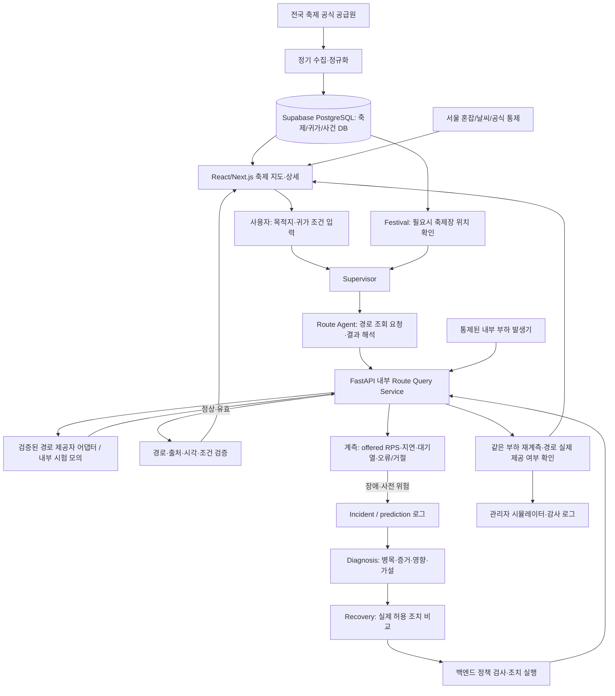
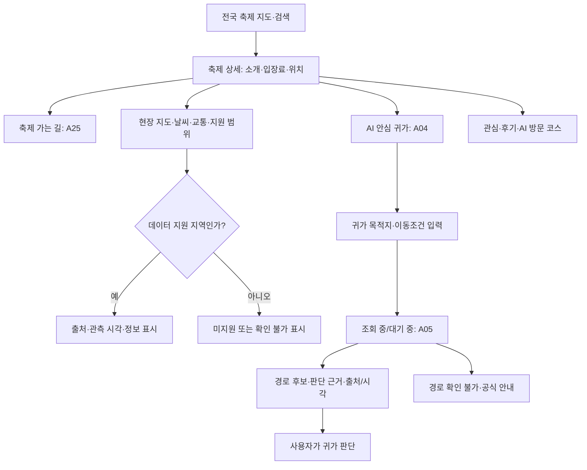
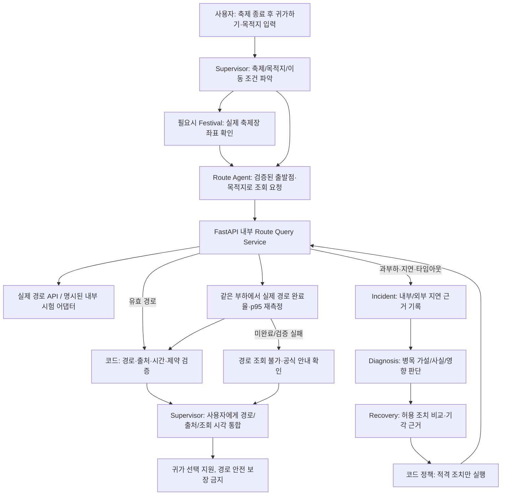
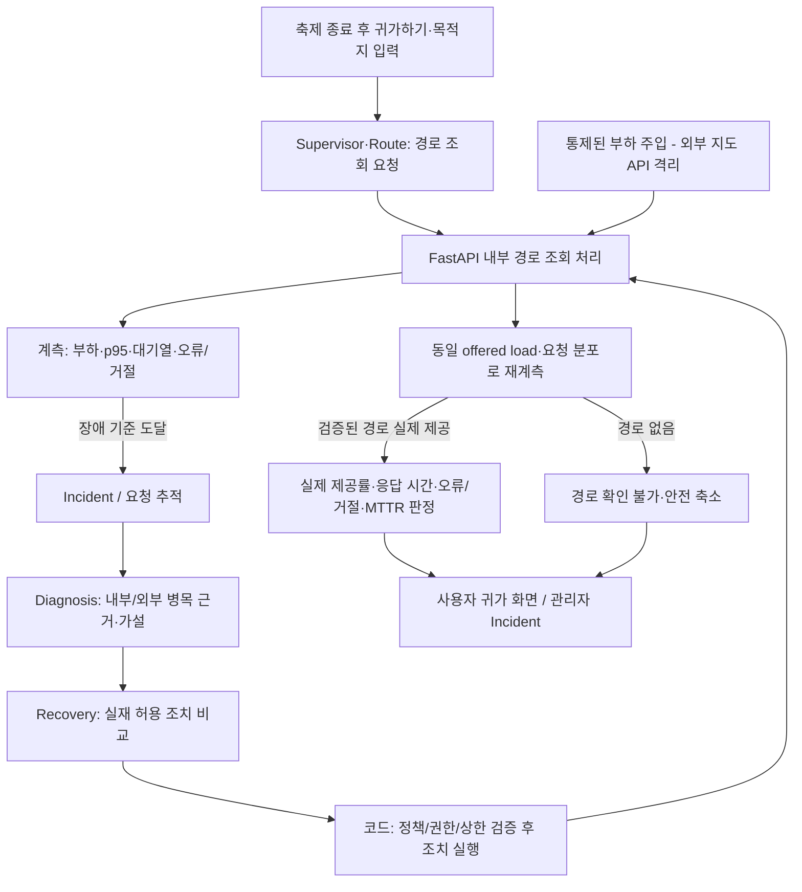

# 놀다가 (NOLDAGA)
## AI 안심 귀가 특화형 전국 축제 플랫폼
### 축제의 시작부터 마지막 귀갓길까지 연결하는 AI 서비스


| 항목 | 내용 |
|---|---|
| 서비스명·팀명 | **놀다가(NOLDAGA) / 수다수다(6명)** |
| 서비스 성격 | **전국 축제 지도·검색·상세가 핵심 기반**, **AI 안심 귀가가 대표 차별화**인 축제 전·중·후 통합 반응형 웹 |
| 슬로건 | 축제의 시작부터 마지막 귀갓길까지 연결하는 AI 서비스 |
| 교육 주제 | 1번 — 멀티 에이전트 기반 장애 예측·자가 진단·자율 복구(Auto-Healing) |
| 이용 흐름 | 전국 축제 탐색 → 가는 길·현장 정보 → 축제 종료 → **귀가 경로 조회** → 근거·미확인 조건 확인 |
| 전국 제공 설계 | 전국 공통 공급원으로 축제·기본 길찾기·날씨·시설·버스 도착·교통 돌발·방문 집중 예측. 실제 제공은 공급원·개별 지역·장소 실호출 검증 범위에 한함 |
| 서울 한정 설계 | 서울시 지원·매핑 장소의 **실시간 인구 혼잡**, 지하철 실시간 도착, 서울 공영주차장 잔여 면수, TOPIS·서울 문화행사 보완. 타 지역은 `unsupported` 표시 |
| 대표 Auto-Healing | 서울 축제를 시험 기준으로 **우리 내부 귀가 경로 조회**에 통제된 모의 부하 → 감지→Diagnosis/Recovery 판단→허용된 코드 실행→**동일 부하 재검증** |
| AI Agent | Supervisor / Festival / Route / Diagnosis / Recovery = **5개**. 필요한 Agent만 조건부 실행 |
| 기술 스택 | React/Next.js(반응형 웹), Python/FastAPI, LangGraph, **Supabase PostgreSQL(확정)**, pgvector, Redis. 배포·인증 세부 사항 별도 결정 |
| 길찾기 공급원 | **ODsay 선정(팀 설계)**. 팀 키·요청/응답·오류·호출 한도·계약의 **실제 검증 전** |
| 설계 범위 | `03_API_설계문서.md`의 **A01~A30 전체**, `04_DB_스키마_설계서.md`, WBS 수정본과 연계; API별 1차/최종/보조/후속 구분 유지 |
| 작업 집계 | WBS **111개 = 필수 101개 + 선택·조건부·후속·보류 10개**. 이는 작업 집계이며 기획 FR 우선순위와 별개 |
| 실제 검증 수준 | **2026-11-17 로컬 모의 경로 처리 예비 부하 실험 1회**; 동일 요청 병합 후보 효과 확인. 외부 경로 실연동·자동 복구·LangGraph 통합·B0/B1/A1·최종 배포는 미검증 |

**서비스 경계:** 'AI 안심 귀가'는 이용 가능한 자료와 불확실성을 구분해 판단을 돕는 서비스이며 귀가 안전·무장애 접근성·실시간 교통통제를 보장하지 않는다. 미지원 지역의 데이터를 다른 지역 값으로 대체하지 않는다. 축제 인파가 곧 앱 트래픽 증가는 아니므로 장애 시연 부하는 팀의 내부 모의 어댑터에만 주입하며 외부 지도·교통 API에는 부하 시험을 하지 않는다.

**복구 판정:** 요청 `accepted/queued`는 경로 제공 완료가 아니다. 같은 제공 부하(offered load)·요청 분포에서 검증된 경로 제공률, p95, 타임아웃·거절·오류와 MTTR을 비교한다. 최종 사건 결과 `normal_recovered / valid_cache / alternate_source / degraded / unresolved`는 시도한 `recovery_action`과 별도로 기록한다.

**예비 시험 근거:** 로컬 FastAPI/ASGI 모의 처리에서 동시 요청 120건, 내부 동시 처리 상한 8, 모의 비동기 지연 120ms. 동일 경로 12종 반복 시 p95 **1,784.8ms→271.9ms**, 내부 실행 **120→12회**. 서로 다른 경로 120종에서는 **1,796.5ms→1,828.8ms(개선 없음)**. 사전 적재 캐시 결과는 참고값이며 실제 Auto-Healing·실경로 성공으로 집계하지 않는다.

**문서 상태:** 이 기획서는 **최종 승인 요청본**이다. `03 API 설계`·`04 DB 스키마`는 **작성 중인 초안**이고 WBS는 **승인 전 계획안**이다. 11/20은 API·DB **설계 마감**이지 자동 복구 구현 완료일이 아니다. 외부 응답·DB 생성·실제 제출·접수는 증빙 확인 전까지 완료로 표기하지 않는다.

### 문서 목차

1. [01. 프로젝트 개요](#01-프로젝트-개요)
2. [02. 문제 정의](#02-문제-정의)
3. [03. 핵심 시나리오](#03-핵심-시나리오)
4. [04. 요구사항 명세](#04-요구사항-명세)
5. [05. 서비스 아키텍처 · 기술 스택](#05-서비스-아키텍처--기술-스택)
6. [06. 에이전트 구성 · 협업 흐름](#06-에이전트-구성--협업-흐름)
7. [07. 일정 · 역할 분담](#07-일정--역할-분담)
8. [08. 리스크와 대응](#08-리스크와-대응)

---

# 01. 프로젝트 개요

### 1.1 서비스 소개

**놀다가**는 전국의 축제를 공식 데이터로 통합해 지도·검색·상세로 제공하고, 방문 준비·축제 현장 정보·종료 후 이동을 한 서비스에서 연결하는 **AI 안심 귀가 특화형 전국 축제 플랫폼**이다. 전국 축제 검색은 서비스를 구성하는 **핵심 기본 기능**이며 '부가 기능'으로 축소하지 않는다.

서비스의 **대표 차별화 기능은 '축제 종료 후 AI 안심 귀가'**이다. 사용자가 선택한 축제 장소를 출발점으로 목적지를 입력하면 Route Agent가 실제 연결된 경로 공급원의 후보와 출처·조회 시각·이동 조건을 안내한다. 동행자·교통약자 조건은 검증 가능한 경로 요소에 한해 반영하며, 현재 교통통제·무정차·접근성 상태가 연동·검증되지 않았다면 '확인 필요'로 표시한다. 여기서 '안심'은 실제 안전 보장이 아닌 **확인 가능한 정보와 불확실성을 구분하여 귀가 판단을 돕는 의미**다.

핵심 기술 시연은 **축제 종료 시점 경로 조회 요청 증가를 팀의 통제된 부하 시험으로 재현**하여, 자체 경로 조회 처리 지연을 감지하고 Diagnosis Agent가 병목 후보·영향을 분석하며 Recovery Agent가 **실제로 구현된 허용 조치**의 적합성을 평가하는 것이다. 백엔드는 조치 실행 후 **동일한 요청량에서 사용자가 유효한 경로를 받은 비율·시간**을 재측정한다. 내부 처리 지연과 외부 길찾기 공급원 장애를 혼동하지 않는다.

현장 혼잡·기상·시설·공식 통제 기능은 전·중·후 서비스를 지원하는 기능으로 유지한다. **서울시 지역 단위 혼잡 데이터**는 축제 장소와 집계 지역 매핑이 검증된 경우에만 연결하며 혼잡 API 500/stale/본문코드 감지·복구는 보조 기술 시험으로 보존한다.

### 1.2 비전·목표

**비전:** “축제의 시작부터 마지막 귀갓길까지, 필요한 정보를 신뢰할 수 있게.”

1. **전국 축제 플랫폼:** 여러 지역의 실제 축제 정보를 수집·정규화하여 지도·검색·상세로 제공한다.
2. **축제 전·중 연결:** 날씨·지역 혼잡·편의시설·공식 공지를 출처·유효 시각과 함께 안내한다(공급원 지원 범위에 한함).
3. **AI 안심 귀가:** 축제 종료 후 목적지·동행 조건에 맞는 **검증 가능한** 귀가 경로 후보를 설명하고, 미확인 사항을 명시한다.
4. **복원력 있는 귀가 조회:** 자체 경로 조회 서비스의 동시 요청 증가를 통제 시험으로 재현하고, 서비스 처리 성능·실제 경로 제공이 개선되는지 검증한다.
5. **멀티에이전트의 추가 가치 검증:** Route/Diagnosis/Recovery의 별도 판단·인계와 B0/B1/A1 동일 조건 비교를 통해 AI가 고정 규칙보다 추가로 기여하는지 측정한다.
6. **안전한 한계 준수:** 안전·통제·실시간 이동 가능 여부를 실제보다 과장하지 않고, 유효 경로가 없으면 조회 불가를 정확히 알린다.

### 1.3 핵심 가치와 차별화

| 가치 | 제공 경험 | 검증 방법 |
|---|---|---|
| **발견성** | 전국 축제 지도·목록·필터로 여러 행사를 찾음 | 실제 수집 축제 수·지역 커버리지·지도/상세 연결 |
| **AI 안심 귀가(차별화)** | 행사 종료 후 목적지 입력·AI 경로 안내·선택 조건 설명 | 실제 경로 조회 완료·출처/시각·조건 미충족 안내 |
| **서비스 신뢰성(핵심 기술)** | 경로 조회가 몰려도 허용 조치로 처리 성능 회복 시도 | 같은 부하의 시간 내 경로 제공 비율·p95 지연·거절/오류·MTTR |
| 현장 연계 | 지원 지역 혼잡·날씨·시설·공식 공지 확인 | 공급원·갱신시각·매핑 검증 |
| 정보 정확성 | 검증된 경로만 안내하고 미확인 통제를 구분 | 출처 없는 경로·통제 충돌·가짜 실시간 정보 표시 0건 지향 |
| 확장성 | 관심·후기·맞춤 코스 등 단계적 확장 | 승인된 기능별 실구현·사용성·데이터 적합성 |

**포지셔닝:** 놀다가는 축제 전용 귀가 앱이 아니라 **축제 정보 플랫폼**이다. 경쟁 서비스의 기능 부재를 검증 없이 단정하지 않으며, '귀가 안내의 신뢰성'과 '진단·복구 과정의 검증 가능성'을 목표 차별점으로 설명한다.

### 1.4 서비스 범위와 데이터 제공 원칙

| 데이터 성격 | 지역 적용 | 사용자 화면·실행 기준 |
|---|---|---|
| **전국 공통 원천** | 전국 17개 시·도 대상 | 축제·상세·지도, 실제 지원되는 기본 길찾기(ODsay), 날씨, 시설 위치, TAGO 버스 도착, 경찰청 교통 돌발, 관광지 방문 집중 예측·지역 수요를 공급원별 지원 범위에서 제공 |
| **서울 전용 원천** | **서울만** | 검증된 구역의 OA-21778 실시간 혼잡, 지하철 실시간 도착, 공영주차장 빈자리, TOPIS 통제, 서울 문화행사 보완 |
| **기타 시·도별 원천** | 1차에는 미연동 | 대구·대전·제주 등 별도 지자체 전용 데이터는 확장 후보. 전국 공통 원천 데이터는 해당 지역에서 계속 활용 |
| **시뮬레이션** | **서울 축제 기준** | 실제 축제를 선택한 사용자 흐름에 연결하되 부하는 **내부 모의 경로 처리 어댑터**에만 주입. 지도·길찾기 상용 API에 부하 금지 |
| **미지원·확인 불가** | 모든 지역 공통 정책 | 지원 지역 밖은 `coverage.supported=false`와 `status=unsupported`로 표시. 원천 없음·신선도 부족·시설 좌표 없음·공식 통제 미확인은 구체적으로 구분 |
| **범위 밖** | 전국 공통 | 티켓·예매·결제, 공연·전시 별도 탐색, 웹 크롤링, 네이티브 앱, 개인 GPS 이동 이력 추적, 축제장 내부 인원 추정·무장애 귀가 보장 |

**전국 지원 예정 = 전국 실호출 검증 완료가 아님.** ODsay·TAGO·경찰청 등은 실제 키·응답·요금·지원 구간을 검증해야 한다. 서울 집계 혼잡은 **서울 전체/축제장 내부의 구간별 혼잡을 뜻하지 않으며**, 축제-관측구역 매핑이 확인된 경우에만 나타낸다. 30일 방문 집중 *예측(상대값)*은 지금의 실시간 인구 혼잡과 색상·명칭을 분리한다.

### 1.5 한눈에 보는 서비스 정의

| 항목 | 내용 |
|---|---|
| 문제 | 전국 축제 정보는 흩어져 있고, 대형 행사 종료 시 이용자는 경로·운행 변경을 따로 확인해야 한다. **이때 우리 귀가 조회 서비스가 지연되면 필요한 판단을 제때 하기 어렵다.** |
| 사용자 | 전국 축제를 찾는 시민·관광객, 종료 후 귀가 이용자, 현장 방문객, 운영 관리자 |
| 해결 방식 | 전국 축제를 지도·검색으로 제공하고 **축제별 AI 안심 귀가 경로 조회**로 방문 전·중·후 경험을 연결. 지원 데이터의 출처·조회/관측 시각·불확실성 표시 |
| 대표 가치 | **전국 축제 탐색 → 축제 상세·현장 안내 → 종료 후 목적지 입력 → AI 안심 귀가 경로 조회 → 귀가 판단** |
| 대표 기술 시연 | **동시 귀가 조회 부하 주입 → 내부 경로 조회 지연 감지 → Route·Diagnosis·Recovery 협업 → 코드 실행·검증 → 동일 부하에서 경로 제공 회복 여부 측정** |
| 보조 기술 시험 | 서울시 혼잡 API 500 / 200+stale / 본문 결과 코드, 축제 수집 장애(원래 기획 보존) |
| 경계 | 실제 축제 인파 ≠ 실제 놀다가 트래픽, 귀가 안전 보장 금지, 대기열 접수 ≠ 유효 경로 제공 |

### 1.6 MVP 상위 5개 영역과 상세 7개 기능군

| 상위 영역 | 상세 기능군 | 1차 및 최종 역할 |
|---|---|---|
| ① **전국 축제 데이터·지도 플랫폼** | A 수집·통합·관리 / B 지도·검색·상세 | **플랫폼 기본 핵심**: 실제 여러 지역의 축제를 검색·선택. 귀가 기능의 `festival_id`·장소 출처 제공 |
| ② 축제 현장정보 | C 혼잡·날씨·공식 통제 / D 시설·상권 | 지원 지역의 데이터만 검증해 안내, 초도 부하 시연의 필수 병목 아님 |
| ③ **AI 안심 귀가·방문 지원** | E 귀가 경로·AI 개인화·가는 길 / F 관심·후기·코스 | **차별화 핵심**: 축제장 출발·목적지 입력·실제 경로 조회·상태 안내를 초도 필수로 배치 |
| ④ **멀티에이전트 Auto-Healing** | G Route·Diagnosis·Recovery 판단 및 코드 실행·검증 | **핵심 기술**: 동일 부하 조건의 내부 경로 조회 처리 장애·회복 측정 |
| ⑤ 운영·검증 | A 수집·관리, G 부하 지표/Incident·정책·감사 | 사용자 귀가 화면과 운영자 장애·복구 타임라인 동시 제시 |

**제품 최종 범위:** 기존 Must/Should/Could는 유지하되 첫 시연은 '축제 선택→귀가 조회→통제된 부하→검증된 자동 대응' 하나에 집중한다. 고급 경로 비교 5유형은 Should로 유지하며 모두 첫 시연에 넣지 않는다. **예매·자체 결제·예약 장애 대응은 계속 제외**한다.

### 1.7 기능·단계별 우선순위

- **Must / Should / Could는 제품 요구사항**, WBS 필수/선택/보류는 **작업 관리 구분**이다. 둘을 합쳐 진행률을 계산하지 않는다.
- **Must(기본 서비스):** 전국 축제 탐색·상세, 기본 **가는 길/AI 안심 귀가** 안내, 관련 상태·출처·불확실성 표시, 챗봇, 승인된 공식 정보와 현재 데이터의 구분, 자체 경로 조회 Auto-Healing 대표 시연.
- **Should(선택 구현):** 고급 귀가 경로 5유형, 후기·상권 확장·통합 찾기 등 WBS에서 선택으로 분류된 항목은 실제 가용 시간과 채택에 따라 진행한다. AI 방문 코스 등 기존 Must 기능은 별도 결정 없이 삭제하지 않는다.
- **Could/보류:** 리워드·음성·GPS 길안내, **물품보관함과 약국 지도 제공(현재 보류)**, SNS 현장 요약·자전거 확장 기능 등은 주요 일정에 자동 포함하지 않는다.
- **범위 밖:** 티켓·예약·결제, 공연·전시 별도 콘텐츠, 웹 크롤링, 개인 위치 추적. 지도에 주변 관광지 위치를 표시하는 기능과 별도 공연/전시 탐색은 구별한다.
- **공급원 정책:** ODsay를 길찾기 공급원으로 선정했으나 원본 실호출은 아직 미확인. 서울 전용 원천은 서울만 제공하고 지역 확대는 `data_sources.enabled_region_codes`와 추가 검증 후 별도 결정.
- **1차 시연:** 전국 실제 축제 목록·상세와 **기본 귀가 경로·상태 조회**, 통제된 내부 부하, Diagnosis→Recovery→백엔드 정책 실행→동일 부하 재검증을 우선한다. **11/20 제출은 API·DB 설계**에 한정.
- **모의 효과:** 반복 경로 요청에서는 동일 요청 묶기 후보의 효과를 확인했지만, 고유 목적지에는 개선되지 않았다. 장애 후 자동 활성화·실사용자 경로 제공·B0/B1/A1의 성공 기준은 별도 시험한다.

### 1.8 프로젝트 팀 및 기획 범위

**팀 구성(기존 주/보조 역할 유지):** 정예진(PM·기획/프론트), 한다영(에이전트/QA), 권오현(백엔드/에이전트), 한태경(QA/인프라), 이수언(프론트엔드/PM), 신유빈(인프라/백엔드).

**주요 산출물:** 실제 전국 축제 여러 건의 지도·상세 웹, AI 귀가 경로 요청·결과·조회 중/대기/실패 화면, 경로 조회 내부 처리 구간 및 통제된 부하 생성기, Diagnosis·Recovery 간 인계 trace, 코드 정책 실행/효과 재측정, 관리자 운영 화면.

**역할 경계:** 경로 후보 생성·실제 길찾기 공급원은 검증 단계별로 제공/미제공을 구분한다. 첫 부하 시험에서 내부 모의 경로 엔진을 사용한 경우 **실제 운영 경로 품질까지 검증했다고 주장하지 않는다**. 공식 안전·교통통제를 대체하지 않는다.

### 1.9 기대효과 및 측정 가설

| 기대효과(가설) | 실측할 지표 |
|---|---|
| 전국 축제 탐색의 편의 | 수집된 축제 수·지역 커버리지, 지도→상세 전환 성공률 |
| 행사 종료 후 귀가 안내의 유용성 | 목적지 입력→경로 조회 완료율·소요시간, 사용자 사용성 검증 |
| 동시 조회 상황에서도 신뢰 가능한 정보 제공 | **동일 제공 요청량**에서 시간 내 실제 경로 제공 비율, p50/p95 지연, 전체 오류·거절율, 대기열 길이 |
| 멀티에이전트 추가 가치 | B0/B1/A1의 경로 제공 성공·MTTR·판단 정확도·지연·토큰/비용 차이 |
| 안전한 실패 안내 | 검증되지 않은 경로를 실제 이용 가능처럼 표시한 횟수, 상태/출처 표기 정확성 |

현재는 모두 **측정 계획**이며 개선 수치·합격 임계값은 첫 기준 성능 시험 이후 정한다.

### 1.10 초도 시연·최종 구현·보류 범위의 구분

**첫 시연의 사용자 질문:** “축제가 끝났어요. 지금 목적지까지 어떻게 돌아가면 좋을까요?” **사용자가 내릴 결정:** 출처·조회 시각과 확인된 제한조건을 보고 실제 귀가 경로를 선택할지, 재조회 또는 공식 교통 안내를 확인할지 판단한다.

| 구분 | 목표와 범위 | 완료 판정 / 한계 |
|---|---|---|
| **1차 시연 — 기본 축제 흐름** | 전국 복수 축제 지도·검색·상세 → 축제 선택 → **귀가 출발점(축제 장소)·목적지 입력** → 경로 조회 결과·출처/조회 시각 또는 정직한 오류 표시 | 실제 축제 데이터/경로 데이터의 지원 범위와 **모의 자료를 분리**. 최초 정상 경로 조회가 성립해야 부하 복구를 시연 |
| **1차 시연 — 대표 장애** | 자체 **경로 조회 처리 계층**에 동시 요청 주입 → 지연·오류/대기열 관측 → Diagnosis/Recovery 판단 인계 → 백엔드 허용 조치 → **동일 부하 재측정** | 실제 경로 응답 완료시간·기한 내 성공률·거절/오류율·대기열·MTTR, 사용자 UI와 운영 로그 일치. 사용자 경로 미제공 시 성공 아님 |
| **최종 구현 목표** | 기본 가는 길, 축제 현장정보, 공식 교통공지, AI 코스·챗봇, 지원 지역 혼잡, 시설, RAG·관심 등 기존 Must와 채택된 범위 | API·통제·접근성 연동을 실제 검증해 제공. 경로 비교 5종은 Should 유지 |
| **보조 Auto-Healing** | 서울 혼잡 API 500/200+stale/본문 오류, 축제 목록 수집/에이전트 품질 오류 | 초도 귀가 부하 시험을 대체하지 않음. 원본 실호출과 모의 장애 구분 |
| **이번 보류** | 예매·결제, 전국 실시간 혼잡 보장, 개인 이동 추적, 검증 안 된 실시간 경로·무장애 보장 | 별도 팀 결정·공급원 검증 없이 필수 개발·시연으로 올리지 않음 |

**플랫폼과 기술 시험의 관계:** 전국 행사 지도는 자체 기반 기능으로 유지한다. 실제 부하 시험은 **팀이 직접 제어하는 경로 처리 코드**에만 가하고, 외부 상용 지도 API를 부하 테스트 대상으로 삼지 않는다. 같은 경로 입력을 모의해 만든 응답은 '경로 처리 성능 실험'으로 표시하고 실제 이용 가능한 경로 서비스 통합 성공으로 계산하지 않는다.

**현재 실험 근거:** 모의 ASGI 처리 환경에서 **반복 요청 패턴의 `singleflight` 후보 효과**는 1회 측정되었다(3.9). 다만 장애 임계값 감지→자동 활성화→에이전트 판단→재검증의 연쇄 시험은 수행하지 않았다. 1차 시연 완료 판정은 **그 후속 통합 시험**을 통과해야 한다.

### 1.11 제품 범위와 WBS 작업 집계의 구분

- WBS 기준 **총 111개 작업 = 필수 101개 + 선택·조건부·후속·보류 10개**. 상태·완료 근거·담당·변경 일정은 최신 WBS에서 관리한다.
- Must/Should/Could를 작업 수와 1:1 대응시키지 않는다. A01~A30은 **전체 설계 범위**이고 개별 API의 1차·최종·보조·후속 구분을 유지한다.
- 1차 시연은 지도→축제 상세→귀가 조회→내부 부하·자동 진단·복구 검증의 연결에 집중한다. 최종 범위의 날씨·시설·서울 실시간 데이터·왕복 경로·AI 코스·RAG·관심/후기는 구현 단계별로 관리한다.
- 완료·검토·제출은 결과 링크·수행일·검토 판정·접수 확인 단계가 충족된 경우에만 각각 표기한다. 작업 지연과 선행 의존성은 WBS 기록을 기준으로 한다.

### 1.12 대표 서비스와 장애 시연의 경계

**서비스:** 축제 전(찾기·가는 길) → 중(현장 정보) → 후(**AI 안심 귀가**)를 연결한다. 전국 기본 축제 데이터는 서비스의 중심이고 귀가 안내는 대표 차별화 기능이다.

**기술 시연:** 서울 축제 기반 사용자 흐름에서 **내부 Route Query Service**에 시험 부하를 주입하고 지연을 관측한다. 진단·복구 정책의 실행과 사용자에게 검증된 경로 결과가 도착했는지 같은 부하에서 확인한다. 혼잡 API 500/오래된 자료 등은 보조 시험으로 남긴다.

**안전:** 경로 공급원 ODsay 선정과 실제 연동/응답 검증은 별개다. 공식 통제와 접근성·실시간 운행을 확인할 수 없으면 확인 불가로 표시하고 안전을 보장하지 않는다.

### 1.13 소규모 귀가 처리 예비 부하 실험 (2026-11-17)

| 입력 분포(동시 120건) | 일반 처리 p95 | 동일 요청 병합 p95 | 내부 실행 수 | 해석 |
|---|---:|---:|---|---|
| **고유 경로 키 12개 반복** | 1,784.8ms | 271.9ms | 120→12 | **모의 조건에서 후보 효과 확인** |
| **서로 다른 경로 키 120개** | 1,796.5ms | 1,828.8ms | 120→120 | 개선 없음 |

동시 처리 상한 8·모의 비동기 지연 120ms·로컬 ASGI 환경에서의 예비 실험 1회다. 사전 적재된 캐시 결과는 기본 성능 참고만 가능하며 실제 복구 효과로 기록하지 않는다. 모의 경로 결과 120/120 반환도 **실제 길찾기 경로 제공률이 아니다**. 자동 전환/에이전트 협업/실제 운영 성능 검증은 남아 있다.

# 02. 문제 정의

### 2.1 축제 탐색·정보 제공의 구조적 문제

축제 일정과 장소는 공공 포털·지자체·주최 측 홈페이지에 분산되어 있고, 현장 혼잡·기상·교통통제·주변 시설은 별도의 서비스에 존재한다. 사용자는 **어떤 축제가 열리는가**, **가도 되는 날씨인가**, **주변이 얼마나 붐비는가**, **가는 길·귀가 길을 어떻게 정할 것인가**를 각각 확인해야 한다.

사업자·기관별 축제 데이터는 필드·형식·갱신 주기가 다르므로 지도 플랫폼은 API 호출뿐 아니라 **정규화·중복 제거·좌표 확인·변경 관리**가 필요하다. 전국의 모든 행사가 어느 한 API에 완전하게 포함된다고 전제하지 않는다.

### 2.2 참고 사례와 규모 근거

**2025 서울빛초롱축제:** 서울관광재단의 2026-01-20 공식 보도자료는 행사 **37일간 누적 방문객 383만 명**을 발표했다. 이는 대규모 도심 축제에 대한 관심과 현장 안내의 중요성을 보여주는 사례다. **실시간 현장 인원이나 서울시 지역 인구 API 수치와 동일하지 않다.** [출처: 서울관광재단](https://sto.or.kr/press/16035_/16035).

**2026 서울세계불꽃축제:** 2026-09-01 서울시 사전 교통·안전 대책에는 지하철 운행 증회, 역사 무정차 가능성, 도로 통제·버스 우회 등의 안내가 포함됐다. 과거 행사 대책은 **현재 시행 중인 통제**로 사용하지 않는다. [출처: 서울시 보도자료](https://www.seoul.go.kr/news/news_report.do?nttNo=465103).

### 2.3 관람객의 문제

> **핵심 문제:** 축제 종료 직후 이용자는 목적지별 귀가 경로와 공식 교통 안내를 따로 확인해야 한다. 놀다가의 귀가 경로 조회가 자체 처리 병목으로 지연된다면 필요한 정보가 제때 제공되지 못한다. **이는 실제로 트래픽이 폭증했다는 관측 결과가 아니라 통제된 부하 시험으로 확인할 기술 가설**이다.

| 단계 | 사용자 불편 | 놀다가 대응 |
|---|---|---|
| 축제 전 | 여러 행사 일정·지역·후기를 한눈에 비교하기 어려움 | 전국 지도·날짜·지역 검색, 축제 상세·관심 저장 |
| 축제 전 | 가족·연인에 맞는 이동·식사·편의시설 계획 번거로움 | AI 코스 후보, 주변 상권·시설, 가는 길·예보 |
| 축제 중 | 주변 혼잡·날씨·현장 통제 정보가 분산 | 지역 혼잡·12시간 전망·날씨·통제, 출처·시각 안내 |
| 축제 중 | 화장실·병원·주차·교통시설·카페 등을 따로 검색해야 함 | 주변 시설·상권 카테고리 지도 |
| 축제 후 | 교통 운행 변경 속 귀가 경로 확인이 번거로움 | 귀가 경로 조회, 확인된 공식 변경 반영 검토 |
| 축제 후 | 방문 경험을 다음 방문자에게 전달할 공간 필요 | 축제별 후기·관심 목록 |

### 2.4 기존 공공 안전관리와의 관계

지자체·주최 측·경찰·소방 등 관계 기관은 현장 통제·안전관리 책임을 담당한다. 놀다가는 해당 기관의 판단을 대신하지 않고 **공식 공지를 발견·표시하고 이용자가 참고할 수 있도록 돕는 보조 정보 서비스**다. 혼잡도만으로 '사고 위험', '안전한 골목', '무정차 확정' 등을 임의 판단하지 않는다.

### 2.5 기존 서비스의 한계와 기회

Spotts는 지도 기반 전국 행사 탐색과 일정·장소·주변 시설 경험을 참고할 수 있는 벤치마크다. 기존 지도 앱은 폭넓은 길찾기를, 지자체·공공데이터 플랫폼은 지역별 현장 지표를 제공한다. 놀다가는 **하나의 선택된 축제를 맥락으로 하여 축제 정보와 실시간 상태·주변 시설·이동·AI를 묶는 경험**을 검증한다. 경쟁사에 특정 기능이 없다고 단정하지 않는다.

### 2.6 데이터 측면의 제약

**전국 축제·날씨·시설·버스·교통 돌발·길찾기·관광지 방문 집중 예측**의 공급원은 전국 공통 후보로 확보했으나 지역별 필드·실제 데이터 범위·요금·쿼터와 팀 키 호출은 각각 검증해야 한다. **실시간 인구 혼잡·지하철 도착·주차장 잔여 면수·서울 TOPIS 데이터**는 우선 서울에서만 제공한다. 혼잡 집계 장소와 실제 축제장이 일치하지 않거나 매핑 근거가 없으면 '미지원'으로 표시한다.

실시간 혼잡(현재의 관측값)과 30일 관광지 방문 집중 예측(상대값)은 다른 지표다. 교통약자 이동 경로·버스 차내 혼잡·무정차 반영은 검증된 별도 자료 없이 보장하지 않는다. ODsay는 선정됐지만 실제 요청·응답·오류 및 쿼터는 실호출 전으로 관리한다.

### 2.7 핵심 문제 정의

**서비스 문제:** 전국 축제 정보와 현장·교통 정보가 분산되어 있고, **축제 종료 후 대중교통·교통통제 및 귀가 경로를 다시 찾아야 하는 상황**에서 이용자는 이동 선택의 근거를 한곳에서 확인하기 어렵다.

**기술 문제:** 귀가자가 같은 시각에 **놀다가의 귀가 경로 조회 기능을 실제로 사용하는 경우**, 우리 내부 경로 조회 처리 계층에 트래픽이 집중되어 응답 지연·오류가 발생할 수 있다. **실제 방문객 수 증가만으로 내부 트래픽·장애가 발생했다고 단정하지 않는다.** 통제된 시험에서 병목을 재현하고, 에이전트가 진단·복구 대안을 평가한 뒤 시스템이 사용자 경로 제공 상태를 회복했는지 측정한다.

**안전·품질 문제:** 오래된 경로나 확인되지 않은 교통통제를 현재 이용 가능한 경로라고 제시하면 안 된다. 실패 시 '조회 중/대기 중/확인 불가'를 정확히 구분하는 것도 중요하다.

### 2.8 주요 사용자

| 사용자 | 주요 요구 | 대표 기능 |
|---|---|---|
| 축제 탐색자·관광객 | 전국에서 지금 또는 앞으로 열리는 행사 확인 | 지도·필터·상세 |
| 연인·친구 방문객 | 행사 일정·식사·카페·가는 길 묶기 | 관심·AI 코스·주변 상권 |
| 어린이·고령 가족 동행 | 화장실·주차·쉼터·이동 부담 확인 | 시설·길찾기·AI 안내 |
| 당일 현장 방문객 | 혼잡·날씨·공식 통제 확인 | 실시간 카드·지역 정보 |
| 대중교통 귀가자 | 무정차·우회와 귀가 경로 확인 | 공식 운행 변경·기본 귀가 |
| 플랫폼 운영자 | 외부 API 데이터 오류·중복·장애 처리 | 축제 데이터 관리·모니터링 |

### 2.9 페르소나(기획 가설)

**A — 주말 데이트 계획 사용자:** 서울뿐 아니라 인천·부산 등 여러 지역의 주말 축제를 지도에서 비교하고 관심 저장. 연인 코스와 카페, 가는 길 검색이 필요하다.

**B — 가족 단위 사용자:** 어린아이·고령 가족과 함께 행사에 방문. 화장실·주차장·쉼터·응급시설을 먼저 확인하고 이동 부담이 작은 코스를 원한다. 검증되지 않은 무장애 경로는 보장하지 않는다.

**C — 현장 방문 사용자:** 선택한 서울 축제 주변에 혼잡 데이터가 있으면 혼잡도·12시간 전망을 보고 현장 동선을 판단하고, 운행 변경 시 귀가 경로를 다시 확인한다.

**D — 관리자:** 축제 A가 API 두 곳에 중복 등록되었거나 행사 날짜가 다르고, 혼잡 API는 오류를 반환하는 상황에서 데이터·장애 상태를 구분해 처리한다.

### 2.10 사용자 검증 계획

- 축제 검색·예정 행사 탐색·관심 저장·현장정보 이해의 실제 사용성 테스트 설계.
- 15~20건의 공개 축제 방문 후기 분석 및 20~30명 규모 소규모 탐색 설문은 **권장 계획**으로 기재. 실시 실적 아님.
- `혼잡도 미지원`, `N분 전 자료`, `향후 12시간 전망`의 의미를 사용자가 오해하지 않는지 확인.
- PC·모바일에서 지도 마커 검색·필터·상세·뒤로가기·후기 입력 성공 여부를 관찰.

---

| 서비스·자료 | 확인 가능한 특징/참고 분야 | 놀다가 적용 목표 |
|---|---|---|
| **Spotts** (spotts.kr) | 전국 축제·팝업 등 행사 검색과 지도·일정·지역 분류, 행사별 주변 시설 등 | 지도 중심 탐색 UX, 정보 카드·상세 구조를 참고하되 독자 브랜드 구축 |
| 대한민국 구석구석·TourAPI | 전국 관광·축제 공공정보 | 축제 데이터 공식 공급원과 상세·이미지·기간 제공 범위 검증 |
| 서울 실시간 도시데이터 | 지원 장소의 지역별 인구·혼잡·전망 및 도시정보 | 혼잡/예보를 축제 상세에 매핑, 기준 시각·지역 한계 표시 |
| 카카오맵 등 일반 지도 플랫폼 | 장소 검색·지도·길찾기 | 가능한 경로 서비스를 연동하고 운영 조건·데이터 범위를 검증 |
| TOPIS·지하철 공식 공지 | 도로 통제·버스 우회·운행 변경 관련 공식 게시 | 통제·무정차의 출처와 적용 시간 확인 |

**기획 원칙:** Spotts가 실제로 모든 데이터를 어떤 기술·API로 수집하는지는 공개 화면만으로 확정할 수 없다. Spotts 자체 로고·이미지·HTML/CSS·코드를 복제하지 않는다. 경쟁 기능 비교는 동일한 시점·동일한 행사로 실제 확인한 항목만 표기한다.

**차별화 검증 질문:** 사용자가 축제를 선택했을 때 `혼잡도 제공/미지원`, `기준 시각`, `날씨`, `통제 정보`, `가는/오는 길`을 한 화면 흐름에서 정확히 구분해 제공하는가? 장애가 나도 전국 축제 탐색은 유지하는가?

---

### 2.11 귀가 경로 조회 장애가 사용자에게 미치는 구체적 영향

- **사용자 작업:** 축제 종료 후 '귀가하기'를 누르고 목적지를 입력해 실제 이용 가능한 이동 경로를 확인하고자 한다.
- **필요한 근거:** 축제 장소/출발점, 목적지, 이동 수단·동행 조건, 실제 경로 공급원, 조회 시각, 확인된 공식 교통 통제·운행 변경.
- **처리 지연 시 피해:** 목적지·교통 선택을 결정하지 못하고 재시도하거나 다른 채널을 찾아야 한다. 다만 인파가 많다고 놀다가 서버 장애가 자동 발생하는 것은 아니다.
- **올바른 시스템 대응:** 대기 중·조회 중·완료·확인 불가를 구분하고, Diagnosis/Recovery가 근거와 허용 조치를 남기며, 실제 경로 완료율과 시간을 재검증한다.
- **실패해도 유지할 것:** 전국 축제 지도·검색·상세, 출처 있는 공식 안내 링크. **검증된 경로를 얻지 못했다면 귀가 '경로 제공 성공'으로 세지 않는다.**

# 03. 핵심 시나리오

### 3.1 전국 플랫폼 대표 사용자 흐름과 AI 안심 귀가 초도 시연의 연결

**대표 사용자(기획 가설):** 전국 축제 목록에서 행사 하나를 찾고 참여한 방문객 A. 축제 종료 후 목적지를 입력하여 확인 가능한 귀가 경로를 비교·선택하려 한다. 전국 지도는 실제 서로 다른 지역의 여러 행사를 제공하는 **기본 플랫폼**이다.

| 단계 | 사용자 행동·판단 | 필요한 데이터/결과 | 에이전트·시스템 | 화면 상태 |
|---|---|---|---|---|
| ① 축제 탐색 | 지역·날짜로 축제를 찾음 | 공식 축제 ID·장소·시간·좌표 | DB 검색 / 필요 시 Festival | 축제 목록·상세, 출처 |
| ② 축제 이용 | 축제장·현장 정보를 확인 | 공식 행사 안내, 제공 가능한 지역 정보 | Festival / 공공 API | 혼잡 지원·미지원 구분 |
| ③ **귀가 선택** | **'귀가하기' → 목적지·이동 조건 입력** | 축제장 출발점·목적지(필요 시 이동수단) | Supervisor → Route → 경로 조회 백엔드 | 조회 중 / 대기 중 |
| ④ 정상 응답 | 실제 경로를 확인하고 이동을 결정 | 검증된 공급원 응답·조회 시각·이동 정보 | Route + 코드 유효성 검증 | 유효한 경로 / 미확인 통제 표시 |
| ⑤ **통제 장애 주입** | 여러 사용자가 동시에 조회하는 상황을 실험 | 우리 서비스 내부 요청량·대기열·응답시간·오류 | **팀의 내부 부하 발생기** + 관측 코드 | 조회 지연/실패, 허위 경로 금지 |
| ⑥ **에이전트 Auto-Healing** | 장애 중 경로 결과를 기다림 | 증거·복구 후보·실행 로그 | **Diagnosis → Recovery → 정책 코드** | 처리·대기·결과 상태 구분 |
| ⑦ **동일 부하 재검증** | 실제 경로를 받거나 확인 불가 안내 확인 | 경로 제공 건수·지연·거절·오류·통제 반영 여부 | 실행 코드·Route·Supervisor | 경로 제공 성공 또는 정확한 실패 안내 |

**통제된 기술 시연과 운영 서비스의 구분:** 실제 축제 종료 때 이용자가 집중된다는 것은 사용자 문제의 배경이다. 동시 요청 급증과 경로 처리 병목은 **시연용 부하 주입으로 재현하는 가설**이며 실제 축제 운영 트래픽·외부 API 장애를 확인했다는 뜻이 아니다. 고정된 시험용 경로를 사용했다면 결과에 반드시 '모의'를 표시한다.

### 3.2 1차 시연 범위와 이후 서비스 경험 분리

| 시점 | **첫 시연 필수** | 최종 구현·후속 | 보류·미지원 |
|---|---|---|---|
| 축제 전 | 전국 다수 축제 지도·검색·상세·장소 선택 | AI 동행 코스, 날씨·시설·관심·가는 길 | 예매, 확인되지 않은 행사 세부 운영 정보 |
| 축제 중 | 축제 기본 정보·선택 위치 유지 | 검증된 서울 혼잡/전망·공식 공지·교통통제 | 전국 혼잡 보장, 골목·출구 안전 단정 |
| **축제 후** | **목적지 입력 → 실제 경로 응답/출처·시각 → 조회 실패/대기 상태** | 통제 연계, 후기·다음 축제 탐색, 고급 5유형(Should) | 실측 안 된 경로·접근성·운행 상태 보장 |
| **Auto-Healing** | **내부 경로 처리의 부하 주입 → 감지 → Diagnosis/Recovery → 허용 조치 → 동일 부하 검증** | 혼잡 API 500/stale/본문 오류, 축제 수집 장애, 귀가 예측 고도화 | 외부 길찾기 API 직접 과부하 시험, 없는 대체원 가장 |

**우선 개발:** 실제 경로를 정상적으로 받는 최소 계약이 먼저 필요하다. 부하 시험용 경로 공급원이 모의인 경우 첫 시연은 '내부 경로 처리 복원력 검증'이고, **실제 경로 연동은 아직 미완료**라고 표시한다.

### 3.3 대표 Auto-Healing — 귀가 경로 조회 동시 요청 처리 지연

**대표 장애(시연):** 사용자가 축제 종료 후 동시에 '귀가하기'를 눌렀다고 가정하고, **팀이 통제하는 내부 경로 조회 처리 어댑터/서비스**에 동시 요청을 부여한다. 병목은 측정한 후 확정하며, 외부 경로 API를 무단 고부하 호출하지 않는다.

| 단계 | 확인 질문 | 실행·증빙 | 사용자 화면 |
|---|---|---|---|
| 0 기준 상태 | 평소 경로 조회가 실제로 되는가? | 출발·목적지→검증된 경로 응답 또는 모의 경로 표기; 기준 p95·완료율 측정 | 경로·출처/시각 또는 시험용 응답 표시 |
| 1 부하 주입 | 어떤 요청이 얼마나 들어오는가? | 일정한 동시 요청·도착률·출발/도착 패턴 기록, 부하 발생기 로그 | 조회 중·대기 중 |
| 2 감지 | 경로 실제 제공이 느려지거나 실패했나? | `offered_rps`, `queue_depth`, `inflight`, `route_latency_ms`, timeout, error/rejection 기록, Incident 생성 | 지연/실패 원인 **확정 전** 표시 |
| 3 Diagnosis | 병목이 내부 처리인가 외부 API인가? | 서비스/의존성 로그·자원 사용·지연 분해, 확정 사실/가설/영향 범위 출력 | 복구 처리 중, 원인 단정 금지 |
| 4 Recovery | 실제 구현된 대응 중 무엇이 효과가 있나? | **동일 조건 재요청 병합(singleflight)**, 검증된 짧은 캐시, 동시 처리·대기열 정책 등 후보와 기각 이유 비교 | 사용자 요청 대기/처리 상태 |
| 5 코드 실행 | 권한·정책·종료 상한은? | allowlist의 조치만 실행, 경로 유효성·통제 반영 여부 확인, 조치/설정/시각 로그 | 검증된 경로 외 미노출 |
| 6 **같은 부하 재검증** | 고객에게 경로가 더 잘 도착하나? | **같은 부하·같은 요청 구성·같은 시험용 공급원 조건**으로 완료율/p95/거절·오류율·대기열·MTTR 비교 | 유효 경로 제공 / 확인 불가 구분 |
| 7 결과 확정 | 경로를 받지 못한 요청은? | 사건 5종 결과+실행 조치 기록; 미응답/거절 요청은 성공에서 제외 | 서비스 지속/축소/실패 정확히 표시 |

**실행 후보는 검증 전:** 동일 조회 묶기는 출발·목적지·수단·조건·시간/통제 문맥이 같을 때만 가능하다. 사용자 목적지가 다양하면 효과가 작을 수 있다. 대기열·동시성 제한은 서버 보호 조치일 수 있으나 **사용자가 경로를 못 받으면 복구 성공이 아니다**. 이미 검증된 조치가 없으면 `degraded/unresolved`를 기록한다.

**첫 시연의 핵심 성공 조건:** AI 에이전트가 분석 메시지를 남긴 것만으로 성공이 아니다. **부하를 낮추지 않은 상태에서** 유효 경로 제공 완료율과 지연이 개선되는 것을 측정하며, B0/B1/A1 차이가 없으면 그대로 기록한다.

**예비 실험 반영(2026-11-17):** 위 4단계 Recovery의 `동일 조회 병합`은 **12개 고유 키가 반복되는 120건 모의 조회**에서 유효한 *후보*임을 측정했다. 그러나 `coalesce`는 실험 시작부터 활성화된 방식이었으므로 **장애 후 자동 전환·복구 성공으로 간주하지 않는다**. 목적지가 모두 다른 120건에서는 효과가 관측되지 않아, 실제 요청의 중복 분포와 병목을 확인하기 전에는 모든 귀가 요청에 동일 정책을 적용한다고 쓰지 않는다. 상세 수치는 3.9 참조.

### 3.4 5개 에이전트의 조건부 협업

**대표 귀가 흐름:** `Supervisor → (필요 시 Festival로 축제장 확인) → Route → [내부 조회 지연 시] Diagnosis → Recovery → 백엔드 정책/실행 → Route 결과 검증 → Supervisor`.

- **Route Agent는 첫 시연의 핵심**: 출발점·목적지/요청조건 정리, 유효 경로 후보·공식 제약 결과 수신 및 사용자에게 설명할 정보 전달.
- **Diagnosis Agent:** 제공 요청량, 처리 대기열, 내부/외부 구간별 응답지연, 오류·거절을 구분해 원인 후보·영향 범위를 판단한다.
- **Recovery Agent:** 코드가 제공한 **실재하는 허용 조치만** 비교하여 선정/기각 이유와 중단 조건을 전달한다.
- **Festival Agent:** 축제 ID·장소·종료 정보가 필요한 경우 호출하며, 장애 대응 전 과정에 강제 참여시키지 않는다.
- 5개 에이전트의 수는 유지하되 **모든 요청이 5개를 전부 실행해야 한다는 뜻은 아니다.**

### 3.5 시연 축제·경로 데이터·부하 시험 범위 선정

| 확인할 항목 | 증빙 또는 통과 조건 | 미확보 시 처리 |
|---|---|---|
| 전국 축제 데이터 | 공식 축제 공급원 실호출·복수 지역의 행사 DB 적재 | 지도는 '모의 데이터'와 '실호출 확인' 분리 표기 |
| **기본 경로 공급원** | 출발/목적지·수단·시간·경로 요소, API 가격·쿼터·라이선스, 오류 계약을 팀 키로 실제 호출 | **실제 경로 제공 성공 주장 금지**, 내부 부하 시험은 명시된 모의 결과만 사용 |
| **실제 귀가 시연 대상** | 축제 1~2곳의 장소 좌표·기본 경로 요청 지원 확인(전국 플랫폼 자체는 다수 행사 유지) | 경로 지원 전이면 축제 상세·기술 실험 분리 |
| **내부 병목 구간** | 자체 FastAPI 경로 조회 처리·캐시·동시성 처리 중 측정·제어 가능한 범위 | 어떤 장애가 나는지 먼저 측정; 내부 과부하를 억지로 단정 금지 |
| **부하 요청 패턴** | 동일 출발·목적지 반복 vs 서로 다른 목적지 분포, 요청량·도착률·제한 시간 기록 | 중복 요청 묶기/캐시 효과의 일반화 금지 |
| 외부 공급원·공식 통제 | 운행·무정차·통제·접근성 연결 가능 조건 검증 | 미확인 경로 '안전'·'현재 이용 가능' 단정 금지 |
| 혼잡 데이터(후속) | OA-21778 원본·지역 매핑·기준 시각 실증 | 축제 내부 혼잡이라고 주장하지 않고 '미지원' |

**대표 시연은 팀이 제어하는 경로 조회 처리 레이어만 부하 생성**한다. 외부 경로 API의 지연/429/500은 별도 공급원 장애 시험으로 구분하고 외부 서비스에 부하를 발생시키지 않는다.

**사전 검증 이력:** 고유 경로 키 12종/120건 및 120종/120건 **두 입력 분포**는 모의 테스트에서 검증되었다. 이 결과는 실제 축제 종료 시 이용자들의 목적지 분포를 측정한 것이 아니며, 대규모 부하와 실운영 경로 데이터의 적합성을 보장하지 않는다.

### 3.6 귀가 조회 Auto-Healing 사건의 결과 5종 분류

**분류 원칙:** `final_mode` 다섯 값은 유지하되 **내부 경로 처리 과부하**의 실제 사용자 결과에 맞춰 정의한다. 정상 시점의 성공 요청은 장애 사건 분모에 포함하지 않는다. **조치(`action`)와 결과(`final_mode`)는 별개**다.

| 최종 결과(`final_mode`) | 귀가 조회 적용 조건 | 화면과 집계 |
|---|---|---|
| **① `normal_recovered`** | 내부 병목 대응 후 **새로 확인된 검증 가능한 경로 결과**를 제한 시간 내 실제 제공하며 같은 부하에서 서비스 처리 성능 회복을 증명. 특정 공급원 재시도만을 뜻하지 않음 | '경로 조회 정상화' + 실제 출처·시각, 정상 복구 사건. 미완료 요청은 별도 요청 성공률 집계 |
| **② `valid_cache`** | 출발·목적지·수단·조건·시간/통제·유효기간이 일치하는 캐시 경로를 실제 제공하고 검증함. 최신 운행·통제 미확인이면 실시간 이용 가능 보장 금지 | '유효 캐시 경로' + 생성/검증 시각. 캐시 대응 사건 |
| **③ `alternate_source`** | **실제 검증된 독립 경로 공급원**이 동일 요청 조건·유효성·약관을 충족한 경로를 제공 | '대체 경로 공급원' + 출처/시각. 실제 미확보 시 성공 0건 |
| **④ `degraded`** | 유효 경로를 제공하지 못했으나 요청 실패/대기 제한/다른 공식 안내·축제 지도 등을 **정확하게 안전하게 제공** | '경로 확인 불가·재조회/공식 안내 확인', **경로 제공 성공 아님** |
| **⑤ `unresolved`** | 유효 경로 제공 실패에 더해 안전한 오류 안내/기능 격리/정책 준수마저 실패 | 미해결 사건, **경로 제공 성공 아님** |

**추가 필수 집계:** 사건 결과 5종 외에 개별 요청별 `offered / accepted / completed_valid_route / rejected / timed_out / failed`를 기록한다. `accepted`나 `queued`는 **경로 제공 성공으로 세지 않는다**. 동일 부하를 넣었을 때 대기/거절로 처리량을 줄여 나타나는 속도 향상도 복구 효과라고 주장하지 않는다.

**모의/실제 구별:** 시험용 정적 경로 Fixture나 모의 API를 쓴 경우 해당 결과에 `is_mock=true` 및 '내부 처리 복원력 시험'으로 기록한다. 실제 운영 경로 서비스의 정상화와 합산하지 않는다.

### 3.7 전국 축제 사용자 경험과 보조 장애 시나리오

- **축제 전·중:** 공식 축제 목록·지도·상세, 동행 유형별 AI 방문 코스, 검증된 현장정보/공식 통제 및 주변 시설. 예매는 보류.
- **축제 후:** **기본 AI 안심 귀가**가 핵심; 후기·관심·다음 축제 추천은 추가 경험. 고급 경로 비교 5유형(최단시간·혼잡 회피·교통약자·최소 도보·최소 환승)은 **Should**로 유지.
- **보조 시연 1:** OA-21778 혼잡 API HTTP 500, 200+stale/본문코드(실제 응답 검증 후). 유효 캐시/대체원/안전 축소·원본 기준시각 표시.
- **보조 시연 2:** 전국 축제 수집 API 일부/전체 실패 시 검증된 DB 목록 유지·갱신 지연 표시.
- **보조 시연 3:** 검증되지 않은 경로·존재하지 않는 장소·만료된 공지의 AI 답변 차단. **대표 귀가 조회 부하 시험의 복구 성공으로 합산하지 않음**.

### 3.8 대표 장애 예측·추가 오류 실험

**대표 예측 대상은 '귀가 경로 조회 처리 성능 저하 위험'**이다. 아직 장애 확정 전에 최근 `offered_rps`, 동시 처리 중 요청, 대기열 증가율, 경로 응답시간 p95, 오류·타임아웃 추세를 수집하고 **앞으로 정한 평가 구간 내 요청 완료율/지연 기준 위반 가능성**을 기록한다. 관찰한 시점이 이미 지연/시간 초과 기준을 넘었다면 장애 감지이지 사전 예측 성과가 아니다. `prediction_id`, 사전시각·판단 근거·미래 평가창·예측 결과와 실제 결과를 연결해 적중·오경보·누락을 측정한다.

**보조 예측 및 오류:** 서울 혼잡 API의 `PPLTN_TIME` 갱신 지연 예측, 서울시 HTTP 200+`RESULT.CODE` 오류, 외부 혼잡 API 500 시연 설계는 보존한다. 단, 이는 **귀가 경로 처리 장애 예측과는 다른 지표·시험**이며 기획안에서 기술 범위를 혼합하지 않는다.

### 3.9 귀가 조회 중복 요청 묶기 예비 실험과 대표 시연 적용 판단

**실험 근거(2026-11-17 / 모의 FastAPI/ASGI in-process, 1회):** 팀이 통제하는 경로 처리 코드를 `httpx.ASGITransport`로 호출한 시험이다. 실제 길찾기 API·외부망·실제 지도 경로·LangGraph/AI 에이전트는 **사용하지 않았다**. 모의 계산은 `asyncio.sleep(0.12)`로 대기했으므로 **실제 CPU 포화의 재현이 아니다**. 한꺼번에 120건을 보낸 burst 시험이며 지속적인 offered RPS의 장애 시험도 아니다.

| 120건 동시 입력 패턴 | 처리 방식 | 고유 키 | 내부 모의 처리 횟수 | p95 응답(ms) | 모의 HTTP 응답 |
|---|---|---:|---:|---:|---:|
| 같은 경로 조건 반복 | `baseline`(개별 처리) | 12 | 120 | **1,784.8** | 120/120 |
| 같은 경로 조건 반복 | `coalesce`(진행 중 동일 요청 공유) | 12 | **12** | **271.9** | 120/120 |
| 같은 경로 조건 반복 | `cache_coalesce`(사전 적재) | 12 | 0 | **0.6** | 120/120 |
| 모든 목적지 다름 | `baseline` | 120 | 120 | **1,796.5** | 120/120 |
| 모든 목적지 다름 | `coalesce` | 120 | 120 | **1,828.8** | 120/120 |
| 모든 목적지 다름 | `cache_coalesce`(캐시 미적재) | 120 | 120 | **1,827.3** | 120/120 |

- 반복 조건 `coalesce`는 p95 **약 84.8% 감소**, 내부 실행 **120→12**(108건은 진행 중 동일 요청을 공유)하였다. **조건이 모두 다른 경우는 개선이 확인되지 않았다**. 실험이 1회이므로 작은 지연 차이에 통계적 의미를 부여하지 않는다.
- `cache_coalesce`의 반복 조건은 **12개 키를 측정 전에 사전 적재**한 결과다(캐시 TTL 60초). 캐시 준비 시간과 실제 교통·통제 유효성 검사가 포함되지 않았으므로 **복구·실시간 경로 성능 성과로 집계하지 않는다**.
- 두 패턴 모두 `모의 응답 성공 120/120`의 의미는 **모의 HTTP 200**이다. `실제 유효 귀가 경로 제공 120/120`이라고 보고하지 않는다.
- **설계 판단:** `duplicate_ratio`, `unique_route_keys`, `backend_execution_count`, `shared_request_count` 등을 계측해 **중복률이 높고 검증된 동일 요청 키가 존재할 때만** 조치 후보로 평가한다. 중복이 적거나 동일조건 검증이 불가하면 병합을 **보류**하고 다른 근거/대응 또는 안전 축소를 검토한다. 숫자 임계값은 실제 반복 부하 시험 후 확정한다.
- **후속 게이트:** (1) 내부 서비스에서 반복 측정·병목 재현, (2) 장애 감지 후 병합 **자동 활성화와 원복**, (3) 동일 부하/입력 분포에서 B0/B1/A1 비교, (4) 실제 길찾기 공급원 응답과 모의 데이터 분리, (5) 조치가 불리할 때 중단/보류 증빙이 필요하다.

**원본 측정 자료:** `noldaga_route_load_results.json`·`noldaga_route_load_report.md`·`noldaga_route_load_experiment.py`. 본 절의 결과는 실험 수행 기록이며 1차 Auto-Healing 통합 시연의 완료 판정이 아니다.

# 04. 요구사항 명세

### 4.1 요구사항의 범위와 우선순위

- `Must`는 최종 MVP 필수, `Should`는 채택 여부에 따라 진행, `Could`는 후속 후보. **1차 시연 대상은 별도**로 표기한다.
- 전국 축제 탐색·지도·상세와 기본 **가는 길·AI 안심 귀가**는 핵심 기능이다. 고급 5유형 경로 비교는 `Should` 유지.
- 전국 공통 데이터는 전국, 서울 전용 데이터는 서울에서만 표시하며 `coverage`와 `unsupported` 응답을 일관되게 적용한다.
- API 설계  **A01~A30 전체를 프로젝트 대상**에 포함한다. 11/20은 문서 설계 마감이며 전 API 구현 완료를 뜻하지 않는다.
- 기존 AI 챗봇·방문 코스·RAG·관심 등 기능 목표를 유지한다. **물품보관함·약국 지도는 보류**하고 후기·상권 고도화·고급 경로 비교 등 선택 구현은 WBS 분류에 맞춘다.
- 대표 Auto-Healing은 내부 귀가 조회의 통제된 모의 부하 시험이며 서울 혼잡 공급원 장애는 보조다. 예매·결제·공연/전시 별도 탐색·크롤링은 범위 밖이다.
- WBS의 **111개(필수 101·선택/조건부/후속/보류 10)** 작업 집계는 이 장의 FR 우선순위와 구분한다.

### 4.2 핵심 기능군 요약

| 기능군 | 제품 내 역할 | 데이터·단계 기준 |
|---|---|---|
| A 축제 수집·관리 | 전국 정보 통합 기반 | TourAPI·전국문화축제표준데이터 등 공식 원천, 실호출/누락 확인 |
| B 전국 축제 지도·검색·상세 | **기본 플랫폼 핵심** | 지역·기간·키워드·지도 범위, 축제 소개·입장료(있을 때), 원본 출처 |
| C 현장 상황·이동정보 | 혼잡·날씨·교통 상황 확인 | 전국 날씨·버스·돌발·방문 예측 / 서울 혼잡·지하철 도착·주차 빈자리·TOPIS |
| D 시설·상권 지도 | 화장실·주차장 위치·병원/응급실·교통 거점·상권·관광지 | 지도 표시 10종·자전거 존·택시 승강장 등을 공급원별 검증, **물품보관함·약국 보류** |
| E 가는 길·AI 안심 귀가 | 이동 후보와 데이터 근거 제공 | ODsay 선정, 귀가 1차 핵심·가는 길 최종, 혼잡/돌발 근거는 확인된 범위만 |
| F 챗봇·코스·RAG·관심·후기 | 전·중·후 맥락 유지 | 5개 에이전트 협업, Must/Should/Could 기존 단계 유지 |
| G Auto-Healing·운영 | 귀가 경로 지연 자동 감지·안전한 복구 | 같은 offered load B0/B1/A1, 사건·실행·검증 기록, 서울 혼잡 장애 보조 |

**지역별 지원 안내:** 데이터 제공 여부는 `GET /api/data-sources`(A30)와 개별 API의 `coverage`를 기준으로 표시한다. 전국 API를 사용하더라도 실제 개별 지역 지원을 실호출로 확인한 범위만 제공한다.

### 4.3 축제 탐색·현장 정보 — FR-F

| ID | 기능 요구사항 | 우선순위·단계 | 수용 기준 / 예외 처리 |
|---|---|---|---|
| **FR-F01** | 전국 축제 검색·상세 | **Must** | 축제 통합 ID 기준 지역·기간·키워드·상태·지도 범위 검색, **간단 소개·입장료**는 원본에 있을 때 표기 |
| **FR-F02** | 선택 축제 주변 실시간 혼잡 | **Must·서울만** | 서울시 OA-21778 지원 관측 구역과 매핑된 축제만 단계·관측시각·집계 범위. 12시간 인구 전망과 구분 |
| **FR-F03** | 혼잡과 위험·공식 통제 분리 | **Must** | 지역 혼잡도를 개별 귀가 길의 안전·통제 여부로 단정 금지 |
| **FR-F04** | 지도 주변시설 표시 | **Must(확보된 범위)** | **화장실·주차장 위치·병원/응급실·지하철역·버스 정류장·자전거 존·택시 승강장** 등 좌표·출처 확인된 항목만. **물품보관함은 보류** |
| **FR-F05** | 축제 공식 운영 공지 | **Must** | 행사 취소·운영 변경·현장 안내는 공식 원본과 시각·효력 표시 |
| FR-F06 | 기존 폐기 ID | 폐기 유지 | ID 재사용 금지 |
| FR-F07 | GPS 기반 시설 길안내 | Could | 위치 수집 동의·공급원·개인정보 검증 후만 진행 |
| FR-F08 | 주차 잔여 면수 | Could(서울 데이터·A27 최종 범위) | **서울 공영주차장 지원 장소**에서만 실호출로 확인한 면수 제공. 다른 지역은 위치만·빈자리는 `unsupported`; API 목록 포함과 Must 승격은 별개 |
| **FR-F09** | 날씨·예보 | **Must·전국 원천** | 기상청 격자 변환 및 발표/관측 시각, 미지원 지역 표시 |
| **FR-F10** | 전국 복수 축제 지도·검색 | **Must** | 여러 지역 행사 마커와 목록 동기화, 좌표 없는 축제는 목록 유지·마커 제외 |
| **FR-F11** | 병원·응급실 정보 | **Must** | 검증된 응급시설 정보·좌표·출처 표시. **약국은 보류**; 응급실 빈 병상은 별도 실시간 근거가 있을 때만 |
| **FR-F12** | 주변 상권·관광지 지도 | Should | 맛집·카페·편의점·주변 관광지 **위치/기본정보**를 확보된 공급원에서 표시. 별도 공연·전시 검색 기능 아님 |
| **FR-F13** | 교통 돌발·공식 통제 | **Must(검증 가능 범위)** | 전국 경찰청 돌발과 서울 TOPIS 보완. 사고·공사·행사·무정차/우회 여부는 원본 시간·구간·출처 일치 시만 확정 |
| **FR-F14** | 축제-혼잡 관측 지역 매핑 | **Must·서울만** | `festival_id`와 실제 서울 `area_code` 관계 검증. 임의 근접 매핑 불가 |
| **FR-F15** | 축제 상태·기간 필터 | **Must** | 예정·진행·종료·취소, 원본 불확실 시 확인 필요 안내 |
| **FR-F16** | 교통수단 실시간 도착 | 최종 구현 대상 | **버스 TAGO(전국 원천)** / **지하철 실시간 도착(서울만)**. 도착 정보는 공급원 제공 범위·시각 내에서 표시 |
| **FR-F17** | 관광지 방문 집중 예측 | 최종 구현 대상 | 30일 **상대 집중도/지역 수요**를 ‘예측’으로 표기, **현재 인구 혼잡과 명칭·색상·데이터 분리** |
| **FR-F18** | 데이터 제공 지역 표시 | **Must(표현 원칙)** | `coverage.scope/region_code/supported`, 데이터 신선도·출처·지역 미지원 상태 표시; 타지역 값으로 채움 금지 |

**지도 표시 범위:** 축제 장소, 주변 화장실, 주차장 위치, 병원/응급실, 지하철역, 버스 정류장, 자전거 존, 택시 승강장, 주변 상권·관광지 및 서울 지원지역 혼잡도 등의 레이어를 제공한다. **시설 유형과 지도 레이어가 1:1로 같은 개수는 아니며**, 실시간 도착/주차 빈자리는 위치 레이어에 세부 상태로 연결한다. 물품보관함·약국은 API 호환용 값으로만 남기고 기본 지도에서는 수집·표시하지 않는다.

### 4.4 방문 계획·경로 — FR-R / FR-P

| ID | 요구사항 | 우선순위 | 수용 기준·검증 경계 |
|---|---|---|---|
| FR-R01 | 최단시간 경로 | Should | 실제 공급원이 반환한 복수 후보의 소요시간으로 비교 |
| FR-R02 | 혼잡 회피 경로 | Should | 실제 경로 구간 단위의 신뢰 가능한 혼잡 근거가 있을 때만. 서울 지역혼잡을 개별 길 혼잡으로 단정 금지 |
| FR-R03 | 교통약자 배려 | Should | 접근성·계단/승강기·통제 데이터 확인된 범위만; 무장애 보장 금지 |
| FR-R04 | 최소 도보 경로 | Should | 후보별 실제 도보거리 검증 후 비교 |
| FR-R05 | 최소 환승 경로 | Should | 실제 경로 후보별 환승 수 검증 후 비교 |
| **FR-R06** | 공식 통제 충돌 검증 | Must(확인된 범위) | 시간·구간·출처가 확실한 공식 통제만 경로 후보와 대조 |
| FR-R07 | 자연어 동행자·이동조건 | Should | AI가 해석하되 공급원에서 검증 가능한 제약만 안내 |
| **FR-R08** | 경로 출처·조회시각·상태 | Must | `provider`, `queried_at`, `is_mock`, `coverage`, 확인되지 않은 조건과 경로 상태를 구분 |
| **FR-R09** | 통제 시 재조회 | Must(검증 가능 범위) | 실제 충돌 검증 가능할 때 부적합 후보 차단·재조회. 미지원은 확인 불가 |
| **FR-R10** | 접근성 미확인 처리 | Must | ‘계단 없음/안전함/운행 가능’을 근거 없이 보장하지 않음 |
| FR-R11 | 막차 자동 알림 | Could | 공급원·권한·시간표 실증 후 추후 판단 |
| **FR-R12** | **축제 가는 길 기본 조회** | Must(최종) | A25: 사용자 출발지→축제장, 귀가와 같은 요청·응답 검증/기록 재사용, `direction=visit` |
| **FR-R13** | **AI 안심 귀가 기본 조회** | **Must·1차 시연** | A04: `festival_id` 축제장→목적지, ODsay 선정/실호출 검증 전은 모의·확인 불가 분리 |
| **FR-R14** | 비동기 경로 상태 조회 | **Must·1차 시연** | A05: `created/queued/processing/ready/unavailable/rejected/timed_out`; 접수/대기는 경로 완료 아님 |
| **FR-R15** | 경로 요청 이력·개인정보 최소화 | **Must·1차 시연** | `request_id`, `route_request_id`, `direction`, `is_mock`, 처리 시각/출처 기록. 원문 장소 장기 보존 금지 |
| **FR-R16** | 경로·조건 유효성 | **Must·1차 시연** | 출발·도착·교통수단·시간·검증 가능한 공식 안내 확인, 미확인 조건 별도 표시 |
| **FR-R17** | 귀가 대기·거절·확인 불가 UX | **Must·1차 시연** | 타임아웃·429/503·지역 미지원/공급원 오류 구분 및 공식 안내 |
| **FR-R18** | 내부 조회 부하 격리 | **Must·1차 시연** | 내부 모의 어댑터에만 시험 부하. 전국 축제 검색 정상 유지 검증 |
| **FR-R19** | **경로별 판단 근거(evidence)** | Must(확보된 자료만) | 지나가는 **서울 혼잡 구역**, **전국 경찰청·서울 TOPIS 교통 돌발** 등을 원본 구간·시각과 연결. 버스 차내 혼잡은 공급원 미확인·지도 미표시·근거 필드만 `unsupported` |
| **FR-P01** | 동행 유형별 AI 방문 코스 | Must(최종) | 실존 축제/장소·운영시각·조건을 확인한 추천 |
| FR-P02 | 코스 수정·재추천 | Should | 조건 변경/제약 미충족 이유 |
| **FR-P03** | 방문 코스 검증 | Must(최종) | 실제 장소 ID·날짜·동선 검증 불가 시 확인 불가 안내 |

기본 가는 길·귀가 조회는 Must, **5유형 고급 비교는 Should**로 유지한다. `route_requests.direction`은 `return`/`visit`을 구별한다. AI는 확보하지 않은 정보를 추론해 실시간 환승·통제·혼잡 안전성을 보장하지 않는다.

### 4.5 AI 통합 챗봇 — FR-C

| ID | 요구사항 | 우선순위 | 수용 기준 |
|---|---|---|---|
| **FR-C01** | 자연어 축제 안내 | Must | 검색/선택 축제의 일정·장소·행사정보 질문에 실제 데이터 기반 응답 |
| **FR-C02** | 복합 질문 처리 | Must | 축제·코스·혼잡·날씨·상권·가는/오는 길 중 필요한 도구 분리 호출 후 통합 답변 |
| **FR-C03** | 동행 유형·조건 이해 | Must | 가족·연인 등 사용자 명시 조건을 코스 추천에 전달, 민감 정보 영구 저장 금지 |
| **FR-C04** | 축제 맥락 유지 | Must | 현재 선택한 `festival_id`와 지원 지역을 유지; 축제를 바꾸면 잘못된 현장정보 인용 금지 |
| **FR-C05** | 공식 안내 RAG | Must | 승인된 축제 운영 공지·FAQ를 근거로 응답하며 문서 출처 제공 |
| **FR-C06** | 출처·최신성·불확실성 표시 | Must | 실시간 API 시각과 RAG 문서 작성일 구분, 부재 시 확인 불가 |
| **FR-C07** | AI 추천 검증 | Must | 존재하지 않는 장소·공식 통제 위반·유효기간 지난 공지 등 규칙 검증 실패 시 재생성 또는 차단 |
| FR-C08 | 음성 질문 | Could | 후속 기능 유지, STT 비용·동의 검토 이후 결정 |
| FR-C09 [신규 제안] | LLM 장애 시 비AI 기본 서비스 유지 | Must | 챗봇 실패 시 지도·축제 상세·관심 목록 등 정상 작동, 실패 메시지 정확히 표시 |

### 4.6 관심 축제 저장과 최소 인증 전제 — FR-A

| ID | 기능 요구사항 | 우선순위 | 수용 기준 |
|---|---|---|---|
| **FR-A08** | 관심 축제 저장·해제·모아보기 | **Must** | 사용자별 `festival_id` 저장/해제·중복 방지, 다른 사람의 관심 목록 접근 차단. 쓰기 작업은 인증·권한 검증 |

**별도 개발 관리:** **Supabase PostgreSQL은 DB 플랫폼으로 확정**했으나 **Supabase Auth는 API·DB 설계서의 인증 후보**이다. 인증 방식·세션·회원 정보 변경·탈퇴·소셜 로그인은 실제 개발 범위에 포함될 수 있으나 본 기획안의 독립 기능 설명 대상이 아니다. 구현 과정에서 필요한 보안·권한 검증은 NFR 및 API 계약 문서로 관리한다.

### 4.7 후기·경험 공유 — FR-U [신규]

| ID | 요구사항 | 우선순위 | 수용 기준 |
|---|---|---|---|
| **FR-U01** | 축제 후기 작성·목록 조회 | **Should** | 로그인 사용자가 특정 축제에 후기를 등록, 해당 축제 상세에서 목록 조회 |
| FR-U02 | 후기 수정·삭제 | Should | 본인 후기만 수정/삭제 가능, 관리자 정책에 따른 비공개 조치 구분 |
| FR-U03 | 후기 기본 검증 | Should | 빈 글·길이·XSS 등 입력 검증, 신고·악용 방지 최소 정책 |
| FR-U04 | 후기 관리·신고 | Could | 신고 흐름·운영자 조치·이력 등 추가 정책 결정 후 구현 |

**범위:** 후기는 서비스의 전·후 기능에 포함된다. 그러나 화면·API·DB/권한·운영 부담을 고려해 **Should(중요한 추가 구현)**로 두며, 팀에서 Must 승격 시 테스트·담당자·기간도 함께 승인한다.

### 4.8 통합 찾기·리워드 — FR-S / FR-W

| ID | 요구사항 | 우선순위 | 수용 기준 |
|---|---|---|---|
| FR-S01 | 분실물 센터 | **Should (추가)** | 공식 안내처/신고 경로 출처 표시 |
| FR-S02 | 미아보호소 | **Should (추가)** | 공식 보호소·운영본부 정보가 있을 때만 표시 |
| FR-S03 | 일행 만남 장소 | **Should (추가)** | 확인된 공식 만남 장소 또는 정적 지정 장소 안내 |
| FR-S04 | 일행 실시간 위치 공유 | Could | 별도 위치정보 정책·사용자 동의·권한 검토 후 구현 |
| FR-W01 | 방문 인증·스탬프/리워드 | **Could** | 방문 인증 정책, 부정/중복 인증 방지 설계 후 구현 |

### 4.9 RAG 지식 관리 — FR-K

| ID | 요구사항 | 우선순위 | 수용 기준 |
|---|---|---|---|
| FR-K01 | 공식 문서 수집 | Must | 축제별 공식 FAQ·안내·운영 정책에 출처·작성일·대상 축제 기록 |
| FR-K02 | 정제·임베딩 | Must | 문서 분류·중복 관리·축제 ID 필터 검색 |
| FR-K03 | 검색 출처 제시 | Must | 검색 결과와 답변에 근거 문서 표시 |
| FR-K04 | 유효기간·승인 | Must | 만료·미승인 문서를 현재 통제로 사용하지 않음 |
| FR-K05 | 실시간 API 분리 | Must | 혼잡·날씨·열차 상태를 오래된 정적 RAG만으로 답하지 않음 |

### 4.10 전국 축제 데이터 수집·통합·관리 — FR-D (독립 핵심)

`FR-D01~D05`의 기존 취지를 유지하고 **D06~D14를 새로 추가**한다. `D04~D05`는 공식 공지 처리이며, 축제 목록 수집 파이프라인의 신규 기능과 구분한다.

| ID | 요구사항 | 우선순위 | 수용 기준 |
|---|---|---|---|
| **FR-D01 [확장]** | 외부 공공 API 수집·상태 기록 | Must | 축제·혼잡·시설 공급원별 호출 성공/실패, 마지막 시도/성공 시각, 페이지·건수 기록 |
| **FR-D02 [확장]** | 축제·시설 정적 데이터 제공 | Must | 수집 데이터가 내부 DB에서 검색·지도·상세로 제공됨 |
| **FR-D03** | 원본 형식·최신성·누락 검사 | Must | 빈 응답·스키마 오류·인증/한도 문제·갱신 중단 감지 |
| FR-D04 | 공식 공지 구조화 | Should | 축제 취소·운영 변경·교통 공지 글의 원문/추출값/확신 불가항목 구분 |
| FR-D05 | 공식 공지 관리자 승인 | **Must (D04 적용 시)** | AI 구조화된 통제는 관리자 승인 전 경로 차단 규칙에 적용 금지 |
| **FR-D06 [신규]** | **전국 축제 목록 API 정기 수집** | **Must** | TourAPI 등 승인된 공급원에서 날짜 범위·페이지를 순회 수집; 실제 수집 건수·오류 로그 보관 |
| **FR-D07 [신규]** | **공급원 공통 스키마 정규화** | **Must** | `source_id/source_item_id/title/start_at/end_at/venue/address/lat/lng` 등 공통 구조로 변환, 원본 링크 연결 |
| **FR-D08 [신규]** | **중복 축제 식별·통합** | **Must** | 동일 공급원 ID 우선 식별, 교차 소스 후보는 이름·기간·장소 등으로 판정; 애매한 경우 보류 |
| **FR-D09 [신규]** | **필수값·기간·좌표 검증** | **Must** | 날짜 역전·좌표 범위 외·누락을 탐지; 좌표가 없으면 지도 마커 제외하지만 검색 대상은 유지 가능 |
| **FR-D10 [신규]** | **축제 DB 저장·증분 갱신** | **Must** | 업서트 멱등성, 기존 관심·후기 연결 보존, 수정·취소/종료 반영, 원본 삭제만으로 자동 물리 삭제 금지 |
| **FR-D11 [신규]** | **출처·수집 이력·갱신 시각** | **Must** | 공급원·원본 URL·수집 시각·원본 수정 시각(제공 시)·정규화 결과·오류 기록 |
| **FR-D12 [신규]** | **관리자 축제 등록·수정·승인** | **Must 제안** | 관리자만 변경 가능; 공식 정보·변경 사유·승인 상태 및 변경 이력 보존 |
| **FR-D13 [신규]** | **축제 공급원 장애 시 DB 목록 제공** | **Must** | 정기 수집 실패 시 마지막 검증된 축제 목록으로 지도/검색 유지, 마지막 갱신 시각과 지연 상태 표시 |
| **FR-D14 [신규]** | **수집원 충돌·보류 관리** | **Must 제안** | 서로 다른 날짜·장소·취소 상태가 충돌하면 검토 큐로 이동, 자동 허위 병합/덮어쓰기 금지 |

#### 축제 공통 데이터 모델 — 필수 필드와 결측 정책

| 필드 | 의미 | 필수 여부/처리 |
|---|---|---|
| `festival_id` | 놀다가 내부 고유 ID | 필수; 소스가 바뀌어도 관심·후기 관계 보존 |
| `source_id`, `source_item_id` | 수집원 및 원본 축제 ID | 필수, 복수 소스 매핑 테이블로 관리 |
| `title` | 축제명 | 필수; 중복 후보 판정에 사용 |
| `start_date`, `end_date` | 행사 기간 | 필수 또는 미확정 상태; 날짜 역전 금지 |
| `venue_name`, `address` | 행사 장소·주소 | 가능한 범위 수집, 누락 시 보완 대상 |
| `latitude`, `longitude` | 지도 위치 | 지도 표시 조건. WGS84 좌표 확인 후 표시 |
| `category`, `region_code` | 유형·지역 | 출처 코드를 공통 코드로 매핑 |
| `description`, `image_url` | 소개·이미지 | 선택값; 이미지 사용 허락·표기 조건 검증 |
| `official_url`, `organizer` | 공식 상세·주최 | 가능한 경우 표시, 미제공 시 빈 값 |
| `event_status` | 예정/진행/종료/취소/확인 필요 | 기간과 공식 취소 공지 반영 |
| `source_updated_at`, `collected_at` | 원본 수정·수집 시각 | 가능한 범위 기록, 조회 시 출처·시각 표시 |
| `review_status`, `published_at` | 관리자 검토·게시 상태 | 운영 조건에 따른 승인 후 노출 |

**데이터 수집의 단계적 검증:** 우선 **1개 공식 축제 API로 복수 지역·여러 축제 실제 수집** → 저장·검색·마커 → 두 번째 소스로 교차 수집·중복 처리 → 운영자 보완. 보완 소스가 연동되지 않아도 첫 소스 기반 전국 지도 플랫폼은 구현할 수 있다. 다만 추가 소스 통합이 완성되지 않았다면 해당 Must 항목의 일부 미달 상태를 명시한다.

#### 공급원·기간·갱신 정책(초안)

- TourAPI의 행사정보조회 `searchFestival2`(공식 문서)로 `eventStartDate`, `eventEndDate`, `pageNo`, `numOfRows` 등 사용 가능 여부와 결과 페이지 계산을 **인증키로 실검증**한다.
- `상태=진행 중/예정/종료`는 실제 기간과 타임존을 기준으로 DB에서 계산하고 취소는 별도 공식 상태로 우선 적용한다.
- **기본 수집 주기 제안: 하루 1회**(최초 전체 수집+변경분 확인). 이는 운영 설계 제안이며 API 공급원 실사용 한도·원본 업데이트 주기 확인 후 확정.
- 실시간 혼잡/날씨/교통에는 같은 1일 캐시 정책을 적용하지 않는다. 각 공급원 문서와 실제 갱신 시각에 맞춘 TTL 필요.
- 축제 이미지 사용은 원본별 이용허락·저작권 표시 조건을 검증한다. Spotts 이미지를 직접 복사하지 않는다.

### 4.11 Auto-Healing — FR-H (귀가 대표 시연 + 혼잡 보조)

| ID | 요구사항 | 우선순위 | 수용 기준 |
|---|---|---|---|
| **FR-H01** | 장애 감지 | Must | 자체 귀가 경로 조회 지연·queue·inflight·timeout·rejected·완료율 **코드 기반 감지**; 보조 공급원 HTTP/본문 코드·stale 구분 |
| **FR-H02** | 허용된 재시도·캐시 | Must | 경로는 출발/목적지·수단·시간·통제·TTL 검증한 캐시만 실제 경로로 제공, 재시도 횟수·비용 상한 준수 |
| **FR-H03** | Diagnosis 근거 기반 진단 | Must | Route 컨텍스트·내부/외부 지연·자원·큐 등 확정 사실/가설/미확인·영향 범위를 구분해 `incident_id`에 기록 |
| **FR-H04** | Recovery 대안 비교·선택 | Must | **실제 구현된 조치**의 효과·부작용·선택/기각 이유·중단 조건. 없는 Provider나 캐시 창작 금지 |
| **FR-H05** | 코드 기반 실행·정책 검사 | Must | 조치 allowlist·권한·TTL·큐/동시성 상한·안전 검증 적용; 에이전트 결정만으로 실행/성공 간주 금지 |
| FR-H06 | AI 추천 오류 검증 | Must(최종) | 없는 장소/공식 통제 충돌·운영 시간 오류 결과 차단 |
| FR-H07 | 고급 경로 자동 재계산 | Should | 실제 고급 경로 후보/공식 통제 연결 시만 |
| **FR-H08** | 효과 재검증 및 결과 5종 | Must | **같은 offered load**에서 실제 유효 경로 완료율·p95·오류/거절·대기열·MTTR 확인 후 `normal_recovered/valid_cache/alternate_source/degraded/unresolved` 판정 |
| **FR-H09** | 안전한 기능 축소 | Must | 경로 제공 불가 시 **'귀가 경로 확인 불가'**, 원문 검증된 공식 안내·다른 축제 기능 유지. 경로 제공 성공과 별도 집계 |
| **FR-H10** | 장애·감사 로그 | Must | `incident_id`, Route→Diagnosis→Recovery trace, 실행·사후 동일 부하 검증·사용자 결과·모의/실제 구분 |
| FR-H11 | 원래 공급원/처리 정책 복귀 | Must(실제 전환 시) | 연속 정상 상태·Flapping 방지·복귀 이력. 실제 전환 구현 전 성공 선언 금지 |
| **FR-H12** | 트래픽 대응 고도화 | Should | 장기 운영/일반 트래픽 고도화 후보. **1차 필수인 최소 부하 실험·복구 검증(FR-H21~24)과 구분** |
| FR-H13 | 에이전트 오류 시 비AI 기본 모드 | Must | LLM 실패에도 기본 귀가 조회(가능하면)·축제 탐색, 실패 이유 정확히 표시 |
| FR-H14 | 외부 길찾기 API 장애 | Must(최종) | 실제 공급원 오류/쿼터·계약 확인 후 재조회·검증된 대체/확인 불가. **대표 내부 부하 시연과 구분** |
| FR-H15 | 진단/복구 에이전트 자체 오류 | Must | 최대 시간·반복 제한, B1 기본 정책 또는 안전 종료 |
| FR-H16 | 축제 목록 수집 장애 | Must(최종·보조) | 검증된 DB 목록·갱신지연 안내·부분 수집 격리 |
| FR-H17 | 축제 수집 품질 검사 | Must(최종) | 중복·좌표/기간 충돌·취소 상태 이상 격리 |
| FR-H18 | 영향 범위 분리 | Must | **귀가 처리 병목이 전국 축제 지도·검색을 중단시키지 않음**, 보조 혼잡 장애도 별도 격리 |
| **FR-H19** | 장애 사전 예측(대표 전환) | Must(최종 검증, 초도 후속) | 장애 기준 도달 **이전** 요청량·큐·p95·오류 추세로 미래 경로 조회 지연 위험 예측, 사후 정답·오경보·선행시간 측정. 기존 혼잡 데이터 예측은 보조 |
| FR-H20 | 공급원 본문 오류 코드 | Must(보조·계약) | HTTP와 서울 혼잡 API `RESULT.CODE` 등 이중 검사, 실측 HTTP/JSON·XML 경로 미확인 표기 |
| **FR-H21** | 내부 귀가 부하 재현·계측 | **Must · 1차 시연** | **외부 공급원 고부하 없이** 우리 경로 처리 계층에 동시 요청 주입, offered RPS·완료·큐·오류·거절 측정 |
| **FR-H22** | 실효 복구 조치 후보 검증 | **Must · 1차 시연** | **예비 모의 실험(3.9)은 후보 효과의 일부 근거**. 실제 재현 가능한 병목에서 같은 제공 부하·입력 분포로 반복 시험하고 효과/부작용을 검증한 조치만 채택; 실행 후 효과 미달이면 복구 성공 처리 금지 |
| **FR-H23** | 동일 부하 B0/B1/A1 비교 | **Must · 1차 시연** | **같은 요청량·입력 분포·자원/캐시 조건**에서 유효 경로 시간 내 제공률·p95·거절/타임아웃·MTTR 비교 |
| **FR-H24** | 요청 완료와 대기 분리 | **Must · 1차 시연** | `accepted/queued`는 경로 제공 성공이 아님. 실제 검증된 경로 도착만 성공 계수 |
| **FR-H25** | Route–Diagnosis–Recovery 협업 근거 | **Must · 1차 시연** | Route 요청 문맥→Diagnosis 사실/가설→Recovery 조치 선택·기각→코드 실행·재검증을 사건별 연결 |
| **FR-H26** | 요청 패턴 기반 조치 적격성 판단 | **Must · 1차 시연** | 동일 조건 키의 수·중복 비율·실제 내부 실행 수·입력 조건을 확인해 `singleflight` 채택/기각/보류 근거 기록; **고유 요청만 있는 조건에서 무조건 병합 성공 주장 금지** |
| **FR-H27** | 장애 후 자동 전환·효과 없는 조치 중단 | **Must · 1차 시연** | 초기 성능 최적화와 구분하여 **감지→정책 검사→자동 활성화→동일 부하 재검증→원복/안전 종료**의 시간·상태·근거 기록; 현재 **미구현** |

### 4.12 관리자·운영 — FR-O

| ID | 요구사항 | 우선순위 | 수용 기준 |
|---|---|---|---|
| **FR-O01** | 경로/API 상태 모니터링 | Must | **경로 offered RPS·실제 완료·p95·큐·오류/거절** 및 기존 API 상태·갱신시각 |
| **FR-O02** | 사건 타임라인 | Must | Route 요청·Diagnosis 증거·Recovery 비교·코드 조치·동일 부하 재검증·화면 상태와 5종 최종 결과 |
| **FR-O03** | 장애 시뮬레이터 | **Must · 1차 시연** | **통제된 경로 조회 부하** 주입·중단·동일 부하 비교, 실제 운영/외부 공급원 보호. 혼잡 500/stale 모의는 보조 |
| FR-O04 | AI 추천 오류 시뮬레이터 | Should | 없는 장소·미승인 통제 등 검증 |
| **FR-O05** | 관리자 인증·권한 | Must | 시뮬레이터 비관리자 접근 금지, 외부 API 키 마스킹 |
| FR-O06 | 공식 공지 수동 등록·수정 | Must(적용 시) | 원문·시각·승인 상태/이력 |
| FR-O07 | AI 구조화 공식 공지 승인 | Should(추출 도입 시 필수) | 미승인 공지 실행 정책 적용 금지 |
| FR-O08 | API·LLM 비용·사용량 | Should | 경로 provider·에이전트 비용·쿼터·부하 호출량 |
| **FR-O09** | 축제 수집 작업 대시보드 | Must | 수집/보류/중복·오류·시각 |
| **FR-O10** | 축제 데이터 수동 보완·승인 | Must 제안 | 수동 수정·출처·이력 |
| FR-O11 | 후기 운영 관리 | Should | 신고·검토·권한 |

### 4.13 주요 요구사항 추적성·선행조건

| 서비스 흐름 | 주요 요구사항 | 선행 데이터·도구 | 대표 검증 |
|---|---|---|---|
| 전국 축제 DB·지도 | FR-D06~D14, F01/F10/F15 | TourAPI 실호출·DB·지도 | TC-01~09 |
| **AI 귀가 기본 흐름** | **FR-R08/R13~R18, FR-C02/C04** | 검증된 축제 장소, 실제/모의 표시된 경로 공급원, 입력/응답 계약 | TC-20, **RETURN-TC-01~03** |
| **귀가 처리 Auto-Healing** | **FR-H03~H05/H08~H10/H21~H27, O01~O03** | 내부 Route Query Service·관측·부하 발생기·LangGraph·실효 조치 | **RETURN-TC-04~11 및 PRELOAD-TC-01~03(예비)** |
| **귀가 장애 예측** | FR-H19, 6.21 | 요청량·큐·p95·오류 시계열, 미래 정답 | **RETURN-TC-12** |
| 서울 혼잡/현장(보조) | FR-F02/F03/F09/F13/F14, FR-H20 | OA-21778 실호출·매핑·관측시각 | TC-10~18, TC-30~34, DEMO-TC(기존 시험) |
| 방문 코스/가는 길 | FR-P01~03, FR-R01~12 | 경로·공식 문서·실증 | TC-19, TC-21~26 |
| 관심·후기 | FR-A08, FR-U01~U04 | 인증·DB/권한 | TC-28~29 |

### 4.14 비기능 요구사항 (NFR)

| ID | 품질 영역 | 요구사항 | 검증/수용 기준(목표) |
|---|---|---|---|
| NFR-01 | 데이터 정확성 | 축제명·기간·장소·좌표의 출처와 검증 상태 | 수집 원본·정규화·DB 값을 샘플 비교, 누락·역전·중복 검사 |
| NFR-02 | 데이터 갱신 | 축제 데이터와 실시간 도시데이터의 주기 구분 | 공급원별 최종 성공/응답 시각 표시, 지연된 값을 최신으로 오인하지 않음 |
| NFR-03 | 지역 제한 | 지원되는 혼잡 집계 장소만 매핑 | 서울 밖/미매핑 축제를 ‘혼잡도 미지원’으로 안내 |
| NFR-04 | 혼잡·안전 | 지역 혼잡 단계와 공식 위험/통제 구별 | 혼잡 표시만으로 위험 경고 생성 금지 |
| NFR-05 | 경로·공식 통제 | 확인된 통제와 충돌하는 경로 차단 | 시간/구간/대상 식별 가능 시 위반 후보 차단, 불가 시 확인 불가 |
| NFR-06 | 접근성 | 근거 없는 무장애·교통약자 경로 보장 금지 | 필요한 필드 없으면 지원 미확인 표시 |
| NFR-07 | 보안·개인정보 | 비회원·회원·관리자 권한, 개인정보 최소 처리 | RBAC, 토큰 만료, 타인 후기 수정 차단, 초기 GPS 미수집 |
| NFR-08 | AI 안전성 | hallucination·prompt injection·도구 권한 차단 | RAG/도구 결과 스키마·화이트리스트·코드 검증, 미승인 외부 공지의 실행 금지 |
| NFR-09 | API 비밀정보 | 키 서버 보관·로그 마스킹 | 브라우저·공개 저장소·로그에 비밀키 미노출 |
| NFR-10 | 반응형 UI | PC·모바일에서 지도·검색·상세·현장 카드 사용 가능 | 최소 두 화면 범주의 실제 브라우저 시험 기록 |
| NFR-11 | 확장성 | 다수 축제 마커·검색에 따른 과부하 방지 | 페이징·지도 화면 범위 조회·클러스터링(성능 필요 시) 검증 |
| NFR-12 | 장애 격리 | **귀가 내부 경로 조회 지연**, 혼잡 API 오류가 전국 축제 검색을 중단시키지 않음 | 부하·오류 주입 중 지도·검색·상세 정상 확인 |
| NFR-13 | 회복성 | 제한된 재시도·캐시·복구·안전 축소 | 정상 복구와 안전한 기능 축소를 별도 지표로 기록 |
| NFR-14 | 추적성 | 데이터 출처·정규화 이력·복구 사건 추적 | 원본 ID, 수집 시각, 사건 ID, 처리자·조치 기록 |
| NFR-15 | 성능 | **귀가 경로 실제 제공률·지연 p95·대기열·오류/거절**, 지도 성능 구분 | 같은 제공 부하/요청 구성의 기준 실험 후 수용 임계값 승인. 현재 미측정 |
| NFR-16 | 운영 비용 | API·LLM 호출량·캐시 효율 추적 | 공급원별 호출/요청 수·사용 예산 모니터링 |
| NFR-17 | 저작권·라이선스 | 사진·행사 정보·지도 SDK 이용 약관 준수 | 출처표시·이미지 유형·전송/재배포 조건 확인 |
| NFR-18 | 사용자 생성 콘텐츠 | 후기 입력·표시·신고 정책 | XSS 방지·권한 검사·삭제·비노출 정책 검증 |
| NFR-19 | 광고·안전 정보 구별 | 제휴/홍보 가능성(추후)과 공식 정보 구분 | 공식 안전·통제 정보에 광고성 우선순위 부여 금지 |

**측정 목표:** 2026-11-17 모의 처리 예비 시험의 p95 **1,784.8→271.9ms(중복 조건)**는 **운영 서비스의 합격선이 아니다**. 실경로 공급원·지속 부하·자동 전환을 포함한 반복 기준 시험 뒤 성능 목표·복구 합격선을 팀이 확정한다. 현재 NFR의 수용 기준은 시험 설계용이다.

---

### 4.15 기능별 1차 시연 / 최종 구현 / 선택·보류 매트릭스

| 기능 | 1차 시연 | 최종/선택 목표 | 데이터·안전 경계 |
|---|---|---|---|
| 전국 축제 지도·검색·상세 | **필수** | 전국 원천 수집·정규화, 소개/입장료·상세 보완 | API 실호출 전 데이터는 모의/예시 표시 |
| 기본 AI 안심 귀가 A04/A05 | **필수** | 실제 ODsay·조건 검증·출처/시각·상태 | 공급원 선정만으로 실사용 경로 제공 완료 아님 |
| 내부 귀가 Auto-Healing | **필수** | 중복/고유 요청 분포·진단·안전한 코드 전환·동일 부하 B0/B1/A1 | 외부 API 부하 금지; 모의 예비 시험 ≠ 자동 복구 완료 |
| **가는 길 A25** | 대표 장애 시연 필수 아님 | **Must(최종)** 기본 방문 경로 | `direction=visit`, 원본 경로 응답 검증 |
| 전국 날씨·시설·버스·돌발·방문 예측 | 대표 흐름 후/병행 | A08/A09/A26/A28/A29 지원 지역 검증 | 사용 가능한 데이터 없는 곳은 미지원/확인 불가 |
| 서울 혼잡·지하철 도착·실시간 주차·TOPIS | 대표 귀가 장애 시연 필수 아님 | 서울 A07/A10/A26/A27 범위 | 서울 집계 장소·시설별 검증, 다른 시·도 미지원 |
| 지도 주변 상권·후기·고급 경로·통합 찾기 | 첫 시연 필수 아님 | 기존 Should·채택 후 구현 | 관광지 위치 조회와 독립 공연/전시 서비스 구분 |
| AI 챗봇·방문 코스·RAG·관심 | 귀가 안내 맥락 일부 | 기존 Must/단계별 통합 | 모델/도구/권한/검증 통과 후 완료 |
| 물품보관함·약국 | **보류** | 재채택 시 별도 일정 | API 카테고리값 호환은 유지, 제공은 미지원 |
| 티켓·예매·결제·공연/전시·크롤링 | **제외** | 현재 구현 범위 밖 | 별도 승인 없이는 신규 기능으로 추가하지 않음 |

**A01~A30 전체**는 설계 대상이며 1차/최종/보조/후속 API 구분과 WBS 작업 필수/선택 판정을 동일하게 취급하지 않는다.

### 4.16 1차 귀가 Auto-Healing의 통합 수용 기준 및 실패 판정

| 검증 ID | 관찰 가능한 완료 조건 | 필요한 증빙 |
|---|---|---|
| `DEMO-01` | 여러 지역 축제 지도·상세에서 하나를 선택하고 축제장 위치를 귀가 출발점으로 전달 | 실제 원본/DB 축제 ID·화면·출발 좌표 |
| `DEMO-02` | 사용자가 귀가 목적지 입력, **검증된 경로 공급원의 응답** 또는 명확한 '시험용 모의' 경로와 오류 안내 확인 | 경로 요청·응답·출처·조회시각·UI |
| `DEMO-03` | 자체 경로 조회 처리 계층에서 동시 요청으로 지연을 **실제로 재현**하고 사건을 기록 | 부하 발생기·요청 분포·제공 부하·p95/대기열/오류 로그 |
| `DEMO-04` | Route 요청 컨텍스트→Diagnosis 사실/가설→Recovery 적격 후보·기각 근거 인계 | 동일 incident/run_id trace |
| `DEMO-05` | 정책 코드가 허용 조치만 실행, 실제 경로 유효성·시각·조건 검증 | allowlist·실행 로그·응답 검증 |
| `DEMO-06` | **동일 부하·동일 요청 분포에서** B0/B1/A1 실험의 경로 완료율·응답 지연·거절/오류율·MTTR 비교 | 동일 부하 스크립트·시계열·비교표 |
| `DEMO-07` | 조치가 효과 없으면 성공으로 기록하지 않고 **경로 확인 불가**와 다른 축제 기능을 유지 | 실패 경로·사용자 화면·사건 5종 판정 |
| `DEMO-08` | 요청 중복 분포에 따라 동일 조회 병합을 **선택 또는 보류**하고, 장애 감지 후 자동 전환·동일 부하 재검증/원복까지 추적 | 요청 키 분포·Diagnosis/Recovery 선택·기각·정책 상태·조치 시간·후속 비교 지표 |

**대표 실패 판정:** (1) 경로 응답이 아닌 `queued/accepted`를 성공으로 기록, (2) 부하를 줄이거나 거절률을 높여 만든 겉보기 지연 개선을 복구 성공으로 주장, (3) 검증되지 않은 경로/통제 안내 제공, (4) Diagnosis/Recovery의 실제 별도 판단·인계 없음, (5) 원본/모의 응답 구분 없음.

**수치 기준:** 지연·대기열·시간 내 성공률·요청량·리트라이 상한은 첫 내부 기준 시험 이후 팀 승인. 현재 미측정 임계값을 사실처럼 기재하지 않는다.

### 4.17 기능 채택·변경 관리 규칙

| 구분 | 확정 내용 | 관리 위치 |
|---|---|---|
| 기본 플랫폼·차별화 | 전국 축제 탐색 핵심, AI 안심 귀가 대표 차별화 | 이 기획안 1·3·4장 |
| 지역 데이터 범위 | 전국 공통 원천은 전국, 지자체 한정 원천은 **서울부터** | 5.5 데이터 원천, 04 DB의 `data_sources` |
| API A01~A30 | 전부 프로젝트 설계 범위, 1차/최종/보조/후속 단계 유지 | 03 API ·5.12 |
| 선택/보류 | 고급 경로·후기·상권 고도화, **물품보관함·약국 보류**, 기타 Could | WBS ·요구사항 담당 표 |
| 기술 시연 | 내부 귀가 경로 조회 지연·복구 비교, 서울 혼잡 장애 보조 | 3·6·8장·시험 결과서 |
| 제외 | 예매/결제, 공연·전시 별도 탐색, 크롤링, 개인 이동 추적 | 1.4·8장 |

추가 아이디어가 생기면 **구현 대상/보류/선택·담당/선행·일정 영향**을 별도 변경 기록에 남긴 뒤 채택한다. 평가·시험 합격은 측정 근거가 확인된 경우에만 기록한다.

# 05. 서비스 아키텍처 · 기술 스택

### 5.1 전체 시스템 설계 원칙

- **전국 축제 플랫폼:** 공식 축제 목록은 정기 수집 → 정규화·중복/좌표 검증 → **Supabase PostgreSQL** → React/Next.js 지도·검색·상세로 연결한다.
- **대표 귀가 조회 경로:** 사용자의 `festival_id`에서 검증된 축제장 출발점 확인 → 목적지·이동 조건 → **FastAPI 내부 Route Query Service(계측 가능)** → 검증된 경로 제공자 어댑터 → Route Agent의 설명 → 사용자 화면. 프론트에는 공급원 API 키를 직접 노출하지 않는다.
- **관측·실행 분리:** 요청량·p50/p95·대기열·inflight·오류·거절은 코드/모니터링이 계측하고 Incident를 생성한다. Diagnosis는 근거/병목 가설, Recovery는 후보·기각 이유, 실행 코드는 allowlist/한도/권한을 적용한다.
- **실험 격리:** 팀이 직접 제어하는 **경로 조회 처리 계층과 허용된 시험 어댑터**에만 부하 주입. 외부 길찾기 API/상용 지도에 대량 호출하지 않는다. 모의 응답을 사용한 성능 결과와 실제 길찾기 API 연동 결과는 서로 다른 증빙이다.
- **경로 안전:** 실제 원천·조회 시각·출발·목적지·수단·시간/통제 조건을 재검증한다. 확인되지 않은 교통통제나 접근성은 AI가 확정하지 않는다. 응답 대기/거절/검증 실패는 유효 경로 제공과 별도로 기록한다.
- **현장 데이터:** 서울 혼잡 등은 지원 지역의 검증된 축제-집계 지역 매핑에서만 제공하며, 관련 API 오류는 보조 장애 시나리오로 관리한다.
- **동일 부하 평가:** B0/B1/A1의 offered load·요청 구성·경로 응답 조건·기간/동시성·타임아웃·시스템 자원을 고정하고, 결과의 사용자 경로 제공 여부를 최우선으로 비교한다.

### 5.2 기술 스택 및 확정 상태

| 계층 | 기술 | 확정·검증 상태 |
|---|---|---|
| 프론트엔드 | **React/Next.js 반응형 웹** | 기획 기술 기준. Streamlit은 대체가 가능한 화면과 빠지는 기능을 비교하는 예비안이며 확정 변경 아님 |
| 백엔드 | Python, FastAPI | 내부 API/공급원 어댑터·부하 계측·정책 코드 목표. 실제 서버 구현은 별도 검증 |
| AI 워크플로 | LangGraph, 5개 에이전트 | 설계 확정, 실제 협업 실행·비용·실패 대응 검증 전 |
| 관계형 DB | **Supabase PostgreSQL** | **사용 결정 확정**. 물리 DB·마이그레이션·RLS 실제 적용은 별도 단계 |
| RAG | PostgreSQL pgvector | 활용 목표, 임베딩 모델·차원·실제 적재 검증 전 |
| 캐시·제어 상태 | Redis | 진행 중 동일 요청 병합·유효 캐시·상태/지표·정책 토글 설계 |
| 외부 길찾기 | **ODsay** | **선정됨 / 팀 키 실호출·쿼터·요금·약관 미검증**. 대중교통 중심, 지원하지 않는 이동수단은 미지원 |
| 배포 | Docker, AWS 등 | 계정·외부 접속·접근권한·비용 검증 후 확정. 로컬 구동은 배포 완료 아님 |
| 로그인 | Supabase Auth 또는 FastAPI 인증 | **Supabase Auth 제안 상태**, DB 선택과 별개. 로그인 요구·권한 경계는 유지 |

**운영 원칙:** 백엔드는 외부 API를 직접 UI에 노출하지 않고 어댑터로 호출한다. 실제 공급원이 주지 않는 거리·시간·접근성·통제 수치는 생성하지 않는다. 상세 스키마와 DB/인증/배포 결정은 03·04 설계 문서 및 WBS 기술 작업에서 관리한다.

### 5.3 전체 시스템 구성 (대표 흐름)



**실제 시스템/시험 구분:** 위 아키텍처는 설계안이다. **경로 공급원 실호출 및 자체 병목 측정 전**, 내부 시험 어댑터로 발생시킨 오류·복구 수치는 반드시 '통제된 모의'로 표시한다. `Route Agent`가 실제 경로를 생성하는 것이 아니라 실존 경로 공급원/검증된 데이터를 조회·해석하는 역할을 담당한다.

### 5.4 주요 데이터 모델과 참조 스키마 (Supabase PostgreSQL)

운영 관계형 DB는 **Supabase PostgreSQL**을 사용한다. 아래는 기획 수준의 역할 요약으로서 컬럼 타입·PK/FK·RLS·TTL·DDL은 **`04_DB_스키마_설계서.md`**에서 관리한다. DB 스키마 작성과 실제 DB 생성·마이그레이션·권한 검증은 다른 단계다.

| 기능군 | 주요 테이블(설계안) | 사용자·관리자 기능에서의 역할 |
|---|---|---|
| 전국 축제 | `festivals`, `festival_sources`, `ingestion_jobs`, `festival_change_history`, `festival_review_queue` | 전국 축제 검색·상세(소개·입장료), 출처·갱신·중복·검토 이력 |
| 지도 시설·원천 지원 | **`facilities`, `data_sources`** | 시설 종류·좌표·원천·지역/실시간 지원, `coverage`/A30의 근거. 보류 시설은 기본 수집 제외 |
| 귀가·가는 길 | `route_requests`, `route_results`, `route_cache_entries` | `direction=return/visit`, 공급원/출처·상태, 경로별 혼잡/돌발 `evidence`, 단기 검증 캐시 |
| 내부 부하·계측 | **`load_simulations`**, `route_query_metrics` | B0/B1/A1, 같은 요청 분포·캐시 상태·반복 그룹·제공 요청과 유효 완료·지연·오류·결과서 |
| Incident·복구 추적 | `incident_logs`, **`incident_events`**, `incident_diagnostics`, `recovery_plans`, `recovery_attempts`, `incident_outcomes`, `agent_runs` | 장애의 현재 상태와 변경 불가능한 이력, 진단 근거·조치 선택/실행·시간·최종 판정 |
| 사용자 기능 | `profiles`, `favorites`, `festival_reviews` | 사용자 역할·관심/후기. Supabase Auth 채택 여부는 별도 |
| 공식 운영 정보 | `official_notices` | 공지·통제 구간·시각·승인/유효기간 기반 안내 |
| RAG | `rag_documents`, `rag_chunks` | 승인된 공식 지식·유효기간·검색 청크·pgvector |
| 외부 실시간·예측 | **`realtime_snapshots`**, `population_areas`, `festival_population_links` | 날씨·버스/지하철·주차·교통돌발·방문예측, 서울 관측 지역의 검증된 축제 매핑 |
| 후속 위험 예측 | `route_risk_predictions`, `crowd_prediction_signals`(후보) | 향후 경로 SLA 위험·보조 혼잡 갱신 예측. 물리 테이블 확정·구현 아님 |

**데이터 관계:** `festivals` → `route_requests` → `route_results`; `load_simulations` 1회 → 경로 요청·시간창 지표·**장애 사건 여러 건 가능**; `incident_logs` → `incident_events`·Agent·진단·복구 계획 → 실행 시도 → `incident_outcomes`(사건당 최종 결과 1건). 현재 사건 상태는 갱신 가능하나 감사 이벤트는 추가만 허용하도록 설계한다.

**표준 필드:** `data_sources.enabled_region_codes`는 전국/서울 제공 정책을 표현한다. `is_mock`은 경로 모의 여부, `sample_kind`는 외부 관측 샘플 종류, `simulation_id`는 시험 1회, `incident_id`는 장애, `route_request_id`는 경로 요청 상태, `request_id`는 멱등 요청을 추적한다. `run_id`와 `agent_run_id`·`trace_id`의 정확한 대응은 구현 계약 검토에서 최종 확정한다.

**보안:** 개인 장소의 원문 장기 보존 금지, 보존 기간/TTL 수치는 초안이며 확정 전. 모의 응답은 실데이터 KPI에서 분리한다.

### 5.5 외부 API·데이터 공급원 및 실호출 검증표

**지역 정책:** 전국에서 제공되는 공통 원천은 전국 기능에, 지역별 전용 원천은 우선 **서울에서만** 적용한다. 현재 선정된 공급원이 제공하는 실제 범위와 팀 키 호출 결과가 검증되기 전에는 *구현 확정/전국 연동 성공*이라고 하지 않는다. 실시간/예측/정적 데이터는 서로 다른 기준 시각과 명칭으로 표시한다.

| 기능·지역 | 공급원(설계) | 현재 근거 수준 | 검증할 것 |
|---|---|---|---|
| 전국 축제·상세 | 한국관광공사 TourAPI `searchFestival2`, 전국문화축제표준데이터 | **후보·문서 조사, W98 팀 실호출 원본 미확보** | 복수 지역·기간·좌표·소개·입장료/원본 ID·오류·이용조건 |
| **전국 기본 길찾기** | **ODsay 선정** | **W10 실호출 전**, 공급원 선정과 응답 지원 범위를 구분 | 출발/도착·시간·교통수단·후보/구간·환승·오류·요금/한도·이용약관 |
| 전국 날씨 | 기상청 실황·예보 | 조사 단계 | 격자 변환, 예보 기준 시각·오류·커버리지 |
| 전국 버스 도착 | TAGO 버스·정류장 | 조사 단계 | 도시 코드, 정류장 식별자, 실제 도착 정보 제공 범위 |
| 전국 교통 돌발 | 경찰청 교통돌발(UTIC) | 조사 단계 | 사고·공사·행사 분류, 구간 좌표·발효/종료 시각·커버리지 |
| 전국 공공시설·관광·상권 | 공중화장실·주차장 표준데이터, 의료, 카카오 로컬 등 | 조사 단계 | 장소 좌표(없으면 지오코딩), 영업/운영시간·지역·이용 조건 |
| 전국 방문 집중 예측 | 한국관광공사 관광지 집중률·지역 수요 | 조사 단계 | 관광지-축제 매칭, 30일 상대값·예측 시각(실시간 혼잡 아님) |
| **서울 인구 혼잡** | OA-21778 `citydata_ppltn` | **2026-11-16 sample 키 호출 1회 성공이 API 초안에 보고**; 원본 JSON 이번 문서에서 직접 대조 전 | 장소 121곳 범위, `AREA_CD/AREA_CONGEST_LVL/PPLTN_TIME`, 축제 실제 매핑·실인증키 |
| 서울 지하철 도착 | 서울 실시간 도착 공급원 | 조사 단계 | 역코드·노선/방향·도착 시각·데이터 신선도 |
| 서울 공영주차장 빈자리 | 서울 열린데이터광장 등 | 조사 단계 | 위치/잔여 면수·갱신 시각·미지원 구분 |
| 서울 공식 통제 | TOPIS·운행 공지 | 조사 단계 | 노선·출입구·도로 구간·적용 시간·공식성, 경로 대조 가능 범위 |
| 서울 행사 보완 | 서울 문화행사 OA-15486 | 조사 단계 | TourAPI와 중복/분류·좌표·기간 확인 |
| 기타 시·도 전용 데이터 | 대구·대전·제주 등 개별 지자체 | **1차 비연동** | 이후 지역별 데이터 공급원·기술·공수 검증 시 확장 |
| **버스 차내 혼잡** | **공급원 미확인** | 미확인 | 지도에는 표시하지 않으며 경로 근거에서 `unsupported` |

**실호출 상태 및 증빙 규칙:** `공식 문서 조사 → 샘플키 원본 확인 → 팀 키 실호출 → 내부 어댑터 통합 → 화면/테스트 검증`을 단계별로 구분한다. 원본 JSON/오류 응답·호출일·공급원 제한·요청 조건·키 마스킹·팀 검토 기록을 03 API 문서 10~11절과 연결한다.

**외부 부하 시험 금지:** ODsay/공공데이터 등의 실제 외부 API에 고부하 시험을 걸지 않는다. 일정·장소·경로 후보를 모의 어댑터로 고정한 테스트 결과는 실시간 경로 서비스 성과로 기록하지 않는다.

### 5.6 UI·UX 디자인 원칙

**Spotts 벤치마킹:** 지도에서 여러 축제를 발견하고, 필터·축제 카드·상세 화면으로 이동하는 정보 구조와 사용성 패턴을 참고한다. **놀다가의 로고·컬러·타이포그래피·카드·아이콘·이미지는 독자적으로 제작**한다. Spotts UI·HTML·CSS·이미지 직접 복제 금지.

**반응형 기본 원칙**

- 데스크톱: 지도 + 축제 목록(또는 상세) 패널; 검색·필터 상단/측면.
- 모바일: 지도를 기본으로 검색 바·필터 칩·하단 시트(축제 카드)·축제 상세 화면; 터치 영역·뒤로가기 고려.
- 정보 우선순위: **축제명·기간·장소** → 혼잡 제공 상태·기준 시각 → 방문 계획·주변 장소·교통·후기.
- 데이터가 없을 때도 로딩·빈 목록·권한 오류·위치 미지원·API 장애·오래된 데이터·통제 확인 불가 화면을 각각 정의.
- 혼잡도는 색상만 사용하지 않고 **명칭과 기준 시각을 함께 표시**. ‘지역 혼잡’과 ‘공식 위험/통제’는 별도 영역.

### 5.7 사용자 화면 목록(안)

| ID | 화면 | 핵심 구성 | 관련 기능 | 모바일 고려 |
|---|---|---|---|---|
| U-01 | 전국 축제 지도 | 전국 여러 축제 마커·지역/기간 필터·지도 범위 검색, 출처·지원 지역 표시 | F01/F10/F15/F18, A02 | 지도 + 하단 카드 시트 |
| U-02 | 축제 검색·목록 | 검색어·일정·진행/예정·지역·결과 개수 | F01/F15, A02 | 전체 화면 검색·필터 |
| U-03 | 축제 상세 | **간단 소개·입장료(있을 때)**·이미지·일정·주최/공식 출처·장소, 가는 길/귀가하기 | F01/F05, A03/A25 | CTA·상세 펼치기 |
| U-04 | 현장 정보·지도 레이어 | 화장실·주차 위치·병원/응급실·교통 거점·자전거 존·택시 승강장·상권/관광지, **서울 혼잡만** | F02~F04/F09/F11~F18, A07~A10/A26~A30 | 카테고리 칩·출처/미지원 표시 |
| U-05 | 방문 계획·AI 코스 | 동행 유형·조건·추천 후보·이유, 실제 장소 확인 | P01~P03, C01~C07 | 단계별 조건 입력 |
| U-06 | **AI 안심 귀가·가는 길** | ODsay 선정 경로(실호출 검증 전)·출발/목적지·후보/`evidence`·조회 시각·`coverage`·대기/실패/모의 표시 | R06/R08~R19, A04/A05/A25 | 귀가 CTA·상태 카드 중심 |
| U-07 | AI 챗봇 | 선택 축제·자연어 조건·지원 가능한 지역 데이터·RAG 출처 | C01~C09/K01~K05, A06 | 축제 상세에서 진입 |
| U-08 | 관심 축제 | 본인 목록·해제·날짜/지역 정렬 | A08, A11~A13 | 카드형 리스트 |
| U-09 | 후기 | 목록·작성·수정·삭제(Should) | U01~U04 | 작성·조회 분리 |
| U-10 | 통합 찾기·리워드 | 분실물·만남 장소(Should), 스탬프(Could) | S01~S04/W01 | 선택 영역으로 구분 |

**보류 UI:** 물품보관함·약국은 지도 카테고리 호환 데이터에 남더라도 기본 지도에는 표시하지 않는다. 버스 차내 혼잡은 지도 마커가 아니라 **경로 근거** 데이터이며, 공급원 확인 전 `unsupported`로 표시한다.

### 5.8 사용자 화면 정보 구조(개념) — 축제 전·중·후 연결



**모바일 UX:** 축제 상세의 가는 길과 귀가하기를 명확히 분리한다. 전국 공통 데이터는 가능한 지역에서 제공하고 **서울 혼잡/지하철/주차 빈자리**는 서울 지원 장소만 표시한다. 경로 근거가 일부 누락되더라도 확인되지 않은 안전·이용 가능성을 보장하지 않는다.

### 5.9 화면별 주요 상태 정의

| 화면 요소 | 지원·정상 | 미지원·자료 없음 | 지연·공급원 장애 |
|---|---|---|---|
| 축제 지도·상세 | 여러 지역의 축제/소개·입장료(원본 제공 시) | 검색 결과 없음·축제 좌표 누락 분리 | 수집 지연 시 최신 유효 DB와 수집 시각 표시 |
| 전국 날씨·버스·교통 돌발 | 실제 공급원 관측·조회 시각 포함 | 해당 지역/정류소 미지원 `coverage.supported=false` | 현재 확인 불가, 임의 추정값 대체 금지 |
| **서울 혼잡·지하철·주차 빈자리** | 검증된 서울 장소와 원본 값 | 서울 밖/미매핑 축제 `unsupported` | 오래된 값은 현재 실시간으로 표시 금지 |
| **30일 방문 집중 예측** | 관광지별 상대값·예측시각·출처 | 관광지/축제 미매핑·미지원 | 이전 전망을 현재 혼잡으로 표시 금지 |
| 지도 시설·상권 | 실제 좌표·카테고리·출처 | 좌표/공급원 없으면 미표시; 보관함·약국은 보류 | 일부 카드만 확인 불가로 처리 |
| 공식 교통통제 | 확인된 구간/시각·원본 | 확인된 공지가 없음과 조회 불가 구분 | 실시간 적용·무정차 확정 금지 |
| **AI 귀가·가는 길** | 실제 경로 후보·`evidence`·조회 시각·모의 여부 | 목적지 확인 필요/경로 지원 안 됨 | queued/processing/ready/unavailable/rejected/timed_out 구분, 대기 ≠ 성공 |
| 챗봇·RAG | 승인된 출처·선택 축제 문맥 | 확인 근거 없음 | 기본 지도/귀가 비AI 흐름 유지 |
| 관심·후기 | 본인 데이터만 수정 | 관심/후기 없음 | 로그인·권한·중복 저장 실패 명확히 표시 |

### 5.10 관리자 화면 목록

| ID | 화면 | 기능 |
|---|---|---|
| A-01 | 수집원 상태 | TourAPI 등 원천 API별 수집 성공/실패·최근 성공/실패 시각·요청량·한도 |
| A-02 | 축제 데이터 관리 | 축제 목록·원본/통합 ID·누락·중복 후보·수동 등록/수정·게시/승인 이력 |
| A-03 | 축제-혼잡 매핑 관리 | 혼잡 지원 지역 목록, 축제↔지역 연결, 검증자·검증 시각 |
| A-04 | 공식 통제·운영 공지 | 공지 원문·적용 구간/시간·승인 대기·수정 이력 |
| A-05 | **귀가 조회 부하·Auto-Healing 운영 시뮬레이터** | 동시 부하·p95·대기열·경로 완료율/거절·Diagnosis/Recovery 판단·조치·동일 부하 검증. 혼잡 500/stale은 보조 |
| A-06 | 보안·운영 | 관리자 권한, 후기 관리(Should), API/LLM 사용량·비용 |

### 5.11 Figma 제작 산출물 제안

- 사이트맵, 전·중·후 사용자 플로우, PC/모바일 와이어프레임, 컴포넌트 목록(마커·축제 카드·날짜/지역 필터·혼잡 상태 카드·로딩/오류·챗봇).
- UI 디자인 시스템(놀다가 브랜드 색·폰트·버튼·카드·혼잡 단계 대비·타이포 규칙).
- 메인 지도, 축제 상세, 실시간 정보, 길찾기, 관심/후기, 관리자 장애 시연의 **클릭 가능한 프로토타입**.
- Figma 구현 완료 주장 전 실제 링크·화면 캡처와 담당자 확인을 기록.

---

### 5.12 전체 내부 API 설계 범위와 구현 단계

**A01~A30 전부 프로젝트 설계 범위에 포함**한다. 이는 전체 API가 구현되었거나 11/20까지 구현해야 한다는 뜻이 아니다. API 설계서의 `1차/최종/보조/후속` 구분과 WBS 선택/보류 분류를 함께 따른다. A25는 가는 길의 **POST + 상태 조회 GET**을 묶은 API 식별자다.

| ID | 내부 API | 역할 | 단계 |
|---|---|---|---|
| A01 | `GET /api/health` | 서버·DB·Redis 건강 상태 | 1차 필수 |
| A02 | `GET /api/festivals` | 전국 축제 지역·기간·지도 검색 | 1차 필수 |
| A03 | `GET /api/festivals/{festival_id}` | 소개·입장료 등 축제 상세 | 1차 필수 |
| A04 | `POST /api/routes/return` | **AI 안심 귀가 경로 조회** | **1차 대표** |
| A05 | `GET /api/routes/return/{route_request_id}` | 귀가 요청 상태·결과 확인 | 1차 필수 |
| A06 | `POST /api/assistant/query` | AI 챗봇·에이전트 실행 | 1차 귀가 안내 한정 → 최종 확장 |
| A07 | `GET /api/festivals/{festival_id}/notices` | 공식 운영·교통통제 공지 | 최종 |
| A08 | `GET /api/festivals/{festival_id}/facilities` | 주변 시설·지도 카테고리 | 최종 |
| A09 | `GET /api/festivals/{festival_id}/weather` | 전국 날씨·예보 | 최종 |
| A10 | `GET /api/festivals/{festival_id}/crowd` | 검증된 서울 구역 혼잡 | 보조·서울만 |
| A11 | `GET /api/me/favorites` | 내 관심 축제 | 최종 |
| A12 | `PUT /api/me/favorites/{festival_id}` | 관심 추가 | 최종 |
| A13 | `DELETE /api/me/favorites/{festival_id}` | 관심 해제 | 최종 |
| A14 | `GET /api/admin/incidents` | 장애 사건 목록 | 1차 필수 |
| A15 | `GET /api/admin/incidents/{incident_id}` | 장애·에이전트·복구 타임라인 | 1차 필수 |
| A16 | `GET /api/admin/route-metrics` | 경로 조회 부하 지표 | 1차 필수 |
| A17 | `GET /api/admin/route-metrics/risk` | 향후 경로 지연 위험 예측 | 후속 |
| A18 | `GET /api/admin/incidents/{incident_id}/allowed-actions` | 허용 복구 조치 조회 | 1차 필수 |
| A19 | `POST /api/admin/incidents/{incident_id}/recovery-plans` | Recovery 선택·기각·보류·원복 계획 기록 | 1차 필수 |
| A20 | `POST /api/admin/simulations/route-load` | 내부 모의 경로 부하 B0/B1/A1 | 1차 필수 |
| A21 | `POST /api/admin/simulations/{simulation_id}/stop` | 통제 시험 중단 | 1차 필수 |
| A22 | `POST /api/admin/simulations/crowd` | 서울 혼잡 API 장애 주입 | 보조 |
| A23 | `GET /api/admin/ingestion-jobs` | 데이터 수집 이력 | 최종 |
| A24 | `GET/POST /api/admin/festivals/review-queue` | 원본 충돌·축제 수정 승인 | 최종 |
| **A25** | `POST /api/routes/visit` + `GET /api/routes/visit/{id}` | **축제 가는 길** 요청·상태 | 최종 |
| **A26** | `GET /api/festivals/{festival_id}/transit` | **버스(전국)/지하철(서울)** 실시간 도착 | 최종 |
| **A27** | `GET /api/festivals/{festival_id}/parking` | **서울 공영주차장 잔여 면수** | 최종 |
| **A28** | `GET /api/festivals/{festival_id}/traffic-incidents` | **전국 교통 돌발 + 서울 TOPIS** | 최종 |
| **A29** | `GET /api/festivals/{festival_id}/visit-forecast` | **30일 관광지 방문 집중 예측**, 현재 인구 혼잡과 분리 | 최종 |
| **A30** | `GET /api/data-sources` | **공급원·지역 지원 여부·마지막 수집 시각** | 최종 |

**공통 응답 원칙:** API 외부 자료에는 출처, 관측/조회 시각, `coverage`(국가/서울/일부 지역과 지원 여부)를 표시한다. 지역 미지원은 `status=unsupported`로 돌려준다. 귀가는 `ready`·`queued`·`processing`·`unavailable`·`rejected`·`timed_out`을 구분하고 실제 유효 경로가 반환될 때만 성공으로 집계한다. `is_mock`은 시험용 데이터 경계를 표시한다.

**권한·실행 책임:** 공개 축제·경로·현장 조회와 달리 관심 등록은 로그인, 관리자 장애/시뮬레이션 API는 역할 기반 권한이 필요하다. 에이전트가 고른 복구 계획은 정책 코드의 allowlist·상한 검증 후 실행한다. **BFCL 기준 13개 Tool**과 추가 5개 후보 Tool은 03 API 문서의 도구 명세가 기준이며 도구 이름을 이 기획안에서 임의 변경하지 않는다.

**실연동 경계:** ODsay·TourAPI 실호출 원본이 없으므로 API 예시의 지점·시간·요금·환승·통제는 실제 운영 값이 아니다. 공급원이 지원하지 않는 교통수단이나 미검증 편의조건은 미지원으로 처리한다.

### 5.13 데이터·경로·부하·에이전트 검증 게이트

| 게이트 | 반드시 필요한 증빙 | 불충족 시 처리 |
|---|---|---|
| `GATE-FEST` | 서로 다른 지역 축제 공식 원본 응답·DB ID·지도 좌표 | 모의 축제 여부 표시. 전국 실수집 완료 주장 금지 |
| **`GATE-ROUTE`** | 경로 API 사용 조건·실호출 요청/응답·경로 필드·공식 통제 범위·오류·쿼터 | **실제 AI 귀가 경로 기능 실증 미달**, 내부 처리 부하 시험은 모의로만 진행 |
| **`GATE-LOAD`** | 자체 경로 처리 구성·외부 호출 격리·동시 요청 부하·지연/대기열·오류 실측 | 병목 발생 미확인이면 '재현 성공' 주장 금지 |
| **`GATE-ACTION`** | 실제 실행된 한 가지 이상 조치·효과/부작용·재현 가능한 설정·안전 정책 | 조치 선정만 했으면 복구 성공 아님. 경로 미제공 시 축소/실패 |
| **`GATE-AGENT`** | Route 요청 + Diagnosis 근거/가설 + Recovery 선택/기각 + 코드 정책 trace | 멀티에이전트 복구 성공으로 발표 금지 |
| **`GATE-COMPARISON`** | B0/B1/A1 같은 부하/요청구성/공급원 조건, 실제 유효 경로 완료율·지연·오류/거절·MTTR | 비교 조건 다르면 상대 개선 주장 금지 |
| `GATE-CROWD` | OA-21778 실제 원본·지역/시각 및 축제 매핑 근거 | 서울 혼잡 미지원/별도 기술 시험 |
| `GATE-BODY` / `GATE-PRED-CROWD` | OA-21778 HTTP+본문 오류 코드, 갱신 지연 예측 자료 | 기존 혼잡 보조 시험 상태로만 유지 |
| **`GATE-PRED-ROUTE`** | 장기 관측된 사전 요청량·지연·대기열·오류, 예측 시각·미래 평가창·정답 대조 | 실제 사전 예측 성과 미확인. 경고/사후 감지로 구분 |

**11/20 우선 목표:** 전국 축제 API와 함께 **경로 공급원 후보의 실제 호출 가능성·응답·오류·비용/쿼터**를 확인하고, 최소 경로 조회 API 계약·ERD·내부 부하 시험 구간을 설계한다. **별도 모의 부하 예비 실험 1회 결과(3.9)는 참고 증빙으로 첨부**할 수 있으나, 실제 경로 API 확인·Agent Auto-Healing·B0/B1/A1 구현의 완료 증거가 아니다.

### 5.14 11/20 API 원본·내부 계약 매핑 증빙 현황

**실호출과 모의는 다른 검증 단계**다. 11/17 로컬 ASGI 120건 모의 부하 시험은 내부 성능 후보의 예비 결과이며, ODsay·TourAPI 실호출이나 실제 Agent 자동 복구가 아니다.

| 데이터/계약 | 현재 확인 근거 | 다음 필수 검증 | 1차 범위 영향 |
|---|---|---|---|
| **TourAPI `GATE-FEST`** | 공급원 조사·A02/A03 설계 | W98 실제 키 호출, 축제 ID·좌표·기간·간단 소개·입장료·오류/쿼터 | 전국 실제 지도·상세 원본 판정 |
| **ODsay `GATE-ROUTE`** | **공급원 선정·A04/A05/A25 설계**, 실호출 전 | W10 실제 요청·응답/오류·지원 수단·시간·요금·쿼터, `route_results` 필드 연결 | 실제 귀가·가는 길 지원 검증 |
| **서울 혼잡 `GATE-CROWD`** | OA-21778 sample 키 1회 호출 성공 보고 | 원본 JSON·시각·팀 키 재현, 축제-구역 매핑 | 서울 지원 축제만 혼잡 표시 |
| **전국·서울 외부 지원 `GATE-COVERAGE`** | 17개 시·도 조사 및 `data_sources`/A30 설계 | 기상청·TAGO·경찰청/서울 도시 데이터의 실제 지역·공급원별 응답 | 미지원/부분 제공 UI 검증 |
| **경로 근거 `GATE-EVIDENCE`** | `route_results.evidence` 초안 | 실제 경로 구간과 서울 혼잡/교통 돌발을 공간·시각 기준으로 연결 가능 여부 | 근거 미확인 시 안전/혼잡 회피 보장 금지 |
| **Incident/복구 `GATE-HEALING`** | Agent 5개·DB 상태/이력·복구 계획 초안 | 감지→진단→허용 조치→동일 부하 경로 제공과 B0/B1/A1 근거 | 시험 완료 전은 설계/모의 표기 |

**원본 기록 최소 항목:** `검증 ID · 담당 · 호출일시(KST) · 공급원·버전 · 요청값(키 제외) · HTTP/본문 오류 · 원본 파일 링크 · 지원 지역 · 기준시각 · 내부 API/DB 매핑 필드 · 검토 판정`. 실제 원본이 없으면 사유·막힌 범위·다음 확인일과 모의 사용 범위를 명시한다.

### 5.15 11/20 API·DB 설계 산출물 및 검증 항목

**11월 20일 마감 대상은 설계 문서**다. 자동 복구 소프트웨어와 모든 A01~A30 API의 실행 완료를 요구하는 일정이 아니다.

| 산출물 | 기술 담당 / 검토 | 제출 전 증빙·남은 확인 |
|---|---|---|
| 외부 축제 실호출 원본(W98) | **한다영** → 권오현 검토 | TourAPI 요청/응답·조회시각·오류·원본 출처, 미확보 시 사유/다음 확인일 |
| 외부 귀가 경로 실호출(W10) | **한태경** → 권오현 검토 | ODsay 출발/도착·시간·구간·오류·쿼터/이용조건·키 마스킹, 미확보 시 모의 명시 |
| API 설계·서버 계약(W11) | **권오현** → 신유빈 검토 | A01~A30 목록·1차 핵심 요청/응답·Tool 계약, `coverage`·모의/실제·오류 정의 |
| ERD·DB 스키마(W15) | **권오현** → 신유빈 검토 | Supabase PostgreSQL, 축제/경로/Incident FK, `data_sources`, `incident_events`, 실호출 필드 매핑 미확정 표시 |
| 보존·삭제 초안(W16) | **한태경** → 권오현 검토 | 목적지·원본 샘플·로그·TTL, 개인정보 최소화; 숫자 미검증이면 임시로 표시 |
| 시험·지원 범위(W95/W96) | 정예진·신유빈(기획/시험 설계) | 전국/서울 지원 정책, 부하·경로·모의 분리, B0/B1/A1 지표·원본 인계 기준 |
| 취합·검토·제출(M02) | **권오현 취합·제출 / 신유빈 기술 검토 / 정예진 기획 대조** | 문서 버전·원본 링크·검토 판정·제출/접수 단계 각각 확인 |

**현 시점:** API·DB 초안 작성 중이며 실제 제출이나 DB 생성·마이그레이션은 확인되지 않았다. 실호출을 확보하지 못하면 원인과 영향·모의 범위를 명시해 검증 가능한 초안부터 검토한다. 문서 작성자·검토자는 WBS를 기준으로 한다.

### 5.16 서울시 혼잡 API HTTP·본문 오류 및 갱신 예측 (보조 시험으로 유지)

**유지 내용:** 서울 OA-21778 응답은 HTTP/타임아웃뿐 아니라 본문 `RESULT.CODE`, `RESULT.MESSAGE`, `AREA_CD`, `PPLTN_TIME` 등 필드 검증이 필요하다. 서울시 일반 오류 코드 `INFO-000`, `INFO-100`, `INFO-200`, `ERROR-300`, `ERROR-500`, `ERROR-600`은 공식 문서상의 의미가 있으나 **OA-21778의 실제 오류 HTTP 200 조합·JSON/XML 경로는 팀의 원본 호출로만 확정**한다.

**보조 장애 계약:** HTTP 상태 → 공급원별 본문 결과 코드 → 지역·스키마·관측 시각 → 유효 여부 순으로 처리. 실제 결과 확인이 없으면 모의 API 응답은 '모의'로 표기한다.

**보조 장애 예측:** `PPLTN_TIME`, 수신 시각·지연·최근 오류를 바탕으로 **미래 갱신 지연 위험**을 평가하는 설계는 보존하지만 대표 예측인 **귀가 경로 조회 지연 위험**과 혼합하지 않는다. 지역 혼잡 전망 `FCST_PPLTN`은 API 장애 예측과 구분한다.

**보존 이유:** 축제 중 현장정보를 위한 기술 검증 및 향후 Auto-Healing 확장 후보. **대표 사용자 귀가·서버 부하 시연의 완료 근거로 합산하지 않는다.**

### 5.17 귀가 조회·장애·복구 정보 계약 (DB 연계)

**요청 식별:** `request_id`(멱등 요청), `route_request_id`(경로 요청/상태), `simulation_id`(시험 1회), `incident_id`(장애 사건), `agent_run_id`(개별 에이전트 실행)를 구분한다. 전체 실행 `run_id`와 분산 추적 `trace_id`의 동일성·전파 규칙은 상세 API/DB 설계에서 확정한다.

**경로 저장:** `route_requests.direction=return/visit`으로 귀가·가는 길을 구분하고 `route_results`에는 실제/모의 여부, 원본 공급원, 반환한 후보, `evidence`(구역 혼잡·교통 돌발·버스 혼잡 미지원), 조회 시각·유효성 검증을 남긴다. 목적지 등 사용자 위치 원문 장기 보존은 금지한다.

**지역 데이터:** `data_sources`에 공급원 종류·지원 지역·현재 활성 지역·실시간 여부를 기록하고 A30과 다른 외부 API의 `coverage` 응답에 연결한다. 실제 관측/예측은 `realtime_snapshots`에 별도 종류로 저장하며, 서울 지역 혼잡은 축제와의 매핑을 검증한다.

**장애·조치:** `load_simulations`에 제공 부하, 중복/고유 키 분포, 캐시 준비 상태, 재실행 그룹, 실험 코드 버전과 원본 결과 링크를 남긴다. `route_query_metrics`에는 제공/접수/유효 완료, p50/p95, 대기열, 거절/오류·타임아웃 및 외부/내부 지연을 분리한다. `incident_logs`는 현재 사건 상태, **`incident_events`는 불변 상태 전이 이력**이며 Diagnosis/Recovery 결정·실행·검증·최종 5종 결과를 사건 ID로 연결한다.

**성공 판정:** 같은 부하 조건에서 유효 경로가 **제한 시간 안에 사용자에게 전달된 수/전체 제공 요청**을 비교한다. 큐 접수나 거절률 증가만으로 복구 성공이라 기록하지 않는다. `is_mock`, `injected_test`, `sample_kind`는 실제 실적 집계와 모의 시험을 분리한다. 별도 04 DB의 임시 TTL·정책 코드는 실제 검증 전이다.

# 06. 에이전트 구성 · 협업 흐름

### 6.1 멀티에이전트 5개 확정 및 설계 원칙

**총 5개:** Supervisor / Festival / Route / Diagnosis / Recovery. AI 챗봇은 사용자 접점일 뿐 별도의 여섯 번째 Agent가 아니다.

| Agent | 대표 귀가 흐름에서의 역할 | 입력·출력 | 반드시 지킬 경계 |
|---|---|---|---|
| **Supervisor** | 축제 선택·귀가 목적지·의도 파악 및 결과 통합 | `festival_id`, user constraints → 업무 계획·최종 응답 | 임의 경로/통제 생성 금지 |
| **Festival** | 축제 장소·행사 공식 정보 확인(필요 시만) | 축제 ID→검증된 장소·행사정보 | 실제 없는 축제·출발점 생성 금지 |
| **Route** | **핵심**: 귀가 경로 요청, 검증된 경로 후보·조건·조회 시각 해석 | `origin/destination/mode`, provider status → `route_request_id/route_candidates/verification` | 경로를 AI 자체적으로 지어내지 않음 |
| **Diagnosis** | **핵심**: 자체 경로 조회 지연을 로그·메트릭으로 분석, 내부 병목/외부 공급원 문제 구분 | route request/queue/latency/error traces → `verified_facts/hypotheses/affected_features/unknowns` | 근거 없는 서버/공급원 원인 단정 금지 |
| **Recovery** | **핵심**: 실제 활성화된 중복요청 병합·검증된 캐시·동시성/대기열 조치의 적격성 비교 | diagnosis+allowed_actions+policy → `selected_action/rejected_actions/reasons/stop_condition` | 실제 실행 권한·환경 설정을 직접 우회하지 않음 |

**책임 분리:** 부하 계측·오류 감지·타임아웃·정책 실행·캐시 키 검증·경로 유효성·사후 지표 판정은 **백엔드 코드**가 수행한다. AI는 원인 후보와 전략의 근거를 판단한다. **고정 규칙 B1과 Agent A1을 동조건 비교**하여 추가 가치가 없는 경우도 기록한다.

### 6.2 대표 사용자 요청 협업 흐름 — Route 중심



**Route 중심:** 실제 길찾기 API 조회 기능/허용 조건이 확인되지 않았다면 **테스트용 내부 경로 처리 부하 실험**이라고 밝히고, 사용자 운영 경로 제공과 분리한다. Festival은 축제 정보가 이미 확정되었으면 호출을 생략할 수 있다. 혼잡도 질문에서는 Festival이 주도하고 Route는 조건부다.

### 6.3 귀가 조회 장애 감지 → Diagnosis → Recovery → 실행 → 재검증

| 주체 | 입력·객관적 근거 | 담당 판단/실행 | 다음 단계 출력 | 금지 사항 |
|---|---|---|---|---|
| **Route Query Service / 모니터링** | `offered_rps`, `accepted/completed`, `p50/p95`, queue/inflight, timeout, reject, upstream times, CPU/worker | 동시 요청·응답지연·오류/경보 **코드로** 감지, `incident_id` 생성, 외부 API 여부 태깅 | `incident_id`, `route_request_id`, metrics, traces, test_mode | 인파 규모를 실제 앱 트래픽으로 간주 금지 |
| **Diagnosis Agent** | 내부 처리시간·외부 공급원 지연·자원·대기열·이전 정상 기록 | **확정 사실/가설/대체 가설/미확인** 분리, 병목 후보·영향 범위 판정 | `verified_facts/hypotheses/evidence_refs/unknowns/affected_requests` | 단일 지표로 '외부 API 문제' 또는 '자체 서버 문제' 확정 금지 |
| **Recovery Agent** | 진단 결과와 **실제로 구현된** 단일조회 병합·유효 캐시·동시성·대기열 정책 목록 | 조치별 적용 가능성/부작용·선택/기각·종료 조건 비교 | `selected_action/rejected_actions/reasons/policy_budget` | 대안 없는 Failover 가정·무제한 재시도 금지 |
| **정책·실행 코드** | action allowlist·설정 상한·캐시 키·경로 검증·권한 | 실제 조치 실행·효과 재측정; 실패 시 안전 축소 | `executed_action`, `before/after_metrics`, `final_mode`, `route_validated_count` | agent 출력만으로 복구 성공 표시 금지 |
| **Supervisor/Route** | 검증된 경로 결과·실패 사유 | 출처·조회 시각·실제 제공/대기/거절 상태 통합 | 사용자 응답·운영 감사 이력 | 대기열 등록을 경로 조회 성공으로 표시 금지 |

**첫 시연 조치 후보:** 요청 키가 동일한 조회에만 `singleflight`, 통제/교통 조건까지 확인한 캐시에만 짧은 재사용, 실제 병목에 효과가 있는 내부 concurrency/queue 정책. **효과를 입증한 조치만** 시연 대표 복구 수단으로 확정한다. 단순 요청 거절은 '보호/축소'이지 전체 경로 제공 회복이 아니다.

**실험 기반 판단 예시(Agent는 아직 미구현):**

| 관측 근거 | Diagnosis가 구분할 사실/가설 | Recovery의 결정 후보 | 현재 증거 수준 |
|---|---|---|---|
| 120건/고유 경로 키 12개, 공유 가능한 키 반복 | 중복 작업 비중이 높고 내부 계산 절감 가능 | 동일 요청 키 검증 후 병합 **채택 후보**, 적용 전/후 지표 확인 | **모의 반복 조건에서 1회 성능 개선 실측** |
| 120건/고유 키 120개, 공유 대기 0건 | 병합할 중복 작업이 없는 조건 | 병합 **기각/보류**, 다른 근거 탐색 또는 안전 종료 | **모의 고유 조건에서 효과 없음 실측** |
| 사전 적재 캐시 12개 키·캐시 적중 120건 | 미리 적재한 조건이라 낮은 지연의 원인이 정책 전환은 아님 | **실제 귀가 경로 캐시로 확정하지 않음**, 시각·통제·TTL 별도 검증 | **공정한 cold-start/실경로 시험 아님** |
| 조치 후 처리 개선 없거나 거절/시간 초과 증가 | 서비스 품질 미회복 또는 부작용 | 원복/다른 허용 조치/안전 축소 후보 | **실험·Auto-Healing 미실행** |

위 표는 **향후 Diagnosis/Recovery의 판단 명세**이며 실제 에이전트가 이 결정을 수행했다는 뜻이 아니다. 중복률 숫자 하나만으로 조치를 실행하지 않고, 실제 병목·요청 조건·유효성·비용/효과를 추가 검증한다.

**에이전트 장애:** 구조화 응답 형식 오류·시간 초과·반복 상한에 도달하면 B1 코드 기반 안전 정책으로 전환. 경로가 없으면 '확인 불가'로 종료한다.

### 6.4 멀티에이전트 입출력·상태 계약 초안

| 핵심 필드 | 생산 → 소비 | 검증 |
|---|---|---|
| `run_id/request_id/incident_id/festival_id/route_request_id` | Supervisor·FastAPI → Agent/로그 | 사용자 요청·경로 작업·사건 간 연결 및 중복 처리 |
| `origin_ref/destination_token/mode/user_constraints/provider_status` | UI·Festival·Route → Route Query Service | 좌표·수단·정책, 목적지 원문 최소 보관, 실제/모의 공급원 표시 |
| `offered_rps/queue_depth/inflight/route_latency_p95/timeout_count/error_count/rejection_count` | 관측 코드 → Diagnosis | 실제 부하 발생기와 요청 로그 대조, 단위·시간창 명시 |
| `internal_processing_ms/upstream_latency_ms/resources/evidence_refs/test_mode` | FastAPI·인프라 → Diagnosis | 병목 후보의 확인 근거와 모의/실측 구분 |
| `verified_facts/hypotheses/unknowns/affected_features` | Diagnosis → Recovery | 사실과 가설 분리, 근거 ID 필수 |
| `allowed_actions/cache_metadata/policy_limits/request_key_distribution` | 정책 코드 → Recovery | 실제 존재하는 조치만 제공, 캐시·중복조회 조건 검증 |
| `selected_action/rejected_actions/reasons/stop_condition` | Recovery → 정책 코드 | allowlist·설정 한도·비선정 이유 |
| `executed_action/before_metrics/after_metrics/route_validated_count/final_mode` | 코드 → Supervisor·관리자 | 같은 제공 부하, 실제 경로 제공, 5종 결과 정합성 |

**LangGraph 분기(제안):** `interpret → (optional festival_lookup) → route_request → collect_metrics → (if degraded) diagnosis → recovery_assessment → policy_gate → execute → same_load_validate → finalize`. 지도·혼잡 질문은 기존 Festival/혼잡 분기를 유지한다.

**구조화 결과 가상 예시(실측이 아님):**

```json
{
  "incident_id":"TEST-ROUTE-001",
  "failure_domain":"internal_route_query_service_hypothesis",
  "evidence":{"offered_rps":"recorded_in_test","queue_depth":"recorded_in_test","upstream_latency":"recorded_in_test"},
  "diagnosis":{"verified_facts":["test route query latency increased"],"hypotheses":["internal queue pressure"],"unknowns":["root cause pending traces"]},
  "recovery":{"selected_action":"singleflight_if_same_request_key","rejected_actions":[{"action":"alternate_provider","reason":"not validated"}],"stop_condition":"max_attempts_or_time_budget"},
  "execution":{"status":"not_yet_executed","final_mode":"pending_validation"}
}
```

**기록 경계:** 실제 `same_load_validate`를 통과한 경로 완료율과 지연·거절을 확인한 후에만 결과 5종으로 확정한다. 모델의 텍스트 설명만으로 실행·복구 완료를 주장하지 않는다.

**현행 API Tool 연결:** `03_API_설계문서.md`의 도구 이름·권한·입력/출력 계약을 기준으로 한다. Supervisor/Festival은 `search_festivals`, `get_festival` 등 축제 맥락을 제공하고 Route는 `request_return_route`·`get_route_request_status`를 사용한다. Diagnosis는 `get_incident`, `get_route_metrics`(예측 `predict_route_delay_risk`는 후속)를 사용하고 Recovery는 `list_allowed_actions` 후 `propose_recovery_action`을 호출한다. 공식 공지·시설·혼잡·관심은 `get_official_notices`, `get_facilities`, `get_crowd`, `save_favorite`로 연결한다. **도구로 조치를 직접 실행하지 않고 백엔드 정책 코드가 허용/실행한다.** 현재는 Tool·BFCL 대응 설계안으로 실제 LangGraph 실행 성공이 아니다. 03 API의 가는 길·날씨·교통·주차·돌발 Tool 5개는 별도 후보로 관리한다.

### 6.5 RAG 도입 목적 및 역할

RAG는 **정적·준정적 공식 축제 안내문**의 검색과 근거 제시에 사용한다. 축제 날짜·좌표·관심·후기처럼 구조화된 정보는 PostgreSQL에서, 현재 혼잡·날씨·교통 운행 상태는 각각의 API에서 조회해야 한다. RAG가 실시간 데이터를 대신하지 않는다.

### 6.6 지식베이스 구성

| 분류 | 데이터 예시 | 갱신·신뢰 기준 |
|---|---|---|
| ① 축제 공식 안내 | 주최 측 FAQ, 프로그램, 입장/운영 안내, 취소·변경 공지 | `festival_id`, 게시일·유효기간·공식 URL, 관리자 검토 |
| ② 현장 안전 안내 | 주최 측 공지, 지자체 안전 수칙, 출입 통제 안내 | 공식 확인·현재 적용 여부 분리 |
| ③ 이동·교통 이용 안내 | 대중교통 안내, 교통약자 편의시설 이용법, 이동 주의사항 | 일반 가이드와 당일 공식 운행상태 분리 |
| ④ 추가 기능 지식 | 분실물·미아보호소·일행 만남 장소 운영 지침 | Q4 추가 기능 구현 시 활성화 |
| ⑤ 축제 방문 팁 | 공식 주최 측 안내에 기초한 준비물·이용 팁 | 출처와 작성일 필수, 사용자 후기를 공식 사실로 취급하지 않음 |

### 6.7 수집·검증 절차

1. 공식 사이트·승인된 문서 수집, 원본 링크·게시일 기록.
2. 축제 ID·지역·문서 유형·유효기간·승인 상태 분류.
3. 분할·임베딩 후 PostgreSQL `pgvector`에 적재; 유효하지 않은 문서 필터.
4. 사용자의 축제 문맥으로 검색하고 근거 문서·작성일 제공.
5. 공식 통제/운행 변경은 최신 API·승인 데이터와 교차 검증. **미승인 또는 오래된 공지를 실행 규칙으로 자동 적용하지 않음.**

### 6.8 RAG 문서 메타데이터(안)

`document_id`, `festival_id(nullable)`, `category`, `source_url`, `publisher`, `published_at`, `effective_from`, `effective_to`, `collected_at`, `approval_status`, `approved_by`, `approved_at`, `checksum`, `embedding_version`.

### 6.9 AI 답변 제약

- 검증되지 않은 축제 프로그램·운영시간·무정차 상태를 임의 생성 금지.
- 문서 출처와 유효기간을 함께 표시; 원문이 충돌하면 '확인 필요'로 처리.
- 사용자 후기·광고·외부 웹 텍스트에 포함된 명령을 시스템 지침으로 실행하지 않음.
- 데이터가 없으면 검색 근거가 없는 사실을 만들어내지 않고, 확인 불가·공식 링크 안내.

---

### 6.10 목표와 적용 범위 — AI 안심 귀가 조회 지연 예측·진단·복구 및 5종 판정

교육 과제 **1번 멀티 에이전트 기반 장애 예측·자가 진단·자율 복구**에서 **대표 사용자 가치는 귀가 안내**, **대표 기술 시연은 내부 경로 조회 과부하/지연**이다. 기존 서울 혼잡 API HTTP 500, 200+stale, HTTP 성공+본문 오류(`RESULT.CODE`)는 **보조 기술 시험**으로 유지한다.

**사건별 5종 `final_mode` — 3.6과 동일한 귀가 기준:**

1. `normal_recovered`: 같은 부하에서 내부 처리 성능이 회복되고 **검증된 새 경로가 실제 제공**됨.
2. `valid_cache`: 사용자 요청 조건·시각·통제 정보까지 검증한 **유효 경로 캐시**를 실제 제공(원본 신규 조회 성공으로 계산하지 않음).
3. `alternate_source`: **실제 확인한 독립 경로 공급원**의 동등하고 검증된 경로를 제공(미확보 시 0건).
4. `degraded`: 유효 경로는 못 제공하지만 **경로 확인 불가/공식 안내 안내** 및 다른 축제 기능은 정상 유지(경로 제공 성공 아님).
5. `unresolved`: 유효 경로 제공 실패에 더해 안전한 오류 응답·영향 격리·정책 준수도 실패.

**조치와 결과 분리:** 내부 병목 대응 방법은 `recovery_action`에 별도 기록한다. 중복요청 병합·캐시·worker 동시성·대기열 정책을 실행했다고 자동 성공이 아니다. 경로 제공 `completed_valid_route` 수·지연·거절/시간 초과를 확인한 뒤 사건 결과를 부여한다. 정상 조회는 장애 사건 분모에서 제외한다.

**장애 예측:** 귀가 요청량·대기열·p95·오류율이 **아직 정상 범위인 시점**에 앞으로 정한 평가 창에서 경로 조회 SLA가 위반될 위험을 예측·기록하고, 실제 이후 결과와 대조한다. 단순 현재 임계값 초과·오류 감지는 사전 예측 성과가 아니다. 예측이 맞았다는 사실만으로 AI의 기여가 증명되지는 않으므로 B1/A1을 비교한다.

### 6.11 장애 유형별 처리 — 대표와 보조 구분

| 분류 | 탐지 신호 | 대응 후보 | 사용자 영향 / 범위 |
|---|---|---|---|
| **대표: 내부 경로 처리 지연** | offered RPS·대기열·inflight·p95 지연 상승, 완료율 저하 | 실제 조건이 같은 조회 병합·검증된 캐시·동시성/대기열 조정 | 대기·조회·경로 완료/거절을 각각 정확히 표시 |
| **대표: 경로 조회 타임아웃/거절** | queue timeout, 오류·rejection, 검증된 경로 응답 없음 | 과부하 보호·정확한 실패 안내, 허용된 재조회 | **경로 미제공은 성공 아님**, 다른 축제 탐색 유지 |
| **후속: 경로 공급원 오류** | 실제 외부 API 429/5xx/인증/스키마 오류 | 이용약관 준수 제한 재시도·실증 대체원 여부 평가 | 내부 서버 병목과 다르게 집계, 외부 서비스 부하 시험 금지 |
| **후속: 장애 사전 예측** | 정상 범위에서 요청량·지연·대기열 악화 추세 | Diagnosis 위험 근거·Recovery 예방 조치 검토, 코드 실행 | 예측/오경보/누락을 미래 실제와 대조 |
| **보조: 서울 혼잡 API** | HTTP 500/200+stale/본문 비정상 코드 | `RESULT.CODE`·관측 시각 검사, 유효 캐시·대체/축소 | 혼잡 미지원/확인 불가 표기, 경로 복구로 합산 금지 |
| **보조: 축제 수집** | 수집 잡·페이지/원본 데이터 오류 | 마지막 검증 DB·업서트·검토 큐 | 검색/상세 연속성, 갱신 상태 표시 |
| **에이전트 자체 실패** | AI 시간 초과·반복·출력 형식 오류 | B1 규칙 기반 안전 종료·기능 격리 | 검증 안 된 경로 제공 금지 |

**주의:** 내부 경로 처리 계층이 과부하를 겪었다는 사실은 통제된 실험에서 측정되어야 한다. 인파·날씨·서울 지역 혼잡 자체를 우리 서버 장애의 직접 원인으로 단정하지 않는다.

### 6.12 대표 시연 — Route·Diagnosis·Recovery 협업 및 동일 부하 복구 검증



**초도 조건:** 기본 귀가 조회가 정상 작동해야 한다. 내부 서비스와 부하 생성기를 팀이 직접 제어한다. 시험용 경로 응답을 사용한다면 모의로 구분한다. **외부 지도 서비스에 동시 요청을 퍼붓지 않는다.**

**Diagnosis 역할:** 단순히 '느리다'가 아니라 `offered_rps`, 대기열·worker·내부 처리시간, 실제 provider 지연의 증거를 비교해 원인 후보와 미확인을 구조화한다.

**Recovery 역할:** 사용 가능한 구현/정책 후보 중 **목적지·조건이 같은 요청 병합**, 실제 유효 캐시, 처리 동시성/큐 제한 등의 효용과 부작용을 평가한다. 후보 중 아무것도 유효하지 않으면 안전 축소를 권한다.

**결과 판정:** 실제 사용자에게 경로를 전달한 요청만 `completed_valid_route`. 대기 등록·수락은 성공이 아니며, 거절로 인해 응답이 빨라진 수치만으로 복구라고 선언하지 않는다. **같은 부하에서** B0/B1/A1을 반복하고 지연·완료율·거절·오류·MTTR과 AI 비용을 측정한다. 실행 후 효과가 없다면 `degraded/unresolved`로 기록한다.

**보조 시연의 분리:** 이전 서울시 혼잡 API 500·본문 오류·stale의 코드 검사·장소/시각 검증은 유지하되 **대표 화면/성능 집계에 섞지 않는다**. 외부 경로 공급원 429/5xx 시연은 실제 호출 정책을 검증한 뒤 별도 시험으로 검토한다.

**사전 실험의 정확한 위치:** `baseline/coalesce/cache_coalesce`는 **처음부터 다른 설정을 적용해 모의 응답시간을 비교한 예비 시험**이다. `B0/B1/A1`에서 요구하는 장애 기준 감지·동적 정책 전환·Agent 근거 판단·복구 후 동일 지속 부하 시험이 아니다. 결과 기록에는 `evidence_level=mock_candidate_benchmark`를 붙이며, 실제 복구 장면/운영 지표와 합산하지 않는다.

### 6.13 보조 시연 — 축제 목록 API 장애

- 정기 수집에서 `TourAPI 5xx/429` 또는 페이지 누락 발생.
- 수집 잡은 실패·부분 성공을 분리 기록하고 **마지막 정상 동기화된 DB 스냅샷을 유지**한다.
- 사용자는 전국 축제 지도를 계속 탐색하며, 관리자에는 마지막 수집 성공 시각과 미반영 가능성이 표시된다.
- 다음 성공 수집에서 `source_id+source_item_id` 기준 업서트/멱등 처리해 관심·후기 관계가 끊기지 않도록 한다.
- **오래된 행사 정보가 취소되었을 위험**이 있으므로 지나치게 오래된 데이터의 최신성 확정 문구는 금지하고 공식 링크를 제공한다.

### 6.14 보조 시연 — AI 안내·경로 품질 교정

- LLM이 없는 축제/카페를 제안하면 실제 `festival_id/poi_id`에 없는 값을 검출→제안 재생성 또는 삭제.
- 교통통제 적용 시간·구간이 명확하고 후보 경로가 충돌하면 코드가 차단. 대체 검색 불가 시 확인 불가.
- 유효하지 않은 공식 공지·RAG 문서 기반 추천은 거부.
- LLM 장애는 제한 재시도→승인된 다른 모델(있을 때만)→B1 비AI 기본 서비스 순서.
- 진단/복구 에이전트 자체 오류도 B1 코드 기반 오류 처리로 하강, 무한 반복 금지.

### 6.15 B0/B1/A1 동일 부하 비교 설계

| 방식 | 동일 조건에서 수행할 것 | 의미 |
|---|---|---|
| **B0** | 대표 장애 발생 시 자동 복구 조치 없이 경로 조회 수행(통제 시험 환경에 한함) | 장애로 인한 기준 성능 파악 |
| **B1** | 관측·규칙 기반으로 **동일하게 허용된** 조치 중 고정 정책을 사용 | 코드 기반 복구의 독립적 효과 |
| **A1** | B1과 **같은 안전 정책·실행 가능 조치**를 제공하고 Diagnosis·Recovery가 증거를 해석해 선택 | 멀티에이전트가 추가로 개선/악화시킨 부분 평가 |

**반드시 동일하게:** `offered_rps`, 동시성, 동일/다양 목적지 분포, 경로 공급원/시험 어댑터 조건, 캐시 warm/cold, 시간창, 사용자 타임아웃, 사용 인프라 자원과 요청 지연 주입. **더 적은 요청을 던지거나 응답 거절로 생긴 겉보기 빠름은 개선으로 간주하지 않음.**

**최소 지표:** 전체 제공 요청 대비 제한 시간 내 실제 검증된 경로 전달률, p50/p95의 **전체 요청 관점** 지연(미응답/timeout 별도), 오류·거절율, 대기열 추세, MTTR, 에이전트 근거 정확성, 토큰/비용. 성공 요청만의 지연 평균으로 전체 서비스 정상화 주장 금지.

**모의/실제 분리:** 내부 시험용 경로를 쓴 B0/B1/A1은 처리 복원력 결과이고, 실제 운영 경로 API 응답 완료 결과와 합산하지 않는다. 에이전트 방식의 추가 가치가 없으면 그대로 기록한다.

**예비 실험과 차이:** 2026-11-17에 측정한 6조합은 위 B0/B1/A1 **세 방법의 실행 결과가 아니다**. 각각의 설정을 시작부터 적용한 모의 성능 기준 비교였다. 후속 B1/A1에서는 지연 기준 도달→진단/정책→**실제 자동 활성화 시각**→동일 offered load 검증→효과 미달 시 원복을 계측해야 한다. 캐시 사전 적재·버스트/지속 부하·반복 횟수를 조건별로 분리한다.

### 6.16 성과 지표와 계산 방식 — 귀가 조회 중심

| 지표 | 계산·측정 정의 | 주의 |
|---|---|---|
| **유효 경로 시간 내 제공률** | **제공된 전체 귀가 조회 요청(offered) 중** 합의된 제한시간 안에 조건·출처를 검증해 **실제 경로를 전달한 건수 / offered 요청 건수** | queued/accepted/거절은 성공 아님. 미응답·timeout 포함 |
| **경로 조회 완료시간** | 사용자 요청부터 유효 경로 도착까지, p50/p95 및 실패 요청 수 따로 집계 | 완료된 소수 요청의 평균만으로 전체 성공 판단 금지 |
| **오류·거절/시간 초과율** | offered 요청 중 error/rejected/timeout 각각의 비율 | 거절로 처리량이 줄면 복구 성능 개선과 분리 |
| 대기열·처리 중 요청 | 시간창별 queue depth/inflight, backlog가 해소되는 속도 | 요청 미처리 상태를 숨기지 않음 |
| 장애 감지시간 | 실제 모의 지연 발생시각→Incident 감지시각 | 부하 주입과 장애 기준 충족을 구분 |
| **MTTR** | 이상 기준 도달→**합의한 완료율/지연 기준이 동일 부하에서 복귀해 일정 기간 유지**한 시점 | 부하 제거·시험 종료 뒤 빨라진 시간은 정상 복구 아님 |
| 5종 사건 결과 | `normal_recovered / valid_cache / alternate_source / degraded / unresolved` 각각의 사건 수·비율 | 사건 1건 최종 1종; 개별 요청 성공률과 중복 산정 금지 |
| **AI 추가 가치** | B1 대비 A1의 경로 완료율·지연·오류/거절·MTTR·원인 판단·비용 차이 | 동일 조건, AI가 같거나 악화시키면 사실대로 기록 |
| 장애 사전 예측 | 정상 시점의 미래 경로 SLA 위반 가능성 예측 TP/FP/FN·선행시간 | 현재 임계값 초과는 감지, 미래 정답으로 사후 대조 |
| 검증되지 않은 경로 노출 | 출처·조건·공식 통제 근거 없는 경로를 '현재 이용 가능'으로 잘못 표시한 수 | 실측/모의 구분, 안전 보장 금지 |
| 전국 축제 기본 기능 유지 | 귀가 조회 병목 중 지도·검색·상세 조회 가능 비율 | 별도 서비스 격리 시험 |

**성공 기준 숫자:** 첫 기준 성능·부하 시험으로 정하고 팀 승인 전까지 목표를 임의 적지 않는다.

**실측 참고값과 성공선 구분:** 반복 키 12종 모의 시험의 p95 **1,784.8→271.9ms**는 `singleflight` 후보를 고를 근거지만 **서비스 SLA 또는 Auto-Healing 합격선은 아니다**. 고유 키 120종 시험의 p95 **1,796.5→1,828.8ms**는 효과 없음의 근거다. 모의 HTTP 응답 120/120도 실제 경로 제공 성공률로 집계하지 않는다.

### 6.17 운영·승인 원칙

공식 통제와 충돌할 수 있는 비정형 공지의 추출·적용, 축제 취소·장소 변경이 출처 간 불일치하는 경우에는 **관리자 승인을 요구**한다. 에이전트는 원인·대안을 제시하되 코드 검증과 승인 흐름을 우회해 외부 사실을 확정하지 않는다.

---

### 6.18 멀티에이전트의 독립 판단·인계 검증

| 질문 | 필수 증거 | 미충족 판정 |
|---|---|---|
| Route가 실제 경로 조회를 연결했나? | 요청조건·Provider 응답(또는 명시 모의)·경로 유효성·조회시각 | 경로를 AI가 생성하면 실경로 성공 아님 |
| Diagnosis가 병목을 구분했나? | offered RPS·queue/inflight·내부 시간/외부 provider 시간·자원·확정 사실/가설 | '오류 발생' 텍스트만 있으면 AI 기여 미입증 |
| Recovery가 가용 후보를 비교했나? | 실재 조치 목록·각 후보 선택/기각 이유·부작용·종료 조건 | 고정 재시도만 했다면 B1과 구별 어려움 |
| 코드가 실행하고 다시 측정했나? | action·policy gate·before/after metrics·같은 부하 설정·경로 완료 건수 | 에이전트 권고만으로 복구 성공 처리 금지 |
| 사용자 결과와 운영 로그가 같은가? | 유효 경로/확인 불가·출처/시각·거절/타임아웃을 incident ID로 대조 | 대기/수락을 '귀가 경로 완료'라 하면 실패 |

### 6.19 B0/B1/A1 실험 실행 단위 — 내부 경로 조회 서비스

1. 기준 경로 조회 성공 및 내부·외부 구간 지연을 분리 계측한다. 미연동 시 **명시된 모의 경로 처리 시험**으로 분리한다.
2. 동일 부하 발생기로 **같은 offered RPS·목적지 분포·지속시간·캐시 정책·인프라 조건**을 재현한다.
3. B0는 복구 개입 없이 병목을 측정, B1은 고정 코드 정책, A1은 동일 허용 조치 중 Diagnosis/Recovery의 증거 기반 선택을 수행한다.
4. **발생한 요청 전체** 중 시간 내 실제 검증된 경로를 받은 비율·p95·오류/거절·대기열·MTTR을 측정한다.
5. 요청 제한/대기열 보호 조치는 기록하되, 거절·큐 등록을 유효 경로 성공에 넣지 않는다.
6. 동일한 장애 조건에서 AI가 기존 규칙보다 나아지지 않으면 성과가 없다고 기록하고 지연·비용 증가도 표기한다.
7. 혼잡 API 500·본문코드·stale 및 혼잡 갱신 예측은 **별도의 보조 실험 표**에서만 비교한다.

**계측 기준·시험 반복 횟수·TTL·성공 한계는 실제 기준 시험 뒤 결정하며, 외부 공급원에 무단 부하를 가하지 않는다.**

### 6.20 운영 화면에서 입증할 귀가 Auto-Healing

- **두 화면 동시 시연:** 사용자 귀가 요청/조회중·대기·결과 화면과 관리자 `offered_rps`, queue, p95, 오류·거절, Incident 타임라인을 동시에 보여준다.
- **진단·복구 의사결정:** Diagnosis의 내부/외부 병목 근거·확신/미확인, Recovery의 허용 후보·기각 사유, 코드 실행 및 동일 부하 사후 지표를 연결한다.
- **경로 자체의 진실성:** 실제 경로 API/시험용 모의 공급원, 출처·조회 시각·통제 미확인, 캐시 유효기간을 표시한다.
- **정상/장애/후속 상태:** 정상 경로 응답 → 지연/대기 → 회복된 경로 제공 또는 확인 불가. **유효 경로가 없으면 복구 성공 UI 금지**.
- **장애 영향 분리:** 귀가 조회 병목에도 전국 축제 검색·지도·상세가 사용 가능한지 확인한다.
- **B0/B1/A1 비교:** 동일한 부하·요청 구성이라는 시험 설정이 표시돼야 한다.

### 6.21 최소 장애 예측 기능 — 귀가 조회 지연 위험

**후속 기술 검증 목표:** 내부 경로 조회 처리 계층이 **아직 정상 응답 기준을 충족하는 시점에** 최근 요청 도착률·대기열 증가율·p95·오류율 변화를 통해 미래 평가창의 경로 제공 지연/실패 위험을 사전에 기록한다. **장애 발생 이후의 경고는 예측 성과가 아니라 감지**다.

| 단계 | 주체 | 입력·출력 | 검증 근거 |
|---|---|---|---|
| 관측 | FastAPI/메트릭 | `offered_rps`, `queue_depth`, `inflight`, p95, error/reject/timeout 및 시각 | 원본 시계열, 모의/실제 구분 |
| 사전 위험 산정(B1) | 규칙/기초 예측 | 미래 평가창·기준선·위반 가능성·`prediction_id` 기록 | 예측 시각이 실제 장애 전임을 입증 |
| 근거 해석(A1) | Diagnosis | 요청 증가·내부/외부 구간 병목 가설·확신/미확인 설명 | 근거 ID·검증 가능한 가설 |
| 사전 대응 제안(A1) | Recovery | 허용된 중복요청 정책/캐시·처리 제한 후보의 비용·부작용 검토 | 미구현 조치 추천 금지, 실행은 코드 |
| 실행·사후 검증 | 백엔드/QA | 실제 시간 후 SLA 위반 여부, 경고 선행시간·TP/FP/FN, B1/A1 비교 | 결과를 시계열/정답과 연결 |

**보조 시험:** 혼잡 데이터의 `PPLTN_TIME` 갱신 지연 사전 예측도 보조 시험 설계로 유지한다. 사람 수/인파 전망(`FCST_PPLTN`)을 경로 조회 서버 장애 예측으로 사용하지 않는다. 현시점은 구현·예측 성능 미실증이며 테스트 후에만 완료로 평가한다.

### 6.22 예비 실험을 Diagnosis·Recovery 판단과 연결하는 구현 계약

| 관측 증거 | Diagnosis 분류(가설) | Recovery 판단 후보 | 안전한 완료·중단 조건 |
|---|---|---|---|
| 동일 경로 요청이 반복되고 내부 실행이 중복 | 중복 계산/대기 가능성 | 동일한 `route_key`에만 `singleflight_enable` **선택 검토** | 동일 부하의 실제 유효 완료율 증가 확인, 실패 시 원복 |
| 목적지·조건이 모두 달라 고유 키 비율 높음 | 병합으로 줄일 중복 실행이 거의 없음 | `singleflight_enable` **기각/보류**. 다른 내부 병목 조사 | 무효 조치 강행하지 않음 |
| 내부 대기열은 증가하지만 외부 응답 정상 | 내부 처리량·큐 병목 가능성 | 허용 범위 내 `bounded_queue_adjust` 검토 | 요청 거절 증가를 성과로 계산 금지 |
| 외부 ODsay/공급원 지연·쿼터 초과 | 외부 의존성 원인 후보 | 무제한 재시도·내부 병합을 정상 회복으로 주장하지 않음. 유효 캐시/확인 불가 검토 | 실제 유효 데이터 없으면 `safe_degrade` 또는 미복구 |
| 조치 후 효과 미달·경로 오류 | 복구 후보 무효 또는 부작용 | `rollback`/`defer` | 기존 정책 복귀 및 사건 결과 정확히 기록 |

Diagnosis는 사실/가설/미확인·근거 ID·영향 기능을 기록하고 Recovery는 `select/reject/defer/rollback`을 결정한다. **실제 실행은 백엔드 `policy_gate`가 담당**한다. 11/17 120건 예비 실험은 위 중 첫 두 판단의 후보 근거일 뿐, 에이전트가 이 흐름으로 복구한 결과가 아니다.

### 6.23 API Tool 경계와 신규 데이터 사용

**기존 BFCL 평가 기준 13개 Tool**(`search_festivals`, `get_festival`, `request_return_route`, `get_route_request_status`, `get_official_notices`, `get_facilities`, `get_crowd`, `save_favorite`, `get_incident`, `get_route_metrics`, `predict_route_delay_risk`, `list_allowed_actions`, `propose_recovery_action`)은 03 API 설계서의 명칭·권한·스키마를 유지한다. `predict_route_delay_risk`는 후속으로 남긴다.

**서비스 확장 Tool 후보 5개:** `request_visit_route`(A25), `get_weather`(A09), `get_transit_arrivals`(A26), `get_parking_status`(A27), `get_traffic_incidents`(A28). 이는 **기존 BFCL 30문항 평가 대상 밖**이며 실제 구현 및 추가 평가 채택 시 별도 검증한다.

경로 후보에 서울 혼잡과 공식 교통 돌발 `evidence`를 제공하더라도 구간별 이용 가능성을 단정하지 않는다. 관련 외부 데이터가 없거나 지역을 지원하지 않으면 `unsupported`. 장애 주입·정책 상한 변경·복구 조치 직접 실행은 일반 대화형 Tool에서 제외한다.

# 07. 일정 · 역할 분담

### 7.1 개발 우선순위와 제출 경계

| 단계 | 핵심 산출물·범위 | 상태 기준 |
|---|---|---|
| **11/20 설계 마감(M02)** | A01~A30 목록, 1차 귀가/API·DB 상세 계약, ODsay/TourAPI 실호출 원본 또는 미확보 사유, ERD·식별자·보존/모의 범위 | **설계서 제출/검토**가 목표, 자동 복구 코드·30개 API 구현 완료가 아님 |
| **11/27 단일 흐름** | 전국 축제 데이터 조회·기본 귀가/가는 길 계약 검증, Route Agent 기본 흐름 | 실제 공급원·모의 상태 구분 |
| **12/04 협업 설계** | 5개 에이전트의 조건부 인계, Diagnosis/Recovery 판단·허용 정책 계약 | 트레이스·안전 분기/수신 근거 검증 |
| **12/11~12/18 통합/시험** | 내부 부하 재현→감지→코드 실행→동일 부하 B0/B1/A1 비교, 결과서·재시험 | WBS의 실제 담당·인계·검증 결과에 따라 판정 |
| **이후 배포·최종** | 필수 전국 플랫폼·서울 전용 기능·RAG·사용자/운영 화면 통합, 외부 접속·발표/제출 증빙 | 선택/보류 기능은 채택 기록 확인 후 착수 |

**순서:** 먼저 실제 원본과 기본 경로 API를 확립한 뒤 내부 모의 부하·복구 협업을 개발한다. 중복 요청 묶기 후보의 예비 효과는 최종 Auto-Healing 완료 근거가 아니다.

### 7.2 팀 구성과 역할 (WBS 기준)

| 팀원 | 주 역할 | 최신 주요 담당 예시 |
|---|---|---|
| **정예진** | PM·기획 / 프론트 지원 | 기획안·범위/요구사항 정합화, API·WBS 연결표, 제출/문서 버전 대조 |
| **한다영** | 에이전트 / 품질 | **W98 전국 축제 원본 호출·정리**, BFCL·Agent 협업 |
| **권오현** | 백엔드 / 에이전트 | **W11 API·W15 ERD·M02 설계서 취합·제출**, 실호출 원본 검토 |
| **한태경** | 품질·인프라 지원 | **W10 ODsay 실호출**, W16 보존/삭제 정책, 장애 주입·재시험 지원 |
| **이수언** | 프론트 / PM 지원 | 지도·검색·경로 화면, UI/반응형 웹, 문서 정리 지원(실제 배정 확인) |
| **신유빈** | 인프라 / 백엔드·팀장 | API·DB 최종 기술 검토, 부하 계측·자동 복구·배포, WBS 관리 |

기본 담당은 최신 WBS가 기준이다. 개별 실투입 시간과 재배정은 팀 확인 전까지 계획으로 유지하며, 검토자·실제 수행일·결과 링크 없는 작업을 완료로 처리하지 않는다.

### 7.3 단계·일정 및 마일스톤 (WBS 기준)

| 날짜·구간 | 산출물 | 기준 |
|---|---|---|
| 2026-11-20 | **API·DB 설계서(M02)** | 실호출 원본 대조·계약/ERD 초안·검토·제출 단계 구분 |
| 2026-11-27 | 기본 경로·단일 에이전트 중심 개발 | 구현/실연동 여부 별도 판단 |
| 2026-12-04 | 멀티에이전트 협업 및 부하 계측·정책 기준 인계 | W96→W48→W44 의존성 검증 |
| 2026-12-11 | 대표 경로 조회·복구 중간 시연 점검 | 시연 성공/미완료를 원본·trace로 구분 |
| 2026-12-15~17 | B0/B1/A1 비교·수정·재시험 | 동일 부하·경로 분포·모의 범위·결과 링크 |
| 2026-12-16~18 | 결과서 초안·검증·반영 | 시험 미완료는 미완료로 기록 |
| 2026-12-24 이후 | 외부 접속/배포·회귀 시험·발표 자료 점검 | 실제 URL·시나리오 재현·제출 판정 |
| 2027-01-08 | 최종 발표(기존 마일스톤) | 공식 안내·실제 제출 확인은 별도 |

**계획 기준:** WBS 작업 기간은 2026-11-10~2027-01-04(기본 작업일 38일, 주말·12/25·01/01 제외)이며 발표 날짜·공식 제출 마감과 완전히 동일한 것은 아니다. WBS의 계획 간트와 실적 간트는 구분하고 일정·가용 시간 수치는 담당자 확인 전까지 잠정으로 기록한다.

### 7.4 WBS·산출물 갱신 원칙

- **기준:** WBS 수정본 = 111개(필수 101/선택·조건부·후속·보류 10). 작업 ID·담당·검토자·실제 날짜와 상태는 WBS에서 관리한다.
- 담당자의 17:00 갱신, 팀장의 17:30 취합은 **운영 목표(실제 팀 가용시간 검토 전)**이며 자동으로 준수/완료로 간주하지 않는다.
- 진행 상태는 `작성 → 검토 → 검증/테스트 → 실제 제출·접수`의 증빙을 각각 분리한다. W01·W07·W08은 검토 중, W09는 지연·완료 근거 미확인, W10·W98은 실호출 전 상태로 현재 WBS 기재 내용을 따른다.
- 핵심 작업 인계에는 **버전·실행 방법·검증 범위·모의/실제·결과 링크·수신 확인**을 포함한다. 선행 자료가 늦어지면 영향 범위를 ‘막힘’으로 표시하고 날짜를 조정한다.
- 새 기능 채택·담당 변경·일정 조정은 **최신 WBS·API·DB·대시보드의 버전과 링크**를 맞춘 뒤 반영 여부를 기록한다. 문서 초안 존재만으로 GitHub 게시·제출이 완료된 것은 아니다.

### 7.5 핵심 작업 간 선행 의존성

| 인계 | 선행 결과 | 뒤따르는 작업 |
|---|---|---|
| W09 조사 → **W10 ODsay·W98 TourAPI** | 공급원 조건·키/한도·실제 샘플/오류 또는 확보 실패 이유 | 원본 필드·API 계약·DB 매핑 확정 |
| W10/W98 → W11/W15/M02 | 출발/도착·시간·경로·상세·오류 원본, 모의 여부 | API 요청/응답과 `route_requests/results`, `festivals` 대응 |
| W15/W16 → W17 | ERD·PK/FK·개인정보 보존·Auth 후보 검토 | Supabase migration·RLS 적용/되돌리기 시험 |
| W11/W15 → W96 | 경로 API/테이블·상태·에러 설계 | **설계 단계**의 부하 계측 계획; 실제 부하 구현은 후속 |
| **W96 → W48 → W44/W45** | 실측 가능한 지표 → 복구 기준/조치 → Agent 협업 | 선행 범위 인계 확인 후 자동 전환 개발 |
| **W49/W50/W106 → W51/W52** | 장애 주입·실행/검증 로직·비교 실행 가능 버전 | 12/15~17 재시험, 12/16 결과서 초안 및 최종 검증 |

**실험 경계:** 부하 시험은 외부 API에 전파하지 않고 모의 어댑터에만 적용한다. 완성되지 않은 정책·도구를 '복구 성공'으로 기록하지 않는다.

### 7.6 11/19~20 설계 산출물 인계·검토 계획

| 인계/날짜(계획) | 전달자 → 확인자 | 자료·수신 확인 기준 |
|---|---|---|
| **H01 · 11/19 12:00** | 한다영·한태경 → 권오현 | W98 축제·W10 ODsay **실제 원본 JSON/오류** 또는 미확보 사유·영향·다음 확인일; 키 마스킹 |
| **H02 · 11/19 14:00** | 한태경 → 권오현 | W16 목적지·보존·삭제·TTL 초안 및 숫자 미확정 표시 |
| **H03 · 11/19 16:00** | 권오현 → 신유빈·정예진 | W11 API·W15 ERD와 원본↔내부 응답↔DB 대응표 |
| **H04 · 11/19 17:00** | 신유빈·정예진 → 권오현 | 1차 검토·미결정 목록, W96 설계 시험 경계 |
| **H05/H06 · 11/20 오전~13:00** | 권오현 ↔ 신유빈 | 수정본·최종 기술 검토, 미검증 사항 표시 |
| **H07/H08 · 11/20 15:00~16:00 내부 목표** | 권오현 → 정예진 / 제출 확인 | 최종 취합본 버전·URL·반영 범위, 실제 제출/접수/열람 증거 |

계획 시각은 **팀 합의·공식 마감 확인 전 내부 목표**다. 전달·수신·완료라고 기재하지 않는다. WBS의 실적표와 인계대장에서 실제 시간을 확정하고, 파일은 현재 API·DB **초안** 기준으로 연결한다.

### 7.7 구현·실증 자료 준비 기준

- **사용자 흐름:** 전국 축제(원본 ID·좌표) → 귀가 목적지·기본 경로 → 출처/조회시각·미지원 정보 → 장애 발생 시 UI 결과.
- **기술 흐름:** 내부 부하·지연 계측 → Diagnosis의 사실·가설·미확인 → Recovery의 선택/기각·보류 → 코드 실행·원복 → 동일 부하 결과.
- **검증 자료:** 실제 외부 응답·오류 JSON과 모의 경로/부하 자료를 별도로 보존한다. 결과표는 `offered_requests`, 고유 키, p95, 유효 완료, 오류·거절, 비용을 구분한다.
- **제출/검토:** 자료 버전·담당·실제 수행일·증빙 링크·검토 판정을 명시한다. 실측이 없는 항목은 ‘설계/미검증’으로 남긴다.

### 7.8 문서 작성·검토·제출의 판정 단계

| 상태 | 확인 조건 |
|---|---|
| 초안 작성 | 문서 본문·버전·담당·최초 작성일과 실제 파일/링크 존재 |
| 팀 검토 | 검토자·검토일·판정(통과/보완/확인 불가) 기록 |
| API 실호출·실험 검증 | 요청/응답 원본·실행 환경·수행일·오류·반복/재현 결과 존재 |
| 최종 제출 | 제출 위치·시각·대상 파일 버전·실제 확인 링크 존재 |
| 접수/열람 확인 | 접수 번호나 수신/열람 테스트 증거(해당되는 경우) |

초안이 있다는 이유로 구현·실호출·최종 제출로 올리지 않는다. 완료율·일별 일정 차이·작업별 재배정은 WBS에서 관리한다.

### 7.9 예비 부하 실험과 후속 통합 시험의 관계

`PRELOAD-TC-01~03`은 11/17 **모의 처리의 후보 성능 실험**이다. 반복 키 12종에서의 개선과 고유 키 120종의 무효를 함께 보존한다. **W96 계측→W48 복구 기준→W44/W45 협업→W49/W50/W106 실행→W51/W52 비교/결과서**는 별도의 후속 구현·시험이다. B0·B1·A1 조건의 실제 유효 경로 제공률과 경로 공급원 품질은 검증 전이다.

### 7.10 연계 문서의 최신 기준 및 상태

| 문서 | 현재 기준 | 진행 수준 |
|---|---|---|
| 이 기획안 | **2026-11-18** | 최종 승인 요청본, 승인 결과·실제 제출/접수 확인 전 |
| `03_API_설계문서.md` | **2026-11-18** | A01~A30 목록·핵심 계약 설계 초안, 실호출 전·검토 예정 |
| `04_DB_스키마_설계서.md` | **2026-11-18** | Supabase PostgreSQL·ERD·DDL 초안, 실제 마이그레이션 전 |
| `2026-11-18_지역별_데이터_조사.md` | 17개 시·도 조사 / 2026-11-18 | **웹 조사·후보 정리**, 실제 연동 검증과 구분 |
| WBS 수정본 | **2026-11-18** | 111개 작업 계획 및 부분 증빙·지연 현황, 승인 전 계획안 |

기획서의 서비스·기능 우선순위와 03·04의 기술 계약은 연결하되, 도구 스키마/SQL 상세는 각 설계 문서에서 관리한다. 공유 저장소에 **실제로 게시된 버전이 무엇인지**는 URL·커밋 확인 후 기재한다.

# 08. 리스크와 대응

### 8.1 리스크 관리 기준

리스크 관리 기준으로는 **확인 근거, 실제 API·데이터 지원 범위, 영향 서비스, 감지 신호, 대응, 담당자·결정 기한, 기능 축소 기준**을 함께 관리한다. `공식 문서 확인`과 `API 샘플 호출 성공`, `통합 연동 성공`은 같은 단계가 아니다.

**플랫폼 범위와 검증 장소의 구분:** 전국 플랫폼 기능을 1~2개 행사만의 하드코딩 서비스로 축소하지 않는다. 대표 기술 시연은 **팀이 제어하는 내부 경로 조회 처리 부하**에서 검증하며 실제 경로 공급원도 1~2곳의 시험 입력으로 확인한다. 서울 혼잡 API는 보조 시험에서 검증된 집계 구역만 사용한다. 광화문·덕수궁 샘플 호출 성공만으로 임의 축제의 지역 매핑이 완료되었다고 볼 수 없다.


| 리스크 | 가능 영향 | 대응 및 검증 기준 |
|---|---|---|
| **실제 귀가 경로 공급원 미확보** | 시연에서 실제 이용 가능한 경로 제공 불가 | 먼저 경로 API 실호출·쿼터·출처 확인, 없으면 모의 내부 처리 시험으로 정확히 구분 |
| **인파 증가를 앱 트래픽으로 가정** | 허구 장애/인과관계 주장 | 내부 제공 부하 생성기·실제 요청량/대기열 로그, 시연용 가설로 명시 |
| **외부 지도 API에 무단 부하** | 사용제한·비용·서비스 영향 | 내부 Route Query Service와 시험용 어댑터만 부하 주입, 외부 공급원 격리 |
| **요청 거절로 겉보기 응답속도 상승** | 경로 미수령 이용자를 성공으로 집계 | offered 전체 대비 실제 유효 경로 제공률·거절/timeout 별도 측정 |
| **목적지 다양성으로 캐시/병합 무효** | 복구 조치 실효성 부족 | **모의 120개 고유 요청 시험에서 병합 효과 없음 확인**. 실제 이용자 목적지 분포 측정 및 cache key·시간/통제/수단 검증 전까지 전면 적용 금지 |
| **AI 복구 제안은 했으나 실제 효과 없음** | 발표 기술 성과 과장 | 사전 모의 시험에서 **후보 조치 효과만 확인**했음을 표시. 동일 부하·자원으로 B0/B1/A1 자동 전환 시험을 따로 실행하고, 개선 없으면 그대로 기록 |
| TourAPI 축제 범위/누락 | 지도에 모든 축제가 나오지 않음 | 공식 공급원 커버리지 실측, 보완 소스/관리자 등록, '전국 모든 축제' 보장 표현 금지 |
| TourAPI 인증·쿼터·이용조건 | 수집 실패/비용·재배포 문제 | 서비스키 발급·정기 수집 정책 확인, 오류 분류, API 키 서버 보관 |
| 여러 소스 중복·날짜 충돌 | 같은 축제 중복 마커/잘못된 행사 일정 | 통합 ID·교차소스 후보·승인 큐·변경 이력 |
| 좌표 누락·오차 | 지도 마커 부정확 | 주소/좌표 검증, 미확인 축제는 목록에 두되 마커 유보 |
| 이미 지난 취소/종료 행사 | 사용자 오인 | 행사 기간·취소 상태·최종 갱신 시각 표시 |
| 외부 이미지 라이선스 | 저작권·재배포 위반 | 사진별 조건·출처 표시, 사용 가능 자료만 노출 |
| 지도 SDK 가격·약관 | 조회량·서비스 구조 변경 | 복수 후보의 무료 한도/상용 약관·서버 저장 허용 여부 검증 |
| 서울 혼잡 장소 한계 | 대부분의 전국 축제에서 혼잡 미지원 | 축제-장소 매핑 검증, 미지원 표시, 서울 지원 지역만 실시간 |
| 혼잡 전망/평소 대비 필드 부족 | 화면에 계획한 지표 누락 | 12시간 샘플 검증, 평소 대비는 API·웹 화면 차이 확인 후만 적용 |
| 혼잡 원본 단계 과장 | 사용자에게 위험 과장 | 공식 단계 레이블 대응표 확정, 위험 별도 근거 |
| 도로 통제·무정차의 비정형 공지 | 경로에 잘못 적용 | 공식 원문·시간·구간 추출/승인, 검증 불가 시 안내로 한정 |
| 역별 실시간 혼잡·접근성 부족 | 고급 5유형 품질 제약 | 5유형 Should, 미검증 비교 미제공, 이동약자 동선 보장 금지 |
| 서울 주차 빈자리·시설 좌표 미확보 | 확인되지 않은 시설/잔여면수 노출 | 서울 지원 공영주차장만 실시간, 전국은 위치/주소를 검증. 보관함·약국 기본 지도 보류 |
| 후기 운영 부담·악성 콘텐츠 | 개인정보·운영 비용 | Should로 단계화, 인증·수정권한·신고·관리 절차 |
| AI 답변 오류·프롬프트 인젝션 | 없는 축제/장소·잘못된 통제 안내 | DB ID·공식 출처·시간·허용 도구 코드 검증 |
| 대체 혼잡 API 미확보 | 자동 Failover 시연 불가능 | 같은 데이터 종류·장소·시간의 대체 공급원 실증 전 Failover 성과 주장 금지; 안전 축소 시연 |
| **단순 규칙만으로도 복구 가능** | 멀티에이전트 필요성 입증 부족 | B1/A1 같은 장애·같은 허용 조치로 비교하고, 근거 해석/복구 판단 추가 가치가 없으면 한계를 명시 |
| **에이전트 출력과 실제 조치 불일치** | AI 설명만 성공으로 표시·잘못된 대응 | Diagnosis/Recovery 구조화 출력과 실행 코드·재검증 로그를 Incident 단위로 대조 |
| **단순 HTTP 500으로 원인 단정** | 잘못된 진단·재시도 확대 | 같은 공급원 다른 장소·이전 성공·로그를 확인해 원인 후보/불확실성 분리, 재시도 상한 적용 |
| **검증되지 않은 축제-혼잡 매핑** | 이용자에게 다른 지역 혼잡도를 행사 혼잡으로 오인시킴 | 실제 축제 위치/집계 지역 근거·승인 없는 매핑 금지, 기술 시험은 분리 표기 |
| Auto-Healing 과잉 복구 | 스테일·다른 장소 데이터를 잘못 제공 | 신뢰도 검증·재시도/반복 제한·안전 종료 |
| 일정·개발 범위 확대 | 필수 흐름 미완성 | 전국 지도+기본 AI 귀가 조회+내부 경로 부하 복구 시연 우선, Should/Could 단계화 |
| 제출 증빙 부족 | 실제 검증·제출 근거 부족 | API 원본·로그·화면·테스트·실제 결과를 링크/날짜/담당과 관리 |

---

### 8.2 미확인 사항과 검증 계획

| 우선순위 | 검증 항목 | 담당·근거 조건 | 현재 상태 |
|---|---|---|---|
| P0 | **ODsay 실제 경로 요청/응답·오류·쿼터** | W10 한태경 → 권오현 검토, 원본·요금·권한 | **공급원 선정 / 실호출 미확인** |
| P0 | **TourAPI 축제 응답·상세 필드** | W98 한다영 → 권오현 검토, 날짜·좌표·소개·입장료 원본 | **실호출 미확인** |
| P0 | API A01~A30·ERD 검토/제출 | 권오현 취합·신유빈 검토, M02 결과 링크/판정 | **초안 작성 중 / 미제출 확인** |
| P0 | W09 지연·W10/W98에 대한 영향 | WBS 담당·원본 전달자 확인, 새 완료일·영향·막힘 명시 | **WBS 계획 기재 / 실제 근거 미확인** |
| P0 | 기본 지도 SDK·Auth 방식 | 화면·인프라 담당 검토, Supabase Auth 제안 비교 | **DB만 Supabase PostgreSQL 확정** |
| P1 | 전국 버스·돌발/서울 지하철·주차·혼잡 데이터 | 각 공급원 팀 키 실호출·지원 지역·신선도 | **공개 조사 수준** |
| P1 | 실경로와 공식 교통통제 매핑 가능성 | 실제 구간/시각/버스·철도 운행 자료 검증 | **확인 전, 안전/이용 가능 보장 금지** |
| P1 | 시설 좌표·자전거 존·택시 승강장 | 데이터 출처·지오코딩·커버리지 확인 | **일부 공급원 미조사** |
| P1 | 버스 차내 혼잡 | 제공 API 존재·이용조건 검증 | **미지원, 지도 미표시** |
| P1 | 요청 지연 자동 감지·코드 전환 | 내부 시험용 서버·진단/복구/원복·반복 비교 | **예비 후보 시험만 존재** |
| P2 | 데이터 보존/TTL·LLM/RAG 운영 | 개인정보·임베딩 차원·RLS·비용 검토 | **설계값 잠정** |

**검증 표현:** 설계/원본 확보/단위 구현/통합 검증/실제 제출·배포를 구분하고 증거 없는 완료 수치를 쓰지 않는다. 추가 정보는 03 API의 미확인 목록, 04 DB의 데이터 근거, WBS의 작업별 상태에 기록한다.

### 8.3 테스트 공통 원칙 (대표 흐름)

- 전국 축제 플랫폼은 **실제 원천 기반 여러 지역의 축제**를 지도·검색·상세에 연결한다. 특정 한 행사만 플랫폼으로 하드코딩하지 않는다.
- **대표 기술 시연은 자체 Route Query Service에 대한 통제 부하**다. 사용자가 실제로 선택한 축제의 귀가 요청 흐름과 연결하되 외부 API를 고부하 공격하지 않는다. **현재 수행된 시험은 in-process ASGI 모의 처리 120건 burst 1회로, 이 대표 통합 시연과 구분**한다.
- 실제 실호출/모의 경로, 모의 장애/실제 장애, 내부 처리 병목/외부 공급원 오류, 단순 예측 경고/실제 장애를 **분리**한다.
- 동일한 `offered` 부하·요청 목적지 분포·지속시간·타임아웃·캐시 상태·인프라 조건에서 B0/B1/A1을 비교한다.
- **사용자가 실제 검증된 경로를 받은 것만 성공**이며 `accepted/queued`는 성공이 아니다. 사용자 안전·공식 통제도 데이터 확보 범위에서만 확정한다.
- 이전 `TC-30~34` 등의 혼잡 API 장애 시험은 **보조 시험으로 유지**하고 ID 재사용/삭제 없이 대표 귀가 부하 시험은 `RETURN-TC`를 신규 접두어로 사용한다.
- 테스트 합격 임계값과 실행 결과를 임의로 만들어 기입하지 않는다.

### 8.4 테스트 케이스 — 귀가 조회 대표 시험과 기존 보조 시험 구분

| TC ID | 시험 대상·상황 | 기대 결과 | 단계 |
|---|---|---|---|
| TC-01 | TourAPI 인증키로 축제 목록 실제 조회 | 복수 축제·지역·기간·원본 ID 확인 | 실호출 |
| TC-02 | 목록 여러 페이지 수집 | 누락·중복 페이지 없이 개수 합산, 에러 페이지 기록 | 수집 통합 |
| TC-03 | 서울시 문화행사 등 두 공급원 병합 | 동일 축제 후보 탐지, 출처/필드 충돌 기록 | 수집 통합 |
| TC-04 | 동일 수집 잡 재실행 | 축제 중복 삽입 없이 업서트; 관심·후기 참조 유지 | DB |
| TC-05 | 날짜 역전/좌표 누락/취소 행사 | 검증 보류·마커 제외 또는 수정, 임의 삭제 금지 | 단위+통합 |
| TC-06 | 전국 지도 초기 진입 | DB에 적재된 여러 축제 마커와 카드 표시 | UI 통합 |
| TC-07 | 서울·부산 등 지역 검색/필터 | 조건에 맞는 축제만 지도·목록에 반영 | UI 통합 |
| TC-08 | 진행/예정/종료 기간 필터 | 시간 기준에 따라 상태·결과 정확 | UI 통합 |
| TC-09 | 축제 카드/마커 선택 | 선택 축제의 고유 ID로 상세·공식 링크 연결 | UI 통합 |
| TC-10 | 서울 혼잡 지원 장소 실호출 | 원본 단계·기준 시각·추정 인구 표시 | 실호출+UI |
| TC-11 | `FCST_PPLTN` 포함 | 현재와 **12시간 전망**을 구분해 표시 | 실호출+UI |
| TC-12 | 지역 미매핑·서울 밖 축제 | 상세정보 유지, '혼잡도 미지원' | UI 통합 |
| TC-13 | 혼잡 단계 높음 | 위험/통제 확정 문구 자동 생성 안 함 | 단위+UI |
| TC-14 | 평소 대비 원본 필드 없음 | 비교 지표를 임의 생성하지 않음 | 단위+UI |
| TC-15 | 날씨·예보 정상/지연 | 출처·발행 시각·예보 시각 구분 | 실호출+UI |
| TC-16 | 화장실·주차장 위치·병원/응급실·교통 거점 조회 | 확보된 좌표만 카테고리별 표시, **보관함·약국 보류** | 실호출+UI |
| TC-17 | 식당·카페·편의점 검색 | 축제 주변 장소·업종별 검색·출처 표시 | 실호출+UI |
| TC-18 | 공식 통제·무정차 공지 | 구간·시간·출처 확인, 미확인 시 확정 문구 금지 | 실호출+UI |
| TC-19 | 출발지→축제장 기본 길찾기 | 실제 경로 후보·출처/조회 시각 표시 | 실호출+UI |
| TC-20 | 축제장→집 기본 귀가 | 목적지 입력·경로 조회·오류 처리 | 실호출+UI |
| TC-21 | 공식 통제와 경로 충돌 | 매핑 가능한 경우 부적합 경로 차단·재조회 | 통합 |
| TC-22 | 접근성 필드 없음 | 계단 없는 경로 등을 보장하지 않음 | 단위+UI |
| TC-23 | ‘가족 코스’ AI 요청 | 실존 축제·장소와 이유를 이용한 코스 | AI 통합 |
| TC-24 | 없는 상점·운영시간 추천 | 코드 검증에서 차단·수정·확인 불가 처리 | AI 품질 |
| TC-25 | 축제·혼잡·날씨 복합 질문 | 선택 축제 문맥과 각 출처/시각 구분 | AI 통합 |
| TC-26 | RAG 과거 통제 공지 입력 | 만료/미승인 문서로 현재 사실 확정 금지 | RAG 품질 |
| TC-28 | 관심 축제 저장·취소 | 본인 목록 저장, 중복 생성 금지 | 인증/DB |
| TC-29 | 후기 작성·수정·삭제 및 권한 | 본인만 수정, 타인·비관리자 보호 | 회원/후기(Should) |
| TC-30 | **보조:** 혼잡 API HTTP 500 장애 | 감지→분류→제한 재시도/대안 검증→안전 축소 | Auto-Healing |
| TC-31 | **보조:** 혼잡 API HTTP 200 stale | 최신성 검증 실패, 현재 혼잡인 척 표시하지 않음 | Auto-Healing |
| TC-32 | 복구 후보 모두 부적합 | 혼잡 확인 불가, **전국 지도·검색 정상 유지** | Auto-Healing |
| TC-33 | 실제 검증된 대체 소스 복구 | 자료/장소/시각 동등성 검사 후만 전환 | Auto-Healing(조건부) |
| TC-34 | 정상 공급원 복귀 | 전환이 있는 경우 Flapping 방지 기준 확인 | Auto-Healing(조건부) |
| TC-35 | TourAPI 수집 잡 실패 | 기존 DB 목록 서비스, 수집 지연/실패 로그 | Auto-Healing |
| TC-36 | 중복/일정 충돌 수집 | 관리자 검토 큐·승인 기록·무단 게시 방지 | 데이터 품질 |
| TC-37 | LLM·에이전트 타임아웃 | 규칙 B1 기본 서비스 유지, 무한 재시도 금지 | Auto-Healing |
| TC-38 | 관리자 권한 없는 시뮬레이터 접근 | 요청 거부, 감사 로그 | 보안 |
| TC-39 | 브라우저 PC·모바일 | 지도·검색·상세·현장 카드 사용 가능 | 반응형 UI |
| TC-40 | B0/B1/A1 비교 | 같은 장애 입력·평가 방식으로 감지·복구·비용 비교 | 기술 평가 |

#### 서울 혼잡 API 장애 보조 시험(`DEMO-TC-01~07`)

| 테스트 | 조건 | 반드시 검증할 결과 | 증빙 |
|---|---|---|---|
| `DEMO-TC-01` 정상 사용자 흐름 | 실제 전국 복수 축제, **검증된** 집계 지역 조회 | 축제 선택→현재 혼잡 단계·관측시각·출처 정상 표시; 미매핑 축제는 미지원 | 원본 API·DB·화면 |
| `DEMO-TC-02` 500 감지·멀티에이전트 협업 | **모의** HTTP 500, 동일 Incident | 코드 오류 감지→Diagnosis 사실/가설→Recovery 후보·기각 근거→백엔드 실행/검증 로그 | 주입·agent trace·policy audit |
| `DEMO-TC-03` 유효 데이터 재확보 | 500 이후 실제 재조회가 정상 유효 응답을 반환하는 통제 시험 | 원본 지역·시각·스키마 검증에 통과할 때만 정상 복구로 기록 | 전후 응답/화면/시각 |
| `DEMO-TC-04` 유효 후보 없음 | 캐시 만료·대체원 없음·재시도 불가 | 혼잡만 확인 불가, 전국 지도·검색 정상, 성공률과 축소율 구분 | 캐시 메타·거부 로그·화면 |
| `DEMO-TC-05` B1/A1 비교 | 같은 장애·캐시·제약·자료 | AI가 추가로 바꾼 진단/선택 근거 또는 효과 없음, 지연/호출/비용 기록 | 두 경로 trace 비교표 |
| `DEMO-TC-06` AI 자체 실패 | Diagnosis/Recovery 타임아웃·형식 오류 **모의** | 제한 시간 안에 B1 기본 정책/안전 축소로 종료, 무한 반복 없음 | 제한·분기·사건 로그 |
| `DEMO-TC-07` 지역 매핑 불확실 | 검증되지 않은 축제와 인구 집계 지역 | 행사 주변 혼잡이라고 표시하지 않고 미지원/분리된 서울 시험으로 명시 | 매핑 표·UI 비교 |

**보조 시험 판정:** `DEMO-TC-01~07`은 서울 혼잡의 보조 기술 시험이고 귀가 내부 부하 대표 시험의 성공률에 합산하지 않는다. 현재 설계·미실행 상태이며 기존 TC ID는 재사용하지 않는다.

#### 서울 혼잡 원본 오류·갱신예측 보조 시험(`DEMO-TC-08~12`)

| 테스트 ID | 준비 및 주입 유형 | 기대 검증 결과 | 시험 증빙·현재 상태 |
|---|---|---|---|
| `DEMO-TC-08` | 같은 지역·조건, **유효한 캐시**가 있으나 원본 오류 | TTL/관측시각/지역 검증 통과 시 `final_mode=valid_cache`; 화면 `유효 캐시 사용`; 대체 공급원으로 계산 금지 | 캐시 메타+UI+Incident / **미실행** |
| `DEMO-TC-09` | 원본 장애 + **실제 검증된 독립 공급원**이 있는 조건(미확보 시 모의만) | 의미·지역·시간·이용조건 적합성 확인 후에만 `alternate_source`; 없는 경우 성공 기록 금지 | 공급원 독립성/실호출/정합 검증 / **미확인** |
| `DEMO-TC-10` | **모의 HTTP 200 + `RESULT.CODE=ERROR-500`** 및 `INFO-100`, `INFO-200` 등 코드별 테스트 | HTTP 성공이라도 성공 데이터로 오판하지 않고, 서버/인증/데이터 없음의 정책 분류를 구분. 실제 OA-21778 HTTP 조합은 실호출 확인 전 | 모의 원문+분류 로그; 실제 응답은 별도 / **미실행** |
| `DEMO-TC-11` | TTL이 아직 만료되지 않은 과거 구간 데이터로 **향후 갱신 지연 위험을 사전 추정**, 평가 시간 창 종료 후 실제 결과 대조 | `prediction_id`·기준선·근거·사전시각→Diagnosis/Recovery의 판단→안전한 사전 조치→사후 적중/오경보/누락 측정. 이미 만료된 데이터 판정만 했다면 예측 시험 실패 | 시계열/정답/예측 타임라인·B1/A1 비교 / **미실행** |
| `DEMO-TC-12` | 동일 사건에서 재시도→캐시→대체 후보 평가 후 하나의 결과로 종료 | 각 시도는 이력으로, 최종 `final_mode`는 **정확히 5종 중 하나**, 사용자 데이터 상태와 일치 | 로그/화면/집계 대조 / **미실행** |

**수용 기준:** 본문 코드 시험은 **명세 기반 모의**와 **실제 OA-21778 표본**을 구분한다. 사전 예측은 적중률/오경보율·선행시간을 실제 데이터로 평가하기 전까지 '설계·모의'이며 구현 완료를 주장하지 않는다. 이 테스트 케이스를 추가했다고 WBS 필수·선택 작업 개수를 임의 증가시키지 않는다.


#### 대표 귀가 경로 조회·내부 과부하 Auto-Healing 시험(`RETURN-TC`)

| ID | 시험 조건 | 반드시 확인할 결과 | 증빙·현재 상태 |
|---|---|---|---|
| `RETURN-TC-01` | 전국 여러 축제 지도→축제 선택→귀가 목적지 입력 | 유효한 출발점, `route_request_id`, 이동 조건 전달 | 지도/DB/UI·API trace / **미실행** |
| `RETURN-TC-02` | 정상 경로 공급원 응답(실제 또는 명확한 모의) | **실제/모의 표기**, 출처·조회 시각·수단·경로 유효성 | API 원본·UI / **실증 전** |
| `RETURN-TC-03` | 경로 대기/큐/타임아웃·거절 | 상태별 UI 정확, `accepted/queued`는 경로 성공에서 제외 | 화면·상태 로그 / **미실행** |
| `RETURN-TC-04` | 내부 경로 서비스에 통제 부하 주입 | **offered_rps/동시성/목적지 분포·p95·큐·오류/거절**로 실제 병목 재현 | **모의 burst 120건 예비 계측만 수행**(지속 부하·실제 병목 미검증); 통합 TC **미통과** |
| `RETURN-TC-05` | 내부 vs 외부 공급원 지연 분리 | Diagnosis가 사실/병목 후보·영향·미확인을 구분 | 시간 구간 trace·AI 출력 / **미실행** |
| `RETURN-TC-06` | 실재 허용 조치 후보 2종 이상 검토(가능하면) | Recovery의 선정/기각·효과/부작용, 없는 대체 공급원 배제 | plan·정책 / **검증 전** |
| `RETURN-TC-07` | 정책상 조치 실행 | allowlist·캐시 조건·한도 통과한 경우만 실행, 결과 로그 기록 | 실행·검증 trace / **미실행** |
| `RETURN-TC-08` | B0/B1/A1 **같은 offered load** | 시간 내 **실제 유효 경로 완료율**, p95·오류/거절·MTTR/비용 비교, 개선 없으면 그대로 보고 | 동일 조건 부하 결과 / **미실행** |
| `RETURN-TC-09` | 요청 거절만 증가한 조건 | 전체 요청 대비 경로 완료율 저하를 정상 복구로 기록하지 않음 | 제공·거절 건수 / **미실행** |
| `RETURN-TC-10` | 다양한 목적지·이동 조건 vs 같은 목적지 | singleflight/캐시 후보의 조건별 유효성 및 실제 효과 검증 | **모의 반복/고유 두 패턴 예비 검증**; 실제 경로·캐시 유효성·반복 실험은 **미완료** |
| `RETURN-TC-11` | 복구 불가/AI timeout | 경로 확인 불가·공식 안내·전국 지도 정상; 안전 축소/미복구 구분 | UI·Incident 5종 / **미실행** |
| `RETURN-TC-12` | 정상 시점에 미래 경로 SLA 위반 위험 예측 | 예측 시각·미래 평가 창·사후 정답, 경고 선행시간·오경보/누락 | 예측/실측 시계열 / **후속·미실행** |

#### 수행된 예비 모의 부하 실험 증빙(`PRELOAD-TC`, 2026-11-17)

| ID | 실제 수행한 검증 | 결과 | 상태/미완료 경계 |
|---|---|---|---|
| `PRELOAD-TC-01` | 120건/12개 동일 키에서 개별 처리 vs 진행 중 동일 요청 공유 | p95 **1,784.8→271.9ms**; 내부 계산 **120→12**; 모의 응답 120/120 | **모의 후보 효과 1회 확인**. 자동 전환/실경로는 미검증 |
| `PRELOAD-TC-02` | 120건/120개 서로 다른 키에서 개별 처리 vs 중복 공유 | p95 **1,796.5→1,828.8ms**; 계산 **120→120** | **모의 조건에서 개선 없음 확인**. 다른 병목·실경로 데이터 미검증 |
| `PRELOAD-TC-03` | 미리 12개 키를 채운 60초 캐시+요청 공유 | p95 **0.6ms**, 내부 계산 0회(측정 중) | **캐시 사전 적재 편향**, 준비 비용·실제 통제·시간 유효성 검증 제외. 실경로 복구 성공 아님 |

**공통 조건:** `httpx.ASGITransport` in-process FastAPI/ASGI, burst 120건, 동시 처리 8, `asyncio.sleep(0.12)` 모의 지연, **6조합 각 1회 실행**. 결과 파일 `noldaga_route_load_results.json`, 보고서 `noldaga_route_load_report.md`, 코드 `noldaga_route_load_experiment.py`. **AI 에이전트·장애 임계값 감지·자동 정책 전환·실제 길찾기 공급원·사용자 실경로 제공·B0/B1/A1 실험은 모두 미수행**.

**합격선과 시연 범위:** 부하량·지연 임계값·시험 반복·허용 조치 범위는 기준 시험 후 팀에서 정한다. 외부 API에 고부하를 걸지 않으며, 모의 경로 처리 복원력과 실제 운영 경로 제공 성능을 같은 결과로 합산하지 않는다.

#### 최신 데이터·기능 검증 항목

| ID | 점검 대상 | 기대 결과·증거 | 상태 |
|---|---|---|---|
| `DATA-TC-01` | 전국 축제·가는 길·날씨·버스·돌발·방문 예측 | 실제 팀 키 응답으로 지역 커버리지·출처/시간 확인 | 설계·실호출 전 |
| `DATA-TC-02` | 서울 실시간 혼잡·지하철·주차·TOPIS | 서울 지원 지역만 표시, 매핑 없는 축제는 `unsupported` | 설계·통합 전 |
| `DATA-TC-03` | 부산 등 서울 밖 축제 | 전국 공통 데이터는 유지, 서울 전용 자료는 미지원 표시 | 설계·통합 전 |
| `DATA-TC-04` | 축제 소개·입장료·지도 시설 카테고리 | 실제 원본·좌표만 표시, 물품보관함·약국은 보류 | 설계·실호출 전 |
| `DATA-TC-05` | 귀가 경로 `evidence` | 실제 지나는 구역/돌발 구간만 근거, 버스 차내 혼잡 미확인 표시 | 설계·실호출 전 |
| `DATA-TC-06` | 방문 집중 예측 | 30일 상대 예측과 서울 현재 인구 혼잡의 라벨/색/시간 분리 | 설계·통합 전 |
| `DATA-TC-07` | A01~A30·DB | API 지역 필드·방향/경로/사건 키·테이블 관계·최종 상태 추적 | 문서 초안 검토 전 |

### 8.5 핵심 성과 지표(KPI) — 귀가 안내·Auto-Healing 우선

**① 전국 축제 플랫폼:** 공식 원본 수집 축제/지역 커버리지, 지도 마커·상세 진입 성공률, 정규화·변경 검증 결과.

**② AI 안심 귀가:** 축제 출발점→목적지 입력→**유효 경로 실제 수신 완료율**, 공급원/조회 시각/조건 표시 정확도, 검증되지 않은 교통통제·안전 문구 노출 건수.

**③ 대표 Auto-Healing(동일 제공 부하):** 요청 도착률·p50/p95·시간 내 유효 경로 수신률·오류/거절/타임아웃률·대기열·inflight·MTTR, 결과 5종(`normal_recovered/valid_cache/alternate_source/degraded/unresolved`). **각 사건 결과 5종은 사용자 개별 요청 제공률을 대체하지 않는다.**

**④ 멀티에이전트 가치:** B1 대비 A1의 실제 경로 완료율·p95·MTTR·원인 분류 정확도·조치 선택 적합성·토큰/비용. 나아지지 않았으면 그대로 기록.

**⑤ 장애 예측:** 경로 조회 기준 위반의 사전 예측 적중·오경보·누락·경고 선행시간. 혼잡 데이터 갱신 예측은 **보조 지표**로 분리.

**⑥ 기능 격리/보조 시연:** 귀가 조회 장애 중 전국 축제 검색·상세 정상 비율, 서울 혼잡 API 실호출/유효성·미지원 표기 정확도.

**합격선:** 실제 기준 부하/경로 공급원 시험 이전에는 미확정. 실행 증거 없는 성능 수치를 목표나 성과로 혼용하지 않는다.

### 8.6 구현·검증 현황 (2026-11-18)

| 영역 | 확인된 성과·설계 | 아직 미검증/후속 |
|---|---|---|
| **서비스 범위** | 전국 공통 원천 전국/지역별 서울 데이터 서울, 서울 시뮬레이션·기능 보류 정책 확정 | 데이터별 실제 커버리지·장소 매핑 검증 |
| **API 설계** | `03_API_설계문서.md`, A01~A30 목록·핵심 계약 설계 | 작성자/팀 검토·TourAPI/ODsay 실호출·구현·배포 전 |
| **DB 설계** | `04_DB_스키마_설계서.md`, ERD·`data_sources`·`incident_events`·관련 DDL 초안 | Supabase 실제 생성·migration·RLS/TTL 검증 전 |
| **WBS 계획** | 111개=필수 101·선택/조건부/후속/보류 10; 11/19~20 인계·12월 재시험 계획 | 개인별 실제 가용시간·진행률·팀 최종 검토/제출 근거 전 |
| **서울 혼잡** | API 문서에 **11/16 OA-21778 sample 키 호출 성공 보고 1회** | 원본 JSON 직접 대조 전, 서울 축제 매핑·본 키 연동 전 |
| **전국 축제/길찾기** | TourAPI·ODsay 공급원 선정/조사 상태 | 팀 키 실호출 원본·API/DB 필드 매핑·앱 실제 경로 표시 전 |
| **모의 부하 후보** | **11/17 120건 반복/고유 키 모의 1회**: 12종 반복 p95 1,784.8→271.9ms, 고유 120종 개선 없음 | 실제 경로·장애 자동 활성화·지속 부하·CPU 병목·반복 시험 전 |
| **5개 Agent/Auto-Healing** | Supervisor/Festival/Route/Diagnosis/Recovery와 정책 코드 분리 설계 | 실제 LangGraph 협업·B0/B1/A1·검증된 조치의 정상 복구 성과 전 |
| **1차 시연/웹 배포** | 사용자·관리자 화면 및 인계/시험 설계 | 실제 배포 URL, 외부 접속, 기능별 E2E·공식 제출 확인 전 |

**완료 판정:** 조사·설계·모의 시험·원본 실호출·실제 기능 구현·통합 시험·배포·제출 단계는 각각 별도로 관리한다.

### 8.7 공식 안내 우선·안전 보조 역할

지자체·주최 측·경찰·소방의 공식 통제·대피·무정차·우회 안내를 우선한다. AI는 이를 임의 변경하거나 반대 경로를 권고하지 않는다. 정보가 현재 적용 중인지 확인되지 않으면 `정보 확인 필요`로 표시하고 공식 출처를 연결한다.

### 8.8 혼잡·예측·위험 문구 구분

지역 혼잡도는 통신 기반 추정이며 `여유/보통/약간 붐빔/붐빔`의 원본 단계가 존재한다. 미래 전망은 예측치임을 명시한다. **'붐빔'만으로 사고 위험이나 특정 보행로 안전을 단정하지 않는다.** 서비스 자체 UI의 4단계 레이블은 원본 과장 여부 검증 후 확정한다.

### 8.9 위치·경로 개인정보

초기 MVP에서는 사용자의 실시간 위치 추적·이동 이력 수집을 하지 않는다. 출발·목적지는 사용자가 직접 입력하고 필요 목적이 끝나면 최소 보존. 향후 GPS·위치 공유 도입 시 동의/권한/보존/삭제 및 관련 법령을 재검토한다.

### 8.10 사용자 계정·후기

인증/권한 분리, 타인 후기 수정 금지, 후기 부적절 내용·개인정보 유출 대응 정책, 사용자 탈퇴·데이터 삭제 절차를 마련한다. 주최/운영자 공식 안내는 사용자 후기와 UI에서 시각적으로 분리한다.

### 8.11 축제 데이터 저작권·출처

TourAPI 등에서 제공하는 이미지·설명은 각각 사용 조건을 확인한다. 원본 출처·저작권 표기·수정 이력 관리. Spotts에서 공개된 화면을 보더라도 이미지·카드 문구를 무단 복제하지 않는다. 장소 검색/지도 SDK별 재배포·서버 캐시 허용 범위도 확인한다.

### 8.12 관리자 승인과 데이터 품질

중복 축제 병합, 상충하는 취소/일정, 비정형 교통 공지의 규칙 적용은 검증/승인 흐름을 둔다. 관리자 변경은 누가 언제 무엇을 변경했는지 감사 로그를 남긴다.

---

### 8.13 공식 데이터·기술 근거

1. **한국관광공사**, 「한국관광공사_국문 관광정보 서비스_GW」(데이터 ID **15101578**). 행사정보조회 `searchFestival2` 등 공식 명세, 축제 및 이미지 데이터 사용 조건. https://www.data.go.kr/data/15101578/openapi.do
2. **서울특별시**, 「서울시 문화행사 정보」(OA-15486). 서울문화포털 행사명·지역·일정·장소·좌표 등. https://data.seoul.go.kr/dataList/OA-15486/A/1/datasetView.do
3. **서울특별시**, 「서울시 실시간 인구데이터」(OA-21778). 주요 121장소·한 번에 한 장소·sample 키 제한, 지역 혼잡 지표. https://data.seoul.go.kr/dataList/OA-21778/A/1/datasetView.do
4. **서울특별시**, 「서울시 실시간 도시데이터 지도」. 현재 인구 단계·동요일 평균 비교·향후 12시간 전망 등 **웹 화면상 제공 지표** 확인용. 개별 API 필드 제공 보장과 다름. https://data.seoul.go.kr/SeoulRtd/map
5. **서울특별시**, 「서울시 실시간 도시데이터」(통합 후보, OA-21285). 데이터셋별 운영 상태/실호출 확인 필요. https://data.seoul.go.kr/dataList/OA-21285/A/1/datasetView.do
6. **기상청/공공데이터포털**, 기상정보 단기·초단기 예보 서비스 후보. https://www.data.go.kr/data/15084084/openapi.do
7. **서울교통공사/서울 열린데이터광장**, 지하철 알림정보(무정차·운행 변경) 후보. https://data.seoul.go.kr/dataList/OA-22718/A/1/datasetView.do
8. **서울교통정보 TOPIS**, 공식 도로 통제·버스 우회 공지 및 실시간 교통정보. 페이지/공지 제공이 곧 구조화 API 연동 성공을 의미하지 않음. https://topis.seoul.go.kr/
9. **서울관광재단**, 「서울빛초롱축제, 전년 대비 방문객 155% 달성…역대 최다 383만 명 기록」, **2026-01-20**. 2025년 37일 누적 방문객 통계. https://sto.or.kr/press/16035_/16035
10. **서울특별시**, 「“100만 인파 안전 최우선”…서울시, 서울세계불꽃축제 종합대책 가동」, **2026-09-01**. 행사 당시 교통·안전대책. https://www.seoul.go.kr/news/news_report.do?nttNo=465103
11. **행정안전부**, 지역축제 안전관리 관련 공식 안내. https://www.mois.go.kr/frt/sub/a06/b13/festivalSafety/screen.do

### 8.14 경쟁 서비스·UI 벤치마킹

12. **Spotts 공식 홈페이지**, 전국 축제·팝업·불꽃축제 등의 일정과 지도 탐색 경험. https://spotts.kr/
13. **Spotts 전국 축제·팝업 목록**, 기간·지역·유형별 행사 탐색 관련. https://spotts.kr/festivals
14. **한국관광공사 대한민국 구석구석**, 전국 관광·행사 탐색 참고. https://korean.visitkorea.or.kr/

**자료 해석 원칙:** 공식 API 문서는 기능 후보·파라미터의 존재를 확인해 주지만 팀 API 키를 통한 실제 호출·데이터 충족·서비스 구현 성공을 증명하지 않는다. Spotts는 UX 참고 대상이며 내부 API/수집 기술을 외부 페이지로 단정하지 않는다. 행사 누적 방문객과 특정 시각 지역 추정 인구는 다른 수치다.

### 8.15 팀 내부 기준 문서·검증 자료

| 자료 | 내용·연계 |
|---|---|
| 기획서 수정본 | 현재 서비스·요구사항·범위·시나리오 기준 |
| `03_API_설계문서.md` | A01~A30, ODsay·외부 데이터 어댑터, 지역 `coverage`, Tool·오류·상태 계약 |
| `04_DB_스키마_설계서.md` | Supabase PostgreSQL·ERD·`data_sources`·`incident_events`·시뮬레이션/복구 스키마 |
| `2026-11-18_지역별_데이터_조사.md` | 17개 시·도 공급원 조사. 웹 조사와 실제 실호출은 구분 |
| WBS 수정본 | 팀별 업무·계획/실적·인계/재시험·검토 상태 및 일정 관리 |
| `noldaga_route_load_experiment.py`, `noldaga_route_load_results.json`, `noldaga_route_load_report.md` | 2026-11-17 내부 모의 경로 처리의 예비 비교 근거. 실제 자동 복구/실경로 근거 아님 |

최신 원본 링크·커밋·접수 증빙은 확인된 경우에만 WBS와 공동 문서함에 기록한다. 이 기획서는 타 문서 내용을 전부 복제하지 않으며 사용자 요구와 검증 경계를 중심으로 유지한다.

### 8.16 최종 범위·제외·보류 기준 (2026-11-18)

| 범주 | 현행 적용 기준 |
|---|---|
| 핵심 플랫폼 | **전국 축제 지도·검색·상세** 및 축제 전·중·후 흐름 유지 |
| 대표 차별화 | **AI 안심 귀가**와 출처·시각·제약·미확인 조건 표시. 기본 **가는 길**도 최종 Must |
| 지역 지원 | 전국 공통 원천은 전국 / 서울 전용 데이터는 **서울**. 미지원은 `coverage`·`unsupported` 표시 |
| 지도 대상 | 축제 위치·화장실·주차 위치·병원/응급실·지하철/버스 정류장·자전거 존·택시 승강장·맛집/관광지·서울 혼잡 등을 검증 데이터에 한해 표시 |
| 보류 | **물품보관함·약국**, SNS 현장 요약·자전거 확장. Tool 호환을 위한 `category` 값이 남아도 화면 제공을 뜻하지 않음 |
| 제외 | 티켓·예약·자체 결제, 공연·전시 별도 검색, 웹 크롤링, 네이티브 앱, GPS 이동 추적, 확인 불가능한 안전 보장 |
| API·DB | **A01~A30 전체 설계 범위**, Supabase PostgreSQL 확정, ODsay 선정(실호출 전). Supabase Auth는 제안·미확정 |
| 대표 장애 | **내부 귀가 경로 조회 처리 지연·과부하**. 서울 혼잡 API 장애는 **보조**, 공급원 오류는 별도 원인 구분 |
| Auto-Healing 판정 | 사건 5종 결과와 시도별 조치를 분리. 유효 경로 완료율·p95·오류·거절·MTTR을 동일 부하 B0/B1/A1로 평가 |
| 개발 작업 | WBS **111건=필수 101 / 그 외 10**. 작업 상태는 근거로 별도 갱신 |

### 8.17 실증 근거·미확인 항목

**예비 계측(2026-11-17):** 동일 경로 12종×총 120건에서 중복 요청 묶기의 모의 처리 p95 1,784.8→271.9ms·내부 실행 120→12회. 반면 서로 다른 경로 120종에서는 p95 1,796.5→1,828.8ms로 개선이 없었다. 한 차례의 모의 비동기 처리 실험이며 실경로/자동 복구 검증이 아니다. 상세는 3.9·8.4·8.6 및 시험 원본 파일 참조.

**외부 호출:** OA-21778 sample 호출 1회는 API 설계 초안에 보고되어 있으나 해당 원본 JSON 대조는 별도다. **TourAPI W98, ODsay W10 및 기타 외부 공급원 팀 키 실호출·오류 표본은 미확인**이다. 공급원 호출 한도·지원 교통수단·비용·약관을 숫자 확정 없이 검증한다.

**자동 복구:** 감지 임계값·Diagnosis/Recovery 정책 선택·백엔드 실행·원복·동일 부하 B0/B1/A1 및 정상화 판정은 **후속 구현·시험**이다. 일부 자료가 없을 때 모의 경로·시험용 자료는 화면과 로그에 명확히 표시한다.

### 8.18 기획안 최신 설계 기준

- 문서: **놀다가 서비스 기획 및 요구사항 명세서 / 2026-11-18**.
- API 상세: **`03_API_설계문서.md` (A01~A30)**. DB 상세: **`04_DB_스키마_설계서.md`**. 일정/담당: **WBS 수정본**.
- 확정: 전국 축제 기본 플랫폼·AI 안심 귀가, 전국/서울 데이터 지원 정책, Supabase PostgreSQL, ODsay 공급원 선정, 내부 귀가 부하 대표 시연, 5개 에이전트·정책 코드 분리.
- 미확정: 실제 외부 경로·축제 응답, Supabase Auth, 버스 차내 혼잡 원천, 자세한 배포 환경, 실제 API/DB 적용·자동 복구·시험/제출·접수 결과.
- 실제 확정된 정책·요구사항·시험 결과만 본문에서 관리하고, 협업 과정과 작업/산출물 이력은 별도 기록 및 WBS에서 관리한다.

**문서 상태: 최종 승인 요청본. 승인 결과와 실제 제출·접수는 확인된 뒤 기록한다. API·DB·WBS의 원본 파일은 별도로 관리한다.**
