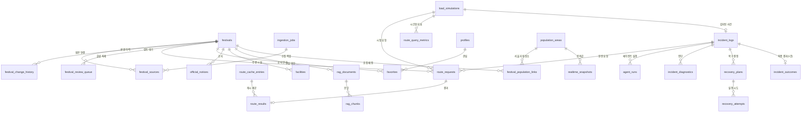

# 04. 데이터베이스 스키마 설계서

놀다가(NOLDAGA) / 3팀 수다수다 | 문서 버전 **v0.1 (초안)** | 작성 2026-11-17 · 권오현(백엔드) — AI 초안 후 본인 검토 예정

문서명: DB 스키마 설계서

> **기준 문서:** 기획서 v2.7 4.10(축제 공통 데이터 모델)·5.4(테이블 초안)·5.17(귀가 경로 부하·캐시·사건 데이터 계약)·6.4·6.8, 03 API 설계 문서 v0.1.
> **DB:** PostgreSQL 16+ + pgvector (Supabase 호스팅은 후보) / 캐시·임시 상태: Redis.
> 테이블은 **설계안**이며 아직 만들지 않았습니다. 외부 공급원 필드(TourAPI·길찾기)는 실호출 뒤 확정합니다(8절).
> 표시: **[1차]** = 1차 시연(귀가 조회 부하·복구)에 꼭 필요 · [최종] = 최종 MVP · [보조] = 혼잡 보조 시험 · [제안] = 기획서 5.4에 없어 이 문서에서 새로 제안

---

## 1. ERD 관계 명세



| 부모 테이블 | 관계 | 자식 테이블 | 연결 키 | 구분 |
|---|---|---|---|---|
| `festivals` | 1:N | `festival_sources` | `festival_sources.festival_id → festivals.festival_id` | [최종] |
| `ingestion_jobs` | 1:N | `festival_sources` | `festival_sources.last_job_id → ingestion_jobs.job_id` | [최종] |
| `festivals` | 1:N | `route_requests` | `route_requests.festival_id → festivals.festival_id` | **[1차]** |
| `route_requests` | 1:0..1 | `route_results` | `route_results.route_request_id → route_requests.route_request_id` (UNIQUE) | **[1차]** |
| `route_cache_entries` | 1:N | `route_results` | `route_results.cache_key → route_cache_entries.cache_key` (캐시로 제공한 경우만) | **[1차]** |
| `load_simulations` | 1:N | `route_requests`, `route_query_metrics` | `simulation_id` | **[1차][제안]** |
| `incident_logs` | 1:N | `agent_runs`, `incident_diagnostics`, `recovery_plans` | `incident_id` | **[1차]** |
| `recovery_plans` | 1:N | `recovery_attempts` | `recovery_attempts.plan_id → recovery_plans.plan_id` | **[1차]** |
| `incident_logs` | 1:0..1 | `incident_outcomes` | `incident_outcomes.incident_id` (UNIQUE) | **[1차]** |
| `profiles` | 1:N | `favorites` | `favorites.user_id → profiles.user_id` | [최종] |
| `festivals` | 1:N | `official_notices`, `facilities`, `rag_documents` | `festival_id` (공지·문서는 NULL 허용: 지역 공통) | [최종] |
| `rag_documents` | 1:N | `rag_chunks` | `rag_chunks.document_id` | [최종] |
| `festivals` ↔ `population_areas` | N:M | `festival_population_links` | `festival_id`, `area_code` | [보조] |

---

## 2. pgvector 스키마

| 테이블 | 컬럼 및 제약 |
|---|---|
| **rag_documents** | `document_id UUID PK`, `festival_id TEXT FK NULL`, `category TEXT NOT NULL`(operation_notice/safety/transport_guide/faq/tip), `source_url TEXT NOT NULL`, `publisher TEXT`, `published_at TIMESTAMPTZ`, `effective_from TIMESTAMPTZ`, `effective_to TIMESTAMPTZ`, `collected_at TIMESTAMPTZ NOT NULL`, `approval_status TEXT NOT NULL DEFAULT 'pending'`(pending/approved/rejected), `approved_by UUID`, `approved_at TIMESTAMPTZ`, `checksum TEXT NOT NULL` |
| **rag_chunks** | `chunk_id UUID PK`, `document_id UUID FK NOT NULL ON DELETE CASCADE`, `chunk_index INT NOT NULL`, `content TEXT NOT NULL`, `embedding VECTOR(1024) NOT NULL`, `embedding_model TEXT NOT NULL`, `embedding_version TEXT NOT NULL`, `metadata JSONB`, `created_at TIMESTAMPTZ DEFAULT now()` |
| **벡터 인덱스** | `CREATE INDEX idx_rag_chunks_embedding ON rag_chunks USING hnsw (embedding vector_cosine_ops);` |
| **기타 인덱스** | `UNIQUE(document_id, chunk_index)`; `INDEX(rag_documents.festival_id, approval_status)`; `UNIQUE(rag_documents.source_url, checksum)` (같은 문서 중복 적재 방지) |

- `VECTOR(1024)`는 **임시값**입니다(BGE-M3 기준). 에이전트가 쓸 임베딩 모델이 정해지면 차원을 맞춥니다. 모델·차원과 인덱스 연산자(`vector_cosine_ops`)가 일치하는지 적재 시험에서 확인합니다.
- 검색은 `approval_status='approved'` 이고 **지금 유효한**(`effective_to IS NULL OR effective_to > now()`) 문서만 대상으로 합니다 (v2.7 6.7·6.9).
- RAG는 1차 시연 필수가 아닙니다. 실시간 혼잡·날씨·경로를 RAG로 대신하지 않습니다.

---

## 3. RLS 정책 (역할 × 명령)

역할: `anonymous` / `user` / `operator` / `admin` / `service`(백엔드·에이전트 실행, RLS 우회 키는 서버에만). Supabase를 쓰지 않으면 같은 규칙을 FastAPI 권한 검사로 구현합니다.

| 테이블 | SELECT | INSERT | UPDATE | DELETE |
|---|---|---|---|---|
| `festivals` | 전체: `published_at IS NOT NULL` 인 행 / admin: 전체 | service(수집), admin | service(수집), admin | 금지(게시 상태로 숨김) |
| `festival_sources`, `ingestion_jobs`, `festival_change_history` | admin | service | service | 금지 |
| `festival_review_queue` | admin | service | admin(승인·반려) | 금지 |
| `profiles` | 본인 / admin | service(가입 시) | 본인(표시 이름만), admin(역할) | admin |
| `favorites` | **본인만** | 본인(`user_id = auth.uid()`) | 금지 | 본인 |
| `route_requests`, `route_results` | operator 이상 (사용자는 API의 요청 토큰으로만 본인 요청 조회, 테이블 직접 접근 없음) | service | service | service(TTL 정리) |
| `route_cache_entries`, `route_query_metrics` | operator 이상 | service | service | service |
| `load_simulations` | operator 이상 | operator(시험 환경만) | service | 금지 |
| `incident_logs`, `incident_diagnostics`, `recovery_plans`, `recovery_attempts`, `incident_outcomes`, `agent_runs` | operator 이상 | service | service | **금지**(감사 기록) |
| `official_notices` | 전체: `approval_status='approved'` / admin: 전체 | service, admin | admin | 금지 |
| `facilities` | 전체 | service | service | service |
| `rag_documents`, `rag_chunks` | service(에이전트 검색), admin | admin, service | admin | admin |
| `population_areas`, `festival_population_links`, `realtime_snapshots` | 전체(snapshots는 최신 유효값만 API로) | service, admin(매핑) | admin(매핑 검증) | 금지 |

---

## 4. JWT·Redis 세션 수명주기

**인증 흐름**
① Supabase Auth(후보) 로그인 → Access JWT(수명 1시간, 임시) + Refresh Token 발급 → ② FastAPI가 요청마다 서명·만료·발급자 검증 → ③ `profiles.role`로 역할 확인(JWT 클레임과 다르면 DB 값 우선) → ④ Access 만료 시 Refresh로 재발급 → ⑤ 로그아웃 시 Refresh 폐기 + Redis `revoked:{jti}` 등록(남은 Access 수명만큼 TTL).

**Redis 키 설계 (모두 초안, TTL 숫자는 기준 시험 후 확정)**

| 키 | 값 | TTL | 용도 |
|---|---|---|---|
| `revoked:{jti}` | `1` | Access 남은 수명 | 로그아웃한 토큰 차단 |
| `rl:route:{ip_or_session}` | 요청 횟수 | 60초 | 귀가 요청 수 제한 |
| `route:inflight:{route_key}` | 진행 중인 조회의 `route_request_id` | 조회 제한 시간(5초, 임시) | **동일 요청 병합(singleflight)** — 같은 키가 있으면 새 조회 대신 결과를 기다림 |
| `route:cache:{route_key}` | 검증된 경로 결과 JSON | `valid_until`까지(60초 후보) | 유효 캐시 제공. **메타데이터·감사는 PostgreSQL `route_cache_entries`** |
| `route:req:{route_request_id}` | 상태(`queued`…`ready`) | 10분 | 상태 조회 API 빠른 응답 |
| `route:token:{route_request_id}` | 요청 토큰 해시 | 10분 | 비로그인 사용자의 본인 요청 확인 |
| `policy:route:active` | 켜진 조치 목록 `{action, enabled_at, incident_id}` | 없음(명시적 해제) | **장애 감지 후에만** 켜지는 복구 조치 상태 — 처음부터 켜 두지 않음 |
| `crowd:snap:{area_code}` | 최신 혼잡 응답 | 5분 후보 | [보조] 혼잡 캐시 (서울시 갱신 주기 확인 후) |

- `route_key` = `sha256(출발 좌표(축제 장소) | 목적지 좌표(소수 4자리 반올림) | travel_mode | 정규화한 user_constraints | 출발 시각 구간(5분 단위) | 통제 버전 | 공급원)`. **이 중 하나라도 다르면 다른 요청**입니다 (v2.7 6.22 "요청 공유 적격성").
- 캐시가 처음부터 항상 켜진 것은 "기본 성능 설계"이고, 오토힐링은 `policy:route:active`에 **감지 뒤 켜진 기록**이 있어야 설명됩니다 (강사 11/17 의견 2).

---

## 5. 쿼리 최적화 기준

| 조회 | 인덱스 | 확인 방법 |
|---|---|---|
| 축제 검색(지역·기간·상태) | `festivals(region_code, start_date, end_date)`, `festivals(event_status)` 부분 인덱스(`published_at IS NOT NULL`) | `EXPLAIN ANALYZE`로 순차 스캔 여부 비교 |
| 축제 이름 검색 | `pg_trgm` GIN `festivals(title gin_trgm_ops)` | 한글 부분 일치 시간 측정 |
| 지도 범위 조회 | `festivals(latitude, longitude)` B-tree (데이터 수천 건 수준 가정) → 느리면 PostGIS `geography` + GiST로 전환 | 지도 이동 시 응답 시간 |
| 귀가 요청 운영 조회 | `route_requests(festival_id, submitted_at DESC)`, `route_requests(simulation_id)`, `route_requests(incident_id)` | |
| 지표 시간창 | `route_query_metrics(simulation_id, window_at)` UNIQUE | 사건 상세 화면 로딩 |
| 사건 목록 | `incident_logs(status, detected_at DESC)`, `incident_logs(failure_domain)` | |
| 원본 중복 방지 | `festival_sources UNIQUE(source_id, source_item_id)` | 재수집 시 중복 행 0건 |

부하 시험 중에는 요청 행을 한 건씩 바로 쓰지 않고 **묶어서 쓰기(batch insert)** 하거나 Redis에 먼저 적은 뒤 옮깁니다. DB 쓰기가 병목이 되어 시험 결과를 왜곡하지 않게 하기 위함입니다(측정 대상은 경로 처리 구간).

---

## 6. 엔터티 정의

### 6-1. [1차] 귀가 경로

| 테이블 | 컬럼 | 타입/제약 | 의미 |
|---|---|---|---|
| **route_requests** | route_request_id | TEXT / PK (`rr_` + ULID) | 귀가 요청 ID |
| | request_id | TEXT / NOT NULL, UNIQUE | 클라이언트 멱등 키 |
| | run_id | TEXT / NULL | 에이전트 실행 ID(챗봇 경유 시) |
| | festival_id | TEXT / FK festivals, NOT NULL | 출발 축제 |
| | origin_lat, origin_lng | NUMERIC(9,6) / NOT NULL | 출발 좌표(축제 장소에서 확정) |
| | destination_hash | TEXT / NOT NULL | 목적지 해시(원문 저장 안 함) |
| | destination_label | TEXT / NULL, 24시간 뒤 NULL 처리 | 화면 표시용 짧은 이름(예: "서울역") |
| | travel_mode | TEXT / CHECK IN ('transit','walk','car','taxi') | 이동 수단 |
| | constraints | JSONB / DEFAULT '{}' | 아이 동반·휠체어 등 (민감 정보 최소) |
| | route_key | TEXT / NOT NULL | 병합·캐시 판정 키(4절) |
| | status | TEXT / CHECK IN ('created','queued','processing','ready','unavailable','rejected','timed_out') | 요청 상태 |
| | error_code | TEXT / NULL | 03 문서 오류 코드 |
| | submitted_at / started_at / completed_at | TIMESTAMPTZ | 접수·처리 시작·완료 시각 |
| | shared_from | TEXT / FK route_requests NULL | 병합으로 다른 요청 결과를 공유했으면 원래 요청 |
| | simulation_id | TEXT / FK load_simulations NULL | 부하 시험 요청이면 연결 |
| | incident_id | TEXT / FK incident_logs NULL | 사건 기간에 처리된 요청 |
| | is_mock | BOOLEAN / NOT NULL | 시험용 어댑터 사용 여부 |
| **route_results** | route_request_id | TEXT / PK, FK route_requests | 요청 1건당 결과 1건 |
| | provider | TEXT / NOT NULL | 경로 공급원(시험용이면 `mock_adapter`) |
| | provider_ref | TEXT / NULL | 공급원 응답 ID |
| | candidates | JSONB / NOT NULL | 경로 후보(필드는 공급원 확정 후) |
| | route_hash | TEXT / NOT NULL | 결과 동일성 확인 |
| | source_type | TEXT / CHECK IN ('fresh','cache','shared','alternate') | 새 조회·캐시·병합 공유·대체 공급원 |
| | cache_key | TEXT / FK route_cache_entries NULL | 캐시로 제공했으면 |
| | queried_at | TIMESTAMPTZ / NOT NULL | 공급원 조회 시각 |
| | validated_at | TIMESTAMPTZ / NULL | 검증 시각 |
| | validation_status | TEXT / CHECK IN ('verified_basic','constraint_unverified','control_unverified','failed') | 검증 결과 |
| | is_mock | BOOLEAN / NOT NULL | |
| **route_cache_entries** | cache_key | TEXT / PK (= route_key) | |
| | route_hash | TEXT / NOT NULL | 저장한 경로 |
| | provider | TEXT / NOT NULL | |
| | control_version | TEXT / NULL | 저장 당시 통제 정보 버전(바뀌면 무효) |
| | created_at / verified_at / valid_until | TIMESTAMPTZ / valid_until NOT NULL | 생성·검증·만료 |
| | hit_count | INT / DEFAULT 0 | 사용 횟수 |
| **route_query_metrics** | metric_id | BIGSERIAL / PK | |
| | simulation_id | TEXT / FK load_simulations NULL (운영 중 지표는 NULL) | |
| | window_at | TIMESTAMPTZ / NOT NULL | 시간창 시작(10초 단위, 임시) |
| | offered_requests / accepted_count / valid_completed_count | INT / NOT NULL | 제공·접수·**검증된 경로 완료** |
| | rejections / timeouts / errors | INT / NOT NULL | 거절·시간초과·오류 |
| | unique_route_keys / backend_execution_count / shared_request_count / cache_hits | INT / NOT NULL | 중복·병합 판단 근거 |
| | duplicate_ratio | NUMERIC(5,4) / `(offered - unique) / offered` | |
| | queue_depth_max / inflight_max | INT | 대기열·동시 처리 최대 |
| | p50_ms / p95_ms | NUMERIC / 전체 요청 기준(시간초과 포함 규칙은 시험 설계에 명시) | |
| | upstream_p95_ms / internal_p95_ms | NUMERIC / NULL | 외부·내부 지연 분리(BFCL 23~25) |
| | is_mock | BOOLEAN / NOT NULL | |
| **load_simulations** [제안] | simulation_id | TEXT / PK | 부하 시험 1회 |
| | comparison_arm | TEXT / CHECK IN ('B0','B1','A1') | 비교 방식 |
| | scenario | TEXT / CHECK IN ('duplicate_keys','unique_keys','mixed') | 요청 분포 |
| | concurrency / duration_s / unique_route_keys | INT / NOT NULL | 같은 부하 비교 조건 |
| | offered_rps | NUMERIC / NULL | |
| | seed | INT / NULL | 같은 입력 재현 |
| | cache_state | TEXT / CHECK IN ('cold','warm') | 캐시 사전 적재 여부 |
| | upstream | TEXT / CHECK = 'mock_adapter' | 외부 공급원 부하 금지 |
| | code_version | TEXT / NOT NULL | 시험한 커밋 |
| | created_by | UUID / FK profiles | 실행 운영자 |
| | started_at / ended_at / status | TIMESTAMPTZ / TEXT | |

### 6-2. [1차] 사건·에이전트·복구

| 테이블 | 컬럼 | 타입/제약 | 의미 |
|---|---|---|---|
| **incident_logs** | incident_id | TEXT / PK (`INC-…`) | 사건 ID |
| | failure_domain | TEXT / CHECK IN ('internal_route','upstream_route','agent','upstream_crowd','ingestion') | 장애 영역 |
| | detected_at | TIMESTAMPTZ / NOT NULL | 코드가 감지한 시각 |
| | detection_rule | TEXT / NOT NULL | 어떤 기준을 넘었는지(예: `p95_ms>기준 for 30s`) |
| | simulation_id | TEXT / FK NULL | 시험 중 사건이면 |
| | injected_test | BOOLEAN / NOT NULL | 장애 주입 시험 여부 |
| | http_status / upstream_result_code / upstream_result_message | INT / TEXT / TEXT, NULL | 외부 공급원 원본 오류(혼잡 보조는 본문 `RESULT.CODE`) |
| | before_metrics | JSONB / NOT NULL | 감지 시점 지표 스냅샷 |
| | status | TEXT / CHECK IN ('open','diagnosing','recovering','validating','closed') | |
| | closed_at | TIMESTAMPTZ / NULL | |
| **agent_runs** | agent_run_id | TEXT / PK | |
| | run_id / incident_id | TEXT / 둘 중 하나 이상 NOT NULL | 사용자 요청 또는 사건 |
| | agent_name | TEXT / CHECK IN ('supervisor','festival','route','diagnosis','recovery') | **정확히 5개** |
| | model / prompt_version | TEXT | 실행 모델·프롬프트 버전 |
| | input_ref / output_ref | TEXT | 입출력 저장 위치(원문은 개인정보 마스킹) |
| | tool_calls | JSONB | 부른 도구·인자·결과 코드 |
| | tokens_in / tokens_out / cost_usd | INT / INT / NUMERIC | 비용 |
| | status | TEXT / CHECK IN ('ok','timeout','schema_error','failed') | 실패 시 B1 전환 근거 |
| | started_at / ended_at | TIMESTAMPTZ | |
| **incident_diagnostics** | diagnostic_id | TEXT / PK | |
| | incident_id / agent_run_id | TEXT / FK NOT NULL | |
| | verified_facts / hypotheses / unknowns | JSONB / NOT NULL | 사실·가설·확인 불가 분리 |
| | affected_features | TEXT[] | 영향 기능(귀가 조회만인지, 검색까지인지) |
| | evidence_refs | TEXT[] / 최소 1개 | 근거(지표 ID·로그 ID) |
| | created_at | TIMESTAMPTZ | |
| **recovery_plans** | plan_id | TEXT / PK | |
| | incident_id / agent_run_id | TEXT / FK (B1 규칙 정책이면 agent_run_id NULL) | |
| | decided_by | TEXT / CHECK IN ('rule_policy','recovery_agent') | B1 vs A1 구분 |
| | decision | TEXT / CHECK IN ('select','reject','defer','rollback') | |
| | action | TEXT / NULL, allowlist(03 문서 7-3) | 선택한 조치 |
| | rejected_actions | JSONB / DEFAULT '[]' | 기각한 조치와 이유 |
| | reasons / evidence_refs | JSONB / TEXT[] NOT NULL | 선택 근거 |
| | stop_condition | JSONB | 중단·원복 조건 |
| | policy_verdict | TEXT / CHECK IN ('allowed','denied') | 정책 코드 판정 |
| | denied_reason | TEXT / NULL | |
| | created_at | TIMESTAMPTZ | |
| **recovery_attempts** | attempt_id | TEXT / PK | |
| | plan_id / incident_id | TEXT / FK NOT NULL | |
| | action | TEXT / NOT NULL | |
| | action_enabled_at / action_disabled_at | TIMESTAMPTZ | **감지 후 켠 시각**·끈 시각 |
| | after_metrics | JSONB | 같은 부하 재측정 결과 |
| | validation_result | TEXT / CHECK IN ('pending','improved','no_effect','worse') | |
| | rollback_reason | TEXT / NULL | |
| **incident_outcomes** | incident_id | TEXT / PK, FK incident_logs | 사건당 정확히 1건 |
| | final_mode | TEXT / CHECK IN ('normal_recovered','valid_cache','alternate_source','degraded','unresolved') | 최종 결과 5종 |
| | ui_data_mode | TEXT / NOT NULL | 사용자 화면에 실제로 보인 상태 |
| | verified_route_count / offered_requests | INT / NOT NULL | 경로 제공 성공 분자·분모(접수 수 아님) |
| | mttr_s | INT / NULL | 감지→회복 시간 |
| | evidence_refs | TEXT[] / NOT NULL | |
| | closed_at | TIMESTAMPTZ / NOT NULL | |

### 6-3. [최종] 축제·사용자·공지·시설

| 테이블 | 컬럼 | 타입/제약 | 의미 |
|---|---|---|---|
| **festivals** | festival_id | TEXT / PK (`fst_` + ULID) | 놀다가 내부 ID(공급원이 바뀌어도 유지) |
| | title | TEXT / NOT NULL | 축제명 |
| | start_date / end_date | DATE / NULL 허용, `CHECK(end_date >= start_date)` | 기간(미확정이면 NULL + 상태 '확인 필요') |
| | venue_name / address | TEXT | 장소·주소 |
| | latitude / longitude | NUMERIC(9,6) / NULL, 대한민국 범위 CHECK | 없으면 지도 마커 제외·검색은 유지 |
| | region_code / category | TEXT | 공통 코드 |
| | description / image_url / official_url / organizer | TEXT | 선택값(이미지 이용 조건 확인) |
| | event_status | TEXT / CHECK IN ('upcoming','ongoing','ended','cancelled','needs_review') | 기간·취소 공지로 계산 |
| | source_updated_at / collected_at / last_synced_at | TIMESTAMPTZ | 원본 수정·수집·마지막 동기화 |
| | review_status / published_at | TEXT / TIMESTAMPTZ | 게시 상태(삭제 대신 숨김) |
| **festival_sources** | id | BIGSERIAL / PK | |
| | festival_id | TEXT / FK | |
| | source_id / source_item_id | TEXT / `UNIQUE(source_id, source_item_id)` | 공급원·원본 ID(예: TourAPI `contentid`) |
| | source_url / raw_checksum / fetched_at / last_job_id | TEXT / TEXT / TIMESTAMPTZ / FK | |
| **ingestion_jobs** | job_id | TEXT / PK | |
| | source_id / started_at / ended_at / status | TEXT / TIMESTAMPTZ / TEXT CHECK IN ('success','partial','failed') | |
| | scanned / inserted / updated / rejected | INT | 건수 |
| | error | JSONB | 페이지별 오류 |
| **festival_change_history** | id / festival_id / field / before / after / source / actor / changed_at | | 일정·장소·상태 변경 추적 |
| **festival_review_queue** | id / festival_id / reason / proposed_value / approval_status / reviewer | | 중복·충돌 승인 |
| **profiles** | user_id | UUID / PK (= `auth.users.id`) | |
| | role | TEXT / CHECK IN ('user','operator','admin') DEFAULT 'user' | 권한의 유일한 기준 |
| | display_name / created_at | TEXT / TIMESTAMPTZ | 이메일 등은 Auth 쪽에만 |
| **favorites** | user_id / festival_id | UUID FK / TEXT FK, `PRIMARY KEY(user_id, festival_id)` | 중복 저장 방지 |
| | created_at | TIMESTAMPTZ | |
| **official_notices** | notice_id | TEXT / PK | |
| | festival_id | TEXT / FK NULL | |
| | type | TEXT / CHECK IN ('operation','traffic_control','no_stop','bus_detour','road_closure') | |
| | source_url / published_at / effective_from / effective_to | TEXT / TIMESTAMPTZ | 출처·효력 기간 |
| | geometry | JSONB / NULL | 구간(형식은 공급원 확인 후) |
| | control_version | TEXT | 경로 캐시 무효화 기준 |
| | approval_status | TEXT / CHECK IN ('pending','approved','rejected') | 미승인은 경로 차단 규칙에 적용 안 함 |
| **facilities** [제안] | facility_id | TEXT / PK | 기획서 5.4에 없어 새로 제안(FR-F04·F11, BFCL 8) |
| | category | TEXT / CHECK IN ('toilet','parking','locker','hospital','pharmacy','emergency') | |
| | name / lat / lng / address | | |
| | source_id / source_url / collected_at | | 출처·수집 시각 |
| | festival_id | TEXT / FK NULL | 축제 주변 연결(반경 계산 결과 저장 시) |
| **festival_reviews** | review_id / user_id / festival_id / body / status / created_at / updated_at | | [Should] 후기 |

### 6-4. [보조] 서울 혼잡

| 테이블 | 주요 컬럼 | 메모 |
|---|---|---|
| **population_areas** | `area_code TEXT PK`(예: `POI009`), `area_name`(예: `광화문·덕수궁`), `data_source`(`OA-21778`) | 서울시 주요 장소(공식 121개) |
| **festival_population_links** | `festival_id FK`, `area_code FK`, `relation_type`, `validated_by`, `validated_at`, `notes`, `PRIMARY KEY(festival_id, area_code)` | **검증된 매핑만**. 임의 근접 매핑 금지 |
| **realtime_snapshots** | `id`, `data_type`, `source`, `area_code`, `observed_at`(=`PPLTN_TIME`), `received_at`, `valid_until`, `congest_level`(=`AREA_CONGEST_LVL`), `ppltn_min`, `ppltn_max`, `forecast JSONB`(=`FCST_PPLTN[]`), `payload_hash`, `source_result_code`(=`RESULT.CODE`), `sample_kind CHECK IN ('original','cache','mock')` | 필드 이름은 11/16 실제 응답 원본으로 확인함(8절) |
| **crowd_prediction_signals** | v2.7 5.4 그대로 | 후속 |

---

## 7. 관계·운영 규칙

| 항목 | 규칙 |
|---|---|
| **삭제 대신 상태** | 축제는 물리 삭제하지 않고 `review_status`·`published_at`으로 숨깁니다. 원본에서 사라져도 관심·후기 연결 보존 (FR-D10) |
| **수집 멱등성** | `UNIQUE(source_id, source_item_id)` + `raw_checksum`이 같으면 갱신하지 않음. 바뀌면 `festival_change_history`에 기록 |
| **개인정보 최소화** | 목적지는 `destination_hash`만 영구 저장, `destination_label`은 24시간 뒤 NULL. GPS·이동 이력 수집 안 함. `route_requests`는 30일 뒤 삭제(임시) — 사건에 연결된 행은 통계 컬럼만 남기고 익명화 |
| **모의/실제 분리** | `is_mock`, `injected_test`, `sample_kind`가 모든 귀가·사건·혼잡 행에 있음. 집계 쿼리는 이 값으로 반드시 나눕니다 |
| **성공 집계** | 경로 제공 성공 = `route_results.validation_status IN ('verified_basic','constraint_unverified','control_unverified')` 이고 제한 시간 안에 완료된 건. `accepted_count`는 성공에 넣지 않음 |
| **사건 결과 1건** | `incident_outcomes.incident_id` PK → 사건당 최종 결과 하나. 시도별 결과는 `recovery_attempts`에만 |
| **감사 기록 보존** | 사건·에이전트·복구 테이블은 UPDATE/DELETE를 막고(RLS·트리거) 추가만 허용 |
| **캐시 무효화** | `official_notices.control_version`이 바뀌면 같은 축제의 `route_cache_entries`를 무효 처리(Redis 키 삭제 + `valid_until=now()`) |
| **시간대** | 모든 TIMESTAMPTZ는 UTC 저장, API에서 `+09:00`으로 변환 |

| 항목 | 설계 |
|---|---|
| **인덱스** | 5절 표 |
| **Supabase RLS** | 3절 표 (미사용 시 FastAPI 권한 검사) |
| **Redis** | 4절 표 (`route:inflight`, `route:cache`, `policy:route:active` 등) |
| **인증** | JWT 서명·만료 검증 후 `profiles.role`로 권한 검사 |
| **마이그레이션** | Alembic(FastAPI) 또는 Supabase migration 중 하나로 통일 — 적용·되돌리기 로그를 WBS W17 증빙으로 |

---

## 8. 실제 데이터 근거·미확인 항목

**확보한 원본:** 서울시 `citydata_ppltn` 광화문·덕수궁 응답(2026-11-16, `DB/notes/evidence/2026-11-16_citydata_ppltn_광화문덕수궁.json`) → `realtime_snapshots`의 컬럼 대응(`AREA_CD`·`AREA_CONGEST_LVL`·`AREA_PPLTN_MIN/MAX`·`PPLTN_TIME`·`FCST_PPLTN[]`)을 이 원본으로 정했습니다.

| 항목 | 현재 상태 | 확인 담당 | 확인 시점 |
|---|---|---|---|
| TourAPI `searchFestival2` 실제 필드 → `festivals`·`festival_sources` 대응표 | 실호출 전 | 권오현 | 11/18 |
| 길찾기 공급원 응답 → `route_results.candidates` 구조 | 공급원 미선정 | 권오현 | 11/19 목표 |
| Supabase 사용 여부(Auth·RLS·호스팅) | 후보 | 신유빈·권오현 | 11/20 전 |
| 임베딩 모델·차원(`VECTOR(1024)` 임시) | 미정 | 한다영 | RAG 착수 전 |
| TTL·보존 기간 숫자(캐시 60초, 요청 30일, 라벨 24시간 등) | 임시값 | 권오현·한태경(개인정보) | 기준 시험·보안 검토 후 |
| `facilities`·`load_simulations` 신규 테이블 | 이 문서에서 제안 | 정예진(기획 반영) | 팀 검토 |
| 과거 구간 혼잡 DB(BFCL 12번) | 기획서에 기능 없음 → 테이블 설계 안 함 | 정예진 | 팀 결정 |
| ERD 그림 형식 | mermaid(GitHub에서 바로 보임) — docx 제출 시 이미지로 변환 | 권오현 | 제출 전 |

---

## 부록. 1차 시연 테이블 DDL 초안

```sql
CREATE TABLE load_simulations (
  simulation_id   TEXT PRIMARY KEY,
  comparison_arm  TEXT NOT NULL CHECK (comparison_arm IN ('B0','B1','A1')),
  scenario        TEXT NOT NULL CHECK (scenario IN ('duplicate_keys','unique_keys','mixed')),
  concurrency     INT  NOT NULL CHECK (concurrency > 0),
  offered_rps     NUMERIC,
  duration_s      INT  NOT NULL CHECK (duration_s > 0),
  unique_route_keys INT NOT NULL CHECK (unique_route_keys > 0),
  seed            INT,
  cache_state     TEXT NOT NULL CHECK (cache_state IN ('cold','warm')),
  upstream        TEXT NOT NULL DEFAULT 'mock_adapter' CHECK (upstream = 'mock_adapter'),
  code_version    TEXT NOT NULL,
  created_by      UUID REFERENCES profiles(user_id),
  status          TEXT NOT NULL DEFAULT 'running' CHECK (status IN ('running','stopped','finished','failed')),
  started_at      TIMESTAMPTZ NOT NULL DEFAULT now(),
  ended_at        TIMESTAMPTZ
);

CREATE TABLE incident_logs (
  incident_id     TEXT PRIMARY KEY,
  failure_domain  TEXT NOT NULL CHECK (failure_domain IN ('internal_route','upstream_route','agent','upstream_crowd','ingestion')),
  detected_at     TIMESTAMPTZ NOT NULL,
  detection_rule  TEXT NOT NULL,
  simulation_id   TEXT REFERENCES load_simulations(simulation_id),
  injected_test   BOOLEAN NOT NULL,
  http_status     INT,
  upstream_result_code TEXT,
  upstream_result_message TEXT,
  before_metrics  JSONB NOT NULL,
  status          TEXT NOT NULL DEFAULT 'open' CHECK (status IN ('open','diagnosing','recovering','validating','closed')),
  closed_at       TIMESTAMPTZ
);

CREATE TABLE route_requests (
  route_request_id TEXT PRIMARY KEY,
  request_id      TEXT NOT NULL UNIQUE,
  run_id          TEXT,
  festival_id     TEXT NOT NULL REFERENCES festivals(festival_id),
  origin_lat      NUMERIC(9,6) NOT NULL,
  origin_lng      NUMERIC(9,6) NOT NULL,
  destination_hash TEXT NOT NULL,
  destination_label TEXT,
  travel_mode     TEXT NOT NULL CHECK (travel_mode IN ('transit','walk','car','taxi')),
  constraints     JSONB NOT NULL DEFAULT '{}',
  route_key       TEXT NOT NULL,
  status          TEXT NOT NULL CHECK (status IN ('created','queued','processing','ready','unavailable','rejected','timed_out')),
  error_code      TEXT,
  submitted_at    TIMESTAMPTZ NOT NULL DEFAULT now(),
  started_at      TIMESTAMPTZ,
  completed_at    TIMESTAMPTZ,
  shared_from     TEXT REFERENCES route_requests(route_request_id),
  simulation_id   TEXT REFERENCES load_simulations(simulation_id),
  incident_id     TEXT REFERENCES incident_logs(incident_id),
  is_mock         BOOLEAN NOT NULL
);
CREATE INDEX idx_route_requests_festival ON route_requests (festival_id, submitted_at DESC);
CREATE INDEX idx_route_requests_sim ON route_requests (simulation_id);

CREATE TABLE route_cache_entries (
  cache_key       TEXT PRIMARY KEY,
  route_hash      TEXT NOT NULL,
  provider        TEXT NOT NULL,
  control_version TEXT,
  created_at      TIMESTAMPTZ NOT NULL DEFAULT now(),
  verified_at     TIMESTAMPTZ,
  valid_until     TIMESTAMPTZ NOT NULL,
  hit_count       INT NOT NULL DEFAULT 0
);

CREATE TABLE route_results (
  route_request_id TEXT PRIMARY KEY REFERENCES route_requests(route_request_id),
  provider        TEXT NOT NULL,
  provider_ref    TEXT,
  candidates      JSONB NOT NULL,
  route_hash      TEXT NOT NULL,
  source_type     TEXT NOT NULL CHECK (source_type IN ('fresh','cache','shared','alternate')),
  cache_key       TEXT REFERENCES route_cache_entries(cache_key),
  queried_at      TIMESTAMPTZ NOT NULL,
  validated_at    TIMESTAMPTZ,
  validation_status TEXT NOT NULL CHECK (validation_status IN ('verified_basic','constraint_unverified','control_unverified','failed')),
  is_mock         BOOLEAN NOT NULL
);

CREATE TABLE route_query_metrics (
  metric_id       BIGSERIAL PRIMARY KEY,
  simulation_id   TEXT REFERENCES load_simulations(simulation_id),
  window_at       TIMESTAMPTZ NOT NULL,
  offered_requests INT NOT NULL, accepted_count INT NOT NULL, valid_completed_count INT NOT NULL,
  rejections INT NOT NULL, timeouts INT NOT NULL, errors INT NOT NULL,
  unique_route_keys INT NOT NULL, backend_execution_count INT NOT NULL,
  shared_request_count INT NOT NULL, cache_hits INT NOT NULL,
  duplicate_ratio NUMERIC(5,4),
  queue_depth_max INT, inflight_max INT,
  p50_ms NUMERIC, p95_ms NUMERIC, upstream_p95_ms NUMERIC, internal_p95_ms NUMERIC,
  is_mock BOOLEAN NOT NULL,
  UNIQUE (simulation_id, window_at)
);

CREATE TABLE incident_outcomes (
  incident_id     TEXT PRIMARY KEY REFERENCES incident_logs(incident_id),
  final_mode      TEXT NOT NULL CHECK (final_mode IN ('normal_recovered','valid_cache','alternate_source','degraded','unresolved')),
  ui_data_mode    TEXT NOT NULL,
  verified_route_count INT NOT NULL,
  offered_requests INT NOT NULL,
  mttr_s          INT,
  evidence_refs   TEXT[] NOT NULL,
  closed_at       TIMESTAMPTZ NOT NULL
);
-- agent_runs, incident_diagnostics, recovery_plans, recovery_attempts는 6-2 표 그대로 (v0.2에서 DDL 추가)
```

DDL은 **초안**입니다. 실제 적용(WBS W17)은 스키마 검토 후 마이그레이션 도구로 하고, 적용·되돌리기 로그를 증빙으로 남깁니다.
