# 04. 데이터베이스 스키마 설계서

놀다가(NOLDAGA) / 3팀 수다수다 | 문서 버전 **v0.3.3** | 작성 상태: **11/20 제출본(강사 11/19 피드백 반영 + 팀 답변 반영)** | 작성 2026-11-17 · 수정 2026-11-20 · 권오현(백엔드) — AI 초안 후 본인 검토

문서명: DB 스키마 설계서

## 문서 정보

| 항목 | 내용 |
|---|---|
| **정본(이 문서의 기준 위치)** | GitHub `yubeenjjang/Final3team` → `Docs/Step 2/DB_스키마_설계서.md`. **이 경로만 정본**이며 로컬 파일·Discord 첨부는 사본입니다 |
| 짝 문서 | `Docs/Step 2/API_설계문서.md` v0.3.3 — ID 형식은 03 문서 0절, API 필드 ↔ DB 컬럼 대응은 03 문서 16절 |
| 기준 문서 | **기획서 최신본(11/19 05:18 신유빈 님 공유, v3.1 다음판)** · 기획서 v3.1 · WBS 128개, 결정대장 D-009~D-039 + 11/20 결정(추천 취향 아기 동반 제외), 팀 자체 평가 30문항(11/18), 강사 2차 의견(11/18)·일일 피드백(11/19), 수업 가이드 「DB 스키마 설계서 작성법」(11/18) |
| DB | **AWS 위 Docker PostgreSQL 17 + pgvector**(이미지 `pgvector/pgvector:pg17`) / 캐시·임시 상태: Docker Redis. **인증은 FastAPI 자체 JWT**(Supabase 사용 안 함, **D-037 11/19 결정** — 기획서·WBS 최신본과 일치, 11/20 GitHub 대조) |
| 진행 단계 | ☑ 초안 작성(11/19) → ☑ 팀 검토 완료(11/19) → ☑ GitHub 정본 업로드(v0.3.1, 11/19 `91b3337`) → ☑ v0.3.2 교체(11/20 12:32 `41c66a5`) → ☑ v0.3.3 교체 + `db/` 폴더 업로드(11/20 16:24 신유빈 `e8aecb4`) → ☐ 대시보드 제출(링크 `Docs/Step 2/DB_스키마_설계서.md`) |
| **SQL 실행 확인** | 기본 DDL(30개 테이블) + 마이그레이션 002(`assistant_runs`)·003(축제 이미지 칸)·004(`festival_trends`·개인정보)·005(추천·친구)·006(방문 코스·공지 이력)·007(동행·채팅·알림·신고, 총 48개)·008(교차 검토 반영: 권한·숨김·검색 경로·누락 칸)·009(기능 상세 시나리오: 출발·도착 선택, 닉네임·출생연도·성별, 채팅방 신고, 앱 사용법 RAG)를 **운영과 같은 Docker 이미지(PostgreSQL 17.12 + pgvector 0.8.7)로 집 컴퓨터에서 2026-11-20 다시 실행, 시험 T1~T43(확인 149개) 모두 통과, `EXPLAIN ANALYZE` 측정**(5·10절). 시험 SQL·실행기는 `db/` 파일로 분리. **AWS 서버에서는 아직 실행하지 않았습니다**(예정: W65 12/07–10, 담당 신유빈) |

> 테이블은 **설계안**이며 실제 AWS 서버에는 아직 만들지 않았습니다. 외부 공급원 필드(TourAPI·TMAP·카카오맵 등)는 실호출 뒤 확정합니다(8절).
> 표시: **[1차]** = 1차 시연(귀가 조회 부하·복구)에 꼭 필요 · [최종] = 최종 MVP · [보조] = 혼잡 보조 시험 · [Should] = 있으면 좋은 기능 · 실행 기준은 부록 DDL(표와 다르면 DDL이 기준이고 표를 고침) · [제안] = 기획서 5.4에 없어 이 문서에서 새로 제안
> 지금 문서는 완성본이 아닙니다(D-034). 서비스 부가 기능이 정해지면 테이블을 **추가**하는 방식으로 붙입니다(7절 '확장 규칙').

### 검토 기록

| 일자 | 검토자 | 범위 | 결과·수정 내용 |
|---|---|---|---|
| 2026-11-19 | 권오현 (AI 초안 작성) | 전체 | v0.3 작성: 수업 가이드 체크리스트·강사 피드백·D-033~D-037 반영, DDL 실행·시험 |
| 2026-11-19 | AI 교차 검토(Gemini 4 Neon) | 전체 | 20건 지적 → 복구 시도 결과 기록 트리거, 캐시 테이블 축제 ID, 모든 테이블 RLS, 컬럼 권한, 인덱스, 공지 제목 등 반영. 이후 Supabase → AWS Docker 전환(D-037) |
| 2026-11-19 | 신유빈(인프라·R06 검토) | 전체 | 검토 완료 → 택시 범위·추적 ID·대조표·신규 기능 표기 반영 |
| 2026-11-19 | 정예진(기획) | 기획서와 대조 | 경로 5유형·택시·created·대조표·추적 ID → 반영 |
| 2026-11-20 | AI 교차 검토 3종(Claude Opus 5.5 · Codex gpt-6.2-sol · agy Gemini 4 Hydrogen XHigh) | 전체 + `db/` | 마이그레이션 008(권한·숨김 축제·검색 경로·동행 글 숨김·복구 조치 해제 기록·부하 시험 칸·공개 표시 이름), 시험 T42(12개), 탈퇴·보존·Redis·RLS 범위 문장 정리, 한태경 11/20 15:03(카카오 저장 불가 공식 답변·공식 한도) → v0.3.3. 제출 뒤 처리는 03 문서 11-1절 |
| 2026-11-20 | 팀 답변(한태경 보존 검토 · 정예진 권한 정책안 · 신유빈 보존·열람·크롤링) | 7-0·7-1·6-4·10절 | 목적지 라벨 DB 제거·해시 HMAC, 챗봇 마스킹·탈퇴 삭제, 로그 IP, 동행 3일·친구 30일, 채팅 열람 참여자·관리자, 권한 기준안, `festival_trends`(004) → v0.3.3 |
| 2026-11-20 | 강사(11/19 피드백 7건) · 권오현 | 전체 | 1차 반영(v0.3.2): 정본 파일명(`DB_스키마_설계서.md`)·짝 문서 버전, 옛 Supabase 문장, 길찾기·택시·자전거 실호출 결과. **4번 반영**: 7-0 보존·만료 통합표. **1·2·3·5·6번 반영**: 시험 SQL 분리·재실행(10절), 연결 재사용 시험·규칙(3절), AWS 예정일, 13개 검증 범위, RAG 결정일. **7번**: 기획서·WBS와 DB·인증 일치 확인, 파일명 정리. 13개 테이블 DDL은 005·007로 완료. **남은 것**: AWS 실행(W65), 임베딩 결정(11/25) — `DB/notes/놀다가_1119_강사피드백_정리.md` |

---

## 1. ERD 관계 명세

**그림의 선 80개 = 아래 관계 명세 표 80행**입니다(수업 가이드 S11). 기본 DDL의 43개 + 마이그레이션 002의 2개 + 004의 3개 + 005의 10개 + 006의 2개 + 007(동행·채팅·알림·신고)의 19개 + 008의 1개(`companion_posts.hidden_by`)이고, 실제로 실행한 DB의 외래키 목록과 같습니다(10절 T11). 상자 안에는 키 컬럼(PK·FK·UK)만 적고, 나머지 컬럼은 6절에 있습니다.

표기: `||--o{` 1 : N(자식 쪽 FK 필수) · `|o--o{` 0..1 : N(자식 쪽 FK NULL 허용) · `||--o|` 1 : 0..1(자식 FK가 UNIQUE)

```mermaid
erDiagram
    agent_runs {
        text agent_run_id PK
        text incident_id FK
    }
    data_sources {
        text source_id PK
    }
    facilities {
        text facility_id PK
        text source_id FK
        text source_item_id UK
        text festival_id FK
    }
    favorites {
        uuid user_id PK, FK
        text festival_id PK, FK
    }
    festival_change_history {
        bigint change_id PK
        text festival_id FK
    }
    festival_population_links {
        text festival_id PK, FK
        text area_code PK, FK
        uuid validated_by FK
    }
    festival_review_queue {
        bigint queue_id PK
        text festival_id FK
        uuid reviewer FK
    }
    festival_reviews {
        text review_id PK
        uuid user_id FK
        text festival_id FK
    }
    festival_sources {
        bigint id PK
        text festival_id FK
        text source_id FK
        text source_item_id UK
        text last_job_id FK
    }
    festivals {
        text festival_id PK
    }
    incident_diagnostics {
        text diagnostic_id PK
        text incident_id FK
        text agent_run_id FK
    }
    incident_events {
        bigint event_id PK
        text incident_id FK
    }
    incident_logs {
        text incident_id PK
        text simulation_id FK
    }
    incident_outcomes {
        text incident_id PK, FK
    }
    ingestion_jobs {
        text job_id PK
        text source_id FK
    }
    load_simulations {
        text simulation_id PK
        text idempotency_key UK
        uuid created_by FK
    }
    official_notices {
        text notice_id PK
        text festival_id FK
        text source_id FK
    }
    population_areas {
        text area_code PK
    }
    profiles {
        uuid user_id PK, FK
    }
    rag_chunks {
        uuid chunk_id PK
        uuid document_id FK
        int chunk_index UK
    }
    rag_documents {
        uuid document_id PK
        text festival_id FK
        text source_url UK
        uuid approved_by FK
        text checksum UK
    }
    realtime_snapshots {
        bigint id PK
        text source_id FK
    }
    recovery_attempts {
        text attempt_id PK
        text plan_id FK
        text incident_id FK
    }
    recovery_plans {
        text plan_id PK
        text incident_id FK
        text agent_run_id FK
        text idempotency_key UK
    }
    refresh_tokens {
        text token_id PK
        uuid user_id FK
        text token_hash UK
    }
    route_cache_entries {
        text cache_key PK
        text festival_id FK
    }
    route_query_metrics {
        bigint metric_id PK
        text simulation_id FK
        text phase UK
        timestamptz window_at UK
    }
    route_requests {
        text route_request_id PK
        text request_id UK
        text festival_id FK
        text shared_from FK
        text simulation_id FK
        text incident_id FK
    }
    route_results {
        text route_request_id PK, FK
        text cache_key FK
    }
    users {
        uuid user_id PK
        text email UK
    }
    agent_runs |o--o{ incident_diagnostics : "agent_run_id"
    agent_runs |o--o{ recovery_plans : "agent_run_id"
    data_sources ||--o{ facilities : "source_id"
    data_sources ||--o{ festival_sources : "source_id"
    data_sources ||--o{ ingestion_jobs : "source_id"
    data_sources ||--o{ official_notices : "source_id"
    data_sources ||--o{ realtime_snapshots : "source_id"
    festivals |o--o{ facilities : "festival_id"
    festivals ||--o{ favorites : "festival_id"
    festivals ||--o{ festival_change_history : "festival_id"
    festivals ||--o{ festival_population_links : "festival_id"
    festivals ||--o{ festival_review_queue : "festival_id"
    festivals ||--o{ festival_reviews : "festival_id"
    festivals ||--o{ festival_sources : "festival_id"
    festivals |o--o{ official_notices : "festival_id"
    festivals |o--o{ rag_documents : "festival_id"
    festivals ||--o{ route_cache_entries : "festival_id"
    festivals ||--o{ route_requests : "festival_id"
    incident_logs |o--o{ agent_runs : "incident_id"
    incident_logs ||--o{ incident_diagnostics : "incident_id"
    incident_logs ||--o{ incident_events : "incident_id"
    incident_logs ||--o| incident_outcomes : "최종 결과(1건)"
    incident_logs ||--o{ recovery_attempts : "incident_id"
    incident_logs ||--o{ recovery_plans : "incident_id"
    incident_logs |o--o{ route_requests : "incident_id"
    ingestion_jobs |o--o{ festival_sources : "last_job_id"
    load_simulations |o--o{ incident_logs : "감지된 사건(여러 건)"
    load_simulations |o--o{ route_query_metrics : "simulation_id"
    load_simulations |o--o{ route_requests : "simulation_id"
    population_areas ||--o{ festival_population_links : "area_code"
    profiles ||--o{ favorites : "user_id"
    profiles |o--o{ festival_population_links : "validated_by"
    profiles |o--o{ festival_review_queue : "reviewer"
    profiles ||--o{ festival_reviews : "user_id"
    profiles |o--o{ load_simulations : "created_by"
    profiles |o--o{ rag_documents : "approved_by"
    rag_documents ||--o{ rag_chunks : "document_id"
    recovery_plans ||--o{ recovery_attempts : "plan_id"
    route_cache_entries |o--o{ route_results : "캐시로 제공"
    route_requests |o--o{ route_requests : "병합 공유"
    route_requests ||--o| route_results : "결과"
    users ||--o| profiles : "프로필(1건)"
    users ||--o{ refresh_tokens : "user_id"
    assistant_runs {
        text run_id PK
        text request_id UK
        uuid user_id FK
        text route_request_id FK
    }
    users |o--o{ assistant_runs : "user_id(비로그인은 NULL)"
    route_requests |o--o{ assistant_runs : "route_request_id"
    festival_trends {
        bigint trend_id PK
        text source_id FK
        text job_id FK
        text festival_id FK
    }
    data_sources ||--o{ festival_trends : "source_id"
    ingestion_jobs |o--o{ festival_trends : "job_id"
    festivals |o--o{ festival_trends : "festival_id(연결된 것만)"
    user_festival_preferences {
        uuid user_id PK, FK
    }
    festival_tags {
        bigint tag_id PK
        text festival_id FK
    }
    festival_engagement_daily {
        text festival_id PK, FK
        date day PK
    }
    friend_requests {
        text request_id PK
        uuid from_user FK
        uuid to_user FK
    }
    friendships {
        uuid user_a PK, FK
        uuid user_b PK, FK
        text request_id FK
    }
    user_blocks {
        uuid blocker PK, FK
        uuid blocked PK, FK
    }
    users ||--o| user_festival_preferences : "취향(1건)"
    festivals ||--o{ festival_tags : "festival_id"
    festivals ||--o{ festival_engagement_daily : "festival_id"
    users ||--o{ friend_requests : "from_user"
    users ||--o{ friend_requests : "to_user"
    users ||--o{ friendships : "user_a"
    users ||--o{ friendships : "user_b"
    friend_requests |o--o| friendships : "수락한 신청"
    users ||--o{ user_blocks : "blocker"
    users ||--o{ user_blocks : "blocked"
    notice_events {
        bigint event_id PK
        text notice_id FK
        uuid actor FK
    }
    official_notices ||--o{ notice_events : "notice_id"
    profiles ||--o{ notice_events : "actor(관리자)"
    chat_rooms {
        text room_id PK
        uuid owner_id FK
        text direct_key UK
    }
    companion_posts {
        text post_id PK
        text festival_id FK
        uuid author_id FK
        text room_id FK, UK
        uuid hidden_by FK
    }
    companion_applications {
        text application_id PK
        text post_id FK
        uuid applicant_id FK
    }
    meeting_places {
        text post_id PK, FK
        uuid updated_by FK
    }
    chat_members {
        text room_id PK, FK
        uuid user_id PK, FK
        uuid invited_by FK
    }
    chat_messages {
        bigint message_id PK
        text room_id FK
        uuid sender_id FK
    }
    notifications {
        bigint notification_id PK
        uuid user_id FK
    }
    reports {
        text report_id PK
        uuid reporter_id FK
        uuid handled_by FK
    }
    chat_admin_access {
        bigint access_id PK
        uuid admin_id FK
        text room_id FK
        text report_id FK
    }
    users |o--o{ chat_rooms : "owner_id"
    festivals ||--o{ companion_posts : "festival_id"
    users ||--o{ companion_posts : "author_id"
    chat_rooms ||--o| companion_posts : "동행방(1:1)"
    companion_posts ||--o{ companion_applications : "post_id"
    users ||--o{ companion_applications : "applicant_id"
    companion_posts ||--o| meeting_places : "만남 장소"
    profiles |o--o{ companion_posts : "hidden_by"
    users ||--o{ meeting_places : "updated_by"
    chat_rooms ||--o{ chat_members : "room_id"
    users ||--o{ chat_members : "user_id"
    users |o--o{ chat_members : "invited_by"
    chat_rooms ||--o{ chat_messages : "room_id"
    users |o--o{ chat_messages : "sender_id(시스템은 NULL)"
    users ||--o{ notifications : "user_id"
    users ||--o{ reports : "reporter_id"
    profiles |o--o{ reports : "handled_by"
    profiles ||--o{ chat_admin_access : "admin_id"
    chat_rooms ||--o{ chat_admin_access : "room_id"
    reports |o--o{ chat_admin_access : "report_id"
```



| # | 부모 테이블 | 관계 | 자식 테이블 | 연결 키 (자식 → 부모) | 자식 쪽 필수 | 구분 |
|---|---|---|---|---|---|---|
| 1 | `agent_runs` | 0..1 : N | `incident_diagnostics` | `incident_diagnostics.agent_run_id → agent_runs.agent_run_id` | 아니요(NULL 허용) | **[1차]** |
| 2 | `agent_runs` | 0..1 : N | `recovery_plans` | `recovery_plans.agent_run_id → agent_runs.agent_run_id` | 아니요(NULL 허용) | **[1차]** |
| 3 | `data_sources` | 1 : N | `facilities` | `facilities.source_id → data_sources.source_id` | 예 | [최종] |
| 4 | `data_sources` | 1 : N | `festival_sources` | `festival_sources.source_id → data_sources.source_id` | 예 | [최종] |
| 5 | `data_sources` | 1 : N | `ingestion_jobs` | `ingestion_jobs.source_id → data_sources.source_id` | 예 | [최종] |
| 6 | `data_sources` | 1 : N | `official_notices` | `official_notices.source_id → data_sources.source_id` | 예 | [최종] |
| 7 | `data_sources` | 1 : N | `realtime_snapshots` | `realtime_snapshots.source_id → data_sources.source_id` | 예 | [최종] |
| 8 | `festivals` | 0..1 : N | `facilities` | `facilities.festival_id → festivals.festival_id` | 아니요(NULL 허용) | [최종] |
| 9 | `festivals` | 1 : N | `favorites` | `favorites.festival_id → festivals.festival_id` | 예 | [최종] |
| 10 | `festivals` | 1 : N | `festival_change_history` | `festival_change_history.festival_id → festivals.festival_id` | 예 | [최종] |
| 11 | `festivals` | 1 : N | `festival_population_links` | `festival_population_links.festival_id → festivals.festival_id` | 예 | [보조] |
| 12 | `festivals` | 1 : N | `festival_review_queue` | `festival_review_queue.festival_id → festivals.festival_id` | 예 | [최종] |
| 13 | `festivals` | 1 : N | `festival_reviews` | `festival_reviews.festival_id → festivals.festival_id` | 예 | [Should] |
| 14 | `festivals` | 1 : N | `festival_sources` | `festival_sources.festival_id → festivals.festival_id` | 예 | [최종] |
| 15 | `festivals` | 0..1 : N | `official_notices` | `official_notices.festival_id → festivals.festival_id` | 아니요(NULL 허용) | [최종] |
| 16 | `festivals` | 0..1 : N | `rag_documents` | `rag_documents.festival_id → festivals.festival_id` | 아니요(NULL 허용) | [최종] |
| 17 | `festivals` | 1 : N | `route_cache_entries` | `route_cache_entries.festival_id → festivals.festival_id` | 예 | **[1차]** |
| 18 | `festivals` | 1 : N | `route_requests` | `route_requests.festival_id → festivals.festival_id` | 예 | **[1차]** |
| 19 | `incident_logs` | 0..1 : N | `agent_runs` | `agent_runs.incident_id → incident_logs.incident_id` | 아니요(NULL 허용) | **[1차]** |
| 20 | `incident_logs` | 1 : N | `incident_diagnostics` | `incident_diagnostics.incident_id → incident_logs.incident_id` | 예 | **[1차]** |
| 21 | `incident_logs` | 1 : N | `incident_events` | `incident_events.incident_id → incident_logs.incident_id` | 예 | **[1차]** |
| 22 | `incident_logs` | 1 : 0..1 | `incident_outcomes` | `incident_outcomes.incident_id → incident_logs.incident_id` | 예 | **[1차]** |
| 23 | `incident_logs` | 1 : N | `recovery_attempts` | `recovery_attempts.incident_id → incident_logs.incident_id` | 예 | **[1차]** |
| 24 | `incident_logs` | 1 : N | `recovery_plans` | `recovery_plans.incident_id → incident_logs.incident_id` | 예 | **[1차]** |
| 25 | `incident_logs` | 0..1 : N | `route_requests` | `route_requests.incident_id → incident_logs.incident_id` | 아니요(NULL 허용) | **[1차]** |
| 26 | `ingestion_jobs` | 0..1 : N | `festival_sources` | `festival_sources.last_job_id → ingestion_jobs.job_id` | 아니요(NULL 허용) | [최종] |
| 27 | `load_simulations` | 0..1 : N | `incident_logs` | `incident_logs.simulation_id → load_simulations.simulation_id` | 아니요(NULL 허용) | **[1차]** |
| 28 | `load_simulations` | 0..1 : N | `route_query_metrics` | `route_query_metrics.simulation_id → load_simulations.simulation_id` | 아니요(NULL 허용) | **[1차]** |
| 29 | `load_simulations` | 0..1 : N | `route_requests` | `route_requests.simulation_id → load_simulations.simulation_id` | 아니요(NULL 허용) | **[1차]** |
| 30 | `population_areas` | 1 : N | `festival_population_links` | `festival_population_links.area_code → population_areas.area_code` | 예 | [보조] |
| 31 | `profiles` | 1 : N | `favorites` | `favorites.user_id → profiles.user_id` | 예 | [최종] |
| 32 | `profiles` | 0..1 : N | `festival_population_links` | `festival_population_links.validated_by → profiles.user_id` | 아니요(NULL 허용) | [보조] |
| 33 | `profiles` | 0..1 : N | `festival_review_queue` | `festival_review_queue.reviewer → profiles.user_id` | 아니요(NULL 허용) | [최종] |
| 34 | `profiles` | 1 : N | `festival_reviews` | `festival_reviews.user_id → profiles.user_id` | 예 | [Should] |
| 35 | `profiles` | 0..1 : N | `load_simulations` | `load_simulations.created_by → profiles.user_id` | 아니요(NULL 허용) | **[1차]** |
| 36 | `profiles` | 0..1 : N | `rag_documents` | `rag_documents.approved_by → profiles.user_id` | 아니요(NULL 허용) | [최종] |
| 37 | `rag_documents` | 1 : N | `rag_chunks` | `rag_chunks.document_id → rag_documents.document_id` | 예 | [최종] |
| 38 | `recovery_plans` | 1 : N | `recovery_attempts` | `recovery_attempts.plan_id → recovery_plans.plan_id` | 예 | **[1차]** |
| 39 | `route_cache_entries` | 0..1 : N | `route_results` | `route_results.cache_key → route_cache_entries.cache_key` | 아니요(NULL 허용) | **[1차]** |
| 40 | `route_requests` | 0..1 : N | `route_requests` | `route_requests.shared_from → route_requests.route_request_id` | 아니요(NULL 허용) | **[1차]** |
| 41 | `route_requests` | 1 : 0..1 | `route_results` | `route_results.route_request_id → route_requests.route_request_id` | 예 | **[1차]** |
| 42 | `users` | 1 : 0..1 | `profiles` | `profiles.user_id → users.user_id` | 예 | [최종] |
| 43 | `users` | 1 : N | `refresh_tokens` | `refresh_tokens.user_id → users.user_id` | 예 | [최종] |
| 44 | `users` | 0..1 : N | `assistant_runs` | `assistant_runs.user_id → users.user_id` | 아니요(비로그인 NULL) | **[1차]** 002 |
| 45 | `route_requests` | 0..1 : N | `assistant_runs` | `assistant_runs.route_request_id → route_requests.route_request_id` (ON DELETE SET NULL) | 아니요(NULL 허용) | **[1차]** 002 |
| 46 | `data_sources` | 1 : N | `festival_trends` | `festival_trends.source_id → data_sources.source_id` | 예 | [최종] 004 |
| 47 | `ingestion_jobs` | 0..1 : N | `festival_trends` | `festival_trends.job_id → ingestion_jobs.job_id` | 아니요(NULL 허용) | [최종] 004 |
| 48 | `festivals` | 0..1 : N | `festival_trends` | `festival_trends.festival_id → festivals.festival_id` | 아니요(연결 안 된 이름은 NULL) | [최종] 004 |
| 49 | `users` | 1 : 0..1 | `user_festival_preferences` | `user_festival_preferences.user_id → users.user_id` | 예 | [최종] 005 |
| 50 | `festivals` | 1 : N | `festival_tags` | `festival_tags.festival_id → festivals.festival_id` | 예 | [최종] 005 |
| 51 | `festivals` | 1 : N | `festival_engagement_daily` | `festival_engagement_daily.festival_id → festivals.festival_id` | 예 | [최종] 005 |
| 52 | `users` | 1 : N | `friend_requests` | `friend_requests.from_user → users.user_id` | 예 | [최종] 005 |
| 53 | `users` | 1 : N | `friend_requests` | `friend_requests.to_user → users.user_id` | 예 | [최종] 005 |
| 54 | `users` | 1 : N | `friendships` | `friendships.user_a → users.user_id` | 예 | [최종] 005 |
| 55 | `users` | 1 : N | `friendships` | `friendships.user_b → users.user_id` | 예 | [최종] 005 |
| 56 | `friend_requests` | 0..1 : 0..1 | `friendships` | `friendships.request_id → friend_requests.request_id` | 아니요(NULL 허용) | [최종] 005 |
| 57 | `users` | 1 : N | `user_blocks` | `user_blocks.blocker → users.user_id` | 예 | [최종] 005 |
| 58 | `users` | 1 : N | `user_blocks` | `user_blocks.blocked → users.user_id` | 예 | [최종] 005 |
| 59 | `official_notices` | 1 : N | `notice_events` | `notice_events.notice_id → official_notices.notice_id` | 예 | [최종] 006 |
| 60 | `profiles` | 1 : N | `notice_events` | `notice_events.actor → profiles.user_id` | 예 | [최종] 006 |
| 61 | `users` | 0..1 : N | `chat_rooms` | `chat_rooms.owner_id → users.user_id` | 아니요(1:1 방 NULL) | [최종] 007 |
| 62 | `festivals` | 1 : N | `companion_posts` | `companion_posts.festival_id → festivals.festival_id` | 예 | [최종] 007 |
| 63 | `users` | 1 : N | `companion_posts` | `companion_posts.author_id → users.user_id` | 예 | [최종] 007 |
| 64 | `chat_rooms` | 1 : 0..1 | `companion_posts` | `companion_posts.room_id → chat_rooms.room_id (UNIQUE)` | 예 | [최종] 007 |
| 65 | `companion_posts` | 1 : N | `companion_applications` | `companion_applications.post_id → companion_posts.post_id` | 예 | [최종] 007 |
| 66 | `users` | 1 : N | `companion_applications` | `companion_applications.applicant_id → users.user_id` | 예 | [최종] 007 |
| 67 | `companion_posts` | 1 : 0..1 | `meeting_places` | `meeting_places.post_id → companion_posts.post_id` | 예 | [최종] 007 |
| 68 | `users` | 1 : N | `meeting_places` | `meeting_places.updated_by → users.user_id` | 예 | [최종] 007 |
| 69 | `chat_rooms` | 1 : N | `chat_members` | `chat_members.room_id → chat_rooms.room_id` | 예 | [최종] 007 |
| 70 | `users` | 1 : N | `chat_members` | `chat_members.user_id → users.user_id` | 예 | [최종] 007 |
| 71 | `users` | 0..1 : N | `chat_members` | `chat_members.invited_by → users.user_id` | 아니요(NULL 허용) | [최종] 007 |
| 72 | `chat_rooms` | 1 : N | `chat_messages` | `chat_messages.room_id → chat_rooms.room_id` | 예 | [최종] 007 |
| 73 | `users` | 0..1 : N | `chat_messages` | `chat_messages.sender_id → users.user_id` | 아니요(시스템 메시지 NULL) | [최종] 007 |
| 74 | `users` | 1 : N | `notifications` | `notifications.user_id → users.user_id` | 예 | [최종] 007 |
| 75 | `users` | 1 : N | `reports` | `reports.reporter_id → users.user_id` | 예 | [최종] 007 |
| 76 | `profiles` | 0..1 : N | `reports` | `reports.handled_by → profiles.user_id` | 아니요(처리 전 NULL) | [최종] 007 |
| 77 | `profiles` | 1 : N | `chat_admin_access` | `chat_admin_access.admin_id → profiles.user_id` | 예 | [최종] 007 |
| 78 | `chat_rooms` | 1 : N | `chat_admin_access` | `chat_admin_access.room_id → chat_rooms.room_id` | 예 | [최종] 007 |
| 79 | `reports` | 0..1 : N | `chat_admin_access` | `chat_admin_access.report_id → reports.report_id` | 아니요(NULL 허용) | [최종] 007 |
| 80 | `profiles` | 0..1 : N | `companion_posts` | `companion_posts.hidden_by → profiles.user_id`(신고 처리로 숨긴 관리자) | 아니요(NULL 허용) | [최종] 008 |

---

## 2. pgvector 스키마와 에이전트 메모리

| 테이블 | 컬럼 | 타입/제약 | 의미 |
|---|---|---|---|
| **rag_documents** [최종] | document_id | UUID / PK | 지식 문서 1건 |
| | title | TEXT / NOT NULL | 문서 제목 |
| | festival_id | TEXT / FK festivals, NULL | 특정 축제 문서면 연결(지역 공통이면 NULL) |
| | category | TEXT / CHECK IN ('operation_notice','safety','transport_guide','faq','tip','app_guide'(009)) | 문서 종류. `app_guide`는 앱 사용법 — `authored_by`(source·team·llm_draft)·`app_version` 필수, 축제 연결 없음 |
| | source_url | TEXT / NOT NULL, `UNIQUE(source_url, checksum)` | 출처 주소(같은 문서 중복 적재 방지) |
| | publisher / published_at | TEXT / TIMESTAMPTZ, NULL | 발행 기관·발행 시각 |
| | effective_from / effective_to | TIMESTAMPTZ / NULL | 효력 기간(지난 문서는 검색 제외) |
| | collected_at | TIMESTAMPTZ / NOT NULL | 수집 시각 |
| | approval_status | TEXT / CHECK IN ('pending','approved','rejected') DEFAULT 'pending' | 승인된 문서만 검색 |
| | approved_by / approved_at | UUID FK profiles / TIMESTAMPTZ, NULL | 승인한 관리자·시각 |
| | checksum | TEXT / NOT NULL | 본문이 바뀌었는지 판단 |
| | created_at | TIMESTAMPTZ / NOT NULL DEFAULT now() | |
| **rag_chunks** [최종] | chunk_id | UUID / PK | 잘라 낸 조각 1개 |
| | document_id | UUID / FK rag_documents NOT NULL, ON DELETE CASCADE | 어느 문서에서 나왔는지 |
| | chunk_index | INT / NOT NULL, `UNIQUE(document_id, chunk_index)` | 문서 안 순번(같은 조각 두 번 적재 방지) |
| | content | TEXT / NOT NULL | 조각 본문 |
| | embedding | VECTOR(1024) / NOT NULL | 임베딩(차원 = 모델 출력 차원) |
| | embedding_model / embedding_version | TEXT / NOT NULL | 어떤 모델·버전으로 만들었는지(모델이 바뀌면 섞어 쓰지 않음) |
| | metadata | JSONB / NULL | 부가 정보 |
| | created_at | TIMESTAMPTZ / NOT NULL DEFAULT now() | |
| **벡터 인덱스** | `idx_rag_chunks_embedding` | `USING hnsw (embedding vector_cosine_ops)` | 검색식은 같은 연산자 `ORDER BY embedding <=> :query_vec LIMIT 5` |

| 항목 | 값 | 상태 |
|---|---|---|
| 임베딩 모델 | **후보 ① BGE-M3(1024차원, 로컬 GPU)** · 후보 ② OpenAI `text-embedding-3-small`(1536차원) | **미정·예정 구조** — 지금 DDL의 `VECTOR(1024)`는 ① 기준 임시값. **결정일: 11/25(W27 RAG 수집·검색 구현 착수일) 전**, 모델·출력 차원·검색 방식·청킹·재적재 방법을 함께 확정(한다영·권오현). 다른 모델로 바꾸면 `VECTOR(n)`을 바꾸고 **전체 다시 적재**(섞어 쓰지 않음) |
| 차원 ↔ 컬럼 | `VECTOR(n)`의 n = 모델 출력 차원. 모델을 바꾸면 다시 적재(섞어 쓰지 않음, `embedding_model`·`embedding_version`으로 구분) | 규칙 확정 |
| 인덱스 연산자 ↔ 검색식 | `vector_cosine_ops` ↔ `<=>` (코사인 거리) | 제안 — 임베딩 모델 확정 때 함께 확정(두 후보 모두 코사인 사용이 일반적) |

- `pgvector/pgvector:pg17` 이미지에 `vector` 확장이 들어 있어 `CREATE EXTENSION IF NOT EXISTS vector;`로 켭니다(부록 DDL 첫 줄, 실행 확인).
- **앱 사용법 문서(009, 시나리오 S05):** `category='app_guide'` — 팀이 LLM으로 초안을 만들고(`authored_by='llm_draft'`) 관리자가 승인한 것만 검색, 축제와 무관(`festival_id` NULL)하고 `app_version` 필수(앱이 바뀌면 다시 생성·승인). 챗봇이 '친구 신청은 어떻게 해?' 같은 질문에 이 문서로 답하고, 없는 기능은 가능하다고 말하지 않음.
- 검색은 `approval_status='approved'` 이고 **지금 유효한**(`(effective_from IS NULL OR effective_from <= now()) AND (effective_to IS NULL OR effective_to > now())`) 문서만 대상으로 합니다.
- RAG는 1차 시연 필수가 아닙니다. 실시간 혼잡·날씨·경로를 RAG로 대신하지 않습니다.
- **RAG 사용 범위(강사 DB 피드백 6):** 챗봇(A06)이 **축제 공식 안내문(운영 공지·안전·교통 안내·FAQ)** 과 **승인된 앱 사용법 문서(`app_guide`, 009)** 를 근거로 답할 때만 씁니다. 실시간 값·경로·사용자 대화는 넣지 않습니다. 이 범위 확정도 위 결정일(11/25 전)에 함께 합니다. 그 전까지 `rag_documents`·`rag_chunks`는 **예정 구조**입니다.

### 2-1. 에이전트 메모리 저장 위치 (수업 가이드 S20)

| 메모리 | 저장 위치 | 설계 |
|---|---|---|
| **단기(대화·그래프 상태 체크포인트)** | LangGraph `PostgresSaver`가 만드는 테이블(`checkpoints`·`checkpoint_blobs`·`checkpoint_writes`·`checkpoint_migrations`), 별도 스키마 `langgraph` | 라이브러리가 `setup()`으로 직접 만듦 — **이 문서에서 컬럼을 설계하지 않음**. `thread_id` = **대화 세션 ID**(`cv_` + ULID, 여러 질문이 이어지는 대화 하나). 질문 1회의 실행 ID `run_id`와 다름(A06 요청의 `conversation_id`, 03 문서 7-6). 보존 7일(임시, 7-0 보존표). **경로 내용은 넣지 않음**(7-0) |
| **실행 기록(감사)** | `agent_runs`(6-2절) | 에이전트별 입력·출력 위치, 도구 호출, 토큰·비용, 상태 |
| **장기 메모리** | 지금은 없음(공식 안내 RAG 문서만, 위 표) | 사용자별 장기 기억은 개인정보 문제로 1차에 만들지 않음. 필요해지면 확장 규칙(7절)으로 추가 |

---

## 3. 권한 정책: 접속 역할 · GRANT · RLS (역할 × 명령)

Supabase를 쓰지 않으므로(D-037) 권한을 이렇게 나눕니다. **1차 검사는 FastAPI**(JWT 역할·소유권, 03 문서 1절·각 API의 403 조건), **DB는 2차 안전장치**입니다.

| 층 | 무엇 | 내용 |
|---|---|---|
| DB 접속 역할 | `noldaga_app` | API 서버가 사용자 요청을 처리할 때 씀. **RLS 적용**. 트랜잭션마다 `SET LOCAL app.user_id = '<JWT의 sub>'`(비로그인은 비움) — 아래 '사용자 정보 설정 시점' 규칙 |
| | `noldaga_service` | 수집·감지·정책 코드·운영자 API의 기록용. `BYPASSRLS`. 서버 안에서만 쓰고 비밀번호는 환경변수 |
| 사용자 역할 | `anonymous`·`user`·`operator`·`admin` | JWT와 `profiles.role`로 FastAPI가 판단. DB 정책은 `app_current_user()`로 본인·운영자 여부만 확인 |
| 테이블 권한 | `GRANT` | `noldaga_app`에는 필요한 테이블·명령만. `users`·`refresh_tokens`(비밀번호 해시·토큰)는 **아예 권한 없음** |
| 컬럼 권한 | `GRANT UPDATE (컬럼)` | 프로필은 `display_name`(닉네임)만, 후기는 `body`·`rating`만 수정 가능 → 자기 `role`·`status` 변조 차단(10절 T16) |
| 행 정책 | RLS | **48개 테이블 모두 RLS 켬**(10절 로그). 정책이 없는 테이블은 `noldaga_app`에게 거부. 아래 표는 기본 30개, **002~009로 생긴 18개 테이블의 권한은 7-1 '권한 기준안' + 부록 2~9의 GRANT·POLICY**(시험 T24·T27~T43) |
| 권한 함수 | `SECURITY DEFINER` (읽기만) | `app_room_joined_at`·`app_room_visible`(채팅 멤버 확인)·`app_public_display_name`(다른 사람 표시 이름만 공개, 탈퇴·정지면 NULL)·`app_applicant_profile`(동행 신청자 닉네임·출생연도·성별 — 그 글 작성자에게만, 대기·승인 신청만, 009)·`app_find_user_by_nickname`(닉네임 정확히 일치, 차단 관계 양쪽 제외, 나이·성별 안 돌려줌, 009). **검색 경로를 `pg_catalog, public, pg_temp`로 고정**(008, T42c) — 임시 테이블로 끼어들기 방지 |

| 테이블 | SELECT | INSERT | UPDATE | DELETE |
|---|---|---|---|---|
| `users`, `refresh_tokens` | service만 | service(가입·로그인) | service | service |
| `festivals` | 공개: `published_at IS NOT NULL` 인 행 / admin: 전체(service 경유) | service(수집·admin 승인) | service | 금지(게시 상태로 숨김) |
| `festival_sources`, `ingestion_jobs`, `festival_change_history` | service(A02·A03의 `source` 표시도 service가 읽어 붙임), admin | service | service | 금지 |
| `festival_review_queue` | admin(service 경유) | service | admin 승인·반려(service 경유) | 금지 |
| `profiles` | **본인만** | service(가입 시) | 본인(**`display_name` 컬럼만**), admin의 역할 변경은 service 경유 | service |
| `favorites` | **본인만** | 본인(`user_id = app_current_user()`) | 금지 | 본인 |
| `festival_reviews` [Should] | `status='visible'` 이거나 본인 것 | 본인 | 본인(**`body`·`rating` 컬럼만**), `status`는 admin(service 경유) | 본인 |
| `route_requests`, `route_results` | operator 이상(service 경유). 사용자는 A05의 요청 토큰으로만 본인 요청 조회 | service | service | service(보존 기간 정리) |
| `route_cache_entries`, `route_query_metrics` | operator 이상(service 경유) | service | service | service |
| `load_simulations` | operator 이상(service 경유) | **service** — A20이 operator 이상·시험 환경(`APP_ENV≠prod`)을 확인한 뒤 기록 | service(종료·결과 위치) | 금지 |
| `incident_logs` | **operator·admin**(정책 `incident_logs_select_operator`) | service | service(**`status`·`closed_at`만 — 트리거로 강제**) | **금지(트리거)** |
| `incident_events`, `incident_diagnostics`, `recovery_plans`, `incident_outcomes`, `agent_runs` | operator 이상(service 경유) | service — `recovery_plans`는 A19가 operator/service 권한 확인 뒤 기록 | **금지**(추가만, 트리거) | **금지** |
| `recovery_attempts` | operator 이상(service 경유) | service | 결과 칸만 **`pending`일 때 1회**(트리거) | **금지** |
| `official_notices` | 공개: `approval_status='approved'` | service | service(admin 승인) | 금지 |
| `facilities`, `data_sources`, `population_areas`, `festival_population_links` | 공개 | service | service | service |
| `realtime_snapshots` | service(최신 유효값만 API로) | service | 금지 | service(보존 기간 정리) |
| `rag_documents`, `rag_chunks` | service(에이전트 검색), admin | service | service | service |

'(service 경유)'는 FastAPI가 권한을 확인한 뒤 `noldaga_service`로 읽고 쓴다는 뜻입니다. 운영자 화면 조회를 `noldaga_app` 정책으로 옮기는 것은 v0.4에서 정합니다.

**사용자 정보 설정 시점과 트랜잭션 종료 규칙 (강사 11/19 DB 피드백 2 — 10절 T21~T23으로 시험함)**

| 단계 | 규칙 |
|---|---|
| ① 요청 시작 | FastAPI가 JWT를 검증한 **뒤** 연결 풀에서 연결을 받아 트랜잭션을 엽니다(`BEGIN`). |
| ② 사용자 설정 | 같은 트랜잭션 첫 문장으로 `SELECT set_config('app.user_id', :sub, true)`(= `SET LOCAL`). 비로그인은 **설정하지 않음**(→ `app_current_user()`가 NULL → 본인 데이터 0행, 쓰기 거부). 세 번째 인자 `true`가 '이 트랜잭션에서만'이라는 뜻 |
| ③ 금지 | **`SET app.user_id`(LOCAL 없음)·`set_config(…, false)`는 쓰지 않음** — 연결에 남아 다음 요청(다른 사용자)으로 새어 나감(T22에서 실제로 확인). 코드 검사(grep)·리뷰 항목으로 막음 |
| ④ 요청 끝 | 성공하면 `COMMIT`, 오류면 `ROLLBACK`. 둘 다 사용자 설정이 사라짐(T21h). 트랜잭션 밖에서 `noldaga_app`으로 쿼리하지 않음(자동 커밋 모드 금지) |
| ⑤ 연결 반납 | 연결 풀 반납 때 `RESET ALL` 또는 풀의 reset 동작을 켜 둠(③을 실수로 어겨도 한 번 더 지움) |
| ⑥ 역할 분리 | 사용자 요청 = `noldaga_app`(RLS 적용) / 수집·감지·정책·워커 = `noldaga_service`(서버 안에서만). 한 요청 안에서 둘을 섞지 않음 |

### 3-1. 정책 SQL (부록 DDL 끝 — 실행·시험함)

```sql
-- 모든 테이블 RLS 켜기
DO $$ DECLARE t text; BEGIN
  FOR t IN SELECT tablename FROM pg_tables WHERE schemaname = 'public' LOOP
    EXECUTE format('ALTER TABLE %I ENABLE ROW LEVEL SECURITY', t);
  END LOOP;
END $$;

-- 본인 것만: 관심 축제
CREATE POLICY favorites_select_own ON favorites FOR SELECT TO noldaga_app USING (user_id = app_current_user());
CREATE POLICY favorites_insert_own ON favorites FOR INSERT TO noldaga_app WITH CHECK (user_id = app_current_user());

-- 프로필: 표시 이름만 수정 (컬럼 권한)
GRANT UPDATE (display_name) ON profiles TO noldaga_app;

-- 운영자만 사건 조회
CREATE POLICY incident_logs_select_operator ON incident_logs FOR SELECT TO noldaga_app
  USING (EXISTS (SELECT 1 FROM profiles p WHERE p.user_id = app_current_user() AND p.role IN ('operator','admin')));
```

전체(공개 조회 6개·관심 3개·프로필 2개·후기 4개·사건 1개 정책과 GRANT)는 부록 DDL에 있고, 다른 사용자로 조회해 0건·거부가 나오는 것을 확인했습니다(10절 T1~T5·T12·T16·T17).

---

## 4. JWT·Redis 세션 수명주기

**인증 흐름 (FastAPI 자체 JWT — D-037)**
① `POST /api/v1/auth/login`(이메일·비밀번호, `users.password_hash`는 bcrypt/argon2) → **Access JWT**(수명 30분, `sub`=user_id, `role`, `jti` 포함, 임시) + **Refresh Token**(수명 14일, 원문은 사용자에게만, DB `refresh_tokens`에는 해시만) → ② FastAPI가 요청마다 서명·만료·발급자 검증 → ③ `profiles.role`로 역할 확인(JWT 클레임과 다르면 DB 값 우선) → ④ Access 만료 시 `POST /api/v1/auth/refresh` — **Refresh는 쓸 때마다 새로 발급하고 이전 것은 `revoked_at` 기록(교체 방식)**, 폐기된 Refresh가 다시 오면 그 사용자의 Refresh 전부 폐기 → ⑤ `POST /api/v1/auth/logout` 시 Refresh 폐기 + Redis `revoked:{jti}` 등록(남은 Access 수명만큼 TTL).
- Redis TTL은 모두 **고정**(조회할 때 늘리지 않음). 세션 연장은 Refresh 교체로만 합니다.

**Redis 키 설계 (모두 초안)** — TTL 숫자의 **기준은 03 문서 9-1절 제한값 기준표**입니다(설정 키·확정 시험·담당). 아래 숫자는 사본이고 다르면 9-1이 맞습니다.

| 키 | 값 | TTL | 용도 |
|---|---|---|---|
| `revoked:{jti}` | `1` | Access 남은 수명 | 로그아웃한 토큰 차단 |
| `rl:route:{ip_or_session}` | 요청 횟수 | 60초 | 귀가·가는 길 요청 수 제한 |
| `route:inflight:{route_key}` | 진행 중인 조회의 `route_request_id` | **12초**(= 경로 전체 처리 제한 10초 + 2초, 임시. v0.3의 5초는 처리보다 먼저 만료돼 고침) | **동일 요청 병합(singleflight)** — 같은 키가 있으면 새 조회 대신 결과를 기다림 |
| `route:cache:{route_key}` | 검증된 경로 결과 JSON | `valid_until`까지(60초 후보) | 유효 캐시 제공. **메타데이터·감사는 PostgreSQL `route_cache_entries`** |
| `route:req:{route_request_id}` | 상태(`queued`…`ready`) | 10분 | 상태 조회 API 빠른 응답 |
| `route:token:{route_request_id}` | 요청 토큰 해시 | 10분 | 비로그인 사용자의 본인 요청 확인 |
| `policy:route:active` | 켜진 조치 목록 `{action, enabled_at, incident_id}` | 정책 코드가 직접 해제 + **안전 TTL `stop_condition.max_minutes`+60초**(코드가 죽어도 조치가 계속 켜져 있지 않게) | **장애 감지 후에만** 켜지는 복구 조치 상태 — 처음부터 켜 두지 않음 |
| `refresh:lock:{token_id}` | `1` | 5초 | 같은 Refresh로 동시에 두 번 교체되는 것 방지 |
| `quota:{provider}:{YYYYMMDD}` | 오늘 호출 수·비용 (`provider` = `tmap`·`kakao`) | 다음 날 0시(KST) | **길찾기 공급원별 일일 한도**(TMAP 무료 10건 — 종량제 미등록, 카카오맵 무료 1,000건). 오류 응답도 1건으로 셈. 하루 비용 상한 **0원**(값의 기준은 03 문서 9-1 ⑤)·80% 경고, 100%면 그 공급원 중지 |
| `ext:{source_id}:{target_id}` | 최신 외부 응답(도착·주차·돌발·날씨·혼잡·자전거) | 공급원별(도착 30초, 주차·돌발·혼잡·자전거 1분, 날씨 10분 — 임시) | 같은 화면을 여러 사람이 볼 때 외부 호출 줄이기 |

**JWT 만료와 Redis TTL 중 먼저 끝나는 쪽 (수업 가이드 S18)**

| 상황 | 결과 |
|---|---|
| JWT가 먼저 만료(Redis 키는 남음) | **JWT 기준**으로 401. Redis에 남은 값은 권한 근거로 쓰지 않음 |
| `revoked:{jti}`가 먼저 만료 | 생기지 않게 TTL을 JWT 남은 수명과 같게 둠 |
| `route:token`(10분)이 먼저 만료 | 상태 조회 401 → 같은 `request_id`로 다시 요청하면 같은 `route_request_id`와 새 토큰을 받음(멱등). `route_requests`에는 사용자 ID를 저장하지 않음(개인정보 최소화) |
| `route:req` 만료·Redis 장애 | 상태는 PostgreSQL `route_requests`에서 읽음(느려질 뿐 틀리지 않음) |
| Redis 장애로 `revoked` 확인 불가 | 공개 API는 영향 없음. **운영자 API(`/api/v1/admin/**`)는 거부(안전 쪽)** |

- `route_key` = `sha256(방향(return/visit) | 출발(축제 좌표 또는 사용자 장소, 소수 4자리 반올림) | 도착(같은 방식) | travel_mode | route_preference | 정규화한 user_constraints | 출발 시각 구간(5분 단위) | 통제 버전 | 공급원)`. **이 중 하나라도 다르면 다른 요청**입니다. 목적지가 다른 요청에 비슷한 캐시를 주지 않습니다 (강사 2차 의견 3).
- 캐시가 처음부터 항상 켜진 것은 "기본 성능 설계"이고, 오토힐링은 `policy:route:active`에 **감지 뒤 켜진 기록**이 있어야 설명됩니다 (강사 11/17·11/18 의견).

---

## 5. 쿼리 최적화 기준

API 목록의 GET부터 보고, **필터 컬럼 먼저 · 정렬 컬럼 다음**으로 인덱스를 묶었습니다. 아래 인덱스는 부록 DDL에 있고 로컬에서 생성까지 확인했습니다.

| 조회 (API) | 인덱스 (부록 DDL 이름) | 확인 방법 |
|---|---|---|
| 축제 검색(지역·기간·상태, A02) | `idx_festivals_search (region_code, start_date, end_date) WHERE published_at IS NOT NULL` · `idx_festivals_status (event_status)` 부분 인덱스 | **`EXPLAIN ANALYZE` 측정함(아래)** |
| 축제 이름·장소 검색(A02 `q`) | `idx_festivals_title_trgm`·`idx_festivals_venue_trgm` (`pg_trgm` GIN) | 한글 부분 일치 시간 측정(데이터 적재 후) |
| 지도 범위 조회(A02 `bbox`, A08) | `idx_festivals_geo (latitude, longitude)`, `idx_facilities_geo (category, lat, lng)` → 느리면 PostGIS `geography` + GiST로 전환(이미지에 PostGIS 추가 필요) | 지도 이동 시 응답 시간 |
| 축제 주변 시설(A08) | `idx_facilities_festival (festival_id, category)` | 지도 레이어 로딩 |
| 최신 외부 값(A09·A10·A26~A28) | `idx_snapshots_latest (source_id, target_id, observed_at DESC)` | 화면 갱신 |
| 귀가 요청 운영 조회 | `idx_route_requests_festival`·`_sim`·`_incident` | |
| 축제별 캐시 무효화 | `idx_route_cache_festival (festival_id, valid_until)` | 통제 공지가 바뀔 때 |
| 지표 시간창(A16) | `UNIQUE NULLS NOT DISTINCT (simulation_id, phase, window_at)` | 운영 중(시뮬레이션 없음) 지표도 중복 방지 |
| 사건 목록·상세(A14·A15) | `idx_incident_status (status, detected_at DESC)`, `idx_incident_sim`, `idx_incident_domain`, `idx_incident_events`, `idx_agent_runs_incident`, `idx_diagnostics_incident`, `idx_recovery_plans_incident`, `idx_recovery_attempts_incident` | |
| 축제 변경 이력 | `idx_change_history (festival_id, changed_at DESC)` | |
| RAG 문서 | `idx_rag_documents_festival (festival_id, approval_status)`, `idx_rag_chunks_embedding`(hnsw) | |
| 로그인 갱신 | `idx_refresh_tokens_user (user_id)`, `refresh_tokens.token_hash` UNIQUE | |
| 원본 중복 방지 | `festival_sources UNIQUE(source_id, source_item_id)`, `facilities UNIQUE(source_id, source_item_id)` | 재수집 시 중복 행 0건 |

**`EXPLAIN ANALYZE` 전후 결과 (모의 데이터, 2026-11-20 재측정 — `db/explain_v0.3.2.sql`)** — 운영과 같은 이미지(PostgreSQL 17.12)에 가짜 축제 20,000건(7개 시·도, 2026년에 고르게, 기간 1~4일, 95% 게시 — 같은 값이 다시 나오게 계산식으로 생성)을 넣고 A02 기본 조회 `서울 · 11/21~22에 열리는 게시된 축제`를 실행했습니다. '인덱스 없이'는 인덱스를 지우지 않고 `enable_indexscan`·`enable_bitmapscan`을 끈 상태입니다.

| | 실행 계획 | 읽은 블록 | 실행 시간 | 결과 행 |
|---|---|---|---|---|
| 인덱스 없이 | `Seq Scan` (19,976행 걸러냄) | 296 | **1.175 ms** | 26 |
| `idx_festivals_search` 있음 | `Bitmap Index Scan` → `Bitmap Heap Scan` | 35 | **0.076 ms** | 26 |

- 숫자는 마지막 실행 로그(`db/results_2026-11-20.log`) 값이며, 실행할 때마다 0.1~0.3 ms 정도 달라집니다(읽은 블록 수 296 → 35는 같음).
- 11/19 측정(1.196 → 0.048 ms, 30행)은 데이터 생성 SQL을 남기지 않아 같은 조건으로 다시 잴 수 없었습니다. 11/20부터 위 파일로 측정합니다. 이 숫자는 **로컬 모의 데이터의 쿼리 1개** 결과이고 서비스 전체 성능 검증이 아닙니다.
- 실제 축제 수집 데이터(TourAPI)로 다시 재서 바꿉니다. 모의 데이터라 실제 분포와 다를 수 있습니다.
- 부하 시험 중에는 요청 행을 한 건씩 바로 쓰지 않고 **묶어서 쓰기(batch insert)** 하거나 Redis에 먼저 적은 뒤 옮깁니다. DB 쓰기가 병목이 되어 시험 결과를 왜곡하지 않게 하기 위함입니다(측정 대상은 경로 처리 구간).

---
## 6. 엔터티 정의

모든 컬럼에 **타입/제약·의미**를 적었고, **모든 테이블에 PK와 `created_at TIMESTAMPTZ`가 있습니다**(로컬 DB에서 확인, 10절 T10). 값이 정해진 컬럼은 허용 값을 CHECK로 적었습니다.

### 6-1. [1차] 경로 (귀가·가는 길)

| 테이블 | 컬럼 | 타입/제약 | 의미 |
|---|---|---|---|
| **route_requests** | route_request_id | TEXT / PK (`rr_` + ULID) | 경로 요청 ID |
| | request_id | TEXT / NOT NULL, UNIQUE | 클라이언트 멱등 키 |
| | run_id | TEXT / NULL, CHECK `^run_` | 에이전트 실행 ID(챗봇 경유 시) |
| | **direction** | TEXT / CHECK IN ('return','visit') DEFAULT 'return' | 귀가 / 축제 가는 길 (D-015) |
| | festival_id | TEXT / FK festivals, NOT NULL | 귀가면 출발 축제, 가는 길이면 도착 축제 |
| | festival_lat, festival_lng | NUMERIC(9,6) / NOT NULL | 축제 쪽 좌표(축제 DB에서 확정) |
| | **origin_type·destination_type / origin_place_hash·destination_place_hash** (009, 옛 `user_place_hash` 대체) | TEXT `festival`·`user` / TEXT NULL 허용 | 출발·도착이 축제 장소인지 사용자가 고른 곳인지(귀가 기본 출발=축제, 가는 길 기본 도착=축제, **둘 다 축제는 불가**). 사용자가 고른 곳만 **HMAC-SHA256(서버 비밀키)** — 역명·좌표는 경우의 수가 적어 일반 해시는 되돌릴 수 있음(11/20 한태경). 원문 저장 안 함 |
| | ~~user_place_label~~ | **004에서 삭제** | 화면 표시 이름은 DB가 아니라 Redis `route:label:{route_request_id}`(24시간)에만 — DB에 두면 매일 백업(7일)에 남기 때문 |
| | travel_mode | TEXT / CHECK IN ('transit','walk','car','taxi') | 이동 수단 |
| | **route_preference** | TEXT / CHECK IN ('fastest','less_crowded','accessible','min_walk','fewest_transfers') DEFAULT 'fastest' | 추천 기준 = 기획서 FR-R01~R05(최단시간·혼잡 회피·교통약자·최소 도보·최소 환승) |
| | constraints | JSONB / DEFAULT '{}' | 아이 동반·휠체어 등 (민감 정보 최소) |
| | route_key | TEXT / NOT NULL | 병합·캐시 판정 키(4절) |
| | status | TEXT / CHECK IN ('created','queued','processing','ready','unavailable','rejected','timed_out') | 요청 상태 |
| | error_code | TEXT / NULL | 03 문서 오류 코드 |
| | submitted_at / started_at / completed_at | TIMESTAMPTZ | 접수·처리 시작·완료 시각 |
| | shared_from | TEXT / FK route_requests NULL | 병합으로 다른 요청 결과를 공유했으면 원래 요청 |
| | simulation_id | TEXT / FK load_simulations NULL | 부하 시험 요청이면 연결 |
| | incident_id | TEXT / FK incident_logs NULL | 사건 기간에 처리된 요청 |
| | is_mock | BOOLEAN / NOT NULL | 시험용 어댑터 사용 여부 |
| | created_at | TIMESTAMPTZ / NOT NULL DEFAULT now() | 행 생성 시각(`submitted_at`과 같은 값으로 시작) |
| **route_results** | route_request_id | TEXT / PK, FK route_requests | 요청 1건당 결과 1건 |
| | provider | TEXT / CHECK IN ('tmap','kakao','mock_adapter') | 실제로 답한 공급원 (D-038: 1차 TMAP, 2차 카카오맵) |
| | **provider_tier** | TEXT / CHECK IN ('primary','secondary','mock') | 1차·2차·모의 |
| | provider_ref | TEXT / NULL | 공급원 응답 ID |
| | candidates | JSONB / `provider='kakao'`면 항상 NULL, 나머지는 NOT NULL — 단 `purged_at`이 있으면 NULL 허용(CHECK) | 경로 후보·점수(필드는 실호출 후 확정, 03 문서 10-2). **카카오맵 응답은 저장 제한이라 내용을 남기지 않고 출처·시각만**(캐시·공유 재사용도 CHECK로 금지) |
| | **evidence** | JSONB / DEFAULT '{}' | `{area_evidence: 혼잡 구역·교통 돌발, mode_evidence: 버스 차내 혼잡(서울만)}` (D-024·D-033) |
| | score_version | TEXT / NULL | 점수 비율 버전(D-025, 미정이면 NULL) |
| | route_hash | TEXT / NOT NULL | 결과 동일성 확인 |
| | source_type | TEXT / CHECK IN ('fresh','cache','shared','alternate') | 새 조회·캐시·병합 공유·대체 공급원 |
| | cache_key | TEXT / FK route_cache_entries NULL | 캐시로 제공했으면 |
| | **validity_check** | JSONB / `source_type`이 cache·alternate면 NOT NULL(CHECK) | 캐시·대체 경로 유효성 검사 결과(조건·시각·`valid_until`·통제 버전 일치 여부와 이유) (강사 일일 피드백 4) |
| | queried_at | TIMESTAMPTZ / NOT NULL | 공급원 조회 시각 |
| | validated_at | TIMESTAMPTZ / NULL | 검증 시각 |
| | validation_status | TEXT / CHECK IN ('verified_basic','constraint_unverified','control_unverified','failed') | 검증 결과 |
| | is_mock | BOOLEAN / NOT NULL | |
| | **purged_at** | TIMESTAMPTZ / NULL | 공급원 약관 때문에 경로 내용을 지운 시각. **TMAP은 받은 데이터를 24시간 넘게 쓸 수 없음**(11/19 한태경 님 약관 확인) → 정리 작업이 24시간 안에 `candidates`·`evidence`를 비우고 기록 |
| | created_at | TIMESTAMPTZ / NOT NULL DEFAULT now() | |
| **route_cache_entries** | cache_key | TEXT / PK (= route_key) | |
| | **festival_id** | TEXT / FK festivals, NOT NULL | 통제 공지가 바뀌면 이 축제의 캐시를 한꺼번에 무효화(7절) |
| | route_hash | TEXT / NOT NULL | 저장한 경로 |
| | provider | TEXT / CHECK IN ('tmap','mock_adapter') | 카카오맵 응답은 캐시하지 않음(D-038) |
| | control_version | TEXT / NULL | 저장 당시 통제 정보 버전(바뀌면 무효) |
| | created_at / verified_at / valid_until | TIMESTAMPTZ / valid_until NOT NULL | 생성·검증·만료 |
| | hit_count | INT / DEFAULT 0 | 사용 횟수 |
| **route_query_metrics** | metric_id | BIGSERIAL / PK | |
| | simulation_id | TEXT / FK load_simulations NULL (운영 중 지표는 NULL) | |
| | **phase** | TEXT / CHECK IN ('live','baseline','fault','after_action') DEFAULT 'live', `UNIQUE NULLS NOT DISTINCT(simulation_id, phase, window_at)` | 평소·장애·조치 뒤 구간 (03 문서 7-0). 운영 중 지표(시뮬레이션 없음)도 중복 방지 |
| | window_at | TIMESTAMPTZ / NOT NULL | 시간창 시작(10초 단위, 임시) |
| | offered_requests / accepted_count / valid_completed_count | INT / NOT NULL | 제공·접수·**검증된 경로 완료** |
| | rejections / timeouts / errors | INT / NOT NULL | 거절·시간초과·오류 |
| | unique_route_keys / backend_execution_count / shared_request_count / cache_hits | INT / NOT NULL | 중복·병합 판단 근거 |
| | duplicate_ratio | NUMERIC(5,4) / `(offered - unique) / offered` | |
| | queue_depth_max / inflight_max | INT | 대기열·동시 처리 최대 |
| | p50_ms / p95_ms | NUMERIC / 전체 요청 기준(시간초과 포함 규칙은 시험 설계에 명시) | |
| | upstream_p95_ms / internal_p95_ms | NUMERIC / NULL | 외부·내부 지연 분리(BFCL NLD-23~25) |
| | is_mock | BOOLEAN / NOT NULL | |
| | created_at | TIMESTAMPTZ / NOT NULL DEFAULT now() | |
| **load_simulations** [제안] | simulation_id | TEXT / PK, CHECK `^sim_` | 부하 시험 1회 |
| | **idempotency_key** | TEXT / NOT NULL, UNIQUE | A20 `Idempotency-Key` — 같은 키면 같은 시험 |
| | comparison_arm | TEXT / CHECK IN ('B0','B1','A1') | 대응 방식: B0 복구 없음 · B1 규칙 · A1 에이전트 (03 문서 7-0) |
| | scenario | TEXT / CHECK IN ('duplicate_keys','unique_keys','mixed') | 요청 분포 |
| | concurrency / duration_s / unique_route_keys | INT / NOT NULL, `> 0` | 같은 부하 비교 조건 |
| | **offered_requests** | INT / NULL | 시험 중 보낸 전체 요청 수(끝날 때 기록) |
| | offered_rps | NUMERIC / NULL | |
| | **fault** | JSONB / NULL | 주입한 장애(`{type, delay_ms}`), 없으면 평소 구간만 |
| | seed | INT / NULL | 같은 입력 재현 |
| | cache_state | TEXT / CHECK IN ('cold','warm') | 캐시 사전 적재 여부 |
| | **repeat_group / run_index** | TEXT / INT DEFAULT 1 | 같은 조건 반복 묶음과 몇 번째 실행인지 (강사 2차 의견 5) |
| | upstream | TEXT / NOT NULL DEFAULT 'mock_adapter', CHECK = 'mock_adapter' | 외부 공급원 부하 금지 |
| | code_version | TEXT / NOT NULL | 시험한 커밋 |
| | **result_ref / report_ref** | TEXT / NULL | 결과 JSON·보고서 위치(GitHub 경로) |
| | created_by | UUID / FK profiles | 실행 운영자 |
| | started_at / ended_at / status | TIMESTAMPTZ / TEXT CHECK IN ('running','stopped','finished','failed') | |
| | created_at | TIMESTAMPTZ / NOT NULL DEFAULT now() | |

### 6-2. [1차] 사건·에이전트·복구

| 테이블 | 컬럼 | 타입/제약 | 의미 |
|---|---|---|---|
| **incident_logs** | incident_id | TEXT / PK, CHECK `^inc_` | 사건 ID |
| | failure_domain | TEXT / CHECK IN ('internal_route','route_upstream','agent','crowd_upstream','ingestion') | 장애 영역 (**BFCL 가상 응답과 같은 값**) |
| | detected_at | TIMESTAMPTZ / NOT NULL | 코드가 감지한 시각 |
| | detection_rule | TEXT / NOT NULL | 어떤 기준을 넘었는지(예: `p95_ms>기준 for 30s`) |
| | simulation_id | TEXT / FK NULL | 시험 중 사건이면 (한 시뮬레이션에 여러 사건 가능) |
| | injected_test | BOOLEAN / NOT NULL | 장애 주입 시험 여부 |
| | http_status / upstream_result_code / upstream_result_message | INT / TEXT / TEXT, NULL | 외부 공급원 원본 오류 |
| | before_metrics | JSONB / NOT NULL | 감지 시점 지표 스냅샷 |
| | status | TEXT / CHECK IN ('open','diagnosing','recovering','validating','closed') | **현재 상태만**. 바뀔 때마다 `incident_events`에 한 줄 추가 |
| | closed_at | TIMESTAMPTZ / NULL | |
| | created_at | TIMESTAMPTZ / NOT NULL DEFAULT now() | |
| **incident_events** [제안] | event_id | BIGSERIAL / PK | 사건 상태 변경 이력 (기획서 v2.8 정합성 항목 "현재 상태와 불변 감사 이력의 경계") |
| | incident_id | TEXT / FK NOT NULL | |
| | from_status / to_status | TEXT / CHECK IN ('open','diagnosing','recovering','validating','closed'), to_status NOT NULL | 상태 변경 |
| | actor | TEXT / CHECK IN ('detector','service','rule_policy','recovery_agent','operator') | 누가 바꿨는지 |
| | ref_id | TEXT / NULL | 관련 계획·시도·실행 ID |
| | note | TEXT / NULL | |
| | occurred_at | TIMESTAMPTZ / NOT NULL | |
| | created_at | TIMESTAMPTZ / NOT NULL DEFAULT now() | |
| **agent_runs** | agent_run_id | TEXT / PK, CHECK `^ar_` | 에이전트 1회 실행 |
| | run_id / incident_id | TEXT(`^run_`) / FK, 둘 중 하나 이상 NOT NULL | 사용자 요청 실행 묶음 또는 사건 |
| | agent_name | TEXT / CHECK IN ('supervisor','festival','route','diagnosis','recovery') | **정확히 5개** |
| | model / prompt_version | TEXT | 실행 모델·프롬프트 버전 |
| | input_ref / output_ref | TEXT | 입출력 저장 위치(원문은 개인정보 마스킹) |
| | tool_calls | JSONB / NOT NULL DEFAULT '[]' | 부른 도구·인자·결과 코드 |
| | tokens_in / tokens_out / cost_usd | INT / INT / NUMERIC(10,6) | 비용 |
| | status | TEXT / CHECK IN ('ok','timeout','schema_error','failed') | 실패 시 B1 전환 근거 |
| | started_at / ended_at | TIMESTAMPTZ / started NOT NULL | **실행이 끝난 뒤 한 번에 추가**(수정 금지 트리거) |
| | created_at | TIMESTAMPTZ / NOT NULL DEFAULT now() | |
| **incident_diagnostics** | diagnostic_id | TEXT / PK, CHECK `^diag_` | |
| | incident_id / agent_run_id | TEXT / FK, incident_id NOT NULL (규칙 진단이면 agent_run_id NULL) | |
| | verified_facts / hypotheses / unknowns | JSONB / NOT NULL | 사실·가설·확인 불가 분리 |
| | affected_features | TEXT[] | 영향 기능(귀가 조회만인지, 검색까지인지) |
| | evidence_refs | TEXT[] / 최소 1개 | 근거(지표 ID·로그 ID) |
| | created_at | TIMESTAMPTZ | |
| **recovery_plans** | plan_id | TEXT / PK, CHECK `^rp_` | |
| | **idempotency_key** | TEXT / NOT NULL, UNIQUE | 같은 결정이 두 번 기록되지 않게 (03 문서 7-4) |
| | incident_id / agent_run_id | TEXT / FK (B1 규칙 정책이면 agent_run_id NULL) | |
| | decided_by | TEXT / CHECK IN ('rule_policy','recovery_agent'); `recovery_agent`면 `agent_run_id` NOT NULL | B1 vs A1 구분 |
| | decision | TEXT / CHECK IN ('select','reject','defer','rollback') | |
| | action | TEXT / CHECK IN ('singleflight_enable','bounded_queue_adjust','valid_cache_serve','fallback_provider_switch','safe_degrade','rollback') | 선택한 조치. `select`·`rollback`이면 NOT NULL(생략되면 API가 채움, 03 7-4) |
| | rejected_actions | JSONB / DEFAULT '[]' | 기각한 조치와 이유 |
| | reasons / evidence_refs | JSONB NOT NULL / TEXT[] NOT NULL, 1개 이상 | 선택 근거 |
| | stop_condition | JSONB / `select`면 NOT NULL(CHECK) | 중단·원복 조건 |
| | policy_verdict | TEXT / CHECK IN ('allowed','denied') | 정책 코드 판정 |
| | denied_reason | TEXT / NULL | |
| | created_at | TIMESTAMPTZ | |
| **recovery_attempts** | attempt_id | TEXT / PK, CHECK `^ra_` | 조치 실행 1회. 결과 칸(`after_metrics`·`validation_result`·`stop_reason`·`rollback_reason`·`validated_at`·`action_disabled_at`)은 **`pending`일 때 한 번만** 채움(트리거), 삭제 금지 |
| | plan_id / incident_id | TEXT / FK NOT NULL | |
| | action | TEXT / NOT NULL, recovery_plans.action과 같은 6개 값 | |
| | action_enabled_at / action_disabled_at | TIMESTAMPTZ | **감지 후 켠 시각**·끈 시각 |
| | after_metrics | JSONB | 같은 부하 재측정 결과 |
| | validation_result | TEXT / CHECK IN ('pending','improved','no_effect','worse') | |
| | **stop_reason** | TEXT / CHECK IN ('improved','no_effect','worse','time_limit','no_allowed_action') | 끝낸 이유 (03 문서 7-5) |
| | rollback_reason | TEXT / NULL | |
| | validated_at | TIMESTAMPTZ / NULL | 재측정 판정 시각 |
| | created_at | TIMESTAMPTZ / NOT NULL DEFAULT now() | |
| **incident_outcomes** | incident_id | TEXT / PK, FK incident_logs | 사건당 정확히 1건 |
| | final_mode | TEXT / CHECK IN ('normal_recovered','valid_cache','alternate_source','degraded','unresolved') | 최종 결과 5종 |
| | **responder_type** | TEXT / CHECK IN ('none','rule','agent') | 복구 없음·규칙·에이전트 비교용 |
| | ui_data_mode | TEXT / NOT NULL | 사용자 화면에 실제로 보인 상태 |
| | verified_route_count / offered_requests | INT / NOT NULL, `offered ≥ verified` | 유효한 경로 제공 분자·분모(접수 수 아님) |
| | mttr_s | INT / NULL | 감지→회복 시간 |
| | evidence_refs | TEXT[] / NOT NULL | |
| | closed_at | TIMESTAMPTZ / NOT NULL | |
| | created_at | TIMESTAMPTZ / NOT NULL DEFAULT now() | |

**복구 성공률·소요 시간 계산 (11/17 강사 일일 피드백 6):** 성공률 = `incident_outcomes JOIN incident_logs`에서 `final_mode='normal_recovered'`인 사건 수 ÷ 닫힌 사건 수 — `incident_logs.injected_test`(시험/실제)별, 필요하면 `load_simulations.comparison_arm`별로 따로 셉니다. 소요 시간 = `incident_outcomes.mttr_s`, 단계별 시간은 `incident_events.occurred_at` 차이.

- **대응 방식 비교:** 같은 `repeat_group`의 사건을 `incident_outcomes.responder_type`(none·rule·agent)별로 나눠 유효한 경로 제공률(`verified_route_count ÷ offered_requests`)·MTTR·p95를 비교합니다. 결론을 미리 정하지 않고 차이가 없으면 그대로 기록합니다.

### 6-3. [최종] 축제·사용자·공지·시설

| 테이블 | 컬럼 | 타입/제약 | 의미 |
|---|---|---|---|
| **festivals** | festival_id | TEXT / PK, CHECK `^fst_` | 놀다가 내부 ID(공급원이 바뀌어도 유지) |
| | title | TEXT / NOT NULL | 축제명 |
| | start_date / end_date | DATE / NULL 허용, `CHECK(end_date >= start_date)` | 기간(미확정이면 NULL + 상태 `needs_review`) |
| | venue_name / address | TEXT / NULL | 장소·주소 |
| | latitude / longitude | NUMERIC(9,6) / NULL, 대한민국 범위 CHECK | 없으면 지도 마커 제외·검색은 유지, 귀가 요청은 400 `FESTIVAL_LOCATION_UNKNOWN` |
| | region_code | TEXT / NOT NULL | 03 문서 0-1절 코드(`SEOUL` 등) |
| | category | TEXT / NULL | 공통 분류 |
| | summary | TEXT / NULL | 간단한 소개 (D-015) |
| | admission_fee_text | TEXT / NULL | 입장료 원문(예: "무료") (D-015) |
| | description / image_url / official_url / organizer | TEXT / NULL | 선택값. `image_url` = TourAPI `firstimage`(대표 이미지 **주소만**, 파일 복사 안 함, D-031) |
| | **thumbnail_url** (003) | TEXT / NULL | 목록·지도용 작은 이미지 = `firstimage2` |
| | **image_copyright_type** (003) | TEXT / CHECK IN ('Type1','Type3'), `image_url`이 있으면 NOT NULL | TourAPI `cpyrhtDivCd`. `Type3` = 출처 표시 + 변경 금지(03 문서 2-4 이미지 규칙) |
| | event_status | TEXT / CHECK IN ('upcoming','ongoing','ended','cancelled','needs_review') | 기간·취소 공지로 계산 |
| | source_updated_at / collected_at / last_synced_at | TIMESTAMPTZ / NULL | 원본 수정·수집·마지막 동기화 |
| | review_status | TEXT / CHECK IN ('pending','approved','hidden') | 게시 검토 상태(삭제 대신 숨김) |
| | published_at | TIMESTAMPTZ / NULL | 게시 시각(NULL이면 비공개) |
| | created_at | TIMESTAMPTZ / NOT NULL DEFAULT now() | |
| **festival_sources** | id | BIGSERIAL / PK | |
| | festival_id | TEXT / FK festivals, NOT NULL | |
| | source_id | TEXT / FK data_sources, NOT NULL | 공급원 |
| | source_item_id | TEXT / NOT NULL, `UNIQUE(source_id, source_item_id)` | 원본 ID(예: TourAPI `contentid`) |
| | source_url | TEXT / NULL | |
| | raw_checksum | TEXT / NOT NULL | 원본이 바뀌었는지 판단 |
| | fetched_at | TIMESTAMPTZ / NOT NULL | |
| | last_job_id | TEXT / FK ingestion_jobs, NULL | 마지막으로 가져온 수집 작업 |
| | created_at | TIMESTAMPTZ / NOT NULL DEFAULT now() | |
| **ingestion_jobs** | job_id | TEXT / PK | 수집 작업 1회 |
| | source_id | TEXT / FK data_sources, NOT NULL | |
| | started_at / ended_at | TIMESTAMPTZ / started NOT NULL | |
| | status | TEXT / CHECK IN ('running','success','partial','failed') | |
| | scanned / inserted / updated / rejected | INT / NOT NULL DEFAULT 0 | 건수 |
| | error | JSONB / NULL | 페이지별 오류 |
| | created_at | TIMESTAMPTZ / NOT NULL DEFAULT now() | |
| **festival_change_history** | change_id | BIGSERIAL / PK | |
| | festival_id | TEXT / FK festivals, NOT NULL | |
| | field | TEXT / NOT NULL | 바뀐 컬럼 이름(예: `start_date`) |
| | before_value / after_value | JSONB / NULL | 바뀌기 전·후 값 |
| | source_id | TEXT / NULL | 변경을 가져온 공급원 |
| | actor | TEXT / CHECK IN ('ingestion','admin') | 수집 작업 또는 관리자 |
| | changed_at | TIMESTAMPTZ / NOT NULL | |
| | created_at | TIMESTAMPTZ / NOT NULL DEFAULT now() | |
| **festival_review_queue** | queue_id | BIGSERIAL / PK | |
| | festival_id | TEXT / FK festivals, NOT NULL | |
| | reason | TEXT / CHECK IN ('duplicate','conflict','missing_location','date_unclear') | 검토가 필요한 이유 |
| | proposed_value | JSONB / NULL | 수집기가 제안한 값 |
| | approval_status | TEXT / CHECK IN ('pending','approved','rejected') DEFAULT 'pending' | |
| | reviewer | UUID / FK profiles, NULL | 처리한 관리자 |
| | reviewed_at | TIMESTAMPTZ / NULL | |
| | created_at | TIMESTAMPTZ / NOT NULL DEFAULT now() | |
| **users** [최종] | user_id | UUID / PK | 회원(자체 인증, D-037) |
| | email | TEXT / NOT NULL, UNIQUE | 로그인 ID |
| | password_hash | TEXT / NOT NULL | bcrypt/argon2 해시. API 역할(`noldaga_app`)은 조회 권한 없음 |
| | status | TEXT / CHECK IN ('active','disabled','deleted') DEFAULT 'active' | 탈퇴는 `deleted`로 |
| | last_login_at | TIMESTAMPTZ / NULL | |
| | created_at | TIMESTAMPTZ / NOT NULL DEFAULT now() | |
| **refresh_tokens** [최종] | token_id | TEXT / PK, CHECK `^rt_` | Refresh Token 1개 |
| | user_id | UUID / FK users, NOT NULL | |
| | token_hash | TEXT / NOT NULL, UNIQUE | 원문은 저장 안 함 |
| | expires_at | TIMESTAMPTZ / NOT NULL | 14일(임시) |
| | revoked_at | TIMESTAMPTZ / NULL | 교체·로그아웃 시 기록 |
| | created_at | TIMESTAMPTZ / NOT NULL DEFAULT now() | |
| **profiles** | user_id | UUID / PK, FK users | 회원 1명당 1행 |
| | role | TEXT / CHECK IN ('user','operator','admin') DEFAULT 'user' | 권한의 유일한 기준. 사용자는 바꿀 수 없음(컬럼 권한) |
| | display_name | TEXT / NULL, 2~12자·대소문자 무시 중복 불가(009 `uq_profiles_nickname`) | **닉네임**. 사용자가 바꿀 수 있는 유일한 칸. 이메일은 `users`에만 |
| | birth_year / gender | SMALLINT 1900~2100 / TEXT `male`·`female` (009, 가입 때 API 필수, 탈퇴 시 NULL) | 다른 사람에게는 동행 신청 때 그 글 작성자에게만(`app_applicant_profile`) |
| | created_at | TIMESTAMPTZ / NOT NULL DEFAULT now() | |
| **favorites** | user_id | UUID / FK profiles, `PRIMARY KEY(user_id, festival_id)` | 중복 저장 방지 |
| | festival_id | TEXT / FK festivals | |
| | created_at | TIMESTAMPTZ / NOT NULL DEFAULT now() | |
| **festival_reviews** [Should] | review_id | TEXT / PK, CHECK `^rv_` | 후기 |
| | user_id | UUID / FK profiles, NOT NULL | 작성자 |
| | festival_id | TEXT / FK festivals, NOT NULL | |
| | rating | SMALLINT / NULL, 1~5 | 평점 |
| | body | TEXT / NOT NULL, 1~1000자 | 본문 |
| | status | TEXT / CHECK IN ('visible','hidden') DEFAULT 'visible' | 관리자가 숨길 수 있음 |
| | created_at / updated_at | TIMESTAMPTZ / created NOT NULL DEFAULT now() | |
| **official_notices** | notice_id | TEXT / PK | |
| | festival_id | TEXT / FK festivals, NULL(지역 공통 공지) | |
| | type | TEXT / CHECK IN ('operation','traffic_control','no_stop','bus_detour','road_closure') | 운영 공지와 교통 통제 4종 |
| | **title** / content | TEXT / title NOT NULL | 공지 제목·내용(A07 응답) |
| | source_id | TEXT / FK data_sources, NOT NULL | 출처(TOPIS 등) |
| | source_url / published_at / effective_from / effective_to | TEXT / TIMESTAMPTZ / NULL | 원문·효력 기간 |
| | geometry | JSONB / NULL | 구간(형식은 공급원 확인 후) |
| | control_version | TEXT / NULL | 경로 캐시 무효화 기준 |
| | approval_status | TEXT / CHECK IN ('pending','approved','rejected') | 미승인은 경로 차단 규칙에 적용 안 함 |
| | created_at | TIMESTAMPTZ / NOT NULL DEFAULT now() | |
| **facilities** [제안] | facility_id | TEXT / PK | 지도 표시용 위치 (FR-F04·F11, D-014) |
| | category | TEXT / CHECK IN ('toilet','parking','locker','hospital','emergency','pharmacy','subway_station','bus_stop','bike_zone','taxi_stand','food','attraction') | 1차 10종. `locker`·`pharmacy`는 **보류**(D-021, BFCL 값과 맞추려고 허용값에만 남김). `bike_zone`·`taxi_stand` = **둘 다** 전국 통합 공급원·좌표 확인 시 전국, 없으면 검증된 서울 공급원, 위치만(D-036) |
| | name | TEXT / NOT NULL | |
| | lat / lng | NUMERIC(9,6) / NOT NULL, 대한민국 범위 | |
| | address / region_code | TEXT / NULL | |
| | source_id | TEXT / FK data_sources, NOT NULL | 출처 |
| | source_item_id / source_url | TEXT / source_item_id NOT NULL, `UNIQUE(source_id, source_item_id)` | 원본 ID(중복 적재 방지) |
| | ref_code | TEXT / NULL | 실시간 조회용 외부 ID(역 코드·정류소 ID·주차장 코드·자전거 대여소 ID) |
| | festival_id | TEXT / FK festivals, NULL | 축제 주변 연결(반경 계산 결과 저장 시) |
| | collected_at | TIMESTAMPTZ / NOT NULL | |
| | created_at | TIMESTAMPTZ / NOT NULL DEFAULT now() | |

### 6-4. [최종] 외부 실시간 데이터

| 테이블 | 컬럼 | 타입/제약 | 의미 |
|---|---|---|---|
| **data_sources** [제안] | source_id | TEXT / PK | 예: `tourapi`, `tmap_transit`, `kakao_transit`, `kakao_local`, `seoul_citydata`, `seoul_bus_arrival`(서울 버스·혼잡), `seoul_bus_arrival`, `tago_bus`, `police_incident`, `bike_national` |
| | name / provider_org | TEXT / name NOT NULL | 이름·제공 기관 |
| | scope | TEXT / CHECK IN ('national','seoul_only','region_specific') | 데이터가 있는 지역 범위 |
| | region_codes | TEXT[] / DEFAULT '{}' | 데이터가 있는 지역 |
| | enabled_region_codes | TEXT[] / DEFAULT '{}' | 지금 켠 지역(D-022·D-036: 한 공급원에서 전국을 받으면 17개 시·도, 아니면 `{SEOUL}`) |
| | is_realtime | BOOLEAN / NOT NULL | |
| | refresh_s | INT / NULL | 갱신 주기(초) — '오래된 정보' 판단 기준(03 문서 0-3) |
| | key_site | TEXT / NULL | 발급 사이트 이름만, **키 값 저장 금지** |
| | status | TEXT / CHECK IN ('planned','key_issued','verified','disabled') | 실호출로 확인되면 `verified` |
| | last_success_at / notes | TIMESTAMPTZ / TEXT | |
| | created_at | TIMESTAMPTZ / NOT NULL DEFAULT now() | |
| **realtime_snapshots** | id | BIGSERIAL / PK | 외부 값 하나 = 한 행 |
| | source_id | TEXT / FK data_sources, NOT NULL | |
| | data_type | TEXT / CHECK IN ('crowd','subway_arrival','bus_arrival','bus_crowding','parking_live','traffic_incident','weather','visit_forecast','region_demand') | 자전거 실시간 대수는 1차 보류(위치만 `facilities`) |
| | target_type / target_id | TEXT / NOT NULL | 대상 종류(area/station/stop/parking/grid/region/attraction)·ID |
| | region_code | TEXT / NULL | |
| | observed_at / received_at / valid_until | TIMESTAMPTZ / received NOT NULL | 관측·수신·유효 시각 |
| | payload / payload_hash | JSONB / TEXT, NOT NULL | 원본 필드 그대로 |
| | source_result_code | TEXT / NULL | 공급원 결과 코드 |
| | sample_kind | TEXT / CHECK IN ('original','cache','mock') | 모의와 실제 분리 |
| | created_at | TIMESTAMPTZ / NOT NULL DEFAULT now() | |
| **festival_trends** [최종, 004] | trend_id | BIGSERIAL / PK | 크롤링 결과 1줄(API A42 지금 핫한 축제) |
| | source_id / job_id | TEXT FK data_sources NOT NULL / TEXT FK ingestion_jobs NULL | 크롤링한 사이트·작업 |
| | crawled_at / raw_title | TIMESTAMPTZ / TEXT 1~200자, NOT NULL, `UNIQUE(source_id, crawled_at, raw_title)` | 크롤링 시각·사이트에 적힌 이름 그대로 |
| | source_rank / mention_count | INT ≥1 / INT ≥0, 둘 중 하나는 NOT NULL | 사이트 순위·언급 수 |
| | festival_id / match_status / match_rule | TEXT FK festivals NULL / CHECK IN ('matched','unmatched','ambiguous') / TEXT | 규칙(LLM 없음)으로 연결한 우리 축제. `matched`면 `festival_id` 필수. 공개 API는 `matched`만(RLS) |
| | source_url / created_at | TEXT / TIMESTAMPTZ | 본문·이미지·작성자는 저장 안 함 |
| **population_areas** [보조] | area_code | TEXT / PK | 예: `POI009` |
| | area_name | TEXT / NOT NULL | 예: 광화문·덕수궁 |
| | data_source | TEXT / NOT NULL DEFAULT 'OA-21778' | 서울시 주요 장소(공식 121개) |
| | created_at | TIMESTAMPTZ / NOT NULL DEFAULT now() | |
| **festival_population_links** [보조] | festival_id / area_code | TEXT FK / TEXT FK, `PRIMARY KEY(festival_id, area_code)` | **검증된 매핑만**(임의 근접 매핑 금지) |
| | relation_type | TEXT / CHECK IN ('contains','adjacent','route_hub') | 축제장 포함·인접·귀가 거점 역 |
| | validated_by / validated_at | UUID FK profiles / TIMESTAMPTZ, NULL | 매핑을 확인한 사람·시각 |
| | notes | TEXT / NULL | |
| | created_at | TIMESTAMPTZ / NOT NULL DEFAULT now() | |

- 혼잡 응답(OA-21778)은 `payload`에 원본 필드(`AREA_CONGEST_LVL`·`AREA_PPLTN_MIN/MAX`·`PPLTN_TIME`·`FCST_PPLTN[]`)를 그대로 두고, 자주 쓰는 값은 API에서 꺼내 씁니다. 필드 이름은 11/16 실제 응답 원본으로 확인했습니다(8절).
- 방문 집중 예측(`visit_forecast`)은 **상대값(0~100)** 이라 `crowd`와 다른 `data_type`으로 나눠, 화면에서 실시간 혼잡처럼 보이지 않게 합니다 (D-018).
- 버스 차내 혼잡(`bus_crowding`)은 **서울만, 교통수단 선택 근거**로 씁니다(D-033). 공급원은 서울시 버스 도착정보(15000314, 혼잡 `reride_Num1`·`arsId` — 11/19 실호출 확인)이고, TMAP `stationID`(6자리)와 `arsId`(5자리)는 체계가 달라 **정류장 이름+거리+노선**으로 연결합니다(03 문서 2절).
- **후속 후보(지금 테이블 없음):** `crowd_prediction_signals`(혼잡 예측 신호, 기획서 5.4) — 기능을 넣기로 하면 7절 확장 규칙으로 추가합니다. ERD·RLS에서 뺐습니다.

---
## 7. 관계·운영 규칙

| 항목 | 규칙 |
|---|---|
| **삭제 대신 상태** | 축제는 물리 삭제하지 않고 `review_status`·`published_at`으로 숨깁니다. 원본에서 사라져도 관심·후기 연결 보존 (FR-D10) |
| **수집 멱등성** | `UNIQUE(source_id, source_item_id)` + `raw_checksum`이 같으면 갱신하지 않음. 바뀌면 `festival_change_history`에 기록 |
| **공급원 약관에 따른 보관 (D-038, 11/19)** | (기준: 7-0 보존표) TMAP 경로 내용: **24시간 안에 삭제**(`route_results.purged_at`, 요청 메타데이터는 남김). 카카오맵: **저장·캐시 모두 안 함**(카카오 공식 답변 '실시간 호출만·저장 불가', 11/20 한태경) — Redis 60초 캐시는 TMAP 결과만. 외부 원본 JSON 근거 파일도 같은 규칙 → 제출용 근거는 합성 예시·메타데이터 |
| **개인정보 최소화** | (기준: 7-0 보존표) 사용자 장소는 DB에 HMAC 해시만(30일), 표시 이름은 Redis 24시간만(004). GPS·이동 이력 수집 안 함. `route_requests`는 30일 뒤 삭제(임시) — 사건에 연결된 행은 통계 컬럼만 남기고 익명화 |
| **모의/실제 분리** | `is_mock`, `injected_test`, `sample_kind`가 모든 경로·사건·외부 데이터 행에 있음. 집계 쿼리는 이 값으로 반드시 나눕니다 |
| **지역 지원 범위** | `data_sources.enabled_region_codes`에 없는 지역은 `unsupported`로 응답. 다른 지역 값으로 채우지 않음. 지역 확대는 이 칸에 지역을 추가하는 것으로 함 (D-020) |
| **성공 집계** | 경로 제공 성공 = `route_results.validation_status IN ('verified_basic','constraint_unverified','control_unverified')` 이고 제한 시간 안에 완료된 건. `accepted_count`는 성공에 넣지 않음 |
| **사건 결과 1건** | `incident_outcomes.incident_id` PK → 사건당 최종 결과 하나. 시도별 결과는 `recovery_attempts`에만 |
| **감사 기록 보존** | `incident_events`·`agent_runs`·`incident_diagnostics`·`recovery_plans`·`recovery_attempts`·`incident_outcomes`는 UPDATE/DELETE를 막고(RLS·트리거 6개, 10절 T6) 추가만 허용. `incident_logs`는 `status`·`closed_at`만 바꿀 수 있고, 바꿀 때마다 `incident_events`에 이력을 남김 |
| **캐시 무효화** | `official_notices.control_version`이 바뀌면 `route_cache_entries.festival_id`로 그 축제의 캐시 행을 찾아 `valid_until=now()`, 같은 `cache_key`의 Redis 키 `route:cache:{cache_key}`를 삭제 |
| **시간대** | 모든 시각은 TIMESTAMPTZ(UTC 저장), API에서 `+09:00`으로 변환. 시간대 없는 TIMESTAMP는 쓰지 않음 |
| **ID 형식** | 03 문서 0절과 같은 접두사를 CHECK로 강제(`fst_`·`rr_`·`inc_`·`diag_`·`rp_`·`ra_`·`sim_`·`ar_`·`run_`·`rv_`·`rt_`). 잘못된 형식은 DB가 거부(10절 T7) |
| **캐시·대체 경로 유효성** | `route_results.source_type`이 `cache`·`alternate`면 `validity_check`가 없으면 저장 거부(CHECK, 10절 T8) |
| **확장 규칙 (D-034)** | 새 서비스 기능은 기존 테이블의 컬럼 의미를 바꾸지 않고 **새 테이블을 추가**합니다(필요하면 `festivals`·`profiles`를 FK로 참조). 추가할 때 ERD·관계 표·RLS 표·DDL을 함께 고치고 문서 버전을 올립니다. 위치 공유처럼 개인정보가 생기면 보존 기간·동의를 먼저 정합니다 |

| 항목 | 설계 |
|---|---|
| **인덱스** | 5절 표 |
| **권한** | 3절 — FastAPI 1차 검사 + DB 접속 역할·GRANT·RLS 2차 |
| **Redis** | 4절 표 (`route:inflight`, `route:cache`, `policy:route:active`, `quota:{provider}`, `ext:*` 등) |
| **인증** | JWT 서명·만료 검증 후 `profiles.role`로 권한 검사 |
| **마이그레이션** | SQL 마이그레이션 파일(`db/migrations/NNN_*.sql`, 부록 DDL이 001번)로 관리 제안(Alembic 사용 여부는 개발 시작 때 결정) — 적용·되돌리기 로그를 WBS W17 증빙으로 |
| **신규 기능 테이블** | 아래 7-1 표. 13개 + 신고·관리자 열람 기록 2개 모두 005·007로 DDL·시험 완료 |
| **AWS Docker 운영 (D-037)** | `pgvector/pgvector:pg17` 컨테이너 + 데이터는 볼륨(EBS)에 저장, 5432 포트는 **같은 서버의 API 컨테이너에만**(외부 공개 안 함), 접속 역할 비밀번호는 환경변수. 백업: 매일 `pg_dump`(보존 7일, 임시, **`route_results` 데이터 제외** — 7-0 ④). DB 볼륨 EBS 스냅샷은 TMAP 24시간 규칙 때문에 쓰지 않음. 서버 사양·배포 방식은 인프라 담당(신유빈)과 확정 |

---

### 7-0. 보존 기간·만료 통합표 (단일 기준 — 강사 11/19 DB 피드백 4)

**보존 기간의 기준은 이 표 하나**입니다(Redis TTL 숫자는 03 문서 9-1절이 기준). 03 문서의 설명, 이 문서 4·6·7절, 정리 코드가 이 표와 다르면 이 표가 맞습니다.

- **상태**: **외부 고정** = 공급원 약관·답변이 정한 것 / **설계 고정** = 의미상 정해진 것 / **임시** = 숫자를 정했지만 보안 검토(W16·W54) 전
- **정리 작업** `retention_sweeper`: 1시간마다 실행(워커 주기 작업). 지운 행 수·실행 시각을 운영 로그에 남기고, 실패하면 다음 회차에 다시 지움. TMAP 경로는 **만들어진 지 23시간 지난 것**을 지워서 1시간 주기여도 24시간을 넘기지 않습니다.
- 프로젝트 종료 = 12/31 최종 제출(WBS W79). 그 뒤 데이터는 팀 합의로 일괄 삭제합니다.

**① 공급원에서 받은 데이터**

| 데이터 | 저장 위치 | 보존 | 만료 때 지우는 것 | 남기는 것(이력) | 근거 | 상태 | 담당·확정 |
|---|---|---|---|---|---|---|---|
| TMAP 경로 내용 | `route_results.candidates`·`evidence` | **24시간 안**(23시간 지나면 정리) | `candidates` → NULL, `evidence` → `'{}'`(NOT NULL 칸), `purged_at` 기록(T20b) | `provider`·`provider_tier`·`queried_at`·`validation_status`·`route_hash`·`source_type` | TMAP 약관 "저장 후 24시간 넘게 사용 불가"(11/19 한태경) | 외부 고정 | 권오현(코드, T20) |
| 카카오맵 경로 내용 | **어디에도 저장 안 함** — DB·Redis·큐·로그·대화 상태·챗봇 답변 모두 | 0 | — | `route_results` 행에 출처·시각만(`candidates` NULL, CHECK) | 카카오 공식 답변(데브톡 6/29, 11/20 한태경) "실시간 호출만·저장 불가" | 외부 고정 | 권오현 |
| 경로 캐시 | Redis `route:cache` | 60초 | 키 자동 삭제 | `route_cache_entries`(메타·`valid_until`) | TMAP 24시간 안, 카카오는 캐시 안 함 | 임시(9-1 ④) | 신유빈 · W96 12/04 |
| 경로 캐시 메타 | `route_cache_entries` | 30일 | 행 삭제 | 없음(지표는 `route_query_metrics`) | `route_requests`와 같게 | 임시 | 권오현 · W16 11/20 |
| 외부 실시간 값(도착·주차·돌발·날씨·혼잡·자전거) | `realtime_snapshots` / Redis `ext:*` | DB 7일 / Redis 30초~10분 | 행 삭제 / 키 자동 삭제 | 없음 | 화면은 최신값만 씀. 혼잡 예측 근거는 7일이면 충분 | 임시 | 권오현 · W16 11/20 |
| 축제·공지·시설 | `festivals`·`official_notices`·`facilities` 등 | 서비스 기간(삭제 대신 숨김) | 원본에서 사라지면 `published_at`으로 숨김 | `festival_change_history` | FR-D10 관심·후기 연결 보존 | 설계 고정 | 권오현 |
| 외부 원본 JSON(근거 파일) | 팀 문서함·GitHub `evidence/` | TMAP·카카오: **24시간 안 삭제 → 합성 예시**로 대체 / 공공데이터: 프로젝트 종료까지 | 원본 파일 | 호출 시각·조건·HTTP 상태·결과 코드 표(03 문서 10절) | 약관 + 강사 피드백 3 | 외부 고정 | 한태경 |

**② 사용자 입력·개인정보**

| 데이터 | 저장 위치 | 보존 | 만료 때 지우는 것 | 남기는 것 | 근거 | 상태 | 담당·확정 |
|---|---|---|---|---|---|---|---|
| 목적지·출발지 원문 | **Redis** `route:label:{id}`만(DB 칸 없음, 004) | 24시간 | 키 자동 삭제 | `origin_place_hash`·`destination_place_hash`(HMAC) | 기획서 FR-R15 "원문 장소 장기 보존 금지". DB에 두면 백업(7일)에 남음 | ✅ 11/20 한태경 확인 | 한태경 · W16 11/20 |
| 경로 요청 기록·장소 해시 | `route_requests`(`origin_place_hash`·`destination_place_hash` HMAC, 009) | 30일 | 행 삭제. **사건에 연결된 행**은 장소 해시 두 칸만 NULL, 통계 칸 유지(T28b) | 사건·지표 | 멱등 키 보관(03 9-1 ⑥)보다 김. 해시도 영구 보관 안 함(11/20 한태경) | ✅ 11/20 한태경 확인 | 권오현 · W16 11/20 |
| 챗봇 질문·답변·방문 코스 결과 | `assistant_runs`(002·006) `message`·`answer`·`result` | 30일 — **탈퇴하면 즉시 삭제** | 두 칸 → NULL, `purged_at` | `run_id`·상태·시각·`error_code` | **저장 전에 연락처·주소 마스킹**(11/20 한태경) | ✅ 11/20 한태경 확인 | 권오현 |
| 대화 상태(체크포인트) | LangGraph `langgraph.checkpoints` 등 | 7일 | 그 `thread_id`(`cv_…`) 전체 삭제 | 없음 | 2-1절 | 임시 | 한다영 · W16 11/20 |
| 에이전트 입출력 원문 | `agent_runs.input_ref`·`output_ref`가 가리키는 파일 | 30일 | **파일만** 삭제(`agent_runs` 행은 감사 기록이라 수정 금지 — 열면 '만료') | `agent_runs` 행(도구·결과 코드·토큰·비용) | 감사 + 개인정보. **경로 내용 금지**: Route 도구 결과는 `route_request_id`·`provider`·`route_status`만 쓰고 `route_candidates`(TMAP·카카오)는 넣지 않음(체크포인트와 같은 규칙) | 임시 | 한다영 · W16 11/20 |
| 도구 호출 인자 | `agent_runs.tool_calls` | 감사 기록과 같음 | — | — | **기록할 때 이미 마스킹**: 출발지·목적지(사용자가 고른 곳) → 해시, 질문 원문·토큰 → 제외 | 설계 고정 | 한다영 |
| 계정·프로필 | `users`·`profiles` | 탈퇴할 때까지 | 탈퇴 시 `users` 행은 남기고(감사 FK) **이메일 → `deleted+<user_id>@invalid`, 비밀번호 해시 → `'!'`, `status='deleted'`**(NOT NULL 칸이라 덮어씀, T42l), `profiles` 닉네임·출생연도·성별 NULL, `favorites`·`refresh_tokens`·취향·알림·친구·챗봇 Q&A 삭제, 체크포인트 `thread_id` 삭제(03 문서 A80과 같은 목록). 백업에서 복원하면 탈퇴 목록으로 다시 지움 | 감사 기록의 행위자 ID(익명) | FR-REC16·FR-COM24 탈퇴 처리 | 임시(탈퇴 API는 W113 11/27–30, 권오현) | 한태경·권오현 · W16 11/20 |
| Refresh 토큰 | `refresh_tokens`(해시만) | 만료 14일 + 7일 | 행 삭제 | 없음 | 재사용 탐지에 폐기 후 7일 필요 | 임시 | 권오현 · W16 11/20 |
| 관심 축제 | `favorites` | 해제·탈퇴할 때까지 | 행 삭제 | 없음 | FR-A08 | 설계 고정 | 권오현 |
| 축제 취향 | `user_festival_preferences`(005) | 탈퇴할 때까지 | 탈퇴 시 행 삭제 | 없음 | FR-REC16 본인만 | 설계 고정 | 신유빈 |
| 친구 신청 | `friend_requests`(005) | 대기 중은 응답할 때까지, **거절·취소된 신청은 30일** | 행 삭제 | 없음 | 재신청 판단에 잠시 필요 | 임시 | 권오현 · W16 |
| 친구 관계·차단 | `friendships`·`user_blocks`(005) | 삭제·차단 해제·탈퇴할 때까지 | 행 삭제(차단 해제해도 친구 관계 자동 복원 안 함) | 없음 | 권한 기준안(7-1) | 설계 고정 | 권오현 |
| 축제 태그 | `festival_tags`(005) | 축제가 있는 동안. 원문이 바뀌면 이전 태그 `revoked`로 남김 | — | 근거 문장·모델·프롬프트 버전 | 추천 이유 근거 추적 | 설계 고정 | 신유빈 |
| 동행 모집 글·신청·만남 장소 | `companion_posts`·`companion_applications`·`meeting_places`(007) | 동행 종료·취소 뒤 3일(채팅과 같이) — 글의 공개 정보(축제·인원·상태)만 남김 | 만남 장소 행·신청 메시지·글 메모(`memo`) 삭제 | 글 ID·상태·인원(통계) | 동행 단기 보관(11/20 팀장) | 임시 | 권오현 |
| 동행방 메시지 | `chat_messages`(`companion` 방) | **동행 종료 뒤 3일**(11/20 팀장) | 본문 NULL·`deleted_at`(순서 번호는 남김, T41a) | 방·순서 | 기획서 '동행 채팅 단기 보관' | ✅ 결정 | 권오현 |
| 친구 채팅 메시지 | `chat_messages`(`direct`·`friend_group`) | **최근 30일**(11/20 팀장·정예진) | 30일 지난 메시지 본문 NULL·`deleted_at` | 방·순서 | 기획서 '친구 채팅 기간 제한' | ✅ 결정 | 권오현 |
| 채팅 최근 메시지 캐시 | Redis `chat:recent:{room_id}` | 방당 최근 100개·24시간 | 자동 삭제 | DB가 원본 | 빠른 조회(5.20) | 임시(9-1) | 권오현 |
| 알림 | `notifications`(007) | 90일(임시) | 행 삭제 | 없음 | 앱 안 알림 | 임시 | 권오현 · W16 |
| 신고·관리자 열람 기록 | `reports`·`chat_admin_access`(007) | 프로젝트 종료까지 | 열람 기록은 수정·삭제 금지(T40c) | 전부 | FR-COM23 운영 기록 | 설계 고정 | 신유빈 |
| 축제 일간 지표 | `festival_engagement_daily`(005) | 프로젝트 종료까지(숫자만, 개인정보 없음) | — | 전부 | 인기 A39 | 설계 고정 | 신유빈 |

**③ 운영·감사·시험 기록**

| 데이터 | 저장 위치 | 보존 | 만료 때 | 남기는 것 | 근거 | 상태 | 담당·확정 |
|---|---|---|---|---|---|---|---|
| 공지 관리 이력 | `notice_events`(006) | 프로젝트 종료까지 | 수정·삭제 금지(트리거, T35c) | 전부 | FR-O06 이력 | 설계 고정 | 신유빈 |
| 사건·진단·복구 기록 | `incident_logs`·`incident_events`·`incident_diagnostics`·`recovery_plans`·`recovery_attempts`·`incident_outcomes`·`agent_runs` | 프로젝트 종료까지 | 수정·삭제 금지(트리거 6개, T6) | 전부 | Auto-Healing 결과서 근거. **개인정보 칸 없음**(11/20 확인: 사용자 ID·장소·질문 원문 칸이 없고, 행위자는 `detector`·`recovery_agent` 같은 역할 이름. `agent_runs` 입출력 원문은 30일 지나면 파일만 삭제) | 설계 고정 | 신유빈 |
| 지금 핫한 축제 크롤링 결과 | `festival_trends`(004) | 30일 | 행 삭제 | 없음 | 축제 이름·순위·언급 수·주소만(본문·작성자 저장 안 함) | 임시 | 신유빈 |
| 부하 시험 | `load_simulations`, 시험 구간 `route_query_metrics` | 프로젝트 종료까지 | — | 전부(결과 JSON에 `LIMITS_VERSION`) | 같은 조건 재시험(강사 2차 의견 5) | 설계 고정 | 신유빈 |
| 운영 중 지표 | `route_query_metrics`(`phase='live'`) | 30일 | 행 삭제 | 사건에 연결된 구간은 사건 기록으로 남음 | 그래프는 최근 24시간만 씀 | 임시 | 신유빈 · W96 12/04 |
| Redis 단기 키(토큰·잠금·상태·한도·켜진 조치) | `revoked:*`·`route:token`·`route:req`·`rl:*`·`quota:*`·`policy:route:active` 등 | 03 문서 9-1 ⑥ | 키 자동 삭제 | DB가 원본(상태는 `route_requests`, 조치는 `recovery_attempts`) | 9-1 | 9-1 따름 | 9-1 담당 |

**④ 로그·백업 — 지운 데이터가 여기서 다시 살아나지 않게**

| 데이터 | 보존 | 규칙 | 상태 | 담당·확정 |
|---|---|---|---|---|
| 서버·워커 로그 | 14일 | **쓰면 안 되는 것**: 목적지 원문, 경로 내용(TMAP·카카오), 챗봇 질문 원문, 토큰·비밀번호·API 키, **전체 IP**(뒷자리 가림 — 11/20 한태경). 대신 `X-Request-ID`·`route_request_id`·`run_id`·해시만. 외부 오류는 HTTP 상태·결과 코드만 | 임시 | 신유빈 · W54 12/16(마스킹 검증) |
| DB 백업(`pg_dump`, 매일) | 7일 | `route_results` **데이터는 백업에서 뺌**(`--exclude-table-data=route_results`) — 넣으면 TMAP 내용이 24시간 넘게 남음. 목적지 원문 라벨은 004로 DB에서 없앴으므로 백업에 들어갈 수 없음(11/20 한태경 지적 반영). **DB 볼륨 EBS 스냅샷은 쓰지 않음**(통째로 들어가 뺄 수 없음). 복원하면 바로 `retention_sweeper`를 1번 돌려 만료 대상을 다시 지움 | 임시(제안) | 신유빈 · AWS 준비 때(W65) |

**⑤ 추가 기능(동행·채팅 — 11/20 결정 반영)**

| 데이터 | 기획서 방향 | 숫자 | 담당·확정 |
|---|---|---|---|
| 동행 채팅 | 단기 보관(종료 뒤 읽기 전용) | ✅ **동행 종료 뒤 3일**(11/20 팀장 결정) | 권오현·신유빈 · DDL 007 완료(11/20) |
| 친구 채팅(1:1·단체) | 기간 제한 보관 | ✅ **최근 30일**(11/20 팀장·정예진 같음) | 같음 |
| 만남 장소·취향 | 만남 장소: 모집 작성자·승인 동행자만 / 취향: 본인만 (7-1 권한 기준안) | ✅ 만남 장소는 **동행 종료와 함께 3일**(7-0 ②, 11/20 팀장 결정과 같음) / 취향은 탈퇴할 때까지 | 같음 |
| 탈퇴 | 토큰·접근 권한 즉시 폐기, 프로필·친구·동행 참여 정리, 메시지·신고 기록은 보존 정책에 따라 삭제·익명화, 다른 참여자 방은 유지하되 탈퇴자 정보 비공개(11/20 정예진 안) | — | 같음 |

**v0.3.2에서 찾아 고친 충돌 3가지 (TMAP 24시간 규칙)**

| 어디서 | 문제 | 고친 규칙 |
|---|---|---|
| LangGraph 대화 상태(7일 보존) | Route 도구 결과가 그대로 상태에 들어가면 경로 내용이 7일 남음 | **도구 결과를 상태에 넣을 때 `route_candidates`를 빼고 `route_request_id`·`provider`·`route_status`만** 넣음(TMAP·카카오 모두) |
| 챗봇 답변(30일 보존) | 답변에 구간·정류장을 쓰면 TMAP 내용이 30일 남음 | 답변에는 **어떤 공급원이든 경로 구간·정류장 내용을 쓰지 않고** 요약("경로를 찾았어요")과 `route_request_id`만. 경로는 화면이 A05로 받음(03 문서 7-6 수정) |
| DB 백업(7일 보존) | 매일 백업에 `route_results`가 들어가면 TMAP 내용이 7일 남음 | 위 ④ — 백업에서 `route_results` 데이터 제외, EBS 스냅샷 안 씀 |

이 셋과 로그 마스킹은 아직 시험이 없습니다 → 백업 시험은 10절 **T25로 완료**. 체크포인트·챗봇 답변에 경로 내용이 없는지와 로그 마스킹은 DB만으로 시험할 수 없어 API·워커 구현 때 시험합니다(W54 보안 검증 12/14–16, 한태경).

### 7-1. 신규 테이블 (기획서 최신본 5.19 13개 + 신고·관리자 열람 기록 2개 — 005·007로 모두 DDL·시험 완료)

> **검증 범위(강사 DB 피드백 5):** 기획서 13개는 **11/20 마이그레이션 005(추천 3·친구 3)·007(동행 3·채팅 3·알림 1)로 DDL·RLS·시험 완료**(10절 T29~T41), 신고(`reports`)·관리자 채팅 열람 기록(`chat_admin_access`) 2개를 더했습니다(FR-COM23, 11/20 '채팅 열람 = 참여자·관리자'). **모두 로컬 시험만**이고 실제 API 코드와 함께 하는 기능 시험은 W128(12/17–18).

**권한 기준안 (11/20 팀 합의 — 정예진 권한 정책안 + 신유빈 답)** — 13개 테이블의 RLS·GRANT를 이 표대로 만들고 차단 시험까지 했습니다(005·007, T29~T41). 실제 API와 함께 하는 시험은 W128.

| 대상 | 누가 볼 수 있나 | 누가 바꿀 수 있나 |
|---|---|---|
| 동행 모집 글 | 공개 정보는 전체 | 작성자 |
| 동행 신청 내역 | 모집 작성자·해당 신청자 | 신청자(취소)·작성자(승인·거절) |
| 정확한 만남 장소 | 모집 작성자·승인된 동행자 | 모집 작성자만 |
| 친구 검색 | ✅ **닉네임 정확히 일치**(2자 이상, 대소문자 무시, 닉네임은 겹치지 않음 — 친구 코드 없음, 11/20 결정, 009) | T43d·e |
| 친구 관계·신청 | 당사자만. 동행 승인이 자동 친구 추가로 이어지지 않음(친구 추가 기능으로만) | 당사자 |
| 채팅 메시지 | **방 참여자와 관리자**(11/20 팀장 결정). 동행방 = 모집 작성자·승인 참여자, 친구방 = 허가된 멤버. 동행 종료 뒤 읽기 전용 | 참여자(본인 메시지) |
| 차단 | 차단 뒤 새 친구 신청·직접 메시지·초대 차단, 기존 친구 관계 해제(해제해도 자동 복원 안 함). 공동 단체방·동행방 참여는 따로 처리 | 본인 |
| 저장소 | 채팅방·참여자·권한은 PostgreSQL, 실시간 전달·임시 상태는 Redis | — |
| 검사 | FastAPI가 사용자·소유권·멤버·차단 상태를 먼저 확인, PostgreSQL GRANT·RLS가 한 번 더(실시간 WebSocket 입장·송수신도 같은 검사) | — |

| 구분 | 테이블 | 역할 | 저장소·보관 (제안) |
|---|---|---|---|
| 추천 ✅005 | `user_festival_preferences` | 사용자별 취향(5가지 `family_relaxed`·`friends_activity`·`couple_photo`·`pet`·`solo` 복수 선택(반려견은 `pet` 값 하나 — 별도 칸 없음, 아기 동반은 11/20 기획서 수정으로 뺌), 온보딩 `pending`·`completed`·`skipped`), 본인만(RLS) | PostgreSQL |
| 추천 ✅005 | `festival_tags` | 축제별 태그 6종(`family_program`·`relaxed`·`activity`·`photo_spot`·`pet_allowed`·`solo_friendly`), 규칙 후보 → LLM 검증, **검증되면 근거 문장·필드·모델·프롬프트 버전 필수**, 반려견 동반은 원문 근거만(CHECK), 공개는 `verified`만 (03 문서 6-4-1) | PostgreSQL |
| 추천 ✅005 | `festival_engagement_daily` | 축제별 일자·상세 조회·관심 추가 수(사람 1명 하루 1회, 숫자만 — 인기 A39) | PostgreSQL |
| 동행 ✅007 | `companion_posts` | 축제·작성자·모집 조건·정원·만남 시각·상태 | PostgreSQL |
| 동행 ✅007 | `companion_applications` | 신청·승인/거절/취소 | PostgreSQL |
| 동행 ✅007 | `meeting_places` | 만남 장소·좌표(승인 멤버만 조회) | PostgreSQL |
| 친구 ✅005 | `friend_requests` · `friendships` · `user_blocks` (+ 닉네임 중복 금지 `uq_profiles_nickname`, 009) | 친구 신청(대기 중은 두 사람 사이 1개만)·관계(한 쌍 1행)·차단(차단당한 사람은 못 봄), 쓰기는 서버 코드만 (03 문서 6-4-3) | PostgreSQL. 친구 검색은 **닉네임 정확히 일치**(`app_find_user_by_nickname`, 009) |
| 채팅 ✅007 | `chat_rooms` · `chat_members` | 방 종류(`companion`·`direct`·`friend_group`)·멤버·권한 | PostgreSQL |
| 채팅 ✅007 | `chat_messages` | 메시지(방별 순서 `seq`, `client_message_id` 중복 방지, 시스템 메시지) | **Redis = 최근 100개·24시간·실시간 전달**, **PostgreSQL = 원본**. 동행 채팅 **종료 뒤 3일**, 친구 채팅 **최근 30일**(11/20 확정, 7-0) |
| 알림 ✅007 | `notifications` | 신청·승인·친구 수락·초대·장소 변경, 읽음 | PostgreSQL(종류에 따라 Redis) |

- 추가할 때 이 문서의 ERD·관계 표·RLS·DDL·시험을 함께 늘리고 버전을 올립니다(7절 확장 규칙). 사용자 대화는 AI·RAG 입력으로 자동 수집하지 않습니다.

---

## 8. 실제 데이터 근거·미확인 항목

**확보한 원본:** 서울시 `citydata_ppltn` 광화문·덕수궁 응답(2026-11-16 샘플 키, 11/19 정식 키 재호출 `evidence/responses/2026-11-19_seoul-ppltn_광화문덕수궁.json`) → 혼잡 `payload`의 필드(`AREA_CD`·`AREA_CONGEST_LVL`·`AREA_PPLTN_MIN/MAX`·`PPLTN_TIME`·`FCST_PPLTN[]`)를 이 원본으로 정했습니다. 나머지 공급원은 03 문서 10-1절 '최소 실호출 계획'으로 확인합니다.

| 항목 | 현재 상태 | 확인 담당 | 확인 시점 |
|---|---|---|---|
| TourAPI 실제 필드 → `festivals`·`festival_sources` 대응표 | ✅ **11/19 한태경 실호출로 확정**(03 문서 10절 표: `contentid`·`title`·`eventstartdate`·`mapx/mapy`·`lDongRegnCd`·`eventplace`·`usetimefestival`·`sponsor1`). 소개(`summary`)는 `detailCommon2`로 확인 필요 | 한태경 | 11/20 |
| TMAP(1차)·카카오맵(2차) 응답 → `route_results.candidates` 구조, TMAP `stationID` ↔ 서울 버스 `arsId`, TMAP 응답 저장 조건 | ✅ **11/19 실호출 완료**(서울·부산, 한태경): TMAP 정류장 목록 키 `stations`·`stationID` 6자리 / 카카오는 정류장 이름만 / 서울 버스 `arsId` 5자리 → **같은 값 아님, 이름+거리로 연결**. 원본은 24시간·저장 금지 규칙으로 삭제, 합성 예시로 `candidates` 구조 확정 예정 | 권오현·한태경 | 11/20 |
| 지하철·버스·주차·돌발·날씨·자전거 응답 → `realtime_snapshots.payload` | **11/19 일부 확인**(서울 지하철·시영주차장·TOPIS·기상청·TAGO 부산). 주차장 응답에 위경도 없음 → `facilities`(주차장 위치)와 주차장 코드로 연결, TOPIS 좌표는 GRS80 TM → 위경도 변환, 서울 버스는 TAGO 대신 서울시 버스도착정보 | 권오현·한태경 | 11/20~ |
| 버스 차내 혼잡 공급원 | 후보: 서울시 버스 도착정보 혼잡·재차 인원 필드(서울만, D-033) | 권오현 | 키 발급 후 |
| 자전거 존·택시 승강장 공급원 | ✅ **둘 다 전국**(11/19 실호출): 자전거 = 행안부 전국 공영자전거(6,314건), 택시 = 전국택시승강장표준데이터 15139230(서울 268·부산 87). 택시·일부 주차장은 **위경도 없음** → 카카오 주소 검색으로 좌표 변환 후 `facilities` 적재 | 권오현·한태경 | 정함 |
| 서비스 범위 → 수집 대상 | ✅ D-022·D-036: 한 공급원에서 전국을 받으면 전국, 아니면 서울만 | 팀 | 정함 |
| DB 운영 방식 | ✅ **AWS 위 Docker PostgreSQL + 자체 JWT**(D-037). **기획서·WBS 최신본(GitHub main, 11/20 대조)과 일치**(Supabase 0건) | 권오현 | 정함 |
| AWS 서버에서 DDL 실행 | **아직 없음** — 같은 Docker 이미지로 집 컴퓨터에서만 확인(10절). 같은 `db/run_tests.sh` 순서로 AWS에서 재실행 | 신유빈 | **W65 12/07–10** |
| 임베딩 모델·차원(`VECTOR(1024)` 임시)·RAG 사용 범위 | 후보 2개(2절), 범위 초안(2절) | 한다영·권오현 | **11/25 전(W27 착수)** |
| **챗봇 작업 테이블 `assistant_runs`** (A06 비동기 작업, 03 문서 7-6) | ✅ **11/20 마이그레이션 002로 추가·시험(T24)**. 처음 설계: 작업 1건 = 1행: `run_id` PK(`^run_`)·`request_id` UNIQUE(멱등)·`conversation_id`·`run_status`(queued·running·retrying·succeeded·failed)·`answer`(카카오 경로 내용 금지)·`error_code`·`queued_at`/`started_at`/`ended_at`, RLS 본인·service. 48개 테이블·시험 T24·T34에 포함 | 권오현 | 완료 |
| TTL·보존 기간 숫자(캐시 60초, 요청 30일, 라벨 24시간, 실시간 값 7일, 체크포인트 7일 등) | **7-0 보존표로 통합**(저장 위치·만료 때 지울 것·남길 것·근거·담당). 대부분 임시 | 7-0 '담당' 칸 | W16 11/20 · W96 12/04 · W54 12/16 |
| `EXPLAIN ANALYZE` 전후 결과 | 모의 데이터 2만 건으로 축제 검색 1개 측정(5절, `db/explain_v0.3.2.sql`로 다시 잼). 실제 데이터로 재측정 필요 | 권오현 | 축제 수집 후(W98) |
| 기획서 5.4에 없는 테이블 | 9절 표 | 정예진(기획 5.4 반영) | 팀 검토 |
| 과거 구간 혼잡 DB(BFCL NLD-12) | 기능 없음 → 테이블 설계 안 함 (BFCL과 같음, 새로 넣지 않음) | — | 기능 추가 결정 시 |
| ERD 그림 형식 | mermaid(GitHub에서 바로 보임) — docx 제출 시 이미지로 변환 | 권오현 | 제출 전 |

---

## 9. 다른 문서와의 연결

| 연결 | 위치 | 내용 |
|---|---|---|
| API 필드 ↔ DB 컬럼 | 03 문서 16절 | 1차 필수 API의 필드가 어느 컬럼에 저장되는지 |
| ID 형식·추적 | 03 문서 0절 · 이 문서 7절 | 두 문서 같은 접두사, DB는 CHECK로 강제. **별도 `trace_id`는 두지 않음** — `X-Request-ID`(로그) → `route_requests.run_id`·`agent_runs.run_id`/`agent_run_id` → `route_request_id`·`incident_id`로 이어서 추적(기획서 최신본 5.16과 같음) |
| 권한 | 03 문서 1절·각 API의 403 조건 · 이 문서 3절 | FastAPI 1차, DB 2차. 12/18 AI 보안 가드레일 문서도 이 표를 기준으로 씀 |
| 복구 기록 | 03 문서 7-0·7-4·7-5 · 이 문서 6-2 | 구간(`phase`), 대응 방식(`comparison_arm` → 종료 뒤 `incident_outcomes.responder_type`), 재검증·종료(`stop_reason`) |

**API 이름과 DB 이름이 다른 것 (전체)** — API 이름이 화면·도구 기준, DB 이름은 아래와 같습니다.

| API (03 문서) | DB 컬럼 |
|---|---|
| `name` · `lat` / `lng`(축제) · `overview` · `fee_text` · `homepage_url` | `festivals.title` · `latitude` / `longitude` · `summary` · `admission_fee_text` · `official_url` |
| `destination` / `origin`(사용자 장소) | `route_requests.origin_type`·`destination_type` + `origin_place_hash`·`destination_place_hash`(HMAC, 009) + Redis `route:label:{id}`(24시간, DB 칸 없음) |
| `user_constraints` | `route_requests.constraints` |
| `route_status` | `route_requests.status` |
| `route_candidates[]` · 후보별 근거 | `route_results.candidates` · `route_results.evidence` |
| `verification_status` | `route_results.validation_status` |
| `test_mode`(A15) | `incident_logs.injected_test` |
| `responder_type`(A15, 사건 진행 중) | `load_simulations.comparison_arm`에서 계산(B0→none, B1→rule, A1→agent), 종료 뒤 `incident_outcomes.responder_type` |

**기획서 최신본(11/19 05:18 신유빈 님 공유) 5.4·5.19와 대조** (강사 일일 피드백 1)

| 구분 | 내용 | 판정 |
|---|---|---|
| DB 플랫폼 | 기획서: AWS Docker PostgreSQL 17 + pgvector(`pgvector/pgvector:pg17`) 확정 | ✅ 같음(D-037) |
| 기본 테이블 | 기획서: 기본 30개·FK 43개·로컬 시험 20개 통과 보고 | ✅ 같음 |
| 이 문서가 기획서 v2.8 5.4에 더한 테이블 | `users`·`refresh_tokens`, `load_simulations`·`incident_events`, `data_sources`·`facilities`, `festival_reviews` | ✅ 기획서 최신본에 반영됨 |
| 후속으로 뺀 테이블 | `crowd_prediction_signals` | ✅ |
| **신규 13개 테이블 후보** | 기획서 5.19(추천 3·동행 3·친구 3·채팅 3·알림 1) | ✅ **13개 + 2개 모두 완료(005·007, T29~T41)** |

**강사 피드백 3(출처 미확인 부가 정보 보류)과 다르게 유지한 것과 이유**: 버스 차내 혼잡(`bus_crowding`)은 멘토님 의견(D-024)과 팀 결정(D-033)으로 **서울만·교통수단 선택 근거**로 남기되, 공급원(`reride_Num1`)은 11/19 실호출로 확인했고, 정류장 이름+거리 연결이 구현되기 전에는 `unverified`로 표시합니다. 자전거 존·택시 승강장(D-036)은 **위치만**(`facilities`) 넣습니다. 11/19 실호출로 **둘 다 전국 공급원 확인**(택시는 좌표 변환 필요), 적재 전에는 지도에 '준비 중'으로 둡니다. 둘 다 핵심 흐름(전국 축제 탐색·귀가 경로)이 없어도 동작하는 부가 정보입니다.

---

## 10. 실행 확인 기록 (2026-11-20 재실행 — 다시 돌릴 수 있는 파일로)

**강사 11/19 DB 피드백 1:** 테이블 생성 SQL과 시험 SQL을 별도 파일로 나누고 실행 순서·버전·기대/실제 결과를 연결했습니다. 아래 파일만 있으면 누구나 같은 조건으로 다시 돌릴 수 있습니다.

| 순서 | 파일 (로컬 `산출물/db/`, GitHub `Docs/Step 2/db/`) | 내용 |
|---|---|---|
| 1 | `db/001_schema_v0.3.1.sql` (= `04_DDL_v0.3.sql`·부록 DDL, 마이그레이션 001) | 기본 30개 테이블·외래키 43·RLS·트리거·권한 |
| 2 | `db/002_assistant_runs.sql` (되돌리기 `002_assistant_runs_down.sql`) | 챗봇 작업 테이블 1개 + 외래키 2 + RLS (03 문서 7-6) |
| 2-1 | `db/003_festival_images.sql` (되돌리기 `003_festival_images_down.sql`) | `festivals`에 썸네일·저작권 유형 칸 2개 (03 문서 2-4 이미지 규칙) |
| 2-2 | `db/004_trends_and_privacy.sql` (되돌리기 `004_trends_and_privacy_down.sql`) | `festival_trends`(A42) 1개 + 외래키 3, 목적지 라벨 칸 삭제·장소 해시 NULL 허용(개인정보) |
| 2-3 | `db/005_recommend_and_friends.sql` (되돌리기 `005_recommend_and_friends_down.sql`) | 추천 3개·친구 3개 테이블 + `profiles` 친구 코드 칸 + 외래키 10 + RLS |
| 2-4 | `db/006_visit_course_and_notices.sql` (되돌리기 `006_visit_course_and_notices_down.sql`) | `assistant_runs`에 `run_kind`·`result`(AI 방문 코스), `notice_events`(공지 관리 이력, 추가만) + 외래키 2 |
| 2-5 | `db/007_companion_chat_notifications.sql` (되돌리기 `007_companion_chat_notifications_down.sql`) | 동행 3·채팅 3·알림 1·신고 1·관리자 열람 기록 1 = 9개 테이블 + 외래키 19 + RLS·멤버 확인 함수 2개 |
| 2-6 | `db/008_review_fixes.sql` (되돌리기 `008_review_fixes_down.sql`) | 교차 검토 반영: 프로필 검색 허용 권한, 숨긴 축제 공개 제외, 권한 함수 검색 경로 고정, 동행 글 숨김 칸 + 외래키 1, 복구 조치 해제 기록, 부하 시험 칸 3개, 공개 표시 이름 함수 |
| 2-7 | `db/009_scenario_v1.sql` (되돌리기 `009_scenario_v1_down.sql`) | 기능 상세 시나리오(11/20 신유빈 초안 + 사용자 결정): 귀갓길·가는 길 출발·도착 선택(`origin_type`·`destination_type`·장소 해시 2칸, `user_place_hash` 대체), `profiles.birth_year`·`gender`, 닉네임 2~12자·중복 금지(친구 코드·검색 허용 칸 삭제), 신청자 정보·닉네임 검색 함수, 신고 대상 `chat_room`, RAG `app_guide` |
| 3 | `db/tests_v0.3.2.sql` → `db/tests_v0.3.2_after_backup.sql` | 시험 T1~T43 (스스로 판정: 기대와 다르면 `FAIL`로 멈춤) |
| 4 | `db/explain_v0.3.2.sql` | 축제 검색 인덱스 전후 실행 계획(데이터 생성 SQL 포함) |
| — | `db/run_tests.sh` | 위 1~4를 새 컨테이너에서 순서대로 실행하고 컨테이너를 지움. 결과는 `db/results_YYYY-MM-DD.log` |

| 항목 | 내용 |
|---|---|
| 환경 | 집 컴퓨터 Docker `pgvector/pgvector:pg17`(digest `sha256:b513c485…`) — **PostgreSQL 17.12**, `vector` 0.8.7, `pg_trgm` 1.6. **운영(AWS)과 같은 이미지** |
| 결과 | 001 뒤 테이블 30·외래키 43 → 002 적용 → **되돌리기 확인(테이블 사라짐)** → 다시 적용 → 003~009도 각각 적용·되돌리기·다시 적용 → 테이블 48·외래키 80·**RLS 48개 모두 켬**. **확인 149개 모두 PASS, FAIL 0** (`db/results_2026-11-20.log`) |
| AWS | **미실행.** 같은 이미지·DDL·시험을 AWS에서 다시 돌릴 예정: WBS W65(AWS Docker·DB 운영 구성, 신유빈, 12/07–12/10). 로컬 통과를 배포 환경 검증으로 쓰지 않습니다(강사 피드백 3) |
| 코드 위치 | `Docs/Step 2/db/`는 **설계 검증 증빙 사본**입니다. 구현을 시작하면 001~009 마이그레이션을 팀 협업 규칙(11/20 신유빈) 6절대로 `backend/shared/db/migrations/`에 넣고, 이 폴더의 시험을 그 파일로 돌립니다(W17 마이그레이션 적용, 신유빈·권오현) |

| 시험 | 기대 | 결과(11/20) |
|---|---|---|
| T1 사용자 A가 `favorites` 조회 | 본인 것 1행만 | ✅ 1행 |
| T2 사용자 A가 B의 이름으로 관심 저장 | RLS 거부 | ✅ `new row violates row-level security policy` |
| T3 / T4 일반 사용자 / 운영자가 `incident_logs` 조회 | 0행 / 1행 | ✅ 0행 / 1행 |
| T5 운영자(API 역할)가 `incident_logs`에 직접 추가 | 거부 | ✅ `permission denied` |
| T6 `incident_events` 수정 | 트리거 거부 | ✅ "추가만 할 수 있습니다" |
| T7 ID `INC-003`으로 사건 추가 | CHECK 거부 | ✅ `incident_logs_incident_id_check` |
| T8 캐시로 제공했는데 `validity_check` 없음 | CHECK 거부 | ✅ `route_results_check` |
| T9 `select` 결정에 `stop_condition` 없음 | CHECK 거부 | ✅ `recovery_plans_check2` |
| T10 `created_at` 없는 테이블 | 0개 | ✅ 0개(48개 모두 있음) |
| T11 외래키 수 | 43 + 2 + 3 + 10 + 2 + 19 + 1 = 80 (009는 0) | ✅ 80 |
| T12 API 역할이 `users`(비밀번호 해시) 조회 | 거부 | ✅ `permission denied` |
| T13 서비스 역할이 사건 기록 | 성공(RLS 우회) | ✅ 1행 |
| T14 복구 시도 결과 수정 | `pending`일 때 1회 성공, 두 번째 거부 | ✅ 1행 / "판정이 끝난 시도는 바꿀 수 없습니다" |
| T15 사건의 `detection_rule` 수정·삭제 | 둘 다 거부 | ✅ "status·closed_at만", "삭제할 수 없습니다" |
| T16 사용자가 자기 `role`을 `admin`으로 | 거부 | ✅ `permission denied`(컬럼 권한) |
| T17 비공개 축제 조회 | 게시된 1건만 | ✅ 1행 |
| T18 카카오 결과에 경로 내용 저장 / 캐시 등록 / 내용 없이 저장 | 거부 / 거부 / 성공 | ✅ `route_results_check1` / `route_cache_entries_provider_check` / 1행 |
| T19 TMAP 결과에 경로 내용 없이 저장 | 거부 | ✅ `route_results_check2` |
| T20 TMAP 경로 내용을 `purged_at` 없이 지움 / 함께 지움 / 23시간 정리 조건 쿼리 | 거부 / 성공 / 실행됨 | ✅ `route_results_check2` / 1행 / 0행 |
| **T21 DB 연결 재사용(새)** — 같은 연결에서 요청 A → 사용자 정보 없는 요청 → 요청 B → 오류로 롤백된 요청 → 다음 요청 | 앞 요청의 사용자가 남지 않음, 사용자 정보 없으면 본인 데이터 0행·쓰기 거부, B는 B 것만 | ✅ A 다음 요청 `app_current_user()` = NULL, `favorites`·`profiles` 0행, 저장 거부, B 요청 B 1행·A 0행, 롤백 뒤 NULL |
| **T22 금지 패턴 확인(새)** — `LOCAL` 없이 `SET app.user_id` | 다음 요청에 **남음**(그래서 코드에서 금지) | ✅ 남는 것 확인 → 3절 규칙의 근거 |
| **T23 다른 사람 데이터 수정·삭제(새)** | 0행(안 보이므로 안 바뀜), 본인 것은 1행 | ✅ B 표시 이름 수정 0행·B 관심 삭제 0행·본인 수정 1행, B 값 그대로 |
| **T24 챗봇 작업 `assistant_runs`(새, 002)** | 같은 `request_id` 거부, 두 워커 동시 선점 시 1명만, 답변 없이 성공·오류 코드 없이 실패 거부, 70초 넘은 `running` 정리, 보존 정리 규칙, 본인 작업만 조회, API 역할 상태 변경 거부 | ✅ 11개 확인 모두 통과 |
| **T25 백업에 TMAP 경로 내용 없음(새, 7-0 ④)** | `pg_dump --exclude-table-data=route_results`에 표식 0건 | ✅ 전체 백업 1건 / 제외 백업 0건 |
| **T27 지금 핫한 축제 `festival_trends`(새, 004)** | 연결·미연결 저장, matched인데 축제 없음 거부, 순위·언급 수 둘 다 없음 거부, 공개 역할은 연결된 것만 조회·추가 거부 | ✅ 6개 확인 통과 |
| **T28 목적지 라벨 DB에 없음·장소 해시 지우기(새, 004)** | `user_place_label` 칸 0개, 사건 연결 행의 해시만 NULL | ✅ 0개 / 1행 |
| **T29 취향(새, 005)** | 모르는 값 거부, 아무것도 안 고르고 완료 거부, 본인 저장 성공, 남의 취향 저장 거부, 다른 사용자 조회 0행 | ✅ 5개 |
| **T30 축제 태그 분류(새, 005)** | 근거 없이 검증 거부, LLM 검증인데 모델·프롬프트 없음 거부, 반려견을 예측 데이터로 검증 거부, 근거와 함께 검증 성공, 공개 역할은 검증된 것만·직접 추가 거부 | ✅ 7개 |
| **T31 일간 지표(새, 005)** | 음수 거부 | ✅ |
| **T32 친구 신청(새, 005·009)** | 닉네임 1글자 거부·대소문자만 다른 닉네임 거부, 자기 자신 거부, 반대 방향 대기 신청 중복 거부, 응답 시각 없이 수락 거부, 관계 순서 거꾸로 거부 | ✅ 6개 |
| **T33 친구 권한(새, 005)** | 당사자는 봄, 앱 역할이 직접 관계 생성 거부, 제3자 0행, 차단당한 사람은 차단 사실 못 봄, 차단한 사람은 봄 | ✅ 5개 |
| **T34 AI 방문 코스(새, 006)** | 챗봇 작업에 코스 결과 거부, 코스 작업·결과 저장 성공, 보존 정리 때 결과를 남기면 거부 | ✅ 4개 |
| **T35 공지 관리 이력(새, 006)** | 등록 이력 성공, 이유 없는 반려 거부, 이력 수정 거부(추가만), 앱 역할 직접 기록 거부, 미승인 공지 공개 조회 0행 | ✅ 5개 |
| **T36 동행 신청·정원(새, 007)** | 대기 중 재신청 거부, 결정 시각 없이 승인 거부, **정원 초과 승인 거부(동시 승인 재현)** | ✅ 3개 |
| **T37 동행 권한(새, 007)** | 승인 전: 장소·메시지 0행, 자기 신청·공개 글은 봄, 앱 역할 직접 승인 거부 / 승인 뒤: 장소 봄, **입장 뒤 메시지만** / 멤버 아니면 방·멤버·메시지·장소 0행 | ✅ 8개 |
| **T38 채팅 저장 규칙(새, 007)** | 같은 순서 번호 거부, **같은 `client_message_id` 재전송 거부(중복 방지)**, 보낸 사람 없는 일반 메시지 거부, 1:1 방 중복 거부, 이름 없는 단체방 거부, **초대만 받은 사람은 메시지 0행** | ✅ 6개 |
| **T39 알림(새, 007)** | 본인 읽음 처리, 읽음 외 칸 수정 거부, 남의 알림 0행 | ✅ 3개 |
| **T40 신고·관리자 열람(새, 007)** | 처리자 없이 완료 거부, 관리자 열람 기록, 기록 삭제 거부, 신고자는 자기 신고만 | ✅ 4개 |
| **T41 채팅 보존(새, 007)** | 동행 종료 3일 지난 메시지 정리(3행), 지우지 않고 내용만 비움 거부, 종료 시각 없이 읽기 전용 거부 | ✅ 3개 |
| **T42 교차 검토 반영(새, 008)** | 본인 닉네임 변경(1행), 게시 뒤 숨긴 축제 안 보임(0행), 권한 함수 3개 검색 경로 `pg_temp` 맨 뒤, 처리자 없는 글 숨김 거부, 숨긴 글은 남에게 0행·작성자 1행, `improved` 뒤 조치 끈 시각 1회 기록·두 번째 거부, 실패 원인 없는 실패 시험 거부, 남의 프로필 행 0행·공개 함수로 이름만, 탈퇴 덮어쓰기 뒤 이름 NULL | ✅ 12개 |
| **T43 기능 상세 시나리오(새, 009)** | 성별 값 제한, 작성자는 신청자 나이·성별 봄·남은 0행, 닉네임 정확히 일치 1명·일부만 0명·결과에 나이·성별 없음, 출발·도착 둘 다 축제 거부, 출발을 사용자 장소로 1행, 축제 장소인데 해시 거부, 채팅방 신고 1행, 앱 사용법 문서 버전 없음 거부, **차단 관계 양쪽 검색 제외·차단 없는 사람은 찾음**, 함수 결과 칸 직접 비교 | ✅ 15개 |
| **T26 축제 대표 이미지(새, 003)** | 이미지 주소만 있고 저작권 유형 없음 거부, 모르는 유형 거부, 셋 함께 저장 성공 | ✅ `festivals_image_copyright_needed` / `festivals_image_copyright_type_check` / 1행 |

- T21의 '같은 연결'은 시험 파일 전체가 DB 연결 1개로 실행되는 것으로 재현했습니다(연결 풀이 같은 연결을 다음 요청에 다시 주는 상황). 실제 서버의 연결 풀(SQLAlchemy·asyncpg)로 같은 시험을 하는 것은 API 구현 때(W18 인증 시험, 11/23–26) 다시 합니다.
- 시험 데이터는 모두 가짜(`@test.local`)이고 시험 컨테이너는 끝나면 지웁니다.

---

## 부록. DDL v0.3 (전체 30개 테이블 + 권한·RLS·트리거)

`산출물/04_DDL_v0.3.sql`과 같은 내용입니다. **운영과 같은 Docker 이미지로 실행 확인(10절), AWS 서버에서는 미실행.** 실제 적용(WBS W17)은 팀 검토 후 마이그레이션 001번으로 하고, 적용·되돌리기 로그를 증빙으로 남깁니다.

```sql
-- 놀다가 DB 스키마 v0.3.1 DDL (DB_스키마_설계서.md 부록과 같은 내용, v0.3.2에서 DDL 변경 없음)
-- 운영 대상: AWS 위 Docker PostgreSQL 17 + pgvector (이미지 pgvector/pgvector:pg17) — D-037
-- 실행 확인: 같은 이미지를 로컬 Docker로 띄워 2026-11-19 실행·시험 (AWS 서버에서는 아직 실행 안 함).

CREATE EXTENSION IF NOT EXISTS vector;
CREATE EXTENSION IF NOT EXISTS pg_trgm;

-- ===== 접속 역할 (비밀번호는 서버 환경변수로 따로 설정, 저장소에 두지 않음) =====
CREATE ROLE noldaga_app LOGIN;                 -- API 서버: RLS 적용 대상
CREATE ROLE noldaga_service LOGIN BYPASSRLS;   -- 수집·감지·정책 코드: RLS 우회, 서버 안에서만
-- 요청한 사용자 ID: API 서버가 트랜잭션마다 SET LOCAL app.user_id = '<JWT의 sub>' 로 넣음
CREATE FUNCTION app_current_user() RETURNS uuid LANGUAGE sql STABLE AS
  $$ SELECT nullif(current_setting('app.user_id', true), '')::uuid $$;

-- ===== 사용자 (자체 인증, Supabase Auth 대신) =====
CREATE TABLE users (
  user_id         UUID PRIMARY KEY,
  email           TEXT NOT NULL UNIQUE,
  password_hash   TEXT NOT NULL,
  status          TEXT NOT NULL DEFAULT 'active' CHECK (status IN ('active','disabled','deleted')),
  last_login_at   TIMESTAMPTZ,
  created_at      TIMESTAMPTZ NOT NULL DEFAULT now()
);

CREATE TABLE refresh_tokens (
  token_id        TEXT PRIMARY KEY CHECK (token_id ~ '^rt_[0-9A-Za-z]{6,26}$'),
  user_id         UUID NOT NULL REFERENCES users(user_id),
  token_hash      TEXT NOT NULL UNIQUE,
  expires_at      TIMESTAMPTZ NOT NULL,
  revoked_at      TIMESTAMPTZ,
  created_at      TIMESTAMPTZ NOT NULL DEFAULT now()
);
CREATE INDEX idx_refresh_tokens_user ON refresh_tokens (user_id);

CREATE TABLE profiles (
  user_id         UUID PRIMARY KEY REFERENCES users(user_id),
  role            TEXT NOT NULL DEFAULT 'user' CHECK (role IN ('user','operator','admin')),
  display_name    TEXT,
  created_at      TIMESTAMPTZ NOT NULL DEFAULT now()
);

-- ===== 외부 데이터 공급원 =====
CREATE TABLE data_sources (
  source_id       TEXT PRIMARY KEY,
  name            TEXT NOT NULL,
  provider_org    TEXT,
  scope           TEXT NOT NULL CHECK (scope IN ('national','seoul_only','region_specific')),
  region_codes    TEXT[] NOT NULL DEFAULT '{}',
  enabled_region_codes TEXT[] NOT NULL DEFAULT '{}',
  is_realtime     BOOLEAN NOT NULL,
  refresh_s       INT,
  key_site        TEXT,
  status          TEXT NOT NULL DEFAULT 'planned' CHECK (status IN ('planned','key_issued','verified','disabled')),
  last_success_at TIMESTAMPTZ,
  notes           TEXT,
  created_at      TIMESTAMPTZ NOT NULL DEFAULT now()
);

-- ===== 축제 =====
CREATE TABLE festivals (
  festival_id     TEXT PRIMARY KEY CHECK (festival_id ~ '^fst_[0-9A-Za-z]{6,26}$'),
  title           TEXT NOT NULL,
  start_date      DATE,
  end_date        DATE,
  venue_name      TEXT,
  address         TEXT,
  latitude        NUMERIC(9,6) CHECK (latitude BETWEEN 33 AND 39),
  longitude       NUMERIC(9,6) CHECK (longitude BETWEEN 124 AND 132),
  region_code     TEXT NOT NULL,
  category        TEXT,
  summary         TEXT,
  admission_fee_text TEXT,
  description     TEXT,
  image_url       TEXT,
  official_url    TEXT,
  organizer       TEXT,
  event_status    TEXT NOT NULL DEFAULT 'upcoming' CHECK (event_status IN ('upcoming','ongoing','ended','cancelled','needs_review')),
  source_updated_at TIMESTAMPTZ,
  collected_at    TIMESTAMPTZ,
  last_synced_at  TIMESTAMPTZ,
  review_status   TEXT NOT NULL DEFAULT 'pending' CHECK (review_status IN ('pending','approved','hidden')),
  published_at    TIMESTAMPTZ,
  created_at      TIMESTAMPTZ NOT NULL DEFAULT now(),
  CHECK (end_date IS NULL OR start_date IS NULL OR end_date >= start_date)
);
CREATE INDEX idx_festivals_search ON festivals (region_code, start_date, end_date) WHERE published_at IS NOT NULL;
CREATE INDEX idx_festivals_status ON festivals (event_status) WHERE published_at IS NOT NULL;
CREATE INDEX idx_festivals_title_trgm ON festivals USING gin (title gin_trgm_ops);
CREATE INDEX idx_festivals_venue_trgm ON festivals USING gin (venue_name gin_trgm_ops);
CREATE INDEX idx_festivals_geo ON festivals (latitude, longitude);

CREATE TABLE ingestion_jobs (
  job_id          TEXT PRIMARY KEY,
  source_id       TEXT NOT NULL REFERENCES data_sources(source_id),
  started_at      TIMESTAMPTZ NOT NULL,
  ended_at        TIMESTAMPTZ,
  status          TEXT NOT NULL CHECK (status IN ('running','success','partial','failed')),
  scanned         INT NOT NULL DEFAULT 0,
  inserted        INT NOT NULL DEFAULT 0,
  updated         INT NOT NULL DEFAULT 0,
  rejected        INT NOT NULL DEFAULT 0,
  error           JSONB,
  created_at      TIMESTAMPTZ NOT NULL DEFAULT now()
);

CREATE TABLE festival_sources (
  id              BIGSERIAL PRIMARY KEY,
  festival_id     TEXT NOT NULL REFERENCES festivals(festival_id),
  source_id       TEXT NOT NULL REFERENCES data_sources(source_id),
  source_item_id  TEXT NOT NULL,
  source_url      TEXT,
  raw_checksum    TEXT NOT NULL,
  fetched_at      TIMESTAMPTZ NOT NULL,
  last_job_id     TEXT REFERENCES ingestion_jobs(job_id),
  created_at      TIMESTAMPTZ NOT NULL DEFAULT now(),
  UNIQUE (source_id, source_item_id)
);

CREATE TABLE festival_change_history (
  change_id       BIGSERIAL PRIMARY KEY,
  festival_id     TEXT NOT NULL REFERENCES festivals(festival_id),
  field           TEXT NOT NULL,
  before_value    JSONB,
  after_value     JSONB,
  source_id       TEXT,
  actor           TEXT NOT NULL CHECK (actor IN ('ingestion','admin')),
  changed_at      TIMESTAMPTZ NOT NULL,
  created_at      TIMESTAMPTZ NOT NULL DEFAULT now()
);
CREATE INDEX idx_change_history ON festival_change_history (festival_id, changed_at DESC);

CREATE TABLE festival_review_queue (
  queue_id        BIGSERIAL PRIMARY KEY,
  festival_id     TEXT NOT NULL REFERENCES festivals(festival_id),
  reason          TEXT NOT NULL CHECK (reason IN ('duplicate','conflict','missing_location','date_unclear')),
  proposed_value  JSONB,
  approval_status TEXT NOT NULL DEFAULT 'pending' CHECK (approval_status IN ('pending','approved','rejected')),
  reviewer        UUID REFERENCES profiles(user_id),
  reviewed_at     TIMESTAMPTZ,
  created_at      TIMESTAMPTZ NOT NULL DEFAULT now()
);

CREATE TABLE favorites (
  user_id         UUID NOT NULL REFERENCES profiles(user_id),
  festival_id     TEXT NOT NULL REFERENCES festivals(festival_id),
  created_at      TIMESTAMPTZ NOT NULL DEFAULT now(),
  PRIMARY KEY (user_id, festival_id)
);

CREATE TABLE festival_reviews (
  review_id       TEXT PRIMARY KEY CHECK (review_id ~ '^rv_[0-9A-Za-z]{6,26}$'),
  user_id         UUID NOT NULL REFERENCES profiles(user_id),
  festival_id     TEXT NOT NULL REFERENCES festivals(festival_id),
  rating          SMALLINT CHECK (rating BETWEEN 1 AND 5),
  body            TEXT NOT NULL CHECK (char_length(body) BETWEEN 1 AND 1000),
  status          TEXT NOT NULL DEFAULT 'visible' CHECK (status IN ('visible','hidden')),
  created_at      TIMESTAMPTZ NOT NULL DEFAULT now(),
  updated_at      TIMESTAMPTZ
);

CREATE TABLE official_notices (
  notice_id       TEXT PRIMARY KEY,
  festival_id     TEXT REFERENCES festivals(festival_id),
  type            TEXT NOT NULL CHECK (type IN ('operation','traffic_control','no_stop','bus_detour','road_closure')),
  title           TEXT NOT NULL,
  content         TEXT,
  source_id       TEXT NOT NULL REFERENCES data_sources(source_id),
  source_url      TEXT,
  published_at    TIMESTAMPTZ,
  effective_from  TIMESTAMPTZ,
  effective_to    TIMESTAMPTZ,
  geometry        JSONB,
  control_version TEXT,
  approval_status TEXT NOT NULL DEFAULT 'pending' CHECK (approval_status IN ('pending','approved','rejected')),
  created_at      TIMESTAMPTZ NOT NULL DEFAULT now()
);

CREATE TABLE facilities (
  facility_id     TEXT PRIMARY KEY,
  category        TEXT NOT NULL CHECK (category IN ('toilet','parking','locker','hospital','emergency','pharmacy',
                    'subway_station','bus_stop','bike_zone','taxi_stand','food','attraction')),
  name            TEXT NOT NULL,
  lat             NUMERIC(9,6) NOT NULL CHECK (lat BETWEEN 33 AND 39),
  lng             NUMERIC(9,6) NOT NULL CHECK (lng BETWEEN 124 AND 132),
  address         TEXT,
  region_code     TEXT,
  source_id       TEXT NOT NULL REFERENCES data_sources(source_id),
  source_item_id  TEXT NOT NULL,
  source_url      TEXT,
  ref_code        TEXT,
  festival_id     TEXT REFERENCES festivals(festival_id),
  collected_at    TIMESTAMPTZ NOT NULL,
  created_at      TIMESTAMPTZ NOT NULL DEFAULT now(),
  UNIQUE (source_id, source_item_id)
);
CREATE INDEX idx_facilities_festival ON facilities (festival_id, category);
CREATE INDEX idx_facilities_geo ON facilities (category, lat, lng);

CREATE TABLE realtime_snapshots (
  id              BIGSERIAL PRIMARY KEY,
  source_id       TEXT NOT NULL REFERENCES data_sources(source_id),
  data_type       TEXT NOT NULL CHECK (data_type IN ('crowd','subway_arrival','bus_arrival','bus_crowding',
                    'parking_live','traffic_incident','weather','visit_forecast','region_demand')),
  target_type     TEXT NOT NULL,
  target_id       TEXT NOT NULL,
  region_code     TEXT,
  observed_at     TIMESTAMPTZ,
  received_at     TIMESTAMPTZ NOT NULL DEFAULT now(),
  valid_until     TIMESTAMPTZ,
  payload         JSONB NOT NULL,
  payload_hash    TEXT NOT NULL,
  source_result_code TEXT,
  sample_kind     TEXT NOT NULL CHECK (sample_kind IN ('original','cache','mock')),
  created_at      TIMESTAMPTZ NOT NULL DEFAULT now()
);
CREATE INDEX idx_snapshots_latest ON realtime_snapshots (source_id, target_id, observed_at DESC);

CREATE TABLE population_areas (
  area_code       TEXT PRIMARY KEY,
  area_name       TEXT NOT NULL,
  data_source     TEXT NOT NULL DEFAULT 'OA-21778',
  created_at      TIMESTAMPTZ NOT NULL DEFAULT now()
);

CREATE TABLE festival_population_links (
  festival_id     TEXT NOT NULL REFERENCES festivals(festival_id),
  area_code       TEXT NOT NULL REFERENCES population_areas(area_code),
  relation_type   TEXT NOT NULL CHECK (relation_type IN ('contains','adjacent','route_hub')),
  validated_by    UUID REFERENCES profiles(user_id),
  validated_at    TIMESTAMPTZ,
  notes           TEXT,
  created_at      TIMESTAMPTZ NOT NULL DEFAULT now(),
  PRIMARY KEY (festival_id, area_code)
);

-- ===== RAG (pgvector) =====
CREATE TABLE rag_documents (
  document_id     UUID PRIMARY KEY,
  festival_id     TEXT REFERENCES festivals(festival_id),
  title           TEXT NOT NULL,
  category        TEXT NOT NULL CHECK (category IN ('operation_notice','safety','transport_guide','faq','tip')),
  source_url      TEXT NOT NULL,
  publisher       TEXT,
  published_at    TIMESTAMPTZ,
  effective_from  TIMESTAMPTZ,
  effective_to    TIMESTAMPTZ,
  collected_at    TIMESTAMPTZ NOT NULL,
  approval_status TEXT NOT NULL DEFAULT 'pending' CHECK (approval_status IN ('pending','approved','rejected')),
  approved_by     UUID REFERENCES profiles(user_id),
  approved_at     TIMESTAMPTZ,
  checksum        TEXT NOT NULL,
  created_at      TIMESTAMPTZ NOT NULL DEFAULT now(),
  UNIQUE (source_url, checksum)
);
CREATE INDEX idx_rag_documents_festival ON rag_documents (festival_id, approval_status);

CREATE TABLE rag_chunks (
  chunk_id        UUID PRIMARY KEY,
  document_id     UUID NOT NULL REFERENCES rag_documents(document_id) ON DELETE CASCADE,
  chunk_index     INT NOT NULL,
  content         TEXT NOT NULL,
  embedding       VECTOR(1024) NOT NULL,
  embedding_model TEXT NOT NULL,
  embedding_version TEXT NOT NULL,
  metadata        JSONB,
  created_at      TIMESTAMPTZ NOT NULL DEFAULT now(),
  UNIQUE (document_id, chunk_index)
);
CREATE INDEX idx_rag_chunks_embedding ON rag_chunks USING hnsw (embedding vector_cosine_ops);

-- ===== [1차] 부하 시험·사건·경로 =====
CREATE TABLE load_simulations (
  simulation_id   TEXT PRIMARY KEY CHECK (simulation_id ~ '^sim_[0-9A-Za-z]{6,26}$'),
  idempotency_key TEXT NOT NULL UNIQUE,
  comparison_arm  TEXT NOT NULL CHECK (comparison_arm IN ('B0','B1','A1')),
  scenario        TEXT NOT NULL CHECK (scenario IN ('duplicate_keys','unique_keys','mixed')),
  concurrency     INT  NOT NULL CHECK (concurrency > 0),
  offered_requests INT,
  offered_rps     NUMERIC,
  duration_s      INT  NOT NULL CHECK (duration_s > 0),
  unique_route_keys INT NOT NULL CHECK (unique_route_keys > 0),
  fault           JSONB,
  seed            INT,
  cache_state     TEXT NOT NULL CHECK (cache_state IN ('cold','warm')),
  repeat_group    TEXT,
  run_index       INT  NOT NULL DEFAULT 1 CHECK (run_index >= 1),
  upstream        TEXT NOT NULL DEFAULT 'mock_adapter' CHECK (upstream = 'mock_adapter'),
  code_version    TEXT NOT NULL,
  result_ref      TEXT,
  report_ref      TEXT,
  created_by      UUID REFERENCES profiles(user_id),
  status          TEXT NOT NULL DEFAULT 'running' CHECK (status IN ('running','stopped','finished','failed')),
  started_at      TIMESTAMPTZ NOT NULL DEFAULT now(),
  ended_at        TIMESTAMPTZ,
  created_at      TIMESTAMPTZ NOT NULL DEFAULT now()
);

CREATE TABLE incident_logs (
  incident_id     TEXT PRIMARY KEY CHECK (incident_id ~ '^inc_[0-9A-Za-z]{6,26}$'),
  failure_domain  TEXT NOT NULL CHECK (failure_domain IN ('internal_route','route_upstream','agent','crowd_upstream','ingestion')),
  detected_at     TIMESTAMPTZ NOT NULL,
  detection_rule  TEXT NOT NULL,
  simulation_id   TEXT REFERENCES load_simulations(simulation_id),
  injected_test   BOOLEAN NOT NULL,
  http_status     INT,
  upstream_result_code TEXT,
  upstream_result_message TEXT,
  before_metrics  JSONB NOT NULL,
  status          TEXT NOT NULL DEFAULT 'open' CHECK (status IN ('open','diagnosing','recovering','validating','closed')),
  closed_at       TIMESTAMPTZ,
  created_at      TIMESTAMPTZ NOT NULL DEFAULT now()
);
CREATE INDEX idx_incident_status ON incident_logs (status, detected_at DESC);
CREATE INDEX idx_incident_sim ON incident_logs (simulation_id);
CREATE INDEX idx_incident_domain ON incident_logs (failure_domain);

CREATE TABLE incident_events (
  event_id        BIGSERIAL PRIMARY KEY,
  incident_id     TEXT NOT NULL REFERENCES incident_logs(incident_id),
  from_status     TEXT CHECK (from_status IN ('open','diagnosing','recovering','validating','closed')),
  to_status       TEXT NOT NULL CHECK (to_status IN ('open','diagnosing','recovering','validating','closed')),
  actor           TEXT NOT NULL CHECK (actor IN ('detector','service','rule_policy','recovery_agent','operator')),
  ref_id          TEXT,
  note            TEXT,
  occurred_at     TIMESTAMPTZ NOT NULL DEFAULT now(),
  created_at      TIMESTAMPTZ NOT NULL DEFAULT now()
);
CREATE INDEX idx_incident_events ON incident_events (incident_id, occurred_at);

CREATE TABLE route_requests (
  route_request_id TEXT PRIMARY KEY CHECK (route_request_id ~ '^rr_[0-9A-Za-z]{6,26}$'),
  request_id      TEXT NOT NULL UNIQUE,
  run_id          TEXT CHECK (run_id ~ '^run_[0-9A-Za-z]{6,26}$'),
  direction       TEXT NOT NULL DEFAULT 'return' CHECK (direction IN ('return','visit')),
  festival_id     TEXT NOT NULL REFERENCES festivals(festival_id),
  festival_lat    NUMERIC(9,6) NOT NULL,
  festival_lng    NUMERIC(9,6) NOT NULL,
  user_place_hash TEXT NOT NULL,
  user_place_label TEXT,
  travel_mode     TEXT NOT NULL CHECK (travel_mode IN ('transit','walk','car','taxi')),
  route_preference TEXT NOT NULL DEFAULT 'fastest' CHECK (route_preference IN ('fastest','less_crowded','accessible','min_walk','fewest_transfers')),
  constraints     JSONB NOT NULL DEFAULT '{}',
  route_key       TEXT NOT NULL,
  status          TEXT NOT NULL CHECK (status IN ('created','queued','processing','ready','unavailable','rejected','timed_out')),
  error_code      TEXT,
  submitted_at    TIMESTAMPTZ NOT NULL DEFAULT now(),
  started_at      TIMESTAMPTZ,
  completed_at    TIMESTAMPTZ,
  shared_from     TEXT REFERENCES route_requests(route_request_id),
  simulation_id   TEXT REFERENCES load_simulations(simulation_id),
  incident_id     TEXT REFERENCES incident_logs(incident_id),
  is_mock         BOOLEAN NOT NULL,
  created_at      TIMESTAMPTZ NOT NULL DEFAULT now()
);
CREATE INDEX idx_route_requests_festival ON route_requests (festival_id, submitted_at DESC);
CREATE INDEX idx_route_requests_sim ON route_requests (simulation_id);
CREATE INDEX idx_route_requests_incident ON route_requests (incident_id);

CREATE TABLE route_cache_entries (
  cache_key       TEXT PRIMARY KEY,
  festival_id     TEXT NOT NULL REFERENCES festivals(festival_id),
  route_hash      TEXT NOT NULL,
  provider        TEXT NOT NULL CHECK (provider IN ('tmap','mock_adapter')),   -- 카카오맵 응답은 캐시 안 함(D-038)
  control_version TEXT,
  created_at      TIMESTAMPTZ NOT NULL DEFAULT now(),
  verified_at     TIMESTAMPTZ,
  valid_until     TIMESTAMPTZ NOT NULL,
  hit_count       INT NOT NULL DEFAULT 0
);
CREATE INDEX idx_route_cache_festival ON route_cache_entries (festival_id, valid_until);

CREATE TABLE route_results (
  route_request_id TEXT PRIMARY KEY REFERENCES route_requests(route_request_id),
  provider        TEXT NOT NULL CHECK (provider IN ('tmap','kakao','mock_adapter')),
  provider_tier   TEXT NOT NULL CHECK (provider_tier IN ('primary','secondary','mock')),
  provider_ref    TEXT,
  candidates      JSONB,                       -- 카카오맵(2차) 응답은 저장 안 함 → NULL
  evidence        JSONB NOT NULL DEFAULT '{}',
  score_version   TEXT,
  route_hash      TEXT NOT NULL,
  source_type     TEXT NOT NULL CHECK (source_type IN ('fresh','cache','shared','alternate')),
  cache_key       TEXT REFERENCES route_cache_entries(cache_key),
  validity_check  JSONB,
  queried_at      TIMESTAMPTZ NOT NULL,
  validated_at    TIMESTAMPTZ,
  validation_status TEXT NOT NULL CHECK (validation_status IN ('verified_basic','constraint_unverified','control_unverified','failed')),
  is_mock         BOOLEAN NOT NULL,
  purged_at       TIMESTAMPTZ,                 -- 공급원 약관으로 경로 내용을 지운 시각(TMAP: 24시간 안)
  created_at      TIMESTAMPTZ NOT NULL DEFAULT now(),
  CHECK (source_type NOT IN ('cache','alternate') OR validity_check IS NOT NULL),
  CHECK (provider <> 'kakao' OR candidates IS NULL),                         -- 카카오는 내용 저장 안 함
  CHECK (provider = 'kakao' OR candidates IS NOT NULL OR purged_at IS NOT NULL), -- 나머지는 내용 필수(지운 뒤만 NULL)
  CHECK (provider <> 'kakao' OR source_type = 'fresh')         -- 카카오 응답은 캐시·공유로 다시 쓰지 않음
);

CREATE TABLE route_query_metrics (
  metric_id       BIGSERIAL PRIMARY KEY,
  simulation_id   TEXT REFERENCES load_simulations(simulation_id),
  phase           TEXT NOT NULL DEFAULT 'live' CHECK (phase IN ('live','baseline','fault','after_action')),
  window_at       TIMESTAMPTZ NOT NULL,
  offered_requests INT NOT NULL, accepted_count INT NOT NULL, valid_completed_count INT NOT NULL,
  rejections INT NOT NULL, timeouts INT NOT NULL, errors INT NOT NULL,
  unique_route_keys INT NOT NULL, backend_execution_count INT NOT NULL,
  shared_request_count INT NOT NULL, cache_hits INT NOT NULL,
  duplicate_ratio NUMERIC(5,4),
  queue_depth_max INT, inflight_max INT,
  p50_ms NUMERIC, p95_ms NUMERIC, upstream_p95_ms NUMERIC, internal_p95_ms NUMERIC,
  is_mock BOOLEAN NOT NULL,
  created_at      TIMESTAMPTZ NOT NULL DEFAULT now(),
  UNIQUE NULLS NOT DISTINCT (simulation_id, phase, window_at)
);

-- ===== [1차] 에이전트·진단·복구 =====
CREATE TABLE agent_runs (
  agent_run_id    TEXT PRIMARY KEY CHECK (agent_run_id ~ '^ar_[0-9A-Za-z]{6,26}$'),
  run_id          TEXT CHECK (run_id ~ '^run_[0-9A-Za-z]{6,26}$'),
  incident_id     TEXT REFERENCES incident_logs(incident_id),
  agent_name      TEXT NOT NULL CHECK (agent_name IN ('supervisor','festival','route','diagnosis','recovery')),
  model           TEXT,
  prompt_version  TEXT,
  input_ref       TEXT,
  output_ref      TEXT,
  tool_calls      JSONB NOT NULL DEFAULT '[]',
  tokens_in       INT,
  tokens_out      INT,
  cost_usd        NUMERIC(10,6),
  status          TEXT NOT NULL CHECK (status IN ('ok','timeout','schema_error','failed')),
  started_at      TIMESTAMPTZ NOT NULL,
  ended_at        TIMESTAMPTZ,
  created_at      TIMESTAMPTZ NOT NULL DEFAULT now(),
  CHECK (run_id IS NOT NULL OR incident_id IS NOT NULL)
);
CREATE INDEX idx_agent_runs_incident ON agent_runs (incident_id);

CREATE TABLE incident_diagnostics (
  diagnostic_id   TEXT PRIMARY KEY CHECK (diagnostic_id ~ '^diag_[0-9A-Za-z]{6,26}$'),
  incident_id     TEXT NOT NULL REFERENCES incident_logs(incident_id),
  agent_run_id    TEXT REFERENCES agent_runs(agent_run_id),
  verified_facts  JSONB NOT NULL,
  hypotheses      JSONB NOT NULL,
  unknowns        JSONB NOT NULL,
  affected_features TEXT[],
  evidence_refs   TEXT[] NOT NULL CHECK (cardinality(evidence_refs) >= 1),
  created_at      TIMESTAMPTZ NOT NULL DEFAULT now()
);

CREATE INDEX idx_diagnostics_incident ON incident_diagnostics (incident_id);

CREATE TABLE recovery_plans (
  plan_id         TEXT PRIMARY KEY CHECK (plan_id ~ '^rp_[0-9A-Za-z]{6,26}$'),
  incident_id     TEXT NOT NULL REFERENCES incident_logs(incident_id),
  agent_run_id    TEXT REFERENCES agent_runs(agent_run_id),
  idempotency_key TEXT NOT NULL UNIQUE,
  decided_by      TEXT NOT NULL CHECK (decided_by IN ('rule_policy','recovery_agent')),
  decision        TEXT NOT NULL CHECK (decision IN ('select','reject','defer','rollback')),
  action          TEXT CHECK (action IN ('singleflight_enable','bounded_queue_adjust','valid_cache_serve',
                    'fallback_provider_switch','safe_degrade','rollback')),
  rejected_actions JSONB NOT NULL DEFAULT '[]',
  reasons         JSONB NOT NULL,
  evidence_refs   TEXT[] NOT NULL CHECK (cardinality(evidence_refs) >= 1),
  stop_condition  JSONB,
  policy_verdict  TEXT NOT NULL CHECK (policy_verdict IN ('allowed','denied')),
  denied_reason   TEXT,
  created_at      TIMESTAMPTZ NOT NULL DEFAULT now(),
  CHECK (decided_by = 'rule_policy' OR agent_run_id IS NOT NULL),
  CHECK (decision NOT IN ('select','rollback') OR action IS NOT NULL),
  CHECK (decision <> 'select' OR stop_condition IS NOT NULL)
);

CREATE INDEX idx_recovery_plans_incident ON recovery_plans (incident_id);

CREATE TABLE recovery_attempts (
  attempt_id      TEXT PRIMARY KEY CHECK (attempt_id ~ '^ra_[0-9A-Za-z]{6,26}$'),
  plan_id         TEXT NOT NULL REFERENCES recovery_plans(plan_id),
  incident_id     TEXT NOT NULL REFERENCES incident_logs(incident_id),
  action          TEXT NOT NULL CHECK (action IN ('singleflight_enable','bounded_queue_adjust','valid_cache_serve',
                    'fallback_provider_switch','safe_degrade','rollback')),
  action_enabled_at  TIMESTAMPTZ,
  action_disabled_at TIMESTAMPTZ,
  after_metrics   JSONB,
  validation_result TEXT NOT NULL DEFAULT 'pending' CHECK (validation_result IN ('pending','improved','no_effect','worse')),
  stop_reason     TEXT CHECK (stop_reason IN ('improved','no_effect','worse','time_limit','no_allowed_action')),
  rollback_reason TEXT,
  validated_at    TIMESTAMPTZ,
  created_at      TIMESTAMPTZ NOT NULL DEFAULT now()
);

CREATE INDEX idx_recovery_attempts_incident ON recovery_attempts (incident_id);

CREATE TABLE incident_outcomes (
  incident_id     TEXT PRIMARY KEY REFERENCES incident_logs(incident_id),
  final_mode      TEXT NOT NULL CHECK (final_mode IN ('normal_recovered','valid_cache','alternate_source','degraded','unresolved')),
  responder_type  TEXT NOT NULL CHECK (responder_type IN ('none','rule','agent')),
  ui_data_mode    TEXT NOT NULL,
  verified_route_count INT NOT NULL,
  offered_requests INT NOT NULL CHECK (offered_requests >= verified_route_count),
  mttr_s          INT,
  evidence_refs   TEXT[] NOT NULL,
  closed_at       TIMESTAMPTZ NOT NULL,
  created_at      TIMESTAMPTZ NOT NULL DEFAULT now()
);

-- 감사 기록: 추가만 허용 (UPDATE·DELETE 차단)
CREATE FUNCTION forbid_change() RETURNS trigger LANGUAGE plpgsql AS $$
BEGIN
  RAISE EXCEPTION '% 테이블은 추가만 할 수 있습니다', TG_TABLE_NAME;
END $$;
CREATE TRIGGER trg_incident_events_append_only BEFORE UPDATE OR DELETE ON incident_events
  FOR EACH ROW EXECUTE FUNCTION forbid_change();
CREATE TRIGGER trg_incident_diagnostics_append_only BEFORE UPDATE OR DELETE ON incident_diagnostics
  FOR EACH ROW EXECUTE FUNCTION forbid_change();
CREATE TRIGGER trg_recovery_plans_append_only BEFORE UPDATE OR DELETE ON recovery_plans
  FOR EACH ROW EXECUTE FUNCTION forbid_change();
CREATE TRIGGER trg_recovery_attempts_no_delete BEFORE DELETE ON recovery_attempts
  FOR EACH ROW EXECUTE FUNCTION forbid_change();
-- 복구 시도: 결과(재측정·판정·종료 이유·끈 시각)는 'pending'일 때 한 번만 채울 수 있음
CREATE FUNCTION recovery_attempt_complete_once() RETURNS trigger LANGUAGE plpgsql AS $$
BEGIN
  IF OLD.validation_result <> 'pending' THEN
    RAISE EXCEPTION 'recovery_attempts: 판정이 끝난 시도는 바꿀 수 없습니다';
  END IF;
  IF (NEW.attempt_id, NEW.plan_id, NEW.incident_id, NEW.action, NEW.action_enabled_at, NEW.created_at)
     IS DISTINCT FROM (OLD.attempt_id, OLD.plan_id, OLD.incident_id, OLD.action, OLD.action_enabled_at, OLD.created_at) THEN
    RAISE EXCEPTION 'recovery_attempts: 결과 칸만 채울 수 있습니다';
  END IF;
  RETURN NEW;
END $$;
CREATE TRIGGER trg_recovery_attempts_complete_once BEFORE UPDATE ON recovery_attempts
  FOR EACH ROW EXECUTE FUNCTION recovery_attempt_complete_once();
-- 사건: status·closed_at만 바꿀 수 있고 삭제 금지
CREATE FUNCTION incident_logs_guard() RETURNS trigger LANGUAGE plpgsql AS $$
BEGIN
  IF TG_OP = 'DELETE' THEN RAISE EXCEPTION 'incident_logs: 삭제할 수 없습니다'; END IF;
  IF (to_jsonb(NEW) - 'status' - 'closed_at') IS DISTINCT FROM (to_jsonb(OLD) - 'status' - 'closed_at') THEN
    RAISE EXCEPTION 'incident_logs: status·closed_at만 바꿀 수 있습니다';
  END IF;
  RETURN NEW;
END $$;
CREATE TRIGGER trg_incident_logs_guard BEFORE UPDATE OR DELETE ON incident_logs
  FOR EACH ROW EXECUTE FUNCTION incident_logs_guard();
CREATE TRIGGER trg_incident_outcomes_append_only BEFORE UPDATE OR DELETE ON incident_outcomes
  FOR EACH ROW EXECUTE FUNCTION forbid_change();
CREATE TRIGGER trg_agent_runs_append_only BEFORE UPDATE OR DELETE ON agent_runs
  FOR EACH ROW EXECUTE FUNCTION forbid_change();

-- ===== 권한: 테이블 접근 권한(GRANT) + 행 단위 정책(RLS) =====
-- 권한의 1차 검사는 FastAPI, DB는 2차 안전장치. 모든 테이블에 RLS를 켜서 정책이 없는 접근은 noldaga_app에게 거부.
DO $$ DECLARE t text; BEGIN
  FOR t IN SELECT tablename FROM pg_tables WHERE schemaname = 'public' LOOP
    EXECUTE format('ALTER TABLE %I ENABLE ROW LEVEL SECURITY', t);
  END LOOP;
END $$;

GRANT SELECT, INSERT, UPDATE, DELETE ON ALL TABLES IN SCHEMA public TO noldaga_service;
GRANT USAGE ON ALL SEQUENCES IN SCHEMA public TO noldaga_service;

-- 공개 조회 (비로그인 포함: API 서버가 noldaga_app으로 읽음)
GRANT SELECT ON festivals, facilities, data_sources, official_notices, festival_reviews,
  population_areas, festival_population_links TO noldaga_app;
CREATE POLICY festivals_public ON festivals FOR SELECT TO noldaga_app USING (published_at IS NOT NULL);
CREATE POLICY facilities_public ON facilities FOR SELECT TO noldaga_app USING (true);
CREATE POLICY data_sources_public ON data_sources FOR SELECT TO noldaga_app USING (true);
CREATE POLICY notices_public ON official_notices FOR SELECT TO noldaga_app USING (approval_status = 'approved');
CREATE POLICY population_areas_public ON population_areas FOR SELECT TO noldaga_app USING (true);
CREATE POLICY population_links_public ON festival_population_links FOR SELECT TO noldaga_app USING (true);

-- 본인 것만: 관심 축제
GRANT SELECT, INSERT, DELETE ON favorites TO noldaga_app;
CREATE POLICY favorites_select_own ON favorites FOR SELECT TO noldaga_app
  USING (user_id = app_current_user());
CREATE POLICY favorites_insert_own ON favorites FOR INSERT TO noldaga_app
  WITH CHECK (user_id = app_current_user());
CREATE POLICY favorites_delete_own ON favorites FOR DELETE TO noldaga_app
  USING (user_id = app_current_user());

-- 프로필: 본인만 조회, 표시 이름만 수정(컬럼 권한으로 role 변경 차단)
GRANT SELECT ON profiles TO noldaga_app;
GRANT UPDATE (display_name) ON profiles TO noldaga_app;
CREATE POLICY profiles_select_own ON profiles FOR SELECT TO noldaga_app USING (user_id = app_current_user());
CREATE POLICY profiles_update_own ON profiles FOR UPDATE TO noldaga_app
  USING (user_id = app_current_user()) WITH CHECK (user_id = app_current_user());

-- 후기: 보이는 것은 누구나, 작성·수정·삭제는 본인(본문·평점만, status는 관리자=service)
GRANT INSERT, DELETE ON festival_reviews TO noldaga_app;
GRANT UPDATE (body, rating, updated_at) ON festival_reviews TO noldaga_app;
CREATE POLICY reviews_select ON festival_reviews FOR SELECT TO noldaga_app
  USING (status = 'visible' OR user_id = app_current_user());
CREATE POLICY reviews_insert_own ON festival_reviews FOR INSERT TO noldaga_app WITH CHECK (user_id = app_current_user());
CREATE POLICY reviews_update_own ON festival_reviews FOR UPDATE TO noldaga_app
  USING (user_id = app_current_user()) WITH CHECK (user_id = app_current_user());
CREATE POLICY reviews_delete_own ON festival_reviews FOR DELETE TO noldaga_app USING (user_id = app_current_user());

-- 운영자 조회: 사건
GRANT SELECT ON incident_logs TO noldaga_app;
CREATE POLICY incident_logs_select_operator ON incident_logs FOR SELECT TO noldaga_app
  USING (EXISTS (SELECT 1 FROM profiles p WHERE p.user_id = app_current_user() AND p.role IN ('operator','admin')));
-- profiles 정책 때문에 운영자 확인이 본인 행으로만 이뤄짐(본인 role 확인에는 충분)
-- noldaga_app에는 사건·경로·복구 테이블 쓰기 권한이 없음 → 기록은 noldaga_service만. 운영자 화면의 나머지 조회 정책은 v0.4.
```

---

## 부록 2. 마이그레이션 002 — `assistant_runs` (`db/002_assistant_runs.sql`과 같은 내용)

```sql
-- 놀다가 DB 마이그레이션 002: 챗봇 작업 테이블 assistant_runs (API 설계서 v0.3.2 7-6, A06 비동기 작업)
-- 적용 순서: 001(= 04_DDL_v0.3.sql, 기본 30개 테이블) 다음. 되돌리기: 002_assistant_runs_down.sql
-- 작업 1건 = 1행. 상태 머신 queued → running → succeeded / retrying / failed (강사 11/19 워커 구조)

CREATE TABLE assistant_runs (
  run_id          TEXT PRIMARY KEY CHECK (run_id ~ '^run_[0-9A-Za-z]{6,26}$'),
  request_id      TEXT NOT NULL UNIQUE,                         -- A06 멱등 키(같은 질문 두 번 전송 방지)
  conversation_id TEXT NOT NULL CHECK (conversation_id ~ '^cv_[0-9A-Za-z]{6,26}$'),
  user_id         UUID REFERENCES users(user_id),               -- 로그인 사용자면 주인, 비로그인이면 NULL
  run_token_hash  TEXT,                                         -- 비로그인 조회 토큰(rat_…)의 해시. 원문 저장 안 함
  run_status      TEXT NOT NULL DEFAULT 'queued'
                    CHECK (run_status IN ('queued','running','retrying','succeeded','failed')),
  attempt         INT  NOT NULL DEFAULT 0 CHECK (attempt BETWEEN 0 AND 2),   -- 실행 횟수(재시도 1회까지)
  message         TEXT CHECK (char_length(message) BETWEEN 1 AND 500),     -- 질문. 보존 30일 뒤 NULL
  answer          TEXT,                                         -- 답변. 경로 구간·정류장 내용 금지(04 문서 7-0)
  error_code      TEXT,
  route_request_id TEXT REFERENCES route_requests(route_request_id) ON DELETE SET NULL,
  is_mock         BOOLEAN NOT NULL DEFAULT false,
  queued_at       TIMESTAMPTZ NOT NULL DEFAULT now(),
  started_at      TIMESTAMPTZ,
  ended_at        TIMESTAMPTZ,
  purged_at       TIMESTAMPTZ,                                  -- 보존 기간이 지나 질문·답변을 지운 시각
  created_at      TIMESTAMPTZ NOT NULL DEFAULT now(),
  CHECK (user_id IS NOT NULL OR run_token_hash IS NOT NULL),    -- 주인을 확인할 방법이 반드시 하나
  CHECK (purged_at IS NOT NULL OR message IS NOT NULL),         -- 지우기 전에는 질문이 있어야 함
  CHECK (purged_at IS NULL OR (message IS NULL AND answer IS NULL)),
  CHECK (run_status <> 'succeeded' OR answer IS NOT NULL OR purged_at IS NOT NULL),
  CHECK (run_status <> 'failed' OR error_code IS NOT NULL)
);
CREATE INDEX idx_assistant_runs_status ON assistant_runs (run_status, started_at);   -- 멈춘 작업 정리
CREATE INDEX idx_assistant_runs_conversation ON assistant_runs (conversation_id, queued_at);

ALTER TABLE assistant_runs ENABLE ROW LEVEL SECURITY;
GRANT SELECT, INSERT, UPDATE, DELETE ON assistant_runs TO noldaga_service;
-- API 서버(noldaga_app)는 로그인 사용자 본인 작업만 조회. 기록·상태 변경은 워커·서버 코드(noldaga_service)만.
-- 비로그인 작업은 서버가 run_token_hash를 확인한 뒤 noldaga_service로 읽음.
GRANT SELECT ON assistant_runs TO noldaga_app;
CREATE POLICY assistant_runs_select_own ON assistant_runs FOR SELECT TO noldaga_app
  USING (user_id IS NOT NULL AND user_id = app_current_user());
```

---

## 부록 3. 마이그레이션 003 — 축제 대표 이미지 (`db/003_festival_images.sql`과 같은 내용)

```sql
-- 놀다가 DB 마이그레이션 003: 축제 대표 이미지(썸네일·저작권 유형) 칸 추가 (API 설계서 v0.3.2 10절, 2026-11-20 TourAPI 원본 확인)
-- 적용 순서: 001 → 002 → 003. 되돌리기: 003_festival_images_down.sql
-- festivals.image_url(기존) = TourAPI firstimage(원본), thumbnail_url = firstimage2(작은 크기), image_copyright_type = cpyrhtDivCd
ALTER TABLE festivals
  ADD COLUMN thumbnail_url TEXT,
  ADD COLUMN image_copyright_type TEXT CHECK (image_copyright_type IN ('Type1','Type3')),
  ADD CONSTRAINT festivals_image_copyright_needed CHECK (image_url IS NULL OR image_copyright_type IS NOT NULL);
COMMENT ON COLUMN festivals.image_copyright_type IS 'TourAPI cpyrhtDivCd. Type1=출처 표시, Type3=출처 표시+변경 금지. 이미지가 있으면 반드시 있음';
```

---

## 부록 4. 마이그레이션 004 — 지금 핫한 축제·개인정보 (`db/004_trends_and_privacy.sql`과 같은 내용)

```sql
-- 놀다가 DB 마이그레이션 004 (2026-11-20, API·DB v0.3.3)
-- ① 지금 핫한 축제(A42): 외부 사이트 크롤링 결과 저장 테이블 festival_trends (11/20 팀장 결정, LLM 사용 안 함)
-- ② 개인정보(11/20 한태경 검토): 목적지 원문 라벨을 DB에서 빼고(Redis 24시간만), 장소 해시는 행과 함께 지울 수 있게
-- 적용 순서: 001 → 002 → 003 → 004. 되돌리기: 004_trends_and_privacy_down.sql

-- ① 크롤링 결과: 공개 페이지에서 '축제 이름·순위·언급 수·주소'만 저장(본문·이미지·작성자 정보 저장 안 함)
CREATE TABLE festival_trends (
  trend_id        BIGSERIAL PRIMARY KEY,
  source_id       TEXT NOT NULL REFERENCES data_sources(source_id),       -- 크롤링한 사이트(예: trend_<사이트>)
  job_id          TEXT REFERENCES ingestion_jobs(job_id),                  -- 크롤링 작업 1회(A23 이력과 같은 표)
  crawled_at      TIMESTAMPTZ NOT NULL,
  raw_title       TEXT NOT NULL CHECK (char_length(raw_title) BETWEEN 1 AND 200),   -- 사이트에 적힌 축제 이름 그대로
  source_rank     INT CHECK (source_rank >= 1),                            -- 사이트의 순위(없으면 NULL)
  mention_count   INT CHECK (mention_count >= 0),                          -- 언급·검색 수(없으면 NULL)
  source_url      TEXT,
  festival_id     TEXT REFERENCES festivals(festival_id),                  -- 규칙으로 연결된 우리 축제
  match_status    TEXT NOT NULL CHECK (match_status IN ('matched','unmatched','ambiguous')),
  match_rule      TEXT,                                                    -- 예: 'name_norm+period'
  created_at      TIMESTAMPTZ NOT NULL DEFAULT now(),
  UNIQUE (source_id, crawled_at, raw_title),
  CHECK (match_status <> 'matched' OR festival_id IS NOT NULL),
  CHECK (source_rank IS NOT NULL OR mention_count IS NOT NULL)            -- 순위나 언급 수 중 하나는 있어야 '핫함'을 셈
);
CREATE INDEX idx_festival_trends_recent ON festival_trends (crawled_at DESC) WHERE match_status = 'matched';
ALTER TABLE festival_trends ENABLE ROW LEVEL SECURITY;
GRANT SELECT, INSERT, UPDATE, DELETE ON festival_trends TO noldaga_service;
GRANT USAGE ON SEQUENCE festival_trends_trend_id_seq TO noldaga_service;
GRANT SELECT ON festival_trends TO noldaga_app;
-- 공개 API는 우리 축제와 연결된 행만 볼 수 있음(연결 안 된 이름은 화면에 안 나감)
CREATE POLICY festival_trends_public ON festival_trends FOR SELECT TO noldaga_app USING (match_status = 'matched');

-- ② 목적지·출발지 원문 라벨: DB에 두면 24시간 안에 지워도 매일 백업(7일)에 남음 → Redis route:label:{route_request_id}(24시간)로 옮김
ALTER TABLE route_requests DROP COLUMN user_place_label;
-- 장소 해시: 서버 비밀키를 섞은 HMAC-SHA256으로 만들고(역산 방지), 사건에 연결돼 30일 뒤에도 남는 행은 NULL로 지울 수 있게
ALTER TABLE route_requests ALTER COLUMN user_place_hash DROP NOT NULL;
COMMENT ON COLUMN route_requests.user_place_hash IS 'HMAC-SHA256(서버 비밀키, 정규화 장소). 30일 뒤 행 삭제, 사건 연결 행은 이 칸만 NULL';
```

---

## 부록 5. 마이그레이션 005 — 맞춤 추천·친구 (`db/005_recommend_and_friends.sql`과 같은 내용)

```sql
-- 놀다가 DB 마이그레이션 005 (2026-11-20, API·DB v0.3.3): 맞춤 추천(취향·축제 태그·일간 지표) + 친구(신청·관계·차단)
-- 적용 순서: 001 → 002 → 003 → 004 → 005. 되돌리기: 005_recommend_and_friends_down.sql
-- 기준: 기획서 FR-REC01~16, FR-COM12~14, 11/20 팀 결정(취향 5개, 권한 기준안), API 설계서 6-4절

-- ===== 맞춤 추천 =====
-- 사용자 취향(A36·A37): 5개 중 여러 개(FR-REC03). 반려견은 취향 값 'pet' 하나(별도 칸 없음), 아기(영유아) 동반은 뺌 — 기획서 11/20 15:32
CREATE TABLE user_festival_preferences (
  user_id         UUID PRIMARY KEY REFERENCES users(user_id),
  scenarios       TEXT[] NOT NULL DEFAULT '{}'
                    CHECK (scenarios <@ ARRAY['family_relaxed','friends_activity','couple_photo','pet','solo']::text[]),
  onboarding_status TEXT NOT NULL DEFAULT 'pending' CHECK (onboarding_status IN ('pending','completed','skipped')),
  updated_at      TIMESTAMPTZ NOT NULL DEFAULT now(),
  created_at      TIMESTAMPTZ NOT NULL DEFAULT now(),
  CHECK (onboarding_status <> 'completed' OR cardinality(scenarios) >= 1)   -- 아무것도 안 고르고 완료 = 건너뛰기(FR-REC04)
);

-- 축제 태그(분류 결과): 규칙이 후보를 만들고 LLM이 공식 원문 근거로 검증. 검증된 것만 추천에 씀(FR-REC08·09)
CREATE TABLE festival_tags (
  tag_id          BIGSERIAL PRIMARY KEY,
  festival_id     TEXT NOT NULL REFERENCES festivals(festival_id),
  tag             TEXT NOT NULL CHECK (tag IN ('family_program','relaxed','activity','photo_spot',
                    'pet_allowed','solo_friendly')),
  status          TEXT NOT NULL DEFAULT 'candidate'
                    CHECK (status IN ('candidate','verified','rejected','insufficient','revoked')),
  rule_id         TEXT NOT NULL,                        -- 후보를 만든 규칙(예: kw_photo_v1)
  evidence_field  TEXT CHECK (evidence_field IN ('overview','program','subevent','agelimit','playtime','festivaltype','cat3','visit_forecast')),
  evidence_quote  TEXT CHECK (char_length(evidence_quote) <= 300),   -- 공식 원문에서 그대로 옮긴 근거 문장
  source_checksum TEXT NOT NULL,                        -- 분류에 쓴 원문 버전(festival_sources.raw_checksum). 원문이 바뀌면 다시 분류
  verified_by     TEXT CHECK (verified_by IN ('llm','rule','admin')),
  model           TEXT,                                 -- LLM 모델 ID
  prompt_version  TEXT,
  decided_at      TIMESTAMPTZ,
  created_at      TIMESTAMPTZ NOT NULL DEFAULT now(),
  UNIQUE (festival_id, tag, source_checksum),
  CHECK (status <> 'verified' OR (evidence_quote IS NOT NULL AND evidence_field IS NOT NULL AND verified_by IS NOT NULL AND decided_at IS NOT NULL)),
  CHECK (verified_by <> 'llm' OR (model IS NOT NULL AND prompt_version IS NOT NULL)),
  -- 반려견 동반은 공식 원문에 명시된 경우만(수치·예측 데이터로 추정 금지)
  CHECK (tag <> 'pet_allowed' OR status <> 'verified' OR evidence_field IN ('overview','program','subevent','agelimit'))
);
CREATE INDEX idx_festival_tags_verified ON festival_tags (tag, festival_id) WHERE status = 'verified';

-- 일간 지표(A39 인기): 사람 1명 = 하루 1회만 셈(중복·봇은 Redis에서 거른 뒤 숫자만 저장)
CREATE TABLE festival_engagement_daily (
  festival_id     TEXT NOT NULL REFERENCES festivals(festival_id),
  day             DATE NOT NULL,
  detail_views    INT NOT NULL DEFAULT 0 CHECK (detail_views >= 0),
  favorites_added INT NOT NULL DEFAULT 0 CHECK (favorites_added >= 0),
  updated_at      TIMESTAMPTZ NOT NULL DEFAULT now(),
  created_at      TIMESTAMPTZ NOT NULL DEFAULT now(),
  PRIMARY KEY (festival_id, day)
);

-- ===== 친구 =====
-- 친구 코드(검색 기본)·닉네임 공개 동의(FR-COM12, 11/20 권한 기준안)
ALTER TABLE profiles
  ADD COLUMN friend_code TEXT UNIQUE CHECK (friend_code ~ '^[A-Z0-9]{8}$'),
  ADD COLUMN nickname_searchable BOOLEAN NOT NULL DEFAULT false;

CREATE TABLE friend_requests (
  request_id      TEXT PRIMARY KEY CHECK (request_id ~ '^frq_[0-9A-Za-z]{6,26}$'),
  from_user       UUID NOT NULL REFERENCES users(user_id),
  to_user         UUID NOT NULL REFERENCES users(user_id),
  status          TEXT NOT NULL DEFAULT 'pending' CHECK (status IN ('pending','accepted','rejected','cancelled')),
  responded_at    TIMESTAMPTZ,
  created_at      TIMESTAMPTZ NOT NULL DEFAULT now(),
  CHECK (from_user <> to_user),
  CHECK (status = 'pending' OR responded_at IS NOT NULL)
);
-- 같은 두 사람 사이에 대기 중 신청은 방향과 상관없이 1개만
CREATE UNIQUE INDEX uq_friend_requests_pending ON friend_requests (LEAST(from_user, to_user), GREATEST(from_user, to_user)) WHERE status = 'pending';

-- 친구 관계: 한 쌍 = 한 행(작은 ID가 user_a). 동행 승인으로 자동 생성하지 않음(친구 추가로만)
CREATE TABLE friendships (
  user_a          UUID NOT NULL REFERENCES users(user_id),
  user_b          UUID NOT NULL REFERENCES users(user_id),
  request_id      TEXT REFERENCES friend_requests(request_id),
  created_at      TIMESTAMPTZ NOT NULL DEFAULT now(),
  PRIMARY KEY (user_a, user_b),
  CHECK (user_a < user_b)
);

-- 차단: 방향 있음(blocker → blocked). 차단하면 친구 관계 해제, 해제해도 자동 복원 안 함
CREATE TABLE user_blocks (
  blocker         UUID NOT NULL REFERENCES users(user_id),
  blocked         UUID NOT NULL REFERENCES users(user_id),
  created_at      TIMESTAMPTZ NOT NULL DEFAULT now(),
  PRIMARY KEY (blocker, blocked),
  CHECK (blocker <> blocked)
);

-- ===== 권한 =====
DO $$ DECLARE t text; BEGIN
  FOREACH t IN ARRAY ARRAY['user_festival_preferences','festival_tags','festival_engagement_daily','friend_requests','friendships','user_blocks'] LOOP
    EXECUTE format('ALTER TABLE %I ENABLE ROW LEVEL SECURITY', t);
    EXECUTE format('GRANT SELECT, INSERT, UPDATE, DELETE ON %I TO noldaga_service', t);
  END LOOP;
END $$;
GRANT USAGE ON SEQUENCE festival_tags_tag_id_seq TO noldaga_service;
-- 취향: 본인만 조회·저장(FR-REC16)
GRANT SELECT, INSERT, UPDATE ON user_festival_preferences TO noldaga_app;
CREATE POLICY prefs_own ON user_festival_preferences FOR ALL TO noldaga_app
  USING (user_id = app_current_user()) WITH CHECK (user_id = app_current_user());
-- 태그: 검증된 것만 공개. 분류·검증 기록은 워커(noldaga_service)만
GRANT SELECT ON festival_tags TO noldaga_app;
CREATE POLICY festival_tags_public ON festival_tags FOR SELECT TO noldaga_app USING (status = 'verified');
-- 일간 지표: 숫자만이라 공개 조회, 쓰기는 서버 코드만
GRANT SELECT ON festival_engagement_daily TO noldaga_app;
CREATE POLICY engagement_public ON festival_engagement_daily FOR SELECT TO noldaga_app USING (true);
-- 친구 신청·관계·차단: 당사자만 조회. 쓰기는 두 사람이 얽혀 있어 서버 코드(noldaga_service)가 한 트랜잭션으로
GRANT SELECT ON friend_requests, friendships, user_blocks TO noldaga_app;
CREATE POLICY friend_requests_party ON friend_requests FOR SELECT TO noldaga_app
  USING (app_current_user() IN (from_user, to_user));
CREATE POLICY friendships_party ON friendships FOR SELECT TO noldaga_app
  USING (app_current_user() IN (user_a, user_b));
CREATE POLICY user_blocks_own ON user_blocks FOR SELECT TO noldaga_app
  USING (blocker = app_current_user());               -- 차단당한 사람은 차단 사실을 볼 수 없음
```

---

## 부록 6. 마이그레이션 006 — AI 방문 코스·공지 이력 (`db/006_visit_course_and_notices.sql`과 같은 내용)

```sql
-- 놀다가 DB 마이그레이션 006 (2026-11-20, API·DB v0.3.3): AI 방문 코스(FR-P01·P03) + 공식 공지 관리자 등록·승인 이력(FR-O06·D05)
-- 적용 순서: 001 → … → 005 → 006. 되돌리기: 006_visit_course_and_notices_down.sql

-- ① AI 방문 코스: 챗봇과 같은 작업 테이블을 쓰고 종류만 구분(A51 → A06-1·A06-2로 조회)
ALTER TABLE assistant_runs
  ADD COLUMN run_kind TEXT NOT NULL DEFAULT 'chat' CHECK (run_kind IN ('chat','visit_course')),
  ADD COLUMN result   JSONB;                      -- 방문 코스 결과(장소 ID·시간·검증 여부). 경로 구간·카카오 장소 내용은 넣지 않음
ALTER TABLE assistant_runs
  ADD CONSTRAINT assistant_runs_result_kind CHECK (run_kind = 'visit_course' OR result IS NULL),
  ADD CONSTRAINT assistant_runs_result_purge CHECK (purged_at IS NULL OR result IS NULL);

-- ② 공식 공지 관리자 등록·수정·승인 이력: 추가만 가능(누가 언제 무엇을 바꿨는지)
CREATE TABLE notice_events (
  event_id        BIGSERIAL PRIMARY KEY,
  notice_id       TEXT NOT NULL REFERENCES official_notices(notice_id),
  action          TEXT NOT NULL CHECK (action IN ('create','update','approve','reject')),
  actor           UUID NOT NULL REFERENCES profiles(user_id),   -- 관리자
  before_value    JSONB,
  after_value     JSONB,
  reason          TEXT CHECK (char_length(reason) <= 300),
  created_at      TIMESTAMPTZ NOT NULL DEFAULT now(),
  CHECK (action <> 'reject' OR reason IS NOT NULL)        -- 반려하면 이유 필수
);
CREATE INDEX idx_notice_events_notice ON notice_events (notice_id, created_at);
CREATE TRIGGER trg_notice_events_append_only BEFORE UPDATE OR DELETE ON notice_events
  FOR EACH ROW EXECUTE FUNCTION forbid_change();
ALTER TABLE notice_events ENABLE ROW LEVEL SECURITY;
GRANT SELECT, INSERT ON notice_events TO noldaga_service;
GRANT USAGE ON SEQUENCE notice_events_event_id_seq TO noldaga_service;
-- API 역할(noldaga_app)에는 권한 없음: 관리자 API가 권한 확인 뒤 noldaga_service로 기록
```

---

## 부록 7. 마이그레이션 007 — 동행·채팅·알림·신고 (`db/007_companion_chat_notifications.sql`과 같은 내용)

```sql
-- 놀다가 DB 마이그레이션 007 (2026-11-20, API·DB v0.3.3): 동행·채팅·알림·신고 (FR-COM01~11·15~24)
-- 기준: 기획서 5.18~5.20, WBS W114~W122, 11/20 팀 결정(채팅 WebSocket, 동행 종료 뒤 3일·친구 채팅 30일, 채팅 열람 = 참여자·관리자, 권한 기준안)
-- 적용 순서: 001 → … → 006 → 007. 되돌리기: 007_companion_chat_notifications_down.sql

-- ===== 채팅방 (동행방·1:1·친구 단체방 공통) =====
CREATE TABLE chat_rooms (
  room_id         TEXT PRIMARY KEY CHECK (room_id ~ '^crm_[0-9A-Za-z]{6,26}$'),
  room_type       TEXT NOT NULL CHECK (room_type IN ('companion','direct','friend_group')),
  name            TEXT CHECK (char_length(name) BETWEEN 1 AND 40),
  owner_id        UUID REFERENCES users(user_id),                   -- 방장(direct는 NULL)
  status          TEXT NOT NULL DEFAULT 'active' CHECK (status IN ('active','read_only','closed')),
  direct_key      TEXT UNIQUE,                                      -- 1:1 방 중복 방지: '작은ID|큰ID'
  last_seq        BIGINT NOT NULL DEFAULT 0,                        -- 방별 메시지 순서 발급용
  read_only_at    TIMESTAMPTZ,                                      -- 동행 종료 시각(보존 3일의 기준)
  created_at      TIMESTAMPTZ NOT NULL DEFAULT now(),
  CHECK ((room_type = 'direct') = (direct_key IS NOT NULL)),
  CHECK (room_type <> 'friend_group' OR name IS NOT NULL),
  CHECK (status = 'active' OR read_only_at IS NOT NULL OR status = 'closed')
);

-- ===== 동행 =====
CREATE TABLE companion_posts (
  post_id         TEXT PRIMARY KEY CHECK (post_id ~ '^cpo_[0-9A-Za-z]{6,26}$'),
  festival_id     TEXT NOT NULL REFERENCES festivals(festival_id),
  author_id       UUID NOT NULL REFERENCES users(user_id),
  room_id         TEXT NOT NULL UNIQUE REFERENCES chat_rooms(room_id),   -- 게시 때 작성자만 있는 동행방 1개(FR-COM04)
  meet_at         TIMESTAMPTZ NOT NULL,
  capacity        INT NOT NULL CHECK (capacity BETWEEN 1 AND 10),         -- 작성자 제외 모집 인원(FR-COM03)
  approved_count  INT NOT NULL DEFAULT 0,
  age_pref        TEXT CHECK (age_pref IN ('any','20s','30s','40s','50s_plus')),
  gender_pref     TEXT NOT NULL DEFAULT 'any' CHECK (gender_pref IN ('any','female','male')),
  memo            TEXT CHECK (char_length(memo) <= 500),
  status          TEXT NOT NULL DEFAULT 'open' CHECK (status IN ('open','full','ended','cancelled')),
  ended_at        TIMESTAMPTZ,
  created_at      TIMESTAMPTZ NOT NULL DEFAULT now(),
  CHECK (approved_count BETWEEN 0 AND capacity),                          -- 동시 승인으로 정원 초과 방지(FR-COM06)
  CHECK (status NOT IN ('ended','cancelled') OR ended_at IS NOT NULL)
);
CREATE INDEX idx_companion_posts_festival ON companion_posts (festival_id, status, meet_at);

CREATE TABLE companion_applications (
  application_id  TEXT PRIMARY KEY CHECK (application_id ~ '^cap_[0-9A-Za-z]{6,26}$'),
  post_id         TEXT NOT NULL REFERENCES companion_posts(post_id),
  applicant_id    UUID NOT NULL REFERENCES users(user_id),
  message         TEXT CHECK (char_length(message) <= 200),
  status          TEXT NOT NULL DEFAULT 'pending' CHECK (status IN ('pending','approved','rejected','cancelled')),
  decided_at      TIMESTAMPTZ,
  created_at      TIMESTAMPTZ NOT NULL DEFAULT now(),
  CHECK (status = 'pending' OR decided_at IS NOT NULL)
);
-- 재신청 규칙: 취소하면 다시 신청 가능, 대기·승인·거절 상태가 있으면 같은 글에 또 신청 불가(FR-COM05)
CREATE UNIQUE INDEX uq_companion_applications_active ON companion_applications (post_id, applicant_id)
  WHERE status IN ('pending','approved','rejected');

-- 정확한 만남 장소: 작성자만 쓰고, 작성자·승인 참여자만 봄(FR-COM08·10·11)
CREATE TABLE meeting_places (
  post_id         TEXT PRIMARY KEY REFERENCES companion_posts(post_id),
  name            TEXT NOT NULL CHECK (char_length(name) BETWEEN 1 AND 60),
  address         TEXT,
  lat             NUMERIC(9,6) CHECK (lat BETWEEN 33 AND 39),
  lng             NUMERIC(9,6) CHECK (lng BETWEEN 124 AND 132),
  guide           TEXT CHECK (char_length(guide) <= 300),
  updated_by      UUID NOT NULL REFERENCES users(user_id),
  updated_at      TIMESTAMPTZ NOT NULL DEFAULT now(),
  created_at      TIMESTAMPTZ NOT NULL DEFAULT now(),
  CHECK ((lat IS NULL) = (lng IS NULL))                                   -- 지도 오류 시 이름·주소만(텍스트)으로도 가능
);

-- ===== 채팅 멤버·메시지 =====
CREATE TABLE chat_members (
  room_id         TEXT NOT NULL REFERENCES chat_rooms(room_id),
  user_id         UUID NOT NULL REFERENCES users(user_id),
  role            TEXT NOT NULL DEFAULT 'member' CHECK (role IN ('owner','member')),
  status          TEXT NOT NULL CHECK (status IN ('invited','joined','declined','left','removed')),
  invited_by      UUID REFERENCES users(user_id),
  invited_at      TIMESTAMPTZ,
  joined_at       TIMESTAMPTZ,                                            -- 이 시각 이후 메시지만 보임(FR-COM16)
  left_at         TIMESTAMPTZ,
  last_read_seq   BIGINT NOT NULL DEFAULT 0,
  created_at      TIMESTAMPTZ NOT NULL DEFAULT now(),
  PRIMARY KEY (room_id, user_id),
  CHECK (status <> 'joined' OR joined_at IS NOT NULL),
  CHECK (status NOT IN ('left','removed') OR left_at IS NOT NULL)
);
CREATE INDEX idx_chat_members_user ON chat_members (user_id, status);

CREATE TABLE chat_messages (
  message_id      BIGSERIAL PRIMARY KEY,
  room_id         TEXT NOT NULL REFERENCES chat_rooms(room_id),
  seq             BIGINT NOT NULL,                                        -- 방별 순서(chat_rooms.last_seq에서 발급)
  sender_id       UUID REFERENCES users(user_id),                         -- 시스템 메시지는 NULL
  msg_type        TEXT NOT NULL CHECK (msg_type IN ('text','system')),
  body            TEXT CHECK (char_length(body) BETWEEN 1 AND 1000),
  client_message_id TEXT CHECK (char_length(client_message_id) BETWEEN 8 AND 64),   -- 재전송 중복 방지
  deleted_at      TIMESTAMPTZ,                                            -- 보존 기간 정리·신고 처리
  created_at      TIMESTAMPTZ NOT NULL DEFAULT now(),
  UNIQUE (room_id, seq),
  UNIQUE (room_id, sender_id, client_message_id),
  CHECK (msg_type <> 'text' OR (sender_id IS NOT NULL AND client_message_id IS NOT NULL)),
  CHECK (deleted_at IS NOT NULL OR body IS NOT NULL)
);
CREATE INDEX idx_chat_messages_room_time ON chat_messages (room_id, created_at);

-- ===== 알림 (앱 안 알림만, 외부 푸시는 범위 밖) =====
CREATE TABLE notifications (
  notification_id BIGSERIAL PRIMARY KEY,
  user_id         UUID NOT NULL REFERENCES users(user_id),
  type            TEXT NOT NULL CHECK (type IN ('companion_applied','companion_approved','companion_rejected','companion_ended',
                    'companion_cancelled','meeting_place_changed','friend_requested','friend_accepted','room_invited')),
  ref_type        TEXT NOT NULL CHECK (ref_type IN ('companion_post','companion_application','friend_request','chat_room')),
  ref_id          TEXT NOT NULL,
  read_at         TIMESTAMPTZ,
  created_at      TIMESTAMPTZ NOT NULL DEFAULT now()
);
CREATE INDEX idx_notifications_user ON notifications (user_id, created_at DESC);

-- ===== 신고·관리자 열람 기록 (FR-COM23, 11/20 '채팅 열람 = 참여자·관리자') =====
CREATE TABLE reports (
  report_id       TEXT PRIMARY KEY CHECK (report_id ~ '^rpt_[0-9A-Za-z]{6,26}$'),
  reporter_id     UUID NOT NULL REFERENCES users(user_id),
  target_type     TEXT NOT NULL CHECK (target_type IN ('companion_post','chat_message','user')),
  target_id       TEXT NOT NULL,
  reason          TEXT NOT NULL CHECK (reason IN ('spam','abuse','harassment','fraud','privacy','other')),
  detail          TEXT CHECK (char_length(detail) <= 500),
  status          TEXT NOT NULL DEFAULT 'received' CHECK (status IN ('received','reviewing','actioned','dismissed')),
  handled_by      UUID REFERENCES profiles(user_id),
  handled_at      TIMESTAMPTZ,
  created_at      TIMESTAMPTZ NOT NULL DEFAULT now(),
  CHECK (status IN ('received','reviewing') OR (handled_by IS NOT NULL AND handled_at IS NOT NULL))
);
-- 관리자가 채팅을 볼 때마다 한 줄(누가·어느 방·왜). 추가만 가능
CREATE TABLE chat_admin_access (
  access_id       BIGSERIAL PRIMARY KEY,
  admin_id        UUID NOT NULL REFERENCES profiles(user_id),
  room_id         TEXT NOT NULL REFERENCES chat_rooms(room_id),
  report_id       TEXT REFERENCES reports(report_id),
  reason          TEXT NOT NULL CHECK (char_length(reason) BETWEEN 1 AND 200),
  created_at      TIMESTAMPTZ NOT NULL DEFAULT now()
);
CREATE TRIGGER trg_chat_admin_access_append_only BEFORE UPDATE OR DELETE ON chat_admin_access
  FOR EACH ROW EXECUTE FUNCTION forbid_change();

-- ===== 권한 =====
-- RLS 정책 안에서 chat_members를 다시 읽으면 무한 반복이 되므로, 멤버 확인은 함수 하나로(SECURITY DEFINER, 읽기만)
CREATE FUNCTION app_room_joined_at(p_room TEXT) RETURNS timestamptz
  LANGUAGE sql STABLE SECURITY DEFINER SET search_path = public AS
  $$ SELECT joined_at FROM chat_members WHERE room_id = p_room AND user_id = app_current_user() AND status = 'joined' $$;
CREATE FUNCTION app_room_visible(p_room TEXT) RETURNS boolean
  LANGUAGE sql STABLE SECURITY DEFINER SET search_path = public AS
  $$ SELECT EXISTS (SELECT 1 FROM chat_members WHERE room_id = p_room AND user_id = app_current_user() AND status IN ('invited','joined')) $$;
REVOKE ALL ON FUNCTION app_room_joined_at(TEXT), app_room_visible(TEXT) FROM PUBLIC;
GRANT EXECUTE ON FUNCTION app_room_joined_at(TEXT), app_room_visible(TEXT) TO noldaga_app;

DO $$ DECLARE t text; BEGIN
  FOREACH t IN ARRAY ARRAY['chat_rooms','companion_posts','companion_applications','meeting_places','chat_members',
                           'chat_messages','notifications','reports','chat_admin_access'] LOOP
    EXECUTE format('ALTER TABLE %I ENABLE ROW LEVEL SECURITY', t);
    EXECUTE format('GRANT SELECT, INSERT, UPDATE, DELETE ON %I TO noldaga_service', t);
  END LOOP;
END $$;
GRANT USAGE ON SEQUENCE chat_messages_message_id_seq, notifications_notification_id_seq, chat_admin_access_access_id_seq TO noldaga_service;
REVOKE UPDATE, DELETE ON chat_admin_access FROM noldaga_service;

-- 앱 역할(noldaga_app)은 조회만(읽음 표시 제외). 쓰기는 정원·멤버·순서가 함께 바뀌어 서버 코드가 noldaga_service로 한 트랜잭션에서
GRANT SELECT ON companion_posts, companion_applications, meeting_places, chat_rooms, chat_members, chat_messages, notifications, reports TO noldaga_app;
GRANT UPDATE (read_at) ON notifications TO noldaga_app;
CREATE POLICY companion_posts_public ON companion_posts FOR SELECT TO noldaga_app USING (true);      -- 공개 정보(장소 제외)
CREATE POLICY companion_applications_party ON companion_applications FOR SELECT TO noldaga_app
  USING (applicant_id = app_current_user()
         OR EXISTS (SELECT 1 FROM companion_posts p WHERE p.post_id = companion_applications.post_id AND p.author_id = app_current_user()));
CREATE POLICY meeting_places_members ON meeting_places FOR SELECT TO noldaga_app
  USING (app_room_joined_at((SELECT room_id FROM companion_posts p WHERE p.post_id = meeting_places.post_id)) IS NOT NULL);
CREATE POLICY chat_rooms_members ON chat_rooms FOR SELECT TO noldaga_app USING (app_room_visible(room_id));
CREATE POLICY chat_members_same_room ON chat_members FOR SELECT TO noldaga_app USING (app_room_visible(room_id));
-- 메시지: 지금 입장한 멤버만, 입장한 뒤 메시지만, 지운 메시지는 안 보임
CREATE POLICY chat_messages_members ON chat_messages FOR SELECT TO noldaga_app
  USING (deleted_at IS NULL AND created_at >= app_room_joined_at(room_id));
CREATE POLICY notifications_own ON notifications FOR SELECT TO noldaga_app USING (user_id = app_current_user());
CREATE POLICY notifications_read_own ON notifications FOR UPDATE TO noldaga_app
  USING (user_id = app_current_user()) WITH CHECK (user_id = app_current_user());
CREATE POLICY reports_own ON reports FOR SELECT TO noldaga_app USING (reporter_id = app_current_user());
-- 관리자 채팅 열람은 앱 정책에 넣지 않음: 관리자 API가 권한·신고를 확인하고 chat_admin_access에 기록한 뒤 noldaga_service로 읽음
```

---

## 부록 8. 마이그레이션 008 — 교차 검토 반영 (`db/008_review_fixes.sql`과 같은 내용)

```sql
-- 놀다가 DB 마이그레이션 008 (2026-11-20, API·DB v0.3.3 제출 전 교차 검토 반영)
-- 적용 순서: 001 → … → 007 → 008. 되돌리기: 008_review_fixes_down.sql
-- 기준: 검토결과/종합.md 나-1~7 (Claude·Codex·agy 교차 검토)

-- 나-1. 프로필 '닉네임 검색 허용'을 본인이 바꿀 수 있게(A78). 001은 display_name만 허용했음
GRANT UPDATE (nickname_searchable) ON profiles TO noldaga_app;

-- 나-2. 숨긴 축제(review_status='hidden')는 게시 시각이 있어도 공개 목록에서 빠짐(A24·A56).
--       최초 공개 시각(published_at)은 지우지 않고 그대로 둠(A41 최신순 기준 유지)
DROP POLICY festivals_public ON festivals;
CREATE POLICY festivals_public ON festivals FOR SELECT TO noldaga_app
  USING (published_at IS NOT NULL AND review_status <> 'hidden');

-- 나-3. SECURITY DEFINER 함수의 검색 경로 고정: 임시 스키마(pg_temp)를 맨 뒤로 → 같은 이름의 임시 테이블로 끼어들 수 없음
ALTER FUNCTION app_room_joined_at(TEXT) SET search_path = pg_catalog, public, pg_temp;
ALTER FUNCTION app_room_visible(TEXT)   SET search_path = pg_catalog, public, pg_temp;

-- 나-4. 신고 처리로 동행 글 숨김(A77 hide_post). 숨긴 글은 작성자 본인만 보임
ALTER TABLE companion_posts
  ADD COLUMN hidden_at TIMESTAMPTZ,
  ADD COLUMN hidden_by UUID REFERENCES profiles(user_id),
  ADD CHECK (hidden_at IS NULL OR hidden_by IS NOT NULL);
DROP POLICY companion_posts_public ON companion_posts;
CREATE POLICY companion_posts_public ON companion_posts FOR SELECT TO noldaga_app
  USING (hidden_at IS NULL OR author_id = app_current_user());

-- 나-5. 복구 시도: 'improved' 판정 뒤에도 조치를 끈 시각·이유는 한 번 기록할 수 있게(최대 시간 만료·시뮬레이션 중단, A21)
--       판정·재측정 값은 여전히 바꿀 수 없음
CREATE OR REPLACE FUNCTION recovery_attempt_complete_once() RETURNS trigger LANGUAGE plpgsql AS $$
BEGIN
  IF (NEW.attempt_id, NEW.plan_id, NEW.incident_id, NEW.action, NEW.action_enabled_at, NEW.created_at)
     IS DISTINCT FROM (OLD.attempt_id, OLD.plan_id, OLD.incident_id, OLD.action, OLD.action_enabled_at, OLD.created_at) THEN
    RAISE EXCEPTION 'recovery_attempts: 결과 칸만 채울 수 있습니다';
  END IF;
  IF OLD.validation_result = 'pending' THEN
    RETURN NEW;
  END IF;
  IF OLD.validation_result = 'improved' AND OLD.action_disabled_at IS NULL AND NEW.action_disabled_at IS NOT NULL
     AND (NEW.validation_result, NEW.after_metrics, NEW.stop_reason, NEW.validated_at)
         IS NOT DISTINCT FROM (OLD.validation_result, OLD.after_metrics, OLD.stop_reason, OLD.validated_at) THEN
    RETURN NEW;   -- 유지하던 조치를 나중에 끔: action_disabled_at·rollback_reason만 1회
  END IF;
  RAISE EXCEPTION 'recovery_attempts: 판정이 끝난 시도는 바꿀 수 없습니다';
END $$;

-- 나-6. 부하 시험: 시작 때 적용한 제한값 버전, 중단 요청 시각, 실패 원인(A20·A21·A31)
ALTER TABLE load_simulations
  ADD COLUMN limits_version    TEXT,
  ADD COLUMN stop_requested_at TIMESTAMPTZ,
  ADD COLUMN error             JSONB,
  ADD CHECK (status <> 'failed' OR error IS NOT NULL);

-- 나-7. 다른 사람의 표시 이름만 공개(동행 글·신청·채팅 A57·A61·A71). profiles RLS는 본인 행만이라 조인하면 이름이 안 보임
--       탈퇴·정지 계정은 NULL → 화면은 "알 수 없음"
CREATE FUNCTION app_public_display_name(p_user UUID) RETURNS text
  LANGUAGE sql STABLE SECURITY DEFINER SET search_path = pg_catalog, public, pg_temp AS
  $$ SELECT p.display_name FROM profiles p JOIN users u ON u.user_id = p.user_id WHERE p.user_id = p_user AND u.status = 'active' $$;
REVOKE ALL ON FUNCTION app_public_display_name(UUID) FROM PUBLIC;
GRANT EXECUTE ON FUNCTION app_public_display_name(UUID) TO noldaga_app;
```

---

## 부록 9. 마이그레이션 009 — 기능 상세 시나리오 (`db/009_scenario_v1.sql`과 같은 내용)

```sql
-- 놀다가 DB 마이그레이션 009 (2026-11-20, 기능 상세 시나리오 초안 16:43 반영 — 사용자 결정)
-- 적용 순서: 001 → … → 008 → 009. 되돌리기: 009_scenario_v1_down.sql
-- 기준: 놀다가_기능_상세시나리오_초안.md S03·S05·S06·S07·S08, 11/20 사용자 결정(나이·성별 필수, 닉네임 중복 금지·정확히 일치 검색, 귀갓길 출발·도착 선택)

-- ① 회원가입 닉네임·출생연도·성별 (S03). 가입 때 API가 셋 다 필수로 받음. 탈퇴하면 NULL(A80)이라 DB 칸은 NULL 허용
ALTER TABLE profiles
  ADD COLUMN birth_year SMALLINT CHECK (birth_year BETWEEN 1900 AND 2100),
  ADD COLUMN gender     TEXT CHECK (gender IN ('male','female'));
-- 닉네임 = display_name. 2~12자, 대소문자 구분 없이 겹치지 않음(S08 정확히 일치 검색)
ALTER TABLE profiles ADD CONSTRAINT profiles_nickname_length CHECK (display_name IS NULL OR char_length(display_name) BETWEEN 2 AND 12);
CREATE UNIQUE INDEX uq_profiles_nickname ON profiles (lower(display_name)) WHERE display_name IS NOT NULL;
-- 친구 코드·닉네임 검색 허용 칸 삭제(친구 코드 없음, 닉네임은 항상 정확히 일치로 검색 — 11/20 결정)
ALTER TABLE profiles DROP COLUMN friend_code, DROP COLUMN nickname_searchable;

-- 동행 신청자 정보(닉네임·나이·성별)는 그 모집 글 작성자에게만(S03·S07). 다른 사람·친구 검색에는 나이·성별 안 보임
CREATE FUNCTION app_applicant_profile(p_application TEXT) RETURNS TABLE (display_name text, birth_year smallint, gender text)
  LANGUAGE sql STABLE SECURITY DEFINER SET search_path = pg_catalog, public, pg_temp AS
  $$ SELECT pr.display_name, pr.birth_year, pr.gender
       FROM companion_applications a
       JOIN companion_posts p ON p.post_id = a.post_id
       JOIN profiles pr ON pr.user_id = a.applicant_id
       JOIN users u ON u.user_id = a.applicant_id
       JOIN users ua ON ua.user_id = p.author_id AND ua.status = 'active'   -- 탈퇴한 작성자의 남은 토큰으로는 못 봄
      WHERE a.application_id = p_application AND p.author_id = app_current_user() AND u.status = 'active'
        AND a.status IN ('pending','approved') $$;   -- 취소·거절된 신청자의 나이·성별은 안 보임. 탈퇴자는 0행 → 화면 '알 수 없음'
REVOKE ALL ON FUNCTION app_applicant_profile(TEXT) FROM PUBLIC;
GRANT EXECUTE ON FUNCTION app_applicant_profile(TEXT) TO noldaga_app;
-- 닉네임 정확히 일치 검색(A43): 2자 이상, 대소문자 무시, 활성 계정만, 나이·성별은 돌려주지 않음
CREATE FUNCTION app_find_user_by_nickname(p_nickname TEXT) RETURNS TABLE (user_id uuid, display_name text)
  LANGUAGE sql STABLE SECURITY DEFINER SET search_path = pg_catalog, public, pg_temp AS
  $$ SELECT pr.user_id, pr.display_name FROM profiles pr JOIN users u ON u.user_id = pr.user_id
      WHERE char_length(p_nickname) >= 2 AND lower(pr.display_name) = lower(p_nickname) AND u.status = 'active'
        AND pr.user_id <> app_current_user()
        AND NOT EXISTS (SELECT 1 FROM user_blocks b   -- 차단 관계면 양쪽 모두 안 보임(A43). user_blocks RLS는 차단한 사람만 보여서 API가 거를 수 없음
                         WHERE (b.blocker = app_current_user() AND b.blocked = pr.user_id)
                            OR (b.blocker = pr.user_id AND b.blocked = app_current_user())) $$;
REVOKE ALL ON FUNCTION app_find_user_by_nickname(TEXT) FROM PUBLIC;
GRANT EXECUTE ON FUNCTION app_find_user_by_nickname(TEXT) TO noldaga_app;

-- ② 귀갓길·가는 길 출발·도착 선택 (S06). 축제 연결(festival_id)은 그대로 필수
--    귀가 기본: 출발 = 축제 장소(바꿀 수 있음), 도착 = 사용자 입력 / 가는 길 기본: 출발 = 사용자 입력, 도착 = 축제 장소(바꿀 수 있음)
--    사용자가 고른 곳은 좌표·이름을 DB에 두지 않고 HMAC 해시만(표시 이름은 Redis route:label 24시간)
ALTER TABLE route_requests
  ADD COLUMN origin_type TEXT NOT NULL DEFAULT 'festival' CHECK (origin_type IN ('festival','user')),
  ADD COLUMN destination_type TEXT NOT NULL DEFAULT 'user' CHECK (destination_type IN ('festival','user')),
  ADD COLUMN origin_place_hash TEXT,
  ADD COLUMN destination_place_hash TEXT;
UPDATE route_requests SET destination_place_hash = user_place_hash WHERE direction = 'return';
UPDATE route_requests SET origin_type = 'user', destination_type = 'festival', origin_place_hash = user_place_hash WHERE direction = 'visit';
ALTER TABLE route_requests DROP COLUMN user_place_hash;
-- 출발·도착을 둘 다 사용자가 고르면 축제 좌표가 없어도 됨(좌표 없는 축제도 연결 가능)
ALTER TABLE route_requests ALTER COLUMN festival_lat DROP NOT NULL, ALTER COLUMN festival_lng DROP NOT NULL;
ALTER TABLE route_requests
  ADD CONSTRAINT route_requests_endpoints_check CHECK (NOT (origin_type = 'festival' AND destination_type = 'festival')),
  ADD CONSTRAINT route_requests_origin_hash_check CHECK (origin_type = 'user' OR origin_place_hash IS NULL),
  ADD CONSTRAINT route_requests_destination_hash_check CHECK (destination_type = 'user' OR destination_place_hash IS NULL),
  ADD CONSTRAINT route_requests_festival_point_check CHECK ((origin_type = 'user' AND destination_type = 'user') OR (festival_lat IS NOT NULL AND festival_lng IS NOT NULL));
COMMENT ON COLUMN route_requests.origin_place_hash IS 'HMAC-SHA256(서버 비밀키, 정규화 장소). 30일 뒤 행 삭제, 사건 연결 행은 이 칸만 NULL';
COMMENT ON COLUMN route_requests.destination_place_hash IS 'HMAC-SHA256(서버 비밀키, 정규화 장소). 30일 뒤 행 삭제, 사건 연결 행은 이 칸만 NULL';

-- ③ 동행방 '채팅방 신고하기'(S07) — 신고 대상에 chat_room 추가
ALTER TABLE reports DROP CONSTRAINT reports_target_type_check;
ALTER TABLE reports ADD CONSTRAINT reports_target_type_check CHECK (target_type IN ('companion_post','chat_message','chat_room','user'));

-- ④ 챗봇 '앱 사용법' 답변(S05): 팀이 LLM으로 초안을 만들고 관리자가 승인한 문서만 RAG 검색
ALTER TABLE rag_documents DROP CONSTRAINT rag_documents_category_check;
ALTER TABLE rag_documents ADD CONSTRAINT rag_documents_category_check
  CHECK (category IN ('operation_notice','safety','transport_guide','faq','tip','app_guide'));
ALTER TABLE rag_documents
  ADD COLUMN authored_by TEXT NOT NULL DEFAULT 'source' CHECK (authored_by IN ('source','team','llm_draft')),
  ADD COLUMN app_version TEXT,
  ADD CONSTRAINT rag_documents_app_guide_check CHECK (category <> 'app_guide' OR (festival_id IS NULL AND app_version IS NOT NULL));
```

---

## 변경 이력

| 버전 | 날짜 | 바뀐 점 |
|---|---|---|
| v0.1 | 2026-11-17 | 첫 초안 (ERD, RLS, Redis, 1차 테이블 DDL 일부) |
| v0.2 | 2026-11-18 | **기획서 v2.8**: Supabase PostgreSQL 확정 반영, Supabase Auth 제안. **정합성 항목**: 시뮬레이션 1회 : 사건 N건으로 ERD 수정, 사건 상태 이력 `incident_events` 추가(현재 상태와 불변 이력 분리), 감사 테이블 추가 전용 트리거, 남은 DDL 4개(`agent_runs`·`incident_diagnostics`·`recovery_plans`·`recovery_attempts`) 작성. **11/18 회의**: `route_requests.direction`(가는 길), `festivals.summary`·`admission_fee_text`, `facilities` 12종, `route_results.evidence`, `data_sources`·`realtime_snapshots`(지하철·버스·주차·돌발·날씨·방문 예측) 일반화, Redis `quota:odsay`·`ext:*`. **BFCL 맞춤**: `failure_domain` 값 `route_upstream`·`crowd_upstream`. **범위 D-020·D-022**: `data_sources.enabled_region_codes`(전국 데이터는 전국, 지역별 데이터는 서울부터 켜고 지역을 늘림). **강사 2차 의견**: `load_simulations`에 요청 수·반복 묶음·실행 번호·결과/보고서 위치, 복구 성공률·소요 시간 계산식 |
| v0.3 | 2026-11-19 | **TMAP 24시간 사용 제한 반영**: `route_results.purged_at`, 24시간 안 경로 내용 삭제 규칙, 시험 T20. **팀 검토 반영(11/19 신유빈·정예진)**: `route_preference` 값을 기획서 FR-R01~R05로(`less_crowded`·`min_walk`), 택시 승강장 범위(전국 공급원 없으면 서울), `trace_id` 미도입 명시, 최신 기획서 대조, 신규 13개 테이블 후보(7-1, v0.4). **D-038: 길찾기 1차 TMAP·2차 카카오맵** — `provider` 값 `tmap`·`kakao`·`mock_adapter`, 카카오맵 응답은 내용 저장·캐시·공유 금지(CHECK), Redis 한도에 비용 상한. **D-037: Supabase → AWS 위 Docker PostgreSQL 17 + pgvector, 자체 JWT 인증** — `users`·`refresh_tokens` 추가, 접속 역할 `noldaga_app`(RLS)·`noldaga_service`(우회), `app_current_user()`, 30개 테이블 모두 RLS + 공개·본인·운영자 정책, 컬럼 권한(프로필 이름·후기 본문만 수정). **AI 교차 검토 20건 반영**: 복구 시도 결과는 `pending`일 때 1회만 채움(트리거), 사건은 `status`·`closed_at`만 수정·삭제 금지(트리거), 캐시 테이블에 `festival_id`, 시험 멱등 키, `NULLS NOT DISTINCT`, 공지 제목·내용, RAG 문서 제목·4칸 표, 인덱스 보강(장소 이름·사건별), 자전거 실시간 보류, 대화 세션 ID 분리, API↔DB 이름 차이 전체, 기획서 5.4 대조. **수업 가이드 체크리스트·강사 피드백·D-033~D-036 반영**, 운영과 같은 이미지로 DDL 실행·시험 20개 통과, `EXPLAIN ANALYZE`(모의 2만 건), ERD 선 43 = 관계 표 43, 모든 테이블 `created_at`. 03 v0.3 맞춤: `route_preference`, `provider`·`provider_tier`, 근거 분리, `validity_check`, `phase`, `fault`, `idempotency_key`, `fallback_provider_switch`, `stop_reason`, `responder_type` |
| v0.3.1 | 2026-11-19 | **v0.3(팀 문서함 1차 업로드본) 이후 수정분**: `route_preference` 값 = 기획서 FR-R01~R05, 택시 승강장 범위, `trace_id` 미도입, 최신 기획서 대조, 신규 13개 테이블 후보(7-1), TMAP 24시간 제한(`route_results.purged_at`, 시험 T20 — 총 20개 통과) |
| v0.3.2 | 2026-11-20 | **강사 11/19 피드백 1차 반영**: 정본 파일명 `Docs/Step 2/DB_스키마_설계서.md`·짝 문서 `API_설계문서.md` v0.3.2, 옛 'Supabase 확정' 문장 정리(기획서·WBS와 일치 확인). **11/19 한태경 실호출 반영**: 길찾기 `candidates` 연결 상태, 버스 혼잡 공급원 확인, 택시·자전거 전국(택시는 좌표 변환 후 `facilities`). **DDL 변경 없음**(v0.3.1 그대로, 시험 20개). API v0.3.2의 A06 비동기 변경에 따라 `assistant_runs` 테이블을 **v0.4 추가 예정**으로 8절에 기록. Redis TTL 기준을 03 문서 9-1로 일원화, `route:inflight` 5초 → 12초, `policy:route:active` 안전 TTL. **DB 피드백 4번**: 7-0 보존 기간·만료 통합표(공급원·개인정보·감사·로그·백업, 만료 때 지울 것/남길 것, 정리 작업 `retention_sweeper`), **TMAP 24시간 규칙 충돌 3곳 수정**(대화 체크포인트·챗봇 답변·백업). 시험 T21·T22는 v0.4. **DB 피드백 1·2·3·5·6 반영(11/20)**: 시험 SQL·실행기를 `db/` 파일로 분리(`run_tests.sh`·`tests_v0.3.2.sql`·`explain_v0.3.2.sql`), 같은 이미지로 재실행 — 확인 51개 통과(T1~T25), **DB 연결 재사용 시험 T21~T23**(같은 연결에서 앞 사용자 남지 않음·사용자 없음 0행·타인 데이터 0행)과 3절 '사용자 정보 설정 시점·트랜잭션 종료 규칙', **마이그레이션 002 `assistant_runs`**(31개 테이블·외래키 45, 되돌리기 확인, 부록 2, ERD·관계 표 갱신), 백업 시험 T25, AWS 예정일 W65 12/07–10, 추가 13개 테이블 검증 범위·일정, RAG 사용 범위·임베딩 결정일 11/25. (앞 문장의 'T21·T22 v0.4'는 체크포인트·답변 시험을 뜻하며 API 구현 때 함) **축제 대표 이미지(D-031 확인)**: 마이그레이션 003(`thumbnail_url`·`image_copyright_type`, 이미지가 있으면 저작권 유형 필수), 시험 T26, 부록 3 — TourAPI 원본 16건 모두 이미지·`Type3` 확인. **남은 것**: 피드백 1~6번(시험 SQL 분리, 연결 재사용 권한 시험, AWS 예정일, 보존·만료 통합표, 추가 13개 테이블 범위, RAG·임베딩 결정일) |
| v0.3.3 | 2026-11-20 | **팀 답변 반영(11/20 오후)**: 마이그레이션 004 — `festival_trends`(API A42 지금 핫한 축제, 크롤링 이름·순위만, 연결된 것만 공개) + 외래키 3(총 32개 테이블·48개), 목적지 라벨 칸 삭제(Redis 24시간)·장소 해시 HMAC·NULL 허용(한태경 검토), 시험 T27·T28(확인 62개 통과), 7-0 보존표 확정·수정(동행 3일·친구 30일, 챗봇 Q&A 마스킹·탈퇴 즉시 삭제, 로그 전체 IP 금지, 감사 테이블 개인정보 칸 없음 확인, 탈퇴 처리), 7-1 권한 기준안(정예진 정책안 + 채팅 열람 참여자·관리자), ERD·관계 표 48, 부록 4  **마이그레이션 005 — 맞춤 추천·친구**: `user_festival_preferences`·`festival_tags`(규칙 후보 → LLM 검증, 근거 필수)·`festival_engagement_daily`·`friend_requests`·`friendships`·`user_blocks`·`profiles` 친구 코드, 외래키 10(총 38개 테이블·58개), 시험 T29~T33(확인 86개 통과), 7-1 13개 중 6개 완료·7개 W114, ERD·관계 표 58, 부록 5  **마이그레이션 006 — 기획서 필수 기능 대조로 찾은 빈칸**: `assistant_runs.run_kind`·`result`(AI 방문 코스 FR-P01·P03), `notice_events`(공지 등록·수정·승인 이력 FR-O06·D05, 추가만), 외래키 2(총 39개 테이블·60개), 시험 T34·T35(확인 95개 통과), 부록 6  **마이그레이션 007 — 동행·채팅·알림·신고**: 9개 테이블(`chat_rooms`·`companion_posts`·`companion_applications`·`meeting_places`·`chat_members`·`chat_messages`·`notifications`·`reports`·`chat_admin_access`), 정원 CHECK·재신청 부분 UNIQUE·방별 순서·`client_message_id` 중복 방지·입장 뒤 메시지만 보이는 RLS·멤버 확인 함수, 외래키 19(총 48개 테이블·79개), 시험 T36~T41(확인 122개 통과), 7-0 보존(동행 3일·친구 30일·알림·신고), 7-1 13개 전부 완료, ERD·관계 표 79, 부록 7  **제출 전 교차 검토 반영(Claude·Codex·agy)**: 마이그레이션 008 — 프로필 `nickname_searchable` 권한, 숨긴 축제 공개 제외, SECURITY DEFINER 검색 경로 고정, 동행 글 숨김 `hidden_at`·`hidden_by`(외래키 1, 총 80), 복구 시도 `improved` 뒤 조치 해제 1회 기록, `load_simulations.limits_version`·`stop_requested_at`·`error`, `app_public_display_name`. 시험 T42(확인 134개 통과), 부록 8. 문서: 진행 단계·RLS 48개·Redis 비용 상한 0원·EXPLAIN 최신 로그 값·TMAP 정리(`evidence='{}'`)·카카오 캐시 금지(공식 답변)·에이전트 입출력 경로 금지·탈퇴 덮어쓰기·만남 장소 3일·RAG `effective_from`. **추천**: 취향 `pet_or_baby` → `pet`, `with_baby`·`with_pet`·`baby_friendly` 삭제 — 반려견은 취향 값 하나(005, 기획서 11/20 15:32 main과 같음)  **기능 상세 시나리오 반영(17:30, 마이그레이션 009)**: 귀갓길·가는 길 출발·도착 선택(`origin_type`·`destination_type`·장소 해시 2칸), 회원가입 닉네임·출생연도·성별(필수, 나이·성별은 동행 작성자에게만), 닉네임 2~12자·중복 금지·정확히 일치 검색(친구 코드 삭제), 신고 대상 `chat_room`, RAG `app_guide`(LLM 초안 → 승인). 시험 T43(확인 149개 통과 — 17:31 교차 검토 반영: 차단 관계 검색 제외·작성자/신청 상태 확인·축제 좌표 조건·down 보완), 부록 9 |
