# 04. 데이터베이스 스키마 설계서

놀다가(NOLDAGA) / 3팀 수다수다

## 문서 개요

놀다가는 공식 데이터를 통합해 전국 축제를 지도·검색·상세 정보로 제공하고, 방문 준비부터 축제 현장 정보와 종료 후 귀가까지 한 서비스에서 연결하는 AI 안심 귀가 특화형 전국 축제 플랫폼이다. 전국 축제 검색은 서비스의 핵심 기본 기능이다.

이 문서는 축제 데이터와 귀가 요청, 장애 지표·사건·복구 기록을 저장하고 관리하기 위한 테이블 관계, 권한 및 보존 규칙을 명세한다.

구현 상태, SQL 실행 결과와 미확인 항목은 [DB 구현·검증 기록](DB_구현_검증기록.md)에 정리한다.

### 목차

0. 핵심 데이터 흐름
1. ERD 관계 명세
2. pgvector 스키마와 에이전트 메모리
3. 권한 정책(GRANT·RLS)
4. JWT·Redis 세션 수명주기
5. 쿼리 최적화 기준
6. 엔터티 정의
7. 관계·운영 규칙

부록: 마이그레이션 파일 목록

### 문서 정보

**기준 자료:** [놀다가 기획서](../Step%201/놀다가_기획서.md), [WBS](../Step%201/놀다가_WBS.md), 팀 자체 평가 30문항(BFCL), 수업 가이드 「DB 스키마 설계서 작성법」.

**저장 환경:** AWS 위 Docker PostgreSQL 17 + pgvector(이미지 `pgvector/pgvector:pg17`)를 사용합니다. 캐시·임시 상태는 Docker Redis에 두고, 인증은 FastAPI 자체 JWT를 사용합니다.

> 테이블은 **설계안**이며 실제 AWS 서버에는 아직 적용하지 않았습니다. 외부 공급원 필드(TourAPI·TMAP·카카오맵 등)는 실호출 뒤 확정합니다([기록 8](DB_구현_검증기록.md#8-실제-데이터-근거미확인-항목)절).
> 표시: **[1차]** = 1차 시연(귀가 조회 부하·복구)에 꼭 필요 · [최종] = 최종 MVP · [보조] = 혼잡 보조 시험 · [Should] = 있으면 좋은 기능 · 실행 기준은 001 DDL(`db/001_schema_v0.3.1.sql`)(표와 다르면 DDL이 기준이고 표를 고침) · [제안] = 기획서 5.4에 없어 이 문서에서 새로 제안
> 향후 기능 범위가 확정되면 기존 컬럼의 의미를 바꾸지 않고 필요한 테이블을 **추가**합니다(7절 '확장 규칙').

## 0. 핵심 데이터 흐름

서비스 데이터가 **어디서 들어와 → 어느 테이블에 저장되고 → 어떤 API가 읽는지**를 세 흐름으로 정리합니다. 테이블 사이의 외래키는 1절 ERD, 컬럼은 6절, 보존 기간은 7-0절을 기준으로 합니다. API 번호(A02 등)는 API 설계서의 번호를 따릅니다.

| 흐름 | 단계 | 저장 테이블 | 쓰는 API |
|---|---|---|---|
| (1) 축제 수집·공개 | 1. TourAPI 등 공급원에서 수집 작업 실행 | `ingestion_jobs`(작업 1회의 건수·오류), `data_sources`(공급원) | 정기 수집 작업 · A23(수집 이력) |
| | 2. 원본을 축제 행으로 저장·갱신 | `festivals`, `festival_sources`(공급원별 원본 번호·`raw_checksum`) | 정기 수집 작업 |
| | 3. 바뀐 값과 검토가 필요한 행 기록 | `festival_change_history`(변경 전·후 값), `festival_review_queue`(검토 대기) | 정기 수집 작업 · A24(검토 결정) |
| | 4. 공개 축제 조회 | `festivals`(EV01·`review_status='approved'`·`published_at` 있는 행만), `festival_sources`(`source_item_id` → A03 응답의 `source_ref`) | A02 목록 · A03 상세 |
| | 5. 축제 부가 정보 조회 | `official_notices`, `facilities`, `realtime_snapshots`, `festival_population_links`·`population_areas` | A07 공지 · A08 시설 · A09·A10·A26·A28·A29 외부 값(A27은 채택 안 함) |
| (2) 귀가 요청 → 상태·결과 | 1. 요청 접수 | `route_requests`(`status`·`route_key`·`access_token_hash`, 사용자가 고른 장소는 HMAC 해시만). Redis `rl:route:*`·`route:inflight:*`·`quota:{provider}:*`는 설계이며 지금은 서버 메모리 카운터·병합을 씀(4절) | A04 귀가 · A25 가는 길 |
| | 2a. 동기 대기 안에 끝남(200) | 같은 `route_requests` 행을 `ready`·`unavailable`로 기록. DB 저장 모드에서 TMAP 결과는 `route_results`에 저장(캐시 메타 `route_cache_entries` 적재는 설계, 지금 경로 캐시는 서버 메모리 60초), 카카오맵 결과는 `route_results` 행 없이 상태·`error_code`만 남김 | A04·A25 응답 본문 |
| | 2b. 동기 대기를 넘김(202) | `route_requests.status`는 `queued`·`processing`, 조회 토큰은 `route_requests.access_token_hash`로 확인(10분, DB 저장 모드). Redis `route:req:*`·`route:token:*`는 설계. 처리가 끝나면 같은 행을 `ready`·`unavailable`·`timed_out`으로 바꾸고 TMAP 결과를 `route_results`에 저장 | A05 상태·결과 |
| | 3. 결과 본문 정리 | `route_results.purged_at`·`route_requests.result_purged_at`(TMAP 본문 최대 24시간) | 정기 정리 작업 · A05 |
| (3) 지표 → 사건 → 복구 | 1. 10초 시간창 조회 지표 | `route_query_metrics`(`phase`·p50/p95·거절·시간초과), 부하 시험이면 `load_simulations` | A16 지표 · A17 위험 예측(후속) · A20 시험 시작 · A21 중단 · A31 시험 상태 |
| | 2. 장애 감지·상태 변경 | `incident_logs`(사건·`before_metrics`·`status`), `incident_events`(상태가 바뀔 때마다 한 줄) | A14 목록 · A15 상세 |
| | 3. 진단·복구 결정 | `incident_diagnostics`(사실·가설·확인 불가), `recovery_plans`(`decided_by`·`policy_verdict`), `agent_runs`(에이전트 실행 1회). Redis `policy:route:active`는 설계(4절) | A18 허용 조치 · A19 복구 계획 |
| | 4. 조치 실행·재측정·종료 | `recovery_attempts`(`after_metrics`·`validation_result`), `incident_outcomes`(사건당 1행, `final_mode`·`mttr_s`) | A15 상세 |

**DB 관점에서 200과 202의 차이** — 둘 다 접수 순간 `route_requests` 한 행을 만들고, 이후에는 새 행을 만들지 않고 같은 행의 `status`·`started_at`·`completed_at`(결과가 있으면 `result_provider`·`result_queried_at`)을 갱신합니다. 200은 응답 전에 결과 저장까지 끝난 경우이고, 202는 행이 `queued`·`processing`인 채로 응답한 뒤 처리 결과를 같은 행과 `route_results`에 적습니다. 카카오맵(2차) 결과는 저장할 수 없으므로 동기 응답(200)에서만 전달되고 `route_results` 행을 만들지 않습니다. TMAP 결과는 202로 응답한 뒤 늦게 성공해도 DB 저장 모드에서는 `route_results` 행으로 저장됩니다. (2) 흐름의 테이블 기록은 DB 저장 모드(`ROUTE_STORE=db`) 기준이며, 기본 메모리 모드는 요청 상태와 결과를 서버 메모리에만 둡니다(4절).

**흐름 사이의 연결**
- (1) → (2): `route_requests.festival_id`가 공개 축제를 가리키고, 통제 공지(`official_notices`)가 바뀌면 `route_cache_entries.festival_id`로 그 축제의 DB 캐시 메타를 한꺼번에 만료시킵니다. 지금 쓰는 서버 메모리 캐시는 통제 버전이 들어간 경로 키로 재사용을 막습니다.
- (2) → (3): 사건 기간에 처리된 요청은 `route_requests.incident_id`, 부하 시험 요청은 `route_requests.simulation_id`로 연결됩니다. 지표는 요청 행이 아니라 `route_query_metrics`의 시간창 집계로 읽습니다.

**주요 테이블 — (1) 축제 수집·공개**
- [`festivals`·`festival_sources`·`ingestion_jobs`·`festival_change_history`·`festival_review_queue`·`official_notices`·`facilities`](#6-3-최종-축제사용자공지시설) — 축제 원본·공개 상태·검토 이력과 공지·시설
- [`data_sources`·`realtime_snapshots`·`population_areas`·`festival_population_links`](#6-4-최종-외부-실시간-데이터) — 공급원 목록과 외부 실시간 값

**주요 테이블 — (2) 귀가 요청 → 상태·결과**
- [`route_requests`·`route_results`·`route_cache_entries`](#6-1-1차-경로-귀가가는-길) — 요청 상태, 경로 결과, 캐시 메타
- [Redis 키(`route:*`·`quota:*`·`rl:*`)](#4-jwtredis-세션-수명주기) — 진행 중 병합·상태·조회 토큰·공급원 일일 한도(설계, 공통 Redis 연결 전에는 서버 메모리)
- [보존·정리 기준](#7-0-보존-기간만료-통합표-단일-기준) — TMAP 본문 24시간, 요청 행 30일

**주요 테이블 — (3) 지표 → 사건 → 복구**
- [`route_query_metrics`·`load_simulations`](#6-1-1차-경로-귀가가는-길) — 시간창 지표와 부하 시험 1회
- [`incident_logs`·`incident_events`·`incident_diagnostics`·`recovery_plans`·`recovery_attempts`·`incident_outcomes`·`agent_runs`](#6-2-1차-사건에이전트복구) — 사건 상태, 진단, 복구 결정·실행, 최종 결과

## 1. ERD 관계 명세

**그림의 선 = 아래 관계 명세 표 82행 = 001–028을 적용한 DB의 외래키 82개**입니다(수업 가이드 S11). 기본 DDL의 43개 + 마이그레이션 002의 2개 + 004의 3개 + 005의 10개 + 006의 2개 + 007(동행·채팅·알림·신고)의 19개 + 008의 1개(`companion_posts.hidden_by`) + 022의 1개(`report_moderation`) + 023의 1개(`notice_control_changes`)입니다(026·028은 기존 외래키의 삭제 규칙만 바꿈). 상자 안에는 키 컬럼(PK·FK·UK)만 적고, 나머지 컬럼은 6절에 있습니다.

표기: `||--o{` 1 : N(자식 쪽 FK 필수) · `|o--o{` 0..1 : N(자식 쪽 FK NULL 허용) · `||--o|` 1 : 0..1(자식 FK가 UNIQUE)

```mermaid
erDiagram
    agent_runs {
        text agent_run_id PK
        text incident_id FK
    }
    data_sources {
        text source_id PK
    }
    facilities {
        text facility_id PK
        text source_id FK
        text source_item_id UK
        text festival_id FK
    }
    favorites {
        uuid user_id PK, FK
        text festival_id PK, FK
    }
    festival_change_history {
        bigint change_id PK
        text festival_id FK
    }
    festival_population_links {
        text festival_id PK, FK
        text area_code PK, FK
        uuid validated_by FK
    }
    festival_review_queue {
        bigint queue_id PK
        text festival_id FK
        uuid reviewer FK
    }
    festival_reviews {
        text review_id PK
        uuid user_id FK
        text festival_id FK
    }
    festival_sources {
        bigint id PK
        text festival_id FK
        text source_id FK
        text source_item_id UK
        text last_job_id FK
    }
    festivals {
        text festival_id PK
    }
    incident_diagnostics {
        text diagnostic_id PK
        text incident_id FK
        text agent_run_id FK
    }
    incident_events {
        bigint event_id PK
        text incident_id FK
    }
    incident_logs {
        text incident_id PK
        text simulation_id FK
    }
    incident_outcomes {
        text incident_id PK, FK
    }
    ingestion_jobs {
        text job_id PK
        text source_id FK
    }
    load_simulations {
        text simulation_id PK
        text idempotency_key UK
        uuid created_by FK
    }
    official_notices {
        text notice_id PK
        text festival_id FK
        text source_id FK
    }
    population_areas {
        text area_code PK
    }
    profiles {
        uuid user_id PK, FK
    }
    rag_chunks {
        uuid chunk_id PK
        uuid document_id FK
        int chunk_index UK
    }
    rag_documents {
        uuid document_id PK
        text festival_id FK
        text source_url UK
        uuid approved_by FK
        text checksum UK
    }
    realtime_snapshots {
        bigint id PK
        text source_id FK
    }
    recovery_attempts {
        text attempt_id PK
        text plan_id FK
        text incident_id FK
    }
    recovery_plans {
        text plan_id PK
        text incident_id FK
        text agent_run_id FK
        text idempotency_key UK
    }
    refresh_tokens {
        text token_id PK
        uuid user_id FK
        text token_hash UK
    }
    route_cache_entries {
        text cache_key PK
        text festival_id FK
    }
    route_query_metrics {
        bigint metric_id PK
        text simulation_id FK
        text phase UK
        timestamptz window_at UK
    }
    route_requests {
        text route_request_id PK
        text request_id UK
        text festival_id FK
        text shared_from FK
        text simulation_id FK
        text incident_id FK
    }
    route_results {
        text route_request_id PK, FK
        text cache_key FK
    }
    users {
        uuid user_id PK
        text email UK
    }
    agent_runs |o--o{ incident_diagnostics : "agent_run_id"
    agent_runs |o--o{ recovery_plans : "agent_run_id"
    data_sources ||--o{ facilities : "source_id"
    data_sources ||--o{ festival_sources : "source_id"
    data_sources ||--o{ ingestion_jobs : "source_id"
    data_sources ||--o{ official_notices : "source_id"
    data_sources ||--o{ realtime_snapshots : "source_id"
    festivals |o--o{ facilities : "festival_id"
    festivals ||--o{ favorites : "festival_id"
    festivals ||--o{ festival_change_history : "festival_id"
    festivals ||--o{ festival_population_links : "festival_id"
    festivals ||--o{ festival_review_queue : "festival_id"
    festivals ||--o{ festival_reviews : "festival_id"
    festivals ||--o{ festival_sources : "festival_id"
    festivals |o--o{ official_notices : "festival_id"
    festivals |o--o{ rag_documents : "festival_id"
    festivals ||--o{ route_cache_entries : "festival_id"
    festivals ||--o{ route_requests : "festival_id"
    incident_logs |o--o{ agent_runs : "incident_id"
    incident_logs ||--o{ incident_diagnostics : "incident_id"
    incident_logs ||--o{ incident_events : "incident_id"
    incident_logs ||--o| incident_outcomes : "최종 결과(1건)"
    incident_logs ||--o{ recovery_attempts : "incident_id"
    incident_logs ||--o{ recovery_plans : "incident_id"
    incident_logs |o--o{ route_requests : "incident_id"
    ingestion_jobs |o--o{ festival_sources : "last_job_id"
    load_simulations |o--o{ incident_logs : "감지된 사건(여러 건)"
    load_simulations |o--o{ route_query_metrics : "simulation_id"
    load_simulations |o--o{ route_requests : "simulation_id"
    population_areas ||--o{ festival_population_links : "area_code"
    profiles ||--o{ favorites : "user_id"
    profiles |o--o{ festival_population_links : "validated_by"
    profiles |o--o{ festival_review_queue : "reviewer"
    profiles ||--o{ festival_reviews : "user_id"
    profiles |o--o{ load_simulations : "created_by"
    profiles |o--o{ rag_documents : "approved_by"
    rag_documents ||--o{ rag_chunks : "document_id"
    recovery_plans ||--o{ recovery_attempts : "plan_id"
    route_cache_entries |o--o{ route_results : "캐시로 제공"
    route_requests |o--o{ route_requests : "병합 공유"
    route_requests ||--o| route_results : "결과"
    users ||--o| profiles : "프로필(1건)"
    users ||--o{ refresh_tokens : "user_id"
    assistant_runs {
        text run_id PK
        text request_id UK
        uuid user_id FK
        text route_request_id FK
    }
    users |o--o{ assistant_runs : "user_id(비로그인은 NULL)"
    route_requests |o--o{ assistant_runs : "route_request_id"
    festival_trends {
        bigint trend_id PK
        text source_id FK
        text job_id FK
        text festival_id FK
        numeric trend_ratio
        text signal
    }
    data_sources ||--o{ festival_trends : "source_id"
    ingestion_jobs |o--o{ festival_trends : "job_id"
    festivals |o--o{ festival_trends : "festival_id(연결된 것만)"
    user_festival_preferences {
        uuid user_id PK, FK
    }
    festival_tags {
        bigint tag_id PK
        text festival_id FK
    }
    festival_engagement_daily {
        text festival_id PK, FK
        date day PK
    }
    friend_requests {
        text request_id PK
        uuid from_user FK
        uuid to_user FK
    }
    friendships {
        uuid user_a PK, FK
        uuid user_b PK, FK
        text request_id FK
    }
    user_blocks {
        uuid blocker PK, FK
        uuid blocked PK, FK
    }
    users ||--o| user_festival_preferences : "취향(1건)"
    festivals ||--o{ festival_tags : "festival_id"
    festivals ||--o{ festival_engagement_daily : "festival_id"
    users ||--o{ friend_requests : "from_user"
    users ||--o{ friend_requests : "to_user"
    users ||--o{ friendships : "user_a"
    users ||--o{ friendships : "user_b"
    friend_requests |o--o| friendships : "수락한 신청"
    users ||--o{ user_blocks : "blocker"
    users ||--o{ user_blocks : "blocked"
    notice_events {
        bigint event_id PK
        text notice_id FK
        uuid actor FK
    }
    official_notices ||--o{ notice_events : "notice_id"
    profiles ||--o{ notice_events : "actor(운영자·관리자)"
    notice_control_changes {
        bigint change_id PK
        text festival_id FK
        timestamptz effective_at
    }
    festivals |o--o{ notice_control_changes : "festival_id"
    report_moderation {
        text report_id PK, FK
    }
    reports ||--o| report_moderation : "report_id"
    chat_rooms {
        text room_id PK
        uuid owner_id FK
        text direct_key
    }
    companion_posts {
        text post_id PK
        text festival_id FK
        uuid author_id FK
        text room_id FK, UK
        uuid hidden_by FK
    }
    companion_applications {
        text application_id PK
        text post_id FK
        uuid applicant_id FK
    }
    meeting_places {
        text post_id PK, FK
        uuid updated_by FK
    }
    chat_members {
        text room_id PK, FK
        uuid user_id PK, FK
        uuid invited_by FK
    }
    chat_messages {
        bigint message_id PK
        text room_id FK
        uuid sender_id FK
    }
    notifications {
        bigint notification_id PK
        uuid user_id FK
    }
    reports {
        text report_id PK
        uuid reporter_id FK
        uuid handled_by FK
    }
    chat_admin_access {
        bigint access_id PK
        uuid admin_id FK
        text room_id FK
        text report_id FK
    }
    users |o--o{ chat_rooms : "owner_id"
    festivals ||--o{ companion_posts : "festival_id"
    users ||--o{ companion_posts : "author_id"
    chat_rooms ||--o| companion_posts : "동행방(1:1)"
    companion_posts ||--o{ companion_applications : "post_id"
    users ||--o{ companion_applications : "applicant_id"
    companion_posts ||--o| meeting_places : "만남 장소"
    profiles |o--o{ companion_posts : "hidden_by"
    users ||--o{ meeting_places : "updated_by"
    chat_rooms ||--o{ chat_members : "room_id"
    users ||--o{ chat_members : "user_id"
    users |o--o{ chat_members : "invited_by"
    chat_rooms ||--o{ chat_messages : "room_id"
    users |o--o{ chat_messages : "sender_id(시스템은 NULL)"
    users ||--o{ notifications : "user_id"
    users ||--o{ reports : "reporter_id"
    profiles |o--o{ reports : "handled_by"
    profiles ||--o{ chat_admin_access : "admin_id"
    chat_rooms ||--o{ chat_admin_access : "room_id"
    reports |o--o{ chat_admin_access : "report_id"
```



| # | 부모 테이블 | 관계 | 자식 테이블 | 연결 키 (자식 → 부모) | 자식 쪽 필수 | 구분 |
|---|---|---|---|---|---|---|
| 1 | `agent_runs` | 0..1 : N | `incident_diagnostics` | `incident_diagnostics.agent_run_id → agent_runs.agent_run_id` | 아니요(NULL 허용) | **[1차]** |
| 2 | `agent_runs` | 0..1 : N | `recovery_plans` | `recovery_plans.agent_run_id → agent_runs.agent_run_id` | 아니요(NULL 허용) | **[1차]** |
| 3 | `data_sources` | 1 : N | `facilities` | `facilities.source_id → data_sources.source_id` | 예 | [최종] |
| 4 | `data_sources` | 1 : N | `festival_sources` | `festival_sources.source_id → data_sources.source_id` | 예 | [최종] |
| 5 | `data_sources` | 1 : N | `ingestion_jobs` | `ingestion_jobs.source_id → data_sources.source_id` | 예 | [최종] |
| 6 | `data_sources` | 1 : N | `official_notices` | `official_notices.source_id → data_sources.source_id` | 예 | [최종] |
| 7 | `data_sources` | 1 : N | `realtime_snapshots` | `realtime_snapshots.source_id → data_sources.source_id` | 예 | [최종] |
| 8 | `festivals` | 0..1 : N | `facilities` | `facilities.festival_id → festivals.festival_id` | 아니요(NULL 허용) | [최종] |
| 9 | `festivals` | 1 : N | `favorites` | `favorites.festival_id → festivals.festival_id` | 예 | [최종] |
| 10 | `festivals` | 1 : N | `festival_change_history` | `festival_change_history.festival_id → festivals.festival_id` | 예 | [최종] |
| 11 | `festivals` | 1 : N | `festival_population_links` | `festival_population_links.festival_id → festivals.festival_id` | 예 | [보조] |
| 12 | `festivals` | 1 : N | `festival_review_queue` | `festival_review_queue.festival_id → festivals.festival_id` | 예 | [최종] |
| 13 | `festivals` | 1 : N | `festival_reviews` | `festival_reviews.festival_id → festivals.festival_id` | 예 | [Should] |
| 14 | `festivals` | 1 : N | `festival_sources` | `festival_sources.festival_id → festivals.festival_id` | 예 | [최종] |
| 15 | `festivals` | 0..1 : N | `official_notices` | `official_notices.festival_id → festivals.festival_id` | 아니요(NULL 허용) | [최종] |
| 16 | `festivals` | 0..1 : N | `rag_documents` | `rag_documents.festival_id → festivals.festival_id` | 아니요(NULL 허용) | [최종] |
| 17 | `festivals` | 1 : N | `route_cache_entries` | `route_cache_entries.festival_id → festivals.festival_id` | 예 | **[1차]** |
| 18 | `festivals` | 1 : N | `route_requests` | `route_requests.festival_id → festivals.festival_id` | 예 | **[1차]** |
| 19 | `incident_logs` | 0..1 : N | `agent_runs` | `agent_runs.incident_id → incident_logs.incident_id` | 아니요(NULL 허용) | **[1차]** |
| 20 | `incident_logs` | 1 : N | `incident_diagnostics` | `incident_diagnostics.incident_id → incident_logs.incident_id` | 예 | **[1차]** |
| 21 | `incident_logs` | 1 : N | `incident_events` | `incident_events.incident_id → incident_logs.incident_id` | 예 | **[1차]** |
| 22 | `incident_logs` | 1 : 0..1 | `incident_outcomes` | `incident_outcomes.incident_id → incident_logs.incident_id` | 예 | **[1차]** |
| 23 | `incident_logs` | 1 : N | `recovery_attempts` | `recovery_attempts.incident_id → incident_logs.incident_id` | 예 | **[1차]** |
| 24 | `incident_logs` | 1 : N | `recovery_plans` | `recovery_plans.incident_id → incident_logs.incident_id` | 예 | **[1차]** |
| 25 | `incident_logs` | 0..1 : N | `route_requests` | `route_requests.incident_id → incident_logs.incident_id` | 아니요(NULL 허용) | **[1차]** |
| 26 | `ingestion_jobs` | 0..1 : N | `festival_sources` | `festival_sources.last_job_id → ingestion_jobs.job_id` | 아니요(NULL 허용) | [최종] |
| 27 | `load_simulations` | 0..1 : N | `incident_logs` | `incident_logs.simulation_id → load_simulations.simulation_id` | 아니요(NULL 허용) | **[1차]** |
| 28 | `load_simulations` | 0..1 : N | `route_query_metrics` | `route_query_metrics.simulation_id → load_simulations.simulation_id` | 아니요(NULL 허용) | **[1차]** |
| 29 | `load_simulations` | 0..1 : N | `route_requests` | `route_requests.simulation_id → load_simulations.simulation_id` | 아니요(NULL 허용) | **[1차]** |
| 30 | `population_areas` | 1 : N | `festival_population_links` | `festival_population_links.area_code → population_areas.area_code` | 예 | [보조] |
| 31 | `profiles` | 1 : N | `favorites` | `favorites.user_id → profiles.user_id` | 예 | [최종] |
| 32 | `profiles` | 0..1 : N | `festival_population_links` | `festival_population_links.validated_by → profiles.user_id` | 아니요(NULL 허용) | [보조] |
| 33 | `profiles` | 0..1 : N | `festival_review_queue` | `festival_review_queue.reviewer → profiles.user_id` | 아니요(NULL 허용) | [최종] |
| 34 | `profiles` | 1 : N | `festival_reviews` | `festival_reviews.user_id → profiles.user_id` | 예 | [Should] |
| 35 | `profiles` | 0..1 : N | `load_simulations` | `load_simulations.created_by → profiles.user_id` | 아니요(NULL 허용) | **[1차]** |
| 36 | `profiles` | 0..1 : N | `rag_documents` | `rag_documents.approved_by → profiles.user_id` | 아니요(NULL 허용) | [최종] |
| 37 | `rag_documents` | 1 : N | `rag_chunks` | `rag_chunks.document_id → rag_documents.document_id` | 예 | [최종] |
| 38 | `recovery_plans` | 1 : N | `recovery_attempts` | `recovery_attempts.plan_id → recovery_plans.plan_id` | 예 | **[1차]** |
| 39 | `route_cache_entries` | 0..1 : N | `route_results` | `route_results.cache_key → route_cache_entries.cache_key` | 아니요(NULL 허용) | **[1차]** |
| 40 | `route_requests` | 0..1 : N | `route_requests` | `route_requests.shared_from → route_requests.route_request_id` | 아니요(NULL 허용) | **[1차]** |
| 41 | `route_requests` | 1 : 0..1 | `route_results` | `route_results.route_request_id → route_requests.route_request_id` | 예 | **[1차]** |
| 42 | `users` | 1 : 0..1 | `profiles` | `profiles.user_id → users.user_id` | 예 | [최종] |
| 43 | `users` | 1 : N | `refresh_tokens` | `refresh_tokens.user_id → users.user_id` | 예 | [최종] |
| 44 | `users` | 0..1 : N | `assistant_runs` | `assistant_runs.user_id → users.user_id` | 아니요(비로그인 NULL) | **[1차]** 002 |
| 45 | `route_requests` | 0..1 : N | `assistant_runs` | `assistant_runs.route_request_id → route_requests.route_request_id` (ON DELETE SET NULL) | 아니요(NULL 허용) | **[1차]** 002 |
| 46 | `data_sources` | 1 : N | `festival_trends` | `festival_trends.source_id → data_sources.source_id` | 예 | [최종] 004 |
| 47 | `ingestion_jobs` | 0..1 : N | `festival_trends` | `festival_trends.job_id → ingestion_jobs.job_id` | 아니요(NULL 허용) | [최종] 004 |
| 48 | `festivals` | 0..1 : N | `festival_trends` | `festival_trends.festival_id → festivals.festival_id` | 아니요(연결 안 된 이름은 NULL) | [최종] 004 |
| 49 | `users` | 1 : 0..1 | `user_festival_preferences` | `user_festival_preferences.user_id → users.user_id` | 예 | [최종] 005 |
| 50 | `festivals` | 1 : N | `festival_tags` | `festival_tags.festival_id → festivals.festival_id` | 예 | [최종] 005 |
| 51 | `festivals` | 1 : N | `festival_engagement_daily` | `festival_engagement_daily.festival_id → festivals.festival_id` | 예 | [최종] 005 |
| 52 | `users` | 1 : N | `friend_requests` | `friend_requests.from_user → users.user_id` | 예 | [최종] 005 |
| 53 | `users` | 1 : N | `friend_requests` | `friend_requests.to_user → users.user_id` | 예 | [최종] 005 |
| 54 | `users` | 1 : N | `friendships` | `friendships.user_a → users.user_id` | 예 | [최종] 005 |
| 55 | `users` | 1 : N | `friendships` | `friendships.user_b → users.user_id` | 예 | [최종] 005 |
| 56 | `friend_requests` | 0..1 : 0..1 | `friendships` | `friendships.request_id → friend_requests.request_id` | 아니요(NULL 허용) | [최종] 005 |
| 57 | `users` | 1 : N | `user_blocks` | `user_blocks.blocker → users.user_id` | 예 | [최종] 005 |
| 58 | `users` | 1 : N | `user_blocks` | `user_blocks.blocked → users.user_id` | 예 | [최종] 005 |
| 59 | `official_notices` | 1 : N | `notice_events` | `notice_events.notice_id → official_notices.notice_id` | 예 | [최종] 006 |
| 60 | `profiles` | 1 : N | `notice_events` | `notice_events.actor → profiles.user_id` | 예 | [최종] 006 |
| 61 | `users` | 0..1 : N | `chat_rooms` | `chat_rooms.owner_id → users.user_id` | 아니요(1:1 방 NULL) | [최종] 007 |
| 62 | `festivals` | 1 : N | `companion_posts` | `companion_posts.festival_id → festivals.festival_id` | 예 | [최종] 007 |
| 63 | `users` | 1 : N | `companion_posts` | `companion_posts.author_id → users.user_id` | 예 | [최종] 007 |
| 64 | `chat_rooms` | 1 : 0..1 | `companion_posts` | `companion_posts.room_id → chat_rooms.room_id (UNIQUE)` | 예 | [최종] 007 |
| 65 | `companion_posts` | 1 : N | `companion_applications` | `companion_applications.post_id → companion_posts.post_id` | 예 | [최종] 007 |
| 66 | `users` | 1 : N | `companion_applications` | `companion_applications.applicant_id → users.user_id` | 예 | [최종] 007 |
| 67 | `companion_posts` | 1 : 0..1 | `meeting_places` | `meeting_places.post_id → companion_posts.post_id` | 예 | [최종] 007 |
| 68 | `users` | 1 : N | `meeting_places` | `meeting_places.updated_by → users.user_id` | 예 | [최종] 007 |
| 69 | `chat_rooms` | 1 : N | `chat_members` | `chat_members.room_id → chat_rooms.room_id` | 예 | [최종] 007 |
| 70 | `users` | 1 : N | `chat_members` | `chat_members.user_id → users.user_id` | 예 | [최종] 007 |
| 71 | `users` | 0..1 : N | `chat_members` | `chat_members.invited_by → users.user_id` | 아니요(NULL 허용) | [최종] 007 |
| 72 | `chat_rooms` | 1 : N | `chat_messages` | `chat_messages.room_id → chat_rooms.room_id` | 예 | [최종] 007 |
| 73 | `users` | 0..1 : N | `chat_messages` | `chat_messages.sender_id → users.user_id` | 아니요(시스템 메시지 NULL) | [최종] 007 |
| 74 | `users` | 1 : N | `notifications` | `notifications.user_id → users.user_id` | 예 | [최종] 007 |
| 75 | `users` | 1 : N | `reports` | `reports.reporter_id → users.user_id` | 예 | [최종] 007 |
| 76 | `profiles` | 0..1 : N | `reports` | `reports.handled_by → profiles.user_id` | 아니요(처리 전 NULL) | [최종] 007 |
| 77 | `profiles` | 1 : N | `chat_admin_access` | `chat_admin_access.admin_id → profiles.user_id` | 예 | [최종] 007 |
| 78 | `chat_rooms` | 1 : N | `chat_admin_access` | `chat_admin_access.room_id → chat_rooms.room_id` | 예 | [최종] 007 |
| 79 | `reports` | 0..1 : N | `chat_admin_access` | `chat_admin_access.report_id → reports.report_id` | 아니요(NULL 허용) | [최종] 007 |
| 80 | `profiles` | 0..1 : N | `companion_posts` | `companion_posts.hidden_by → profiles.user_id`(신고 처리로 숨긴 관리자) | 아니요(NULL 허용) | [최종] 008 |
| 81 | `festivals` | 0..1 : N | `notice_control_changes` | `notice_control_changes.festival_id → festivals.festival_id` | 아니요(공통 공지 NULL) | 023 |
| 82 | `reports` | 1 : 0..1 | `report_moderation` | `report_moderation.report_id → reports.report_id`(신고별 운영 조치·메모 1행) | 예 | 022 |

56번의 `0..1 : 0..1`은 A46의 수락 처리(신청 상태 변경과 친구 관계 한 행 생성)에 맞춘 관계입니다. 001–014만 적용하면 `0..1 : N`이며, 015 적용 후 `friendships.request_id`의 UNIQUE가 그림과 표의 관계를 보장합니다.

---

## 2. pgvector 스키마와 에이전트 메모리

| 테이블 | 컬럼 | 타입/제약 | 의미 |
|---|---|---|---|
| **rag_documents** [최종] | document_id | UUID / PK | 지식 문서 1건 |
| | title | TEXT / NOT NULL | 문서 제목 |
| | festival_id | TEXT / FK festivals, NULL | 특정 축제 문서면 연결(지역 공통이면 NULL) |
| | category | TEXT / NOT NULL, `CHECK (category IN ('operation_notice','safety','transport_guide','faq','tip','app_guide'))` | 문서 종류. `app_guide`는 축제 연결 없이 앱 버전 필수(009) |
| | authored_by (009) | TEXT / `NOT NULL DEFAULT 'source' CHECK (authored_by IN ('source','team','llm_draft'))` | 작성 유형(외부 출처·팀 작성·LLM 초안) |
| | app_version (009) | TEXT / NULL, `CHECK (category <> 'app_guide' OR (festival_id IS NULL AND app_version IS NOT NULL))` | 사용법 문서가 설명하는 앱 버전 |
| | source_url | TEXT / NOT NULL, `UNIQUE(source_url, checksum)` | 출처 주소(같은 문서 중복 적재 방지) |
| | publisher / published_at | TEXT / TIMESTAMPTZ, NULL | 발행 기관·발행 시각 |
| | effective_from / effective_to | TIMESTAMPTZ / NULL | 효력 기간(지난 문서는 검색 제외) |
| | collected_at | TIMESTAMPTZ / NOT NULL | 수집 시각 |
| | approval_status | TEXT / CHECK IN ('pending','approved','rejected') DEFAULT 'pending' | 승인된 문서만 검색 |
| | approved_by / approved_at | UUID FK profiles / TIMESTAMPTZ, NULL | 승인한 관리자·시각 |
| | checksum | TEXT / NOT NULL | 본문이 바뀌었는지 판단 |
| | created_at | TIMESTAMPTZ / NOT NULL DEFAULT now() | |
| **rag_chunks** [최종] | chunk_id | UUID / PK | 잘라 낸 조각 1개 |
| | document_id | UUID / FK rag_documents NOT NULL, ON DELETE CASCADE | 어느 문서에서 나왔는지 |
| | chunk_index | INT / NOT NULL, `UNIQUE(document_id, chunk_index)` | 문서 안 순번(같은 조각 두 번 적재 방지) |
| | content | TEXT / NOT NULL | 조각 본문 |
| | embedding | VECTOR(1024) / NOT NULL | 임베딩(차원 = 모델 출력 차원) |
| | embedding_model / embedding_version | TEXT / NOT NULL | 어떤 모델·버전으로 만들었는지(모델이 바뀌면 섞어 쓰지 않음) |
| | metadata | JSONB / NULL | 부가 정보 |
| | created_at | TIMESTAMPTZ / NOT NULL DEFAULT now() | |
| **벡터 인덱스** | `idx_rag_chunks_embedding` | `USING hnsw (embedding vector_cosine_ops)` | 검색식은 같은 연산자 `ORDER BY embedding <=> :query_vec LIMIT 5` |

| 항목 | 값 | 상태 |
|---|---|---|
| 임베딩 모델 | **OpenAI `text-embedding-3-small`, 요청 차원 `dimensions=1024`** (문서와 질문에 같은 설정, 별도 모델 서버 없음). | **확정** — 검색 품질이 부족하면 BGE-M3 1024차원으로 바꾸고 전체 재적재 |
| 차원 ↔ 컬럼 | `VECTOR(n)`의 n = 모델 출력 차원. 모델을 바꾸면 다시 적재(섞어 쓰지 않음, `embedding_model`·`embedding_version`으로 구분) | 규칙 확정 |
| 인덱스 연산자 ↔ 검색식 | `vector_cosine_ops` ↔ `<=>` (코사인 거리), 상위 5개(`top_k=5`). 승인(`approval_status='approved'`)·선택한 `festival_id`·기준 시각의 유효기간·같은 `embedding_model`·`embedding_version` 조건을 **벡터 정렬 전에** 적용 | 확정 |
| 청크 나누기 | 제목·소제목·공지 항목 단위로 먼저 나누고, 긴 항목만 약 500자·50자 겹침. 출처·유효기간이 다른 공지는 한 청크에 합치지 않음 | 확정 |

- `pgvector/pgvector:pg17` 이미지에 `vector` 확장이 들어 있어 `CREATE EXTENSION IF NOT EXISTS vector;`로 켭니다(001 DDL(`db/001_schema_v0.3.1.sql`) 첫 줄).
- **앱 사용법 문서(009, 시나리오 S05):** `category='app_guide'` — 팀이 LLM으로 초안을 만들고(`authored_by='llm_draft'`) 관리자가 승인한 것만 검색, 축제와 무관(`festival_id` NULL)하고 `app_version` 필수(앱이 바뀌면 다시 생성·승인). 챗봇이 '친구 신청은 어떻게 해?' 같은 질문에 이 문서로 답하고, 없는 기능은 가능하다고 말하지 않음.
- 검색은 `approval_status='approved'` 이고 **지금 유효한**(`(effective_from IS NULL OR effective_from <= now()) AND (effective_to IS NULL OR effective_to > now())`) 문서만 대상으로 합니다.
- RAG는 1차 시연 필수가 아닙니다. 실시간 혼잡·날씨·경로를 RAG로 대신하지 않습니다.
- **RAG 사용 범위:** 검색 자료는 **축제 공식 안내문**만 사용합니다. 009의 앱 사용법(`app_guide`) 구조는 유지하며, 승인된 앱 사용법 문서가 준비되면 같은 승인·버전 규칙으로 추가합니다. 실시간 값·경로·사용자 대화는 검색 자료에서 제외합니다. 유효기간 끝이 날짜만 있으면 다음 날 0시(KST)를 상한으로 저장합니다.

### 2-1. 에이전트 메모리 저장 위치 (수업 가이드 S20)

| 메모리 | 저장 위치 | 설계 |
|---|---|---|
| **단기(대화·그래프 상태 체크포인트)** | LangGraph `PostgresSaver`가 만드는 테이블(`checkpoints`·`checkpoint_blobs`·`checkpoint_writes`·`checkpoint_migrations`), 별도 스키마 `langgraph` | 라이브러리가 `setup()`으로 직접 만듦 — **이 문서에서 컬럼을 설계하지 않음**. `thread_id` = **대화 세션 ID**(`cv_` + ULID, 여러 질문이 이어지는 대화 하나). 질문 1회의 실행 ID `run_id`와 다름(A06 요청의 `conversation_id`, [03 문서 6-9](API_설계문서.md#6-9-챗봇-질문-post-apiv1assistantquery-a06--비동기-작업)). 보존 7일(7-0 보존표). **경로 내용은 넣지 않음**(7-0) |
| **실행 기록(감사)** | `agent_runs`(6-2절) | 에이전트별 입력·출력 위치, 도구 호출, 토큰·비용, 상태 |
| **장기 메모리** | 지금은 없음(공식 안내 RAG 문서만, 위 표) | 사용자별 장기 기억은 개인정보 문제로 1차에 만들지 않음. 필요해지면 확장 규칙(7절)으로 추가 |

---

## 3. 권한 정책: 접속 역할 · GRANT · RLS (역할 × 명령)

Supabase를 쓰지 않으므로 권한을 이렇게 나눕니다. **1차 검사는 FastAPI**(JWT 역할·소유권, [03 문서 2-4](API_설계문서.md#2-4-인증-방식)절·각 API의 403 조건), **DB는 2차 안전장치**입니다.

| 층 | 무엇 | 내용 |
|---|---|---|
| DB 접속 역할 | `noldaga_app` | API 서버가 사용자 요청을 처리할 때 씀. **RLS 적용**. 트랜잭션마다 `SET LOCAL app.user_id = '<JWT의 sub>'`(비로그인은 비움) — 아래 '사용자 정보 설정 시점' 규칙 |
| | `noldaga_service` | 수집·감지·정책 코드·운영자 API의 기록용. `BYPASSRLS`. 서버 안에서만 쓰고 비밀번호는 환경변수 |
| 사용자 역할 | `anonymous`·`user`·`operator`·`admin` | JWT와 `profiles.role`로 FastAPI가 판단. DB 정책은 `app_current_user()`로 본인·운영자 여부만 확인 |
| 테이블 권한 | `GRANT` | `noldaga_app`에는 필요한 테이블·명령만. `users`·`refresh_tokens`(비밀번호 해시·토큰)는 **아예 권한 없음** |
| 컬럼 권한 | `GRANT UPDATE (컬럼)` | 프로필은 `display_name`(닉네임)만, 후기는 `body`·`rating`만 수정 가능 → 자기 `role`·`status` 변조 차단([기록 10](DB_구현_검증기록.md#10-실행-확인-기록-2026-11-23-밤-로컬-기록-포함)절 T16) |
| 행 정책 | RLS | **51개 테이블(001–028) 모두 RLS 켬**. `noldaga_app`의 명령에는 GRANT와 해당 행 정책이 모두 필요합니다. 아래 표는 001 이후 추가된 테이블 21개입니다. |
| 권한 함수 | `SECURITY DEFINER` (읽기만) | `app_room_joined_at`·`app_room_visible`(채팅 멤버 확인)·`app_public_display_name`(다른 사람 표시 이름만 공개, 탈퇴·정지면 NULL)·`app_applicant_profile`(동행 신청자 닉네임·출생연도·성별 — 그 글 작성자에게만, 대기·승인 신청만, 009)·`app_find_user_by_nickname`(닉네임 정확히 일치, 차단 관계 양쪽 제외, 나이·성별 안 돌려줌, 009). **검색 경로를 `pg_catalog, public, pg_temp`로 고정**(008, T42c) — 임시 테이블로 끼어들기 방지 |

| 테이블 | SELECT | INSERT | UPDATE | DELETE |
|---|---|---|---|---|
| `users`, `refresh_tokens` | service만 | service(가입·로그인) | service | service |
| `festivals` | `noldaga_app`: `category='festival' AND source_class_level2='EV01' AND review_status='approved' AND published_at IS NOT NULL`인 행(018, A02·A03과 동일) / admin: 전체(service 경유) | service(수집·admin 승인) | service | 금지(게시 상태로 숨김) |
| `festival_sources` | `noldaga_app`(010): 018 축제 RLS로 보이는 행의 `festival_id`·`source_id`·`source_item_id`·`source_url`만(A03 `source_ref`). `raw_checksum`·`fetched_at`·`last_job_id`·`source_image_url`(027)는 앱 계정에 비공개. service·admin(service 경유)은 전체 | service | service | 금지 |
| `ingestion_jobs`, `festival_change_history` | service·admin(service 경유) | service | service | 금지 |
| `festival_review_queue` | operator·admin(service 경유) | service | operator·admin 승인·거절·숨김(service 경유) | 금지 |
| `profiles` | **본인만** | service(가입 시) | 본인(**`display_name` 컬럼만**), admin의 역할 변경은 service 경유 | service |
| `favorites` | **본인만** | 본인(`user_id = app_current_user()`) | 금지 | 본인 |
| `festival_reviews` [Should] | `status='visible'` 이거나 본인 것 | 본인 | 본인(**`body`·`rating` 컬럼만**), `status`는 admin(service 경유) | 본인 |
| `route_requests`, `route_results` | operator 이상(service 경유). 사용자는 A05의 요청 토큰으로만 본인 요청 조회 | service | service | service(보존 기간 정리) |
| `route_cache_entries`, `route_query_metrics` | operator 이상(service 경유) | service | service | service |
| `load_simulations` | operator 이상(service 경유) | **service** — A20이 operator 이상·시험 환경(`APP_ENV≠prod`)을 확인한 뒤 기록 | service(종료·결과 위치) | 금지 |
| `incident_logs` | **operator·admin**(정책 `incident_logs_select_operator`) | service | service(**`status`·`closed_at`만 — 트리거로 강제**) | **금지(트리거)** |
| `incident_events`, `incident_diagnostics`, `recovery_plans`, `incident_outcomes`, `agent_runs` | operator 이상(service 경유) | service — `recovery_plans`는 A19가 operator/service 권한 확인 뒤 기록 | **금지**(추가만, 트리거) | **금지** |
| `recovery_attempts` | operator 이상(service 경유) | service | 결과 칸만 **`pending`일 때 1회**(트리거) | **금지** |
| `official_notices` | 공개: `approval_status='approved'`이며 공개 축제에 연결됐거나 공통 공지인 행(023) | service | service(공지 관리) | 금지 |
| `facilities`, `data_sources`, `population_areas`, `festival_population_links` | 공개 | service | service | service |
| `realtime_snapshots` | service(최신 유효값만 API로) | service | 금지 | service(보존 기간 정리) |
| `rag_documents`, `rag_chunks` | service(에이전트 검색), admin | service | service | service |
| `assistant_runs` | `noldaga_app`: 로그인한 본인 작업만. 비로그인 작업은 조회 토큰 확인 후 service 경유 | service | service | service |
| `festival_trends` (004·017) | `noldaga_app`: `match_status='matched'`인 행(`trend_ratio`·`signal` 포함), A42는 공개 축제와 대상 기간을 추가로 확인. service: 전체 | service | service | service |
| `user_festival_preferences` | `noldaga_app`: 본인만 | `noldaga_app`: 본인만, service | `noldaga_app`: 본인만, service | service |
| `festival_tags` | `noldaga_app`: `status='verified'`인 행. service: 전체 | service | service | service |
| `festival_engagement_daily` | `noldaga_app`: 공개(`USING (true)`) | service | service | service |
| `friend_requests` | `noldaga_app`: 보낸 사람·받은 사람 | service | service | service |
| `friendships` | `noldaga_app`: 두 친구 당사자 | service | service | service |
| `user_blocks` | `noldaga_app`: 차단을 설정한 본인만 | service | service | service |
| `notice_events` | `noldaga_app` 권한 없음. operator·admin은 API에서 권한 확인 후 service 경유 | service(공지 관리) | 금지(권한 없음·추가 전용 트리거) | 금지(권한 없음·추가 전용 트리거) |
| `notice_control_changes` (023) | service | service | 권한 없음 | service(승인 일정 변경 시 미래 전이만) |
| `chat_rooms` | `noldaga_app`: 그 방에서 `invited`·`joined`인 사용자(`app_room_visible`). 관리자 열람은 service 경유 | service | service | service |
| `companion_posts` | `noldaga_app`: 숨김 처리하지 않은 글 또는 본인 작성 글(008) | service | service | service |
| `companion_applications` | `noldaga_app`: 신청자 또는 해당 모집 글 작성자 | service | service | service |
| `meeting_places` | `noldaga_app`: 연결된 방에서 `joined`이며 입장 시각이 있는 멤버 | service | service | service |
| `chat_members` | `noldaga_app`: 그 방에서 `invited`·`joined`인 사용자가 방의 멤버 행을 조회(`app_room_visible`) | service | service | service |
| `chat_messages` | `noldaga_app`: `joined` 멤버의 입장 시각 이후(`created_at >= app_room_joined_at(room_id)`)이며 `deleted_at IS NULL`인 메시지. operator·admin의 신고 메시지 열람은 service 경유(A77) | service | service | service |
| `notifications` | `noldaga_app`: 본인 알림만 | service | `noldaga_app`: 본인 알림의 `read_at`만, service | service |
| `reports` | `noldaga_app`: 본인이 접수한 신고만. operator·admin은 service 경유 | service | service(operator·admin 신고 처리) | service |
| `chat_admin_access` | `noldaga_app` 권한 없음. service만 | service(관리자 열람 기록) | 금지(권한 없음·추가 전용 트리거) | 금지(권한 없음·추가 전용 트리거) |
| `report_moderation` (022) | service(운영 조치·메모) | service | 권한 없음 | 권한 없음 |
| `scheduled_job_runs` (026) | service | service | service | 권한 없음 |

추가 테이블 21개의 `noldaga_service`는 SELECT 권한과 RLS 우회 권한이 있습니다. INSERT·UPDATE·DELETE 칸의 `service`는 `noldaga_app`에 해당 명령 권한이 없고 `noldaga_service`에 있다는 뜻입니다. 두 역할이 모두 허용된 칸에는 각각 표시했습니다.

'(service 경유)'는 FastAPI가 권한을 확인한 뒤 `noldaga_service`로 읽고 쓴다는 뜻입니다. 운영자 화면의 DB 조회는 FastAPI가 권한을 확인한 뒤 서버 계정 `noldaga_service`를 통해서만 합니다. 아래 정책 SQL과 [기록 10](DB_구현_검증기록.md#10-실행-확인-기록-2026-11-23-밤-로컬-기록-포함)절의 역할별 시험은 DB 권한 자체의 검증 기록입니다.

**사용자 정보 설정 시점과 트랜잭션 종료 규칙**

| 단계 | 규칙 |
|---|---|
| (1) 요청 시작 | FastAPI가 JWT를 검증한 **뒤** 연결 풀에서 연결을 받아 트랜잭션을 엽니다(`BEGIN`). |
| (2) 사용자 설정 | 같은 트랜잭션 첫 문장으로 `SELECT set_config('app.user_id', :sub, true)`(= `SET LOCAL`). 비로그인은 **설정하지 않음**(→ `app_current_user()`가 NULL → 본인 데이터 0행, 쓰기 거부). 세 번째 인자 `true`가 '이 트랜잭션에서만'이라는 뜻 |
| (3) 금지 | **`SET app.user_id`(LOCAL 없음)·`set_config(…, false)`는 쓰지 않음** — 연결에 남아 다음 요청(다른 사용자)으로 새어 나감(T22에서 실제로 확인). 코드 검사(grep)·리뷰 항목으로 막음 |
| (4) 요청 끝 | 성공하면 `COMMIT`, 오류면 `ROLLBACK`. 둘 다 사용자 설정이 사라짐(T21h). 트랜잭션 밖에서 `noldaga_app`으로 쿼리하지 않음(자동 커밋 모드 금지) |
| (5) 연결 반납 | `RESET ALL`로 세션에 남은 설정을 초기화합니다(`backend/shared/db/connection.py`). 앞 사용자의 `app.user_id`가 다음 요청에 남지 않아야 합니다 |
| (6) 역할 분리 | 사용자 요청 = `noldaga_app`(RLS 적용) / 수집·감지·정책·워커 = `noldaga_service`(서버 안에서만). **한 트랜잭션 안에서 둘을 섞지 않음.** 사용자 요청이 남의 행이나 계정 행을 바꿔야 할 때(가입·로그인·탈퇴 A80·비밀번호 변경 A82·동행 승인·관리자 처리 등)는 `noldaga_app`으로 본인 인증을 확인한 뒤, 서버 코드가 **별도의** `noldaga_service` 트랜잭션에서 정해진 변경만 실행 |

### 3-1. 정책 SQL (001 DDL 끝)

```sql
-- 모든 테이블 RLS 켜기
DO $$ DECLARE t text; BEGIN
  FOR t IN SELECT tablename FROM pg_tables WHERE schemaname = 'public' LOOP
    EXECUTE format('ALTER TABLE %I ENABLE ROW LEVEL SECURITY', t);
  END LOOP;
END $$;

-- 본인 것만: 관심 축제
CREATE POLICY favorites_select_own ON favorites FOR SELECT TO noldaga_app USING (user_id = app_current_user());
CREATE POLICY favorites_insert_own ON favorites FOR INSERT TO noldaga_app WITH CHECK (user_id = app_current_user());

-- 프로필: 표시 이름만 수정 (컬럼 권한)
GRANT UPDATE (display_name) ON profiles TO noldaga_app;

-- 운영자만 사건 조회
CREATE POLICY incident_logs_select_operator ON incident_logs FOR SELECT TO noldaga_app
  USING (EXISTS (SELECT 1 FROM profiles p WHERE p.user_id = app_current_user() AND p.role IN ('operator','admin')));
```

전체(공개 조회 6개·관심 3개·프로필 2개·후기 4개·사건 1개 정책과 GRANT)는 001 DDL(`db/001_schema_v0.3.1.sql`)에 있습니다.

---

## 4. JWT·Redis 세션 수명주기

아래 Redis 키는 연결 예정입니다. 실제 경로의 **기본 메모리 모드**는 TMAP 결과 본문과 요청 원문을 캐시 만료(60초) 때 정리합니다(`ROUTE_RESULT_EXPIRED`, `retryable=true`). 카카오·실패 요청의 원문은 처리 끝에 정리합니다. **011 DB 모드**는 접수 후 10분 토큰과 TMAP 요약의 최대 24시간 보존 정책을 적용합니다. 유효 토큰으로 조회한 정리된 결과에는 `ROUTE_RESULT_EXPIRED`(`retryable=false`)와 “경로 보관 시간이 지났어요. 새 경로를 다시 요청해 주세요.”를 반환합니다.

공통 Redis 연결은 `backend/shared/redis.py`에서 합니다.

**인증 흐름 (FastAPI 자체 JWT)**
(1) `POST /api/v1/auth/login`(이메일·비밀번호, `users.password_hash`는 argon2id) → **Access JWT**(수명 30분, `sub`=user_id, `role`, `jti` 포함) + **Refresh Token**(수명 14일, 원문은 사용자에게만, DB `refresh_tokens`에는 해시만) → (2) FastAPI가 요청마다 서명·만료·발급자 검증 → (3) `profiles.role`로 역할 확인(JWT 클레임과 다르면 DB 값 우선) → (4) Access 만료 시 `POST /api/v1/auth/refresh` — **Refresh는 쓸 때마다 새로 발급하고 이전 것은 `revoked_at` 기록(교체 방식)**, 폐기된 Refresh가 다시 오면 그 사용자의 Refresh 전부 폐기 → (5) `POST /api/v1/auth/logout` 시 Refresh 폐기 + Redis `revoked:{jti}` 등록(남은 Access 수명만큼 TTL).
- Redis TTL은 모두 **고정**(조회할 때 늘리지 않음). 세션 연장은 Refresh 교체로만 합니다.

**Redis 키 설계 (모두 초안)** — TTL 숫자의 **기준은 [03 문서 8-4](API_설계문서.md#8-4-제한값-기준표-단일-기준)절 제한값 기준표**입니다(설정 키·확정 시험·담당). 아래 숫자는 사본이고 다르면 [03 문서 8-4](API_설계문서.md#8-4-제한값-기준표-단일-기준)가 맞습니다.

| 키 | 값 | TTL | 용도 |
|---|---|---|---|
| `revoked:{jti}` | `1` | Access 남은 수명 | 로그아웃한 토큰 차단 |
| `ws:ticket:{hash}` | WebSocket 연결용 1회용 티켓 | 30초 | A73 발급, 연결할 때 한 번 사용([API 7-2-5](API_설계문서.md#7-2-5-채팅-api-a66a73--websocket)절) |
| `fault:crowd` | 혼잡 어댑터의 시험 장애 상태 | `duration_s`초 | A22 시험 장애 주입([API 설계서 5-13](API_설계문서.md#5-13-혼잡-공급원-장애-모의-post-apiv1adminsimulationscrowd-a22-보조)절), A10 어댑터의 모의 응답에 적용([API 설계서 7-1](API_설계문서.md#7-1-외부-정보관리-api-상세-명세)절) |
| `eng:{festival_id}:{day}` | 중복 집계를 막는 세션 HMAC 집합 | 일자는 KST 기준. 다음 날 00:10 KST 집계 작업이 숫자를 `festival_engagement_daily`에 반영한 뒤 삭제하고, 집계가 실패해도 남지 않게 TTL 48시간 | A39 인기 축제. 숫자만 `festival_engagement_daily`에 저장([API 7-2-2](API_설계문서.md#7-2-2-추천-api-a36a41)절) |
| `route:inflight:{route_key}` | 진행 중인 조회의 `route_request_id` | **12초**(= 경로 전체 처리 제한 10초 + 2초, 초기값 — 확정값은 [API 구현·검증 기록 25](API_구현_검증기록.md#25-제한값-확정-기록-설계서-8-4의-초기값--측정-뒤-확정값)절.) | **동일 요청 병합(singleflight)** — 같은 키가 있으면 새 조회 대신 결과를 기다림 |
| `route:req:{route_request_id}` | 상태(`queued`…`ready`) | 10분 | 상태 조회 API 빠른 응답 |
| `route:token:{route_request_id}` | 요청 토큰 해시 | 10분 | A05에서 본인 요청 확인(로그인·비로그인 공통) |
| `policy:route:active` | 켜진 조치 목록 `{action, enabled_at, incident_id}` | 정책 코드가 직접 해제 + **안전 TTL `stop_condition.max_minutes`+60초**(코드가 죽어도 조치가 계속 켜져 있지 않게) | **장애 감지 후에만** 켜지는 복구 조치 상태 — 처음부터 켜 두지 않음 |
| `refresh:lock:{token_id}` | `1` | 5초 | 같은 Refresh로 동시에 두 번 교체되는 것 방지 |
| `quota:{provider}:{YYYYMMDD}` | 오늘 호출 수·비용 (`provider` = `tmap`·`kakao`) | 다음 날 0시(KST) | **길찾기 공급원별 일일 한도**(TMAP Free 10건, 오류 포함, 유료 전환 안 함. 한도 도달 시 카카오 2차 1,000건). 하루 비용 상한 **0원**(값의 기준은 [03 문서 8-4](API_설계문서.md#8-4-제한값-기준표-단일-기준) (5))·80% 경고, 100%면 그 공급원 중지 |
| `ext:{source_id}:{target_id}` | 최신 외부 응답(도착·돌발·날씨·혼잡·자전거) | 공급원별(도착 30초, 돌발·혼잡·자전거 1분, 날씨 10분). 7-0 보존표 기준 | 같은 화면을 여러 사람이 볼 때 외부 호출 줄이기 |
| `posts:{festival_id}` | 정상 A81 결과의 제목·링크·게시일·출처 종류 | 10분(`POSTS_CACHE_TTL_S` = 600초) | 축제 상세의 요즘 올라온 글. PostgreSQL에는 적재하지 않음 |

요청 수 제한 카운터([API 설계서 8-4](API_설계문서.md#8-4-제한값-기준표-단일-기준) (5)의 분당 한도): 고정 1분 창 카운터로 `INCR` 후 처음 만들 때 `EXPIRE 60`.

| 키 | 대상 | 한도 | TTL |
|---|---|---|---|
| `rl:auth:{ip_hash}:{yyyymmddHHMM}` | 로그인(A33) | IP당 분당 10회(`AUTH_RATE_LIMIT_PER_MIN`) | 60초 |
| `rl:route:{ip_or_session_hash}:{yyyymmddHHMM}` | A04·A25 귀가·가는 길 | IP·세션당 분당 10회(`ROUTE_RATE_LIMIT_PER_MIN`) | 60초 |
| `rl:assistant:{ip_or_session_hash}:{yyyymmddHHMM}` | A06 챗봇·A51 방문 코스 | IP·세션당 분당 10회(`ASSISTANT_RATE_LIMIT_PER_MIN`) | 60초 |

IP·세션 값은 원문 대신 HMAC 해시를 키에 씁니다. 공통 Redis 연결 전까지 A33과 A04·A25는 메모리 카운터를 사용합니다. 경로 요청은 IP와 로그인 세션을 각각 같은 분 단위로 집계합니다.

**JWT 만료와 Redis TTL 중 먼저 끝나는 쪽 (수업 가이드 S18)**

| 상황 | 결과 |
|---|---|
| JWT가 먼저 만료(Redis 키는 남음) | **JWT 기준**으로 401. Redis에 남은 값은 권한 근거로 쓰지 않음 |
| `revoked:{jti}`가 먼저 만료 | 생기지 않게 TTL을 JWT 남은 수명과 같게 둠 |
| `route:token`(10분)이 먼저 만료 | 상태 조회 401. 011에서 로그인·비로그인 모두 A05 조회 토큰의 해시로 확인하며 `route_requests`에 `user_id` 또는 토큰 원문을 저장하지 않음. DB 모드는 접수 시각으로 10분을 계산하며 만료 후에는 새 `request_id`를 사용([기록 8](DB_구현_검증기록.md#8-실제-데이터-근거미확인-항목)절) |
| `route:req` 만료·Redis 장애 | 상태는 PostgreSQL `route_requests`에서 읽음(느려질 뿐 틀리지 않음) |
| Redis 장애로 `revoked:{jti}` 확인 불가 | 보호 API 중 **읽기는 그대로 처리**, **쓰기·관리자 API는 503 `AUTH_CHECK_UNAVAILABLE`**. 공개 API는 영향 없음([API 설계서 2-5](API_설계문서.md#2-5-인증-api-상세-a32a35-fr-a01a04)절) |

- **`route_key` v2(분석 #26)**. 정규화한 방향·축제 ID·출발/도착 유형과 좌표(소수 4자리)·이동수단·추천 기준·이동 제약·출발 기준과 5분 구간·통제 공지 버전(현재 `none`)·공급원에 HMAC-SHA256을 적용해 `v2:`를 붙입니다. `TEXT` 컬럼을 그대로 사용합니다. 메모리 모드에 한해 `ROUTE_KEY_SECRET`이 없으면 시작할 때 임의 키를 씁니다. P23에서 키 분리와 같음, 좌표 원문 부재를 확인합니다.
- 기존 무접두사 키는 DB에 보존합니다. 새 캐시·병합·복구 후보에는 완전히 일치하는 v2 키만 씁니다. 해석 전 `pending:` 키도 재사용에서 제외합니다. A05와 멱등 조회는 기존 요청 ID·본문 해시·조회 토큰 검증을 사용합니다([API 구현·검증 기록 17-3](API_구현_검증기록.md#17-3-저장캐시-규칙--실제-코드-강사-1120-api-2)절).
- 캐시가 처음부터 항상 켜진 것은 "기본 성능 설계"이고, 오토힐링은 `policy:route:active`에 **감지 뒤 켜진 기록**이 있어야 설명됩니다 .

---

## 5. 쿼리 최적화 기준

API 목록의 GET부터 보고, **필터 컬럼 먼저 · 정렬 컬럼 다음**으로 인덱스를 묶었습니다. 아래 인덱스는 001 DDL(`db/001_schema_v0.3.1.sql`)과 이후 마이그레이션에 있습니다.

| 조회 (API) | 인덱스 (001 DDL(`db/001_schema_v0.3.1.sql`) 이름) | 확인 방법 |
|---|---|---|
| 축제 검색(지역·기간·상태, A02) | `idx_festivals_search (region_code, start_date, end_date) WHERE published_at IS NOT NULL` · `idx_festivals_status (event_status)` 부분 인덱스 | `EXPLAIN ANALYZE` 전후 비교(아래 측정 방법) |
| 축제 이름·장소 검색(A02 `q`) | `idx_festivals_title_trgm`·`idx_festivals_venue_trgm` (`pg_trgm` GIN) | 한글 부분 일치 시간 측정(데이터 적재 후) |
| 지도 범위 조회(A02 `bbox`, A08) | `idx_festivals_geo (latitude, longitude)`, `idx_facilities_geo (category, lat, lng)` → 느리면 PostGIS `geography` + GiST로 전환(이미지에 PostGIS 추가 필요) | 지도 이동 시 응답 시간 |
| 축제 주변 시설(A08) | `idx_facilities_festival (festival_id, category)` | 지도 레이어 로딩 |
| 최신 외부 값(A09·A10·A26–A28) | `idx_snapshots_latest (source_id, target_id, observed_at DESC)` | 화면 갱신 |
| 귀가 요청 운영 조회 | `idx_route_requests_festival`·`_sim`·`_incident` | |
| 축제별 캐시 무효화 | `idx_route_cache_festival (festival_id, valid_until)` | 통제 공지가 바뀔 때 |
| 지표 시간창(A16) | `UNIQUE NULLS NOT DISTINCT (simulation_id, phase, window_at)` | 운영 중(시뮬레이션 없음) 지표도 중복 방지 |
| 사건 목록·상세(A14·A15) | `idx_incident_status (status, detected_at DESC)`, `idx_incident_sim`, `idx_incident_domain`, `idx_incident_events`, `idx_agent_runs_incident`, `idx_diagnostics_incident`, `idx_recovery_plans_incident`, `idx_recovery_attempts_incident` | |
| 축제 변경 이력 | `idx_change_history (festival_id, changed_at DESC)` | |
| 축제 검토 대기열 | `idx_festival_review_queue_listing` 상태·생성 시각·ID, `idx_festival_review_queue_pending_reason` 축제·사유 | 019. 두 번째는 대기 상태에 대한 부분 인덱스 |
| RAG 문서 | `idx_rag_documents_festival (festival_id, approval_status)`, `idx_rag_chunks_embedding`(hnsw) | |
| 로그인 갱신 | `idx_refresh_tokens_user (user_id)`, `refresh_tokens.token_hash` UNIQUE | |
| 원본 중복 방지 | `festival_sources UNIQUE(source_id, source_item_id)`, `facilities UNIQUE(source_id, source_item_id)` | 재수집 시 중복 행 0건 |

**측정 방법** — 인덱스 없이/있이 같은 데이터로 `EXPLAIN ANALYZE`를 실행해 실행 계획·읽은 블록·실행 시간을 비교하고(`db/explain_v0.3.2.sql`), 실제 수집 데이터가 쌓이면 다시 잽니다. 측정 결과는 [DB 구현·검증 기록 20절](DB_구현_검증기록.md#20-쿼리-실행-계획-측정-설계서-5절에서-옮김)에 있습니다.
- 부하 시험 중에는 요청 행을 한 건씩 바로 쓰지 않고 **묶어서 쓰기(batch insert)** 하거나 Redis에 먼저 적은 뒤 옮깁니다. DB 쓰기가 병목이 되어 시험 결과를 왜곡하지 않게 하기 위함입니다(측정 대상은 경로 처리 구간).

---
## 6. 엔터티 정의

모든 컬럼에 **타입/제약·의미**를 적었고, **모든 테이블에 PK가 있고, `report_moderation`(신고당 조치 1행, `updated_at`만)·`scheduled_job_runs`(작업당 1행)를 뺀 모든 테이블에 `created_at TIMESTAMPTZ`가 있습니다**. 값이 정해진 컬럼은 허용 값을 CHECK로 적었습니다.

### 6-1. [1차] 경로 (귀가·가는 길)

| 테이블 | 컬럼 | 타입/제약 | 의미 |
|---|---|---|---|
| **route_requests** | route_request_id | TEXT / PK (`rr_` + ULID) | 경로 요청 ID |
| | request_id | TEXT / NOT NULL, UNIQUE | STEP4 DB 저장 모드는 방향과 클라이언트 멱등 키의 HMAC 저장 |
| | access_token_hash (011) | TEXT / NOT NULL, 소문자 HEX 64자리 | A05 조회 토큰 SHA-256 |
| | request_body_hash (011) | TEXT / NULL, 소문자 HEX 64자리 | 멱등 비교용 접수 본문 HMAC. NULL은 011 이전 요청 |
| | error_detail (011) | JSONB / NULL | API가 정한 오류 안내·재시도 정보 |
| | run_id | TEXT / NULL, CHECK `^run_` | 에이전트 실행 ID(챗봇 경유 시) |
| | **direction** | TEXT / CHECK IN ('return','visit') DEFAULT 'return' | 귀가 / 축제 가는 길 |
| | festival_id | TEXT / FK festivals, NOT NULL | 귀가면 출발 축제, 가는 길이면 도착 축제 |
| | festival_lat, festival_lng | NUMERIC(9,6) / 009에서 NULL 허용 | 공개 축제 좌표. 축제 장소가 출발·도착에 포함되면 필수 |
| | **origin_type·destination_type / origin_place_hash·destination_place_hash** (009, 옛 `user_place_hash` 대체) | TEXT `festival`·`user` / TEXT NULL 허용 | 출발·도착이 축제 장소인지 사용자가 고른 곳인지(귀가 기본 출발=축제, 가는 길 기본 도착=축제, **둘 다 축제는 불가**). 사용자가 고른 곳만 **HMAC-SHA256(서버 비밀키)** — 역명·좌표는 경우의 수가 적어 일반 해시는 되돌릴 수 있음. 원문 저장 안 함 |
| | travel_mode | TEXT / CHECK IN ('transit','walk','car','taxi') | 이동 수단 |
| | **route_preference** | TEXT / CHECK IN ('fastest','less_crowded','accessible','min_walk','fewest_transfers') DEFAULT 'fastest' | 추천 기준 = 기획서 FR-R01–R05(최단시간·혼잡 회피·교통약자·최소 도보·최소 환승) |
| | constraints | JSONB / DEFAULT '{}' | 아이 동반·휠체어 등 (민감 정보 최소) |
| | route_key | TEXT / NOT NULL | 병합·캐시 판정 키(4절) |
| | status | TEXT / CHECK IN ('created','queued','processing','ready','unavailable','rejected','timed_out') | 요청 상태 |
| | error_code | TEXT / NULL | 03 문서 오류 코드 |
| | submitted_at / started_at / completed_at | TIMESTAMPTZ | 접수·처리 시작·완료 시각 |
| | result_provider / result_queried_at (012) | TEXT / TIMESTAMPTZ, 둘 다 값이 있거나 둘 다 NULL | 결과의 공급원과 조회 시각. 012가 기존 결과에서 이관하고 이후 결과 저장과 같은 트랜잭션에서 기록. 7일 백업에 보존 |
| | result_purged_at (013) | TIMESTAMPTZ / NULL | 본문을 실제로 지운 시각. 013이 기존 `route_results.purged_at`을 이관하며, 이후 정리 시 같은 트랜잭션에서 기록. 7일 백업에 보존 |
| | shared_from | TEXT / FK route_requests NULL | 병합으로 다른 요청 결과를 공유했으면 원래 요청 |
| | simulation_id | TEXT / FK load_simulations NULL | 부하 시험 요청이면 연결 |
| | incident_id | TEXT / FK incident_logs NULL | 사건 기간에 처리된 요청 |
| | is_mock | BOOLEAN / NOT NULL | 시험용 어댑터 사용 여부 |
| | created_at | TIMESTAMPTZ / NOT NULL DEFAULT now() | 행 생성 시각(`submitted_at`과 같은 값으로 시작) |
| **route_results** | route_request_id | TEXT / PK, FK route_requests | 요청 1건당 결과 1건 |
| | provider | TEXT / CHECK IN ('tmap','kakao','mock_adapter') | 실제로 답한 공급원 (2차 카카오맵) |
| | **provider_tier** | TEXT / CHECK IN ('primary','secondary','mock') | 1차·2차·모의 |
| | provider_ref | TEXT / NULL | 공급원 응답 ID |
| | candidates | JSONB / `provider='kakao'`면 항상 NULL, 나머지는 NOT NULL — 단 `purged_at`이 있으면 NULL 허용(CHECK) | 경로 후보·점수(필드는 실호출 후 확정, [API 구현·검증 기록 10-2](API_구현_검증기록.md#10-2-원본-응답--내부-api--db-연결표-1119-실호출-반영)). **STEP4는 카카오 결과 행을 만들지 않고 요청 상태와 오류 코드만 남김** |
| | **evidence** | JSONB / DEFAULT '{}' | 경로 전체 근거 `{notices: 통제 공지, control_version: 통제 버전}`. 후보별 `area_evidence`(혼잡 구역·교통 돌발)·`mode_evidence`(버스 차내 혼잡, 서울만)는 `candidates[]` 안에 저장 |
| | score_version | TEXT / NULL | 점수 비율 버전(미정이면 NULL) |
| | route_hash | TEXT / NOT NULL | 보관 중 결과 동일성 확인. TMAP 정리 때 빈 문자열로 덮어씀(7-0) |
| | source_type | TEXT / CHECK IN ('fresh','cache','shared','alternate') | 새 조회·캐시·병합 공유·대체 공급원 |
| | cache_key | TEXT / FK route_cache_entries NULL, `ON DELETE SET NULL`(028) | 캐시로 제공했으면 |
| | **validity_check** | JSONB / `source_type`이 cache·alternate면 NOT NULL(CHECK) | 캐시·대체 경로 유효성 검사 결과(조건·시각·`valid_until`·통제 버전 일치 여부와 이유) |
| | queried_at | TIMESTAMPTZ / NOT NULL | 공급원 조회 시각 |
| | validated_at | TIMESTAMPTZ / NULL | 검증 시각 |
| | validation_status | TEXT / CHECK IN ('verified_basic','constraint_unverified','control_unverified','failed') | 검증 결과 |
| | is_mock | BOOLEAN / NOT NULL | |
| | **purged_at** | TIMESTAMPTZ / NULL | 만료된 경로 내용을 실제로 지운 시각. **TMAP은 받은 데이터를 24시간 넘게 쓸 수 없음**. A05 조회 또는 정기 작업이 본문을 정리하며 기록 |
| | created_at | TIMESTAMPTZ / NOT NULL DEFAULT now() | |
| **route_cache_entries** | cache_key | TEXT / PK (= route_key) | |
| | **festival_id** | TEXT / FK festivals, NOT NULL | 통제 공지가 바뀌면 이 축제의 캐시를 한꺼번에 무효화(7절) |
| | route_hash | TEXT / NOT NULL | 저장한 경로 |
| | provider | TEXT / CHECK IN ('tmap','mock_adapter') | 카카오맵 응답은 캐시하지 않음 |
| | control_version | TEXT / NULL | 저장 당시 통제 정보 버전(바뀌면 무효) |
| | created_at / verified_at / valid_until | TIMESTAMPTZ / valid_until NOT NULL | 생성·검증·만료 |
| | hit_count | INT / DEFAULT 0 | 사용 횟수 |
| **route_query_metrics** | metric_id | BIGSERIAL / PK | |
| | simulation_id | TEXT / FK load_simulations NULL (운영 중 지표는 NULL) | |
| | **phase** | TEXT / CHECK IN ('live','baseline','fault','after_action') DEFAULT 'live', `UNIQUE NULLS NOT DISTINCT(simulation_id, phase, window_at)` | 평소·장애·조치 뒤 구간 ([03 문서 5-9](API_설계문서.md#5-9-복구-시험-설계-감지부터-경로-제공-회복까지)). 운영 중 지표(시뮬레이션 없음)도 중복 방지 |
| | window_at | TIMESTAMPTZ / NOT NULL | 시간창 시작(10초 단위, [API 8-4](API_설계문서.md#8-4-제한값-기준표-단일-기준) (8)) |
| | offered_requests / accepted_count / valid_completed_count | INT / NOT NULL | 제공·접수·**검증된 경로 완료** |
| | rejections / timeouts / errors | INT / NOT NULL | 거절·시간초과·오류 |
| | unique_route_keys / backend_execution_count / shared_request_count / cache_hits | INT / NOT NULL | 중복·병합 판단 근거 |
| | duplicate_ratio | NUMERIC(5,4) / `(offered - unique) / offered` | |
| | queue_depth_max / inflight_max | INT | 대기열·동시 처리 최대 |
| | p50_ms / p95_ms | NUMERIC / 전체 요청 기준(시간초과 포함 규칙은 시험 설계에 명시) | |
| | upstream_p95_ms / internal_p95_ms | NUMERIC / NULL | 외부·내부 지연 분리(BFCL NLD-23–25) |
| | is_mock | BOOLEAN / NOT NULL | |
| | created_at | TIMESTAMPTZ / NOT NULL DEFAULT now() | |
| **load_simulations** [제안] | simulation_id | TEXT / PK, CHECK `^sim_` | 부하 시험 1회 |
| | **idempotency_key** | TEXT / NOT NULL, UNIQUE | A20 `Idempotency-Key` — 같은 키면 같은 시험 |
| | comparison_arm | TEXT / CHECK IN ('B0','B1','A1') | 대응 방식: B0 복구 없음 · B1 규칙 · A1 에이전트 ([03 문서 5-9](API_설계문서.md#5-9-복구-시험-설계-감지부터-경로-제공-회복까지)) |
| | scenario | TEXT / CHECK IN ('duplicate_keys','unique_keys','mixed') | 요청 분포 |
| | concurrency / duration_s / unique_route_keys | INT / NOT NULL, `> 0` | 같은 부하 비교 조건 |
| | **offered_requests** | INT / NULL | 시험 중 보낸 전체 요청 수(끝날 때 기록) |
| | offered_rps | NUMERIC / NULL | 부하 생성기가 초당 보낸 요청 수 |
| | **fault** | JSONB / NULL | 주입한 장애(`{type, delay_ms}`), 없으면 평소 구간만 |
| | seed | INT / NULL | 같은 입력 재현 |
| | cache_state | TEXT / CHECK IN ('cold','warm') | 캐시 사전 적재 여부 |
| | **repeat_group / run_index** | TEXT / INT DEFAULT 1 | 같은 조건 반복 묶음과 몇 번째 실행인지 |
| | upstream | TEXT / NOT NULL DEFAULT 'mock_adapter', CHECK = 'mock_adapter' | 외부 공급원 부하 금지 |
| | code_version | TEXT / NOT NULL | 시험한 커밋 |
| | **result_ref / report_ref** | TEXT / NULL | 결과 JSON·보고서 위치(GitHub 경로) |
| | created_by | UUID / FK profiles | 실행 운영자 |
| | started_at / ended_at / status | TIMESTAMPTZ / TEXT CHECK IN ('running','stopped','finished','failed') | |
| | limits_version (008) | TEXT / NULL | 시험 시작 때 적용한 제한값 버전 |
| | stop_requested_at (008) | TIMESTAMPTZ / NULL | 시험 중단을 요청한 시각 |
| | error (008) | JSONB / NULL, `CHECK (status <> 'failed' OR error IS NOT NULL)` | 시험 실패 원인 |
| | created_at | TIMESTAMPTZ / NOT NULL DEFAULT now() | |

### 6-2. [1차] 사건·에이전트·복구

| 테이블 | 컬럼 | 타입/제약 | 의미 |
|---|---|---|---|
| **incident_logs** | incident_id | TEXT / PK, CHECK `^inc_` | 사건 ID |
| | failure_domain | TEXT / CHECK IN ('internal_route','route_upstream','agent','crowd_upstream','ingestion') | 장애 영역 (**BFCL 가상 응답과 같은 값**) |
| | detected_at | TIMESTAMPTZ / NOT NULL | 코드가 감지한 시각 |
| | detection_rule | TEXT / NOT NULL | 적용한 장애 감지 규칙(초기 기준 `p95_ms > 3000 for 30s`, 7절) |
| | simulation_id | TEXT / FK NULL | 시험 중 사건이면 (한 시뮬레이션에 여러 사건 가능) |
| | injected_test | BOOLEAN / NOT NULL | 장애 주입 시험 여부 |
| | http_status / upstream_result_code / upstream_result_message | INT / TEXT / TEXT, NULL | 외부 공급원 원본 오류 |
| | before_metrics | JSONB / NOT NULL | 감지 시점 지표 스냅샷 |
| | status | TEXT / CHECK IN ('open','diagnosing','recovering','validating','closed') | **현재 상태만**. 바뀔 때마다 `incident_events`에 한 줄 추가 |
| | closed_at | TIMESTAMPTZ / NULL | |
| | created_at | TIMESTAMPTZ / NOT NULL DEFAULT now() | |
| **incident_events** [제안] | event_id | BIGSERIAL / PK | 사건 상태 변경 이력 |
| | incident_id | TEXT / FK NOT NULL | |
| | from_status / to_status | TEXT / CHECK IN ('open','diagnosing','recovering','validating','closed'), to_status NOT NULL | 상태 변경 |
| | actor | TEXT / CHECK IN ('detector','service','rule_policy','recovery_agent','operator') | 누가 바꿨는지 |
| | ref_id | TEXT / NULL | 관련 계획·시도·실행 ID |
| | note | TEXT / NULL | |
| | occurred_at | TIMESTAMPTZ / NOT NULL DEFAULT now() | 사건 상태가 바뀐 시각 |
| | created_at | TIMESTAMPTZ / NOT NULL DEFAULT now() | |
| **agent_runs** | agent_run_id | TEXT / PK, CHECK `^ar_` | 에이전트 1회 실행 |
| | run_id / incident_id | TEXT(`^run_`) / FK, 둘 중 하나 이상 NOT NULL | 사용자 요청 실행 묶음 또는 사건 |
| | agent_name | TEXT / CHECK IN ('supervisor','festival','route','diagnosis','recovery') | **정확히 5개** |
| | model / prompt_version | TEXT | 실행 모델·프롬프트 버전 |
| | input_ref / output_ref | TEXT | 입출력 저장 위치(원문은 개인정보 마스킹) |
| | tool_calls | JSONB / NOT NULL DEFAULT '[]' | 부른 도구·인자·결과 코드 |
| | tokens_in / tokens_out / cost_usd | INT / INT / NUMERIC(10,6) | 비용 |
| | status | TEXT / CHECK IN ('ok','timeout','schema_error','failed') | 실패 시 B1 전환 근거 |
| | started_at / ended_at | TIMESTAMPTZ / started NOT NULL | **실행이 끝난 뒤 한 번에 추가**(수정 금지 트리거) |
| | created_at | TIMESTAMPTZ / NOT NULL DEFAULT now() | |
| **incident_diagnostics** | diagnostic_id | TEXT / PK, CHECK `^diag_` | |
| | incident_id / agent_run_id | TEXT / FK, incident_id NOT NULL (규칙 진단이면 agent_run_id NULL) | |
| | verified_facts / hypotheses / unknowns | JSONB / NOT NULL | 사실·가설·확인 불가 분리 |
| | affected_features | TEXT[] | 영향 기능(귀가 조회만인지, 검색까지인지) |
| | evidence_refs | TEXT[] / 최소 1개 | 근거(지표 ID·로그 ID) |
| | created_at | TIMESTAMPTZ / NOT NULL DEFAULT now() | 진단을 기록한 시각 |
| **recovery_plans** | plan_id | TEXT / PK, CHECK `^rp_` | |
| | **idempotency_key** | TEXT / NOT NULL, UNIQUE | 같은 결정이 두 번 기록되지 않게 ([03 문서 5-7](API_설계문서.md#5-7-복구-결정-기록-post-apiv1adminincidentsincident_idrecovery-plans-a19)) |
| | incident_id / agent_run_id | TEXT / FK (B1 규칙 정책이면 agent_run_id NULL) | |
| | decided_by | TEXT / CHECK IN ('rule_policy','recovery_agent'); `recovery_agent`면 `agent_run_id` NOT NULL | B1 vs A1 구분 |
| | decision | TEXT / CHECK IN ('select','reject','defer','rollback') | |
| | action | TEXT / CHECK IN ('singleflight_enable','bounded_queue_adjust','valid_cache_serve','fallback_provider_switch','safe_degrade','rollback') | 선택한 조치. `select`·`rollback`이면 NOT NULL(생략되면 API가 채움, 03 5-7) |
| | rejected_actions | JSONB / DEFAULT '[]' | 기각한 조치와 이유 |
| | reasons / evidence_refs | JSONB NOT NULL / TEXT[] NOT NULL, 1개 이상 | 선택 근거 |
| | stop_condition | JSONB / `select`면 NOT NULL(CHECK) | 중단·원복 조건 |
| | policy_verdict | TEXT / CHECK IN ('allowed','denied') | 정책 코드 판정 |
| | denied_reason | TEXT / NULL | |
| | created_at | TIMESTAMPTZ / NOT NULL DEFAULT now() | 복구 계획을 기록한 시각 |
| **recovery_attempts** | attempt_id | TEXT / PK, CHECK `^ra_` | 조치 실행 1회. 결과 칸(`after_metrics`·`validation_result`·`stop_reason`·`rollback_reason`·`validated_at`·`action_disabled_at`)은 **`pending`일 때 한 번만** 채움(트리거), 삭제 금지 |
| | plan_id / incident_id | TEXT / FK NOT NULL | |
| | action | TEXT / NOT NULL, recovery_plans.action과 같은 6개 값 | |
| | action_enabled_at / action_disabled_at | TIMESTAMPTZ | **감지 후 켠 시각**·끈 시각 |
| | after_metrics | JSONB | 같은 부하 재측정 결과 |
| | validation_result | TEXT / CHECK IN ('pending','improved','no_effect','worse') | |
| | **stop_reason** | TEXT / CHECK IN ('improved','no_effect','worse','time_limit','no_allowed_action') | 끝낸 이유 ([03 문서 5-8](API_설계문서.md#5-8-조치-뒤-재검증종료-기준)) |
| | rollback_reason | TEXT / NULL | |
| | validated_at | TIMESTAMPTZ / NULL | 재측정 판정 시각 |
| | created_at | TIMESTAMPTZ / NOT NULL DEFAULT now() | |
| **incident_outcomes** | incident_id | TEXT / PK, FK incident_logs | 사건당 정확히 1건 |
| | final_mode | TEXT / CHECK IN ('normal_recovered','valid_cache','alternate_source','degraded','unresolved') | 최종 결과 5종 |
| | **responder_type** | TEXT / CHECK IN ('none','rule','agent') | 복구 없음·규칙·에이전트 비교용 |
| | ui_data_mode | TEXT / NOT NULL | 사용자 화면에 실제로 보인 상태 |
| | verified_route_count / offered_requests | INT / NOT NULL, `offered ≥ verified` | 유효한 경로 제공 분자·분모(접수 수 아님) |
| | mttr_s | INT / NULL | 감지→회복 시간 |
| | evidence_refs | TEXT[] / NOT NULL | |
| | closed_at | TIMESTAMPTZ / NOT NULL | |
| | created_at | TIMESTAMPTZ / NOT NULL DEFAULT now() | |

**복구 성공률·소요 시간 계산 :** 성공률 = `incident_outcomes JOIN incident_logs`에서 `final_mode='normal_recovered'`인 사건 수 ÷ 닫힌 사건 수 — `incident_logs.injected_test`(시험/실제)별, 필요하면 `load_simulations.comparison_arm`별로 따로 셉니다. 소요 시간 = `incident_outcomes.mttr_s`, 단계별 시간은 `incident_events.occurred_at` 차이.

- **대응 방식 비교:** 같은 `repeat_group`의 사건을 `incident_outcomes.responder_type`(none·rule·agent)별로 나눠 유효한 경로 제공률(`verified_route_count ÷ offered_requests`)·MTTR·p95를 비교합니다. 결론을 미리 정하지 않고 차이가 없으면 그대로 기록합니다.

### 6-3. [최종] 축제·사용자·공지·시설

| 테이블 | 컬럼 | 타입/제약 | 의미 |
|---|---|---|---|
| **festivals** | festival_id | TEXT / PK, CHECK `^fst_` | 놀다가 내부 ID(공급원이 바뀌어도 유지) |
| | title | TEXT / NOT NULL | 축제명 |
| | start_date / end_date | DATE / NULL 허용, `CHECK(end_date >= start_date)` | 기간(미확정이면 NULL + 상태 `needs_review`) |
| | venue_name / address | TEXT / NULL | 장소·주소 |
| | latitude / longitude | NUMERIC(9,6) / NULL, 대한민국 범위 CHECK | 원본 또는 시·군 확인 후 카카오로 보정한 좌표. 주소가 있으나 보정 실패면 검토 대기. 주소도 없으면 좌표 NULL이며 공개 조건 충족 시 목록·상세 유지, 지도 마커 제외 |
| | coords_source (018) | TEXT / NULL, 값이 있으면 좌표 두 칸 필수 | `tourapi`는 원본, `geocoded`는 관리자가 직접 입력·승인한 보정 좌표(A24·A56), NULL은 좌표가 없는 행. 카카오 주소 검색 결과는 저장하지 않으므로 수집 때 자동 보정하지 않음 |
| | region_code | TEXT / NOT NULL | [03 문서 2-1](API_설계문서.md#2-1-지역-코드)절 코드(`SEOUL` 등) |
| | category | TEXT / NULL | TourAPI `lclsSystm2` 대응. `EV01` → `festival`(공개 대상), `EV02` → `performance`, `EV03` → `event`, 미분류 → `unknown` |
| | source_class_level1 / source_class_level2 / source_class_code (014) | TEXT / NULL | TourAPI `searchFestival2`의 `lclsSystm1` / `lclsSystm2` / `lclsSystm3` 원본 코드. 빈 값이면 NULL |
| | summary | TEXT / NULL | 간단한 소개 |
| | admission_fee_text | TEXT / NULL | 입장료 원문(예: "무료") |
| | description / image_url / official_url / organizer | TEXT / NULL | 선택값. `image_url` = TourAPI `firstimage`(대표 이미지 **주소만**, 파일 복사 안 함) |
| | **thumbnail_url** (003) | TEXT / NULL | 목록·지도용 작은 이미지 = `firstimage2` |
| | **image_copyright_type** (003) | TEXT / CHECK IN ('Type1','Type3'), `image_url`이 있으면 NOT NULL | TourAPI `cpyrhtDivCd`. `Type3` = 출처 표시 + 변경 금지([03 문서 4-2](API_설계문서.md#4-2-축제-상세-get-apiv1festivalsfestival_id-a03--필드-명세) 이미지 규칙) |
| | event_status | TEXT / `NOT NULL DEFAULT 'upcoming' CHECK (event_status IN ('upcoming','ongoing','ended','cancelled','needs_review'))` | 기간·취소 공지로 계산 |
| | source_updated_at / collected_at / last_synced_at | TIMESTAMPTZ / NULL | 원본 수정·수집·마지막 동기화 |
| | review_status | TEXT / `NOT NULL DEFAULT 'pending' CHECK (review_status IN ('pending','approved','hidden'))` | 게시 검토 상태(삭제 대신 숨김) |
| | published_at | TIMESTAMPTZ / NULL | 게시 시각(NULL이면 비공개) |
| | created_at | TIMESTAMPTZ / NOT NULL DEFAULT now() | |
| **festival_sources** | id | BIGSERIAL / PK | |
| | festival_id | TEXT / FK festivals, NOT NULL | |
| | source_id | TEXT / FK data_sources, NOT NULL | 공급원 |
| | source_item_id | TEXT / NOT NULL, `UNIQUE(source_id, source_item_id)` | 원본 ID(예: TourAPI `contentid`) |
| | source_url | TEXT / NULL | |
| | source_image_url (027) | TEXT / NULL | 서울시 이미지 주소 검토 근거, 서비스 역할 전용 |
| | raw_checksum | TEXT / NOT NULL | 원본이 바뀌었는지 판단 |
| | fetched_at | TIMESTAMPTZ / NOT NULL | |
| | last_job_id | TEXT / FK ingestion_jobs, NULL | 마지막으로 가져온 수집 작업 |
| | created_at | TIMESTAMPTZ / NOT NULL DEFAULT now() | |
| **ingestion_jobs** | job_id | TEXT / PK | 수집 작업 1회 |
| | source_id | TEXT / FK data_sources, NOT NULL | |
| | started_at / ended_at | TIMESTAMPTZ / started NOT NULL | |
| | status | TEXT / CHECK IN ('running','success','partial','failed') | |
| | scanned / inserted / updated / rejected | INT / NOT NULL DEFAULT 0 | 건수 |
| | error | JSONB / NULL | 페이지별 오류. 누락 대조용 정상 수집은 `errors`와 `listing.scope`·`listing.ids` 기록 |
| | created_at | TIMESTAMPTZ / NOT NULL DEFAULT now() | |
| **festival_change_history** | change_id | BIGSERIAL / PK | |
| | festival_id | TEXT / FK festivals, NOT NULL | |
| | field | TEXT / NOT NULL | 바뀐 컬럼 이름(예: `start_date`) 또는 `source_classification`·`source_presence`. 미분류 공개 전환 사유는 `after_value.reason='class_unverified'` |
| | before_value / after_value | JSONB / NULL | 바뀌기 전·후 값 |
| | source_id | TEXT / NULL | 변경을 가져온 공급원 |
| | actor | TEXT / CHECK IN ('ingestion','admin') | 수집 작업 또는 관리자 |
| | reason / actor_user_id (024) | TEXT / UUID, 기존 이력은 NULL | A55·A56 작업 사유와 인증된 관리자 UUID |
| | changed_at | TIMESTAMPTZ / NOT NULL | |
| | created_at | TIMESTAMPTZ / NOT NULL DEFAULT now() | |
| **festival_review_queue** | queue_id | BIGSERIAL / PK | |
| | festival_id | TEXT / FK festivals, NOT NULL | |
| | reason | TEXT / CHECK(001·019) | 기존 `duplicate`·`conflict`·`missing_location`·`date_unclear` 및 019의 `not_festival_class`·`class_unverified`·`missing_from_source`·`coords_out_of_range` |
| | proposed_value | JSONB / NULL | 수집기가 제안한 값 |
| | approval_status | TEXT / CHECK IN ('pending','approved','rejected') DEFAULT 'pending' | |
| | reviewer | UUID / FK profiles, NULL | 처리한 operator·admin |
| | reviewed_at | TIMESTAMPTZ / NULL | |
| | created_at | TIMESTAMPTZ / NOT NULL DEFAULT now() | |
| **users** [최종] | user_id | UUID / PK | 회원(자체 인증) |
| | email | TEXT / NOT NULL, UNIQUE | 로그인 ID |
| | password_hash | TEXT / NOT NULL | argon2id 해시. API 역할(`noldaga_app`)은 조회 권한 없음 |
| | status | TEXT / CHECK IN ('active','disabled','deleted') DEFAULT 'active' | 탈퇴는 `deleted`로 |
| | last_login_at | TIMESTAMPTZ / NULL | |
| | created_at | TIMESTAMPTZ / NOT NULL DEFAULT now() | |
| **refresh_tokens** [최종] | token_id | TEXT / PK, CHECK `^rt_` | Refresh Token 1개 |
| | user_id | UUID / FK users, NOT NULL | |
| | token_hash | TEXT / NOT NULL, UNIQUE | 원문은 저장 안 함 |
| | expires_at | TIMESTAMPTZ / NOT NULL | 14일 |
| | revoked_at | TIMESTAMPTZ / NULL | 교체·로그아웃·비밀번호 변경(A82, 그 계정 전체)·재사용 감지(그 계정 전체) 시 기록 |
| | created_at | TIMESTAMPTZ / NOT NULL DEFAULT now() | |
| **profiles** | user_id | UUID / PK, FK users | 회원 1명당 1행 |
| | role | TEXT / CHECK IN ('user','operator','admin') DEFAULT 'user' | 권한의 유일한 기준. 사용자는 바꿀 수 없음(컬럼 권한) |
| | display_name | TEXT / NULL, 2–12자·대소문자 무시 중복 불가(009 `uq_profiles_nickname`) | **닉네임**. 사용자가 바꿀 수 있는 유일한 칸. 이메일은 `users`에만 |
| | birth_year / gender | SMALLINT 1900–2100 / TEXT `male`·`female` (009, 가입 때 API 필수, 탈퇴 시 NULL) | 다른 사람에게는 동행 신청 때 그 글 작성자에게만(`app_applicant_profile`) |
| | created_at | TIMESTAMPTZ / NOT NULL DEFAULT now() | |
| **favorites** | user_id | UUID / FK profiles, `PRIMARY KEY(user_id, festival_id)` | 중복 저장 방지 |
| | festival_id | TEXT / FK festivals | |
| | created_at | TIMESTAMPTZ / NOT NULL DEFAULT now() | |
| **festival_reviews** [Should] | review_id | TEXT / PK, CHECK `^rv_` | 후기 |
| | user_id | UUID / FK profiles, NOT NULL | 작성자 |
| | festival_id | TEXT / FK festivals, NOT NULL | |
| | rating | SMALLINT / NULL, 1–5 | 평점 |
| | body | TEXT / NOT NULL, 1–1000자 | 본문 |
| | status | TEXT / CHECK IN ('visible','hidden') DEFAULT 'visible' | 관리자가 숨길 수 있음 |
| | created_at / updated_at | TIMESTAMPTZ / created NOT NULL DEFAULT now() | |
| **official_notices** | notice_id | TEXT / PK | |
| | festival_id | TEXT / FK festivals, NULL(지역 공통 공지) | |
| | type | TEXT / CHECK IN ('operation','traffic_control','no_stop','bus_detour','road_closure') | 운영 공지와 교통 통제 4종 |
| | **title** / content | TEXT / title NOT NULL | 공지 제목·내용(A07 응답) |
| | source_id | TEXT / FK data_sources, NOT NULL | 출처(TOPIS 등) |
| | source_url / published_at / effective_from / effective_to | TEXT / TIMESTAMPTZ / NULL | 원문·효력 기간 |
| | geometry | JSONB / NULL | 구간(형식은 공급원 확인 후) |
| | control_version | TEXT / NULL | 승인 또는 수동 종료 당시의 통제 버전 |
| | ended_at (023) | TIMESTAMPTZ / NULL | 수동 종료 시각. A07 실효 종료는 이 시각과 예정 종료 중 빠른 시각 |
| | approval_status | TEXT / CHECK IN ('pending','approved','rejected') | 미승인은 경로 차단 규칙에 적용 안 함 |
| | created_at | TIMESTAMPTZ / NOT NULL DEFAULT now() | |
| **facilities** | facility_id | TEXT / PK | 지도 표시용 위치 (FR-F04·F11). 주차는 A08 주차장 위치만 제공 |
| | category | TEXT / CHECK IN ('toilet','parking','locker','hospital','emergency','pharmacy','subway_station','bus_stop','bike_zone','taxi_stand','food','attraction') | 1차 10종. `locker`·`pharmacy`는 **보류**(BFCL 값과 맞추려고 허용값에만 남김). `bike_zone`·`taxi_stand` = **둘 다** 전국 통합 공급원·좌표 확인 시 전국, 없으면 검증된 서울 공급원, 위치만 |
| | name | TEXT / NOT NULL | 지도와 시설 목록에 표시할 이름 |
| | lat / lng | NUMERIC(9,6) / NOT NULL, 대한민국 범위 | |
| | address / region_code | TEXT / NULL | |
| | source_id | TEXT / FK data_sources, NOT NULL | 출처 |
| | source_item_id / source_url | TEXT / source_item_id NOT NULL, `UNIQUE(source_id, source_item_id)` | 원본 ID(중복 적재 방지) |
| | ref_code | TEXT / NULL | 실시간 조회용 외부 ID(역 코드·정류소 ID·자전거 대여소 ID) |
| | festival_id | TEXT / FK festivals, NULL | 축제 주변 연결(반경 계산 결과 저장 시) |
| | collected_at | TIMESTAMPTZ / NOT NULL | 공급원에서 시설 정보를 수집한 시각 |
| | created_at | TIMESTAMPTZ / NOT NULL DEFAULT now() | |

**마이페이지 범위** — 필수 범위는 비밀번호 변경(A82)·탈퇴(A80)·관심 축제(A11–A13)이고, 이미 만든 본인 프로필(A78)·내 동행 내역(A79)·축제 취향(A36·A37)도 함께 제공합니다(화면에 넣을지는 화면 담당이 결정). 운영 공지·이용약관은 고정 문서 링크(별도 API 없음). [API 설계서 7-2-6](API_설계문서.md#7-2-6-알림신고마이페이지탈퇴비밀번호-변경-a74a80a82)을 따릅니다.

### 6-4. [최종] 외부 실시간 데이터

| 테이블 | 컬럼 | 타입/제약 | 의미 |
|---|---|---|---|
| **data_sources** [제안] | source_id | TEXT / PK | 예: `tourapi`, `tmap_transit`, `kakao_transit`, `kakao_local`, `seoul_citydata`, `seoul_bus_arrival`(서울 버스·혼잡), `seoul_bus_arrival`, `tago_bus`, `police_incident`, `bike_national` |
| | name / provider_org | TEXT / name NOT NULL | 이름·제공 기관 |
| | scope | TEXT / CHECK IN ('national','seoul_only','region_specific') | 데이터가 있는 지역 범위 |
| | region_codes | TEXT[] / DEFAULT '{}' | 데이터가 있는 지역 |
| | enabled_region_codes | TEXT[] / DEFAULT '{}' | 지금 켠 지역(한 공급원에서 전국을 받으면 17개 시·도, 아니면 `{SEOUL}`) |
| | is_realtime | BOOLEAN / NOT NULL | |
| | refresh_s | INT / NULL | 갱신 주기(초) — '오래된 정보' 판단 기준([03 문서 2-3](API_설계문서.md#2-3-확인-불가-표시-규칙)) |
| | key_site | TEXT / NULL | 발급 사이트 이름만, **키 값 저장 금지** |
| | status | TEXT / CHECK IN ('planned','key_issued','verified','disabled') | 실호출로 확인되면 `verified` |
| | last_success_at / notes | TIMESTAMPTZ / TEXT | |
| | created_at | TIMESTAMPTZ / NOT NULL DEFAULT now() | |
| **realtime_snapshots** | id | BIGSERIAL / PK | 외부 값 하나 = 한 행 |
| | source_id | TEXT / FK data_sources, NOT NULL | |
| | data_type | TEXT / CHECK IN ('crowd','subway_arrival','bus_arrival','bus_crowding','parking_live','traffic_incident','weather','visit_forecast','region_demand') | 자전거 실시간 대수는 1차 보류. 기존 DDL의 `parking_live` 값은 유지하며 운영 범위에서 사용하지 않음(A27 **채택 안 함**, A08 위치만) |
| | target_type / target_id | TEXT / NOT NULL | 대상 종류(area/station/stop/parking/grid/region/attraction)·ID |
| | region_code | TEXT / NULL | |
| | observed_at / received_at / valid_until | TIMESTAMPTZ / received NOT NULL | 관측·수신·유효 시각 |
| | payload / payload_hash | JSONB / TEXT, NOT NULL | 원본 필드 그대로 |
| | source_result_code | TEXT / NULL | 공급원 결과 코드 |
| | sample_kind | TEXT / CHECK IN ('original','cache','mock') | 모의와 실제 분리 |
| | created_at | TIMESTAMPTZ / NOT NULL DEFAULT now() | |
| **festival_trends** [최종, 004·017] | trend_id | BIGSERIAL / PK | 출처별 축제 수집 결과 한 행(API A42 지금 핫한 축제) |
| | source_id / job_id | TEXT FK data_sources NOT NULL / TEXT FK ingestion_jobs NULL | `trend_naver_datalab` 또는 `trend_visitkorea`와 해당 수집 작업 |
| | crawled_at / raw_title | TIMESTAMPTZ / TEXT 1–200자, NOT NULL, `UNIQUE(source_id, crawled_at, raw_title)` | 회차 기준 시각과 데이터랩 검색어 묶음 이름(동명 축제는 지역으로 구분) 또는 대한민국 구석구석 목록의 축제명 |
| | source_rank / mention_count | INT ≥1 / INT ≥0, 각각 NULL 가능 | `source_rank`는 대한민국 구석구석 인기순. `mention_count`는 004의 기존 데이터 호환용이며 A42 점수에서는 제외 |
| | trend_ratio | NUMERIC(10,4) / NULL 가능 / CHECK (trend_ratio >= 0) | 데이터랩 최근 7일 평균 ÷ 직전 7일 평균. `no_signal`이면 NULL |
| | signal | TEXT NOT NULL DEFAULT 'ok' / CHECK IN ('ok','no_signal') | 데이터랩 점수 있음은 `ok`, 검색 신호 부족은 `no_signal`. 017 CHECK는 `source_rank`·`mention_count`·`trend_ratio` 중 하나 이상이 있거나 `signal='no_signal'`을 요구 |
| | festival_id / match_status / match_rule | TEXT FK festivals NULL / CHECK IN ('matched','unmatched','ambiguous') / TEXT | 데이터랩 묶음은 해당 DB 축제에 직접 연결하고, 대한민국 구석구석은 `name_norm+period`로 연결(LLM 없음). `matched`면 `festival_id` 필수. 공개 API는 `matched`만(RLS) |
| | source_url / created_at | TEXT / TIMESTAMPTZ | 기존 004의 `source_url`은 A42에서 수집하지 않음 |
| **population_areas** [보조] | area_code | TEXT / PK | 예: `POI009` |
| | area_name | TEXT / NOT NULL | 예: 광화문·덕수궁 |
| | data_source | TEXT / NOT NULL DEFAULT 'OA-21778' | 서울시 주요 장소(공식 121개) |
| | created_at | TIMESTAMPTZ / NOT NULL DEFAULT now() | |
| **festival_population_links** [보조] | festival_id / area_code | TEXT FK / TEXT FK, `PRIMARY KEY(festival_id, area_code)` | **검증된 매핑만**(임의 근접 매핑 금지) |
| | relation_type | TEXT / CHECK IN ('contains','adjacent','route_hub') | 축제장 포함·인접·귀가 거점 역 |
| | validated_by / validated_at | UUID FK profiles / TIMESTAMPTZ, NULL | 매핑을 확인한 사람·시각 |
| | notes | TEXT / NULL | |
| | created_at | TIMESTAMPTZ / NOT NULL DEFAULT now() | |

- **A42 수집**은 네이버 데이터랩 검색어 트렌드(NAVER API HUB `POST /search-trend/v1/search`, HTTPS)와 대한민국 구석구석 인기순을 사용합니다. 진행 중이거나 30일 이내에 시작하는 공개 축제가 대상입니다. 데이터랩 요청당 최대 5개 묶음에 공통 기준점 '축제'를 포함해 상대값 척도를 맞춥니다. 최근 7일 평균이 기준점 최근 7일 평균의 1% 미만이거나 비율을 계산할 수 없으면 `signal='no_signal'`, `trend_ratio=NULL`로 저장하며 네이버 점수는 산출하지 않습니다.
- 수집기를 등록할 때 `data_sources`에 `trend_naver_datalab`·`trend_visitkorea`를 등록합니다. 이 값은 A42의 `items[].sources` 코드 `naver_datalab`·`visitkorea`에 각각 대응합니다. 대한민국 구석구석은 약관과 `robots.txt` 허용을 확인하고 축제명·순위만 수집합니다.
- **A42 점수**는 기존 004·017의 회차별 값으로 API에서 계산합니다. 네이버 점수는 `trend_ratio`(최근 7일 평균 ÷ 직전 7일 평균)를 같은 회차의 유효한 증가율 최댓값으로 나눈 0–1 값입니다. 구석구석 점수는 1 − (`source_rank` − 1) / (같은 회차에서 매칭 전 수집한 구석구석 순위 개수)입니다. 두 점수가 있으면 0.6 × 네이버 점수 + 0.4 × 구석구석 점수(`TREND_SCORE_WEIGHTS`)로 계산하고 점수 내림차순으로 표시합니다.
- **A42는 한쪽 점수가 없으면**(`no_signal`, 수집 실패·한도 초과·오래됨 등) 있는 쪽 점수를 그대로 사용해 `partial_sources: true`와 '일부 출처만 반영'을 표시합니다. 6시간마다 수집하고 마지막 성공 후 12시간을 초과한 출처는 현재 점수에서 제외합니다. 두 출처 모두 사용할 점수가 없으면 마지막 성공 목록과 기준 시각을 `stale`로 반환하며, 성공 목록이 없으면 `unavailable`과 빈 목록을 반환합니다([API 설계서 7-1](API_설계문서.md#7-1-외부-정보관리-api-상세-명세)·[8-4](API_설계문서.md#8-4-제한값-기준표-단일-기준)).
- **A81 요즘 올라온 글**의 제목·링크·게시일·출처 종류는 Redis `posts:{festival_id}`에 10분간 캐시합니다. 카페 게시일은 `null`이며 날짜 필터는 블로그·뉴스에만 적용합니다([API 설계서 7-1](API_설계문서.md#7-1-외부-정보관리-api-상세-명세)). 글 목록은 PostgreSQL 적재 및 A42 점수 산출 대상에서 제외합니다.
- **서울 혼잡 시연 대상**은 서울빛초롱축제(`fst_01M835B57450M888RBNEFVRWWA`)입니다. 주변 구역은 광화문·덕수궁 POI009, 시의회 앞 POI130, 명동 관광특구 POI003입니다. 숭례문 파수의식은 TourAPI EV03 행사로 범위에서 제외합니다. 실연동 매핑 검증 절차는 API 설계서 A10을 따릅니다.
- 혼잡 응답(OA-21778)은 `payload`에 원본 필드(`AREA_CONGEST_LVL`·`AREA_PPLTN_MIN/MAX`·`PPLTN_TIME`·`FCST_PPLTN[]`)를 그대로 두고, 자주 쓰는 값은 API에서 꺼내 씁니다.
- 방문 집중 예측(`visit_forecast`)은 **상대값(0–100)** 이라 `crowd`와 다른 `data_type`으로 나눠, 화면에서 실시간 혼잡처럼 보이지 않게 합니다 .
- **A28·A29 동작 규칙.** 두 조회는 기존 공개 축제의 EV01·승인·게시 조건(018)을 적용합니다. A28은 60초 메모리 캐시를 사용합니다. A29는 승인된 설정 파일의 축제 연결과 기존 `realtime_snapshots`의 선택적 일일 적재를 사용합니다. [info2 명세](../../backend/Doc/info2/SPEC.md)
- **버스 차내 혼잡 동작 규칙.** A05는 정규화한 정류장 이름·30m 이내 거리·노선 번호·진행 방향이 모두 일치하는 서울 승차 정류장 한 곳에서 선택한 귀가 후보의 차내 혼잡을 확인합니다. 관측값은 60초 메모리 캐시에서 읽어 응답에 붙입니다. DB 모드도 011의 경로 조회 토큰과 기존 RLS를 사용합니다. 60초 경로 캐시에서 승차 좌표를 찾을 수 없으면 차내 혼잡은 `unknown`입니다.
- **후속 후보(지금 테이블 없음):** `crowd_prediction_signals`(혼잡 예측 신호, 기획서 5.4) — 기능을 넣기로 하면 7절 확장 규칙으로 추가합니다. ERD·RLS에서 뺐습니다.

### 6-5. 챗봇·AI 방문 코스

**동작 규칙** — A06은 `assistant_runs`를 작업 기록과 큐로 함께 사용합니다. [025_assistant.sql](db/025_assistant.sql)은 본문 HMAC, 익명 세션 해시, 실행 문맥, 재시도 예정 시각, 도구·근거 및 오류 재시도 표시를 추가합니다. 워커는 `FOR UPDATE SKIP LOCKED`로 선점하고 동일 시도에 대해서만 결과를 적습니다. 완료·실패 신호는 PostgreSQL 알림으로 전달하며, 진행 이벤트를 별도 보관하지 않습니다. A80 또는 30일 정리로 본문을 지우면 025 트리거가 저장된 대화 문맥·근거도 함께 지웁니다. 로그인 조회에는 002의 본인 행 RLS를 그대로 적용합니다.

| 테이블 | 컬럼 | 타입/제약 | 의미 |
|---|---|---|---|
| **assistant_runs** (002) | run_id | TEXT / `PRIMARY KEY CHECK (run_id ~ '^run_[0-9A-Za-z]{6,26}$')` | 챗봇 또는 AI 방문 코스 작업 ID |
| | request_id | TEXT / `NOT NULL UNIQUE` | A06·A51 요청의 멱등 키 |
| | conversation_id | TEXT / `NOT NULL CHECK (conversation_id ~ '^cv_[0-9A-Za-z]{6,26}$')` | 대화 세션 ID |
| | user_id | UUID / NULL, `REFERENCES users(user_id)` | 로그인한 작업 소유자 |
| | run_token_hash | TEXT / NULL | 비로그인 작업 조회 토큰의 해시 |
| | run_status | TEXT / `NOT NULL DEFAULT 'queued' CHECK (run_status IN ('queued','running','retrying','succeeded','failed'))` | 작업 처리 상태 |
| | attempt | INT / `NOT NULL DEFAULT 0 CHECK (attempt BETWEEN 0 AND 2)` | 실행 횟수(재시도 1회까지) |
| | message | TEXT / NULL, `CHECK (char_length(message) BETWEEN 1 AND 500)` | 질문 원문. 보존 기간이 지나면 NULL |
| | answer | TEXT / NULL | 챗봇 답변. 경로 구간·정류장 내용 제외 |
| | error_code | TEXT / NULL | 실패 오류 코드 |
| | route_request_id | TEXT / NULL, `REFERENCES route_requests(route_request_id) ON DELETE SET NULL` | 작업에서 생성한 경로 요청 |
| | is_mock | BOOLEAN / `NOT NULL DEFAULT false` | 모의 실행 여부 |
| | queued_at | TIMESTAMPTZ / `NOT NULL DEFAULT now()` | 작업 접수 시각 |
| | started_at | TIMESTAMPTZ / NULL | 워커 실행 시작 시각 |
| | ended_at | TIMESTAMPTZ / NULL | 작업 종료 시각 |
| | purged_at | TIMESTAMPTZ / NULL | 보존 만료로 질문·답변·코스 결과를 정리한 시각 |
| | created_at | TIMESTAMPTZ / `NOT NULL DEFAULT now()` | 행 생성 시각 |
| | run_kind (006) | TEXT / `NOT NULL DEFAULT 'chat' CHECK (run_kind IN ('chat','visit_course'))` | 챗봇 질문 또는 AI 방문 코스 |
| | result (006) | JSONB / NULL | 방문 코스 결과(장소 ID·시간·검증 여부) |
| | request_body_hash (025) | TEXT / NULL | 같은 `request_id` 재전송 판정용 본문 HMAC. 정리 시 NULL |
| | anonymous_session_hash (025) | TEXT / NULL | 비로그인 재제출·이어 가기 확인용 세션 해시. 정리 시 NULL |
| | execution_context (025) | JSONB / NULL | 워커에 넘기는 대화 문맥(선택 축제 등). 정리 시 NULL |
| | next_attempt_at (025) | TIMESTAMPTZ / `NOT NULL DEFAULT now()` | 큐에서 꺼낼 수 있는 시각(재시도 5초 뒤) |
| | used_tools (025) | JSONB / `NOT NULL DEFAULT '[]'` | A06-1 `used_tools[]` 원본. 정리 시 `[]` |
| | evidence (025) | JSONB / `NOT NULL DEFAULT '[]'` | A06-1 `evidence[]` 원본. 정리 시 `[]` |
| | error_retryable (025) | BOOLEAN / `NOT NULL DEFAULT true` | A06-1 `error.retryable` |

- `assistant_runs`의 행 제약 `CHECK (user_id IS NOT NULL OR run_token_hash IS NOT NULL)`, `CHECK (purged_at IS NOT NULL OR message IS NOT NULL)`, `CHECK (purged_at IS NULL OR (message IS NULL AND answer IS NULL))`, `CHECK (run_status <> 'succeeded' OR answer IS NOT NULL OR purged_at IS NOT NULL)`, `CHECK (run_status <> 'failed' OR error_code IS NOT NULL)`, `CHECK (run_kind = 'visit_course' OR result IS NULL)`, `CHECK (purged_at IS NULL OR result IS NULL)`.

### 6-6. 맞춤 추천·친구

A36·A37은 요청 트랜잭션에 설정된 `app.user_id`의 취향 행만 `noldaga_app`으로 읽고 저장합니다. A78은 009의 `profiles`에 있는 본인 프로필과 취향 상태를 조회하며, 닉네임 수정은 `display_name` 컬럼 권한과 `uq_profiles_nickname`을 사용합니다.


| 테이블 | 컬럼 | 타입/제약 | 의미 |
|---|---|---|---|
| **user_festival_preferences** (005) | user_id | UUID / `PRIMARY KEY REFERENCES users(user_id)` | 취향의 소유자 |
| | scenarios | TEXT[] / `NOT NULL DEFAULT '{}' CHECK (scenarios <@ ARRAY['family_relaxed','friends_activity','couple_photo','pet','solo']::text[])` | 추천에 사용할 복수 선택 취향 |
| | onboarding_status | TEXT / `NOT NULL DEFAULT 'pending' CHECK (onboarding_status IN ('pending','completed','skipped'))` | 취향 입력 진행 상태 |
| | updated_at | TIMESTAMPTZ / `NOT NULL DEFAULT now()` | 취향의 마지막 수정 시각 |
| | created_at | TIMESTAMPTZ / `NOT NULL DEFAULT now()` | 행 생성 시각 |
| **festival_tags** (005) | tag_id | BIGSERIAL / `PRIMARY KEY` | 축제 태그 판정 ID |
| | festival_id | TEXT / `NOT NULL REFERENCES festivals(festival_id)` | 분류할 축제 |
| | tag | TEXT / `NOT NULL CHECK (tag IN ('family_program','relaxed','activity','photo_spot', 'pet_allowed','solo_friendly'))` | 추천 태그 |
| | status | TEXT / `NOT NULL DEFAULT 'candidate' CHECK (status IN ('candidate','verified','rejected','insufficient','revoked'))` | 태그 검증 상태 |
| | rule_id | TEXT / `NOT NULL` | 후보를 만든 분류 규칙 ID |
| | evidence_field | TEXT / NULL, `CHECK (evidence_field IN ('overview','program','subevent','agelimit','playtime','festivaltype','cat3','visit_forecast'))` | 공식 원문에서 근거를 가져온 필드 |
| | evidence_quote | TEXT / NULL, `CHECK (char_length(evidence_quote) <= 300)` | 공식 원문에서 인용한 근거 문장 |
| | source_checksum | TEXT / `NOT NULL`, `UNIQUE (festival_id, tag, source_checksum)` | 분류에 사용한 원문의 체크섬 |
| | verified_by | TEXT / NULL, `CHECK (verified_by IN ('llm','rule','admin'))` | 검증 주체 |
| | model | TEXT / NULL | 검증에 사용한 LLM 모델 ID |
| | prompt_version | TEXT / NULL | 검증에 사용한 프롬프트 버전 |
| | decided_at | TIMESTAMPTZ / NULL | 검증 판정 시각 |
| | created_at | TIMESTAMPTZ / `NOT NULL DEFAULT now()` | 행 생성 시각 |
| **festival_engagement_daily** (005) | festival_id | TEXT / `NOT NULL REFERENCES festivals(festival_id)` | 지표를 집계한 축제 |
| | day | DATE / `NOT NULL`, `PRIMARY KEY (festival_id, day)` | 지표의 집계 일자 |
| | detail_views | INT / `NOT NULL DEFAULT 0 CHECK (detail_views >= 0)` | 중복·봇을 거른 상세 조회 수 |
| | favorites_added | INT / `NOT NULL DEFAULT 0 CHECK (favorites_added >= 0)` | 관심 축제 추가 수 |
| | updated_at | TIMESTAMPTZ / `NOT NULL DEFAULT now()` | 집계값의 마지막 수정 시각 |
| | created_at | TIMESTAMPTZ / `NOT NULL DEFAULT now()` | 행 생성 시각 |
| **friend_requests** (005) | request_id | TEXT / `PRIMARY KEY CHECK (request_id ~ '^frq_[0-9A-Za-z]{6,26}$')` | 친구 신청 ID |
| | from_user | UUID / `NOT NULL REFERENCES users(user_id)` | 신청을 보낸 사용자 |
| | to_user | UUID / `NOT NULL REFERENCES users(user_id)` | 신청을 받은 사용자 |
| | status | TEXT / `NOT NULL DEFAULT 'pending' CHECK (status IN ('pending','accepted','rejected','cancelled'))` | 친구 신청 상태 |
| | responded_at | TIMESTAMPTZ / NULL | 수락·거절·취소 처리 시각 |
| | created_at | TIMESTAMPTZ / `NOT NULL DEFAULT now()` | 신청 생성 시각 |
| **friendships** (005) | user_a | UUID / `NOT NULL REFERENCES users(user_id)` | 친구 쌍에서 ID가 작은 사용자 |
| | user_b | UUID / `NOT NULL REFERENCES users(user_id)`, `PRIMARY KEY (user_a, user_b)` | 친구 쌍에서 ID가 큰 사용자 |
| | request_id | TEXT / NULL, `REFERENCES friend_requests(request_id)`, `UNIQUE` (015) | 관계를 생성한 수락 신청 ID |
| | created_at | TIMESTAMPTZ / `NOT NULL DEFAULT now()` | 친구 관계가 시작된 시각(A47 since) |
| **user_blocks** (005) | blocker | UUID / `NOT NULL REFERENCES users(user_id)` | 차단한 사용자 |
| | blocked | UUID / `NOT NULL REFERENCES users(user_id)`, `PRIMARY KEY (blocker, blocked)` | 차단당한 사용자 |
| | created_at | TIMESTAMPTZ / `NOT NULL DEFAULT now()` | 차단 등록 시각. 차단으로 닫힌 기존 1:1 방은 차단 해제 뒤에도 닫힌 채 유지 |

- `user_festival_preferences`의 행 제약 `CHECK (onboarding_status <> 'completed' OR cardinality(scenarios) >= 1)`.
- `festival_tags`의 행 제약 `CHECK (status <> 'verified' OR (evidence_quote IS NOT NULL AND evidence_field IS NOT NULL AND verified_by IS NOT NULL AND decided_at IS NOT NULL))`, `CHECK (verified_by <> 'llm' OR (model IS NOT NULL AND prompt_version IS NOT NULL))`, `CHECK (tag <> 'pet_allowed' OR status <> 'verified' OR evidence_field IN ('overview','program','subevent','agelimit'))`.
- `friend_requests`의 행 제약 `CHECK (from_user <> to_user)`, `CHECK (status = 'pending' OR responded_at IS NOT NULL)`. 부분 UNIQUE 인덱스 `uq_friend_requests_pending`은 `status = 'pending'`인 행에서 `(LEAST(from_user, to_user), GREATEST(from_user, to_user))`의 중복을 막습니다.
- `friendships`의 행 제약 `CHECK (user_a < user_b)`. 015의 `UNIQUE (request_id)`는 신청이 연결된 경우에 적용됩니다. 여러 관계의 `request_id`가 NULL일 수 있습니다.
- `user_blocks`의 행 제약 `CHECK (blocker <> blocked)`.

**동작 규칙** — 친구 API는 005·009·015와 기존 RLS를 사용합니다. 쓰기는 서비스 트랜잭션에서 사용자 행을 UUID 순서로 잠급니다. A49는 차단 등록·친구 삭제·대기 신청 취소와 1:1 방 닫기를 함께 처리합니다. A50은 본인 차단 행을 삭제하고, 016이 같은 쌍의 새 1:1 방 개설을 허용합니다. 7-0의 거절·취소 신청은 응답 후 30일에 API에서 제외되며 `api.jobs.purge_friend_requests`로 삭제합니다.

### 6-7. 공식 공지 관리 이력

| 테이블 | 컬럼 | 타입/제약 | 의미 |
|---|---|---|---|
| **notice_events** (006) | event_id | BIGSERIAL / `PRIMARY KEY` | 공지 관리 이력 ID |
| | notice_id | TEXT / `NOT NULL REFERENCES official_notices(notice_id)` | 변경한 공식 공지 |
| | action | TEXT / `NOT NULL CHECK (action IN ('create','update','approve','reject','end'))` | 등록·수정·승인·반려·수동 종료 구분(023) |
| | actor | UUID / `NOT NULL REFERENCES profiles(user_id)` | 변경을 실행한 운영자·관리자 |
| | before_value | JSONB / NULL | 변경 전 값 |
| | after_value | JSONB / NULL | 변경 후 값 |
| | reason | TEXT / NULL, `CHECK (char_length(reason) <= 300)` | 변경 사유(반려할 때 필수) |
| | created_at | TIMESTAMPTZ / `NOT NULL DEFAULT now()` | 변경 이력을 기록한 시각 |

- `notice_events`의 행 제약 `CHECK (action <> 'reject' OR reason IS NOT NULL)`. 트리거 `trg_notice_events_append_only`가 이력의 수정·삭제를 막습니다.

**동작 규칙** — [023_notice](db/023_notice.sql)가 수동 종료와 `notice_control_changes`를 추가합니다. 공지 변경·감사 행을 같은 서비스 트랜잭션에 기록합니다. A07 앱 역할은 공개 축제에 연결된 승인 공지와 승인된 공통 공지를 조회합니다.

| 테이블 | 주요 컬럼 | 제약과 용도 |
|---|---|---|
| `notice_control_changes` | `change_id`, `notice_id`, `festival_id`, `effective_at`, `created_at` | `change_id` PK, `festival_id` FK(공통이면 NULL). 공지 ID는 변경 기록을 보존하기 위한 참조값. 해당 축제와 공통 범위에서 효력 시각이 지난 변경 건수가 통제 버전. |

### 6-8. 동행·채팅·알림·신고

**동작 규칙** — 동행 API는 007·008의 테이블·권한과 009 신청자 프로필 조회를 사용합니다. 승인 시 서비스 트랜잭션에서 글 행을 잠그고 정원·신청·멤버·시스템 메시지·알림을 함께 변경합니다. [020 마이그레이션](db/020_companions.sql)은 수동 마감과 72시간 경과 후 장소·메시지 열람 정책을 추가합니다.
**동작 규칙** — 007·016에 [021_chat](db/021_chat.sql)을 추가했습니다. `closed_by_block`으로 차단 종료 방의 이력을 보호하고, 차단 추가·삭제 트리거와 016 부분 고유 인덱스로 닫힌 방 보존과 새 방 생성을 지원합니다. 앱 역할의 RLS는 입장 시각·삭제·차단·보존을 적용합니다. 보존 기한이 지난 본문·알림 정리 명령과 SQL 적용·되돌리기 시험은 [구현 및 검증 절차](../../backend/Doc/chat/IMP-PLAN.md)에 있습니다.

**동작 규칙** — A74·A75는 007의 본인 알림 RLS와 `read_at` 열 권한을 사용합니다. A76은 007·009·021의 대상·열람 규칙을 적용하고, 서비스 트랜잭션 잠금과 [022_notify](db/022_notify.sql) 인덱스로 KST 날짜당 중복을 막습니다. A77은 서비스 계정에서 열람 기록을 먼저 추가하고, 022의 `report_moderation`에 최종 조치·메모를 저장합니다. operator·admin은 신고를 조회·처리할 수 있으며, 정지는 `profiles.role='user'`인 대상에게만 적용합니다.

A79는 007 RLS 세션에서 `author_id = app_current_user()`로 작성 글, `applicant_id = app_current_user()`로 보낸 신청을 조회합니다. 작성자에게 RLS가 허용하는 받은 신청은 A61에서 조회합니다.

| 테이블 | 컬럼 | 타입/제약 | 의미 |
|---|---|---|---|
| **chat_rooms** (007) | room_id | TEXT / `PRIMARY KEY CHECK (room_id ~ '^crm_[0-9A-Za-z]{6,26}$')` | 채팅방 ID |
| | room_type | TEXT / `NOT NULL CHECK (room_type IN ('companion','direct','friend_group'))` | 동행방·1:1 방·친구 단체방 구분 |
| | name | TEXT / NULL, `CHECK (char_length(name) BETWEEN 1 AND 40)` | 방 이름(친구 단체방 필수) |
| | owner_id | UUID / NULL, `REFERENCES users(user_id)` | 방장 사용자 ID |
| | status | TEXT / `NOT NULL DEFAULT 'active' CHECK (status IN ('active','read_only','closed'))` | 채팅방 상태 |
| | direct_key | TEXT / NULL, 부분 UNIQUE(`status <> 'closed'`, 016) | 닫히지 않은 1:1 방의 중복 방지 키(작은 ID와 큰 ID를 순서대로 연결) |
| | last_seq | BIGINT / `NOT NULL DEFAULT 0` | 방에서 마지막으로 발급한 메시지 순번 |
| | read_only_at | TIMESTAMPTZ / NULL | 동행 종료 등으로 읽기 전용이 된 시각 |
| | closed_by_block (021) | BOOLEAN / `NOT NULL DEFAULT false`, `CHECK (NOT closed_by_block OR (room_type = 'direct' AND status = 'closed'))` | 차단 때문에 닫힌 1:1 방. 차단을 풀어도 다시 열지 않음(A49·A50) |
| | created_at | TIMESTAMPTZ / `NOT NULL DEFAULT now()` | 방 생성 시각 |
| **companion_posts** (007) | post_id | TEXT / `PRIMARY KEY CHECK (post_id ~ '^cpo_[0-9A-Za-z]{6,26}$')` | 동행 모집 글 ID |
| | festival_id | TEXT / `NOT NULL REFERENCES festivals(festival_id)` | 동행 대상 축제 |
| | author_id | UUID / `NOT NULL REFERENCES users(user_id)` | 모집 글 작성자 |
| | room_id | TEXT / `NOT NULL UNIQUE REFERENCES chat_rooms(room_id)` | 게시할 때 만든 동행 채팅방 |
| | meet_at | TIMESTAMPTZ / `NOT NULL` | 만날 시각 |
| | capacity | INT / `NOT NULL CHECK (capacity BETWEEN 1 AND 10)` | 작성자를 뺀 모집 인원 |
| | approved_count | INT / `NOT NULL DEFAULT 0` | 승인된 참여자 수 |
| | age_pref | TEXT / NULL, `CHECK (age_pref IN ('any','20s','30s','40s','50s_plus'))` | 선호 연령대 |
| | gender_pref | TEXT / `NOT NULL DEFAULT 'any' CHECK (gender_pref IN ('any','female','male'))` | 선호 성별 |
| | memo | TEXT / NULL, `CHECK (char_length(memo) <= 500)` | 모집 글 메모 |
| | status | TEXT / `NOT NULL DEFAULT 'open' CHECK (status IN ('open','full','ended','cancelled'))` | 모집 상태 |
| | ended_at | TIMESTAMPTZ / NULL | 동행 종료·취소 시각 |
| | created_at | TIMESTAMPTZ / `NOT NULL DEFAULT now()` | 모집 글 생성 시각 |
| | hidden_at (008) | TIMESTAMPTZ / NULL | 신고 처리로 글을 숨긴 시각 |
| | hidden_by (008) | UUID / NULL, `REFERENCES profiles(user_id)` | 글을 숨긴 관리자 |
| | recruitment_closed_at (020) | TIMESTAMPTZ / NULL | 작성자가 모집을 수동 마감한 시각. 정원을 반환해도 공개 상태 `full` 유지 |
| **companion_applications** (007) | application_id | TEXT / `PRIMARY KEY CHECK (application_id ~ '^cap_[0-9A-Za-z]{6,26}$')` | 동행 신청 ID |
| | post_id | TEXT / `NOT NULL REFERENCES companion_posts(post_id)` | 신청 대상 모집 글 |
| | applicant_id | UUID / `NOT NULL REFERENCES users(user_id)` | 동행 신청자 |
| | message | TEXT / NULL, `CHECK (char_length(message) <= 200)` | 신청할 때 남긴 메시지 |
| | status | TEXT / `NOT NULL DEFAULT 'pending' CHECK (status IN ('pending','approved','rejected','cancelled'))` | 동행 신청 상태 |
| | decided_at | TIMESTAMPTZ / NULL | 승인·거절·취소 처리 시각 |
| | created_at | TIMESTAMPTZ / `NOT NULL DEFAULT now()` | 신청 생성 시각 |
| **meeting_places** (007) | post_id | TEXT / `PRIMARY KEY REFERENCES companion_posts(post_id)` | 만남 장소를 정한 모집 글 |
| | name | TEXT / `NOT NULL CHECK (char_length(name) BETWEEN 1 AND 60)` | 만남 장소 이름 |
| | address | TEXT / NULL | 만남 장소 주소 |
| | lat | NUMERIC(9,6) / NULL, `CHECK (lat BETWEEN 33 AND 39)` | 위도 |
| | lng | NUMERIC(9,6) / NULL, `CHECK (lng BETWEEN 124 AND 132)` | 경도 |
| | guide | TEXT / NULL, `CHECK (char_length(guide) <= 300)` | 만남 장소 안내 |
| | updated_by | UUID / `NOT NULL REFERENCES users(user_id)` | 장소 정보를 마지막으로 바꾼 사용자 |
| | updated_at | TIMESTAMPTZ / `NOT NULL DEFAULT now()` | 장소 정보를 마지막으로 바꾼 시각 |
| | created_at | TIMESTAMPTZ / `NOT NULL DEFAULT now()` | 장소 정보 생성 시각 |
| **chat_members** (007) | room_id | TEXT / `NOT NULL REFERENCES chat_rooms(room_id)` | 소속 채팅방 |
| | user_id | UUID / `NOT NULL REFERENCES users(user_id)`, `PRIMARY KEY (room_id, user_id)` | 채팅방 멤버 |
| | role | TEXT / `NOT NULL DEFAULT 'member' CHECK (role IN ('owner','member'))` | 방장·멤버 역할 |
| | status | TEXT / `NOT NULL CHECK (status IN ('invited','joined','declined','left','removed'))` | 초대·입장·거절·퇴장·내보내기 상태 |
| | invited_by | UUID / NULL, `REFERENCES users(user_id)` | 초대한 사용자 |
| | invited_at | TIMESTAMPTZ / NULL | 방에 초대한 시각 |
| | joined_at | TIMESTAMPTZ / NULL | 방에 입장한 시각(이후 메시지부터 열람) |
| | left_at | TIMESTAMPTZ / NULL | 퇴장하거나 내보낸 시각 |
| | last_read_seq | BIGINT / `NOT NULL DEFAULT 0` | 마지막으로 읽은 메시지의 방별 순번 |
| | created_at | TIMESTAMPTZ / `NOT NULL DEFAULT now()` | 멤버 행 생성 시각 |
| **chat_messages** (007) | message_id | BIGSERIAL / `PRIMARY KEY` | 저장된 채팅 메시지 ID |
| | room_id | TEXT / `NOT NULL REFERENCES chat_rooms(room_id)` | 메시지를 보낸 채팅방 |
| | seq | BIGINT / `NOT NULL`, `UNIQUE (room_id, seq)` | 방별 메시지 순번 |
| | sender_id | UUID / NULL, `REFERENCES users(user_id)` | 보낸 사용자(시스템 메시지는 NULL) |
| | msg_type | TEXT / `NOT NULL CHECK (msg_type IN ('text','system'))` | 일반·시스템 메시지 구분 |
| | body | TEXT / NULL, `CHECK (char_length(body) BETWEEN 1 AND 1000)` | 메시지 본문 |
| | client_message_id | TEXT / NULL, `CHECK (char_length(client_message_id) BETWEEN 8 AND 64)`, `UNIQUE (room_id, sender_id, client_message_id)` | 재전송 시 중복 저장을 막는 클라이언트 ID |
| | deleted_at | TIMESTAMPTZ / NULL | 보존 기간 정리 또는 신고 처리로 삭제한 시각 |
| | created_at | TIMESTAMPTZ / `NOT NULL DEFAULT now()` | 메시지 저장 시각 |
| **notifications** (007) | notification_id | BIGSERIAL / `PRIMARY KEY` | 앱 알림 ID |
| | user_id | UUID / `NOT NULL REFERENCES users(user_id)` | 알림을 받을 사용자 |
| | type | TEXT / `NOT NULL CHECK (type IN ('companion_applied','companion_approved','companion_rejected','companion_ended', 'companion_cancelled','meeting_place_changed','friend_requested','friend_accepted','room_invited'))` | 알림을 만든 이벤트 유형 |
| | ref_type | TEXT / `NOT NULL CHECK (ref_type IN ('companion_post','companion_application','friend_request','chat_room'))` | 관련 대상 종류 |
| | ref_id | TEXT / `NOT NULL` | 관련 대상 ID |
| | read_at | TIMESTAMPTZ / NULL | 사용자가 알림을 읽은 시각 |
| | created_at | TIMESTAMPTZ / `NOT NULL DEFAULT now()` | 알림 생성 시각 |
| **reports** (007) | report_id | TEXT / `PRIMARY KEY CHECK (report_id ~ '^rpt_[0-9A-Za-z]{6,26}$')` | 신고 ID |
| | reporter_id | UUID / `NOT NULL REFERENCES users(user_id)` | 신고한 사용자 |
| | target_type (009) | TEXT / `NOT NULL CHECK (target_type IN ('companion_post','chat_message','chat_room','user'))` | 신고 대상 종류 |
| | target_id | TEXT / `NOT NULL` | 신고 대상 ID |
| | reason | TEXT / `NOT NULL CHECK (reason IN ('spam','abuse','harassment','fraud','privacy','other'))` | 신고 사유 유형 |
| | detail | TEXT / NULL, `CHECK (char_length(detail) <= 500)` | 신고 상세 설명 |
| | status | TEXT / `NOT NULL DEFAULT 'received' CHECK (status IN ('received','reviewing','actioned','dismissed'))` | 신고 처리 상태 |
| | handled_by | UUID / NULL, `REFERENCES profiles(user_id)` | 신고를 처리한 관리자 |
| | handled_at | TIMESTAMPTZ / NULL | 신고를 처리한 시각 |
| | created_at | TIMESTAMPTZ / `NOT NULL DEFAULT now()` | 신고 접수 시각 |
| **chat_admin_access** (007) | access_id | BIGSERIAL / `PRIMARY KEY` | 관리자 열람 기록 ID |
| | admin_id | UUID / `NOT NULL REFERENCES profiles(user_id)` | 채팅을 열람한 관리자 |
| | room_id | TEXT / `NOT NULL REFERENCES chat_rooms(room_id)` | 열람한 채팅방 |
| | report_id | TEXT / NULL, `REFERENCES reports(report_id)` | 열람 사유와 관련된 신고 |
| | reason | TEXT / `NOT NULL CHECK (char_length(reason) BETWEEN 1 AND 200)` | 관리자가 채팅을 열람한 이유 |
| | created_at | TIMESTAMPTZ / `NOT NULL DEFAULT now()` | 열람 기록을 남긴 시각 |
| **report_moderation** (022) | report_id | TEXT / `PRIMARY KEY REFERENCES reports(report_id)` | 조치한 신고 |
| | action | TEXT / `NOT NULL`, A77 조치 5종 CHECK | 실제로 적용한 조치 |
| | note | TEXT / `NOT NULL` | 운영자 처리 메모. 서비스 역할만 읽고 추가 가능 |

- **1:1 방 재개설:** 차단 시 기존 방을 `closed`로 전환합니다. 차단 해제 뒤에도 기존 방은 닫힌 채 유지하고, 다시 친구가 된 두 사람이 대화를 시작할 때 새 방을 만듭니다(A49·A50·A67). 016은 007의 전역 UNIQUE를 `status <> 'closed'` 부분 UNIQUE로 바꿉니다. 닫힌 방의 키는 보존하고 닫히지 않은 방은 사용자 쌍당 한 개만 허용합니다([기록 8](DB_구현_검증기록.md#8-실제-데이터-근거미확인-항목)·[기록 10](DB_구현_검증기록.md#10-실행-확인-기록-2026-11-23-밤-로컬-기록-포함)).
- `chat_rooms`의 행 제약 `CHECK ((room_type = 'direct') = (direct_key IS NOT NULL))`, `CHECK (room_type <> 'friend_group' OR name IS NOT NULL)`, `CHECK (status = 'active' OR read_only_at IS NOT NULL OR status = 'closed')`.
- `companion_posts`의 행 제약 `CHECK (approved_count BETWEEN 0 AND capacity)`, `CHECK (status NOT IN ('ended','cancelled') OR ended_at IS NOT NULL)`, `CHECK (hidden_at IS NULL OR hidden_by IS NOT NULL)`.
- `companion_applications`의 행 제약 `CHECK (status = 'pending' OR decided_at IS NOT NULL)`. 부분 UNIQUE 인덱스 `uq_companion_applications_active`는 `status IN ('pending','approved','rejected')`인 행에서 `(post_id, applicant_id)`의 중복을 막습니다.
- `meeting_places`의 행 제약 `CHECK ((lat IS NULL) = (lng IS NULL))`.
- `chat_members`의 행 제약 `CHECK (status <> 'joined' OR joined_at IS NOT NULL)`, `CHECK (status NOT IN ('left','removed') OR left_at IS NOT NULL)`.
- `chat_messages`의 행 제약 `CHECK (msg_type <> 'text' OR (sender_id IS NOT NULL AND client_message_id IS NOT NULL))`, `CHECK (deleted_at IS NOT NULL OR body IS NOT NULL)`.
- `reports`의 행 제약 `CHECK (status IN ('received','reviewing') OR (handled_by IS NOT NULL AND handled_at IS NOT NULL))`.
- `chat_admin_access`의 `trg_chat_admin_access_append_only` 트리거가 열람 기록의 수정·삭제를 막습니다.

### 6-9. 정기 작업 (026)

| 테이블 | 컬럼 | 타입/제약 | 의미 |
|---|---|---|---|
| **scheduled_job_runs** (026) | job_name | TEXT / PK | 정기 작업 이름(수집·보존 정리·동행 종료·경로 결과 정리) |
| | last_success_slot | TIMESTAMPTZ / `NOT NULL` | 마지막으로 성공한 실행 회차. 같은 회차를 두 번 실행하지 않음. 실패하면 같은 회차 안에서 다시 실행할 때 재시도하고, 다음 회차로 넘어가면 그 회차만 실행(지난 실패 회차는 건너뜀) |

- RLS를 켜고 `noldaga_service`에만 SELECT·INSERT·UPDATE를 줍니다(앱 역할 권한 없음). 실행기는 `python -m api.jobs.scheduler`(7-0).

---
## 7. 관계·운영 규칙

| 항목 | 규칙 |
|---|---|
| **삭제 대신 상태** | 축제는 물리 삭제하지 않고 `review_status`·`published_at`으로 숨깁니다. 원본에서 사라져도 관심·후기 연결 보존 (FR-D10) |
| **수집 멱등성** | `UNIQUE(source_id, source_item_id)` + `raw_checksum`이 같으면 갱신하지 않음. 바뀌면 `festival_change_history`에 기록 |
| **공급원 약관에 따른 보관 ** | (기준: 7-0 보존표) TMAP 경로 내용은 **23시간 기준으로 시간당 정리해 최대 24시간 보관**합니다(정상 실행 기준). A05 조회 정리와 시간당 작업은 본문을 지울 때 `route_results.purged_at`과 `route_requests.result_purged_at`에 같은 시각을 기록. 카카오맵: **저장·캐시 모두 안 함**(카카오 공식 답변 '실시간 호출만·저장 불가') — 경로 캐시는 TMAP 결과에 한해 서버 메모리에서 60초만 유지. 외부 원본 JSON 근거 파일도 같은 규칙 → 제출용 근거는 합성 예시·메타데이터 |
| **TMAP 운영·지도 표시** | Free 하루 10건(오류 포함), 소진 시 카카오 2차 하루 1,000건, 부하 시험은 모의 응답. TMAP 경로를 카카오 지도 위에 그림((1)). 카카오 공식 답변은 타사 지도 위 표시 허용, SK는 회신 없음. 경로 아래 **경로 정보: TMAP** 표기. SK가 금지 회신하면 TMAP 경로를 소요 시간·환승·정류장 목록으로 표시합니다. |
| **개인정보 최소화** | (기준: 7-0 보존표) 사용자 장소는 DB에 HMAC 해시만(30일), 표시 이름은 Redis 24시간만(004). GPS·이동 이력 수집 안 함. `route_requests`는 30일 뒤 삭제 — 사건에 연결된 행은 통계 컬럼만 남기고 익명화 |
| **모의/실제 분리** | `is_mock`, `injected_test`, `sample_kind`가 모든 경로·사건·외부 데이터 행에 있음. 집계 쿼리는 이 값으로 반드시 나눕니다 |
| **지역 지원 범위** | `data_sources.enabled_region_codes`에 없는 지역은 `unsupported`로 응답. 다른 지역 값으로 채우지 않음. 지역 확대는 이 칸에 지역을 추가하는 것으로 함 |
| **성공 집계** | 경로 제공 성공 = `route_results.validation_status IN ('verified_basic','constraint_unverified','control_unverified')` 이고 제한 시간 안에 완료된 건. `accepted_count`는 성공에 넣지 않음 |
| **장애 감지·복구 초기 SLO** | 귀가 조회 p95가 3초를 초과한 상태가 30초 이어지면 장애, 3초 이하가 5분 유지되면 복구. 숫자 확정은 [API 설계서 8-4](API_설계문서.md#8-4-제한값-기준표-단일-기준)절 규칙을 따름([API 설계서 5-9](API_설계문서.md#5-9-복구-시험-설계-감지부터-경로-제공-회복까지)·[8-4](API_설계문서.md#8-4-제한값-기준표-단일-기준)절) |
| **사건 결과 1건** | `incident_outcomes.incident_id` PK → 사건당 최종 결과 하나. 시도별 결과는 `recovery_attempts`에만 |
| **감사 기록 보존** | `incident_events`·`agent_runs`·`incident_diagnostics`·`recovery_plans`·`recovery_attempts`·`incident_outcomes`는 UPDATE/DELETE를 막고(RLS·트리거 6개, [기록 10](DB_구현_검증기록.md#10-실행-확인-기록-2026-11-23-밤-로컬-기록-포함)절 T6) 추가만 허용. `incident_logs`는 `status`·`closed_at`만 바꿀 수 있고, 바꿀 때마다 `incident_events`에 이력을 남김 |
| **캐시 무효화** | 023은 승인·재검토·수동 종료 시 해당 축제의 DB 캐시를 즉시 만료시키고, 새 DB 캐시의 유효 시간을 다음 효력 전이로 제한합니다. A04/A25는 같은 축제의 최신 통제 버전으로 v2 키를 만들어 이전 메모리 캐시와 진행 중인 조회의 재사용을 차단합니다. 공통 공지는 모든 축제에 반영합니다. |
| **시간대** | 모든 시각은 TIMESTAMPTZ(UTC 저장), API에서 `+09:00`으로 변환. 시간대 없는 TIMESTAMP는 쓰지 않음 |
| **ID 형식** | [03 문서 2](API_설계문서.md#2-공통-규칙-설계-원칙id-형식오류-형식--모든-api-공통)절과 같은 접두사를 CHECK로 강제(`fst_`·`rr_`·`inc_`·`diag_`·`rp_`·`ra_`·`sim_`·`ar_`·`run_`·`rv_`·`rt_`). 잘못된 형식은 DB가 거부([기록 10](DB_구현_검증기록.md#10-실행-확인-기록-2026-11-23-밤-로컬-기록-포함)절 T7) |
| **캐시·대체 경로 유효성** | `route_results.source_type`이 `cache`·`alternate`면 `validity_check`가 없으면 저장 거부(CHECK, [기록 10](DB_구현_검증기록.md#10-실행-확인-기록-2026-11-23-밤-로컬-기록-포함)절 T8) |
| **확장 규칙 ** | 새 서비스 기능은 기존 테이블의 컬럼 의미를 바꾸지 않고 **새 테이블을 추가**합니다(필요하면 `festivals`·`profiles`를 FK로 참조). 추가할 때 ERD·관계 표·RLS 표·DDL을 함께 고치고 문서 버전을 올립니다. 위치 공유처럼 개인정보가 생기면 보존 기간·동의를 먼저 정합니다 |

| 항목 | 설계 |
|---|---|
| **인덱스** | 5절 표 |
| **권한** | 3절 — FastAPI 1차 검사 + DB 접속 역할·GRANT·RLS 2차 |
| **Redis** | 4절 표 (`route:inflight`, `policy:route:active`, `quota:{provider}`, `ext:*` 등) |
| **인증** | JWT 서명·만료 검증 후 `profiles.role`로 권한 검사 |
| **마이그레이션** | SQL 마이그레이션 파일(`Docs/Step 2/db/NNN_*.sql`, 001은 `db/001_schema_v0.3.1.sql`)을 번호 순으로 적용하고 002부터는 같은 번호의 `_down.sql`로 되돌림(Alembic은 쓰지 않음, 공통 실행기 `backend/shared/db/migrate.py`) |
| **신규 기능 테이블** | 아래 7-1 표. 13개 + 신고·관리자 열람 기록 2개(005·007) |
| **AWS Docker 운영 ** | `pgvector/pgvector:pg17` 컨테이너 + 데이터는 볼륨(EBS)에 저장, 5432 포트는 **같은 서버의 API 컨테이너에만**(외부 공개 안 함), 접속 역할 비밀번호는 환경변수. 매일 백업은 013까지 적용 후 [백업 실행기](db/backup_long_term.sh)로 생성(7일, SK 회신 없이 적용하는 확정 기준, 7-0 (4)). DB 볼륨 EBS 스냅샷은 TMAP 24시간 규칙 때문에 쓰지 않음. 서버 사양·배포 방식은 인프라 담당과 확정 |

---

### 7-0. 보존 기간·만료 통합표 (단일 기준)

**보존 기간의 기준은 이 표**이며, 표에서 위임한 Redis 단기 키의 TTL은 [API 설계서 8-4](API_설계문서.md#8-4-제한값-기준표-단일-기준)절을 따릅니다. 03 문서의 설명, 이 문서 4·6·7절, 정리 코드가 이 표와 다르면 이 표가 맞습니다.

- **상태** — **확정**은 팀이 정한 보존 기준, **외부 고정**은 공급원 약관·답변 기준, **설계 고정**은 데이터의 성격상 정해진 기준입니다. 담당 칸의 시험 일정은 적용 검증에 사용합니다.
- **동작 규칙** — 028까지 적용한 뒤 저장소 루트에서 `PYTHONPATH=backend python -m api.jobs.scheduler`로 실행합니다. 동행 종료·정리와 TMAP 결과 정리는 매시, 축제 수집과 일일 보존 정리(경로 요청·알림·체크포인트·거절·취소 신청·채팅 및 아래 review-fix 항목)는 06:00 KST 회차입니다. 작업별 advisory lock과 서비스 전용 `scheduled_job_runs`가 마지막 성공 회차를 관리합니다. [예약 실행 예시](../../backend/Doc/jobs/IMP-PLAN.md)
- **동작 규칙** — Refresh는 만료 및 폐기 시각을 기준으로 추가 7일을 보존합니다. 실시간 스냅샷은 수신 후 7일, 경로 캐시 메타는 생성 후 30일, 축제 추세는 수집 후 30일, 운영 지표는 집계 창 이후 30일에 삭제합니다. 사건에 저장된 지표와 부하 시험 구간은 보존합니다. 챗봇 본문은 워커 실행 여부와 관계없이 접수 30일에 비우고 `purged_at`을 남깁니다. 028은 캐시 메타 삭제 시 경로 결과의 외래키만 NULL로 정리합니다.
- 동행 종료·취소 시 방은 읽기 전용으로 전환됩니다. 020·021을 적용하면 참가자는 정기 작업이 본문을 지우기 전에도 종료·취소 72시간이 지난 만남 장소와 메시지를 열람할 수 없습니다. 021을 되돌려도 020의 동행방 72시간 채팅 정책이 적용됩니다.
- **TMAP 정리 작업.** 정리 명령을 시간당 실행하고 실패를 감시합니다. API와 같은 DB 환경에서 013까지 적용 후 `backend/`는 `python -m api.jobs.purge_route_results`, 저장소 루트는 `PYTHONPATH=backend python -m api.jobs.purge_route_results`를 실행합니다. `--dry-run`을 붙이면 대상 건수만 출력합니다. `queried_at` 기준 기본 23시간 이상 된 본문을 정리하며, `ROUTE_PURGE_AFTER_HOURS`에는 1–23 사이의 정수만 설정할 수 있습니다.
- **감시 기준.** 완료는 종료 코드 `0`이며, 로그 한 줄에 `processed`와 `duration_ms`를 남깁니다. 처리 0건도 정상입니다. `1` 실행 실패, `2` 인자 또는 정리 기준 설정 오류, `3` 중복 실행은 각각 경보를 보냅니다. 직전 정리 성공이 65분을 넘으면 누락을 경보로 잡습니다. 시간당 정상 실행과 23시간 정리 기준을 적용하면 본문은 최대 24시간 보관됩니다. 유효 토큰으로 정리된 결과를 A05에서 조회하면 `ROUTE_RESULT_EXPIRED`(`retryable=false`)를 반환합니다.
- 프로젝트 종료 = 최종 제출일. 그 뒤 데이터는 일괄 삭제합니다.

**(1) 공급원에서 받은 데이터**

| 데이터 | 저장 위치 | 보존 | 만료 때 지우는 것 | 남기는 것(이력) | 근거 | 상태 |
| --- | --- | --- | --- | --- | --- | --- |
| TMAP 경로 내용 및 파생 값 | `route_results` | 조회 후 기본 23시간부터 시간당 정리(정상 실행 시 최대 24시간). 유효 토큰 A05의 정리 기준은 24시간 | 총 소요 시간·요금·환승 수·요약 등 `candidates`, `provider_ref`·`score_version`·`cache_key` → NULL, `evidence` → `{}`, `route_hash` → 빈 문자열, `validity_check` → 캐시·대체는 `{}`, 그 외는 NULL. 이전에 정리한 행도 잔여 값을 비움 | 요청·조회·처리 시작·완료 시각, 자체 측정 처리 시간, 처리 상태·오류 코드·공급원 및 최초 `route_results.purged_at`과 `route_requests.result_purged_at` | TMAP 약관 24시간 제한, [API 설계서 4-4](API_설계문서.md#4-4-귀가-상태-조회-get-apiv1routesreturnroute_request_id-a05) | **SK 회신 없이 적용하는 확정 기준** |
| 카카오맵 경로 내용 | **어디에도 저장 안 함** — DB·Redis·큐·로그·대화 상태·챗봇 답변 모두 | 0 | — | STEP4는 `route_requests`의 상태와 오류 코드만 기록 | 카카오 공식 답변(데브톡 6/29) "실시간 호출만·저장 불가" | 외부 고정 |
| 경로 캐시 | 서버 메모리(TMAP만) | 60초 | 만료 시 삭제 | `route_cache_entries`(메타·`valid_until`) | TMAP 24시간 안, 카카오는 캐시 안 함 | 확정 |
| 선택 경로의 서울 버스 차내 혼잡 | 서버 메모리 | 60초 | 만료된 관측은 응답에서 제외 | 없음 | 요청 시 읽는 `mode_evidence.bus_crowding` | 구현 |
| 경로 캐시 메타 | `route_cache_entries` | 30일 | 행 삭제 | 없음(지표는 `route_query_metrics`) | `route_requests`와 같게 | 확정 |
| 외부 실시간 값(도착·돌발·날씨·혼잡·자전거) | `realtime_snapshots` / Redis `ext:*` | DB 7일 / Redis 30초–10분 | 행 삭제 / 키 자동 삭제 | 없음 | 화면은 최신값만 씀. 혼잡 예측 근거는 7일이면 충분 | 확정 |
| 축제 검토 결정 | `festival_review_queue`·`festival_change_history` | 서비스 기간 | 축제 숨김 시 관련 행과 감사 이력 보존 | 결정·사유·처리자 ID·변경 전후 값 | FR-D12·D14, A24·A55·A56 | 설계 고정 |
| 축제·공지·시설 | `festivals`·`official_notices`·`facilities` 등 | 서비스 기간(삭제 대신 숨김) | 원본에서 사라지면 `published_at`으로 숨김 | `festival_change_history` | FR-D10 관심·후기 연결 보존 | 설계 고정 |
| 외부 원본 JSON(근거 파일) | 팀 문서함·GitHub `evidence/` | TMAP·카카오: **24시간 안 삭제 → 합성 예시**로 대체 / 공공데이터: 프로젝트 종료까지 | 원본 파일 | 호출 시각·조건·HTTP 상태·결과 코드 표([API 구현·검증 기록 10](API_구현_검증기록.md#10-실제-호출-근거-현재-확보분)절) | 약관 | 외부 고정 |

**(2) 사용자 입력·개인정보**

A11–A13은 `favorites`의 본인 행 정책과 복합 PK를 사용합니다. 목록과 저장은 승인·게시된 축제에 한하며 해제는 기존 관심 행만 삭제합니다.

A80은 비밀번호 재확인 뒤 `noldaga_service` 단일 트랜잭션으로 처리합니다. 본인 동행 글을 취소하면 연결된 방을 읽기 전용으로 전환하고 보존 기산 시각을 기록합니다. 다른 사람의 글에서 승인된 본인 신청을 취소하면 해당 정원을 돌려줍니다. 탈퇴 계정이 소유한 방은 가장 일찍 입장한 활성 멤버에게 승계합니다. `assistant_runs` 행은 실행 이력으로 보존하며 `message`·`answer`·`result`를 NULL로 만들고 `purged_at`을 기록합니다. 같은 DB에 `langgraph` 테이블이 있으면 다른 로그인 계정이 소유하지 않은 본인 대화의 체크포인트를 함께 삭제합니다. 체크포인트를 배포할 때 해당 스키마의 `USAGE`와 체크포인트 3개 데이터 테이블의 `SELECT`·`DELETE`를 서비스 역할에 부여합니다.

| 데이터 | 저장 위치 | 보존 | 만료 때 지우는 것 | 남기는 것 | 근거 | 상태 |
| --- | --- | --- | --- | --- | --- | --- |
| 목적지·출발지 원문 | **Redis** `route:label:{id}`만(DB 칸 없음, 004) | 24시간 | 키 자동 삭제 | `origin_place_hash`·`destination_place_hash`(HMAC) | 기획서 FR-R15 "원문 장소 장기 보존 금지". DB에 두면 백업(7일)에 남음 | 확정 |
| 경로 요청 기록·장소 해시 | `route_requests`(`origin_place_hash`·`destination_place_hash` HMAC, 009) | 30일 | 비사건 요청의 행과 연결 결과 삭제, 공유·챗봇의 선택 참조는 NULL(026·002). **사건에 연결된 행**은 장소 해시 두 칸을 NULL로 바꾸고 통계 칸 유지(T28b) | 사건·지표 | 멱등 키 보관([03 8-4](API_설계문서.md#8-4-제한값-기준표-단일-기준) (6))보다 김. 해시도 영구 보관 안 함 | 확정 |
| 챗봇 질문·답변·방문 코스 결과 | `assistant_runs`(002·006) `message`·`answer`·`result` | 30일 — **탈퇴하면 즉시 삭제** | 세 칸 → NULL, `purged_at` | `run_id`·상태·시각·`error_code` | **저장 전에 연락처·주소 마스킹** | 확정 |
| 대화 상태(체크포인트) | LangGraph `langgraph.checkpoints` 등 | 7일 | 그 `thread_id`(`cv_…`) 전체 삭제 | 없음 | 2-1절 | 확정 |
| 에이전트 입출력 원문 | `agent_runs.input_ref`·`output_ref`가 가리키는 파일 | 30일 | **파일만** 삭제(`agent_runs` 행은 감사 기록이라 수정 금지 — 열면 '만료') | `agent_runs` 행(도구·결과 코드·토큰·비용) | 감사 + 개인정보. **경로 내용 금지**: Route 도구 결과는 `route_request_id`·`provider`·`route_status`만 쓰고 `route_candidates`(TMAP·카카오)는 넣지 않음(체크포인트와 같은 규칙) | 확정 |
| 도구 호출 인자 | `agent_runs.tool_calls` | 감사 기록과 같음 | — | — | **기록할 때 이미 마스킹**: 출발지·목적지(사용자가 고른 곳) → 해시, 질문 원문·토큰 → 제외 | 설계 고정 |
| 계정·프로필 | `users`·`profiles` | 탈퇴할 때까지 | 탈퇴 시 `users` 행은 남기고(감사 FK) **이메일 → `deleted+<user_id>@invalid`, 비밀번호 해시 → `'!'`, `status='deleted'`**(NOT NULL 칸이라 덮어씀, T42l), `profiles` 닉네임·출생연도·성별 NULL, `favorites`·`refresh_tokens`·취향·알림·친구 행 삭제, 챗봇 Q&A·방문 코스 결과 NULL, 체크포인트 `thread_id` 삭제(03 문서 A80과 같은 목록). 백업에서 복원하면 탈퇴 기록으로 다시 지움((6)) | 감사 기록의 행위자 ID(익명) | FR-REC16·FR-COM24 탈퇴 처리 | 확정 |
| Refresh 토큰 | `refresh_tokens`(해시만) | 만료 14일 + 7일 | 행 삭제 | 없음 | 재사용 탐지에 폐기 후 7일 필요 | 확정 |
| 관심 축제 | `favorites` | 해제·탈퇴할 때까지 | 행 삭제 | 없음 | FR-A08 | 설계 고정 |
| 축제 취향 | `user_festival_preferences`(005) | 탈퇴할 때까지 | 탈퇴 시 행 삭제 | 없음 | FR-REC16 본인만 | 설계 고정 |
| 친구 신청 | `friend_requests`(005) | 대기 중은 응답할 때까지, **거절·취소된 신청은 30일** | 행 삭제 | 없음 | 재신청 판단에 잠시 필요 | 확정 |
| 친구 관계·차단 | `friendships`·`user_blocks`(005) | 삭제·차단 해제·탈퇴할 때까지 | 행 삭제(차단 해제해도 친구 관계 자동 복원 안 함) | 없음 | 권한 정책(7-1). 1:1 방은 차단 해제 뒤에도 닫힌 채 유지 | 확정 |
| 축제 태그 | `festival_tags`(005) | 축제가 있는 동안. 원문이 바뀌면 이전 태그 `revoked`로 남김 | — | 근거 문장·모델·프롬프트 버전 | 추천 이유 근거 추적 | 설계 고정 |
| 동행 모집 글·신청·만남 장소 | `companion_posts`·`companion_applications`·`meeting_places`(007) | 동행 종료·취소 뒤 3일(채팅과 같이) — 글의 공개 정보(축제·인원·상태)만 남김 | 만남 장소 행·신청 메시지·글 메모(`memo`) 삭제 | 글 ID·상태·인원(통계) | 동행 단기 보관 | 확정 |
| 동행방 메시지 | `chat_messages`(`companion` 방) | **동행 종료 뒤 3일** | 본문 NULL·`deleted_at`(순서 번호는 남김, T41a) | 방·순서 | 기획서 '동행 채팅 단기 보관' | 확정 |
| 친구 채팅 메시지 | `chat_messages`(`direct`·`friend_group`) | **최근 30일** | 30일 지난 메시지 본문 NULL·`deleted_at` | 방·순서 | 기획서 '친구 채팅 기간 제한' | 확정 |
| 채팅 최근 메시지 캐시 | Redis `chat:recent:{room_id}` | 방당 최근 100개·24시간 | 자동 삭제 | DB가 원본 | 빠른 조회(5.20) | 확정 |
| 알림 | `notifications`(007) | 90일 | `PYTHONPATH=backend python -m api.jobs.purge_chat`로 행 삭제. API는 만료 즉시 조회에서 제외 | 없음 | 앱 안 알림 | 확정 |
| 신고·관리자 열람 기록 | `reports`·`chat_admin_access`(007)·`report_moderation`(022) | 프로젝트 종료까지 | 열람 기록은 수정·삭제 금지(T40c) | 전부 | FR-COM23 운영 기록 | 설계 고정 |
| 축제 일간 지표 | `festival_engagement_daily`(005) | 프로젝트 종료까지(숫자만, 개인정보 없음) | — | 전부 | 인기 A39 | 설계 고정 |

**(3) 운영·감사·시험 기록**

| 데이터 | 저장 위치 | 보존 | 만료 때 | 남기는 것 | 근거 | 상태 |
| --- | --- | --- | --- | --- | --- | --- |
| 공지 관리 이력 | `notice_events`(006) | 프로젝트 종료까지 | 수정·삭제 금지(트리거, T35c) | 전부 | FR-O06 이력 | 설계 고정 |
| 공지 통제 버전 | `notice_control_changes`(023) | 프로젝트 종료까지 | 승인 공지 일정 변경 시 이전 미래 전이만 삭제 | 효력이 도달한 버전 변경 기록 | 경로 키·캐시 무효화 | 구현 |
| 사건·진단·복구 기록 | `incident_logs`·`incident_events`·`incident_diagnostics`·`recovery_plans`·`recovery_attempts`·`incident_outcomes`·`agent_runs` | 프로젝트 종료까지 | 수정·삭제 금지(트리거 6개, T6) | 전부 | Auto-Healing 결과서 근거. **개인정보 칸 없음**(사용자 ID·장소·질문 원문 칸이 없고, 행위자는 `detector`·`recovery_agent` 같은 역할 이름. `agent_runs` 입출력 원문은 30일 지나면 파일만 삭제) | 설계 고정 |
| 지금 핫한 축제 수집 결과 | `festival_trends`(004·017) | 30일 | 행 삭제 | 없음 | 데이터랩 축제명·증가율·신호, 대한민국 구석구석 축제명·순위 | 확정 |
| 요즘 올라온 글(A81) | Redis `posts:{festival_id}` | 10분 | 키 자동 삭제 | 없음 | 제목·링크·게시일·출처 종류만 캐시 | 확정 |
| 부하 시험 | `load_simulations`, 시험 구간 `route_query_metrics` | 프로젝트 종료까지 | — | 전부(결과 JSON에 `LIMITS_VERSION`) | 같은 조건 재시험 | 설계 고정 |
| 운영 중 지표 | `route_query_metrics`(`phase='live'`) | 30일 | 행 삭제 | 사건에 연결된 구간은 사건 기록으로 남음 | 그래프는 최근 24시간만 씀. 건수·성공 여부·서비스 응답 시간 등 자체 측정값만 사용하며 TMAP 경로 소요 시간·요금·환승 수·요약은 기록 금지 | 확정 |
| Redis 단기 키(토큰·잠금·상태·한도·켜진 조치) | `revoked:*`·`route:token`·`route:req`·`rl:*`·`quota:*`·`policy:route:active` 등 | [03 문서 8-4](API_설계문서.md#8-4-제한값-기준표-단일-기준) (6) | 키 자동 삭제 | DB가 원본(상태는 `route_requests`, 조치는 `recovery_attempts`) | [03 문서 8-4](API_설계문서.md#8-4-제한값-기준표-단일-기준) | [03 문서 8-4](API_설계문서.md#8-4-제한값-기준표-단일-기준) 따름 |

**(4) 로그·백업 — 지운 데이터가 여기서 다시 살아나지 않게**

| 데이터 | 보존 | 규칙 | 상태 |
| --- | --- | --- | --- |
| 서버·워커 로그 | 14일 | **쓰면 안 되는 것**: 목적지 원문, 경로 내용(TMAP·카카오), 챗봇 질문 원문, 토큰·비밀번호·API 키, **전체 IP**(뒷자리 가림). 대신 `X-Request-ID`·`route_request_id`·`run_id`·해시만. 외부 오류는 HTTP 상태·결과 코드만 | 확정 |
| DB 논리 백업(매일) | 7일 | 013까지 적용 후 [백업 실행기](db/backup_long_term.sh)의 `pg_dump --exclude-table-data=public.route_results`를 사용. 테이블 정의와 `route_requests` 데이터(삭제 시각 포함)는 보존. 공급원 원본·후보 상세·경로 근거를 담을 수 있는 `route_results` 행 전체는 제외. DB 볼륨 EBS 스냅샷은 이 보존에 사용하지 않음 | SK 회신 없이 적용하는 확정 기준 |

DB 접속 설정은 기존 환경을 사용합니다. 저장소 루트에서 `bash 'Docs/Step 2/db/backup_long_term.sh' --dbname=noldaga --file=/path/to/noldaga.dump`로 생성하고, 빈 DB에 `pg_restore --single-transaction`으로 복원합니다. 복원 뒤 정기 실행기를 호출해 현재 회차를 확인하고 다음 일일 회차에서 만료 대상 정리를 확인합니다.

012는 기존 결과의 `provider`·`queried_at`을 각각 `route_requests.result_provider`·`result_queried_at`에 이관합니다. 신규 결과를 저장하거나 공급원·조회 시각을 수정할 때 같은 트랜잭션에서 갱신합니다. 013은 기존 `route_results.purged_at`을 `route_requests.result_purged_at`에 이관하고, 이후 A05 또는 정리 명령이 본문을 지울 때 트리거가 같은 트랜잭션에서 같은 시각을 기록합니다. 백업에는 이 증빙과 `submitted_at`·`status`·`error_code`가 남습니다. 백업 당시 미정리 결과의 삭제 시각은 NULL이며, 애초에 결과가 저장되지 않은 요청은 요청 시각·상태·오류 코드만 남습니다. 복원 후 `route_requests.status=ready`이고 `route_results` 행이 없으면 유효 토큰으로 조회한 A05는 `ROUTE_RESULT_EXPIRED`(`retryable=false`)를 반환합니다. 메시지는 “경로 보관 시간이 지났어요. 새 경로를 다시 요청해 주세요.”입니다.

**(5) 추가 기능(동행·채팅)**

| 데이터 | 기획서 방향 | 숫자 |
| --- | --- | --- |
| 동행 채팅 | 단기 보관(종료 뒤 읽기 전용) | **동행 종료 뒤 3일** |
| 친구 채팅(1:1·단체) | 기간 제한 보관 | **최근 30일** |
| 만남 장소·취향 | 만남 장소: 모집 작성자·승인 동행자만 / 취향: 본인만 (7-1 권한 기준안) | 만남 장소는 **동행 종료와 함께 3일**(7-0 (2)) / 취향은 탈퇴할 때까지 |
| 탈퇴 | 토큰·접근 권한 즉시 폐기, 프로필·친구·동행 참여 정리, 메시지·신고 기록은 보존 정책에 따라 삭제·익명화, 다른 참여자 방은 유지하되 탈퇴자 정보 비공개 | — |

**(6) 백업 복원 뒤 탈퇴 계정 다시 정리 **

탈퇴 전에 만든 백업으로 DB를 되돌리면 그 사이 탈퇴한 계정의 개인정보가 되살아납니다. 이를 막으려고 **탈퇴 기록을 DB 밖에 따로** 둡니다.

| 항목 | 규칙 |
|---|---|
| 기록 시점 | A80 탈퇴 트랜잭션이 **커밋된 뒤** 한 줄 추가(롤백된 탈퇴는 남기지 않음). 기록에 실패해도 탈퇴는 유지하고 서버 오류 로그를 남김 → 복원 때 운영자가 그 계정을 수동 확인 |
| 내용 | `{"user_id", "deleted_at"}`만(이메일·닉네임 등 개인정보 없음), 한 줄에 하나(JSON Lines) |
| 위치 | 설정 `WITHDRAWAL_LOG_PATH`의 파일. **DB 볼륨·DB 백업과 다른 저장 위치**여야 함(같은 곳이면 복원 때 함께 되돌아감). 실제 경로는 배포 환경마다 정하고 [DB 구현·검증 기록](DB_구현_검증기록.md)의 '진행 상태'에 적음 |
| 복원 절차 | (1) 백업 복원 → (2) `python -m api.jobs.reapply_withdrawals`(먼저 `--dry-run`으로 대상 수 확인) → (3) 서비스 재개. (2)는 기록의 계정마다 A80과 같은 정리를 다시 실행하고, 이미 `status='deleted'`인 계정과 없는 계정은 건너뜀(여러 번 실행해도 결과 같음) |
| 보존 | `WITHDRAWAL_LOG_KEEP_DAYS`(기본 8일 = DB 백업 보존 7일 + 1일). 매일 06:00 정기 작업 `prune_withdrawal_log`가 지난 줄을 지움 |
| 권한 | 서버 계정만 읽고 씀. 앱 사용자·에이전트에는 넘기지 않음 |

**TMAP 24시간 규칙과 맞춘 세 곳**

| 어디서 | 문제 | 고친 규칙 |
|---|---|---|
| LangGraph 대화 상태(7일 보존) | Route 도구 결과가 그대로 상태에 들어가면 경로 내용이 7일 남음 | **도구 결과를 상태에 넣을 때 `route_candidates`를 빼고 `route_request_id`·`provider`·`route_status`만** 넣음(TMAP·카카오 모두) |
| 챗봇 답변(30일 보존) | 답변에 구간·정류장을 쓰면 TMAP 내용이 30일 남음 | 답변에는 **어떤 공급원이든 경로 구간·정류장 내용을 쓰지 않고** 요약("경로를 찾았어요")과 `route_request_id`만. 경로는 화면이 A05로 받음([03 문서 6-9](API_설계문서.md#6-9-챗봇-질문-post-apiv1assistantquery-a06--비동기-작업) 수정) |
| DB 백업(7일 보존) | 매일 백업에 `route_results`가 들어가면 TMAP 내용이 7일 남음 | 위 (4) — 백업에서 `route_results` 데이터 제외, EBS 스냅샷 안 씀 |

체크포인트·챗봇 답변과 로그 마스킹은 API·워커 시험에서 다룹니다.

### 7-1. 신규 테이블 (기획서 최신본 5.19 13개 + 신고·관리자 열람 기록 2개)

> 기획서 13개와 신고·관리자 열람 기록 2개의 시험 범위와 결과는 [DB 구현·검증 기록 21절](DB_구현_검증기록.md#21-시험확인-상태-메모-설계서에서-옮김-1125)에 있습니다.

**권한 정책** — 권한 정책의 RLS·GRANT(005·007)와 1:1 새 방 개설 규칙(016·021)을 따릅니다.

| 대상 | 누가 볼 수 있나 | 누가 바꿀 수 있나 |
|---|---|---|
| 동행 모집 글 | 공개 정보는 전체 | 작성자 |
| 동행 신청 내역 | 모집 작성자·해당 신청자 | 신청자(취소)·작성자(승인·거절) |
| 정확한 만남 장소 | 모집 작성자·승인된 동행자 | 모집 작성자만 |
| 친구 검색 | **닉네임 정확히 일치**(2자 이상, 대소문자 무시, 닉네임은 겹치지 않음 — 친구 코드 없음, 009) | T43d·e |
| 친구 관계·신청 | 당사자만. 동행 승인이 자동 친구 추가로 이어지지 않음(친구 추가 기능으로만) | 당사자 |
| 채팅 메시지 | **방 참여자와 관리자**. 동행방 = 모집 작성자·승인 참여자, 친구방 = 허가된 멤버. 동행 종료 뒤 읽기 전용 | 참여자(본인 메시지) |
| 차단 | 차단 뒤 새 친구 신청·직접 메시지·초대 차단, 기존 친구 관계 해제(해제해도 자동 복원 안 함). 기존 1:1 방은 닫고 차단 해제 뒤에도 유지. 다시 대화하려면 새 방을 시작. 공동 단체방·동행방 참여는 따로 처리 | 본인 |
| 저장소 | 채팅방·참여자·권한은 PostgreSQL, 실시간 전달·임시 상태는 Redis | — |
| 검사 | FastAPI가 사용자·소유권·멤버·차단 상태를 먼저 확인, PostgreSQL GRANT·RLS가 한 번 더(실시간 WebSocket 입장·송수신도 같은 검사) | — |

| 구분 | 테이블 | 역할 | 저장소·보관(7-0) |
|---|---|---|---|
| 추천 005 | `user_festival_preferences` | 사용자별 취향(5가지 `family_relaxed`·`friends_activity`·`couple_photo`·`pet`·`solo` 복수 선택(반려견은 `pet` 값 하나 — 별도 칸 없음, 아기 동반은 범위 밖), 온보딩 `pending`·`completed`·`skipped`), 본인만(RLS) | PostgreSQL |
| 추천 005 | `festival_tags` | 축제별 태그 6종(`family_program`·`relaxed`·`activity`·`photo_spot`·`pet_allowed`·`solo_friendly`), 규칙 후보 → LLM 검증, **검증되면 근거 문장·필드·모델·프롬프트 버전 필수**, 반려견 동반은 원문 근거만(CHECK), 공개는 `verified`만 ([03 문서 7-2-1](API_설계문서.md#7-2-1-축제를-5가지-취향으로-분류하는-방법-규칙-후보--llm-검증)) | PostgreSQL |
| 추천 005 | `festival_engagement_daily` | 축제별 일자·상세 조회·관심 추가 수(사람 1명 하루 1회, 숫자만 — 인기 A39) | PostgreSQL |
| 동행 007 | `companion_posts` | 축제·작성자·모집 조건·정원·만남 시각·상태 | PostgreSQL |
| 동행 007 | `companion_applications` | 신청·승인/거절/취소 | PostgreSQL |
| 동행 007 | `meeting_places` | 만남 장소·좌표(승인 멤버만 조회) | PostgreSQL |
| 친구 005 | `friend_requests` · `friendships` · `user_blocks` (+ 닉네임 중복 금지 `uq_profiles_nickname`, 009) | 친구 신청(대기 중은 두 사람 사이 1개만)·관계(한 쌍 1행)·차단(차단당한 사람은 못 봄), 쓰기는 서버 코드만 ([03 문서 7-2-3](API_설계문서.md#7-2-3-친구-api-a43a50)) | PostgreSQL. 친구 검색은 **닉네임 정확히 일치**(`app_find_user_by_nickname`, 009) |
| 채팅 007 | `chat_rooms` · `chat_members` | 방 종류(`companion`·`direct`·`friend_group`)·멤버·권한. 차단으로 닫힌 1:1 방은 닫힌 채 보존(6-8) | PostgreSQL |
| 채팅 007 | `chat_messages` | 메시지(방별 순서 `seq`, `client_message_id` 중복 방지, 시스템 메시지) | **Redis = 최근 100개·24시간·실시간 전달**, **PostgreSQL = 원본**. 동행 채팅 **종료 뒤 3일**, 친구 채팅 **최근 30일**(7-0) |
| 알림 007 | `notifications` | 신청·승인·친구 수락·초대·장소 변경, 읽음 | PostgreSQL(종류에 따라 Redis) |

- 추가할 때 이 문서의 ERD·관계 표·RLS·DDL·시험을 함께 늘리고 버전을 올립니다(7절 확장 규칙). 사용자 대화는 AI·RAG 입력으로 자동 수집하지 않습니다.

---

### 7-2. 열람 범위 요약 — 누가 무엇을 볼 수 있나

| 데이터 | 사용자 본인 | 다른 사용자 | 관리자 | 에이전트(LLM 포함) | 삭제·탈퇴·차단 뒤 | DB 행 접근 제한(RLS) ↔ 서버 검사 |
|---|---|---|---|---|---|---|
| 귀가 요청·결과(`route_requests`·`route_results`) | A05 요청 토큰으로 자기 요청만(로그인 여부 공통) | 불가 | 운영 지표(service 경유) | 경로 도구 결과만(좌표 원문 없음) | 장소 HMAC 해시와 TMAP 요약 최대 24시간 보관(7-0). 30일 뒤 행 삭제와 운영 정리 연동은 예정 | 메모리 모드는 메모리 토큰 비교. DB 모드(011)는 서비스 계정으로 토큰 해시 비교 |
| 축제(`festivals`·`festival_sources`) | A02·A03은 승인·게시된 축제만(TourAPI `lclsSystm2=EV01`) | 같음 | 전체(검토 대기 포함) | API를 통해 승인·게시된 축제만 | 재수집에서 비축제 또는 미분류 공개 행은 검토 대기로 전환하고 게시 시각을 비움. 관리자 숨김 상태와 게시 시각은 보존 | 018 RLS와 서버 A02·A03은 `category='festival' AND source_class_level2='EV01' AND review_status='approved' AND published_at IS NOT NULL`을 적용. 010 원본 참조 정책은 같은 범위의 축제 행과 조인 |
| 동행 채팅 메시지 | 참여 중인 방만 | 같은 방 참여자 | **신고된 메시지 1건만**. 방 신고는 방 정보·신고 사유로 처리. 메시지를 보여 주기 전에 `chat_admin_access`에 열람 이유를 기록(A77) | 넘기지 않음 | 동행 종료 3일 뒤 접근 차단·삭제(7-0), 탈퇴 시 작성자 표시 ‘알 수 없음’ | RLS: 방 멤버 함수(007). A77 서버가 열람 이유를 먼저 기록한 뒤 보여 줌. 열람 기록은 수정·삭제 불가(트리거) |
| 가입 정보(출생연도·성별) | 본인 | 동행 글 작성자가 **대기·승인된 신청자만**(`app_applicant_profile`, 009) | 운영 필요 시 | 넘기지 않음 | 탈퇴 시 NULL(A80) | 함수 안 조건 = 서버 조건 |
| 차단 관계 | 자기가 차단한 목록 | 서로 검색·신청 불가(닉네임 검색 양쪽 제외, 009). A60 동행 신청·A62 승인은 서비스 트랜잭션에서 양방향 차단 검사 | 신고 처리 때 | 넘기지 않음 | 차단 해제 시 차단 관계 삭제. 닫힌 1:1 방과 이전 대화는 열지 않으며, 새 대화는 새 방에서 시작 | `app_find_user_by_nickname`(009) |
| 챗봇 질문·작업 | 본인(세션 또는 `run_token`) | 불가 | 마스킹된 기록만 | 질문 문장 + 선택 축제 | 보존 기간 뒤 삭제(7-0) | RLS·토큰 해시(002) |

**A55·A56 동작 규칙 (6-3·7-0·7-1절)** — 024에 `admin_manual` 공급원, 관리자 사유·작업자 컬럼과 중복 확인 인덱스를 추가했습니다. 검증된 관리자 요청은 서비스 계정으로 실행합니다. A55는 저장된 축제와 중복이면 기존 축제의 019 대기열에 제안을 추가합니다. A56은 축제 행을 잠그고 변경과 컬럼별 이력을 같은 트랜잭션에 보관합니다. 숨김 뒤에도 행·최초 게시 시각과 감사 이력을 보존합니다. 수집은 관리자 수정 칸을 보존하고 달라진 공급원 값을 A24 `conflict`로 제안합니다. 024 되돌리기는 작업자 식별자가 기록된 감사 이력이 있을 때 중단합니다.

**A24 동작 규칙 (6-3·7-1절)** — `AUTH_PROVIDER=db`에서 본인 프로필의 역할을 확인한 뒤 서비스 계정으로 대기열을 읽고 처리합니다. `noldaga_app`의 대기열 및 검토 이력에 대한 직접 권한은 없습니다. 한 트랜잭션으로 축제와 대기열을 갱신하고 `field='review_decision'`, `actor='admin'`으로 결정별 이력 한 줄을 저장합니다. `after_value`에는 대기열 ID, 결정, 사유, 처리자 UUID와 변경된 값이 들어갑니다. 숨김은 게시 시각을 비우며 수집 후에도 숨김 상태를 유지합니다. 019는 기존 대기열과 미처리 TourAPI 보류 사유를 이관하고, 새 보류 건은 수집 중 등록합니다.

**서울시 축제 보강 동작 규칙 (6-3·7-0·7-2절)** — `festival_sources`의 공급원·원본 번호 유일 제약으로 병합과 격리의 재실행을 처리합니다. 확정 일치 시 빈 공식 URL·요금만 보강하고 A55·A56이 바꾼 칸은 보호합니다. 격리 축제는 EV01과 게시 시각을 비운 보류 행 및 A24 대기열에 보관합니다. 027은 `source_image_url TEXT`를 서비스 역할 전용 근거로 추가합니다. 검토와 변경 이력은 7-0의 보존 기간을 따릅니다.

## 부록. 마이그레이션 파일 목록 (SQL 원문의 기준)

SQL 원문은 아래 파일이 기준입니다. 적용 순서는 번호 순이고, 002부터는 같은 번호의 `_down.sql`로 되돌립니다(001은 되돌리기 파일 없음 — 빈 DB에서 다시 만듦). 자동 적용 도구(`backend/shared/db/migrate.py`)는 `[0-9][0-9][0-9]_*.sql` 파일 중 **`_down.sql`로 끝나는 되돌리기 파일과 `009_precheck.sql`(이름이 `_precheck.sql`로 끝나는 점검 파일)을 제외**하고 적용합니다. 이 두 종류는 자동으로 적용되지 않으며 필요할 때 직접 실행합니다.

| 번호 | 파일 | 내용 |
|---|---|---|
| 001 | [`db/001_schema_v0.3.1.sql`](db/001_schema_v0.3.1.sql) | 기본 스키마(테이블 30개, 권한·RLS·트리거) |
| 002 | [`db/002_assistant_runs.sql`](db/002_assistant_runs.sql) | 챗봇 작업 테이블 `assistant_runs`(A06 비동기 작업) |
| 003 | [`db/003_festival_images.sql`](db/003_festival_images.sql) | 축제 대표 이미지 칸(썸네일·저작권 유형) |
| 004 | [`db/004_trends_and_privacy.sql`](db/004_trends_and_privacy.sql) | 지금 핫한 축제(`festival_trends`)·개인정보 보존 칸 |
| 005 | [`db/005_recommend_and_friends.sql`](db/005_recommend_and_friends.sql) | 맞춤 추천(취향·축제 태그·일간 지표)·친구(신청·관계·차단) |
| 006 | [`db/006_visit_course_and_notices.sql`](db/006_visit_course_and_notices.sql) | AI 방문 코스·공식 공지 등록·승인 이력 |
| 007 | [`db/007_companion_chat_notifications.sql`](db/007_companion_chat_notifications.sql) | 동행·채팅·알림·신고 |
| 008 | [`db/008_review_fixes.sql`](db/008_review_fixes.sql) | 권한·숨김 축제·검색 경로·동행 글 숨김·부하 시험 칸 보완 |
| 009 | [`db/009_precheck.sql`](db/009_precheck.sql) | **수동 점검용 — 자동 적용 대상 아님**. 009 적용 전에 직접 실행합니다. 결과는 두 개입니다. **첫 번째 결과((1) 닉네임 길이 위반·(2) 대소문자 무시 중복)는 적용을 막는 검사**로 0행이어야 하며, 0행이 아니면 데이터를 먼저 고칩니다. **두 번째 결과((3) 손실 안내)는 참고용 집계**로 `drops_friend_code`·`drops_nickname_searchable_true` 두 행이 건수 0이어도 항상 나오며, 009가 지울 값의 개수만 알려 줍니다 |
| 009 | [`db/009_scenario_v1.sql`](db/009_scenario_v1.sql) | 닉네임 중복 금지·출생연도·성별·출발/도착 선택 등 기능 시나리오 반영 |
| 010 | [`db/010_festival_sources_public.sql`](db/010_festival_sources_public.sql) | 공개 축제의 원본 번호를 앱 역할이 읽도록 허용(A03 `source_ref`) |
| 011 | [`db/011_route_access_token.sql`](db/011_route_access_token.sql) | 귀가 조회 토큰 해시·경로 결과 DB 저장 |
| 012 | [`db/012_route_backup_evidence.sql`](db/012_route_backup_evidence.sql) | 7일 백업에서 `route_results`를 빼도 공급원·조회 시각 보존 |
| 013 | [`db/013_route_purge_evidence.sql`](db/013_route_purge_evidence.sql) | 경로 결과 정리 시각 보존 |
| 014 | [`db/014_tourapi_festival_class.sql`](db/014_tourapi_festival_class.sql) | TourAPI 분류 보관, 축제(EV01)만 공개 |
| 015 | [`db/015_friendships_request_unique.sql`](db/015_friendships_request_unique.sql) | 수락한 신청 1건당 친구 관계 1건 |
| 016 | [`db/016_direct_room_key_partial_unique.sql`](db/016_direct_room_key_partial_unique.sql) | 닫힌 1:1 방 보존, 같은 사용자 쌍의 새 방 허용 |
| 017 | [`db/017_festival_trends_signal.sql`](db/017_festival_trends_signal.sql) | 지금 핫한 축제 증가율·신호 칸 |
| 018 | [`db/018_festival_publication.sql`](db/018_festival_publication.sql) | 축제 공개 조건(분류 확인)·좌표 보정 표시 |
| 019 | [`db/019_admin-review.sql`](db/019_admin-review.sql) | 관리자 축제 검토 대기열(A24) |
| 020 | [`db/020_companions.sql`](db/020_companions.sql) | 동행 수동 마감·72시간 열람 정책 |
| 021 | [`db/021_chat.sql`](db/021_chat.sql) | 차단으로 닫힌 방 표시·메시지 열람/보존 정책 |
| 022 | [`db/022_notify.sql`](db/022_notify.sql) | 신고 처리 메모(`report_moderation`) |
| 023 | [`db/023_notice.sql`](db/023_notice.sql) | 공지 수동 종료·통제 버전(`notice_control_changes`) |
| 024 | [`db/024_admin-festivals.sql`](db/024_admin-festivals.sql) | 관리자 축제 등록·수정 감사 이력(A55·A56) |
| 025 | [`db/025_assistant.sql`](db/025_assistant.sql) | 챗봇 작업 큐 칸(본문 해시·재시도 시각·도구·근거) |
| 026 | [`db/026_jobs.sql`](db/026_jobs.sql) | 정기 작업 성공 회차(`scheduled_job_runs`)·경로 요청 30일 보존 외래 키 |
| 027 | [`db/027_src2.sql`](db/027_src2.sql) | 서울시 문화행사 2차 공급원 근거 칸 |
| 028 | [`db/028_review-fix.sql`](db/028_review-fix.sql) | 경로 캐시 메타가 결과와 따로 만료되도록 외래 키 조정 |
- 004의 `festival_trends` 수집 범위와 컬럼은 6-4절과 017을 따릅니다. 010의 적용 이유(A03 `source_ref`를 앱 역할로 읽기 위해 공개 축제의 원본 번호 칸만 열고, 3절 (6) 역할 분리를 지킴)는 파일 머리 주석에 있습니다.
