# 04. 데이터베이스 스키마 설계서

놀다가(NOLDAGA) / 3팀 수다수다 | 문서 버전 **v0.3.1** | 작성 상태: **팀 검토 반영본(11/20 제출 대상)** | 작성 2026-11-17 · 수정 2026-11-19 · 권오현(백엔드) — AI 초안 후 본인 검토

문서명: DB 스키마 설계서

## 문서 정보

| 항목 | 내용 |
|---|---|
| **정본(이 문서의 기준 위치)** | GitHub `yubeenjjang/Final3team` → `Docs/Step 2/DB_스키마_설계서.md`. **이 경로만 정본**이며 로컬 파일·Discord 첨부는 사본입니다 |
| 짝 문서 | `Docs/Step 2/API_설계문서.md` v0.3 — ID 형식은 03 문서 0절, API 필드 ↔ DB 컬럼 대응은 03 문서 16절 |
| 기준 문서 | **기획서 최신본(11/19 05:18 신유빈 님 공유, v3.1 다음판)** · 기획서 v3.1 · WBS 128개, 결정대장 D-009~D-036, 팀 자체 평가 30문항(11/18), 강사 2차 의견(11/18)·일일 피드백(11/19), 수업 가이드 「DB 스키마 설계서 작성법」(11/18) |
| DB | **AWS 위 Docker PostgreSQL 17 + pgvector**(이미지 `pgvector/pgvector:pg17`) / 캐시·임시 상태: Docker Redis. **인증은 FastAPI 자체 JWT**(Supabase 사용 안 함, **D-037 11/19 사용자 결정** — 기획서 v2.9의 'Supabase 확정'과 다름 → 팀 공유 필요) |
| 진행 단계 | ☑ 초안 작성(11/19) → ☑ 팀 검토 완료(11/19) → ☐ GitHub 정본 업로드 → ☐ 대시보드 제출 |
| **SQL 실행 확인** | 부록 DDL 전체(30개 테이블·정책·트리거)를 **운영과 같은 Docker 이미지(PostgreSQL 17.12 + pgvector)로 집 컴퓨터에서 2026-11-19 실행, 시험 20개 통과, `EXPLAIN ANALYZE` 측정**(5·10절). **AWS 서버에서는 아직 실행하지 않았습니다**(서버 준비 후, 담당 신유빈) |

> 테이블은 **설계안**이며 실제 AWS 서버에는 아직 만들지 않았습니다. 외부 공급원 필드(TourAPI·TMAP·카카오맵 등)는 실호출 뒤 확정합니다(8절).
> 표시: **[1차]** = 1차 시연(귀가 조회 부하·복구)에 꼭 필요 · [최종] = 최종 MVP · [보조] = 혼잡 보조 시험 · [Should] = 있으면 좋은 기능 · 실행 기준은 부록 DDL(표와 다르면 DDL이 기준이고 표를 고침) · [제안] = 기획서 5.4에 없어 이 문서에서 새로 제안
> 지금 문서는 완성본이 아닙니다(D-034). 서비스 부가 기능이 정해지면 테이블을 **추가**하는 방식으로 붙입니다(7절 '확장 규칙').

### 검토 기록

| 일자 | 검토자 | 범위 | 결과·수정 내용 |
|---|---|---|---|
| 2026-11-19 | 권오현 (AI 초안 작성) | 전체 | v0.3 작성: 수업 가이드 체크리스트·강사 피드백·D-033~D-037 반영, DDL 실행·시험 |
| 2026-11-19 | AI 교차 검토(Gemini 4 Neon) | 전체 | 20건 지적 → 복구 시도 결과 기록 트리거, 캐시 테이블 축제 ID, 모든 테이블 RLS, 컬럼 권한, 인덱스, 공지 제목 등 반영. 이후 Supabase → AWS Docker 전환(D-037) |
| 2026-11-19 | 신유빈(인프라·R06 검토) | 전체 | 검토 완료 → 택시 범위·추적 ID·대조표·신규 기능 표기 반영 |
| 2026-11-19 | 정예진(기획) | 기획서와 대조 | 경로 5유형·택시·created·대조표·추적 ID → 반영 |

---

## 1. ERD 관계 명세

**그림의 선 43개 = 아래 관계 명세 표 43행**입니다(수업 가이드 S11). 둘 다 부록 DDL을 실제로 실행한 DB의 외래키 목록에서 그대로 뽑았습니다. 상자 안에는 키 컬럼(PK·FK·UK)만 적고, 나머지 컬럼은 6절에 있습니다.

표기: `||--o{` 1 : N(자식 쪽 FK 필수) · `|o--o{` 0..1 : N(자식 쪽 FK NULL 허용) · `||--o|` 1 : 0..1(자식 FK가 UNIQUE)

```mermaid
erDiagram
    agent_runs {
        text agent_run_id PK
        text incident_id FK
    }
    data_sources {
        text source_id PK
    }
    facilities {
        text facility_id PK
        text source_id FK
        text source_item_id UK
        text festival_id FK
    }
    favorites {
        uuid user_id PK, FK
        text festival_id PK, FK
    }
    festival_change_history {
        bigint change_id PK
        text festival_id FK
    }
    festival_population_links {
        text festival_id PK, FK
        text area_code PK, FK
        uuid validated_by FK
    }
    festival_review_queue {
        bigint queue_id PK
        text festival_id FK
        uuid reviewer FK
    }
    festival_reviews {
        text review_id PK
        uuid user_id FK
        text festival_id FK
    }
    festival_sources {
        bigint id PK
        text festival_id FK
        text source_id FK
        text source_item_id UK
        text last_job_id FK
    }
    festivals {
        text festival_id PK
    }
    incident_diagnostics {
        text diagnostic_id PK
        text incident_id FK
        text agent_run_id FK
    }
    incident_events {
        bigint event_id PK
        text incident_id FK
    }
    incident_logs {
        text incident_id PK
        text simulation_id FK
    }
    incident_outcomes {
        text incident_id PK, FK
    }
    ingestion_jobs {
        text job_id PK
        text source_id FK
    }
    load_simulations {
        text simulation_id PK
        text idempotency_key UK
        uuid created_by FK
    }
    official_notices {
        text notice_id PK
        text festival_id FK
        text source_id FK
    }
    population_areas {
        text area_code PK
    }
    profiles {
        uuid user_id PK, FK
    }
    rag_chunks {
        uuid chunk_id PK
        uuid document_id FK
        int chunk_index UK
    }
    rag_documents {
        uuid document_id PK
        text festival_id FK
        text source_url UK
        uuid approved_by FK
        text checksum UK
    }
    realtime_snapshots {
        bigint id PK
        text source_id FK
    }
    recovery_attempts {
        text attempt_id PK
        text plan_id FK
        text incident_id FK
    }
    recovery_plans {
        text plan_id PK
        text incident_id FK
        text agent_run_id FK
        text idempotency_key UK
    }
    refresh_tokens {
        text token_id PK
        uuid user_id FK
        text token_hash UK
    }
    route_cache_entries {
        text cache_key PK
        text festival_id FK
    }
    route_query_metrics {
        bigint metric_id PK
        text simulation_id FK
        text phase UK
        timestamptz window_at UK
    }
    route_requests {
        text route_request_id PK
        text request_id UK
        text festival_id FK
        text shared_from FK
        text simulation_id FK
        text incident_id FK
    }
    route_results {
        text route_request_id PK, FK
        text cache_key FK
    }
    users {
        uuid user_id PK
        text email UK
    }
    agent_runs |o--o{ incident_diagnostics : "agent_run_id"
    agent_runs |o--o{ recovery_plans : "agent_run_id"
    data_sources ||--o{ facilities : "source_id"
    data_sources ||--o{ festival_sources : "source_id"
    data_sources ||--o{ ingestion_jobs : "source_id"
    data_sources ||--o{ official_notices : "source_id"
    data_sources ||--o{ realtime_snapshots : "source_id"
    festivals |o--o{ facilities : "festival_id"
    festivals ||--o{ favorites : "festival_id"
    festivals ||--o{ festival_change_history : "festival_id"
    festivals ||--o{ festival_population_links : "festival_id"
    festivals ||--o{ festival_review_queue : "festival_id"
    festivals ||--o{ festival_reviews : "festival_id"
    festivals ||--o{ festival_sources : "festival_id"
    festivals |o--o{ official_notices : "festival_id"
    festivals |o--o{ rag_documents : "festival_id"
    festivals ||--o{ route_cache_entries : "festival_id"
    festivals ||--o{ route_requests : "festival_id"
    incident_logs |o--o{ agent_runs : "incident_id"
    incident_logs ||--o{ incident_diagnostics : "incident_id"
    incident_logs ||--o{ incident_events : "incident_id"
    incident_logs ||--o| incident_outcomes : "최종 결과(1건)"
    incident_logs ||--o{ recovery_attempts : "incident_id"
    incident_logs ||--o{ recovery_plans : "incident_id"
    incident_logs |o--o{ route_requests : "incident_id"
    ingestion_jobs |o--o{ festival_sources : "last_job_id"
    load_simulations |o--o{ incident_logs : "감지된 사건(여러 건)"
    load_simulations |o--o{ route_query_metrics : "simulation_id"
    load_simulations |o--o{ route_requests : "simulation_id"
    population_areas ||--o{ festival_population_links : "area_code"
    profiles ||--o{ favorites : "user_id"
    profiles |o--o{ festival_population_links : "validated_by"
    profiles |o--o{ festival_review_queue : "reviewer"
    profiles ||--o{ festival_reviews : "user_id"
    profiles |o--o{ load_simulations : "created_by"
    profiles |o--o{ rag_documents : "approved_by"
    rag_documents ||--o{ rag_chunks : "document_id"
    recovery_plans ||--o{ recovery_attempts : "plan_id"
    route_cache_entries |o--o{ route_results : "캐시로 제공"
    route_requests |o--o{ route_requests : "병합 공유"
    route_requests ||--o| route_results : "결과"
    users ||--o| profiles : "프로필(1건)"
    users ||--o{ refresh_tokens : "user_id"
```



| # | 부모 테이블 | 관계 | 자식 테이블 | 연결 키 (자식 → 부모) | 자식 쪽 필수 | 구분 |
|---|---|---|---|---|---|---|
| 1 | `agent_runs` | 0..1 : N | `incident_diagnostics` | `incident_diagnostics.agent_run_id → agent_runs.agent_run_id` | 아니요(NULL 허용) | **[1차]** |
| 2 | `agent_runs` | 0..1 : N | `recovery_plans` | `recovery_plans.agent_run_id → agent_runs.agent_run_id` | 아니요(NULL 허용) | **[1차]** |
| 3 | `data_sources` | 1 : N | `facilities` | `facilities.source_id → data_sources.source_id` | 예 | [최종] |
| 4 | `data_sources` | 1 : N | `festival_sources` | `festival_sources.source_id → data_sources.source_id` | 예 | [최종] |
| 5 | `data_sources` | 1 : N | `ingestion_jobs` | `ingestion_jobs.source_id → data_sources.source_id` | 예 | [최종] |
| 6 | `data_sources` | 1 : N | `official_notices` | `official_notices.source_id → data_sources.source_id` | 예 | [최종] |
| 7 | `data_sources` | 1 : N | `realtime_snapshots` | `realtime_snapshots.source_id → data_sources.source_id` | 예 | [최종] |
| 8 | `festivals` | 0..1 : N | `facilities` | `facilities.festival_id → festivals.festival_id` | 아니요(NULL 허용) | [최종] |
| 9 | `festivals` | 1 : N | `favorites` | `favorites.festival_id → festivals.festival_id` | 예 | [최종] |
| 10 | `festivals` | 1 : N | `festival_change_history` | `festival_change_history.festival_id → festivals.festival_id` | 예 | [최종] |
| 11 | `festivals` | 1 : N | `festival_population_links` | `festival_population_links.festival_id → festivals.festival_id` | 예 | [보조] |
| 12 | `festivals` | 1 : N | `festival_review_queue` | `festival_review_queue.festival_id → festivals.festival_id` | 예 | [최종] |
| 13 | `festivals` | 1 : N | `festival_reviews` | `festival_reviews.festival_id → festivals.festival_id` | 예 | [Should] |
| 14 | `festivals` | 1 : N | `festival_sources` | `festival_sources.festival_id → festivals.festival_id` | 예 | [최종] |
| 15 | `festivals` | 0..1 : N | `official_notices` | `official_notices.festival_id → festivals.festival_id` | 아니요(NULL 허용) | [최종] |
| 16 | `festivals` | 0..1 : N | `rag_documents` | `rag_documents.festival_id → festivals.festival_id` | 아니요(NULL 허용) | [최종] |
| 17 | `festivals` | 1 : N | `route_cache_entries` | `route_cache_entries.festival_id → festivals.festival_id` | 예 | **[1차]** |
| 18 | `festivals` | 1 : N | `route_requests` | `route_requests.festival_id → festivals.festival_id` | 예 | **[1차]** |
| 19 | `incident_logs` | 0..1 : N | `agent_runs` | `agent_runs.incident_id → incident_logs.incident_id` | 아니요(NULL 허용) | **[1차]** |
| 20 | `incident_logs` | 1 : N | `incident_diagnostics` | `incident_diagnostics.incident_id → incident_logs.incident_id` | 예 | **[1차]** |
| 21 | `incident_logs` | 1 : N | `incident_events` | `incident_events.incident_id → incident_logs.incident_id` | 예 | **[1차]** |
| 22 | `incident_logs` | 1 : 0..1 | `incident_outcomes` | `incident_outcomes.incident_id → incident_logs.incident_id` | 예 | **[1차]** |
| 23 | `incident_logs` | 1 : N | `recovery_attempts` | `recovery_attempts.incident_id → incident_logs.incident_id` | 예 | **[1차]** |
| 24 | `incident_logs` | 1 : N | `recovery_plans` | `recovery_plans.incident_id → incident_logs.incident_id` | 예 | **[1차]** |
| 25 | `incident_logs` | 0..1 : N | `route_requests` | `route_requests.incident_id → incident_logs.incident_id` | 아니요(NULL 허용) | **[1차]** |
| 26 | `ingestion_jobs` | 0..1 : N | `festival_sources` | `festival_sources.last_job_id → ingestion_jobs.job_id` | 아니요(NULL 허용) | [최종] |
| 27 | `load_simulations` | 0..1 : N | `incident_logs` | `incident_logs.simulation_id → load_simulations.simulation_id` | 아니요(NULL 허용) | **[1차]** |
| 28 | `load_simulations` | 0..1 : N | `route_query_metrics` | `route_query_metrics.simulation_id → load_simulations.simulation_id` | 아니요(NULL 허용) | **[1차]** |
| 29 | `load_simulations` | 0..1 : N | `route_requests` | `route_requests.simulation_id → load_simulations.simulation_id` | 아니요(NULL 허용) | **[1차]** |
| 30 | `population_areas` | 1 : N | `festival_population_links` | `festival_population_links.area_code → population_areas.area_code` | 예 | [보조] |
| 31 | `profiles` | 1 : N | `favorites` | `favorites.user_id → profiles.user_id` | 예 | [최종] |
| 32 | `profiles` | 0..1 : N | `festival_population_links` | `festival_population_links.validated_by → profiles.user_id` | 아니요(NULL 허용) | [보조] |
| 33 | `profiles` | 0..1 : N | `festival_review_queue` | `festival_review_queue.reviewer → profiles.user_id` | 아니요(NULL 허용) | [최종] |
| 34 | `profiles` | 1 : N | `festival_reviews` | `festival_reviews.user_id → profiles.user_id` | 예 | [Should] |
| 35 | `profiles` | 0..1 : N | `load_simulations` | `load_simulations.created_by → profiles.user_id` | 아니요(NULL 허용) | **[1차]** |
| 36 | `profiles` | 0..1 : N | `rag_documents` | `rag_documents.approved_by → profiles.user_id` | 아니요(NULL 허용) | [최종] |
| 37 | `rag_documents` | 1 : N | `rag_chunks` | `rag_chunks.document_id → rag_documents.document_id` | 예 | [최종] |
| 38 | `recovery_plans` | 1 : N | `recovery_attempts` | `recovery_attempts.plan_id → recovery_plans.plan_id` | 예 | **[1차]** |
| 39 | `route_cache_entries` | 0..1 : N | `route_results` | `route_results.cache_key → route_cache_entries.cache_key` | 아니요(NULL 허용) | **[1차]** |
| 40 | `route_requests` | 0..1 : N | `route_requests` | `route_requests.shared_from → route_requests.route_request_id` | 아니요(NULL 허용) | **[1차]** |
| 41 | `route_requests` | 1 : 0..1 | `route_results` | `route_results.route_request_id → route_requests.route_request_id` | 예 | **[1차]** |
| 42 | `users` | 1 : 0..1 | `profiles` | `profiles.user_id → users.user_id` | 예 | [최종] |
| 43 | `users` | 1 : N | `refresh_tokens` | `refresh_tokens.user_id → users.user_id` | 예 | [최종] |

---

## 2. pgvector 스키마와 에이전트 메모리

| 테이블 | 컬럼 | 타입/제약 | 의미 |
|---|---|---|---|
| **rag_documents** [최종] | document_id | UUID / PK | 지식 문서 1건 |
| | title | TEXT / NOT NULL | 문서 제목 |
| | festival_id | TEXT / FK festivals, NULL | 특정 축제 문서면 연결(지역 공통이면 NULL) |
| | category | TEXT / CHECK IN ('operation_notice','safety','transport_guide','faq','tip') | 문서 종류 |
| | source_url | TEXT / NOT NULL, `UNIQUE(source_url, checksum)` | 출처 주소(같은 문서 중복 적재 방지) |
| | publisher / published_at | TEXT / TIMESTAMPTZ, NULL | 발행 기관·발행 시각 |
| | effective_from / effective_to | TIMESTAMPTZ / NULL | 효력 기간(지난 문서는 검색 제외) |
| | collected_at | TIMESTAMPTZ / NOT NULL | 수집 시각 |
| | approval_status | TEXT / CHECK IN ('pending','approved','rejected') DEFAULT 'pending' | 승인된 문서만 검색 |
| | approved_by / approved_at | UUID FK profiles / TIMESTAMPTZ, NULL | 승인한 관리자·시각 |
| | checksum | TEXT / NOT NULL | 본문이 바뀌었는지 판단 |
| | created_at | TIMESTAMPTZ / NOT NULL DEFAULT now() | |
| **rag_chunks** [최종] | chunk_id | UUID / PK | 잘라 낸 조각 1개 |
| | document_id | UUID / FK rag_documents NOT NULL, ON DELETE CASCADE | 어느 문서에서 나왔는지 |
| | chunk_index | INT / NOT NULL, `UNIQUE(document_id, chunk_index)` | 문서 안 순번(같은 조각 두 번 적재 방지) |
| | content | TEXT / NOT NULL | 조각 본문 |
| | embedding | VECTOR(1024) / NOT NULL | 임베딩(차원 = 모델 출력 차원) |
| | embedding_model / embedding_version | TEXT / NOT NULL | 어떤 모델·버전으로 만들었는지(모델이 바뀌면 섞어 쓰지 않음) |
| | metadata | JSONB / NULL | 부가 정보 |
| | created_at | TIMESTAMPTZ / NOT NULL DEFAULT now() | |
| **벡터 인덱스** | `idx_rag_chunks_embedding` | `USING hnsw (embedding vector_cosine_ops)` | 검색식은 같은 연산자 `ORDER BY embedding <=> :query_vec LIMIT 5` |

| 항목 | 값 | 상태 |
|---|---|---|
| 임베딩 모델 | **후보 ① BGE-M3(1024차원, 로컬 GPU)** · 후보 ② OpenAI `text-embedding-3-small`(1536차원) | **미정** — 에이전트 LLM 공급원 결정 후 확정(권오현). 지금 DDL은 ① 기준 `VECTOR(1024)` |
| 차원 ↔ 컬럼 | `VECTOR(n)`의 n = 모델 출력 차원. 모델을 바꾸면 다시 적재(섞어 쓰지 않음, `embedding_model`·`embedding_version`으로 구분) | 규칙 확정 |
| 인덱스 연산자 ↔ 검색식 | `vector_cosine_ops` ↔ `<=>` (코사인 거리) | 제안 — 임베딩 모델 확정 때 함께 확정(두 후보 모두 코사인 사용이 일반적) |

- `pgvector/pgvector:pg17` 이미지에 `vector` 확장이 들어 있어 `CREATE EXTENSION IF NOT EXISTS vector;`로 켭니다(부록 DDL 첫 줄, 실행 확인).
- 검색은 `approval_status='approved'` 이고 **지금 유효한**(`effective_to IS NULL OR effective_to > now()`) 문서만 대상으로 합니다.
- RAG는 1차 시연 필수가 아닙니다. 실시간 혼잡·날씨·경로를 RAG로 대신하지 않습니다.

### 2-1. 에이전트 메모리 저장 위치 (수업 가이드 S20)

| 메모리 | 저장 위치 | 설계 |
|---|---|---|
| **단기(대화·그래프 상태 체크포인트)** | LangGraph `PostgresSaver`가 만드는 테이블(`checkpoints`·`checkpoint_blobs`·`checkpoint_writes`·`checkpoint_migrations`), 별도 스키마 `langgraph` | 라이브러리가 `setup()`으로 직접 만듦 — **이 문서에서 컬럼을 설계하지 않음**. `thread_id` = **대화 세션 ID**(`cv_` + ULID, 여러 질문이 이어지는 대화 하나). 질문 1회의 실행 ID `run_id`와 다름(A06 요청에 `conversation_id`를 v0.4에서 추가). 보존 7일(임시) |
| **실행 기록(감사)** | `agent_runs`(6-2절) | 에이전트별 입력·출력 위치, 도구 호출, 토큰·비용, 상태 |
| **장기 메모리** | 지금은 없음(공식 안내 RAG 문서만, 위 표) | 사용자별 장기 기억은 개인정보 문제로 1차에 만들지 않음. 필요해지면 확장 규칙(7절)으로 추가 |

---

## 3. 권한 정책: 접속 역할 · GRANT · RLS (역할 × 명령)

Supabase를 쓰지 않으므로(D-037) 권한을 이렇게 나눕니다. **1차 검사는 FastAPI**(JWT 역할·소유권, 03 문서 1절·각 API의 403 조건), **DB는 2차 안전장치**입니다.

| 층 | 무엇 | 내용 |
|---|---|---|
| DB 접속 역할 | `noldaga_app` | API 서버가 사용자 요청을 처리할 때 씀. **RLS 적용**. 트랜잭션마다 `SET LOCAL app.user_id = '<JWT의 sub>'`(비로그인은 비움) |
| | `noldaga_service` | 수집·감지·정책 코드·운영자 API의 기록용. `BYPASSRLS`. 서버 안에서만 쓰고 비밀번호는 환경변수 |
| 사용자 역할 | `anonymous`·`user`·`operator`·`admin` | JWT와 `profiles.role`로 FastAPI가 판단. DB 정책은 `app_current_user()`로 본인·운영자 여부만 확인 |
| 테이블 권한 | `GRANT` | `noldaga_app`에는 필요한 테이블·명령만. `users`·`refresh_tokens`(비밀번호 해시·토큰)는 **아예 권한 없음** |
| 컬럼 권한 | `GRANT UPDATE (컬럼)` | 프로필은 `display_name`만, 후기는 `body`·`rating`만 수정 가능 → 자기 `role`·`status` 변조 차단(10절 T16) |
| 행 정책 | RLS | **30개 테이블 모두 RLS 켬**. 정책이 없는 테이블은 `noldaga_app`에게 거부 |

| 테이블 | SELECT | INSERT | UPDATE | DELETE |
|---|---|---|---|---|
| `users`, `refresh_tokens` | service만 | service(가입·로그인) | service | service |
| `festivals` | 공개: `published_at IS NOT NULL` 인 행 / admin: 전체(service 경유) | service(수집·admin 승인) | service | 금지(게시 상태로 숨김) |
| `festival_sources`, `ingestion_jobs`, `festival_change_history` | service(A02·A03의 `source` 표시도 service가 읽어 붙임), admin | service | service | 금지 |
| `festival_review_queue` | admin(service 경유) | service | admin 승인·반려(service 경유) | 금지 |
| `profiles` | **본인만** | service(가입 시) | 본인(**`display_name` 컬럼만**), admin의 역할 변경은 service 경유 | service |
| `favorites` | **본인만** | 본인(`user_id = app_current_user()`) | 금지 | 본인 |
| `festival_reviews` [Should] | `status='visible'` 이거나 본인 것 | 본인 | 본인(**`body`·`rating` 컬럼만**), `status`는 admin(service 경유) | 본인 |
| `route_requests`, `route_results` | operator 이상(service 경유). 사용자는 A05의 요청 토큰으로만 본인 요청 조회 | service | service | service(보존 기간 정리) |
| `route_cache_entries`, `route_query_metrics` | operator 이상(service 경유) | service | service | service |
| `load_simulations` | operator 이상(service 경유) | **service** — A20이 operator 이상·시험 환경(`APP_ENV≠prod`)을 확인한 뒤 기록 | service(종료·결과 위치) | 금지 |
| `incident_logs` | **operator·admin**(정책 `incident_logs_select_operator`) | service | service(**`status`·`closed_at`만 — 트리거로 강제**) | **금지(트리거)** |
| `incident_events`, `incident_diagnostics`, `recovery_plans`, `incident_outcomes`, `agent_runs` | operator 이상(service 경유) | service — `recovery_plans`는 A19가 operator/service 권한 확인 뒤 기록 | **금지**(추가만, 트리거) | **금지** |
| `recovery_attempts` | operator 이상(service 경유) | service | 결과 칸만 **`pending`일 때 1회**(트리거) | **금지** |
| `official_notices` | 공개: `approval_status='approved'` | service | service(admin 승인) | 금지 |
| `facilities`, `data_sources`, `population_areas`, `festival_population_links` | 공개 | service | service | service |
| `realtime_snapshots` | service(최신 유효값만 API로) | service | 금지 | service(보존 기간 정리) |
| `rag_documents`, `rag_chunks` | service(에이전트 검색), admin | service | service | service |

'(service 경유)'는 FastAPI가 권한을 확인한 뒤 `noldaga_service`로 읽고 쓴다는 뜻입니다. 운영자 화면 조회를 `noldaga_app` 정책으로 옮기는 것은 v0.4에서 정합니다.

### 3-1. 정책 SQL (부록 DDL 끝 — 실행·시험함)

```sql
-- 모든 테이블 RLS 켜기
DO $$ DECLARE t text; BEGIN
  FOR t IN SELECT tablename FROM pg_tables WHERE schemaname = 'public' LOOP
    EXECUTE format('ALTER TABLE %I ENABLE ROW LEVEL SECURITY', t);
  END LOOP;
END $$;

-- 본인 것만: 관심 축제
CREATE POLICY favorites_select_own ON favorites FOR SELECT TO noldaga_app USING (user_id = app_current_user());
CREATE POLICY favorites_insert_own ON favorites FOR INSERT TO noldaga_app WITH CHECK (user_id = app_current_user());

-- 프로필: 표시 이름만 수정 (컬럼 권한)
GRANT UPDATE (display_name) ON profiles TO noldaga_app;

-- 운영자만 사건 조회
CREATE POLICY incident_logs_select_operator ON incident_logs FOR SELECT TO noldaga_app
  USING (EXISTS (SELECT 1 FROM profiles p WHERE p.user_id = app_current_user() AND p.role IN ('operator','admin')));
```

전체(공개 조회 6개·관심 3개·프로필 2개·후기 4개·사건 1개 정책과 GRANT)는 부록 DDL에 있고, 다른 사용자로 조회해 0건·거부가 나오는 것을 확인했습니다(10절 T1~T5·T12·T16·T17).

---

## 4. JWT·Redis 세션 수명주기

**인증 흐름 (FastAPI 자체 JWT — D-037)**
① `POST /api/v1/auth/login`(이메일·비밀번호, `users.password_hash`는 bcrypt/argon2) → **Access JWT**(수명 30분, `sub`=user_id, `role`, `jti` 포함, 임시) + **Refresh Token**(수명 14일, 원문은 사용자에게만, DB `refresh_tokens`에는 해시만) → ② FastAPI가 요청마다 서명·만료·발급자 검증 → ③ `profiles.role`로 역할 확인(JWT 클레임과 다르면 DB 값 우선) → ④ Access 만료 시 `POST /api/v1/auth/refresh` — **Refresh는 쓸 때마다 새로 발급하고 이전 것은 `revoked_at` 기록(교체 방식)**, 폐기된 Refresh가 다시 오면 그 사용자의 Refresh 전부 폐기 → ⑤ `POST /api/v1/auth/logout` 시 Refresh 폐기 + Redis `revoked:{jti}` 등록(남은 Access 수명만큼 TTL).
- Redis TTL은 모두 **고정**(조회할 때 늘리지 않음). 세션 연장은 Refresh 교체로만 합니다.

**Redis 키 설계 (모두 초안, TTL 숫자는 기준 시험 후 확정)**

| 키 | 값 | TTL | 용도 |
|---|---|---|---|
| `revoked:{jti}` | `1` | Access 남은 수명 | 로그아웃한 토큰 차단 |
| `rl:route:{ip_or_session}` | 요청 횟수 | 60초 | 귀가·가는 길 요청 수 제한 |
| `route:inflight:{route_key}` | 진행 중인 조회의 `route_request_id` | 조회 제한 시간(5초, 임시) | **동일 요청 병합(singleflight)** — 같은 키가 있으면 새 조회 대신 결과를 기다림 |
| `route:cache:{route_key}` | 검증된 경로 결과 JSON | `valid_until`까지(60초 후보) | 유효 캐시 제공. **메타데이터·감사는 PostgreSQL `route_cache_entries`** |
| `route:req:{route_request_id}` | 상태(`queued`…`ready`) | 10분 | 상태 조회 API 빠른 응답 |
| `route:token:{route_request_id}` | 요청 토큰 해시 | 10분 | 비로그인 사용자의 본인 요청 확인 |
| `policy:route:active` | 켜진 조치 목록 `{action, enabled_at, incident_id}` | 없음(명시적 해제) | **장애 감지 후에만** 켜지는 복구 조치 상태 — 처음부터 켜 두지 않음 |
| `refresh:lock:{token_id}` | `1` | 5초 | 같은 Refresh로 동시에 두 번 교체되는 것 방지 |
| `quota:{provider}:{YYYYMMDD}` | 오늘 호출 수·비용 (`provider` = `tmap`·`kakao`) | 다음 날 0시(KST) | **길찾기 공급원별 일일 한도**(TMAP 무료 10건 뒤 0.88원/건, 카카오맵 무료 1,000건). 하루 비용 상한(임시 1,000원)·80% 경고, 100%면 그 공급원 중지 |
| `ext:{source_id}:{target_id}` | 최신 외부 응답(도착·주차·돌발·날씨·혼잡·자전거) | 공급원별(도착 30초, 주차·돌발·혼잡·자전거 1분, 날씨 10분 — 임시) | 같은 화면을 여러 사람이 볼 때 외부 호출 줄이기 |

**JWT 만료와 Redis TTL 중 먼저 끝나는 쪽 (수업 가이드 S18)**

| 상황 | 결과 |
|---|---|
| JWT가 먼저 만료(Redis 키는 남음) | **JWT 기준**으로 401. Redis에 남은 값은 권한 근거로 쓰지 않음 |
| `revoked:{jti}`가 먼저 만료 | 생기지 않게 TTL을 JWT 남은 수명과 같게 둠 |
| `route:token`(10분)이 먼저 만료 | 상태 조회 401 → 같은 `request_id`로 다시 요청하면 같은 `route_request_id`와 새 토큰을 받음(멱등). `route_requests`에는 사용자 ID를 저장하지 않음(개인정보 최소화) |
| `route:req` 만료·Redis 장애 | 상태는 PostgreSQL `route_requests`에서 읽음(느려질 뿐 틀리지 않음) |
| Redis 장애로 `revoked` 확인 불가 | 공개 API는 영향 없음. **운영자 API(`/api/v1/admin/**`)는 거부(안전 쪽)** |

- `route_key` = `sha256(방향(return/visit) | 축제 좌표 | 사용자 장소 좌표(소수 4자리 반올림) | travel_mode | route_preference | 정규화한 user_constraints | 출발 시각 구간(5분 단위) | 통제 버전 | 공급원)`. **이 중 하나라도 다르면 다른 요청**입니다. 목적지가 다른 요청에 비슷한 캐시를 주지 않습니다 (강사 2차 의견 3).
- 캐시가 처음부터 항상 켜진 것은 "기본 성능 설계"이고, 오토힐링은 `policy:route:active`에 **감지 뒤 켜진 기록**이 있어야 설명됩니다 (강사 11/17·11/18 의견).

---

## 5. 쿼리 최적화 기준

API 목록의 GET부터 보고, **필터 컬럼 먼저 · 정렬 컬럼 다음**으로 인덱스를 묶었습니다. 아래 인덱스는 부록 DDL에 있고 로컬에서 생성까지 확인했습니다.

| 조회 (API) | 인덱스 (부록 DDL 이름) | 확인 방법 |
|---|---|---|
| 축제 검색(지역·기간·상태, A02) | `idx_festivals_search (region_code, start_date, end_date) WHERE published_at IS NOT NULL` · `idx_festivals_status (event_status)` 부분 인덱스 | **`EXPLAIN ANALYZE` 측정함(아래)** |
| 축제 이름·장소 검색(A02 `q`) | `idx_festivals_title_trgm`·`idx_festivals_venue_trgm` (`pg_trgm` GIN) | 한글 부분 일치 시간 측정(데이터 적재 후) |
| 지도 범위 조회(A02 `bbox`, A08) | `idx_festivals_geo (latitude, longitude)`, `idx_facilities_geo (category, lat, lng)` → 느리면 PostGIS `geography` + GiST로 전환(이미지에 PostGIS 추가 필요) | 지도 이동 시 응답 시간 |
| 축제 주변 시설(A08) | `idx_facilities_festival (festival_id, category)` | 지도 레이어 로딩 |
| 최신 외부 값(A09·A10·A26~A28) | `idx_snapshots_latest (source_id, target_id, observed_at DESC)` | 화면 갱신 |
| 귀가 요청 운영 조회 | `idx_route_requests_festival`·`_sim`·`_incident` | |
| 축제별 캐시 무효화 | `idx_route_cache_festival (festival_id, valid_until)` | 통제 공지가 바뀔 때 |
| 지표 시간창(A16) | `UNIQUE NULLS NOT DISTINCT (simulation_id, phase, window_at)` | 운영 중(시뮬레이션 없음) 지표도 중복 방지 |
| 사건 목록·상세(A14·A15) | `idx_incident_status (status, detected_at DESC)`, `idx_incident_sim`, `idx_incident_domain`, `idx_incident_events`, `idx_agent_runs_incident`, `idx_diagnostics_incident`, `idx_recovery_plans_incident`, `idx_recovery_attempts_incident` | |
| 축제 변경 이력 | `idx_change_history (festival_id, changed_at DESC)` | |
| RAG 문서 | `idx_rag_documents_festival (festival_id, approval_status)`, `idx_rag_chunks_embedding`(hnsw) | |
| 로그인 갱신 | `idx_refresh_tokens_user (user_id)`, `refresh_tokens.token_hash` UNIQUE | |
| 원본 중복 방지 | `festival_sources UNIQUE(source_id, source_item_id)`, `facilities UNIQUE(source_id, source_item_id)` | 재수집 시 중복 행 0건 |

**`EXPLAIN ANALYZE` 전후 결과 (모의 데이터, 2026-11-19)** — 운영과 같은 이미지(PostgreSQL 17.12)에 가짜 축제 20,000건(7개 시·도, 1년에 고르게)을 넣고 A02 기본 조회 `서울 · 11/21~22에 열리는 게시된 축제`를 실행했습니다.

| | 실행 계획 | 실행 시간 | 결과 행 |
|---|---|---|---|
| 인덱스 없이 | `Seq Scan` (19,972행 걸러냄) | **1.196 ms** | 30 |
| `idx_festivals_search` 있음 | `Bitmap Index Scan` → `Bitmap Heap Scan` (30블록) | **0.048 ms** | 30 |

- 실제 축제 수집 데이터(TourAPI)로 다시 재서 바꿉니다. 모의 데이터라 실제 분포와 다를 수 있습니다.
- 부하 시험 중에는 요청 행을 한 건씩 바로 쓰지 않고 **묶어서 쓰기(batch insert)** 하거나 Redis에 먼저 적은 뒤 옮깁니다. DB 쓰기가 병목이 되어 시험 결과를 왜곡하지 않게 하기 위함입니다(측정 대상은 경로 처리 구간).

---
## 6. 엔터티 정의

모든 컬럼에 **타입/제약·의미**를 적었고, **모든 테이블에 PK와 `created_at TIMESTAMPTZ`가 있습니다**(로컬 DB에서 확인, 10절 T10). 값이 정해진 컬럼은 허용 값을 CHECK로 적었습니다.

### 6-1. [1차] 경로 (귀가·가는 길)

| 테이블 | 컬럼 | 타입/제약 | 의미 |
|---|---|---|---|
| **route_requests** | route_request_id | TEXT / PK (`rr_` + ULID) | 경로 요청 ID |
| | request_id | TEXT / NOT NULL, UNIQUE | 클라이언트 멱등 키 |
| | run_id | TEXT / NULL, CHECK `^run_` | 에이전트 실행 ID(챗봇 경유 시) |
| | **direction** | TEXT / CHECK IN ('return','visit') DEFAULT 'return' | 귀가 / 축제 가는 길 (D-015) |
| | festival_id | TEXT / FK festivals, NOT NULL | 귀가면 출발 축제, 가는 길이면 도착 축제 |
| | festival_lat, festival_lng | NUMERIC(9,6) / NOT NULL | 축제 쪽 좌표(축제 DB에서 확정) |
| | **user_place_hash** | TEXT / NOT NULL | 사용자 쪽 장소(귀가 목적지 또는 가는 길 출발지) 해시. 원문 저장 안 함 |
| | **user_place_label** | TEXT / NULL, 24시간 뒤 NULL 처리 | 화면 표시용 짧은 이름(예: "서울역") |
| | travel_mode | TEXT / CHECK IN ('transit','walk','car','taxi') | 이동 수단 |
| | **route_preference** | TEXT / CHECK IN ('fastest','less_crowded','accessible','min_walk','fewest_transfers') DEFAULT 'fastest' | 추천 기준 = 기획서 FR-R01~R05(최단시간·혼잡 회피·교통약자·최소 도보·최소 환승) |
| | constraints | JSONB / DEFAULT '{}' | 아이 동반·휠체어 등 (민감 정보 최소) |
| | route_key | TEXT / NOT NULL | 병합·캐시 판정 키(4절) |
| | status | TEXT / CHECK IN ('created','queued','processing','ready','unavailable','rejected','timed_out') | 요청 상태 |
| | error_code | TEXT / NULL | 03 문서 오류 코드 |
| | submitted_at / started_at / completed_at | TIMESTAMPTZ | 접수·처리 시작·완료 시각 |
| | shared_from | TEXT / FK route_requests NULL | 병합으로 다른 요청 결과를 공유했으면 원래 요청 |
| | simulation_id | TEXT / FK load_simulations NULL | 부하 시험 요청이면 연결 |
| | incident_id | TEXT / FK incident_logs NULL | 사건 기간에 처리된 요청 |
| | is_mock | BOOLEAN / NOT NULL | 시험용 어댑터 사용 여부 |
| | created_at | TIMESTAMPTZ / NOT NULL DEFAULT now() | 행 생성 시각(`submitted_at`과 같은 값으로 시작) |
| **route_results** | route_request_id | TEXT / PK, FK route_requests | 요청 1건당 결과 1건 |
| | provider | TEXT / CHECK IN ('tmap','kakao','mock_adapter') | 실제로 답한 공급원 (D-038: 1차 TMAP, 2차 카카오맵) |
| | **provider_tier** | TEXT / CHECK IN ('primary','secondary','mock') | 1차·2차·모의 |
| | provider_ref | TEXT / NULL | 공급원 응답 ID |
| | candidates | JSONB / `provider='kakao'`면 항상 NULL, 나머지는 NOT NULL — 단 `purged_at`이 있으면 NULL 허용(CHECK) | 경로 후보·점수(필드는 실호출 후 확정, 03 문서 10-2). **카카오맵 응답은 저장 제한이라 내용을 남기지 않고 출처·시각만**(캐시·공유 재사용도 CHECK로 금지) |
| | **evidence** | JSONB / DEFAULT '{}' | `{area_evidence: 혼잡 구역·교통 돌발, mode_evidence: 버스 차내 혼잡(서울만)}` (D-024·D-033) |
| | score_version | TEXT / NULL | 점수 비율 버전(D-025, 미정이면 NULL) |
| | route_hash | TEXT / NOT NULL | 결과 동일성 확인 |
| | source_type | TEXT / CHECK IN ('fresh','cache','shared','alternate') | 새 조회·캐시·병합 공유·대체 공급원 |
| | cache_key | TEXT / FK route_cache_entries NULL | 캐시로 제공했으면 |
| | **validity_check** | JSONB / `source_type`이 cache·alternate면 NOT NULL(CHECK) | 캐시·대체 경로 유효성 검사 결과(조건·시각·`valid_until`·통제 버전 일치 여부와 이유) (강사 일일 피드백 4) |
| | queried_at | TIMESTAMPTZ / NOT NULL | 공급원 조회 시각 |
| | validated_at | TIMESTAMPTZ / NULL | 검증 시각 |
| | validation_status | TEXT / CHECK IN ('verified_basic','constraint_unverified','control_unverified','failed') | 검증 결과 |
| | is_mock | BOOLEAN / NOT NULL | |
| | **purged_at** | TIMESTAMPTZ / NULL | 공급원 약관 때문에 경로 내용을 지운 시각. **TMAP은 받은 데이터를 24시간 넘게 쓸 수 없음**(11/19 한태경 님 약관 확인) → 정리 작업이 24시간 안에 `candidates`·`evidence`를 비우고 기록 |
| | created_at | TIMESTAMPTZ / NOT NULL DEFAULT now() | |
| **route_cache_entries** | cache_key | TEXT / PK (= route_key) | |
| | **festival_id** | TEXT / FK festivals, NOT NULL | 통제 공지가 바뀌면 이 축제의 캐시를 한꺼번에 무효화(7절) |
| | route_hash | TEXT / NOT NULL | 저장한 경로 |
| | provider | TEXT / CHECK IN ('tmap','mock_adapter') | 카카오맵 응답은 캐시하지 않음(D-038) |
| | control_version | TEXT / NULL | 저장 당시 통제 정보 버전(바뀌면 무효) |
| | created_at / verified_at / valid_until | TIMESTAMPTZ / valid_until NOT NULL | 생성·검증·만료 |
| | hit_count | INT / DEFAULT 0 | 사용 횟수 |
| **route_query_metrics** | metric_id | BIGSERIAL / PK | |
| | simulation_id | TEXT / FK load_simulations NULL (운영 중 지표는 NULL) | |
| | **phase** | TEXT / CHECK IN ('live','baseline','fault','after_action') DEFAULT 'live', `UNIQUE NULLS NOT DISTINCT(simulation_id, phase, window_at)` | 평소·장애·조치 뒤 구간 (03 문서 7-0). 운영 중 지표(시뮬레이션 없음)도 중복 방지 |
| | window_at | TIMESTAMPTZ / NOT NULL | 시간창 시작(10초 단위, 임시) |
| | offered_requests / accepted_count / valid_completed_count | INT / NOT NULL | 제공·접수·**검증된 경로 완료** |
| | rejections / timeouts / errors | INT / NOT NULL | 거절·시간초과·오류 |
| | unique_route_keys / backend_execution_count / shared_request_count / cache_hits | INT / NOT NULL | 중복·병합 판단 근거 |
| | duplicate_ratio | NUMERIC(5,4) / `(offered - unique) / offered` | |
| | queue_depth_max / inflight_max | INT | 대기열·동시 처리 최대 |
| | p50_ms / p95_ms | NUMERIC / 전체 요청 기준(시간초과 포함 규칙은 시험 설계에 명시) | |
| | upstream_p95_ms / internal_p95_ms | NUMERIC / NULL | 외부·내부 지연 분리(BFCL NLD-23~25) |
| | is_mock | BOOLEAN / NOT NULL | |
| | created_at | TIMESTAMPTZ / NOT NULL DEFAULT now() | |
| **load_simulations** [제안] | simulation_id | TEXT / PK, CHECK `^sim_` | 부하 시험 1회 |
| | **idempotency_key** | TEXT / NOT NULL, UNIQUE | A20 `Idempotency-Key` — 같은 키면 같은 시험 |
| | comparison_arm | TEXT / CHECK IN ('B0','B1','A1') | 대응 방식: B0 복구 없음 · B1 규칙 · A1 에이전트 (03 문서 7-0) |
| | scenario | TEXT / CHECK IN ('duplicate_keys','unique_keys','mixed') | 요청 분포 |
| | concurrency / duration_s / unique_route_keys | INT / NOT NULL, `> 0` | 같은 부하 비교 조건 |
| | **offered_requests** | INT / NULL | 시험 중 보낸 전체 요청 수(끝날 때 기록) |
| | offered_rps | NUMERIC / NULL | |
| | **fault** | JSONB / NULL | 주입한 장애(`{type, delay_ms}`), 없으면 평소 구간만 |
| | seed | INT / NULL | 같은 입력 재현 |
| | cache_state | TEXT / CHECK IN ('cold','warm') | 캐시 사전 적재 여부 |
| | **repeat_group / run_index** | TEXT / INT DEFAULT 1 | 같은 조건 반복 묶음과 몇 번째 실행인지 (강사 2차 의견 5) |
| | upstream | TEXT / NOT NULL DEFAULT 'mock_adapter', CHECK = 'mock_adapter' | 외부 공급원 부하 금지 |
| | code_version | TEXT / NOT NULL | 시험한 커밋 |
| | **result_ref / report_ref** | TEXT / NULL | 결과 JSON·보고서 위치(GitHub 경로) |
| | created_by | UUID / FK profiles | 실행 운영자 |
| | started_at / ended_at / status | TIMESTAMPTZ / TEXT CHECK IN ('running','stopped','finished','failed') | |
| | created_at | TIMESTAMPTZ / NOT NULL DEFAULT now() | |

### 6-2. [1차] 사건·에이전트·복구

| 테이블 | 컬럼 | 타입/제약 | 의미 |
|---|---|---|---|
| **incident_logs** | incident_id | TEXT / PK, CHECK `^inc_` | 사건 ID |
| | failure_domain | TEXT / CHECK IN ('internal_route','route_upstream','agent','crowd_upstream','ingestion') | 장애 영역 (**BFCL 가상 응답과 같은 값**) |
| | detected_at | TIMESTAMPTZ / NOT NULL | 코드가 감지한 시각 |
| | detection_rule | TEXT / NOT NULL | 어떤 기준을 넘었는지(예: `p95_ms>기준 for 30s`) |
| | simulation_id | TEXT / FK NULL | 시험 중 사건이면 (한 시뮬레이션에 여러 사건 가능) |
| | injected_test | BOOLEAN / NOT NULL | 장애 주입 시험 여부 |
| | http_status / upstream_result_code / upstream_result_message | INT / TEXT / TEXT, NULL | 외부 공급원 원본 오류 |
| | before_metrics | JSONB / NOT NULL | 감지 시점 지표 스냅샷 |
| | status | TEXT / CHECK IN ('open','diagnosing','recovering','validating','closed') | **현재 상태만**. 바뀔 때마다 `incident_events`에 한 줄 추가 |
| | closed_at | TIMESTAMPTZ / NULL | |
| | created_at | TIMESTAMPTZ / NOT NULL DEFAULT now() | |
| **incident_events** [제안] | event_id | BIGSERIAL / PK | 사건 상태 변경 이력 (기획서 v2.8 정합성 항목 "현재 상태와 불변 감사 이력의 경계") |
| | incident_id | TEXT / FK NOT NULL | |
| | from_status / to_status | TEXT / CHECK IN ('open','diagnosing','recovering','validating','closed'), to_status NOT NULL | 상태 변경 |
| | actor | TEXT / CHECK IN ('detector','service','rule_policy','recovery_agent','operator') | 누가 바꿨는지 |
| | ref_id | TEXT / NULL | 관련 계획·시도·실행 ID |
| | note | TEXT / NULL | |
| | occurred_at | TIMESTAMPTZ / NOT NULL | |
| | created_at | TIMESTAMPTZ / NOT NULL DEFAULT now() | |
| **agent_runs** | agent_run_id | TEXT / PK, CHECK `^ar_` | 에이전트 1회 실행 |
| | run_id / incident_id | TEXT(`^run_`) / FK, 둘 중 하나 이상 NOT NULL | 사용자 요청 실행 묶음 또는 사건 |
| | agent_name | TEXT / CHECK IN ('supervisor','festival','route','diagnosis','recovery') | **정확히 5개** |
| | model / prompt_version | TEXT | 실행 모델·프롬프트 버전 |
| | input_ref / output_ref | TEXT | 입출력 저장 위치(원문은 개인정보 마스킹) |
| | tool_calls | JSONB / NOT NULL DEFAULT '[]' | 부른 도구·인자·결과 코드 |
| | tokens_in / tokens_out / cost_usd | INT / INT / NUMERIC(10,6) | 비용 |
| | status | TEXT / CHECK IN ('ok','timeout','schema_error','failed') | 실패 시 B1 전환 근거 |
| | started_at / ended_at | TIMESTAMPTZ / started NOT NULL | **실행이 끝난 뒤 한 번에 추가**(수정 금지 트리거) |
| | created_at | TIMESTAMPTZ / NOT NULL DEFAULT now() | |
| **incident_diagnostics** | diagnostic_id | TEXT / PK, CHECK `^diag_` | |
| | incident_id / agent_run_id | TEXT / FK, incident_id NOT NULL (규칙 진단이면 agent_run_id NULL) | |
| | verified_facts / hypotheses / unknowns | JSONB / NOT NULL | 사실·가설·확인 불가 분리 |
| | affected_features | TEXT[] | 영향 기능(귀가 조회만인지, 검색까지인지) |
| | evidence_refs | TEXT[] / 최소 1개 | 근거(지표 ID·로그 ID) |
| | created_at | TIMESTAMPTZ | |
| **recovery_plans** | plan_id | TEXT / PK, CHECK `^rp_` | |
| | **idempotency_key** | TEXT / NOT NULL, UNIQUE | 같은 결정이 두 번 기록되지 않게 (03 문서 7-4) |
| | incident_id / agent_run_id | TEXT / FK (B1 규칙 정책이면 agent_run_id NULL) | |
| | decided_by | TEXT / CHECK IN ('rule_policy','recovery_agent'); `recovery_agent`면 `agent_run_id` NOT NULL | B1 vs A1 구분 |
| | decision | TEXT / CHECK IN ('select','reject','defer','rollback') | |
| | action | TEXT / CHECK IN ('singleflight_enable','bounded_queue_adjust','valid_cache_serve','fallback_provider_switch','safe_degrade','rollback') | 선택한 조치. `select`·`rollback`이면 NOT NULL(생략되면 API가 채움, 03 7-4) |
| | rejected_actions | JSONB / DEFAULT '[]' | 기각한 조치와 이유 |
| | reasons / evidence_refs | JSONB NOT NULL / TEXT[] NOT NULL, 1개 이상 | 선택 근거 |
| | stop_condition | JSONB / `select`면 NOT NULL(CHECK) | 중단·원복 조건 |
| | policy_verdict | TEXT / CHECK IN ('allowed','denied') | 정책 코드 판정 |
| | denied_reason | TEXT / NULL | |
| | created_at | TIMESTAMPTZ | |
| **recovery_attempts** | attempt_id | TEXT / PK, CHECK `^ra_` | 조치 실행 1회. 결과 칸(`after_metrics`·`validation_result`·`stop_reason`·`rollback_reason`·`validated_at`·`action_disabled_at`)은 **`pending`일 때 한 번만** 채움(트리거), 삭제 금지 |
| | plan_id / incident_id | TEXT / FK NOT NULL | |
| | action | TEXT / NOT NULL, recovery_plans.action과 같은 6개 값 | |
| | action_enabled_at / action_disabled_at | TIMESTAMPTZ | **감지 후 켠 시각**·끈 시각 |
| | after_metrics | JSONB | 같은 부하 재측정 결과 |
| | validation_result | TEXT / CHECK IN ('pending','improved','no_effect','worse') | |
| | **stop_reason** | TEXT / CHECK IN ('improved','no_effect','worse','time_limit','no_allowed_action') | 끝낸 이유 (03 문서 7-5) |
| | rollback_reason | TEXT / NULL | |
| | validated_at | TIMESTAMPTZ / NULL | 재측정 판정 시각 |
| | created_at | TIMESTAMPTZ / NOT NULL DEFAULT now() | |
| **incident_outcomes** | incident_id | TEXT / PK, FK incident_logs | 사건당 정확히 1건 |
| | final_mode | TEXT / CHECK IN ('normal_recovered','valid_cache','alternate_source','degraded','unresolved') | 최종 결과 5종 |
| | **responder_type** | TEXT / CHECK IN ('none','rule','agent') | 복구 없음·규칙·에이전트 비교용 |
| | ui_data_mode | TEXT / NOT NULL | 사용자 화면에 실제로 보인 상태 |
| | verified_route_count / offered_requests | INT / NOT NULL, `offered ≥ verified` | 유효한 경로 제공 분자·분모(접수 수 아님) |
| | mttr_s | INT / NULL | 감지→회복 시간 |
| | evidence_refs | TEXT[] / NOT NULL | |
| | closed_at | TIMESTAMPTZ / NOT NULL | |
| | created_at | TIMESTAMPTZ / NOT NULL DEFAULT now() | |

**복구 성공률·소요 시간 계산 (11/17 강사 일일 피드백 6):** 성공률 = `incident_outcomes JOIN incident_logs`에서 `final_mode='normal_recovered'`인 사건 수 ÷ 닫힌 사건 수 — `incident_logs.injected_test`(시험/실제)별, 필요하면 `load_simulations.comparison_arm`별로 따로 셉니다. 소요 시간 = `incident_outcomes.mttr_s`, 단계별 시간은 `incident_events.occurred_at` 차이.

- **대응 방식 비교:** 같은 `repeat_group`의 사건을 `incident_outcomes.responder_type`(none·rule·agent)별로 나눠 유효한 경로 제공률(`verified_route_count ÷ offered_requests`)·MTTR·p95를 비교합니다. 결론을 미리 정하지 않고 차이가 없으면 그대로 기록합니다.

### 6-3. [최종] 축제·사용자·공지·시설

| 테이블 | 컬럼 | 타입/제약 | 의미 |
|---|---|---|---|
| **festivals** | festival_id | TEXT / PK, CHECK `^fst_` | 놀다가 내부 ID(공급원이 바뀌어도 유지) |
| | title | TEXT / NOT NULL | 축제명 |
| | start_date / end_date | DATE / NULL 허용, `CHECK(end_date >= start_date)` | 기간(미확정이면 NULL + 상태 `needs_review`) |
| | venue_name / address | TEXT / NULL | 장소·주소 |
| | latitude / longitude | NUMERIC(9,6) / NULL, 대한민국 범위 CHECK | 없으면 지도 마커 제외·검색은 유지, 귀가 요청은 400 `FESTIVAL_LOCATION_UNKNOWN` |
| | region_code | TEXT / NOT NULL | 03 문서 0-1절 코드(`SEOUL` 등) |
| | category | TEXT / NULL | 공통 분류 |
| | summary | TEXT / NULL | 간단한 소개 (D-015) |
| | admission_fee_text | TEXT / NULL | 입장료 원문(예: "무료") (D-015) |
| | description / image_url / official_url / organizer | TEXT / NULL | 선택값(이미지는 공급원에 있을 때만, D-031) |
| | event_status | TEXT / CHECK IN ('upcoming','ongoing','ended','cancelled','needs_review') | 기간·취소 공지로 계산 |
| | source_updated_at / collected_at / last_synced_at | TIMESTAMPTZ / NULL | 원본 수정·수집·마지막 동기화 |
| | review_status | TEXT / CHECK IN ('pending','approved','hidden') | 게시 검토 상태(삭제 대신 숨김) |
| | published_at | TIMESTAMPTZ / NULL | 게시 시각(NULL이면 비공개) |
| | created_at | TIMESTAMPTZ / NOT NULL DEFAULT now() | |
| **festival_sources** | id | BIGSERIAL / PK | |
| | festival_id | TEXT / FK festivals, NOT NULL | |
| | source_id | TEXT / FK data_sources, NOT NULL | 공급원 |
| | source_item_id | TEXT / NOT NULL, `UNIQUE(source_id, source_item_id)` | 원본 ID(예: TourAPI `contentid`) |
| | source_url | TEXT / NULL | |
| | raw_checksum | TEXT / NOT NULL | 원본이 바뀌었는지 판단 |
| | fetched_at | TIMESTAMPTZ / NOT NULL | |
| | last_job_id | TEXT / FK ingestion_jobs, NULL | 마지막으로 가져온 수집 작업 |
| | created_at | TIMESTAMPTZ / NOT NULL DEFAULT now() | |
| **ingestion_jobs** | job_id | TEXT / PK | 수집 작업 1회 |
| | source_id | TEXT / FK data_sources, NOT NULL | |
| | started_at / ended_at | TIMESTAMPTZ / started NOT NULL | |
| | status | TEXT / CHECK IN ('running','success','partial','failed') | |
| | scanned / inserted / updated / rejected | INT / NOT NULL DEFAULT 0 | 건수 |
| | error | JSONB / NULL | 페이지별 오류 |
| | created_at | TIMESTAMPTZ / NOT NULL DEFAULT now() | |
| **festival_change_history** | change_id | BIGSERIAL / PK | |
| | festival_id | TEXT / FK festivals, NOT NULL | |
| | field | TEXT / NOT NULL | 바뀐 컬럼 이름(예: `start_date`) |
| | before_value / after_value | JSONB / NULL | 바뀌기 전·후 값 |
| | source_id | TEXT / NULL | 변경을 가져온 공급원 |
| | actor | TEXT / CHECK IN ('ingestion','admin') | 수집 작업 또는 관리자 |
| | changed_at | TIMESTAMPTZ / NOT NULL | |
| | created_at | TIMESTAMPTZ / NOT NULL DEFAULT now() | |
| **festival_review_queue** | queue_id | BIGSERIAL / PK | |
| | festival_id | TEXT / FK festivals, NOT NULL | |
| | reason | TEXT / CHECK IN ('duplicate','conflict','missing_location','date_unclear') | 검토가 필요한 이유 |
| | proposed_value | JSONB / NULL | 수집기가 제안한 값 |
| | approval_status | TEXT / CHECK IN ('pending','approved','rejected') DEFAULT 'pending' | |
| | reviewer | UUID / FK profiles, NULL | 처리한 관리자 |
| | reviewed_at | TIMESTAMPTZ / NULL | |
| | created_at | TIMESTAMPTZ / NOT NULL DEFAULT now() | |
| **users** [최종] | user_id | UUID / PK | 회원(자체 인증, D-037) |
| | email | TEXT / NOT NULL, UNIQUE | 로그인 ID |
| | password_hash | TEXT / NOT NULL | bcrypt/argon2 해시. API 역할(`noldaga_app`)은 조회 권한 없음 |
| | status | TEXT / CHECK IN ('active','disabled','deleted') DEFAULT 'active' | 탈퇴는 `deleted`로 |
| | last_login_at | TIMESTAMPTZ / NULL | |
| | created_at | TIMESTAMPTZ / NOT NULL DEFAULT now() | |
| **refresh_tokens** [최종] | token_id | TEXT / PK, CHECK `^rt_` | Refresh Token 1개 |
| | user_id | UUID / FK users, NOT NULL | |
| | token_hash | TEXT / NOT NULL, UNIQUE | 원문은 저장 안 함 |
| | expires_at | TIMESTAMPTZ / NOT NULL | 14일(임시) |
| | revoked_at | TIMESTAMPTZ / NULL | 교체·로그아웃 시 기록 |
| | created_at | TIMESTAMPTZ / NOT NULL DEFAULT now() | |
| **profiles** | user_id | UUID / PK, FK users | 회원 1명당 1행 |
| | role | TEXT / CHECK IN ('user','operator','admin') DEFAULT 'user' | 권한의 유일한 기준. 사용자는 바꿀 수 없음(컬럼 권한) |
| | display_name | TEXT / NULL | 사용자가 바꿀 수 있는 유일한 칸. 이메일은 `users`에만 |
| | created_at | TIMESTAMPTZ / NOT NULL DEFAULT now() | |
| **favorites** | user_id | UUID / FK profiles, `PRIMARY KEY(user_id, festival_id)` | 중복 저장 방지 |
| | festival_id | TEXT / FK festivals | |
| | created_at | TIMESTAMPTZ / NOT NULL DEFAULT now() | |
| **festival_reviews** [Should] | review_id | TEXT / PK, CHECK `^rv_` | 후기 |
| | user_id | UUID / FK profiles, NOT NULL | 작성자 |
| | festival_id | TEXT / FK festivals, NOT NULL | |
| | rating | SMALLINT / NULL, 1~5 | 평점 |
| | body | TEXT / NOT NULL, 1~1000자 | 본문 |
| | status | TEXT / CHECK IN ('visible','hidden') DEFAULT 'visible' | 관리자가 숨길 수 있음 |
| | created_at / updated_at | TIMESTAMPTZ / created NOT NULL DEFAULT now() | |
| **official_notices** | notice_id | TEXT / PK | |
| | festival_id | TEXT / FK festivals, NULL(지역 공통 공지) | |
| | type | TEXT / CHECK IN ('operation','traffic_control','no_stop','bus_detour','road_closure') | 운영 공지와 교통 통제 4종 |
| | **title** / content | TEXT / title NOT NULL | 공지 제목·내용(A07 응답) |
| | source_id | TEXT / FK data_sources, NOT NULL | 출처(TOPIS 등) |
| | source_url / published_at / effective_from / effective_to | TEXT / TIMESTAMPTZ / NULL | 원문·효력 기간 |
| | geometry | JSONB / NULL | 구간(형식은 공급원 확인 후) |
| | control_version | TEXT / NULL | 경로 캐시 무효화 기준 |
| | approval_status | TEXT / CHECK IN ('pending','approved','rejected') | 미승인은 경로 차단 규칙에 적용 안 함 |
| | created_at | TIMESTAMPTZ / NOT NULL DEFAULT now() | |
| **facilities** [제안] | facility_id | TEXT / PK | 지도 표시용 위치 (FR-F04·F11, D-014) |
| | category | TEXT / CHECK IN ('toilet','parking','locker','hospital','emergency','pharmacy','subway_station','bus_stop','bike_zone','taxi_stand','food','attraction') | 1차 10종. `locker`·`pharmacy`는 **보류**(D-021, BFCL 값과 맞추려고 허용값에만 남김). `bike_zone`·`taxi_stand` = **둘 다** 전국 통합 공급원·좌표 확인 시 전국, 없으면 검증된 서울 공급원, 위치만(D-036) |
| | name | TEXT / NOT NULL | |
| | lat / lng | NUMERIC(9,6) / NOT NULL, 대한민국 범위 | |
| | address / region_code | TEXT / NULL | |
| | source_id | TEXT / FK data_sources, NOT NULL | 출처 |
| | source_item_id / source_url | TEXT / source_item_id NOT NULL, `UNIQUE(source_id, source_item_id)` | 원본 ID(중복 적재 방지) |
| | ref_code | TEXT / NULL | 실시간 조회용 외부 ID(역 코드·정류소 ID·주차장 코드·자전거 대여소 ID) |
| | festival_id | TEXT / FK festivals, NULL | 축제 주변 연결(반경 계산 결과 저장 시) |
| | collected_at | TIMESTAMPTZ / NOT NULL | |
| | created_at | TIMESTAMPTZ / NOT NULL DEFAULT now() | |

### 6-4. [최종] 외부 실시간 데이터

| 테이블 | 컬럼 | 타입/제약 | 의미 |
|---|---|---|---|
| **data_sources** [제안] | source_id | TEXT / PK | 예: `tourapi`, `tmap_transit`, `kakao_transit`, `kakao_local`, `seoul_citydata`, `seoul_bus_arrival`(서울 버스·혼잡), `seoul_bus_arrival`, `tago_bus`, `police_incident`, `bike_national` |
| | name / provider_org | TEXT / name NOT NULL | 이름·제공 기관 |
| | scope | TEXT / CHECK IN ('national','seoul_only','region_specific') | 데이터가 있는 지역 범위 |
| | region_codes | TEXT[] / DEFAULT '{}' | 데이터가 있는 지역 |
| | enabled_region_codes | TEXT[] / DEFAULT '{}' | 지금 켠 지역(D-022·D-036: 한 공급원에서 전국을 받으면 17개 시·도, 아니면 `{SEOUL}`) |
| | is_realtime | BOOLEAN / NOT NULL | |
| | refresh_s | INT / NULL | 갱신 주기(초) — '오래된 정보' 판단 기준(03 문서 0-3) |
| | key_site | TEXT / NULL | 발급 사이트 이름만, **키 값 저장 금지** |
| | status | TEXT / CHECK IN ('planned','key_issued','verified','disabled') | 실호출로 확인되면 `verified` |
| | last_success_at / notes | TIMESTAMPTZ / TEXT | |
| | created_at | TIMESTAMPTZ / NOT NULL DEFAULT now() | |
| **realtime_snapshots** | id | BIGSERIAL / PK | 외부 값 하나 = 한 행 |
| | source_id | TEXT / FK data_sources, NOT NULL | |
| | data_type | TEXT / CHECK IN ('crowd','subway_arrival','bus_arrival','bus_crowding','parking_live','traffic_incident','weather','visit_forecast','region_demand') | 자전거 실시간 대수는 1차 보류(위치만 `facilities`) |
| | target_type / target_id | TEXT / NOT NULL | 대상 종류(area/station/stop/parking/grid/region/attraction)·ID |
| | region_code | TEXT / NULL | |
| | observed_at / received_at / valid_until | TIMESTAMPTZ / received NOT NULL | 관측·수신·유효 시각 |
| | payload / payload_hash | JSONB / TEXT, NOT NULL | 원본 필드 그대로 |
| | source_result_code | TEXT / NULL | 공급원 결과 코드 |
| | sample_kind | TEXT / CHECK IN ('original','cache','mock') | 모의와 실제 분리 |
| | created_at | TIMESTAMPTZ / NOT NULL DEFAULT now() | |
| **population_areas** [보조] | area_code | TEXT / PK | 예: `POI009` |
| | area_name | TEXT / NOT NULL | 예: 광화문·덕수궁 |
| | data_source | TEXT / NOT NULL DEFAULT 'OA-21778' | 서울시 주요 장소(공식 121개) |
| | created_at | TIMESTAMPTZ / NOT NULL DEFAULT now() | |
| **festival_population_links** [보조] | festival_id / area_code | TEXT FK / TEXT FK, `PRIMARY KEY(festival_id, area_code)` | **검증된 매핑만**(임의 근접 매핑 금지) |
| | relation_type | TEXT / CHECK IN ('contains','adjacent','route_hub') | 축제장 포함·인접·귀가 거점 역 |
| | validated_by / validated_at | UUID FK profiles / TIMESTAMPTZ, NULL | 매핑을 확인한 사람·시각 |
| | notes | TEXT / NULL | |
| | created_at | TIMESTAMPTZ / NOT NULL DEFAULT now() | |

- 혼잡 응답(OA-21778)은 `payload`에 원본 필드(`AREA_CONGEST_LVL`·`AREA_PPLTN_MIN/MAX`·`PPLTN_TIME`·`FCST_PPLTN[]`)를 그대로 두고, 자주 쓰는 값은 API에서 꺼내 씁니다. 필드 이름은 11/16 실제 응답 원본으로 확인했습니다(8절).
- 방문 집중 예측(`visit_forecast`)은 **상대값(0~100)** 이라 `crowd`와 다른 `data_type`으로 나눠, 화면에서 실시간 혼잡처럼 보이지 않게 합니다 (D-018).
- 버스 차내 혼잡(`bus_crowding`)은 **서울만, 교통수단 선택 근거**로 씁니다(D-033). 공급원은 서울시 버스 도착정보(15000314, 혼잡·`arsId` 제공 — 문서 확인)이고, 경로 속 정류장은 TMAP `stationID`로 연결합니다(같은 값인지 실호출로 확인).
- **후속 후보(지금 테이블 없음):** `crowd_prediction_signals`(혼잡 예측 신호, 기획서 5.4) — 기능을 넣기로 하면 7절 확장 규칙으로 추가합니다. ERD·RLS에서 뺐습니다.

---
## 7. 관계·운영 규칙

| 항목 | 규칙 |
|---|---|
| **삭제 대신 상태** | 축제는 물리 삭제하지 않고 `review_status`·`published_at`으로 숨깁니다. 원본에서 사라져도 관심·후기 연결 보존 (FR-D10) |
| **수집 멱등성** | `UNIQUE(source_id, source_item_id)` + `raw_checksum`이 같으면 갱신하지 않음. 바뀌면 `festival_change_history`에 기록 |
| **공급원 약관에 따른 보관 (D-038, 11/19)** | TMAP 경로 내용: **24시간 안에 삭제**(`route_results.purged_at`, 요청 메타데이터는 남김). 카카오맵: 저장 안 함. 캐시 TTL(60초)은 둘 다 문제없음. 외부 원본 JSON 근거 파일도 같은 규칙 → 제출용 근거는 합성 예시·메타데이터 |
| **개인정보 최소화** | 사용자 장소는 `user_place_hash`만 영구 저장, `user_place_label`은 24시간 뒤 NULL. GPS·이동 이력 수집 안 함. `route_requests`는 30일 뒤 삭제(임시) — 사건에 연결된 행은 통계 컬럼만 남기고 익명화 |
| **모의/실제 분리** | `is_mock`, `injected_test`, `sample_kind`가 모든 경로·사건·외부 데이터 행에 있음. 집계 쿼리는 이 값으로 반드시 나눕니다 |
| **지역 지원 범위** | `data_sources.enabled_region_codes`에 없는 지역은 `unsupported`로 응답. 다른 지역 값으로 채우지 않음. 지역 확대는 이 칸에 지역을 추가하는 것으로 함 (D-020) |
| **성공 집계** | 경로 제공 성공 = `route_results.validation_status IN ('verified_basic','constraint_unverified','control_unverified')` 이고 제한 시간 안에 완료된 건. `accepted_count`는 성공에 넣지 않음 |
| **사건 결과 1건** | `incident_outcomes.incident_id` PK → 사건당 최종 결과 하나. 시도별 결과는 `recovery_attempts`에만 |
| **감사 기록 보존** | `incident_events`·`agent_runs`·`incident_diagnostics`·`recovery_plans`·`recovery_attempts`·`incident_outcomes`는 UPDATE/DELETE를 막고(RLS·트리거 6개, 10절 T6) 추가만 허용. `incident_logs`는 `status`·`closed_at`만 바꿀 수 있고, 바꿀 때마다 `incident_events`에 이력을 남김 |
| **캐시 무효화** | `official_notices.control_version`이 바뀌면 `route_cache_entries.festival_id`로 그 축제의 캐시 행을 찾아 `valid_until=now()`, 같은 `cache_key`의 Redis 키 `route:cache:{cache_key}`를 삭제 |
| **시간대** | 모든 시각은 TIMESTAMPTZ(UTC 저장), API에서 `+09:00`으로 변환. 시간대 없는 TIMESTAMP는 쓰지 않음 |
| **ID 형식** | 03 문서 0절과 같은 접두사를 CHECK로 강제(`fst_`·`rr_`·`inc_`·`diag_`·`rp_`·`ra_`·`sim_`·`ar_`·`run_`·`rv_`·`rt_`). 잘못된 형식은 DB가 거부(10절 T7) |
| **캐시·대체 경로 유효성** | `route_results.source_type`이 `cache`·`alternate`면 `validity_check`가 없으면 저장 거부(CHECK, 10절 T8) |
| **확장 규칙 (D-034)** | 새 서비스 기능은 기존 테이블의 컬럼 의미를 바꾸지 않고 **새 테이블을 추가**합니다(필요하면 `festivals`·`profiles`를 FK로 참조). 추가할 때 ERD·관계 표·RLS 표·DDL을 함께 고치고 문서 버전을 올립니다. 위치 공유처럼 개인정보가 생기면 보존 기간·동의를 먼저 정합니다 |

| 항목 | 설계 |
|---|---|
| **인덱스** | 5절 표 |
| **권한** | 3절 — FastAPI 1차 검사 + DB 접속 역할·GRANT·RLS 2차 |
| **Redis** | 4절 표 (`route:inflight`, `route:cache`, `policy:route:active`, `quota:{provider}`, `ext:*` 등) |
| **인증** | JWT 서명·만료 검증 후 `profiles.role`로 권한 검사 |
| **마이그레이션** | SQL 마이그레이션 파일(`db/migrations/NNN_*.sql`, 부록 DDL이 001번)로 관리 제안(Alembic 사용 여부는 개발 시작 때 결정) — 적용·되돌리기 로그를 WBS W17 증빙으로 |
| **신규 기능 테이블 (v0.4)** | 아래 '신규 13개 테이블 후보' 표 참고. 기본 30개 DDL·시험에는 들어 있지 않음 |
| **AWS Docker 운영 (D-037)** | `pgvector/pgvector:pg17` 컨테이너 + 데이터는 볼륨(EBS)에 저장, 5432 포트는 **같은 서버의 API 컨테이너에만**(외부 공개 안 함), 접속 역할 비밀번호는 환경변수. 백업: 매일 `pg_dump` + EBS 스냅샷(보존 7일, 임시). 서버 사양·배포 방식은 인프라 담당(신유빈)과 확정 |

---

### 7-1. 신규 13개 테이블 후보 (기획서 최신본 5.19 — 미구현·미검증, v0.4에서 컬럼·DDL·권한 확정)

| 구분 | 테이블 | 역할 | 저장소·보관 (제안) |
|---|---|---|---|
| 추천 | `user_festival_preferences` | 사용자별 취향(5가지·복수 선택·반려견/영유아·건너뛰기), `user_id` UNIQUE | PostgreSQL |
| 추천 | `festival_tags` | 축제별 검증된 추천 태그·근거 출처·검증 시각 | PostgreSQL |
| 추천 | `festival_engagement_daily` | 축제별 일자·상세 조회·관심 추가 집계(인기 A39) | PostgreSQL |
| 동행 | `companion_posts` | 축제·작성자·모집 조건·정원·만남 시각·상태 | PostgreSQL |
| 동행 | `companion_applications` | 신청·승인/거절/취소 | PostgreSQL |
| 동행 | `meeting_places` | 만남 장소·좌표(승인 멤버만 조회) | PostgreSQL |
| 친구 | `friend_requests` · `friendships` · `user_blocks` | 친구 요청·관계·차단 | PostgreSQL. 친구 검색은 **`profiles.friend_code`(고유)** 기본, 닉네임 검색은 공개 허용 시만(11/19 정예진 님 제안) |
| 채팅 | `chat_rooms` · `chat_members` | 방 종류(`companion`·`direct`·`friend_group`)·멤버·권한 | PostgreSQL |
| 채팅 | `chat_messages` | 메시지 | **Redis = 최근 메시지·접속·입력 중 표시**, **PostgreSQL = 보존 기간만 장기 이력**. 동행 채팅은 단기(예: 동행 종료 후 7일), 친구 채팅은 기간 제한(예: 30일) — **숫자는 미확정**(W16·W114) |
| 알림 | `notifications` | 신청·승인·친구 수락·초대·장소 변경, 읽음 | PostgreSQL(종류에 따라 Redis) |

- 추가할 때 이 문서의 ERD·관계 표·RLS·DDL·시험을 함께 늘리고 버전을 올립니다(7절 확장 규칙). 사용자 대화는 AI·RAG 입력으로 자동 수집하지 않습니다.

---

## 8. 실제 데이터 근거·미확인 항목

**확보한 원본:** 서울시 `citydata_ppltn` 광화문·덕수궁 응답(2026-11-16, `DB/notes/evidence/2026-11-16_citydata_ppltn_광화문덕수궁.json`) → 혼잡 `payload`의 필드(`AREA_CD`·`AREA_CONGEST_LVL`·`AREA_PPLTN_MIN/MAX`·`PPLTN_TIME`·`FCST_PPLTN[]`)를 이 원본으로 정했습니다. 나머지 공급원은 03 문서 10-1절 '최소 실호출 계획'으로 확인합니다.

| 항목 | 현재 상태 | 확인 담당 | 확인 시점 |
|---|---|---|---|
| TourAPI 실제 필드 → `festivals`·`festival_sources` 대응표 | ✅ **11/19 한태경 실호출로 확정**(03 문서 10절 표: `contentid`·`title`·`eventstartdate`·`mapx/mapy`·`lDongRegnCd`·`eventplace`·`usetimefestival`·`sponsor1`). 소개(`summary`)는 `detailCommon2`로 확인 필요 | 한태경 | 11/20 |
| TMAP(1차)·카카오맵(2차) 응답 → `route_results.candidates` 구조, TMAP `stationID` ↔ 서울 버스 `arsId`, TMAP 응답 저장 조건 | 실호출 전, 공식 문서 대조만(11/19 한태경, D-038) | 권오현·한태경 | 11/20~ |
| 지하철·버스·주차·돌발·날씨·자전거 응답 → `realtime_snapshots.payload` | **11/19 일부 확인**(서울 지하철·시영주차장·TOPIS·기상청·TAGO 부산). 주차장 응답에 위경도 없음 → `facilities`(주차장 위치)와 주차장 코드로 연결, TOPIS 좌표는 GRS80 TM → 위경도 변환, 서울 버스는 TAGO 대신 서울시 버스도착정보 | 권오현·한태경 | 11/20~ |
| 버스 차내 혼잡 공급원 | 후보: 서울시 버스 도착정보 혼잡·재차 인원 필드(서울만, D-033) | 권오현 | 키 발급 후 |
| 자전거 존·택시 승강장 공급원 | 둘 다 전국 통합 공급원·좌표 확인 시 전국, 없으면 서울(D-036). 자전거 후보: 행정안전부 전국 공영자전거 / 택시: 전국 공급원 조사 중 | 권오현·한태경 | 11/20 이후 |
| 서비스 범위 → 수집 대상 | ✅ D-022·D-036: 한 공급원에서 전국을 받으면 전국, 아니면 서울만 | 팀 | 정함 |
| DB 운영 방식 | ✅ **AWS 위 Docker PostgreSQL + 자체 JWT**(D-037). 기획서 v2.9·WBS의 'Supabase 확정'과 다름 → 팀 공유·기획서 수정 필요 | 권오현 → 정예진·신유빈 | 11/20 전 |
| AWS 서버에서 DDL 실행 | **아직 없음** — 같은 Docker 이미지로 집 컴퓨터에서만 확인(10절) | 신유빈 | 서버 준비 후 |
| 임베딩 모델·차원(`VECTOR(1024)` 임시) | 후보 2개(2절) | 권오현 | RAG 착수 전 |
| TTL·보존 기간 숫자(캐시 60초, 요청 30일, 라벨 24시간, 실시간 값 7일, 체크포인트 7일 등) | 임시값 | 권오현·한태경(개인정보) | 기준 시험·보안 검토 후 |
| `EXPLAIN ANALYZE` 전후 결과 | 모의 데이터 2만 건으로 축제 검색 1개 측정(5절). 실제 데이터로 재측정 필요 | 권오현 | 축제 수집 후 |
| 기획서 5.4에 없는 테이블 | 9절 표 | 정예진(기획 5.4 반영) | 팀 검토 |
| 과거 구간 혼잡 DB(BFCL NLD-12) | 기능 없음 → 테이블 설계 안 함 (BFCL과 같음, 새로 넣지 않음) | — | 기능 추가 결정 시 |
| ERD 그림 형식 | mermaid(GitHub에서 바로 보임) — docx 제출 시 이미지로 변환 | 권오현 | 제출 전 |

---

## 9. 다른 문서와의 연결

| 연결 | 위치 | 내용 |
|---|---|---|
| API 필드 ↔ DB 컬럼 | 03 문서 16절 | 1차 필수 API의 필드가 어느 컬럼에 저장되는지 |
| ID 형식·추적 | 03 문서 0절 · 이 문서 7절 | 두 문서 같은 접두사, DB는 CHECK로 강제. **별도 `trace_id`는 두지 않음** — `X-Request-ID`(로그) → `route_requests.run_id`·`agent_runs.run_id`/`agent_run_id` → `route_request_id`·`incident_id`로 이어서 추적(기획서 최신본 5.16과 같음) |
| 권한 | 03 문서 1절·각 API의 403 조건 · 이 문서 3절 | FastAPI 1차, DB 2차. 12/18 AI 보안 가드레일 문서도 이 표를 기준으로 씀 |
| 복구 기록 | 03 문서 7-0·7-4·7-5 · 이 문서 6-2 | 구간(`phase`), 대응 방식(`comparison_arm` → 종료 뒤 `incident_outcomes.responder_type`), 재검증·종료(`stop_reason`) |

**API 이름과 DB 이름이 다른 것 (전체)** — API 이름이 화면·도구 기준, DB 이름은 아래와 같습니다.

| API (03 문서) | DB 컬럼 |
|---|---|
| `name` · `lat` / `lng`(축제) · `overview` · `fee_text` · `homepage_url` | `festivals.title` · `latitude` / `longitude` · `summary` · `admission_fee_text` · `official_url` |
| `destination` / `origin`(사용자 장소) | `route_requests.user_place_hash` + `user_place_label` |
| `user_constraints` | `route_requests.constraints` |
| `route_status` | `route_requests.status` |
| `route_candidates[]` · 후보별 근거 | `route_results.candidates` · `route_results.evidence` |
| `verification_status` | `route_results.validation_status` |
| `test_mode`(A15) | `incident_logs.injected_test` |
| `responder_type`(A15, 사건 진행 중) | `load_simulations.comparison_arm`에서 계산(B0→none, B1→rule, A1→agent), 종료 뒤 `incident_outcomes.responder_type` |

**기획서 최신본(11/19 05:18 신유빈 님 공유) 5.4·5.19와 대조** (강사 일일 피드백 1)

| 구분 | 내용 | 판정 |
|---|---|---|
| DB 플랫폼 | 기획서: AWS Docker PostgreSQL 17 + pgvector(`pgvector/pgvector:pg17`) 확정 | ✅ 같음(D-037) |
| 기본 테이블 | 기획서: 기본 30개·FK 43개·로컬 시험 20개 통과 보고 | ✅ 같음 |
| 이 문서가 기획서 v2.8 5.4에 더한 테이블 | `users`·`refresh_tokens`, `load_simulations`·`incident_events`, `data_sources`·`facilities`, `festival_reviews` | ✅ 기획서 최신본에 반영됨 |
| 후속으로 뺀 테이블 | `crowd_prediction_signals` | ✅ |
| **신규 13개 테이블 후보** | 기획서 5.19(추천 3·동행 3·친구 3·채팅 3·알림 1) | ⏳ **아래 표, 미구현·미검증 → v0.4** |

**강사 피드백 3(출처 미확인 부가 정보 보류)과 다르게 유지한 것과 이유**: 버스 차내 혼잡(`bus_crowding`)은 멘토님 의견(D-024)과 팀 결정(D-033)으로 **서울만·교통수단 선택 근거**로 남기되, 공급원 후보를 적고 실호출 전에는 `unverified`로 표시합니다. 자전거 존·택시 승강장(D-036)은 **위치만**(`facilities`, 전국 공급원 없으면 서울) 넣고 공급원 확인 전에는 지도에 '준비 중'으로 둡니다. 둘 다 핵심 흐름(전국 축제 탐색·귀가 경로)이 없어도 동작하는 부가 정보입니다.

---

## 10. 실행 확인 기록 (2026-11-19)

| 항목 | 내용 |
|---|---|
| 환경 | 집 컴퓨터 Docker `pgvector/pgvector:pg17` — **PostgreSQL 17.12**, pgvector, pg_trgm. **운영(AWS)과 같은 이미지**. 시험이 끝난 뒤 컨테이너 삭제 |
| 실행 결과 | 부록 DDL 전체를 오류 없이 실행 — **테이블 30개, 외래키 43개, RLS 30개 테이블 모두 켬** |

| 시험 | 기대 | 결과 |
|---|---|---|
| T1 사용자 A가 `favorites` 조회 | 본인 것 1행만 | ✅ 1행 |
| T2 사용자 A가 B의 이름으로 관심 저장 | RLS 거부 | ✅ `violates row-level security policy` |
| T3 일반 사용자가 `incident_logs` 조회 | 0행 | ✅ 0행 |
| T4 운영자가 `incident_logs` 조회 | 1행 | ✅ 1행 |
| T5 운영자(API 역할)가 `incident_logs`에 직접 추가 | 거부 | ✅ `permission denied` |
| T6 `incident_events` 수정 | 트리거 거부 | ✅ "추가만 할 수 있습니다" |
| T7 ID `INC-003`으로 사건 추가 | CHECK 거부 | ✅ `incident_logs_incident_id_check` |
| T8 캐시로 제공했는데 `validity_check` 없음 | CHECK 거부 | ✅ `route_results_check` |
| T9 `select` 결정에 `stop_condition` 없음 | CHECK 거부 | ✅ `recovery_plans_check2` |
| T10 `created_at` 없는 테이블 | 0개 | ✅ 0개(30개 모두 있음) |
| T11 외래키 수 | ERD 선과 같음 | ✅ 43 |
| T12 API 역할이 `users`(비밀번호 해시) 조회 | 거부 | ✅ `permission denied` |
| T13 서비스 역할이 사건 기록 | 성공(RLS 우회) | ✅ |
| T14 복구 시도 결과 수정 | `pending`일 때 1회 성공, 두 번째 거부 | ✅ "판정이 끝난 시도는 바꿀 수 없습니다" |
| T15 사건의 `detection_rule` 수정·삭제 | 둘 다 거부 | ✅ "status·closed_at만", "삭제할 수 없습니다" |
| T16 사용자가 자기 `role`을 `admin`으로 | 거부 | ✅ `permission denied`(컬럼 권한) |
| T17 비공개 축제(`published_at` 없음) 조회 | 안 보임 | ✅ 게시된 1건만 |
| T20 TMAP 경로 내용을 `purged_at` 없이 지움 / 함께 지움 | 앞은 거부, 뒤는 성공 | ✅ CHECK 위반 1건, 정리 1건 성공 |
| T18 카카오맵 결과에 경로 내용 저장 / 캐시 등록 | 둘 다 거부(D-038), 내용 없이 출처·시각만 저장은 성공 | ✅ CHECK 위반 2건, 내용 없는 저장 1건 성공 |
| T19 TMAP 결과에 경로 내용 없이 저장 | 거부 | ✅ CHECK 위반 |

---

## 부록. DDL v0.3 (전체 30개 테이블 + 권한·RLS·트리거)

`산출물/04_DDL_v0.3.sql`과 같은 내용입니다. **운영과 같은 Docker 이미지로 실행 확인(10절), AWS 서버에서는 미실행.** 실제 적용(WBS W17)은 팀 검토 후 마이그레이션 001번으로 하고, 적용·되돌리기 로그를 증빙으로 남깁니다.

```sql
-- 놀다가 DB 스키마 v0.3.1 DDL (DB_스키마_설계서.md 부록과 같은 내용)
-- 운영 대상: AWS 위 Docker PostgreSQL 17 + pgvector (이미지 pgvector/pgvector:pg17) — D-037
-- 실행 확인: 같은 이미지를 로컬 Docker로 띄워 2026-11-19 실행·시험 (AWS 서버에서는 아직 실행 안 함).

CREATE EXTENSION IF NOT EXISTS vector;
CREATE EXTENSION IF NOT EXISTS pg_trgm;

-- ===== 접속 역할 (비밀번호는 서버 환경변수로 따로 설정, 저장소에 두지 않음) =====
CREATE ROLE noldaga_app LOGIN;                 -- API 서버: RLS 적용 대상
CREATE ROLE noldaga_service LOGIN BYPASSRLS;   -- 수집·감지·정책 코드: RLS 우회, 서버 안에서만
-- 요청한 사용자 ID: API 서버가 트랜잭션마다 SET LOCAL app.user_id = '<JWT의 sub>' 로 넣음
CREATE FUNCTION app_current_user() RETURNS uuid LANGUAGE sql STABLE AS
  $$ SELECT nullif(current_setting('app.user_id', true), '')::uuid $$;

-- ===== 사용자 (자체 인증, Supabase Auth 대신) =====
CREATE TABLE users (
  user_id         UUID PRIMARY KEY,
  email           TEXT NOT NULL UNIQUE,
  password_hash   TEXT NOT NULL,
  status          TEXT NOT NULL DEFAULT 'active' CHECK (status IN ('active','disabled','deleted')),
  last_login_at   TIMESTAMPTZ,
  created_at      TIMESTAMPTZ NOT NULL DEFAULT now()
);

CREATE TABLE refresh_tokens (
  token_id        TEXT PRIMARY KEY CHECK (token_id ~ '^rt_[0-9A-Za-z]{6,26}$'),
  user_id         UUID NOT NULL REFERENCES users(user_id),
  token_hash      TEXT NOT NULL UNIQUE,
  expires_at      TIMESTAMPTZ NOT NULL,
  revoked_at      TIMESTAMPTZ,
  created_at      TIMESTAMPTZ NOT NULL DEFAULT now()
);
CREATE INDEX idx_refresh_tokens_user ON refresh_tokens (user_id);

CREATE TABLE profiles (
  user_id         UUID PRIMARY KEY REFERENCES users(user_id),
  role            TEXT NOT NULL DEFAULT 'user' CHECK (role IN ('user','operator','admin')),
  display_name    TEXT,
  created_at      TIMESTAMPTZ NOT NULL DEFAULT now()
);

-- ===== 외부 데이터 공급원 =====
CREATE TABLE data_sources (
  source_id       TEXT PRIMARY KEY,
  name            TEXT NOT NULL,
  provider_org    TEXT,
  scope           TEXT NOT NULL CHECK (scope IN ('national','seoul_only','region_specific')),
  region_codes    TEXT[] NOT NULL DEFAULT '{}',
  enabled_region_codes TEXT[] NOT NULL DEFAULT '{}',
  is_realtime     BOOLEAN NOT NULL,
  refresh_s       INT,
  key_site        TEXT,
  status          TEXT NOT NULL DEFAULT 'planned' CHECK (status IN ('planned','key_issued','verified','disabled')),
  last_success_at TIMESTAMPTZ,
  notes           TEXT,
  created_at      TIMESTAMPTZ NOT NULL DEFAULT now()
);

-- ===== 축제 =====
CREATE TABLE festivals (
  festival_id     TEXT PRIMARY KEY CHECK (festival_id ~ '^fst_[0-9A-Za-z]{6,26}$'),
  title           TEXT NOT NULL,
  start_date      DATE,
  end_date        DATE,
  venue_name      TEXT,
  address         TEXT,
  latitude        NUMERIC(9,6) CHECK (latitude BETWEEN 33 AND 39),
  longitude       NUMERIC(9,6) CHECK (longitude BETWEEN 124 AND 132),
  region_code     TEXT NOT NULL,
  category        TEXT,
  summary         TEXT,
  admission_fee_text TEXT,
  description     TEXT,
  image_url       TEXT,
  official_url    TEXT,
  organizer       TEXT,
  event_status    TEXT NOT NULL DEFAULT 'upcoming' CHECK (event_status IN ('upcoming','ongoing','ended','cancelled','needs_review')),
  source_updated_at TIMESTAMPTZ,
  collected_at    TIMESTAMPTZ,
  last_synced_at  TIMESTAMPTZ,
  review_status   TEXT NOT NULL DEFAULT 'pending' CHECK (review_status IN ('pending','approved','hidden')),
  published_at    TIMESTAMPTZ,
  created_at      TIMESTAMPTZ NOT NULL DEFAULT now(),
  CHECK (end_date IS NULL OR start_date IS NULL OR end_date >= start_date)
);
CREATE INDEX idx_festivals_search ON festivals (region_code, start_date, end_date) WHERE published_at IS NOT NULL;
CREATE INDEX idx_festivals_status ON festivals (event_status) WHERE published_at IS NOT NULL;
CREATE INDEX idx_festivals_title_trgm ON festivals USING gin (title gin_trgm_ops);
CREATE INDEX idx_festivals_venue_trgm ON festivals USING gin (venue_name gin_trgm_ops);
CREATE INDEX idx_festivals_geo ON festivals (latitude, longitude);

CREATE TABLE ingestion_jobs (
  job_id          TEXT PRIMARY KEY,
  source_id       TEXT NOT NULL REFERENCES data_sources(source_id),
  started_at      TIMESTAMPTZ NOT NULL,
  ended_at        TIMESTAMPTZ,
  status          TEXT NOT NULL CHECK (status IN ('running','success','partial','failed')),
  scanned         INT NOT NULL DEFAULT 0,
  inserted        INT NOT NULL DEFAULT 0,
  updated         INT NOT NULL DEFAULT 0,
  rejected        INT NOT NULL DEFAULT 0,
  error           JSONB,
  created_at      TIMESTAMPTZ NOT NULL DEFAULT now()
);

CREATE TABLE festival_sources (
  id              BIGSERIAL PRIMARY KEY,
  festival_id     TEXT NOT NULL REFERENCES festivals(festival_id),
  source_id       TEXT NOT NULL REFERENCES data_sources(source_id),
  source_item_id  TEXT NOT NULL,
  source_url      TEXT,
  raw_checksum    TEXT NOT NULL,
  fetched_at      TIMESTAMPTZ NOT NULL,
  last_job_id     TEXT REFERENCES ingestion_jobs(job_id),
  created_at      TIMESTAMPTZ NOT NULL DEFAULT now(),
  UNIQUE (source_id, source_item_id)
);

CREATE TABLE festival_change_history (
  change_id       BIGSERIAL PRIMARY KEY,
  festival_id     TEXT NOT NULL REFERENCES festivals(festival_id),
  field           TEXT NOT NULL,
  before_value    JSONB,
  after_value     JSONB,
  source_id       TEXT,
  actor           TEXT NOT NULL CHECK (actor IN ('ingestion','admin')),
  changed_at      TIMESTAMPTZ NOT NULL,
  created_at      TIMESTAMPTZ NOT NULL DEFAULT now()
);
CREATE INDEX idx_change_history ON festival_change_history (festival_id, changed_at DESC);

CREATE TABLE festival_review_queue (
  queue_id        BIGSERIAL PRIMARY KEY,
  festival_id     TEXT NOT NULL REFERENCES festivals(festival_id),
  reason          TEXT NOT NULL CHECK (reason IN ('duplicate','conflict','missing_location','date_unclear')),
  proposed_value  JSONB,
  approval_status TEXT NOT NULL DEFAULT 'pending' CHECK (approval_status IN ('pending','approved','rejected')),
  reviewer        UUID REFERENCES profiles(user_id),
  reviewed_at     TIMESTAMPTZ,
  created_at      TIMESTAMPTZ NOT NULL DEFAULT now()
);

CREATE TABLE favorites (
  user_id         UUID NOT NULL REFERENCES profiles(user_id),
  festival_id     TEXT NOT NULL REFERENCES festivals(festival_id),
  created_at      TIMESTAMPTZ NOT NULL DEFAULT now(),
  PRIMARY KEY (user_id, festival_id)
);

CREATE TABLE festival_reviews (
  review_id       TEXT PRIMARY KEY CHECK (review_id ~ '^rv_[0-9A-Za-z]{6,26}$'),
  user_id         UUID NOT NULL REFERENCES profiles(user_id),
  festival_id     TEXT NOT NULL REFERENCES festivals(festival_id),
  rating          SMALLINT CHECK (rating BETWEEN 1 AND 5),
  body            TEXT NOT NULL CHECK (char_length(body) BETWEEN 1 AND 1000),
  status          TEXT NOT NULL DEFAULT 'visible' CHECK (status IN ('visible','hidden')),
  created_at      TIMESTAMPTZ NOT NULL DEFAULT now(),
  updated_at      TIMESTAMPTZ
);

CREATE TABLE official_notices (
  notice_id       TEXT PRIMARY KEY,
  festival_id     TEXT REFERENCES festivals(festival_id),
  type            TEXT NOT NULL CHECK (type IN ('operation','traffic_control','no_stop','bus_detour','road_closure')),
  title           TEXT NOT NULL,
  content         TEXT,
  source_id       TEXT NOT NULL REFERENCES data_sources(source_id),
  source_url      TEXT,
  published_at    TIMESTAMPTZ,
  effective_from  TIMESTAMPTZ,
  effective_to    TIMESTAMPTZ,
  geometry        JSONB,
  control_version TEXT,
  approval_status TEXT NOT NULL DEFAULT 'pending' CHECK (approval_status IN ('pending','approved','rejected')),
  created_at      TIMESTAMPTZ NOT NULL DEFAULT now()
);

CREATE TABLE facilities (
  facility_id     TEXT PRIMARY KEY,
  category        TEXT NOT NULL CHECK (category IN ('toilet','parking','locker','hospital','emergency','pharmacy',
                    'subway_station','bus_stop','bike_zone','taxi_stand','food','attraction')),
  name            TEXT NOT NULL,
  lat             NUMERIC(9,6) NOT NULL CHECK (lat BETWEEN 33 AND 39),
  lng             NUMERIC(9,6) NOT NULL CHECK (lng BETWEEN 124 AND 132),
  address         TEXT,
  region_code     TEXT,
  source_id       TEXT NOT NULL REFERENCES data_sources(source_id),
  source_item_id  TEXT NOT NULL,
  source_url      TEXT,
  ref_code        TEXT,
  festival_id     TEXT REFERENCES festivals(festival_id),
  collected_at    TIMESTAMPTZ NOT NULL,
  created_at      TIMESTAMPTZ NOT NULL DEFAULT now(),
  UNIQUE (source_id, source_item_id)
);
CREATE INDEX idx_facilities_festival ON facilities (festival_id, category);
CREATE INDEX idx_facilities_geo ON facilities (category, lat, lng);

CREATE TABLE realtime_snapshots (
  id              BIGSERIAL PRIMARY KEY,
  source_id       TEXT NOT NULL REFERENCES data_sources(source_id),
  data_type       TEXT NOT NULL CHECK (data_type IN ('crowd','subway_arrival','bus_arrival','bus_crowding',
                    'parking_live','traffic_incident','weather','visit_forecast','region_demand')),
  target_type     TEXT NOT NULL,
  target_id       TEXT NOT NULL,
  region_code     TEXT,
  observed_at     TIMESTAMPTZ,
  received_at     TIMESTAMPTZ NOT NULL DEFAULT now(),
  valid_until     TIMESTAMPTZ,
  payload         JSONB NOT NULL,
  payload_hash    TEXT NOT NULL,
  source_result_code TEXT,
  sample_kind     TEXT NOT NULL CHECK (sample_kind IN ('original','cache','mock')),
  created_at      TIMESTAMPTZ NOT NULL DEFAULT now()
);
CREATE INDEX idx_snapshots_latest ON realtime_snapshots (source_id, target_id, observed_at DESC);

CREATE TABLE population_areas (
  area_code       TEXT PRIMARY KEY,
  area_name       TEXT NOT NULL,
  data_source     TEXT NOT NULL DEFAULT 'OA-21778',
  created_at      TIMESTAMPTZ NOT NULL DEFAULT now()
);

CREATE TABLE festival_population_links (
  festival_id     TEXT NOT NULL REFERENCES festivals(festival_id),
  area_code       TEXT NOT NULL REFERENCES population_areas(area_code),
  relation_type   TEXT NOT NULL CHECK (relation_type IN ('contains','adjacent','route_hub')),
  validated_by    UUID REFERENCES profiles(user_id),
  validated_at    TIMESTAMPTZ,
  notes           TEXT,
  created_at      TIMESTAMPTZ NOT NULL DEFAULT now(),
  PRIMARY KEY (festival_id, area_code)
);

-- ===== RAG (pgvector) =====
CREATE TABLE rag_documents (
  document_id     UUID PRIMARY KEY,
  festival_id     TEXT REFERENCES festivals(festival_id),
  title           TEXT NOT NULL,
  category        TEXT NOT NULL CHECK (category IN ('operation_notice','safety','transport_guide','faq','tip')),
  source_url      TEXT NOT NULL,
  publisher       TEXT,
  published_at    TIMESTAMPTZ,
  effective_from  TIMESTAMPTZ,
  effective_to    TIMESTAMPTZ,
  collected_at    TIMESTAMPTZ NOT NULL,
  approval_status TEXT NOT NULL DEFAULT 'pending' CHECK (approval_status IN ('pending','approved','rejected')),
  approved_by     UUID REFERENCES profiles(user_id),
  approved_at     TIMESTAMPTZ,
  checksum        TEXT NOT NULL,
  created_at      TIMESTAMPTZ NOT NULL DEFAULT now(),
  UNIQUE (source_url, checksum)
);
CREATE INDEX idx_rag_documents_festival ON rag_documents (festival_id, approval_status);

CREATE TABLE rag_chunks (
  chunk_id        UUID PRIMARY KEY,
  document_id     UUID NOT NULL REFERENCES rag_documents(document_id) ON DELETE CASCADE,
  chunk_index     INT NOT NULL,
  content         TEXT NOT NULL,
  embedding       VECTOR(1024) NOT NULL,
  embedding_model TEXT NOT NULL,
  embedding_version TEXT NOT NULL,
  metadata        JSONB,
  created_at      TIMESTAMPTZ NOT NULL DEFAULT now(),
  UNIQUE (document_id, chunk_index)
);
CREATE INDEX idx_rag_chunks_embedding ON rag_chunks USING hnsw (embedding vector_cosine_ops);

-- ===== [1차] 부하 시험·사건·경로 =====
CREATE TABLE load_simulations (
  simulation_id   TEXT PRIMARY KEY CHECK (simulation_id ~ '^sim_[0-9A-Za-z]{6,26}$'),
  idempotency_key TEXT NOT NULL UNIQUE,
  comparison_arm  TEXT NOT NULL CHECK (comparison_arm IN ('B0','B1','A1')),
  scenario        TEXT NOT NULL CHECK (scenario IN ('duplicate_keys','unique_keys','mixed')),
  concurrency     INT  NOT NULL CHECK (concurrency > 0),
  offered_requests INT,
  offered_rps     NUMERIC,
  duration_s      INT  NOT NULL CHECK (duration_s > 0),
  unique_route_keys INT NOT NULL CHECK (unique_route_keys > 0),
  fault           JSONB,
  seed            INT,
  cache_state     TEXT NOT NULL CHECK (cache_state IN ('cold','warm')),
  repeat_group    TEXT,
  run_index       INT  NOT NULL DEFAULT 1 CHECK (run_index >= 1),
  upstream        TEXT NOT NULL DEFAULT 'mock_adapter' CHECK (upstream = 'mock_adapter'),
  code_version    TEXT NOT NULL,
  result_ref      TEXT,
  report_ref      TEXT,
  created_by      UUID REFERENCES profiles(user_id),
  status          TEXT NOT NULL DEFAULT 'running' CHECK (status IN ('running','stopped','finished','failed')),
  started_at      TIMESTAMPTZ NOT NULL DEFAULT now(),
  ended_at        TIMESTAMPTZ,
  created_at      TIMESTAMPTZ NOT NULL DEFAULT now()
);

CREATE TABLE incident_logs (
  incident_id     TEXT PRIMARY KEY CHECK (incident_id ~ '^inc_[0-9A-Za-z]{6,26}$'),
  failure_domain  TEXT NOT NULL CHECK (failure_domain IN ('internal_route','route_upstream','agent','crowd_upstream','ingestion')),
  detected_at     TIMESTAMPTZ NOT NULL,
  detection_rule  TEXT NOT NULL,
  simulation_id   TEXT REFERENCES load_simulations(simulation_id),
  injected_test   BOOLEAN NOT NULL,
  http_status     INT,
  upstream_result_code TEXT,
  upstream_result_message TEXT,
  before_metrics  JSONB NOT NULL,
  status          TEXT NOT NULL DEFAULT 'open' CHECK (status IN ('open','diagnosing','recovering','validating','closed')),
  closed_at       TIMESTAMPTZ,
  created_at      TIMESTAMPTZ NOT NULL DEFAULT now()
);
CREATE INDEX idx_incident_status ON incident_logs (status, detected_at DESC);
CREATE INDEX idx_incident_sim ON incident_logs (simulation_id);
CREATE INDEX idx_incident_domain ON incident_logs (failure_domain);

CREATE TABLE incident_events (
  event_id        BIGSERIAL PRIMARY KEY,
  incident_id     TEXT NOT NULL REFERENCES incident_logs(incident_id),
  from_status     TEXT CHECK (from_status IN ('open','diagnosing','recovering','validating','closed')),
  to_status       TEXT NOT NULL CHECK (to_status IN ('open','diagnosing','recovering','validating','closed')),
  actor           TEXT NOT NULL CHECK (actor IN ('detector','service','rule_policy','recovery_agent','operator')),
  ref_id          TEXT,
  note            TEXT,
  occurred_at     TIMESTAMPTZ NOT NULL DEFAULT now(),
  created_at      TIMESTAMPTZ NOT NULL DEFAULT now()
);
CREATE INDEX idx_incident_events ON incident_events (incident_id, occurred_at);

CREATE TABLE route_requests (
  route_request_id TEXT PRIMARY KEY CHECK (route_request_id ~ '^rr_[0-9A-Za-z]{6,26}$'),
  request_id      TEXT NOT NULL UNIQUE,
  run_id          TEXT CHECK (run_id ~ '^run_[0-9A-Za-z]{6,26}$'),
  direction       TEXT NOT NULL DEFAULT 'return' CHECK (direction IN ('return','visit')),
  festival_id     TEXT NOT NULL REFERENCES festivals(festival_id),
  festival_lat    NUMERIC(9,6) NOT NULL,
  festival_lng    NUMERIC(9,6) NOT NULL,
  user_place_hash TEXT NOT NULL,
  user_place_label TEXT,
  travel_mode     TEXT NOT NULL CHECK (travel_mode IN ('transit','walk','car','taxi')),
  route_preference TEXT NOT NULL DEFAULT 'fastest' CHECK (route_preference IN ('fastest','less_crowded','accessible','min_walk','fewest_transfers')),
  constraints     JSONB NOT NULL DEFAULT '{}',
  route_key       TEXT NOT NULL,
  status          TEXT NOT NULL CHECK (status IN ('created','queued','processing','ready','unavailable','rejected','timed_out')),
  error_code      TEXT,
  submitted_at    TIMESTAMPTZ NOT NULL DEFAULT now(),
  started_at      TIMESTAMPTZ,
  completed_at    TIMESTAMPTZ,
  shared_from     TEXT REFERENCES route_requests(route_request_id),
  simulation_id   TEXT REFERENCES load_simulations(simulation_id),
  incident_id     TEXT REFERENCES incident_logs(incident_id),
  is_mock         BOOLEAN NOT NULL,
  created_at      TIMESTAMPTZ NOT NULL DEFAULT now()
);
CREATE INDEX idx_route_requests_festival ON route_requests (festival_id, submitted_at DESC);
CREATE INDEX idx_route_requests_sim ON route_requests (simulation_id);
CREATE INDEX idx_route_requests_incident ON route_requests (incident_id);

CREATE TABLE route_cache_entries (
  cache_key       TEXT PRIMARY KEY,
  festival_id     TEXT NOT NULL REFERENCES festivals(festival_id),
  route_hash      TEXT NOT NULL,
  provider        TEXT NOT NULL CHECK (provider IN ('tmap','mock_adapter')),   -- 카카오맵 응답은 캐시 안 함(D-038)
  control_version TEXT,
  created_at      TIMESTAMPTZ NOT NULL DEFAULT now(),
  verified_at     TIMESTAMPTZ,
  valid_until     TIMESTAMPTZ NOT NULL,
  hit_count       INT NOT NULL DEFAULT 0
);
CREATE INDEX idx_route_cache_festival ON route_cache_entries (festival_id, valid_until);

CREATE TABLE route_results (
  route_request_id TEXT PRIMARY KEY REFERENCES route_requests(route_request_id),
  provider        TEXT NOT NULL CHECK (provider IN ('tmap','kakao','mock_adapter')),
  provider_tier   TEXT NOT NULL CHECK (provider_tier IN ('primary','secondary','mock')),
  provider_ref    TEXT,
  candidates      JSONB,                       -- 카카오맵(2차) 응답은 저장 안 함 → NULL
  evidence        JSONB NOT NULL DEFAULT '{}',
  score_version   TEXT,
  route_hash      TEXT NOT NULL,
  source_type     TEXT NOT NULL CHECK (source_type IN ('fresh','cache','shared','alternate')),
  cache_key       TEXT REFERENCES route_cache_entries(cache_key),
  validity_check  JSONB,
  queried_at      TIMESTAMPTZ NOT NULL,
  validated_at    TIMESTAMPTZ,
  validation_status TEXT NOT NULL CHECK (validation_status IN ('verified_basic','constraint_unverified','control_unverified','failed')),
  is_mock         BOOLEAN NOT NULL,
  purged_at       TIMESTAMPTZ,                 -- 공급원 약관으로 경로 내용을 지운 시각(TMAP: 24시간 안)
  created_at      TIMESTAMPTZ NOT NULL DEFAULT now(),
  CHECK (source_type NOT IN ('cache','alternate') OR validity_check IS NOT NULL),
  CHECK (provider <> 'kakao' OR candidates IS NULL),                         -- 카카오는 내용 저장 안 함
  CHECK (provider = 'kakao' OR candidates IS NOT NULL OR purged_at IS NOT NULL), -- 나머지는 내용 필수(지운 뒤만 NULL)
  CHECK (provider <> 'kakao' OR source_type = 'fresh')         -- 카카오 응답은 캐시·공유로 다시 쓰지 않음
);

CREATE TABLE route_query_metrics (
  metric_id       BIGSERIAL PRIMARY KEY,
  simulation_id   TEXT REFERENCES load_simulations(simulation_id),
  phase           TEXT NOT NULL DEFAULT 'live' CHECK (phase IN ('live','baseline','fault','after_action')),
  window_at       TIMESTAMPTZ NOT NULL,
  offered_requests INT NOT NULL, accepted_count INT NOT NULL, valid_completed_count INT NOT NULL,
  rejections INT NOT NULL, timeouts INT NOT NULL, errors INT NOT NULL,
  unique_route_keys INT NOT NULL, backend_execution_count INT NOT NULL,
  shared_request_count INT NOT NULL, cache_hits INT NOT NULL,
  duplicate_ratio NUMERIC(5,4),
  queue_depth_max INT, inflight_max INT,
  p50_ms NUMERIC, p95_ms NUMERIC, upstream_p95_ms NUMERIC, internal_p95_ms NUMERIC,
  is_mock BOOLEAN NOT NULL,
  created_at      TIMESTAMPTZ NOT NULL DEFAULT now(),
  UNIQUE NULLS NOT DISTINCT (simulation_id, phase, window_at)
);

-- ===== [1차] 에이전트·진단·복구 =====
CREATE TABLE agent_runs (
  agent_run_id    TEXT PRIMARY KEY CHECK (agent_run_id ~ '^ar_[0-9A-Za-z]{6,26}$'),
  run_id          TEXT CHECK (run_id ~ '^run_[0-9A-Za-z]{6,26}$'),
  incident_id     TEXT REFERENCES incident_logs(incident_id),
  agent_name      TEXT NOT NULL CHECK (agent_name IN ('supervisor','festival','route','diagnosis','recovery')),
  model           TEXT,
  prompt_version  TEXT,
  input_ref       TEXT,
  output_ref      TEXT,
  tool_calls      JSONB NOT NULL DEFAULT '[]',
  tokens_in       INT,
  tokens_out      INT,
  cost_usd        NUMERIC(10,6),
  status          TEXT NOT NULL CHECK (status IN ('ok','timeout','schema_error','failed')),
  started_at      TIMESTAMPTZ NOT NULL,
  ended_at        TIMESTAMPTZ,
  created_at      TIMESTAMPTZ NOT NULL DEFAULT now(),
  CHECK (run_id IS NOT NULL OR incident_id IS NOT NULL)
);
CREATE INDEX idx_agent_runs_incident ON agent_runs (incident_id);

CREATE TABLE incident_diagnostics (
  diagnostic_id   TEXT PRIMARY KEY CHECK (diagnostic_id ~ '^diag_[0-9A-Za-z]{6,26}$'),
  incident_id     TEXT NOT NULL REFERENCES incident_logs(incident_id),
  agent_run_id    TEXT REFERENCES agent_runs(agent_run_id),
  verified_facts  JSONB NOT NULL,
  hypotheses      JSONB NOT NULL,
  unknowns        JSONB NOT NULL,
  affected_features TEXT[],
  evidence_refs   TEXT[] NOT NULL CHECK (cardinality(evidence_refs) >= 1),
  created_at      TIMESTAMPTZ NOT NULL DEFAULT now()
);

CREATE INDEX idx_diagnostics_incident ON incident_diagnostics (incident_id);

CREATE TABLE recovery_plans (
  plan_id         TEXT PRIMARY KEY CHECK (plan_id ~ '^rp_[0-9A-Za-z]{6,26}$'),
  incident_id     TEXT NOT NULL REFERENCES incident_logs(incident_id),
  agent_run_id    TEXT REFERENCES agent_runs(agent_run_id),
  idempotency_key TEXT NOT NULL UNIQUE,
  decided_by      TEXT NOT NULL CHECK (decided_by IN ('rule_policy','recovery_agent')),
  decision        TEXT NOT NULL CHECK (decision IN ('select','reject','defer','rollback')),
  action          TEXT CHECK (action IN ('singleflight_enable','bounded_queue_adjust','valid_cache_serve',
                    'fallback_provider_switch','safe_degrade','rollback')),
  rejected_actions JSONB NOT NULL DEFAULT '[]',
  reasons         JSONB NOT NULL,
  evidence_refs   TEXT[] NOT NULL CHECK (cardinality(evidence_refs) >= 1),
  stop_condition  JSONB,
  policy_verdict  TEXT NOT NULL CHECK (policy_verdict IN ('allowed','denied')),
  denied_reason   TEXT,
  created_at      TIMESTAMPTZ NOT NULL DEFAULT now(),
  CHECK (decided_by = 'rule_policy' OR agent_run_id IS NOT NULL),
  CHECK (decision NOT IN ('select','rollback') OR action IS NOT NULL),
  CHECK (decision <> 'select' OR stop_condition IS NOT NULL)
);

CREATE INDEX idx_recovery_plans_incident ON recovery_plans (incident_id);

CREATE TABLE recovery_attempts (
  attempt_id      TEXT PRIMARY KEY CHECK (attempt_id ~ '^ra_[0-9A-Za-z]{6,26}$'),
  plan_id         TEXT NOT NULL REFERENCES recovery_plans(plan_id),
  incident_id     TEXT NOT NULL REFERENCES incident_logs(incident_id),
  action          TEXT NOT NULL CHECK (action IN ('singleflight_enable','bounded_queue_adjust','valid_cache_serve',
                    'fallback_provider_switch','safe_degrade','rollback')),
  action_enabled_at  TIMESTAMPTZ,
  action_disabled_at TIMESTAMPTZ,
  after_metrics   JSONB,
  validation_result TEXT NOT NULL DEFAULT 'pending' CHECK (validation_result IN ('pending','improved','no_effect','worse')),
  stop_reason     TEXT CHECK (stop_reason IN ('improved','no_effect','worse','time_limit','no_allowed_action')),
  rollback_reason TEXT,
  validated_at    TIMESTAMPTZ,
  created_at      TIMESTAMPTZ NOT NULL DEFAULT now()
);

CREATE INDEX idx_recovery_attempts_incident ON recovery_attempts (incident_id);

CREATE TABLE incident_outcomes (
  incident_id     TEXT PRIMARY KEY REFERENCES incident_logs(incident_id),
  final_mode      TEXT NOT NULL CHECK (final_mode IN ('normal_recovered','valid_cache','alternate_source','degraded','unresolved')),
  responder_type  TEXT NOT NULL CHECK (responder_type IN ('none','rule','agent')),
  ui_data_mode    TEXT NOT NULL,
  verified_route_count INT NOT NULL,
  offered_requests INT NOT NULL CHECK (offered_requests >= verified_route_count),
  mttr_s          INT,
  evidence_refs   TEXT[] NOT NULL,
  closed_at       TIMESTAMPTZ NOT NULL,
  created_at      TIMESTAMPTZ NOT NULL DEFAULT now()
);

-- 감사 기록: 추가만 허용 (UPDATE·DELETE 차단)
CREATE FUNCTION forbid_change() RETURNS trigger LANGUAGE plpgsql AS $$
BEGIN
  RAISE EXCEPTION '% 테이블은 추가만 할 수 있습니다', TG_TABLE_NAME;
END $$;
CREATE TRIGGER trg_incident_events_append_only BEFORE UPDATE OR DELETE ON incident_events
  FOR EACH ROW EXECUTE FUNCTION forbid_change();
CREATE TRIGGER trg_incident_diagnostics_append_only BEFORE UPDATE OR DELETE ON incident_diagnostics
  FOR EACH ROW EXECUTE FUNCTION forbid_change();
CREATE TRIGGER trg_recovery_plans_append_only BEFORE UPDATE OR DELETE ON recovery_plans
  FOR EACH ROW EXECUTE FUNCTION forbid_change();
CREATE TRIGGER trg_recovery_attempts_no_delete BEFORE DELETE ON recovery_attempts
  FOR EACH ROW EXECUTE FUNCTION forbid_change();
-- 복구 시도: 결과(재측정·판정·종료 이유·끈 시각)는 'pending'일 때 한 번만 채울 수 있음
CREATE FUNCTION recovery_attempt_complete_once() RETURNS trigger LANGUAGE plpgsql AS $$
BEGIN
  IF OLD.validation_result <> 'pending' THEN
    RAISE EXCEPTION 'recovery_attempts: 판정이 끝난 시도는 바꿀 수 없습니다';
  END IF;
  IF (NEW.attempt_id, NEW.plan_id, NEW.incident_id, NEW.action, NEW.action_enabled_at, NEW.created_at)
     IS DISTINCT FROM (OLD.attempt_id, OLD.plan_id, OLD.incident_id, OLD.action, OLD.action_enabled_at, OLD.created_at) THEN
    RAISE EXCEPTION 'recovery_attempts: 결과 칸만 채울 수 있습니다';
  END IF;
  RETURN NEW;
END $$;
CREATE TRIGGER trg_recovery_attempts_complete_once BEFORE UPDATE ON recovery_attempts
  FOR EACH ROW EXECUTE FUNCTION recovery_attempt_complete_once();
-- 사건: status·closed_at만 바꿀 수 있고 삭제 금지
CREATE FUNCTION incident_logs_guard() RETURNS trigger LANGUAGE plpgsql AS $$
BEGIN
  IF TG_OP = 'DELETE' THEN RAISE EXCEPTION 'incident_logs: 삭제할 수 없습니다'; END IF;
  IF (to_jsonb(NEW) - 'status' - 'closed_at') IS DISTINCT FROM (to_jsonb(OLD) - 'status' - 'closed_at') THEN
    RAISE EXCEPTION 'incident_logs: status·closed_at만 바꿀 수 있습니다';
  END IF;
  RETURN NEW;
END $$;
CREATE TRIGGER trg_incident_logs_guard BEFORE UPDATE OR DELETE ON incident_logs
  FOR EACH ROW EXECUTE FUNCTION incident_logs_guard();
CREATE TRIGGER trg_incident_outcomes_append_only BEFORE UPDATE OR DELETE ON incident_outcomes
  FOR EACH ROW EXECUTE FUNCTION forbid_change();
CREATE TRIGGER trg_agent_runs_append_only BEFORE UPDATE OR DELETE ON agent_runs
  FOR EACH ROW EXECUTE FUNCTION forbid_change();

-- ===== 권한: 테이블 접근 권한(GRANT) + 행 단위 정책(RLS) =====
-- 권한의 1차 검사는 FastAPI, DB는 2차 안전장치. 모든 테이블에 RLS를 켜서 정책이 없는 접근은 noldaga_app에게 거부.
DO $$ DECLARE t text; BEGIN
  FOR t IN SELECT tablename FROM pg_tables WHERE schemaname = 'public' LOOP
    EXECUTE format('ALTER TABLE %I ENABLE ROW LEVEL SECURITY', t);
  END LOOP;
END $$;

GRANT SELECT, INSERT, UPDATE, DELETE ON ALL TABLES IN SCHEMA public TO noldaga_service;
GRANT USAGE ON ALL SEQUENCES IN SCHEMA public TO noldaga_service;

-- 공개 조회 (비로그인 포함: API 서버가 noldaga_app으로 읽음)
GRANT SELECT ON festivals, facilities, data_sources, official_notices, festival_reviews,
  population_areas, festival_population_links TO noldaga_app;
CREATE POLICY festivals_public ON festivals FOR SELECT TO noldaga_app USING (published_at IS NOT NULL);
CREATE POLICY facilities_public ON facilities FOR SELECT TO noldaga_app USING (true);
CREATE POLICY data_sources_public ON data_sources FOR SELECT TO noldaga_app USING (true);
CREATE POLICY notices_public ON official_notices FOR SELECT TO noldaga_app USING (approval_status = 'approved');
CREATE POLICY population_areas_public ON population_areas FOR SELECT TO noldaga_app USING (true);
CREATE POLICY population_links_public ON festival_population_links FOR SELECT TO noldaga_app USING (true);

-- 본인 것만: 관심 축제
GRANT SELECT, INSERT, DELETE ON favorites TO noldaga_app;
CREATE POLICY favorites_select_own ON favorites FOR SELECT TO noldaga_app
  USING (user_id = app_current_user());
CREATE POLICY favorites_insert_own ON favorites FOR INSERT TO noldaga_app
  WITH CHECK (user_id = app_current_user());
CREATE POLICY favorites_delete_own ON favorites FOR DELETE TO noldaga_app
  USING (user_id = app_current_user());

-- 프로필: 본인만 조회, 표시 이름만 수정(컬럼 권한으로 role 변경 차단)
GRANT SELECT ON profiles TO noldaga_app;
GRANT UPDATE (display_name) ON profiles TO noldaga_app;
CREATE POLICY profiles_select_own ON profiles FOR SELECT TO noldaga_app USING (user_id = app_current_user());
CREATE POLICY profiles_update_own ON profiles FOR UPDATE TO noldaga_app
  USING (user_id = app_current_user()) WITH CHECK (user_id = app_current_user());

-- 후기: 보이는 것은 누구나, 작성·수정·삭제는 본인(본문·평점만, status는 관리자=service)
GRANT INSERT, DELETE ON festival_reviews TO noldaga_app;
GRANT UPDATE (body, rating, updated_at) ON festival_reviews TO noldaga_app;
CREATE POLICY reviews_select ON festival_reviews FOR SELECT TO noldaga_app
  USING (status = 'visible' OR user_id = app_current_user());
CREATE POLICY reviews_insert_own ON festival_reviews FOR INSERT TO noldaga_app WITH CHECK (user_id = app_current_user());
CREATE POLICY reviews_update_own ON festival_reviews FOR UPDATE TO noldaga_app
  USING (user_id = app_current_user()) WITH CHECK (user_id = app_current_user());
CREATE POLICY reviews_delete_own ON festival_reviews FOR DELETE TO noldaga_app USING (user_id = app_current_user());

-- 운영자 조회: 사건
GRANT SELECT ON incident_logs TO noldaga_app;
CREATE POLICY incident_logs_select_operator ON incident_logs FOR SELECT TO noldaga_app
  USING (EXISTS (SELECT 1 FROM profiles p WHERE p.user_id = app_current_user() AND p.role IN ('operator','admin')));
-- profiles 정책 때문에 운영자 확인이 본인 행으로만 이뤄짐(본인 role 확인에는 충분)
-- noldaga_app에는 사건·경로·복구 테이블 쓰기 권한이 없음 → 기록은 noldaga_service만. 운영자 화면의 나머지 조회 정책은 v0.4.
```

---

## 변경 이력

| 버전 | 날짜 | 바뀐 점 |
|---|---|---|
| v0.1 | 2026-11-17 | 첫 초안 (ERD, RLS, Redis, 1차 테이블 DDL 일부) |
| v0.2 | 2026-11-18 | **기획서 v2.8**: Supabase PostgreSQL 확정 반영, Supabase Auth 제안. **정합성 항목**: 시뮬레이션 1회 : 사건 N건으로 ERD 수정, 사건 상태 이력 `incident_events` 추가(현재 상태와 불변 이력 분리), 감사 테이블 추가 전용 트리거, 남은 DDL 4개(`agent_runs`·`incident_diagnostics`·`recovery_plans`·`recovery_attempts`) 작성. **11/18 회의**: `route_requests.direction`(가는 길), `festivals.summary`·`admission_fee_text`, `facilities` 12종, `route_results.evidence`, `data_sources`·`realtime_snapshots`(지하철·버스·주차·돌발·날씨·방문 예측) 일반화, Redis `quota:odsay`·`ext:*`. **BFCL 맞춤**: `failure_domain` 값 `route_upstream`·`crowd_upstream`. **범위 D-020·D-022**: `data_sources.enabled_region_codes`(전국 데이터는 전국, 지역별 데이터는 서울부터 켜고 지역을 늘림). **강사 2차 의견**: `load_simulations`에 요청 수·반복 묶음·실행 번호·결과/보고서 위치, 복구 성공률·소요 시간 계산식 |
| v0.3 | 2026-11-19 | **TMAP 24시간 사용 제한 반영**: `route_results.purged_at`, 24시간 안 경로 내용 삭제 규칙, 시험 T20. **팀 검토 반영(11/19 신유빈·정예진)**: `route_preference` 값을 기획서 FR-R01~R05로(`less_crowded`·`min_walk`), 택시 승강장 범위(전국 공급원 없으면 서울), `trace_id` 미도입 명시, 최신 기획서 대조, 신규 13개 테이블 후보(7-1, v0.4). **D-038: 길찾기 1차 TMAP·2차 카카오맵** — `provider` 값 `tmap`·`kakao`·`mock_adapter`, 카카오맵 응답은 내용 저장·캐시·공유 금지(CHECK), Redis 한도에 비용 상한. **D-037: Supabase → AWS 위 Docker PostgreSQL 17 + pgvector, 자체 JWT 인증** — `users`·`refresh_tokens` 추가, 접속 역할 `noldaga_app`(RLS)·`noldaga_service`(우회), `app_current_user()`, 30개 테이블 모두 RLS + 공개·본인·운영자 정책, 컬럼 권한(프로필 이름·후기 본문만 수정). **AI 교차 검토 20건 반영**: 복구 시도 결과는 `pending`일 때 1회만 채움(트리거), 사건은 `status`·`closed_at`만 수정·삭제 금지(트리거), 캐시 테이블에 `festival_id`, 시험 멱등 키, `NULLS NOT DISTINCT`, 공지 제목·내용, RAG 문서 제목·4칸 표, 인덱스 보강(장소 이름·사건별), 자전거 실시간 보류, 대화 세션 ID 분리, API↔DB 이름 차이 전체, 기획서 5.4 대조. **수업 가이드 체크리스트·강사 피드백·D-033~D-036 반영**, 운영과 같은 이미지로 DDL 실행·시험 20개 통과, `EXPLAIN ANALYZE`(모의 2만 건), ERD 선 43 = 관계 표 43, 모든 테이블 `created_at`. 03 v0.3 맞춤: `route_preference`, `provider`·`provider_tier`, 근거 분리, `validity_check`, `phase`, `fault`, `idempotency_key`, `fallback_provider_switch`, `stop_reason`, `responder_type` |
| v0.3.1 | 2026-11-19 | **v0.3(팀 문서함 1차 업로드본) 이후 수정분**: `route_preference` 값 = 기획서 FR-R01~R05, 택시 승강장 범위, `trace_id` 미도입, 최신 기획서 대조, 신규 13개 테이블 후보(7-1), TMAP 24시간 제한(`route_results.purged_at`, 시험 T20 — 총 20개 통과) |
