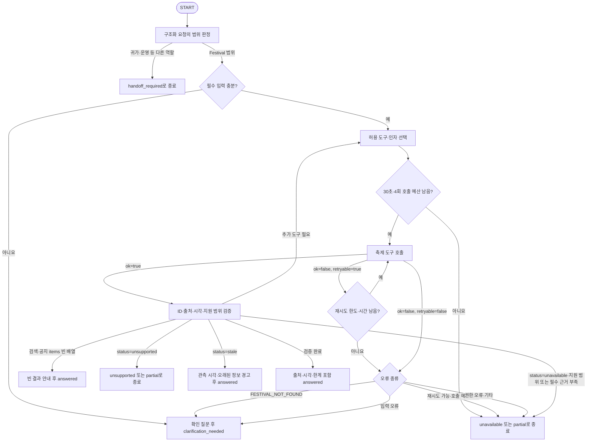

# 놀다가 단일 Festival Agent 상태 전이 그래프 설계서

> 작성 기준: 2026-11-23, 제출본 정리: 2026-11-24. 11/27 M03 제출을 위한 단일 Festival Agent 설계서다. 강사님 Step3 가이드의 9개 항목 순서로 작성했다. 기준은 `Docs/Step 1/놀다가_기획서.md`, `Docs/Step 1/놀다가_WBS.md` W22~W25, `origin/ohyun:Docs/Step 2/API_설계문서.md` v0.4, `origin/yubeen:Docs/Step 2/handoff/에이전트_도구_인계.md`의 W14 연결 내용이다. 현재 작업 브랜치의 API 문서 사본은 v0.3.3이며, 최신 도구 계약은 오현님 브랜치를 기준으로 확인한다. 코드 기준은 `dayoung 6dc31ca`다.

## 1. 목적과 범위

전체 서비스의 에이전트는 Supervisor·Festival·Route·Diagnosis·Recovery **5개**다. 이번 문서는 그중 Festival Agent **한 개의 내부 상태 전이**를 설계한다. 기획서 6.1·6.2절에 따라 **Supervisor가 사용자 의도·축제 선택·조건을 파악하고 필요한 경우 Festival을 호출**한다. Festival은 전달받은 축제 ID·조건을 검증하고 축제 도구를 사용한다. 현재 단독 실행기와 시험 하네스는 Supervisor 대신 구조화된 요청을 넘기고 결과를 받는다. Supervisor와의 실제 연결은 W44~W47의 별도 설계 대상이다.

이번 필수 흐름은 **전국 축제 검색, 선택된 축제 상세, 서울에서 매핑이 검증된 축제 주변 지역 혼잡 조회**다. 공식 공지 조회도 단독 흐름으로 연결했으며 현재는 모의 API의 계약과 전이만 검증했다. 실제 공식 자료 공급원이 준비되기 전에는 현장 공지로 제공하지 않는다. 시설은 자료 공급원이 확인될 때 확장한다. 날씨는 서비스 필수 기능이지만 현재 13개 도구에 없으므로 이번 단일 그래프의 실행 대상으로 두지 않는다. 코스 추천·RAG는 W27·W37과 연결되는 후속 흐름이다. **관심 저장은 팀 합의에 따라 Supervisor가 처리하며, 단일 Festival Agent는 `save_favorite`를 호출하지 않는다.**

Festival Agent는 경로를 만들거나 귀가 조회·장애 진단·복구 조치를 실행하지 않는다. 그런 질문은 `handoff_required` 결과로 끝내고, 나중에 Supervisor가 담당 에이전트로 전달한다. 단독 시험에서는 '이 단독 범위에서 처리하지 않음'으로 표시한다.

### 1-1. W22 질문 범위와 후속 연결 경계

| 질문 유형 | 현재 단일 Agent 동작 | 후속 연결·근거 |
|---|---|---|
| 축제 검색·일정·장소 | `search_festivals`, `get_festival`로 실존 ID·출처·갱신 시각을 확인한다. | 자연어 의도 분류와 선택 축제 문맥 유지(FR-C01/C04)는 Supervisor 및 W26·W44 이후 연결한다. |
| 축제 주변 혼잡 | `get_crowd`의 서울 지원 구역·관측 시각·대체값 여부를 검증한다. | 행사장 내부나 개별 귀가 길의 혼잡으로 확대하지 않는다(FR-F02/F03/F18). |
| 공식 운영·교통 공지 | `get_official_notices` 단독 조회를 연결했으나 현재 공급 응답은 모의 자료다. | 실제 공식 원본·효력 확인은 FR-F05와 W27의 자료 준비 뒤 검증한다. |
| 화장실·주차장·응급시설 등 현장 정보 | `get_facilities`가 현재 그래프에 없어 도구를 호출하지 않는다. | W90의 검증된 공급원·지원 범위를 받은 뒤 연결한다(FR-F04/F11). |
| 날씨·실시간 도착·상권 | 이번 단일 그래프에 도구가 없으므로 수치를 만들어 답하지 않는다. | 각 API·도구 계약 및 공급원 확인 뒤 별도 연결한다(FR-F09/F12/F16). |
| 방문 코스 추천·공식 안내 RAG | 현재 실행하지 않는다. | W27·W37의 공식 문서와 실존 장소·조건 검증 이후 연결한다(FR-P01/P03, FR-C05/C07). |
| 가는 길·귀가·장애 진단·복구 | `handoff_required`로 종료한다. | Route·Diagnosis·Recovery와의 협업은 W44 이후 Supervisor 계약에서 설계한다. |

현재 단독 입력 계약은 `FestivalRequest(intent, festival_id, 검색 조건, notice_type)`이고, 최종 출력은 `FestivalResult(outcome, answer, evidence, transitions, used_tools, handoff_target)`이다. `tool_results`는 그래프의 한 실행 동안 `response`에 보관하며 별도 영속 상태가 아니다. **Supervisor가 이 입력을 실제로 생성하는 세부 형식은 아직 확정되지 않았다.** 이 표는 W22의 확장 계약 초안이며 후속 기능을 현재 구현 완료로 세지 않는다.

**최신 기획서 범위 확인(2026-11-24):** 추천 상황 카드 5종(가족·친구·연인·반려견·혼자)은 후속 취향·코스 연결 범위다. A42 `지금 핫한 축제`의 외부 순위 사전 수집은 추천 목록용이며, 이 단일 Festival Agent의 도구나 공식 안내 RAG 입력으로 추가하지 않는다. 상황 카드의 반려견 동반 가능 여부도 검증된 공식 정보가 있을 때만 확정한다.

### 1-2. 실제 자료와 모의 자료의 시연 경계

| 조회 | 현재 확인한 범위 | 첫 시연에서의 표기 기준 |
|---|---|---|
| 축제 검색·상세 | TourAPI 적재 DB 응답의 수동 확인·재생에 이어 11/24 학원망에서 Agent의 직접 HTTP 검색·상세 호출이 통과했다(A-11). | 직접 연결된 실제 DB 조회로 표시할 수 있다. |
| 서울 주변 혼잡 | 11/23 숭례문 응답의 직접 조회·재생과 11/24 숭례문 `unsupported` 직접 연결은 당시 기록으로 구분한다(A-8~A-11). 11/24 서울빛초롱축제는 학원망 맥북에서 Agent가 직접 HTTP 호출해 `is_mock:false`, 공급원 `ok`, Agent `answered`를 확인했다(A-12). | 실제 연결 확인 범위는 서울빛초롱축제 1건이다. 첫 시연에서 모의 혼잡 응답을 사용하면 화면·답변·발표 자료에 **모의 데이터**라고 표시한다. |
| 공식 공지 | 모의 API의 계약과 상태 전이만 확인했다. | 공식 원본 공급원이 연결되기 전에는 현장 공지로 제시하지 않는다. |

서버 응답의 `is_mock` 값을 유지해 답변에 반영한다. 시연 환경의 자료 모드는 실제 실행 직전에 다시 확인한다.

## 2. 상태·노드·전이(개념)

**그림 1. Festival Agent 개념 상태 전이.** 그림의 설명 상자는 실제 LangGraph 노드 이름이 아니며, 바로 아래 2-1 표에서 노드에 대응한다.



현재 그래프에서 `FESTIVAL_NOT_FOUND`는 재선택 질문으로 끝난다. 검색 조건을 이용한 자동 검색 복귀는 구현되지 않았다. `추가 도구 필요 → P`는 `search_detail_crowd`의 검색→상세→혼잡 순차 호출에만 쓰며 도구 호출 상한을 적용한다. 복합 흐름에서 이미 확인한 정보가 있으면 후속 조회 실패·미지원·예산 초과 시 `partial`로 종료한다. 단독 혼잡 조회의 `stale`은 오래된 자료임을 밝힌 `answered`다. `budget_exceeded`는 최종 `outcome`이 아니라 호출 예산 소진을 나타내는 `transitions` 기록이며, 그때의 최종 결과는 `unavailable` 또는 `partial`이다.


### 2-1. 개념 단계와 실제 노드 대응

| 개념 단계 | 현재 LangGraph 노드 | 확인할 사실 |
|---|---|---|
| 요청 범위 판정 | `interpret` | 구조화된 `intent`를 검사한다. 자연어를 해석하지 않는다. |
| 필수 값 확인 | `check_slots` | 상세·혼잡·공식 공지의 축제 ID, 복합 요청의 명시적 첫 결과 선택을 확인한다. |
| 도구 선택·실행 | `select_tool` → `call_tool` | 연결된 네 도구만 선택하고 예산을 확인한다. |
| 재시도·오류 처리 | `retry` 또는 `error` | 일시 오류만 같은 호출을 최대 1회 반복한다. |
| 결과 관찰·검증·종료 | `validate` → `END` 또는 `select_tool` | 결과의 ID·출처·시각·지원 범위를 검사하고 다음 단계 또는 종료를 고른다. |

현재 그래프에 별도의 `finalize` 노드는 없다. 각 종료 분기가 `FestivalResult`를 만들어 `END`로 간다. 개념 그림의 답변·확인 불가·인계 상자는 이 결과 생성에 대응한다.

## 3. LLM 및 프롬프트 정책

**현재 구현:** LLM 호출과 프롬프트는 없다. 호출자가 이미 분류한 `FestivalRequest`를 넘기며, `interpret` 노드는 자연어 추론 대신 `intent`의 담당 범위만 검사한다. 따라서 모델명·프롬프트 버전·JSON 파싱 성공률을 현재 실행 결과로 기재하지 않는다.

**문서에 정해진 역할:** 기획서 6.1절은 Supervisor가 축제 선택·의도를 파악하고 필요한 경우 Festival을 호출하도록 정한다. API 설계서 3절은 사용자 챗봇 요청의 `message`, `context.festival_id`, `reference_date`를 정의한다. WBS W22~W25와 M03은 단일 Festival Agent의 상태·전이·종료·단독 실행을 11/27 범위로 두고, 5개 Agent의 상세 협업 계약은 W44 이후로 배치한다. 따라서 **이번 단독 시험은 현재 구현된 구조화 `FestivalRequest`로 재현**하며, 아직 연결되지 않은 자연어 분류나 모델 성능을 시험 결과로 기록하지 않는다.

**후속 연결 설계안:** 실제 협업에서는 Supervisor가 사용자 질문의 의도·선택 축제·조건을 구조화해 Festival에 전달하고, Festival이 누락값·축제 ID·출처를 재검증한다. 아래 표는 후속 자연어/LLM 연결을 위한 설계안이며, 현재 실행 계약이나 11/27 제출 선결 조건이 아니다. 모델·프롬프트와 Supervisor→Festival 세부 필드는 팀의 해당 구현 단계에서 확정한다.

| 항목 | 설계안 |
|---|---|
| 입력 | 후속 단계에서 Supervisor가 전달할 구조화 의도·조건·선택 축제 ID와 Festival 허용 도구 이름·인자. 자연어 분류 단계를 추가하면 사용자 질문·`reference_date`를 그 단계에 제공한다. 인증 토큰·API 키는 입력하지 않는다. |
| 출력 | 후속 구조화 출력 후보는 `intent`(`search/detail/crowd/notices/search_detail_crowd/other`), `festival_id`, `notice_type`, `region`, `date_from`, `date_to`, `q`, `status`, `page_size`, `select_first`, `missing_slots`다. **현재 `FestivalRequest`에 `missing_slots` 필드는 없으며, 이 목록은 확정된 Agent 간 스키마가 아니다.** |
| 제약 | 상대 날짜의 기준일이 없거나 지시 대상이 모호하면 추측하지 않고 확인 질문으로 종료한다. 검색의 첫 결과 선택은 사용자 지시가 있을 때만 `true`다. 도구 결과 문장으로 권한·도구 목록을 바꾸지 않는다. |
| 검증 | 후속 LLM 출력은 코드에서 JSON 형식·허용 enum·필수 값·도구 인자를 재검사한다. 출력이 틀리면 같은 구조화 요청 생성을 최대 1회 다시 시도하고, 계속 실패하면 `clarification_needed` 또는 `unavailable`로 종료한다. **현재는 LLM 출력과 재생성 자체가 없다.** |
| 모델 장애 | LLM 단계가 연결된 뒤 장애가 나면 검증되지 않은 축제·혼잡을 생성하지 않는다. 검색·상세 같은 기본 조회를 코드 기반으로 이어갈 범위는 Supervisor 계약과 함께 결정한다. |

모델 내부 추론 원문은 기록하거나 사용자에게 보여주지 않는다. 외부 API의 설명·공지·축제 소개는 비신뢰 데이터로 취급하고, 내용에 담긴 지시를 프롬프트나 도구 권한으로 실행하지 않는다.

## 4. CoT·ReAct 단계와 기록

현재 실행은 **규칙 기반 도구 흐름**이다. `select_tool`은 구조화된 의도에서 도구를 고르고, `call_tool`이 실행하며, `validate`가 응답을 관찰·검증한다. LLM의 Thought 또는 근거 부족에 따른 재추론 고리는 없다. 따라서 현재의 `retry`는 **같은 도구 호출을 반복하는 통신 재시도**이며 자기 성찰이나 LLM 재추론 성공으로 세지 않는다.

| ReAct 관점 | 현재 동작 | 후속 LLM 연결 시 기록할 요약 |
|---|---|---|
| Thought | `interpret`의 범위 판정과 `select_tool`의 규칙 선택. 모델 추론 없음 | 의도·필요한 정보의 짧은 결정 요약만 기록 |
| Action | `call_tool` | 도구 이름, 인자 중 민감하지 않은 값, 호출 시각, 재시도 번호 |
| Observation | `response`를 받은 뒤 `validate` | 성공/오류 코드, 결과 상태, 출처·관측 시각·지원 범위 요약 |
| Check | `validate` 또는 `error` | ID 일치·근거 충족·미지원 판정과 다음 전이 |

현재 `transitions`, `used_tools`, `evidence`는 결과와 함께 반환되지만 별도 JSON Lines 저장소나 `trace_id` 영속 기록은 없다. 향후 추적 로그에는 노드·도구·판정 요약만 남기고 모델의 내부 추론, 인증 정보, 외부 응답 원문은 기록하지 않는다. 이 기록 정책은 다음 자기 성찰 시험의 입력·기대 전이와 연결한다.

**11/27 단독 실행 입력:** 현재 구현과 기획서 6.1절의 역할 분담에 따라 시험 하네스가 `FestivalRequest`의 구조화된 `intent`·축제 ID·검색 조건을 전달한다. 이는 Supervisor를 모의한 입력이며, 자연어 분류나 LLM 재추론의 성능을 검증하는 시험으로 해석하지 않는다. 후속 통합에서 Supervisor의 실제 출력 계약이 확정되면 같은 필드로 연결한다.

## 5. 도구 선택 및 재추론

| 도구 | 이번 그래프 | 호출 조건·주의 |
|---|---|---|
| `search_festivals` | 필수 | 입력은 모두 선택값이다. 구조화 요청의 지역·기간·검색어를 반영한다. 상대 날짜 해석은 후속 자연어 연결 단계다. `items:[]`는 정상 빈 결과다. |
| `get_festival` | 필수 | `festival_id`가 확정된 경우. 다른 축제의 정보를 섞지 않는다. |
| `get_crowd` | 필수 | 선택 축제 ID로 조회. 서울 매핑 미지원은 `unsupported`, 오래된 관측은 `stale`, 공급원 오류는 `unavailable`로 구분한다. |
| `get_official_notices` | 단독 흐름 연결 | 축제 ID로 조회하고 공지 출처·게시 시각·적용 기간을 검증한다. 현재 모의 공지만 확인했으며 실제 현장 공지로 단정하지 않는다. |
| `get_facilities` | 조건부 | 시설 공급원·모의 응답의 구분이 가능할 때만 사용한다. 현재 이 단일 그래프에는 연결하지 않았다. |
| `save_favorite` | 단일 Festival Agent 범위 밖 | 팀 합의에 따라 Supervisor가 처리한다. Festival Agent 도구 허용 목록에서 제외한다. |
| `get_weather` | 후속 후보 | 현재 13개 도구에 없다. 도구·API 계약과 BFCL 영향 검토 후 추가한다. |

이름·인자·허용값은 `origin/ohyun`의 API 설계 v0.4 JSON Schema 및 `handoff/tools/*.json`을 따른다. 현재 인계 문서 머리말에는 v0.3.3이 남아 있어 버전 표기 갱신을 오현님께 확인한다. 이 문서에서 새로운 도구 인자를 임의 확정하지 않는다. 운영자 전용 `get_incident`·`get_route_metrics`·`list_allowed_actions`·`propose_recovery_action` 등은 Festival Agent에 제공하지 않는다.

### 5-1. 연결된 도구 4개의 입력·결과

| 도구 | 입력 JSON Schema 요약 | 성공 결과에서 확인할 필드 | 오류·특수 상태 |
|---|---|---|---|
| `search_festivals` | 모두 선택: `region`(기본 `ALL`, 17개 시·도 코드), `date_from`·`date_to`(`YYYY-MM-DD`, 순서·최대 366일 검증), `q`(1~50자), `status`(`upcoming/ongoing/ended/cancelled`), `page_size`(1~20, 기본 10). **도구 스키마에는 `bbox`·`sort`·`page`가 없다.** | `data.items[]`의 `festival_id`, `name`, `region_code`, 날짜, `source`, `last_synced_at`; `total`·`page`·`page_size` | `items:[]`는 `ok:true`인 결과 없음. `VALIDATION_ERROR`는 되묻거나 입력 수정, `TOOL_TIMEOUT`·`RATE_LIMITED`는 제한 재시도. |
| `get_festival` | 필수 `festival_id:string` 하나. 검색 결과의 ID나 선택 문맥의 ID를 그대로 사용 | `data.festival_id`, `name`, 장소·주소·좌표, 날짜, `source`, `source_ref`, `last_synced_at`. 빈값 허용 필드는 그대로 표시 | `FESTIVAL_NOT_FOUND`는 재선택 요청. ID 형식 오류는 `VALIDATION_ERROR`, 일시적 호출 오류는 `TOOL_TIMEOUT`. |
| `get_crowd` | 필수 `festival_id:string` 하나. 지역 코드나 관측구역 코드를 인자로 보내지 않음 | 현재 Agent가 사용하는 값은 `data.festival_id`, `status`, `coverage`, `areas[]`의 `area_name`, `congest_level`, `observed_at`, `is_estimate`, `source`다. API의 `forecast[]`는 현재 답변에 사용하지 않는다. | `status:unsupported`는 정상 미지원. `status:stale`은 관측 시각을 밝히고 현재 상태로 단정하지 않음. `status:unavailable`은 정보 제공 불가. 본문 결과 코드 오류는 `SOURCE_RESULT_ERROR`. |
| `get_official_notices` | 필수 `festival_id:string`, 선택 `type`(`operation/traffic_control/no_stop/bus_detour/road_closure`) | `data.festival_id`, `status`, `coverage`, `items[]`의 `notice_id`, `title`, `source`, `published_at`, `effective_from`, `effective_to` | `items:[]`는 정상 빈 결과. `unsupported`·`unavailable`은 공지 확인 불가, `stale`은 오래된 자료임을 표시. 현재 검증 자료는 모의 응답이다. |

`search_festivals` 도구의 기본 `page_size`는 10이지만 공개 축제 목록 API의 기본값은 20이다. 연결 어댑터는 도구 호출에서 값이 생략되면 API 요청에 `page_size=10`을 명시한다.

**W14 연결 확인(2026-11-24):** `yubeen 00ca7dc`의 공통 `ToolExecutor`를 `dayoung`에 반영했다. Festival 단독 HTTP 실행기에서는 Agent 실행마다 `FESTIVAL_TOOLS` 권한의 실행기를 새로 만들고, 실행별 `trace_id`를 모든 도구 호출에 전달한다. 모의 전송 시험에서 검색→상세→혼잡 3회 호출, 같은 추적 ID 전달, 범위 밖 귀가 도구의 HTTP 호출 전 차단을 확인했다. 기존 Festival 그래프가 실제로 선택하는 도구는 검색·상세·혼잡·공식 공지 4개다. `get_facilities`는 공통 실행기의 허용 목록과 인자 검증에만 포함되며, A08 API와 Festival 그래프의 시설 흐름은 아직 구현 전이다. 공통 실행기를 통한 실제 DB·서울 혼잡 공급원 연속 실행도 별도 확인이 필요하다.

도구 래퍼의 공통 출력은 `{ok, data, request_id, is_mock}` 또는 `{ok:false, error:{code,message,retryable}, request_id}`다. **`ok`는 도구 호출의 성공 여부이고, `data.status`는 데이터 이용 가능 상태**이므로 두 값을 순서대로 판정한다. API가 `forecast[]`를 보내더라도 현재 Agent는 이를 답변·근거에 넣지 않는다. 후속 연결 시에는 예측 정보로 별도 표시하고 현재 관측값처럼 표현하지 않는다.


### 5-2. 재시도와 재추론의 구분

| 상황 | 도구·다음 전이 | 한도 초과 시 |
|---|---|---|
| 검색·상세·혼잡·공지 조회 필요 | 해당 단계의 허용 도구 1개 선택 | 도구 호출 4회 또는 30초 예산 초과 시 `unavailable`/`partial` |
| 도구가 `retryable:true` 오류 반환 | `retry` → 같은 `call_tool` | 같은 호출 최대 1회 재시도 후 `error` |
| 도구가 `retryable:false` 오류 반환 | 재시도 없이 `error` | 없는 축제·입력 오류는 확인 질문, 기타는 확인 불가 |
| 결과의 출처·시각·지원 범위 검증 실패 | `validate`에서 종료 | 임의 데이터 보충이나 LLM 재추론 없음 |
| 범위 밖 도구 요청 | 도구 호출 없이 `handoff_required` | 담당 역할만 표시, 단독 그래프에서 타 Agent 호출 없음 |

현재 `attempts`는 **단일 도구 단계의 호출 시도**이며, `tool_call_count`는 복합 흐름 전체 호출 수다. LLM 재추론 횟수는 별도 필드도 실행 경로도 없다. 후속 도입 시 재추론 카운터를 통신 재시도 카운터와 분리해야 한다.

## 6. 메모리 및 체크포인트

| 종류 | 현재 상태 | 보관·재개 규칙 |
|---|---|---|
| 실행 중 단기 상태 | `FestivalGraphState`의 `request`, `stage`, 선택 축제 ID, 호출 수, `parts`, `evidence`, `trace` | 한 번의 `.invoke()` 동안 사용한다. 실행 종료 후에는 `FestivalResult`만 호출자에게 반환한다. |
| 대화 문맥 | `FestivalRequest.festival_id` 등 호출자가 전달한 값만 사용 | 세션 기억·Redis 연결은 아직 없다. 축제 변경 시 문맥 초기화 규칙은 W26에서 정한다. |
| 장기 지식 | 현재 네 도구 흐름에는 없음 | 공식 안내 RAG·벡터 저장은 W27 이후 별도 계약으로 연결한다. 현재 혼잡을 정적 문서로 대체하지 않는다. |
| 체크포인트 | `graph.compile()`에 checkpointer가 없음 | 중단된 노드부터 자동 재개하지 못한다. 재호출은 새로운 실행이며, 읽기 전용 도구를 처음부터 다시 부를 수 있다. `thread_id`와 저장 기간은 W26에서 결정한다. |

API의 작업 상태(`queued/running/...`)와 LangGraph의 노드·State는 별개다. 체크포인트가 없는 현재 구현을 장애 후 재개 기능으로 설명하지 않는다. 세션 식별자·보존 기간을 확정할 때 API·DB 문서와 이름을 맞춘다.
현재 `deadline_at`은 프로세스의 단조 시계 값이므로, 후속 체크포인트를 도입할 때 이 값을 그대로 저장·복원하지 않고 재개 시점의 시간 예산을 새로 계산해야 한다.

## 7. State 정의

| 구분 | 필드 | 의미와 규칙 |
|---|---|---|
| 입력 | `intent`, `region`, `date_from`, `date_to`, `q`, `status`, `page_size`, `select_first`, `notice_type` | 현재 실행 코드는 해석된 구조화 요청을 받는다. 자연어 질문 해석과 상대 날짜 변환은 후속 연결 단계다. |
| 입력 | `festival_id` | 상세·혼잡·공식 공지 조회할 축제 ID. 인증 맥락은 현재 공개 조회 범위에서 사용하지 않는다. |
| 추적 | `transitions`, `used_tools` | 노드 방문 순서와 도구 호출 결과를 남긴다. HTTP `request_id`를 최종 결과에 전달하는 기능은 후속 작업이다. |
| 판단 | `intent`, `stage` | `search`, `detail`, `crowd`, `notices`, `search_detail_crowd`를 처리한다. 범위 밖 의도는 인계한다. 복합 요청에서 첫 결과 선택은 `select_first=true`가 필요하다. |
| 도구 | `tool`, `args`, `response`, `attempts`, `tool_call_count`, `stage`, `selected_festival_id` | 복합 요청의 `stage`는 `search → detail → crowd`. 검색 결과의 첫 ID를 후속 호출에 전달한다. |
| 검증 | `evidence`, 도구 응답의 `coverage`·`status` | 축제 ID·출처·시각·지역 지원 여부를 확인한다. `unsupported`는 호출 실패와 구별한다. 별도 `validation_errors` 상태 필드는 아직 없다. |
| 출력 | `answer`, `outcome`, `handoff_target` | `outcome`은 `answered`, `partial`, `clarification_needed`, `unsupported`, `unavailable`, `handoff_required` 중 하나. 복합 요청 중간 실패·미지원은 앞서 확인한 정보를 보존해 `partial`로 끝낸다. |

상태에는 인증 토큰·외부 API 키·경로 본문을 넣지 않는다. 대화 기억의 보존 방식은 W26에서 정하고, 현재 설계는 필요한 최소 문맥만 다음 노드에 전달한다.


### 7-1. 실제 `FestivalGraphState` 필드와 작성 노드

다음은 `backend/agents/festival_graph.py`의 `TypedDict(total=False)`를 그대로 옮긴 표다. **선택 필드**이므로 각 노드는 자신의 전이에서 필요한 값이 먼저 설정됐는지 확인한다.

| 필드 | 타입 | 주로 쓰는 노드 | 용도 |
|---|---|---|---|
| `request` | `FestivalRequest` | 호출자 | 구조화 요청 |
| `trace` | `list[str]` | 각 노드 | 노드·분기 순서 |
| `tool` | `str` | `select_tool` | 허용 도구 이름 |
| `args` | `dict[str, Any]` | `select_tool` | 도구 인자 |
| `response` | `dict[str, Any]` | `call_tool` | 도구 응답 |
| `attempts` | `int` | `select_tool`, `call_tool` | 현재 도구 단계의 시도 횟수 |
| `used_tools` | `list[dict[str, Any]]` | `interpret`, `call_tool` | 실제 호출과 성공·오류 코드 |
| `result` | `FestivalResult` | 종료 분기 | 호출자에게 돌려줄 최종 결과 |
| `stage` | `str` | `interpret`, `validate` | 복합 흐름의 `search/detail/crowd` 단계 |
| `selected_festival_id` | `str` | `validate` | 검색 결과 중 사용자가 선택을 명시한 첫 ID |
| `parts` | `list[str]` | `interpret`, `validate` | 복합 답변에서 이미 확인한 문장 |
| `evidence` | `list[dict[str, Any]]` | `interpret`, `validate` | 복합 흐름의 근거 |
| `deadline_at` | `float` | `interpret` | 단조 시계의 종료 시각. 현재 실행 내부에서만 유효 |
| `timeout_s` | `float` | `interpret` | 실행 시간 예산 |
| `tool_call_count` | `int` | `interpret`, `call_tool` | 전체 도구 호출 수(최대 4) |

`FestivalResult`의 `outcome`, `answer`, `evidence`, `transitions`, `used_tools`, `handoff_target`은 그래프 State의 개별 필드가 아니라 **최종 `result` 객체의 필드**다. HTTP `request_id`와 LLM 재추론 횟수는 아직 이 State에 없다.

## 8. 구현 노드 및 전이표

| 코드 노드 | 하는 일 | 다음 단계 |
|---|---|---|
| `interpret` | 이미 분류된 `intent`가 Festival 범위인지 확인. 자연어 분류는 아직 구현하지 않음 | `check_slots` 또는 `END` |
| `check_slots` | 상세·혼잡·공식 공지의 `festival_id`와 복합 요청의 `select_first` 확인 | `select_tool` 또는 `END` |
| `select_tool` | 현재 `stage`에 맞는 허용 도구 1개와 인자 구성 | `call_tool` |
| `call_tool` | 호출 예산 검사, API 래퍼 실행, 응답·오류 기록 | `validate`, `retry`, `error` 또는 `END` |
| `retry` | 동일 도구 호출 재시도 기록 | `call_tool` |
| `validate` | 축제 ID, 검색·상세의 출처/갱신 시각, 혼잡의 관측 시각·지원 범위, 공지의 출처·게시/효력 시각을 해당 도구별로 검사하고 부분 결과 보존 | `select_tool` 또는 `END` |
| `error` | 오류를 확인 질문 또는 확인 불가 결과로 변환 | `END` |


### 8-1. 코드와 1:1로 대조하는 전이표

| 현재 노드 | 조건 | 다음 노드/종료 | 상한·실패 출구 |
|---|---|---|---|
| `START` | 항상 | `interpret` | — |
| `interpret` | 범위 밖 의도 | `END` (`handoff_required`) | 도구 호출 없음 |
| `interpret` | Festival 의도 | `check_slots` | 예산 초기화 |
| `check_slots` | 필수 축제 ID 또는 복합 선택 지시 누락 | `END` (`clarification_needed`) | 도구 호출 없음 |
| `check_slots` | 필수 값 충족 | `select_tool` | — |
| `select_tool` | 현재 `stage` 확정 | `call_tool` | 단계마다 `attempts=0` 초기화 |
| `call_tool` | 호출 전·후 시간 또는 총 4회 예산 초과 | `END` (`unavailable`/`partial`) | `budget_exceeded` 기록 |
| `call_tool` | `response.ok=true` | `validate` | — |
| `call_tool` | 오류가 재시도 가능, `attempts<2`, 총 호출 수 `<4` | `retry` | 같은 단계 최대 1회 재시도 |
| `call_tool` | 재시도 가능 오류이나 총 4회 호출 예산 소진 | `error` | 추가 호출 없이 예산 결과 생성 |
| `call_tool` | 그 밖의 오류 | `error` | 같은 도구 추가 호출 없음 |
| `retry` | 항상 | `call_tool` | 다음 호출에서도 시간·횟수 검사 |
| `validate` | 단일 조회 완료·빈 결과·미지원·근거 실패 | `END` | 결과별 `outcome` 반환 |
| `validate` | 복합 검색·상세 성공, 다음 단계 필요 | `select_tool` | 정상 3회 호출, 전체 상한 4회(일시 오류 재시도 1회분) |
| `validate` | 복합 후속 단계 완료·실패 | `END` | 앞 단계 답변이 있으면 `partial` |
| `error` | 재시도 가능 오류이고, 현재 단계에서 아직 재시도하지 않았으며(`attempts<2`), 총 4회 호출 예산 소진 | `END` (`unavailable`/`partial`) | `budget_exceeded` 기록, 추가 호출 없음 |
| `error` | 그 밖의 오류 | `END` | 없는 ID·입력 오류는 확인 질문, 기타는 확인 불가 |

조건은 `build_festival_graph()`의 `add_conditional_edges` 및 각 노드의 결과 생성과 대응한다. `retry`와 복합 `validate → select_tool`은 모두 호출 수·시간으로 닫힌 유한 반복이다. 성공·실패·예산 초과 중 어느 것도 다음 노드 없이 방치되지 않는다.

### 8-2. API 응답부터 사용자 안내까지의 오류 계약

| API·도구 응답 | 그래프 전이·호출 횟수 | 최종 `outcome`·사용자 안내 |
|---|---|---|
| 상세 404 `FESTIVAL_NOT_FOUND`, `retryable:false` | `call_tool → error → END`, 도구 1회 | `clarification_needed` · “해당 축제를 찾지 못했습니다. 다시 선택해 주세요.” 자동 검색 복귀 없음 |
| 일시적 503·`retryable:true`, 다음 호출 성공 | `call_tool → retry → call_tool → validate → END`, 최대 2회 | 검증 성공 시 `answered`. 두 번째도 실패하면 `unavailable` 또는 앞 단계 근거가 있는 복합 흐름은 `partial` |
| 혼잡 HTTP 200 `status:"unsupported"` | `call_tool → validate → END`, 도구 1회 | 단독 `unsupported` · “이 축제 주변 지역의 혼잡 정보는 지원하지 않습니다.” 복합 흐름은 기존 축제 정보와 함께 `partial` |
| 혼잡 HTTP 200 `status:"stale"` | 재시도 없이 `validate → END` | 관측 시각·오래된 자료 경고를 포함한 `answered` |
| 혼잡 HTTP 200 `status:"unavailable"` | 재시도 없이 `validate → END` | `unavailable` · 현재 혼잡을 확인할 수 없다고 안내 |

위 계약에서 `ok:false`의 재시도 여부는 **도구 오류의 `retryable`**로, `ok:true`인 혼잡의 이용 가능 여부는 **본문 `status`**로 판단한다. `FESTIVAL_NOT_FOUND`는 재시도 없이 재선택 안내 후 종료하는 것으로 오현님 API 문서·인계 문구와 일치 완료했다(오현님 `b529ef4` 보고 기준).

## 9. 종료 조건

| 상황 | 처리·종료 |
|---|---|
| 필수 축제 ID·복합 요청 선택 지시가 없음 | 확인 질문 후 `clarification_needed`. 도구 호출 없음. 상대 날짜의 기준일 확인은 자연어 연결 단계에서 처리한다. |
| 없는 축제 ID | 재시도 없이 사용자에게 재선택 요청 후 종료. |
| 서울 밖 또는 미매핑 혼잡 | `unsupported`를 정상적인 결과 상태로 처리. 다른 지역 혼잡으로 채우지 않음. |
| 검색 결과 0건 | `ok:true`와 `items:[]`를 정상 처리하고 조건에 맞는 결과가 없다고 안내. 임의 축제 생성 금지. |
| 공식 공지 결과 0건 | 정상 빈 결과로 처리하되 전체 현장 공지가 없다고 단정하지 않는다. 모의 응답은 모의임을 표시한다. |
| 혼잡 `stale` | `observed_at`과 오래된 정보 경고를 함께 제시하고 현재 혼잡이라고 단정하지 않음. |
| 혼잡 대체값 `is_estimate=true` | 최근 4주 같은 요일·시간대 평균임을 답변과 근거에 표시한다. 실시간 관측으로 표현하지 않는다. |
| 혼잡 `unavailable` | 현재 코드의 안내는 “현재 혼잡 정보를 확인할 수 없습니다.”다. 응답의 세부 원인을 사용자 문구에 덧붙이지 않고 현재 혼잡값도 만들지 않는다. 복합 요청에서 앞 단계 결과가 있으면 `partial`로 종료한다. |
| 일시적 도구 오류·시간 초과 | `retryable=true`일 때만 **최대 1회** 재시도. 전체 실행 시간·도구 호출 상한을 초과하면 `unavailable`, 앞 단계에서 확인한 결과가 있으면 `partial`. |
| 입력 오류·권한 오류 | 입력 오류는 되묻고, 권한 오류는 우회 호출 없이 종료. |
| 출처·시각·지원 범위 검증 실패 | 확인 불가를 명시하고 종료. 혼잡 `ok`·`stale`에는 `coverage.supported=true`가 필요하다. 모의 결과는 실제 현장 정보로 표시하지 않음. |
| Festival 범위 밖 질문 | `handoff_required`. 단독 실행에서 다른 에이전트를 직접 호출하지 않음. |

**현재 코드 예산:** 정상 복합 흐름은 도구 3회, 전체 상한은 **4회(재시도 포함)**, 동일 호출 재시도 최대 1회, 전체 실행 시간 기본 30초다. 따라서 검색·상세·혼잡 중 한 번의 일시 오류는 재시도 후에도 다음 단계로 진행할 수 있다. 노드에서 호출 전후 시간을 확인하고 초과 시 `unavailable` 또는 앞서 확인한 정보가 있으면 `partial`로 종료한다. 이는 **협력적 시간 제한**이며 진행 중인 동기 HTTP 호출을 30초 시점에 강제로 중단하지는 않는다. HTTP 래퍼의 호출별 기본 타임아웃은 5초다. 실제 한도는 W23/W24에서 다시 확정한다.


### 9-1. 최종 결과의 세 범주

| 범주 | 현재 `outcome` | 반환 내용 |
|---|---|---|
| 정상 종료 | `answered`, `unsupported` | 확인된 축제 정보 또는 명시적인 지역 미지원 안내. 검색 0건도 `answered`다. 오래된 혼잡은 관측 시각을 밝힌 `answered`다. |
| 부분·오류 종료 | `partial`, `clarification_needed`, `unavailable` | 앞 단계 근거를 보존한 부분 답변, 누락값 질문, 또는 확인 불가 안내. `partial`은 전체 성공으로 세지 않는다. |
| 역할 인계 | `handoff_required` | `handoff_target`을 표시한다. 현재 단독 그래프는 실제 사람·다른 Agent 호출을 실행하지 않는다. |

모든 경로는 `FestivalResult`를 반환하고 `END`에 도달한다. API의 `run_status`나 실제 사용자 화면의 성공 상태와 동일하게 취급하지 않는다.

## 부록 A. 설계 검토와 실행 근거

### A-0. 구조화 요청 한 건의 실제 그래프 추적 (2026-11-23)

입력은 `FestivalRequest(intent="search_detail_crowd", select_first=True, region="SEOUL")`이다. 시험 하네스가 서울 축제 한 건과 서울 지원 혼잡 응답을 **모의 데이터**로 제공했다. 아래 표의 `validate_result`, `answer`, `advance_detail`, `advance_crowd`는 별도 LangGraph 노드가 아니라 `validate` 노드가 남긴 전이 추적 값이다.

| 순서 | 실행 노드·결과 | 다음 전이 | 핵심 State 변경 |
|---|---|---|---|
| 1 | `interpret` → `check_slots` | Festival 범위·필수 조건 충족 | `stage=search`, `tool_call_count=0`, `parts=[]` |
| 2 | `select_tool` → `call_tool` → `validate` | 검색 성공 → `advance_detail` | `tool=search_festivals`, `args={region:SEOUL}`, `selected_festival_id=fst_000001`, `tool_call_count=1`, 검색 근거 보관 |
| 3 | `select_tool` → `call_tool` → `validate` | 상세 성공 → `advance_crowd` | `tool=get_festival`, `args={festival_id:fst_000001}`, `stage=crowd`, `tool_call_count=2`, 상세 근거·답변 보관 |
| 4 | `select_tool` → `call_tool` → `validate` | 혼잡 검증 통과 → `END` | `tool=get_crowd`, 같은 축제 ID, `coverage.supported=true`, 관측 시각 확인, `tool_call_count=3` |

실제 반환값은 `outcome=answered`, `used_tools` 3건, `evidence` 3건이었다. 기록된 전이 순서는 `START → interpret → check_slots → select_tool → call_tool → validate_result → answer → advance_detail → select_tool → call_tool → validate_result → answer → advance_crowd → select_tool → call_tool → validate_result → answer → END`다. 이 추적은 **모의 응답을 사용하는 단독 그래프 시험**이며 사용자 자연어·실제 DB·현장 혼잡을 검증하지 않는다.

| 사례 | 기대 경로 | 확인할 결과 |
|---|---|---|
| 날짜·지역이 있는 축제 검색 | 해석→`search_festivals`→검증→답변 | 검색된 축제만, 날짜·지역 일치, 출처 표시 |
| 선택된 축제 상세 | 해석→`get_festival`→검증→답변 | 선택 ID 일치, 장소·기간·출처 표시 |
| 서울 매핑 축제 주변 혼잡 | 해석→`get_crowd`→검증→답변 | 지역 혼잡·관측 시각 표시, 내부 인원으로 과장 금지 |
| 서울 외 축제 혼잡 | 해석→`get_crowd`→`unsupported` | 지원하지 않는 지역이라고 안내 |
| 혼잡 자료 오래됨 | 해석→`get_crowd`→`stale` | 관측 시각과 오래된 정보 경고, 현재 혼잡 단정 없음 |
| 검색 결과 없음 | 해석→`search_festivals`→`items:[]` | 정상 빈 결과 안내, 가상 축제 생성 없음 |
| 첫 축제를 명시한 복합 질문 | 검색→첫 `festival_id` 확인→상세→혼잡→답변 | 같은 ID로 후속 조회, 도구 총 3회 |
| 복합 질문에서 첫 결과 선택이 불명확 | 해석→확인 질문 | 임의 첫 축제 선택·도구 호출 없음 |
| 복합 질문 중 혼잡 미지원 | 검색→상세→혼잡 `unsupported` | 앞서 확인한 축제 정보와 미지원 안내, `partial` 기록 |
| “그 축제”만 말하고 선택 문맥 없음 | 해석→확인 질문 | 임의 축제 선택·도구 호출 없음 |
| 없는 축제 ID | `get_festival` 오류→재선택 질문 | 다른 축제를 사실처럼 대신 안내하지 않음 |
| 도구 시간 초과 | 호출→1회 제한 재시도→확인 불가 | 반복 무한 루프 없음. HTTP 요청 ID를 최종 결과에 보존하는 기능은 후속 작업 |
| 공식 공지 단독 조회 | 축제 ID 확인→`get_official_notices`→검증→답변 | 공지 출처·게시·효력 시각 표시, 모의 자료 명시 |
| 날씨 또는 귀가 요청 | 범위 판정→인계/미지원 안내 | 미정 도구 호출·날씨 추측·경로 생성 없음 |

위 표는 **상태 전이 시험 계획**이다. 실제 확인 결과는 아래에 기록한다. BFCL 문항 평가와 실제 DB 연동은 아직 하지 않았다.

### A-1. 모의 API와 LangGraph 실행 확인 (2026-11-23)

오현님 브랜치 `origin/ohyun`의 `a663d0e` 모의 API를 별도 로컬 서버로 실행했다. 모의 API의 축제 검색·상세·혼잡 관련 시험은 **32개 통과**했다. 모의 서버 자료는 실제 축제·현장 상태가 아니다.

`backend/agents/festival_graph.py`의 LangGraph 노드는 `interpret → check_slots → select_tool → call_tool → validate`로 연결했고, 오류·1회 재시도 분기를 둔다. 긴 축제 ID 전달과 복합 요청의 재시도·호출 상한 사례를 추가했다. 태경님 검토를 반영해 전체 호출 상한을 4회로 조정한 뒤 단독 처리·LangGraph 분기 시험 **23개를 다시 실행해 모두 통과**했다. 서울 검색·상세·혼잡과 부산 미지원도 모의 API 연결 상태에서 예상대로 종료했다.

시험은 `backend/`에서 `python -m pytest tests/agents/test_festival_flow.py tests/agents/test_festival_graph.py -q` 형태로 실행했다(`23 passed`). 단독 `pytest` 명령은 현재 작업 환경의 import 경로 때문에 같은 결과를 보장하지 않으므로, 팀의 시험 실행 기준이 정해질 때까지 모듈 실행 방식을 사용한다.

복합 요청 `search_detail_crowd`에 `select_first=true`를 주어 서울 축제를 검색하면 `search_festivals → get_festival → get_crowd` 순서로 호출됐다. 상세·혼잡에는 첫 검색 결과 `fst_000001`이 전달됐고, 결과는 `answered`였다. 첫 선택이 명시되지 않거나 검색 결과가 비어 있으면 후속 호출을 하지 않는다. 혼잡 미지원 시 앞서 확인한 축제 정보와 함께 `partial`로 종료한다.

### A-2. 당시 오현님 브랜치 모의 API 재확인 (2026-11-23)

`origin/ohyun`의 `5838bfa`를 별도 작업 폴더에서 실행하고 현재 Festival Agent를 연결했다. 전체 축제 검색의 첫 결과 `fst_000004`는 상세 조회가 `answered`, 주변 혼잡이 `unsupported`였다. 같은 축제를 대상으로 한 복합 요청은 도구를 검색→상세→혼잡 순서로 3회 호출하고, 확인된 정보와 미지원 안내를 함께 담아 `partial`로 끝났다. 없는 축제 ID는 `clarification_needed`로 끝났다. 서울 검색의 첫 결과 `fst_000001`은 혼잡 조회가 `answered`였고, 지원 범위 검사도 통과했다. 이 검증은 모의 데이터에 대한 연결 시험이며 실제 DB·현장 혼잡 검증은 아니다.

**이 단계 시험의 한계:** 자연어 질문에서 `intent`·`select_first`·검색 조건을 추출하는 모델 연결, 실제 DB 연동, BFCL 채점은 이 시험에 포함되지 않았다. 실제 DB·혼잡 직접 연결은 후속 A-11~A-12에서 별도로 확인했다. 30초 예산은 호출 전후 검사이며 실행 중인 동기 HTTP 호출을 강제로 끊는 방식은 아니다. 이 시험만으로 W24 전체 완료나 11/27 제출 완료로 기록하지 않는다.

### A-3. W24 실제 데이터 연결 준비 상태

11/23 당시 `origin/ohyun`의 축제 목록·상세 API는 `FESTIVAL_DATA=db`일 때 PostgreSQL을 조회하고, DB 응답에 `is_mock:false`를 넣었다. **이 절을 처음 작성할 때 혼잡 API는 모의 응답이었으며, 이후 W89 실제 모드가 추가됐다(A-7~A-10 참조).** DB 연동 시험 `backend/tests/ingestion/test_i12_catalog_db.py`는 일회용 PostgreSQL의 `TEST_DB_URL`·`TEST_DB_APP_URL`이 있어야 실행되며, 현재 작업 환경에는 해당 접속 설정과 `DB_USER_PASSWORD`가 없다. 맥북 Safari에서 실제 DB의 목록·상세 **한 건을 수동 확인**했지만, **Festival Agent의 실제 DB 단독 E2E와 서울 혼잡 연동은 검증하지 않았다.**

W24 확인 순서는 다음과 같다.

1. W100에서 승인·게시된 실제 축제 데이터를 복수 지역으로 적재하고, 별도 시험 DB 접속 정보가 준비됐는지 확인한다. 접속 정보는 문서나 로그에 남기지 않는다.
2. DB 모드에서 `search_festivals`로 서울 및 다른 지역 축제를 조회하고 `is_mock:false`, 출처, 갱신 시각, 선택 ID를 대조한다.
3. 같은 ID로 `get_festival`을 호출해 목록과 상세의 축제 ID·출처가 일치하는지 확인한다.
4. W89의 검증된 서울 축제↔관측구역 매핑과 혼잡 API가 준비된 뒤 `get_crowd`를 연결한다. 실제 관측 시각·`coverage.supported`·미지원 상태를 확인하고 모의 응답과 구분한다.
5. 검색→상세→혼잡 단독 실행의 도구 순서, 종료 상태, `used_tools`·`evidence`를 남긴다. 어느 단계라도 모의 응답이면 실제 DB 전체 E2E 완료로 표시하지 않는다.

### A-4. 축제 DB 준비 안내 반영

오현님은 2026-11-23에 TourAPI 전국 축제 870건을 학원 서버 DB에 적재했고, 진행·예정 축제는 59건이라고 공유했다. 해당 서버는 학원 와이파이 내부 주소로 안내됐으며 현재 작업 환경에서는 접속 시간이 초과되어 실제 응답을 직접 확인하지 못했다. 따라서 이 수치는 팀원 안내 사항이고 본 설계서의 실행 검증 결과가 아니다. 서울 혼잡 매핑은 준비 중이며 혼잡 API 응답은 여전히 모의 데이터라고 안내받았다.

맥북 Safari에서 전달받은 화면으로 실제 API의 목록과 상세 응답을 **수동 대조**했다. 목록에는 `is_mock:false`, `total:869`, 축제 ID `fst_01M835BPX17Y44VEDJM1VMZ3N6`, `source:tourapi`, `last_synced_at:2026-11-23T11:57:22.397300+09:00`이 보였고, 상세 응답도 같은 축제 ID와 `is_mock:false`, `source:tourapi`, 같은 갱신 시각을 표시했다. 이로써 해당 한 건의 실제 DB 검색→상세 응답 일치는 확인했다. 화면의 `total:869`와 팀원이 안내한 적재 870건은 집계 기준이 다를 수 있으나 원인은 아직 확인하지 않았다. Safari에서 한글이 깨져 보여 축제 이름·장소 문구의 정확성은 판정하지 않았다. **Festival Agent가 집 컴퓨터에서 실제 API를 호출한 결과는 아직 아니다.**

학원 네트워크에서 `backend/agents/check_festival_live.py --base-url <공유받은 API 주소>`를 실행하면 진행·예정 상태를 **각각** 조회한 뒤 첫 축제의 상세 정보를 확인한다. 도구 JSON Schema의 `status`는 단일 값만 허용하지만 API는 쉼표로 구분한 여러 값을 받으므로, 도구 계약이 바뀌기 전에는 `ongoing,upcoming`을 Agent 인자로 보내지 않는다. 이 확인은 실제 축제 DB의 검색·상세까지만 포함하고 혼잡은 제외한다.

### A-5. 실제 DB 형태와 혼잡 모의 응답의 혼합 시험

최신 `origin/ohyun`은 실제 DB 축제 ID를 공통 조회에 연결했지만 `get_crowd`는 여전히 모의 서비스를 사용한다. 실제 API 응답 화면에서 확인한 긴 축제 ID `fst_01M835BPX17Y44VEDJM1VMZ3N6`와 `is_mock:false` 검색·상세 형태를 **로컬에 구성한 응답**으로 `search_detail_crowd`를 실행했다. 같은 ID가 `get_festival`과 `get_crowd`에 그대로 전달됐고, 혼잡 응답을 `status:unsupported`, `is_mock:true`로 주면 최종 `outcome=partial`과 모의 데이터 안내가 나왔다. 이는 형식·상태 전이 시험이며 학원 API에 집 컴퓨터의 Agent가 직접 접속한 결과가 아니다.

복합 요청에서 검색 성공 후 상세 도구가 한 번 시간 초과되고 재시도에 성공하는 경우도 확인했다. 기존 3회 상한에서는 혼잡 조회 전에 `partial`로 끝났으나, 태경님 검토를 반영한 **4회 상한에서는 혼잡 조회까지 진행해 `answered`로 끝난다.** 일시 오류가 두 번 발생해 네 번째 호출 뒤에도 재시도가 필요하면 `budget_exceeded`, `outcome=partial`로 종료하고 이미 확인한 검색·상세 결과를 보존한다. 두 경우 모두 `backend/tests/agents/test_festival_graph.py`에 반복 실행 가능한 시험으로 추가했다.

### A-6. 공식 공지 단독 흐름의 모의 API 검증

`get_official_notices(festival_id, type?)`를 Festival Agent에 연결했다. 선택한 축제 ID가 없으면 도구를 부르지 않고 되묻는다. 응답의 축제 ID·지원 범위·공지별 출처·게시 시각·효력 기간을 검사하고, 필수 근거가 빠진 공지는 안내하지 않는다. 빈 목록은 정상 빈 결과로 처리하며, 모의 응답은 모의 데이터임을 밝힌다.

현재 `origin/ohyun` 브랜치의 **공지 라우터만** 별도 로컬 앱에 연결해 HTTP로 확인했다. 모의 축제 `fst_000001`에서 유효한 공지 2건, `type=traffic_control`에서 1건을 받았다. `fst_000002`의 빈 목록은 `answered`로 끝났고, 효력 기간이 지난 공지는 API에서 제외됐다. 에이전트 단독·그래프 시험은 기존 23개에 공지 사례 3개를 더해 **26개 통과**했다. 현재 환경에서 `backend/` 기준 `uv run --with-requirements agents/requirements.txt python -m unittest discover -s tests/agents -p test_festival_*.py -q`로 재실행했다. 전체 오현님 서버를 Windows에서 실행하거나 실제 공식 공지 공급원과 연결한 검증은 아니다.

### A-7. W89 서울 혼잡 API 계약 대조

`origin/ohyun`의 `380d178`에 서울 공식 관측구역 121곳을 이용한 혼잡 API 구현이 올라왔다. `CROWD_PROVIDER=real`일 때 응답은 `is_mock:false`, `nearby_areas`에 1km 내 최대 3곳, 기존 `areas[0]`에 대표 구역을 제공한다. 따라서 Festival Agent의 현재 `areas[0]` 읽기 방식은 유지할 수 있다. 다만 실시간 관측이 없는 경우 `is_estimate=true`로 최근 4주 같은 요일·시간대 평균값이 반환되므로, 이 값을 실시간으로 오해하지 않도록 답변·근거에 구분 표시를 추가했다.

이 대조는 **브랜치 코드와 고정 응답 형태에 대한 검토**다. 이후 학원망 직접 실행에서 숭례문 혼잡은 `unsupported`였으나(A-11), 공개 범위 변경 후 서울빛초롱축제의 실제 혼잡값 `answered`까지 Agent 직접 연결을 확인했다(A-12).

대체값 표시 시험과 새 실제 모드 응답 형태의 그래프 시험을 추가해 Festival Agent 단독·그래프 시험 **28개를 다시 실행해 모두 통과**했다. `origin/ohyun`의 5개 호환 시험 통과 기록은 해당 브랜치의 검증 결과이며, 이 문서의 실제 공급원 연동 결과로 합산하지 않는다.

학원 네트워크에서 `backend/agents/check_festival_live.py --base-url <API 주소> --crowd-festival-id <서울 축제 ID>`를 실행하도록 준비했다. 축제 검색·상세는 실제 DB 응답을 요구하고, 혼잡은 `is_mock:false`인지와 Agent 종료 상태·대체값 표시를 대조한다. `unsupported`·`unavailable`은 기록하지만 혼잡 조회 성공으로 세지 않는다. 실행 전 서버의 `CROWD_PROVIDER=real` 및 축제 DB 모드가 활성화됐는지 확인해야 한다.

재시험 ID는 오현님이 11/24 학원 서버에서 실제 `status:ok`를 확인한 **서울빛초롱축제** `fst_01M835B57450M888RBNEFVRWWA`다. 11/24 공개 범위가 축제(EV01)로 좁혀져 이전 후보 숭례문 파수의식(EV03)은 제외됐다. **프로젝트 코드가 있고 학원망에 접속되는 컴퓨터**에서, API 주소가 `http://192.100.200.242:3000/api/v1`로 유지된다면 `backend/`를 기준으로 다음을 실행한다. 실행기는 혼잡 조회 대상 ID의 공개 상세 조회도 확인하며, `--require-crowd-answered`는 실제 혼잡 답변이 없으면 실패한다.

```powershell
uv run --with-requirements agents/requirements.txt python -m agents.check_festival_live --base-url http://192.100.200.242:3000/api/v1 --crowd-festival-id fst_01M835B57450M888RBNEFVRWWA --require-crowd-answered
```

이전 집 컴퓨터 시험에서는 학원 API의 축제 목록 조회가 5초 안에 연결되지 않았다. 맥북에서 Safari로 API를 확인하는 것만으로는 Festival Agent 전체 E2E가 되지 않는다. `is_mock:false`와 `agent_outcome=answered`가 모두 확인돼야 실제 혼잡 조회 성공으로 기록한다. 평균 대체값이면 답변에 같은 요일·시간대 평균 표시가 있어야 한다.

### A-8. 학원망 Safari 실제 혼잡 API 응답 확인 (2026-11-23)

사용자가 학원망 맥북 Safari에서 `fst_01M835BYKKNJ8CZP9RP09ST18D`의 `/crowd` 응답 화면을 제공했다. 화면에 `is_mock:false`, `festival_id` 일치, `status:"ok"`, `coverage.scope:"seoul_only"`, `coverage.region_code:"SEOUL"`, `coverage.supported:true`, `source:"seoul_citydata"`, `observed_at:"2026-11-23T16:40:00+09:00"`이 보인다. 대표 `areas[0]`은 숭례문 구역의 혼잡 `보통`이며, `nearby_areas`에는 최대 세 구역이 표시되고 최상위 `is_estimate:false`다. 따라서 **해당 시점의 실제 혼잡 API 응답**은 확인했다.

이 증거는 Safari에서 받은 **API 직접 조회 화면**이다. Festival Agent가 같은 응답을 받아 `answered`와 근거를 반환한 실행 로그는 아직 없으므로 W24 단독 E2E 완료로 기록하지 않는다. 관측 시각은 응답에 적힌 자료 기준 시각이며 현재 시각의 혼잡을 보장하는 표현으로 사용하지 않는다.

집 Windows에서 실제 응답 본문을 재생할 수 있도록 `backend/agents/check_festival_capture.py`를 추가했다. 학원망 맥북 Safari의 `/crowd` 응답 화면에서 JSON 전체를 복사해 채팅에 붙이거나 `.json` 파일로 전달받은 뒤, Windows `backend/`에서 `uv run --with-requirements agents/requirements.txt python -m agents.check_festival_capture <응답 파일.json>`을 실행한다. `is_mock:false`와 축제 ID를 확인하고 **저장된 실제 응답을 Festival Agent 그래프의 `get_crowd` 결과로 한 번 주입**한다. 이 방식은 Agent의 검증·답변 호환성을 확인하지만, Agent가 학원 서버에 직접 HTTP 요청을 보낸 단독 E2E는 아니다.

사용자가 같은 축제의 `observed_at:"2026-11-23T16:55:00+09:00"`, `status:"ok"`, `is_estimate:false`인 실제 응답 JSON을 채팅으로 제공했다. 붙여넣은 `source_url`의 `https\://`와 `datasetView\.do`는 JSON 문법상 유효하지 않은 이스케이프라, **Agent가 소비하는 필드만 원문 값 그대로 추출한 검토용 JSON**으로 재생했다. `get_crowd` 1회 호출 후 `agent_outcome=answered`였고, 답변은 “숭례문 지역 혼잡은 보통입니다. 관측 기준 시각 2026-11-23T16:55:00+09:00. 행사장 내부나 이동 경로의 혼잡을 뜻하지 않습니다.”였다. 확인용 파일은 실행 후 삭제했다. 이는 실제 응답의 핵심 필드와 Agent 처리 결과의 호환 검증이며, 원문 전체 재생이나 직접 HTTP E2E로 확대하지 않는다.

### A-9. 11/23 기준 실제 축제 DB 검색·상세 응답의 ID 검증

사용자가 학원망 API의 서울 진행 축제 검색(`page_size=1`)과 숭례문 파수의식 상세 응답을 제공했다. 두 응답 모두 `is_mock:false`, `source:"tourapi"`, `last_synced_at:"2026-11-23T11:57:22.397300+09:00"`이지만, **검색 첫 결과는 페인터즈 `fst_01M835BPX17Y44VEDJM1VMZ3N6`, 상세는 숭례문 파수의식 `fst_01M835BYKKNJ8CZP9RP09ST18D`로 ID가 다르다.** URL의 복사 이스케이프를 제외하고 Agent가 소비하는 필드를 추출해 재생했을 때 검색 단독과 상세 단독은 각각 `answered`였다. 두 응답을 하나의 `search_detail_crowd` 흐름으로 주면 검색→상세 2회 뒤 **ID 불일치를 감지해 `partial`로 종료**했고, 혼잡 도구는 호출하지 않았다. 이는 잘못된 축제의 상세·혼잡을 섞지 않는 전이 검증이며 검색→상세→혼잡 전체 성공으로 기록하지 않는다.

### A-10. 11/23 기준 동일 축제의 실제 응답 필드로 복합 전이 재생

사용자가 `q=숭례문` 검색 결과도 제공했고, 첫 결과 ID `fst_01M835BYKKNJ8CZP9RP09ST18D`가 앞서 받은 상세·혼잡 응답과 일치했다. 세 응답 모두 `is_mock:false`였다. 복사된 URL 문자열의 잘못된 이스케이프와 Agent가 사용하지 않는 필드를 제외하고 **검색·상세·혼잡 응답에서 Agent가 소비하는 원문 값을 추출**해 `search_detail_crowd` 그래프에 순서대로 주입했다. `search_festivals(region=SEOUL, q=숭례문, page_size=1) → get_festival(같은 ID) → get_crowd(같은 ID)`로 3회 호출했고, `outcome=answered`, 근거 3건으로 종료했다. 축제 출처·갱신 시각과 숭례문 구역 혼잡·관측 시각·적용 범위가 답변에 포함됐다.

이는 **실제 API에서 받은 세 응답의 핵심 필드와 복합 상태 전이의 호환 검증**이다. Agent가 학원 서버를 직접 호출한 실행은 아니므로 W24의 직접 HTTP 단독 E2E 완료로 기록하지 않는다.

### A-11. 학원망 맥북에서 Festival Agent 직접 HTTP 실행 (2026-11-24)

사용자가 맥북의 임시 폴더에 `dayoung` 브랜치를 받아 `python -m agents.check_festival_live --base-url http://192.100.200.242:3000/api/v1 --crowd-festival-id fst_01M835BYKKNJ8CZP9RP09ST18D`를 직접 실행한 터미널 기록을 제공했다. 실행기는 각 API 응답의 `is_mock:false`를 검사한 뒤 Agent를 실행한다. 출력은 `ongoing: total=28, agent_evidence=10`, `upcoming: total=31, agent_evidence=10`, `detail: festival_id=fst_01M835BPX17Y44VEDJM1VMZ3N6, outcome=answered, source=tourapi`, `Real DB search/detail check passed.`였다. 따라서 **실제 축제 DB 검색·상세에 대한 Agent 직접 HTTP 연결은 통과**했다.

같은 실행의 혼잡 출력은 `festival_id=fst_01M835BYKKNJ8CZP9RP09ST18D, provider_status=unsupported, agent_outcome=unsupported, is_estimate=False`였다. 실행기는 혼잡 응답도 `is_mock:false`인지 검사했으므로 이는 모의 값이 아닌 **실제 API의 미지원 판정**이다. 당시에는 Agent가 이를 `unsupported`로 안내하는 분기만 확인했다. 이후 서울빛초롱축제에서 실제 혼잡 `answered`를 확인했다(A-12). 기존 `check_festival_live.py`는 `unsupported`에서도 정상 종료하므로 이 실행의 프로세스 종료만으로 혼잡값 제공 성공이라 판단하지 않는다.

`origin/ohyun`의 `61301f9` 기준 `backend/api/data/seoul_crowd_mapping.json`에는 승인된 후보 연결이 0개였다. 이후 오현님이 당시 승인 0건이 `unsupported` 원인이었다고 확인했고, 공개 범위를 축제(EV01)로 바꾸며 숭례문 매핑을 취소했다(A-12). 따라서 A-8~A-10의 숭례문 결과는 **11/23 당시 기록**이며 현재 공개 축제의 혼잡 근거로 사용하지 않는다.

### A-12. EV01 공개 범위 변경과 재시험 대상 (2026-11-24)

오현님 보고에 따르면 W89는 승인된 매핑만 실제 혼잡을 제공하며, 기존 실행 당시 승인 0건이 숭례문 `unsupported`의 원인이었다. 이어서 공개 범위를 축제(EV01)로 바꾸면서 숭례문 파수의식(EV03)과 페인터즈(공연)는 공개 목록에서 제외됐다. 오현님은 학원 서버 `ohyun-web aa9036e`에서 서울빛초롱축제 `fst_01M835B57450M888RBNEFVRWWA`의 `is_mock:false`, `status:ok`, 주변 구역 응답을 확인했다고 전달했다. 이 보고는 API 직접 조회이며 아래의 Agent 직접 실행 결과와 구분한다.

따라서 A-7의 재시험 명령을 새 ID와 `--require-crowd-answered`로 갱신했다. **다영님이 학원망 맥북에서 `dayoung f242684`를 임시 폴더에 받아 직접 실행한 결과**, 진행 축제 검색 `total=1`, 예정 축제 검색 `total=12`, 첫 검색 결과 상세 `answered`·`source=tourapi`였다. 이어 서울빛초롱축제의 공개 상세는 `answered`, 혼잡은 `provider_status=ok`, `agent_outcome=answered`, `is_estimate=False`였다. 실행기는 검색·상세·혼잡 응답의 `is_mock:false`를 요구하며, 새 옵션은 실제 혼잡 `answered`가 아니면 오류로 종료한다. 이번 실행은 오류 없이 끝났으므로 **서울빛초롱축제 1건의 실제 DB·혼잡 API와 Festival Agent 직접 HTTP 연결을 확인**했다. 다만 터미널 출력에는 혼잡 관측 시각·구역 이름이 없어 그 값은 이번 증빙으로 확정하지 않는다. A-8~A-11의 과거 실행 기록은 당시 결과로 유지한다.

별도 접속 환경에서의 재시도는 첫 `ongoing` 검색이 `TOOL_TIMEOUT`으로 종료되어 실자료 검증 근거로 사용하지 않는다. 앞 문단의 직접 HTTP 성공 기록은 이와 구분한다.

### A-13. W14 공통 실행기 연결 후 재시험 (2026-11-24)

`dayoung 6dc31ca`에서 Festival 단독 실행기의 도구 호출을 `ToolExecutor.execute`로 바꾸고, 실행별 추적 ID를 전달했다. 공통 명령으로 모의 전송·그래프 시험 **35개가 통과**했다. 같은 코드로 A-7의 실제 API 명령을 다시 실행했으나 첫 진행 축제 검색에서 `TOOL_TIMEOUT`으로 종료됐다. 따라서 **공통 실행기를 통한 실제 DB·서울 혼잡 공급원 연속 실행은 아직 통과로 기록하지 않는다.** 이전 A-12의 성공은 기존 `FestivalApiTools`를 사용한 결과다. 동일 명령을 API에 접속 가능한 환경에서 재시험해야 한다.

## 부록 B. 후속 구현에서 확인할 결정

1. **11/27 제출 선결 사항 아님:** 단독 시험은 현재 구조화된 `FestivalRequest`로 재현한다. 모델·프롬프트와 Supervisor→Festival 세부 입력 계약은 W44 이후 연결 단계에서 확정하고, 그때 자연어 입력 시험과 JSON 실패 처리 규칙을 추가한다. 모델 실행 전에는 CoT·ReAct 성능을 검증했다고 쓰지 않는다.
2. 세션·체크포인트를 도입할 시점에 `thread_id`, 보존 기간, 중단 후 재개 규칙을 W26 및 DB 문서와 맞춘다.
3. 날씨 답변: Festival Agent의 최종 범위에 둘지, `get_weather` 도구를 언제 추가할지, BFCL 문항에 어떤 영향을 주는지 결정한다.
4. 공식 공지의 실제 공급원과 시설 자료의 준비 상태를 확인한다. 현재 공지는 모의 API와의 계약만 검증했다.
5. 현재 코드의 단계별 재시도 1회·전체 도구 호출 4회·30초 제한을 후속 협업 흐름에도 적용할지 구현 담당자와 확인한다.
6. 도구 계약은 `origin/ohyun` 최신 브랜치를 기준으로 유지한다. 인계 문서의 Festival Agent 도구 목록에서 `save_favorite`가 제외된 상태도 확인했다.

## 부록 C. W23 검토자가 확인할 지점 (2026-11-24)

| 확인 지점 | 현재 근거 | 검토할 질문 |
|---|---|---|
| 그래프 전이·종료 | 2장·8장·9장, `backend/agents/festival_graph.py` | 모든 분기가 `END`에 도달하고, 검색→상세→혼잡의 ID가 계속 같은가? |
| 오류·호출 예산 | 5-2절·9장, 11/24 공통 명령 기준 시험 35개 통과 | 일시 오류만 단계별 최대 1회 재시도, 전체 4회·30초 제한, 앞 단계 성공 후 실패 시 `partial` 처리가 맞는가? |
| 실제·모의 근거 경계 | A-7~A-10 | 실제 API 직접 조회, 실제 응답 필드 재생, Agent의 학원 서버 직접 HTTP E2E를 구분했는가? |
| 기능 범위 | 1-1절·3장 | 현재 네 도구와 후속 시설·코스·RAG·Supervisor 계약을 구현 완료로 혼동하지 않는가? |

현재 브랜치의 시험 통과와 실제 응답 재생은 **작성자 확인 결과**다. 이 표는 R04 검토를 요청할 때 사용할 점검 목록이며 검토 완료·M03 제출을 뜻하지 않는다.

## 부록 D. 11/27 공통 시험 실행 기준

- **시험 코드 기준:** `dayoung 6dc31ca`(2026-11-24). W14 공통 도구 실행기를 Festival 단독 HTTP 실행기에 연결한 코드다. 팀 `main` 병합 기준 커밋은 실제 병합 후 기록한다.
- **위치:** 저장소 `backend/`에서 실행한다. Python·`uv`가 설치돼 있어야 한다.
- **명령:** `uv run --with-requirements agents/requirements.txt python -m unittest discover -s tests/agents -p test_festival_*.py -q`
- **기대 결과:** 2026-11-24 현재 `Ran 35 tests`, `OK`. 검색·상세·없는 ID·혼잡 미지원·오래된 값·일시 오류와 호출 상한을 포함한다. `test_festival_http_contract.py`는 404 재선택, 503 1회 재시도, 혼잡 200 미지원을 **HTTP 도구 래퍼부터 Agent 종료까지** 확인한다. `test_festival_shared_executor.py`는 W14 공통 실행기의 복합 흐름·추적 ID·권한 차단을 확인한다.
- **범위:** 이 명령은 고정 응답·모의 HTTP를 이용한 재현 시험이다. 실제 학원 API 직접 호출이나 W24 단독 E2E를 통과했다고 뜻하지 않는다. 실패 시 실행 환경·커밋·문항·오류를 같이 기록한다.

## 참고 파일

- [강사님 Step3 단일 에이전트 상태 전이 그래프 설계서 가이드](https://github.com/jbbdyee/ai-engineering-lab/blob/main/Lecture/FinalProject/Doc/Step3/%EB%8B%A8%EC%9D%BC%EC%97%90%EC%9D%B4%EC%A0%84%ED%8A%B8_%EC%83%81%ED%83%9C%EC%A0%84%EC%9D%B4%EA%B7%B8%EB%9E%98%ED%94%84_%EC%84%A4%EA%B3%84%EC%84%9C_%EA%B0%80%EC%9D%B4%EB%93%9C.html) — 9개 항목과 전이표·State·종료 조건 작성 기준
- `Docs/Step 1/놀다가_기획서.md` — 서비스·5개 Agent·안전 경계
- `Docs/Step 1/놀다가_WBS.md` — W22~W25 및 M03(11/27)
- `Docs/Step 2/API_설계문서.md` — 도구 목록·공통 출력·실패 규칙
- `origin/ohyun:Docs/Step 2/handoff/에이전트_도구_인계.md` — Festival Agent 작업 제안 및 모의 API 현황
