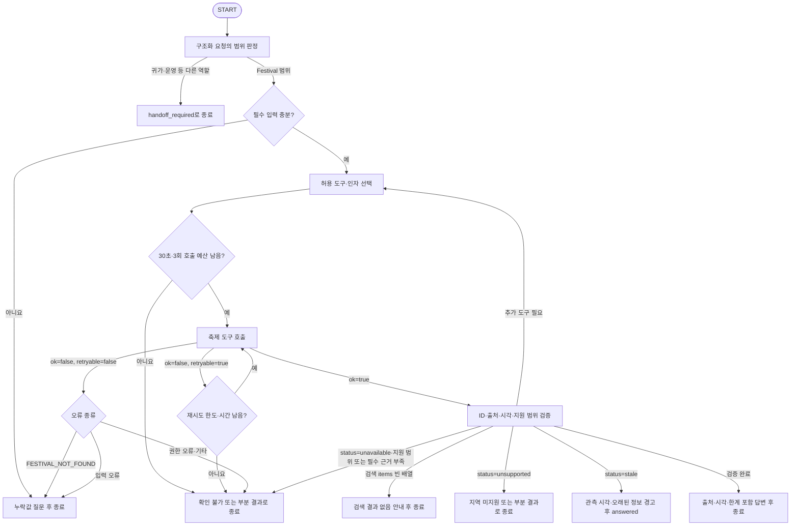

# 놀다가 단일 Festival Agent 상태 전이 그래프 설계서 — 초안

> 작성 기준: 2026-11-23. 11/27 M03 제출을 위한 **설계 초안**이다. 기준은 `Docs/Step 1/놀다가_기획서.md`, `Docs/Step 1/놀다가_WBS.md` W22~W25, `Docs/Step 2/API_설계문서.md` v0.3.3, `origin/ohyun` 브랜치의 `Docs/Step 2/handoff/에이전트_도구_인계.md`이다. 도구 계약은 최신 `origin/ohyun` 브랜치와 대조한다.

## 1. 목적과 범위

전체 서비스의 에이전트는 Supervisor·Festival·Route·Diagnosis·Recovery **5개**다. 이번 문서는 그중 Festival Agent **한 개의 내부 상태 전이**를 설계한다. 현재 단독 실행기와 시험 하네스는 구조화된 요청을 넘기고 결과를 받는다. 자연어 질문 분류·인증 맥락 연결과 Supervisor 인계는 후속 단계다. 멀티 에이전트 간 인계·장애 복구 전체 그래프는 W44~W47의 별도 설계 대상이다.

이번 필수 흐름은 **전국 축제 검색, 선택된 축제 상세, 서울에서 매핑이 검증된 축제 주변 지역 혼잡 조회**다. 공식 공지·시설은 도구 계약과 자료 공급원이 확인될 때 확장한다. 날씨는 서비스 필수 기능이지만 현재 13개 도구에 없으므로 이번 단일 그래프의 실행 대상으로 두지 않는다. 코스 추천·RAG는 W27·W37과 연결되는 후속 흐름이다. **관심 저장은 팀 합의에 따라 Supervisor가 처리하며, 단일 Festival Agent는 `save_favorite`를 호출하지 않는다.**

Festival Agent는 경로를 만들거나 귀가 조회·장애 진단·복구 조치를 실행하지 않는다. 그런 질문은 `handoff_required` 결과로 끝내고, 나중에 Supervisor가 담당 에이전트로 전달한다. 단독 시험에서는 '이 단독 범위에서 처리하지 않음'으로 표시한다.

## 2. 입력·출력·상태

| 구분 | 필드 | 의미와 규칙 |
|---|---|---|
| 입력 | `intent`, `region`, `date_from`, `date_to`, `q`, `status`, `page_size`, `select_first` | 현재 실행 코드는 해석된 구조화 요청을 받는다. 자연어 질문 해석과 상대 날짜 변환은 후속 연결 단계다. |
| 입력 | `festival_id` | 상세·혼잡 조회할 축제 ID. 인증 맥락은 현재 공개 조회 범위에서 사용하지 않는다. |
| 추적 | `transitions`, `used_tools` | 노드 방문 순서와 도구 호출 결과를 남긴다. HTTP `request_id`를 최종 결과에 전달하는 기능은 후속 작업이다. |
| 판단 | `intent`, `stage` | `search`, `detail`, `crowd`, `search_detail_crowd`를 처리한다. 범위 밖 의도는 인계한다. 복합 요청에서 첫 결과 선택은 `select_first=true`가 필요하다. |
| 도구 | `tool`, `args`, `response`, `attempts`, `tool_call_count`, `stage`, `selected_festival_id` | 복합 요청의 `stage`는 `search → detail → crowd`. 검색 결과의 첫 ID를 후속 호출에 전달한다. |
| 검증 | `evidence`, 도구 응답의 `coverage`·`status` | 축제 ID·출처·시각·지역 지원 여부를 확인한다. `unsupported`는 호출 실패와 구별한다. 별도 `validation_errors` 상태 필드는 아직 없다. |
| 출력 | `answer`, `outcome`, `handoff_target` | `outcome`은 `answered`, `partial`, `clarification_needed`, `unsupported`, `unavailable`, `handoff_required` 중 하나. 복합 요청 중간 실패·미지원은 앞서 확인한 정보를 보존해 `partial`로 끝낸다. |

상태에는 인증 토큰·외부 API 키·경로 본문을 넣지 않는다. 대화 기억의 보존 방식은 W26에서 정하고, 현재 설계는 필요한 최소 문맥만 다음 노드에 전달한다.

## 3. 단일 에이전트 상태 전이 그래프

현재 그래프에서 `FESTIVAL_NOT_FOUND`는 재선택 질문으로 끝난다. 검색 조건을 이용한 자동 검색 복귀는 구현되지 않았다. `추가 도구 필요 → P`는 `search_detail_crowd`의 검색→상세→혼잡 순차 호출에만 쓰며 도구 호출 상한을 적용한다. 복합 흐름에서 이미 확인한 정보가 있으면 후속 조회 실패·미지원·예산 초과 시 `partial`로 종료한다. 단독 혼잡 조회의 `stale`은 오래된 자료임을 밝힌 `answered`다.

## 4. 노드별 계약과 분기 기준

| 노드 | 하는 일 | 다음 단계 |
|---|---|---|
| 요청 판정 | 이미 분류된 `intent`가 Festival 범위인지 확인. 귀가·운영 요청이면 다른 역할로 인계 표시. 자연어 분류는 아직 구현하지 않음 | 필수 입력 검사 또는 `handoff_required` |
| 필수 입력 검사 | 상세·혼잡에는 확정된 `festival_id`가 필요. 복합 요청에는 `select_first=true`가 필요 | 도구 선택 또는 `clarification_needed` |
| 도구 선택 | 허용 목록 안에서 필요한 최소 도구와 인자 구성. 이번 필수 흐름의 세 도구는 모두 공개 조회다 | 도구 호출 |
| 도구 호출 | 내부 API 래퍼의 `{ok,data,error,request_id,is_mock}` 결과 수신. `retryable`만으로 재시도 가능 여부 판단 | 검증, 제한 재시도 또는 오류 분기 |
| 결과 검증 | 축제 ID 일치, 검색·상세 출처와 갱신 시각, 혼잡 관측 시각과 `coverage.supported`, `status`, 모의 여부 확인. 빈 검색 결과와 혼잡 `unsupported`·`stale`·`unavailable`을 구분. 지역 혼잡을 행사장 내부 인원이나 경로별 혼잡으로 표현하지 않음 | 추가 조회, 답변, 결과 없음, 미지원, 오래된 정보, 확인 불가 |
| 답변 | 확인된 사실과 한계 제시. 자료가 없으면 추측하지 않음 | 종료 |

## 5. 도구 사용 범위

| 도구 | 이번 그래프 | 호출 조건·주의 |
|---|---|---|
| `search_festivals` | 필수 | 입력은 모두 선택값이다. 구조화 요청의 지역·기간·검색어를 반영한다. 상대 날짜 해석은 후속 자연어 연결 단계다. `items:[]`는 정상 빈 결과다. |
| `get_festival` | 필수 | `festival_id`가 확정된 경우. 다른 축제의 정보를 섞지 않는다. |
| `get_crowd` | 필수 | 선택 축제 ID로 조회. 서울 매핑 미지원은 `unsupported`, 오래된 관측은 `stale`, 공급원 오류는 `unavailable`로 구분한다. |
| `get_official_notices` | 조건부 | 승인된 공지 공급원과 유효 시각을 확인한 경우에만 안내한다. |
| `get_facilities` | 조건부 | 시설 공급원·모의 응답의 구분이 가능할 때만 사용한다. 현재 인계 자료에는 모의 API가 없다. |
| `save_favorite` | 단일 Festival Agent 범위 밖 | 팀 합의에 따라 Supervisor가 처리한다. Festival Agent 도구 허용 목록에서 제외한다. |
| `get_weather` | 후속 후보 | 현재 13개 도구에 없다. 도구·API 계약과 BFCL 영향 검토 후 추가한다. |

이름·인자·허용값은 API 설계 v0.3.3의 JSON Schema 및 `origin/ohyun` 브랜치의 `handoff/tools/*.json`을 따른다. 이 문서에서 새로운 도구 인자를 임의 확정하지 않는다. 운영자 전용 `get_incident`·`get_route_metrics`·`list_allowed_actions`·`propose_recovery_action` 등은 Festival Agent에 제공하지 않는다.

### 5-1. 이번 주 필수 도구 3개의 확정 입력·결과

| 도구 | 입력 JSON Schema 요약 | 성공 결과에서 확인할 필드 | 오류·특수 상태 |
|---|---|---|---|
| `search_festivals` | 모두 선택: `region`(기본 `ALL`, 17개 시·도 코드), `date_from`·`date_to`(`YYYY-MM-DD`, 순서·최대 366일 검증), `q`(1~50자), `status`(`upcoming/ongoing/ended/cancelled`), `page_size`(1~20, 기본 10). **도구 스키마에는 `bbox`·`sort`·`page`가 없다.** | `data.items[]`의 `festival_id`, `name`, `region_code`, 날짜, `source`, `last_synced_at`; `total`·`page`·`page_size` | `items:[]`는 `ok:true`인 결과 없음. `VALIDATION_ERROR`는 되묻거나 입력 수정, `TOOL_TIMEOUT`·`RATE_LIMITED`는 제한 재시도. |
| `get_festival` | 필수 `festival_id:string` 하나. 검색 결과의 ID나 선택 문맥의 ID를 그대로 사용 | `data.festival_id`, `name`, 장소·주소·좌표, 날짜, `source`, `source_ref`, `last_synced_at`. 빈값 허용 필드는 그대로 표시 | `FESTIVAL_NOT_FOUND`는 재선택 요청. ID 형식 오류는 `VALIDATION_ERROR`, 일시적 호출 오류는 `TOOL_TIMEOUT`. |
| `get_crowd` | 필수 `festival_id:string` 하나. 지역 코드나 관측구역 코드를 인자로 보내지 않음 | `data.festival_id`, `status`, `coverage`, `areas[]`의 `area_name`, `relation_type`, `congest_level`, `observed_at`, 별도 `forecast[]` | `status:unsupported`는 정상 미지원. `status:stale`은 관측 시각을 밝히고 현재 상태로 단정하지 않음. `status:unavailable`은 정보 제공 불가. 본문 결과 코드 오류는 `SOURCE_RESULT_ERROR`. |

`search_festivals` 도구의 기본 `page_size`는 10이지만 공개 축제 목록 API의 기본값은 20이다. 연결 어댑터는 도구 호출에서 값이 생략되면 API 요청에 `page_size=10`을 명시한다.

도구 래퍼의 공통 출력은 `{ok, data, request_id, is_mock}` 또는 `{ok:false, error:{code,message,retryable}, request_id}`다. **`ok`는 도구 호출의 성공 여부이고, `data.status`는 데이터 이용 가능 상태**이므로 두 값을 순서대로 판정한다. `forecast[]`는 예측 정보로 따로 표시하고 현재 관측값처럼 표현하지 않는다.

### 5-2. 노드별 상태 변경

| 전이 | 읽는 상태 | 쓰는 상태 |
|---|---|---|
| `START → 요청 판정` | 구조화된 `FestivalRequest.intent` | 처리 범위 또는 `outcome=handoff_required` |
| `요청 판정 → 필수 입력 검사` | `intent`, `festival_id`, `select_first` | `outcome=clarification_needed` 또는 다음 단계 허용. 검색 도구는 인자가 모두 선택값이므로 지역·기간이 없다는 이유만으로 되묻지 않음 |
| `필수 입력 검사 → 도구 선택` | `intent`, 사용자 조건, 선택 ID | `tool`, `args`(허용 스키마에 있는 키만) |
| `도구 선택 → 도구 호출` | `tool`, `args`, `tool_call_count` | `response`, `attempts+1`, `tool_call_count+1`, `used_tools` |
| `도구 호출 → 재시도/오류 분기` | `response.ok`, `error.retryable`, 예산 | 재시도 여부 또는 `outcome=clarification_needed/unavailable` |
| `도구 호출 → 결과 검증` | `response.data`, `is_mock` | `evidence`, `answer`, `outcome`; 혼잡 `coverage`·`status`는 검증 중 읽고 필요할 때 근거에 포함 |
| `결과 검증 → 종료/다음 도구` | 결과 상태와 근거 | `answer`, `outcome`; 빈 검색은 `answered`, 미지원은 `unsupported`, 공급원 오류는 `unavailable`. 복합 요청은 첫 축제 ID를 선택해 `stage=detail`, 상세 뒤 `stage=crowd`로 이동 |

상태 필드는 현재 `FestivalGraphState`와 `FestivalRequest`를 기준으로 적었다. API의 `run_status`(`queued/running/succeeded/retrying/failed`)와 혼동하지 않는다.

## 6. 실패·시간 예산·종료 조건

| 상황 | 처리·종료 |
|---|---|
| 필수 축제 ID·복합 요청 선택 지시가 없음 | 확인 질문 후 `clarification_needed`. 도구 호출 없음. 상대 날짜의 기준일 확인은 자연어 연결 단계에서 처리한다. |
| 없는 축제 ID | 사용자에게 재선택 요청. 자동 검색 복귀는 후속 검토 사항. |
| 서울 밖 또는 미매핑 혼잡 | `unsupported`를 정상적인 결과 상태로 처리. 다른 지역 혼잡으로 채우지 않음. |
| 검색 결과 0건 | `ok:true`와 `items:[]`를 정상 처리하고 조건에 맞는 결과가 없다고 안내. 임의 축제 생성 금지. |
| 혼잡 `stale` | `observed_at`과 오래된 정보 경고를 함께 제시하고 현재 혼잡이라고 단정하지 않음. |
| 혼잡 `unavailable` | 공급원 오류·좌표 누락 등 이유를 확인 가능한 범위에서 안내하고 현재 혼잡값을 만들지 않음. |
| 일시적 도구 오류·시간 초과 | `retryable=true`일 때만 **최대 1회** 재시도. 전체 실행 시간·도구 호출 상한을 초과하면 `unavailable`. |
| 입력 오류·권한 오류 | 입력 오류는 되묻고, 권한 오류는 우회 호출 없이 종료. |
| 출처·시각·지원 범위 검증 실패 | 확인 불가를 명시하고 종료. 혼잡 `ok`·`stale`에는 `coverage.supported=true`가 필요하다. 모의 결과는 실제 현장 정보로 표시하지 않음. |
| Festival 범위 밖 질문 | `handoff_required`. 단독 실행에서 다른 에이전트를 직접 호출하지 않음. |

**현재 코드 예산:** 도구 호출 최대 3회(재시도 포함), 동일 호출 재시도 최대 1회, 전체 실행 시간 기본 30초. 노드에서 호출 전후 시간을 확인하고 초과 시 `unavailable` 또는 앞서 확인한 정보가 있으면 `partial`로 종료한다. 이는 **협력적 시간 제한**이며 진행 중인 동기 HTTP 호출을 30초 시점에 강제로 중단하지는 않는다. HTTP 래퍼의 호출별 기본 타임아웃은 5초다. 실제 한도는 W23/W24에서 다시 확정한다.

## 7. 설계 검토용 시나리오

| 사례 | 기대 경로 | 확인할 결과 |
|---|---|---|
| 날짜·지역이 있는 축제 검색 | 해석→`search_festivals`→검증→답변 | 검색된 축제만, 날짜·지역 일치, 출처 표시 |
| 선택된 축제 상세 | 해석→`get_festival`→검증→답변 | 선택 ID 일치, 장소·기간·출처 표시 |
| 서울 매핑 축제 주변 혼잡 | 해석→`get_crowd`→검증→답변 | 지역 혼잡·관측 시각 표시, 내부 인원으로 과장 금지 |
| 서울 외 축제 혼잡 | 해석→`get_crowd`→`unsupported` | 지원하지 않는 지역이라고 안내 |
| 혼잡 자료 오래됨 | 해석→`get_crowd`→`stale` | 관측 시각과 오래된 정보 경고, 현재 혼잡 단정 없음 |
| 검색 결과 없음 | 해석→`search_festivals`→`items:[]` | 정상 빈 결과 안내, 가상 축제 생성 없음 |
| 첫 축제를 명시한 복합 질문 | 검색→첫 `festival_id` 확인→상세→혼잡→답변 | 같은 ID로 후속 조회, 도구 총 3회 |
| 복합 질문에서 첫 결과 선택이 불명확 | 해석→확인 질문 | 임의 첫 축제 선택·도구 호출 없음 |
| 복합 질문 중 혼잡 미지원 | 검색→상세→혼잡 `unsupported` | 앞서 확인한 축제 정보와 미지원 안내, `partial` 기록 |
| “그 축제”만 말하고 선택 문맥 없음 | 해석→확인 질문 | 임의 축제 선택·도구 호출 없음 |
| 없는 축제 ID | `get_festival` 오류→재선택 질문 | 다른 축제를 사실처럼 대신 안내하지 않음 |
| 도구 시간 초과 | 호출→1회 제한 재시도→확인 불가 | 반복 무한 루프 없음. HTTP 요청 ID를 최종 결과에 보존하는 기능은 후속 작업 |
| 날씨 또는 귀가 요청 | 범위 판정→인계/미지원 안내 | 미정 도구 호출·날씨 추측·경로 생성 없음 |

위 표는 **상태 전이 시험 계획**이다. 실제 확인 결과는 아래에 기록한다. BFCL 문항 평가와 실제 DB 연동은 아직 하지 않았다.

### 7-1. 모의 API와 LangGraph 실행 확인 (2026-11-23)

오현님 브랜치 `origin/ohyun`의 `a663d0e` 모의 API를 별도 로컬 서버로 실행했다. 모의 API의 축제 검색·상세·혼잡 관련 시험은 **32개 통과**했다. 모의 서버 자료는 실제 축제·현장 상태가 아니다.

`backend/agents/festival_graph.py`의 LangGraph 노드는 `interpret → check_slots → select_tool → call_tool → validate`로 연결했고, 오류·1회 재시도 분기를 둔다. 지원 범위 검사를 추가한 뒤 단독 처리·LangGraph 분기 시험 **20개를 다시 실행해 모두 통과**했다. 서울 검색·상세·혼잡과 부산 미지원도 모의 API 연결 상태에서 예상대로 종료했다.

복합 요청 `search_detail_crowd`에 `select_first=true`를 주어 서울 축제를 검색하면 `search_festivals → get_festival → get_crowd` 순서로 호출됐다. 상세·혼잡에는 첫 검색 결과 `fst_000001`이 전달됐고, 결과는 `answered`였다. 첫 선택이 명시되지 않거나 검색 결과가 비어 있으면 후속 호출을 하지 않는다. 혼잡 미지원 시 앞서 확인한 축제 정보와 함께 `partial`로 종료한다.

### 7-2. 최신 오현님 브랜치 모의 API 재확인 (2026-11-23)

`origin/ohyun`의 `5838bfa`를 별도 작업 폴더에서 실행하고 현재 Festival Agent를 연결했다. 전체 축제 검색의 첫 결과 `fst_000004`는 상세 조회가 `answered`, 주변 혼잡이 `unsupported`였다. 같은 축제를 대상으로 한 복합 요청은 도구를 검색→상세→혼잡 순서로 3회 호출하고, 확인된 정보와 미지원 안내를 함께 담아 `partial`로 끝났다. 없는 축제 ID는 `clarification_needed`로 끝났다. 서울 검색의 첫 결과 `fst_000001`은 혼잡 조회가 `answered`였고, 지원 범위 검사도 통과했다. 이 검증은 모의 데이터에 대한 연결 시험이며 실제 DB·현장 혼잡 검증은 아니다.

**남은 한계:** 자연어 질문에서 `intent`·`select_first`·검색 조건을 추출하는 모델 연결, 실제 DB 연동, BFCL 채점은 아직 없다. 30초 예산은 호출 전후 검사이며 실행 중인 동기 HTTP 호출을 강제로 끊는 방식은 아니다. 이 시험을 W24 전체 완료나 11/27 제출 완료로 기록하지 않는다.

### 7-3. W24 실제 데이터 연결 준비 상태

최신 `origin/ohyun`의 축제 목록·상세 API는 `FESTIVAL_DATA=db`일 때 PostgreSQL을 조회하고, DB 응답에 `is_mock:false`를 넣는다. 혼잡 API는 아직 모의 응답을 반환한다. DB 연동 시험 `backend/tests/ingestion/test_i12_catalog_db.py`는 일회용 PostgreSQL의 `TEST_DB_URL`·`TEST_DB_APP_URL`이 있어야 실행되며, 현재 작업 환경에는 해당 접속 설정과 `DB_USER_PASSWORD`가 없다. 따라서 **실제 DB 축제 검색·상세 또는 서울 혼잡의 단독 E2E는 검증하지 않았다.**

W24 확인 순서는 다음과 같다.

1. W100에서 승인·게시된 실제 축제 데이터를 복수 지역으로 적재하고, 별도 시험 DB 접속 정보가 준비됐는지 확인한다. 접속 정보는 문서나 로그에 남기지 않는다.
2. DB 모드에서 `search_festivals`로 서울 및 다른 지역 축제를 조회하고 `is_mock:false`, 출처, 갱신 시각, 선택 ID를 대조한다.
3. 같은 ID로 `get_festival`을 호출해 목록과 상세의 축제 ID·출처가 일치하는지 확인한다.
4. W89의 검증된 서울 축제↔관측구역 매핑과 혼잡 API가 준비된 뒤 `get_crowd`를 연결한다. 실제 관측 시각·`coverage.supported`·미지원 상태를 확인하고 모의 응답과 구분한다.
5. 검색→상세→혼잡 단독 실행의 도구 순서, 종료 상태, `used_tools`·`evidence`를 남긴다. 어느 단계라도 모의 응답이면 실제 DB 전체 E2E 완료로 표시하지 않는다.

## 8. 제출 전 확인할 결정

1. 날씨 답변: Festival Agent의 최종 범위에 둘지, `get_weather` 도구를 언제 추가할지, BFCL 문항에 어떤 영향을 주는지 결정한다.
2. 공식 공지·시설 자료와 모의 API의 실제 준비 상태를 확인한다. 없는 자료를 시험 성공으로 꾸미지 않는다.
3. 재시도·호출·전체 시간 예산과 상태 저장 필드를 구현 담당자와 확정한다.
4. 도구 계약은 `origin/ohyun` 최신 브랜치를 기준으로 유지한다. 인계 문서의 Festival Agent 도구 목록에서 `save_favorite`가 제외된 상태도 확인했다.

## 참고 파일

- `Docs/Step 1/놀다가_기획서.md` — 서비스·5개 Agent·안전 경계
- `Docs/Step 1/놀다가_WBS.md` — W22~W25 및 M03(11/27)
- `Docs/Step 2/API_설계문서.md` — 도구 목록·공통 출력·실패 규칙
- `origin/ohyun:Docs/Step 2/handoff/에이전트_도구_인계.md` — Festival Agent 작업 제안 및 모의 API 현황
